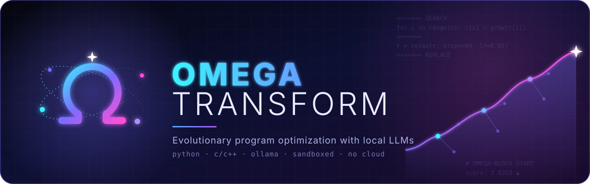

<!-- Copyright (c) 2026 by C. Klukas -->
<!-- SPDX-License-Identifier: GPL-3.0-only -->
# OMEGA TRANSFORM



LLM-driven evolutionary optimization of Python and C/C++ programs, running
entirely on your own machine: a local model served by Ollama proposes code
changes, and a pool of local compute jobs builds, tests, and scores them. It
is designed for private compute: by default there is no cloud and no API key,
and no code or data leaves the machine; cloud models through OpenRouter are an
explicit option (docs/cloud-models.md). The documentation in [docs/](docs/index.md) explains how
the engine works; it is published as the project's Pages site.

The engine is standard-library Python only (3.11+). The source is on GitHub:
<https://github.com/cklukas/OMEGA_TRANSFORM>.

## Quick start

```bash
git clone https://github.com/cklukas/OMEGA_TRANSFORM.git
```

```bash
cd OMEGA_TRANSFORM
```

```bash
python3 -m omega_transform check examples/circle_packing
```

```bash
python3 -m omega_transform run examples/circle_packing -n 100
```

```bash
python3 -m omega_transform status examples/circle_packing/runs/<timestamp>
```

`run` creates `runs/<timestamp>/` in the problem directory with:

- `omega.sqlite`: every attempt (code, diff, idea, status, score, metrics,
  feedback), the per-island MAP-Elites archive, and the lessons notebook
- `best_<file>`: the best program so far, updated live
- `llm/<id>.md`: the exact prompt and response of every iteration
- `notebook.md`: the current lessons-learned notebook

To resume a run, pass the same directory again: `run ... --run-dir runs/<timestamp>`.

Other commands, all taking the run directory:

| Command | Shows |
|---|---|
| `status` | counts by status, per-island bests, leaderboard |
| `journal [-n 40] [--island i]` | recent attempts, one line each |
| `lineage [id]` | the chain of ideas that led to a program (default: best) |
| `show [id] [--code]` | one program's details and its diff |
| `best [-o file]` | the best program's source |
| `notebook` | the lessons notebook |
| `stats` | success rate and gain per strategy, LLM time, best score over time |
| `openrouter-snapshot` | records OpenRouter's most used models with their prices for the docs |
| `replay [-n 6] [-m MODEL] [--think] [--evaluate]` | re-sends logged prompts with other LLM settings and reports which answers apply (and score); a quick way to compare models, thinking, or temperature |

Useful `run` overrides: `-m MODEL` (repeatable), `-j` (evaluation jobs),
`--llm-jobs`, `--minutes`, `--think/--no-think`.

## Safety

Every build, run and evaluator process is sandboxed (macOS `sandbox-exec`,
Linux bubblewrap): it can write only inside its own job directory and has no
network access. Each job's process tree is also killed if it exceeds
`evaluator.max_memory_mb`. Evaluators must therefore write any scratch files
to `$OMEGA_WORKDIR`, not to the problem directory.

Python candidates run in a process of their own with a stricter sandbox that
cannot read the problem directory, so a candidate cannot read the evaluator or
its hidden data; evaluators call the candidate through
`omega_transform.harness` (see docs/defining-problems.md).

## Defining a problem

A problem is a directory with `omega.toml`, an initial program, and an
evaluator.

**Initial program**: mark the regions that may evolve. Everything else is a
fixed harness that the LLM cannot touch:

```python
# OMEGA-BLOCK-START
def solve(...):
    ...
# OMEGA-BLOCK-END
```

In C/C++ use `// OMEGA-BLOCK-START` and `// OMEGA-BLOCK-END`.

**Evaluator**: any command that prints one JSON line as its last output.
Higher `score` is better:

```json
{"score": 1.23, "metrics": {"m": 1}, "features": {"f": 0.5}, "valid": true, "feedback": "text for the LLM"}
```

**omega.toml**, minimal form:

```toml
[problem]
name = "my_problem"
language = "cpp"            # python | cpp | c
initial = "kernel.cpp"
description = "What to optimize and the constraints."
metrics_help = "What the metrics mean."
hints = "Expert knowledge, known techniques."

[evaluator]
build = ["clang++", "-O3", "-march=native", "{candidate}", "-o", "{binary}"]
command = ["{python}", "evaluate.py", "{binary}", "{stage}"]
stages = [
  { name = "check", timeout = 30, min_score = 0.0 },   # cheap correctness gate
  { name = "bench", timeout = 120, exclusive = true },  # timing runs alone
]
concurrency = 4

[llm]
models = ["qwen3.5:latest"]   # or [{ name = "...", weight = 0.7, temperature = 0.6 }, ...]

[search]
iterations = 200
islands = 4
```

All settings with their defaults are in
[omega_transform/config.py](omega_transform/config.py). Two are especially
useful:

- `evaluator.launcher`, e.g. `["srun", "-n1"]`, sends every job through a batch system.
- `llm.provider = "openai"` with `base_url` uses llama.cpp server, vLLM, or LM Studio instead of Ollama.

## Parameter sweeps

The LLM does not have to be called for every numeric tweak. Any answer may end
with a `SWEEP:` section, such as `STEP = logrange(1e-4, 0.1)`,
`TILE = [16, 32, 64]` or `N = intrange(10, 500)`. The engine then evaluates up
to `search.sweep_budget` variants on the job pool and keeps the best one. The
LLM sees a one-line summary of the sweep in later prompts. See
[docs/sweeps.md](docs/sweeps.md).

## Examples

`examples/` holds 15 complete problems in four groups: mathematical
constructions (circle packing, Heilbronn triangles, points on a sphere),
algorithms and heuristics (TSP, bin packing, max-cut), C++ performance
kernels (matrix multiply, sorting, float parsing, prefix sum) and data
modelling (a lossless compressor, symbolic regression, feature engineering).
The [example gallery](docs/examples.md) describes each; `examples/toy` is used
by the tests.

## Tests

```bash
python3 -m unittest discover -s tests
```

## Project status

OMEGA TRANSFORM is a short research prototype. It was built and tested on
the examples in this repository; it has not yet been used on any real
project. Expect rough edges, changing configuration keys and command-line
options, and results that depend strongly on the model in use. Check every
program it produces yourself before relying on it.

## License

Copyright (c) 2026 by C. Klukas. The project uses three licenses, one for
each kind of code it contains. Every file names its license in an
`SPDX-License-Identifier` line.

| Part | License | Text |
|---|---|---|
| The framework: `omega_transform/`, tests, scripts, documentation | GPL-3.0-only | [`LICENSE`](LICENSE) |
| The evaluator interface: `omega_transform/harness.py`, `omega_transform/candidate_runner.py` | LGPL-3.0-only | [`LICENSES/LGPL-3.0-only.txt`](LICENSES/LGPL-3.0-only.txt), on top of [`LICENSE`](LICENSE) |
| The examples: `examples/` | MIT | [`examples/LICENSE`](examples/LICENSE) |

Why three, and what this means for using the project:

- **The framework is GPL.** The engine stays free software: anyone who
  distributes a modified version of it, or a product built on it, has to
  pass on the source of that version under the same terms. Using the engine
  on your own machine, privately or at work, carries no such duty.
- **The programs it optimizes stay yours.** The engine only runs your
  evaluator and edits the program you give it; the GPL does not reach that
  program or the optimized versions it produces. Their license is whatever
  it was before.
- **The interface is LGPL.** An evaluator imports `omega_transform.harness`
  to call the candidate program. The LGPL lets that evaluator, and the
  problem it belongs to, carry any license (including a closed one), while
  changes to the two interface files themselves remain free software.
- **The examples are MIT.** They are meant as starting points: copy one,
  adapt it to your own problem, and license the result as you like, keeping
  only the copyright notice.

This summary is meant as orientation; the license texts are what counts.
