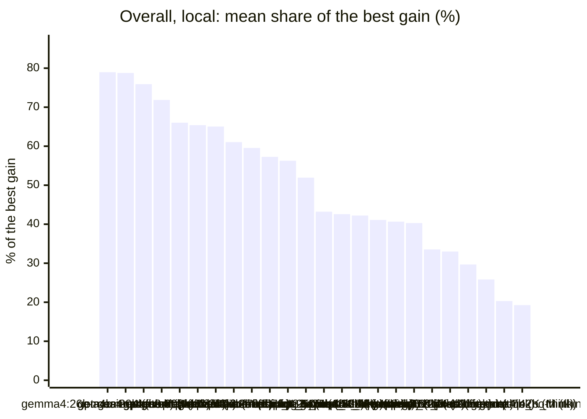
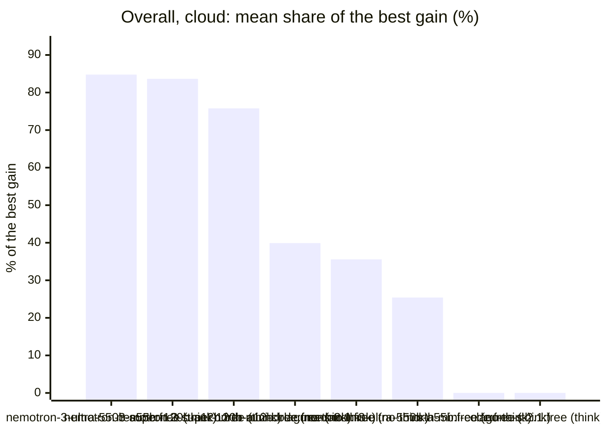

<!-- Copyright (c) 2026 by C. Klukas -->
<!-- SPDX-License-Identifier: GPL-3.0-only -->
<!-- Generated by `omega report` from bench/results/*.json. Do not edit by hand. -->

# Model benchmarks

Each row is one time-boxed OMEGA TRANSFORM search: the same example, the same
budget and the same settings, with only the Ollama model changed. The numbers
come from the committed result files in `bench/results/`; rerun
`omega bench` to add new ones (see [Benchmarking models](benchmarking.md)).

Read the results with care: one run per model is a single sample of a
stochastic search, and timing-based scores (the C++ example) depend on what
else the machine was doing.

## Pages

| Page | What it shows |
|---|---|
| [Models by developer](benchmarks/developers.md) | who develops each model, the ranking grouped by developer, and each developer's progress over time |
| [Models by country](benchmarks/countries.md) | the best model of each country |
| [Model check](benchmarks/model-check.md) | which installed models were usable before the benchmark |
| [bin_packing_1d](benchmarks/bin_packing_1d.md) | 24 models on this example: scores, speed, memory and progress over time |
| [circle_packing_26](benchmarks/circle_packing_26.md) | 32 models on this example: scores, speed, memory and progress over time |
| [circles_in_circle_21](benchmarks/circles_in_circle_21.md) | 24 models on this example: scores, speed, memory and progress over time |
| [feature_engineering](benchmarks/feature_engineering.md) | 24 models on this example: scores, speed, memory and progress over time |
| [float_parse_single_thread](benchmarks/float_parse_single_thread.md) | 24 models on this example: scores, speed, memory and progress over time |
| [heilbronn_13](benchmarks/heilbronn_13.md) | 24 models on this example: scores, speed, memory and progress over time |
| [log_compressor](benchmarks/log_compressor.md) | 24 models on this example: scores, speed, memory and progress over time |
| [matmul_f32](benchmarks/matmul_f32.md) | 24 models on this example: scores, speed, memory and progress over time |
| [matmul_f32_single_thread](benchmarks/matmul_f32_single_thread.md) | 32 models on this example: scores, speed, memory and progress over time |
| [max_cut](benchmarks/max_cut.md) | 24 models on this example: scores, speed, memory and progress over time |
| [prefix_sum_histogram_single_thread](benchmarks/prefix_sum_histogram_single_thread.md) | 24 models on this example: scores, speed, memory and progress over time |
| [sort_u32_single_thread](benchmarks/sort_u32_single_thread.md) | 24 models on this example: scores, speed, memory and progress over time |
| [symbolic_regression](benchmarks/symbolic_regression.md) | 24 models on this example: scores, speed, memory and progress over time |
| [tammes_30](benchmarks/tammes_30.md) | 24 models on this example: scores, speed, memory and progress over time |
| [tsp_heuristic](benchmarks/tsp_heuristic.md) | 24 models on this example: scores, speed, memory and progress over time |

Machine: Apple M1 Max (Mac13,1), 10 cores, 32 GB.

## Overall ranking

Scores of different examples cannot be added up (a matrix multiply gains ×80, a route heuristic ×1.1), so every example is weighted equally: per example, a model's **share** is its gain over the starting program as a fraction of the largest gain any model of its group reached there (100% = the best model, 0% = no gain). The ranking is the mean share over the examples; the geometric mean of the improvement factors, the examples won and the examples without any gain are shown alongside. Only models with results on at least three quarters of the examples are ranked; the others follow without a rank. The same ranking is grouped [by developer](benchmarks/developers.md) and [by country](benchmarks/countries.md) on pages of their own.

### Local models

| # | Model | Share of best gain | Geometric-mean gain | Wins | No gain | Examples |
|--:|---|--:|--:|--:|--:|--:|
| 1 | gemma4:26b-a4b-it-qat (no-think) | **79%** | ×3.45 | 0 | 0 | 15 |
| 2 | gpt-oss:20b (think) | **79%** | ×3.30 | 2 | 0 | 15 |
| 3 | gemma4:e4b-it-qat (think) | **76%** | ×3.29 | 2 | 0 | 15 |
| 4 | gemma4:latest (no-think) | **72%** | ×3.10 | 0 | 0 | 15 |
| 5 | gpt-oss:20b (no-think) | **66%** | ×3.06 | 2 | 1 | 15 |
| 6 | gemma4:e4b-it-qat (no-think) | **65%** | ×3.05 | 1 | 1 | 15 |
| 7 | gemma4:12b-it-qat (no-think) | **65%** | ×3.10 | 0 | 1 | 15 |
| 8 | gemma4:latest (think) | **61%** | ×2.85 | 2 | 1 | 15 |
| 9 | qwen3:30b-a3b-instruct-2507-q4_K_M (no-think) | **60%** | ×2.71 | 0 | 1 | 15 |
| 10 | qwen3.8:27b-mtp-q4_K_M (no-think) | **57%** | ×2.79 | 0 | 1 | 15 |
| 11 | qwen3:30b-a3b-instruct-2507-q4_K_M (think) | **56%** | ×2.48 | 2 | 2 | 15 |
| 12 | qwen3.6:27b-coding-mtp-q4_K_M (no-think) | **52%** | ×2.99 | 1 | 3 | 15 |
| 13 | qwen3.5:27b (no-think) | **43%** | ×2.41 | 1 | 5 | 15 |
| 14 | qwen3-coder:30b (no-think) | **43%** | ×1.81 | 0 | 2 | 15 |
| 15 | qwen3.5:latest (think) | **42%** | ×2.02 | 0 | 5 | 15 |
| 16 | gemma4:26b-a4b-it-qat (think) | **41%** | ×2.32 | 0 | 5 | 15 |
| 17 | qwen3.8:27b-mtp-q4_K_M (think) | **41%** | ×2.20 | 1 | 8 | 15 |
| 18 | qwen3.5:27b (think) | **40%** | ×2.13 | 0 | 5 | 15 |
| 19 | gemma4:e2b (no-think) | **34%** | ×1.55 | 0 | 2 | 15 |
| 20 | qwen3.5:latest (no-think) | **33%** | ×1.39 | 1 | 6 | 15 |
| 21 | gemma4:12b-it-qat (think) | **30%** | ×2.26 | 0 | 6 | 15 |
| 22 | qwen3.6:27b-coding-mtp-q4_K_M (think) | **26%** | ×1.68 | 0 | 9 | 15 |
| 23 | qwen2.5-coder:7b (no-think) | **20%** | ×1.63 | 0 | 6 | 15 |
| 24 | gemma4:e2b (think) | **19%** | ×1.21 | 0 | 8 | 15 |

### Cloud models (OpenRouter)

| # | Model | Share of best gain | Geometric-mean gain | Wins | No gain | Examples |
|--:|---|--:|--:|--:|--:|--:|
| 1 | nvidia/nemotron-3-ultra-550b-a55b:free (think) | **85%** | ×6.11 | 0 | 0 | 2 |
| 2 | nvidia/nemotron-3-super-120b-a12b:free (think) | **84%** | ×5.77 | 1 | 0 | 2 |
| 3 | nvidia/nemotron-3-super-120b-a12b:free (no-think) | **76%** | ×6.25 | 1 | 0 | 2 |
| 4 | cohere/north-mini-code:free (no-think) | **40%** | ×4.33 | 0 | 0 | 2 |
| 5 | poolside/laguna-s-2.1:free (no-think) | **36%** | ×4.30 | 0 | 0 | 2 |
| 6 | nvidia/nemotron-3-ultra-550b-a55b:free (no-think) | **25%** | ×3.90 | 0 | 1 | 2 |
| 7 | cohere/north-mini-code:free (think) | **0%** | ×1.00 | 0 | 2 | 2 |
| 8 | poolside/laguna-s-2.1:free (think) | **0%** | ×1.00 | 0 | 2 | 2 |

