<!-- Copyright (c) 2026 by C. Klukas -->
<!-- SPDX-License-Identifier: GPL-3.0-only -->
<!-- Generated by `omega report` from bench/results/*.json. Do not edit by hand. -->

# Model benchmarks

Each row is one time-boxed OMEGA TRANSFORM search: the same example, the same
budget and the same settings, with only the Ollama model changed. The numbers
come from the committed result files in `bench/results/`; rerun
`omega bench` to add new ones (see [Benchmarking models](benchmarking.md)).

Read the results with care: one run per model is a single sample of a
stochastic search, and timing-based scores (the C++ example) depend on what
else the machine was doing.

## Model check

Before benchmarking, `omega models` loads every installed model, greets it, asks for a three-line edit in the engine's SEARCH/REPLACE format, and tries its reasoning mode. Only models marked ok are benchmarked. Checked 2026-10-13.

| Model | Params | Size GB | Verdict | Load s | Gen tok/s | RAM GB | Hello | Edit | Think | Note |
|---|---|--:|---|--:|--:|--:|---|---|---|---|
| qwen2.5-coder:7b | 7.6B | 4.7 | ok | 72 | 24.8 | 6.4 | yes | yes | - |  |
| gemma4:e4b-it-qat | 7.5B | 6.1 | ok | 164 | 26.9 | 5.5 | yes | yes | yes |  |
| qwen3.5:latest | 9.7B | 6.6 | ok | 114 | 24.0 | 6.7 | yes | yes | yes |  |
| gemma4:12b-it-qat | 11.9B | 7.2 | ok | 159 | 25.1 | 7.7 | yes | yes | yes |  |
| gemma4:e2b | 5.1B | 7.2 | ok | 84 | 27.8 | 6.6 | yes | yes | yes |  |
| gemma4:latest |  | 9.5 | ok | 155 | 38.0 | 9.4 | yes | yes | yes |  |
| gpt-oss:20b | 20.9B | 13.8 | ok | 159 | 23.2 | 12.8 | yes | yes | yes |  |
| gemma4:26b-a4b-it-qat | 25.2B | 15.6 | ok | 430 | 24.9 | 15.2 | yes | yes | yes |  |
| qwen3.5:27b | 27.8B | 17.4 | ok | 401 | 10.1 | 18.4 | yes | yes | yes |  |
| qwen3.8:27b-mtp-q4_K_M | 27.3B | 17.7 | ok | 406 | 13.4 | 17.6 | yes | yes | yes |  |
| qwen3.6:27b-coding-mtp-q4_K_M | 27.3B | 17.8 | failed to load | - | - | - | no | no | - | qwen3.6:27b-coding-mtp-q4_K_M: request failed after retries: HTTP Error 500: Int |
| qwen3:30b-a3b-instruct-2507-q4_K_M | 30.5B | 18.6 | ok | 189 | 22.9 | 21.8 | yes | yes | yes |  |
| qwen3-coder:30b | 30.5B | 18.6 | ok | 178 | 23.5 | 21.8 | yes | yes | - |  |

Machine: Apple M1 Max (Mac13,1), 10 cores, 32 GB.

## circle_packing_26

22 models, 15 minutes each, latest run per model.

### Local models

Ollama on this machine.

| Model | Params | Initial | Best | Gain | LLM calls | s/call | Valid | New bests | Min to best |
|---|---|--:|--:|--:|--:|--:|--:|--:|--:|
| qwen3.8:27b-mtp-q4_K_M (no-think) | 27.3B | 1.4901 | **2.30696** | ×1.55 | 2 | 483 | 50% | 2 | 14.2 |
| gemma4:26b-a4b-it-qat (no-think) | 25.2B | 1.4901 | **2.16738** | ×1.45 | 8 | 123 | 88% | 3 | 13.2 |
| gpt-oss:20b (no-think) | 20.9B | 1.4901 | **2.16667** | ×1.45 | 7 | 139 | 71% | 1 | 8.2 |
| gemma4:e4b-it-qat (no-think) | 7.5B | 1.4901 | **2.16667** | ×1.45 | 22 | 41 | 55% | 2 | 13.9 |
| gemma4:latest (no-think) |  | 1.4901 | **1.94013** | ×1.30 | 45 | 20 | 62% | 2 | 11.4 |
| gemma4:12b-it-qat (no-think) | 11.9B | 1.4901 | **1.91763** | ×1.29 | 16 | 58 | 56% | 2 | 7.0 |
| qwen3:30b-a3b-instruct-2507-q4_K_M (no-think) | 30.5B | 1.4901 | **1.62283** | ×1.09 | 22 | 40 | 59% | 2 | 11.5 |
| qwen3-coder:30b (no-think) | 30.5B | 1.4901 | **1.61875** | ×1.09 | 15 | 62 | 87% | 2 | 6.6 |
| gemma4:e2b (no-think) | 5.1B | 1.4901 | **1.60406** | ×1.08 | 40 | 22 | 30% | 1 | 6.9 |
| qwen2.5-coder:7b (no-think) | 7.6B | 1.4901 | **1.60406** | ×1.08 | 35 | 26 | 26% | 1 | 7.7 |
| qwen3.5:latest (no-think) | 9.7B | 1.4901 | **1.4901** | ×1.00 | 15 | 61 | 7% | 0 | - |
| qwen3.5:latest (think) | 9.7B | 1.4901 | **1.4901** | ×1.00 | 17 | 54 | 47% | 0 | - |
| gemma4:e2b (think) | 5.1B | 1.4901 | **1.4901** | ×1.00 | 17 | 55 | 12% | 0 | - |
| qwen3.5:27b (no-think) | 27.8B | 1.4901 | **1.4901** | ×1.00 | 4 | 243 | 50% | 0 | - |

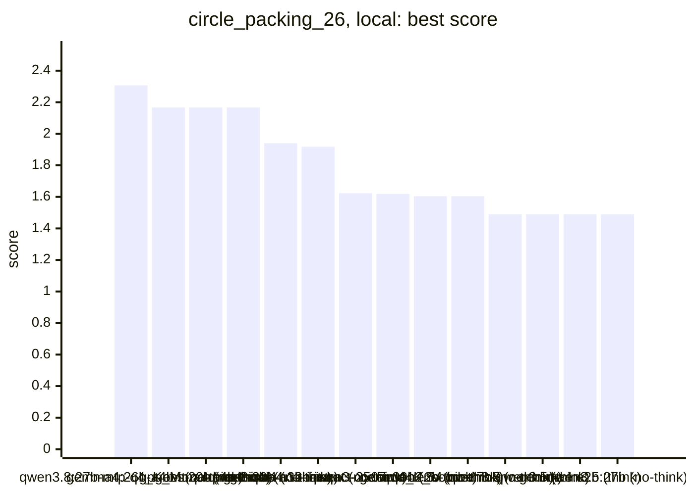

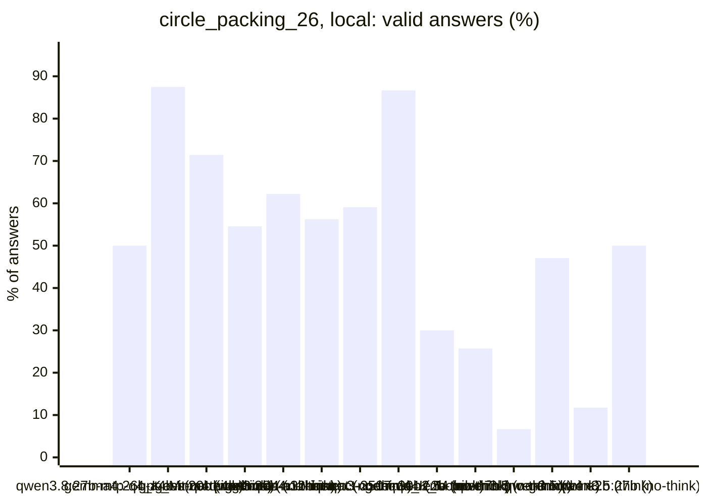

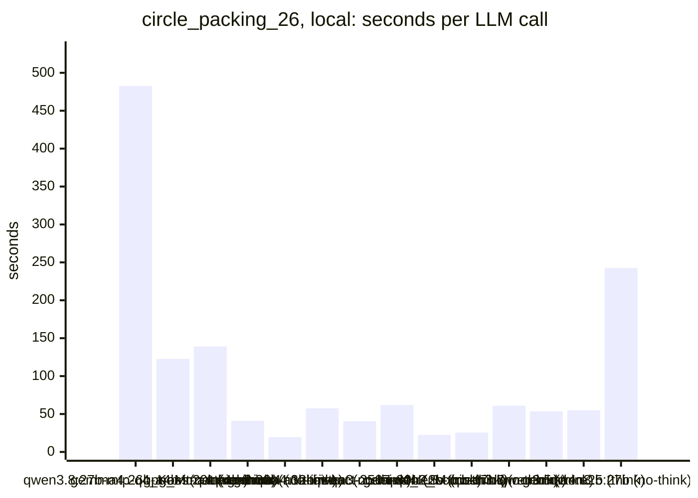

#### Inference speed and memory

RAM is what Ollama reports for the loaded model (weights, context cache and buffers; on Apple silicon this is shared memory). Load is the time to bring the model into memory. Prompt and generation speeds are tokens per second over all calls of the run.

| Model | Params | RAM GB | Load s | Prompt tok/s | Gen tok/s | Median s/call | p90 s/call | Tokens/answer | Stopped |
|---|---|--:|--:|--:|--:|--:|--:|--:|--:|
| gemma4:e4b-it-qat (no-think) | 7.5B | 5.5 | 177 | 578 | 25.7 | 36 | 63 | 728 | 0 |
| gemma4:e2b (no-think) | 5.1B | 6.6 | 41 | 938 | 25.7 | 16 | 33 | 453 | 0 |
| qwen2.5-coder:7b (no-think) | 7.6B | 6.6 | 123 | 484 | 23.8 | 22 | 32 | 408 | 0 |
| qwen3.5:latest (no-think) | 9.7B | 6.6 | 0 | 362 | 22.7 | 56 | 130 | 925 | 2 |
| gemma4:e2b (think) | 5.1B | 6.6 | 79 | 1262 | 62.0 | 53 | 93 | 2737 | 3 |
| qwen3.5:latest (think) | 9.7B | 6.8 | 83 | 387 | 32.5 | 49 | 77 | 1394 | 0 |
| gemma4:12b-it-qat (no-think) | 11.9B | 7.7 | 145 | 210 | 21.8 | 46 | 82 | 683 | 0 |
| gpt-oss:20b (no-think) | 20.9B | 12.8 | 150 | 468 | 25.5 | 106 | 444 | 2840 | 0 |
| gemma4:latest (no-think) |  | 14.4 | 146 | 838 | 49.6 | 15 | 29 | 571 | 1 |
| gemma4:26b-a4b-it-qat (no-think) | 25.2B | 15.2 | 379 | 194 | 23.8 | 83 | 437 | 1108 | 0 |
| qwen3.8:27b-mtp-q4_K_M (no-think) | 27.3B | 17.6 | 384 | 32 | 12.7 | 822 | 822 | 1136 | 0 |
| qwen3.5:27b (no-think) | 27.8B | 18.4 | 226 | 84 | 10.0 | 196 | 567 | 1551 | 0 |
| qwen3:30b-a3b-instruct-2507-q4_K_M (no-think) | 30.5B | 21.8 | 192 | 575 | 19.0 | 30 | 70 | 437 | 0 |
| qwen3-coder:30b (no-think) | 30.5B | 21.8 | 144 | 560 | 18.2 | 52 | 73 | 833 | 0 |

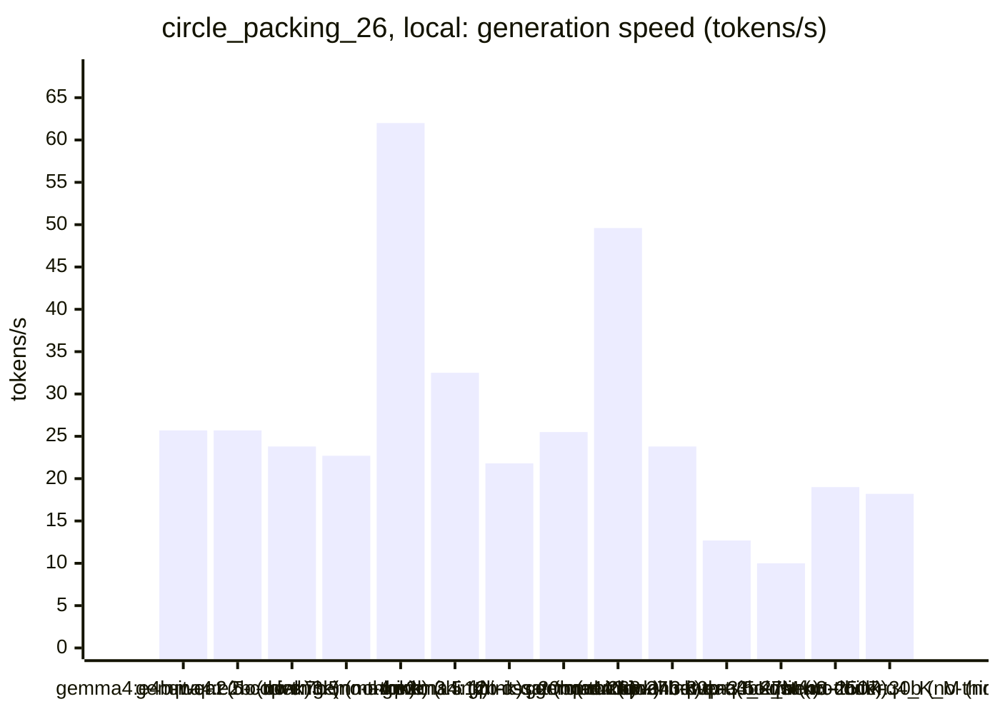

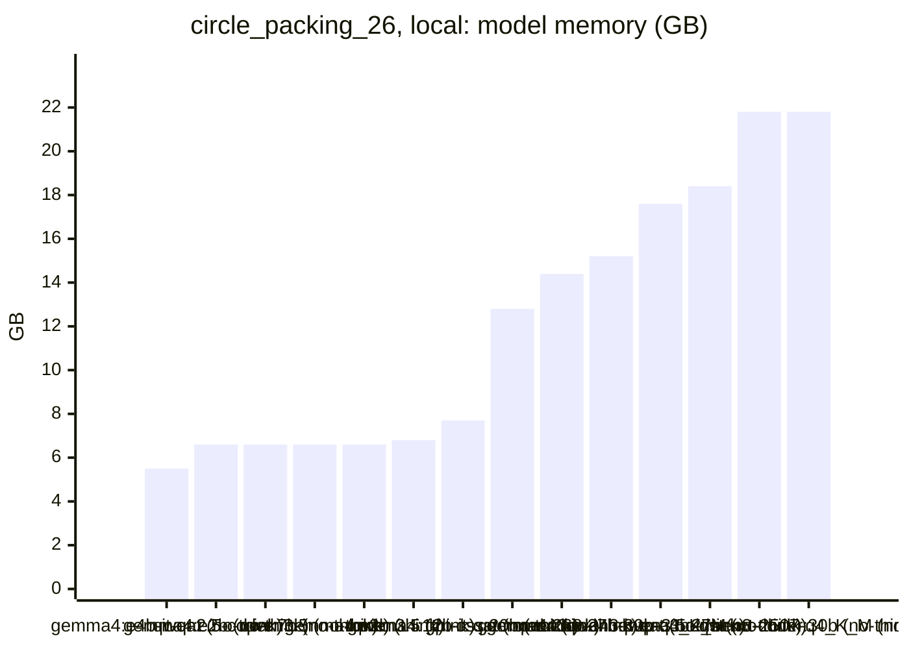

#### Best score over time

| Model | 3.75 min | 7.5 min | 11.25 min | 15 min |
|---|--:|--:|--:|--:|
| qwen3.8:27b-mtp-q4_K_M (no-think) | 1.4901 | 1.4901 | 1.4901 | 2.30696 |
| gemma4:26b-a4b-it-qat (no-think) | 1.4901 | 1.4901 | 1.4901 | 2.16738 |
| gpt-oss:20b (no-think) | 1.4901 | 1.4901 | 2.16667 | 2.16667 |
| gemma4:e4b-it-qat (no-think) | 1.4901 | 1.86519 | 1.86519 | 2.16667 |
| gemma4:latest (no-think) | 1.4901 | 1.4901 | 1.4913 | 1.94013 |
| gemma4:12b-it-qat (no-think) | 1.4901 | 1.91763 | 1.91763 | 1.91763 |
| qwen3:30b-a3b-instruct-2507-q4_K_M (no-think) | 1.4901 | 1.49537 | 1.49537 | 1.62283 |
| qwen3-coder:30b (no-think) | 1.4901 | 1.61875 | 1.61875 | 1.61875 |
| gemma4:e2b (no-think) | 1.4901 | 1.60406 | 1.60406 | 1.60406 |
| qwen2.5-coder:7b (no-think) | 1.4901 | 1.4901 | 1.60406 | 1.60406 |
| qwen3.5:latest (no-think) | 1.4901 | 1.4901 | 1.4901 | 1.4901 |
| qwen3.5:latest (think) | 1.4901 | 1.4901 | 1.4901 | 1.4901 |
| gemma4:e2b (think) | 1.4901 | 1.4901 | 1.4901 | 1.4901 |
| qwen3.5:27b (no-think) | 1.4901 | 1.4901 | 1.4901 | 1.4901 |

#### Outcome of the LLM answers

| Model | duplicate | edit error | invalid | llm error | ok |
|---|--:|--:|--:|--:|--:|
| qwen3.8:27b-mtp-q4_K_M (no-think) | 0 | 0 | 1 | 0 | 1 |
| gemma4:26b-a4b-it-qat (no-think) | 0 | 0 | 1 | 0 | 7 |
| gpt-oss:20b (no-think) | 0 | 2 | 0 | 0 | 5 |
| gemma4:e4b-it-qat (no-think) | 0 | 0 | 10 | 0 | 12 |
| gemma4:latest (no-think) | 0 | 4 | 12 | 1 | 28 |
| gemma4:12b-it-qat (no-think) | 0 | 5 | 2 | 0 | 9 |
| qwen3:30b-a3b-instruct-2507-q4_K_M (no-think) | 0 | 2 | 7 | 0 | 13 |
| qwen3-coder:30b (no-think) | 0 | 0 | 2 | 0 | 13 |
| gemma4:e2b (no-think) | 3 | 8 | 17 | 0 | 12 |
| qwen2.5-coder:7b (no-think) | 5 | 2 | 19 | 0 | 9 |
| qwen3.5:latest (no-think) | 0 | 2 | 10 | 2 | 1 |
| qwen3.5:latest (think) | 0 | 1 | 8 | 0 | 8 |
| gemma4:e2b (think) | 0 | 4 | 8 | 3 | 2 |
| qwen3.5:27b (no-think) | 0 | 0 | 2 | 0 | 2 |

#### Best idea per model

- **qwen3.8:27b-mtp-q4_K_M (no-think)**: tuned MAX_ITERS=16000, BASE_STEP=0.02 on top of: Replace the grid layout with a dense 26-circle candidate (one central, a 5-inner and 10-outer ring, 10 corners), then jointly …
- **gemma4:26b-a4b-it-qat (no-think)**: tuned temp=0.5, cooling=0.95, iterations=2000 on top of: Implement a basic Simulated Annealing optimization on circle centers to maximize the sum of radii, starting from a dense …
- **gpt-oss:20b (no-think)**: Refine radius shrinkage by iteratively reducing only the larger radius in overlapping pairs, which preserves more total radius and improves packing efficiency.
- **gemma4:e4b-it-qat (no-think)**: Introduce a more aggressive initial radii scaling and switch the iterative overlap constraint application from a simple sequential update to a relaxation method that re-evaluates …
- **gemma4:latest (no-think)**: Restrict the number of generated circles to exactly 26 by trimming the generated list based on a density metric derived from the current radii.
- **gemma4:12b-it-qat (no-think)**: Use a greedy "largest-circle-first" placement strategy with a randomized heuristic to find a dense packing, which typically yields a much higher sum of radii than a fixed grid.
- **qwen3:30b-a3b-instruct-2507-q4_K_M (no-think)**: tuned cols=5, rows=6, offset=0.02819 on top of: Replace the square grid layout with a hexagonal packing pattern using optimized spacing and offset to reduce wasted space and allow …
- **qwen3-coder:30b (no-think)**: Replace the uniform grid layout with a hexagonal packing pattern that better utilizes space and allows for larger total radius sum, similar to the high-performing programs.
- **gemma4:e2b (no-think)**: tuned cols=5, rows=6 on top of: Switch the initial center placement to a hexagonal lattice, which is known to be a denser and more space-filling packing strategy, likely leading …
- **qwen2.5-coder:7b (no-think)**: Expose the number of columns in the initial layout as a named constant and let the engine find the optimal value.
- **qwen3.5:latest (no-think)**: initial program
- **qwen3.5:latest (think)**: initial program
- **gemma4:e2b (think)**: initial program
- **qwen3.5:27b (no-think)**: initial program

### Cloud models (OpenRouter)

Free OpenRouter models; times include the network and the provider's queue.

| Model | Params | Initial | Best | Gain | LLM calls | s/call | Valid | New bests | Min to best |
|---|---|--:|--:|--:|--:|--:|--:|--:|--:|
| nvidia/nemotron-3-super-120b-a12b:free (think) |  | 1.4901 | **2.5045** | ×1.68 | 23 | 39 | 83% | 4 | 10.7 |
| nvidia/nemotron-3-ultra-550b-a55b:free (think) |  | 1.4901 | **2.40507** | ×1.61 | 10 | 112 | 30% | 2 | 13.0 |
| nvidia/nemotron-3-super-120b-a12b:free (no-think) |  | 1.4901 | **2.01309** | ×1.35 | 108 | 8 | 58% | 13 | 15.0 |
| cohere/north-mini-code:free (no-think) |  | 1.4901 | **1.75953** | ×1.18 | 81 | 10 | 58% | 7 | 14.6 |
| poolside/laguna-s-2.1:free (no-think) |  | 1.4901 | **1.63899** | ×1.10 | 21 | 45 | 14% | 1 | 12.3 |
| nvidia/nemotron-3-ultra-550b-a55b:free (no-think) |  | | | | | | | | failed: all 3 model requests failed: nvidia/nemotron-3-ultra-550b-a5 |
| cohere/north-mini-code:free (think) |  | 1.4901 | **1.4901** | ×1.00 | 11 | 84 | 0% | 0 | - |
| poolside/laguna-s-2.1:free (think) |  | 1.4901 | **1.4901** | ×1.00 | 6 | 158 | 0% | 0 | - |

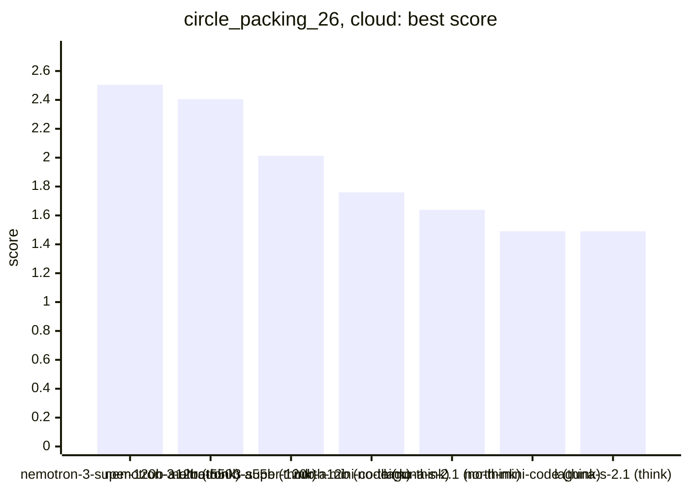

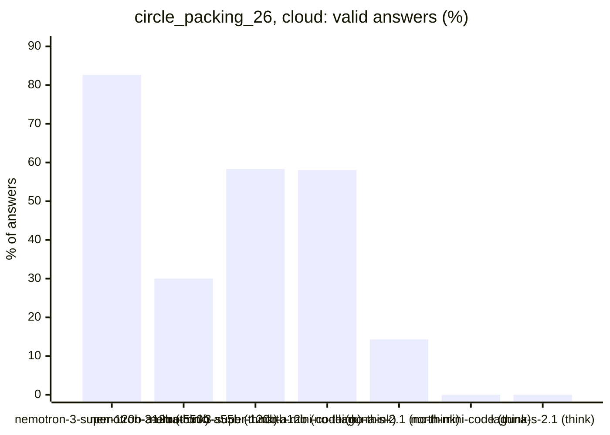

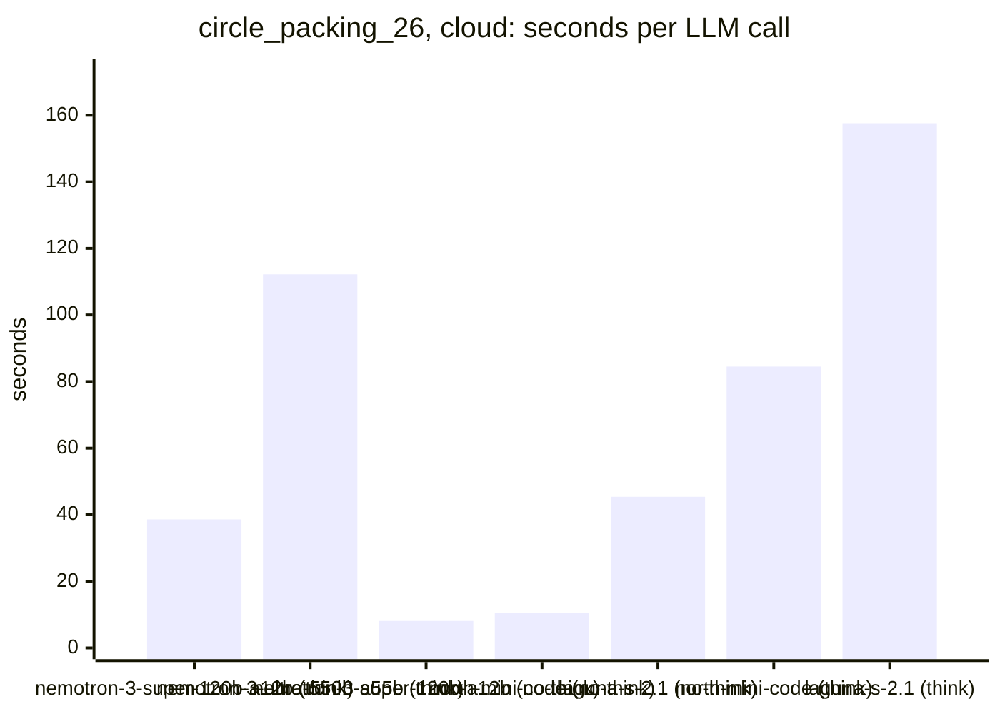

#### Inference speed and cost

Generation speed is measured from the first to the last streamed token; the time to the first token is counted as prompt time. Cost is what OpenRouter charged for the run.

| Model | Gen tok/s | Median s/call | p90 s/call | Tokens/answer | Stopped | Cost $ |
|---|--:|--:|--:|--:|--:|--:|
| nvidia/nemotron-3-super-120b-a12b:free (no-think) | 132.7 | 7 | 15 | 895 | 6 | 0.000 |
| cohere/north-mini-code:free (no-think) | 115.8 | 8 | 21 | 1154 | 2 | 0.000 |
| nvidia/nemotron-3-super-120b-a12b:free (think) | 115.7 | 36 | 57 | 4438 | 1 | 0.000 |
| cohere/north-mini-code:free (think) | 109.0 | 79 | 110 | 7542 | 10 | 0.000 |
| nvidia/nemotron-3-ultra-550b-a55b:free (think) | 54.5 | 71 | 300 | 4908 | 1 | 0.000 |
| poolside/laguna-s-2.1:free (no-think) | 53.1 | 33 | 59 | 1125 | 3 | 0.000 |
| poolside/laguna-s-2.1:free (think) | 50.8 | 187 | 263 | 2915 | 3 | 0.000 |

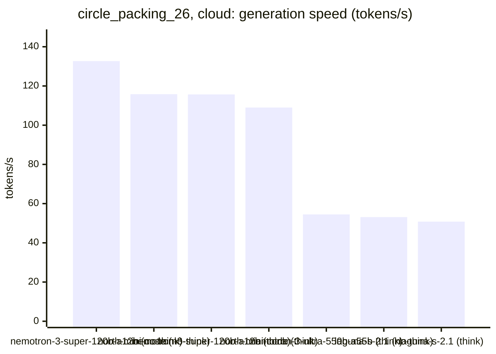

#### Best score over time

| Model | 3.75 min | 7.5 min | 11.25 min | 15 min |
|---|--:|--:|--:|--:|
| nvidia/nemotron-3-super-120b-a12b:free (think) | 2.46819 | 2.46819 | 2.5045 | 2.5045 |
| nvidia/nemotron-3-ultra-550b-a55b:free (think) | 1.4901 | 1.4901 | 1.4901 | 2.40507 |
| nvidia/nemotron-3-super-120b-a12b:free (no-think) | 1.67937 | 1.69674 | 1.94393 | 2.01309 |
| cohere/north-mini-code:free (no-think) | 1.60406 | 1.60406 | 1.60406 | 1.75953 |
| poolside/laguna-s-2.1:free (no-think) | 1.4901 | 1.4901 | 1.4901 | 1.63899 |
| cohere/north-mini-code:free (think) | 1.4901 | 1.4901 | 1.4901 | 1.4901 |
| poolside/laguna-s-2.1:free (think) | 1.4901 | 1.4901 | 1.4901 | 1.4901 |

#### Outcome of the LLM answers

| Model | duplicate | edit error | invalid | llm error | ok |
|---|--:|--:|--:|--:|--:|
| nvidia/nemotron-3-super-120b-a12b:free (think) | 0 | 1 | 2 | 1 | 19 |
| nvidia/nemotron-3-ultra-550b-a55b:free (think) | 0 | 1 | 5 | 1 | 3 |
| nvidia/nemotron-3-super-120b-a12b:free (no-think) | 16 | 5 | 18 | 6 | 63 |
| cohere/north-mini-code:free (no-think) | 11 | 5 | 16 | 2 | 47 |
| poolside/laguna-s-2.1:free (no-think) | 0 | 5 | 6 | 7 | 3 |
| cohere/north-mini-code:free (think) | 0 | 0 | 1 | 10 | 0 |
| poolside/laguna-s-2.1:free (think) | 0 | 1 | 1 | 4 | 0 |

#### Best idea per model

- **nvidia/nemotron-3-super-120b-a12b:free (think)**: tuned INITIAL_STEP=0.07883, STEP_DECAY=0.9843, MIN_STEP=0.0001, INITIAL_OFFSET=0.09298 on top of: Expose the initial offset of the grid points as a tunable constant to allow the …
- **nvidia/nemotron-3-ultra-550b-a55b:free (think)**: tuned OPT_STEPS=4245, PERTURB=0.04072, HEX_OFFSET=0.666 on top of: Replace the simple grid initialization with a hexagonal grid and an exact maximal-radius solver, then add a …
- **nvidia/nemotron-3-super-120b-a12b:free (no-think)**: tuned cols=6, rows=5, scale_x=0.98, scale_y=1.02 on top of: Increase the number of local optimization steps from 0 to 200 to iteratively improve circle positions and sum of radii …
- **cohere/north-mini-code:free (no-think)**: tuned JITTER_MAG=0.012, R0_SCALE_FACTOR=1.05 on top of: Replace the third gradient‑based local optimization with a fast vectorized radius‑only shrink loop to reduce runtime and …
- **poolside/laguna-s-2.1:free (no-think)**: tuned HEX_RADIUS=0.1 on top of: Replace the naive grid layout with a fixed-radius hexagonal lattice packing optimized for 26 circles, which yields a much larger sum of radii by …
- **cohere/north-mini-code:free (think)**: initial program
- **poolside/laguna-s-2.1:free (think)**: initial program

## matmul_f32

4 models, 15 minutes each, latest run per model.

### Local models

Ollama on this machine.

| Model | Params | Initial | Best | Gain | LLM calls | s/call | Valid | New bests | Min to best |
|---|---|--:|--:|--:|--:|--:|--:|--:|--:|
| gemma4:e2b (no-think) | 5.1B | 1.4879 | **1.65962** | ×1.12 | 66 | 12 | 17% | 1 | 3.2 |
| qwen3.5:latest (think) | 9.7B | 1.62938 | **1.62938** | ×1.00 | 8 | 113 | 12% | 0 | - |
| gemma4:e2b (think) | 5.1B | 1.55072 | **1.55072** | ×1.00 | 15 | 62 | 0% | 0 | - |
| qwen3.5:latest (no-think) | 9.7B | 1.50421 | **1.50421** | ×1.00 | 11 | 82 | 0% | 0 | - |

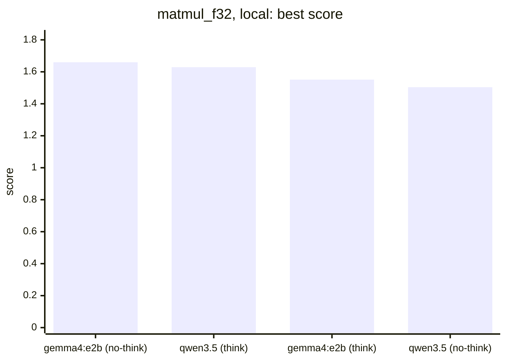

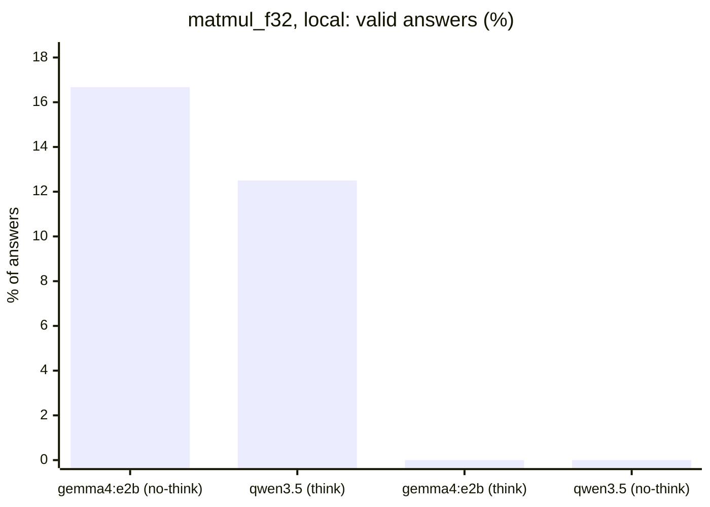

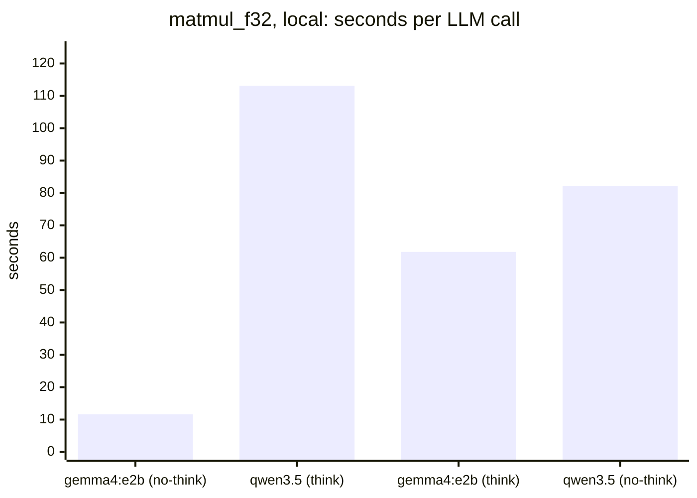

#### Inference speed and memory

RAM is what Ollama reports for the loaded model (weights, context cache and buffers; on Apple silicon this is shared memory). Load is the time to bring the model into memory. Prompt and generation speeds are tokens per second over all calls of the run.

| Model | Params | RAM GB | Load s | Prompt tok/s | Gen tok/s | Median s/call | p90 s/call | Tokens/answer | Stopped |
|---|---|--:|--:|--:|--:|--:|--:|--:|--:|
| gemma4:e2b (no-think) | 5.1B | 6.6 | 42 | 958 | 58.1 | 11 | 16 | 426 | 0 |
| gemma4:e2b (think) | 5.1B | 6.6 | 54 | 1004 | 54.3 | 60 | 82 | 2967 | 1 |
| qwen3.5:latest (no-think) | 9.7B | 6.7 | 0 | 374 | 30.6 | 72 | 140 | 1624 | 3 |
| qwen3.5:latest (think) | 9.7B | 6.8 | 59 | 373 | 33.4 | 113 | 369 | 3308 | 1 |

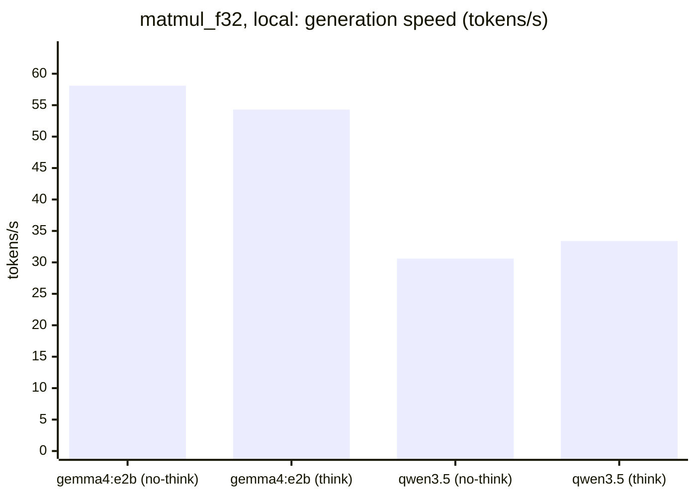

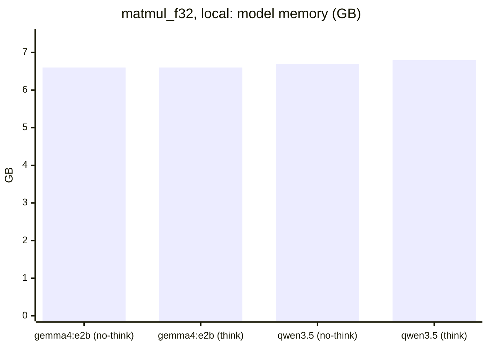

#### Best score over time

| Model | 3.75 min | 7.5 min | 11.25 min | 15 min |
|---|--:|--:|--:|--:|
| gemma4:e2b (no-think) | 1.65962 | 1.65962 | 1.65962 | 1.65962 |
| qwen3.5:latest (think) | 1.62938 | 1.62938 | 1.62938 | 1.62938 |
| gemma4:e2b (think) | 1.55072 | 1.55072 | 1.55072 | 1.55072 |
| qwen3.5:latest (no-think) | 1.50421 | 1.50421 | 1.50421 | 1.50421 |

#### Outcome of the LLM answers

| Model | compile error | duplicate | edit error | invalid | llm error | ok |
|---|--:|--:|--:|--:|--:|--:|
| gemma4:e2b (no-think) | 20 | 16 | 11 | 8 | 0 | 11 |
| qwen3.5:latest (think) | 1 | 0 | 2 | 3 | 1 | 1 |
| gemma4:e2b (think) | 10 | 0 | 3 | 1 | 1 | 0 |
| qwen3.5:latest (no-think) | 3 | 0 | 2 | 3 | 3 | 0 |

#### Best idea per model

- **gemma4:e2b (no-think)**: Implement loop tiling with a block size optimized for cache utilization and NEON vectorization to improve data locality and leverage SIMD instructions.
- **qwen3.5:latest (think)**: initial program
- **gemma4:e2b (think)**: initial program
- **qwen3.5:latest (no-think)**: initial program

## matmul_f32_single_thread

21 models, 15 minutes each, latest run per model.

### Local models

Ollama on this machine.

| Model | Params | Initial | Best | Gain | LLM calls | s/call | Valid | New bests | Min to best |
|---|---|--:|--:|--:|--:|--:|--:|--:|--:|
| qwen3.5:27b (no-think) | 27.8B | 1.60018 | **27.9923** | ×17.49 | 5 | 204 | 60% | 3 | 17.8 |
| qwen3.5:latest (think) | 9.7B | 1.72654 | **25.5246** | ×14.78 | 12 | 91 | 25% | 2 | 18.2 |
| qwen3:30b-a3b-instruct-2507-q4_K_M (no-think) | 30.5B | 1.5722 | **23.6521** | ×15.04 | 26 | 33 | 15% | 1 | 5.6 |
| gemma4:latest (no-think) |  | 1.3718 | **22.9778** | ×16.75 | 55 | 16 | 27% | 1 | 4.9 |
| gemma4:26b-a4b-it-qat (no-think) | 25.2B | 1.37405 | **21.4446** | ×15.61 | 14 | 67 | 86% | 3 | 7.3 |
| gemma4:12b-it-qat (no-think) | 11.9B | 1.36162 | **19.3530** | ×14.21 | 13 | 75 | 46% | 2 | 10.5 |
| gpt-oss:20b (no-think) | 20.9B | 1.38651 | **18.6383** | ×13.44 | 5 | 200 | 60% | 2 | 6.7 |
| qwen2.5-coder:7b (no-think) | 7.6B | 1.31594 | **5.25547** | ×3.99 | 29 | 32 | 10% | 1 | 3.3 |
| gemma4:e2b (think) | 5.1B | 1.7021 | **1.7021** | ×1.00 | 13 | 73 | 0% | 0 | - |
| gemma4:e4b-it-qat (no-think) | 7.5B | 1.36176 | **1.50204** | ×1.10 | 28 | 32 | 7% | 1 | 4.2 |
| qwen3.8:27b-mtp-q4_K_M (no-think) | 27.3B | 1.46284 | **1.46284** | ×1.00 | 4 | 388 | 0% | 0 | - |
| gemma4:e2b (no-think) | 5.1B | 1.33579 | **1.36975** | ×1.03 | 29 | 31 | 14% | 3 | 13.8 |
| qwen3.5:latest (no-think) | 9.7B | 1.3591 | **1.3591** | ×1.00 | 11 | 97 | 0% | 0 | - |

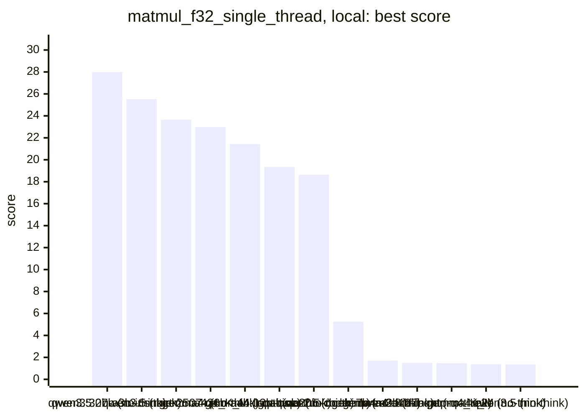

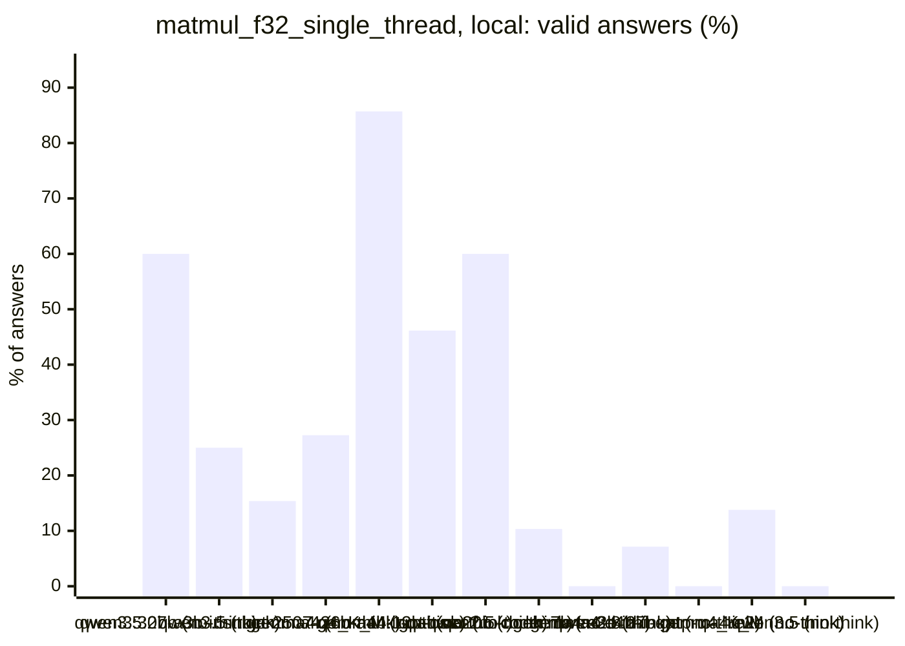

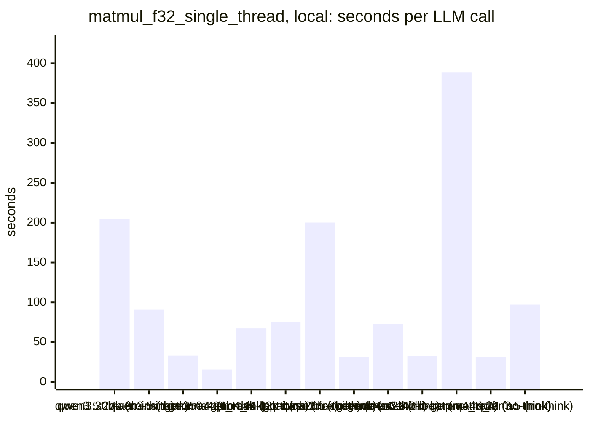

#### Inference speed and memory

RAM is what Ollama reports for the loaded model (weights, context cache and buffers; on Apple silicon this is shared memory). Load is the time to bring the model into memory. Prompt and generation speeds are tokens per second over all calls of the run.

| Model | Params | RAM GB | Load s | Prompt tok/s | Gen tok/s | Median s/call | p90 s/call | Tokens/answer | Stopped |
|---|---|--:|--:|--:|--:|--:|--:|--:|--:|
| gemma4:e2b (no-think) | 5.1B | 1.8 | 40 | 849 | 28.4 | 26 | 57 | 707 | 2 |
| gemma4:e4b-it-qat (no-think) | 7.5B | 3.2 | 109 | 612 | 26.4 | 25 | 61 | 606 | 0 |
| qwen2.5-coder:7b (no-think) | 7.6B | 6.4 | 78 | 659 | 24.8 | 26 | 52 | 594 | 0 |
| gemma4:e2b (think) | 5.1B | 6.6 | 40 | 1023 | 49.8 | 73 | 90 | 3336 | 0 |
| qwen3.5:latest (no-think) | 9.7B | 6.6 | 0 | 383 | 23.7 | 74 | 201 | 1226 | 3 |
| qwen3.5:latest (think) | 9.7B | 6.8 | 177 | 380 | 33.2 | 50 | 211 | 2325 | 0 |
| gemma4:12b-it-qat (no-think) | 11.9B | 7.7 | 150 | 222 | 21.6 | 71 | 97 | 932 | 0 |
| gpt-oss:20b (no-think) | 20.9B | 12.8 | 79 | 568 | 26.3 | 172 | 322 | 4683 | 0 |
| gemma4:26b-a4b-it-qat (no-think) | 25.2B | 15.2 | 305 | 309 | 24.1 | 48 | 88 | 553 | 0 |
| gemma4:latest (no-think) |  | 15.3 | 146 | 1046 | 50.3 | 12 | 21 | 460 | 0 |
| qwen3.8:27b-mtp-q4_K_M (no-think) | 27.3B | 17.6 | 486 | 16 | 9.1 | 592 | 744 | 925 | 0 |
| qwen3.5:27b (no-think) | 27.8B | 18.4 | 226 | 96 | 9.8 | 157 | 347 | 1140 | 0 |
| qwen3:30b-a3b-instruct-2507-q4_K_M (no-think) | 30.5B | 21.8 | 183 | 676 | 29.3 | 26 | 64 | 454 | 0 |

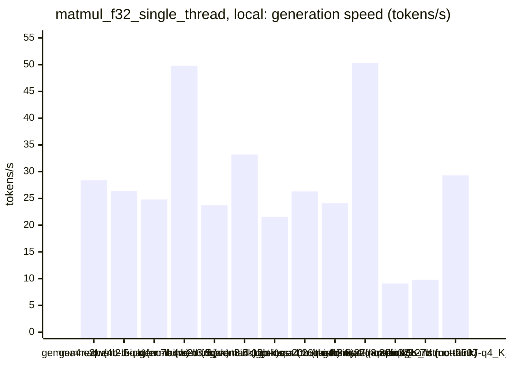

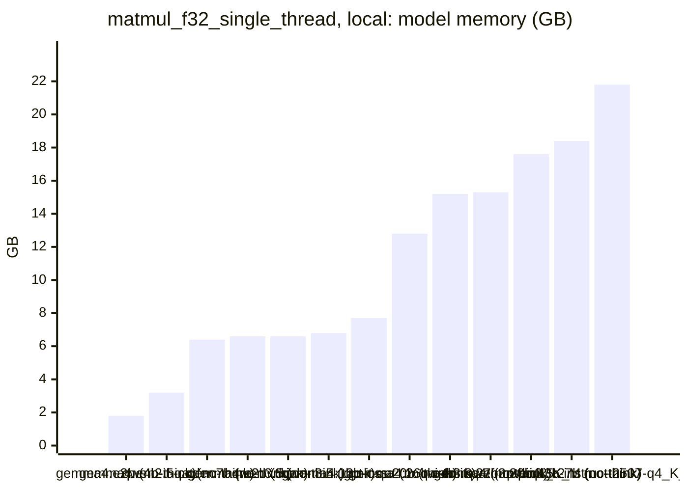

#### Best score over time

| Model | 3.75 min | 7.5 min | 11.25 min | 15 min |
|---|--:|--:|--:|--:|
| qwen3.5:27b (no-think) | 1.60018 | 25.9419 | 25.9419 | 25.9419 |
| qwen3.5:latest (think) | 1.72654 | 25.3809 | 25.3809 | 25.3809 |
| qwen3:30b-a3b-instruct-2507-q4_K_M (no-think) | 1.5722 | 23.6521 | 23.6521 | 23.6521 |
| gemma4:latest (no-think) | 1.3718 | 22.9778 | 22.9778 | 22.9778 |
| gemma4:26b-a4b-it-qat (no-think) | 1.37405 | 21.4446 | 21.4446 | 21.4446 |
| gemma4:12b-it-qat (no-think) | 1.36162 | 18.3146 | 19.3530 | 19.3530 |
| gpt-oss:20b (no-think) | 1.38651 | 18.6383 | 18.6383 | 18.6383 |
| qwen2.5-coder:7b (no-think) | 5.25547 | 5.25547 | 5.25547 | 5.25547 |
| gemma4:e2b (think) | 1.7021 | 1.7021 | 1.7021 | 1.7021 |
| gemma4:e4b-it-qat (no-think) | 1.36176 | 1.50204 | 1.50204 | 1.50204 |
| qwen3.8:27b-mtp-q4_K_M (no-think) | 1.46284 | 1.46284 | 1.46284 | 1.46284 |
| gemma4:e2b (no-think) | 1.33579 | 1.33579 | 1.36955 | 1.36975 |
| qwen3.5:latest (no-think) | 1.3591 | 1.3591 | 1.3591 | 1.3591 |

#### Outcome of the LLM answers

| Model | compile error | duplicate | edit error | invalid | llm error | ok | timeout |
|---|--:|--:|--:|--:|--:|--:|--:|
| qwen3.5:27b (no-think) | 0 | 0 | 2 | 0 | 0 | 3 | 0 |
| qwen3.5:latest (think) | 2 | 0 | 0 | 7 | 0 | 3 | 0 |
| qwen3:30b-a3b-instruct-2507-q4_K_M (no-think) | 2 | 5 | 0 | 15 | 0 | 4 | 0 |
| gemma4:latest (no-think) | 11 | 10 | 2 | 17 | 0 | 15 | 0 |
| gemma4:26b-a4b-it-qat (no-think) | 1 | 0 | 1 | 0 | 0 | 12 | 0 |
| gemma4:12b-it-qat (no-think) | 4 | 0 | 0 | 3 | 0 | 6 | 0 |
| gpt-oss:20b (no-think) | 0 | 0 | 2 | 0 | 0 | 3 | 0 |
| qwen2.5-coder:7b (no-think) | 10 | 3 | 0 | 13 | 0 | 3 | 0 |
| gemma4:e2b (think) | 6 | 0 | 1 | 5 | 0 | 0 | 1 |
| gemma4:e4b-it-qat (no-think) | 9 | 6 | 2 | 9 | 0 | 2 | 0 |
| qwen3.8:27b-mtp-q4_K_M (no-think) | 1 | 0 | 0 | 3 | 0 | 0 | 0 |
| gemma4:e2b (no-think) | 17 | 1 | 3 | 2 | 2 | 4 | 0 |
| qwen3.5:latest (no-think) | 6 | 0 | 1 | 1 | 3 | 0 | 0 |

#### Best idea per model

- **qwen3.5:27b (no-think)**: Implement a manual NEON micro-kernel with register blocking (8x16) and i-k-j tiling to maximize vector unit utilization and avoid cache pollution, while handling non-tile-aligned …
- **qwen3.5:latest (think)**: Initialize C to zero using memset and reorder loops to i-k-j to stream memory access patterns, allowing the compiler to auto-vectorize with NEON for high performance while …
- **qwen3:30b-a3b-instruct-2507-q4_K_M (no-think)**: The loop reordering i-k-j is correct for performance, but the bug is that the inner loop does not initialize C elements before accumulation; this causes undefined behavior for n=1 …
- **gemma4:latest (no-think)**: Initialize C to zero before accumulation to ensure correctness for the first run when C is not guaranteed to be zeroed by the caller.
- **gemma4:26b-a4b-it-qat (no-think)**: Change loop order to i-k-j to allow contiguous access of B and C, improving cache efficiency and vectorization potential.
- **gemma4:12b-it-qat (no-think)**: Fix the compilation error by using a `const float*` for the B row and use `vld1q_f32` on the `const float*` directly to satisfy the ARM NEON requirements.
- **gpt-oss:20b (no-think)**: Use NEON vectorized i‑k‑j loop with per‑row zeroing to accelerate compute while preserving correctness.
- **qwen2.5-coder:7b (no-think)**: Use loop unrolling to reduce the overhead of the inner loop.
- **gemma4:e2b (think)**: initial program
- **gemma4:e4b-it-qat (no-think)**: Implement loop tiling (cache blocking) for better data locality, specifically targeting the access patterns of A and B to improve cache reuse on the CPU.
- **qwen3.8:27b-mtp-q4_K_M (no-think)**: initial program
- **gemma4:e2b (no-think)**: Implement cache blocking with a block size optimized for NEON vectorization and use FMA intrinsics to maximize performance by improving data reuse and SIMD capabilities for …
- **qwen3.5:latest (no-think)**: initial program

### Cloud models (OpenRouter)

Free OpenRouter models; times include the network and the provider's queue.

| Model | Params | Initial | Best | Gain | LLM calls | s/call | Valid | New bests | Min to best |
|---|---|--:|--:|--:|--:|--:|--:|--:|--:|
| nvidia/nemotron-3-super-120b-a12b:free (no-think) |  | 1.69859 | **49.1573** | ×28.94 | 88 | 10 | 25% | 10 | 13.1 |
| nvidia/nemotron-3-ultra-550b-a55b:free (think) |  | 1.52545 | **35.3384** | ×23.17 | 12 | 80 | 67% | 4 | 16.1 |
| nvidia/nemotron-3-super-120b-a12b:free (think) |  | 1.57117 | **31.1191** | ×19.81 | 20 | 48 | 60% | 4 | 7.8 |
| poolside/laguna-s-2.1:free (no-think) |  | 1.67947 | **28.1830** | ×16.78 | 24 | 38 | 46% | 9 | 8.4 |
| cohere/north-mini-code:free (no-think) |  | 1.74962 | **27.7760** | ×15.88 | 75 | 12 | 16% | 4 | 8.5 |
| nvidia/nemotron-3-ultra-550b-a55b:free (no-think) |  | 1.69723 | **25.7986** | ×15.20 | 66 | 13 | 58% | 3 | 11.9 |
| poolside/laguna-s-2.1:free (think) |  | 1.6705 | **1.6705** | ×1.00 | 5 | 208 | 0% | 0 | - |
| cohere/north-mini-code:free (think) |  | 1.54957 | **1.54957** | ×1.00 | 9 | 110 | 0% | 0 | - |

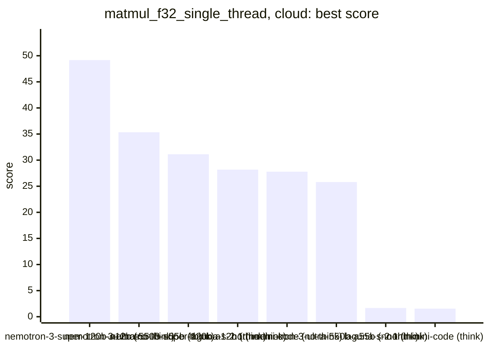

```mermaid
xychart-beta
    title "matmul_f32_single_thread, cloud: valid answers (%)"
    x-axis ["nemotron-3-super-120b-a12b (no-think)", "nemotron-3-ultra-550b-a55b (think)", "nemotron-3-super-120b-a12b (think)", "laguna-s-2.1 (no-think)", "north-mini-code (no-think)", "nemotron-3-ultra-550b-a55b (no-think)", "laguna-s-2.1 (think)", "north-mini-code (think)"]
    y-axis "% of answers" 0 --> 73.33
    bar [25, 66.67, 60, 45.83, 16, 57.58, 0, 0]
```

```mermaid
xychart-beta
    title "matmul_f32_single_thread, cloud: seconds per LLM call"
    x-axis ["nemotron-3-super-120b-a12b (no-think)", "nemotron-3-ultra-550b-a55b (think)", "nemotron-3-super-120b-a12b (think)", "laguna-s-2.1 (no-think)", "north-mini-code (no-think)", "nemotron-3-ultra-550b-a55b (no-think)", "laguna-s-2.1 (think)", "north-mini-code (think)"]
    y-axis "seconds" 0 --> 228.8
    bar [10.1, 80.1, 48.5, 37.7, 11.7, 13.2, 208, 110.2]
```

#### Inference speed and cost

Generation speed is measured from the first to the last streamed token; the time to the first token is counted as prompt time. Cost is what OpenRouter charged for the run.

| Model | Gen tok/s | Median s/call | p90 s/call | Tokens/answer | Stopped | Cost $ |
|---|--:|--:|--:|--:|--:|--:|
| cohere/north-mini-code:free (no-think) | 150.6 | 10 | 22 | 1715 | 1 | 0.000 |
| nvidia/nemotron-3-super-120b-a12b:free (no-think) | 140.4 | 8 | 23 | 1149 | 13 | 0.000 |
| nvidia/nemotron-3-super-120b-a12b:free (think) | 127.5 | 43 | 101 | 5738 | 1 | 0.000 |
| cohere/north-mini-code:free (think) | 113.0 | 97 | 222 | 4886 | 7 | 0.000 |
| nvidia/nemotron-3-ultra-550b-a55b:free (no-think) | 57.5 | 10 | 28 | 663 | 0 | 0.000 |
| poolside/laguna-s-2.1:free (think) | 55.5 | 267 | 323 | 9830 | 0 | 0.000 |
| poolside/laguna-s-2.1:free (no-think) | 46.3 | 27 | 77 | 925 | 5 | 0.000 |
| nvidia/nemotron-3-ultra-550b-a55b:free (think) | 37.8 | 59 | 165 | 2969 | 0 | 0.000 |

```mermaid
xychart-beta
    title "matmul_f32_single_thread, cloud: generation speed (tokens/s)"
    x-axis ["north-mini-code (no-think)", "nemotron-3-super-120b-a12b (no-think)", "nemotron-3-super-120b-a12b (think)", "north-mini-code (think)", "nemotron-3-ultra-550b-a55b (no-think)", "laguna-s-2.1 (think)", "laguna-s-2.1 (no-think)", "nemotron-3-ultra-550b-a55b (think)"]
    y-axis "tokens/s" 0 --> 165.7
    bar [150.6, 140.4, 127.5, 113, 57.5, 55.5, 46.3, 37.8]
```

#### Best score over time

| Model | 3.75 min | 7.5 min | 11.25 min | 15 min |
|---|--:|--:|--:|--:|
| nvidia/nemotron-3-super-120b-a12b:free (no-think) | 37.5267 | 45.5444 | 47.7429 | 49.1573 |
| nvidia/nemotron-3-ultra-550b-a55b:free (think) | 24.3390 | 33.7080 | 33.7080 | 34.3014 |
| nvidia/nemotron-3-super-120b-a12b:free (think) | 19.9022 | 25.5203 | 31.1191 | 31.1191 |
| poolside/laguna-s-2.1:free (no-think) | 20.5189 | 27.5229 | 28.1830 | 28.1830 |
| cohere/north-mini-code:free (no-think) | 1.74962 | 26.2015 | 27.7760 | 27.7760 |
| nvidia/nemotron-3-ultra-550b-a55b:free (no-think) | 25.5239 | 25.5239 | 25.6831 | 25.7986 |
| poolside/laguna-s-2.1:free (think) | 1.6705 | 1.6705 | 1.6705 | 1.6705 |
| cohere/north-mini-code:free (think) | 1.54957 | 1.54957 | 1.54957 | 1.54957 |

#### Outcome of the LLM answers

| Model | compile error | duplicate | edit error | invalid | llm error | ok |
|---|--:|--:|--:|--:|--:|--:|
| nvidia/nemotron-3-super-120b-a12b:free (no-think) | 0 | 33 | 4 | 16 | 13 | 22 |
| nvidia/nemotron-3-ultra-550b-a55b:free (think) | 1 | 2 | 0 | 1 | 0 | 8 |
| nvidia/nemotron-3-super-120b-a12b:free (think) | 4 | 2 | 0 | 1 | 1 | 12 |
| poolside/laguna-s-2.1:free (no-think) | 0 | 4 | 1 | 2 | 6 | 11 |
| cohere/north-mini-code:free (no-think) | 18 | 6 | 11 | 27 | 1 | 12 |
| nvidia/nemotron-3-ultra-550b-a55b:free (no-think) | 6 | 16 | 0 | 6 | 0 | 38 |
| poolside/laguna-s-2.1:free (think) | 0 | 0 | 3 | 0 | 2 | 0 |
| cohere/north-mini-code:free (think) | 0 | 0 | 0 | 2 | 7 | 0 |

#### Best idea per model

- **nvidia/nemotron-3-super-120b-a12b:free (no-think)**: tuned BLOCK_SIZE=112, UNROLL=8 on top of: Increase UNROLL factor to 8 and add NEON vectorization of the inner j-loop to process 4 columns per iteration, improving …
- **nvidia/nemotron-3-ultra-550b-a55b:free (think)**: Unroll the inner k-loop in the 4x4 micro-kernel by a factor of 4 to reduce loop overhead and improve instruction-level parallelism, while handling remainder iterations.
- **nvidia/nemotron-3-super-120b-a12b:free (think)**: tuned IM=8, JM=8, BK=64 on top of: Replace the current panel‑update microkernel with a 2D blocked microkernel that computes a small IM×JM tile of C using registers, reloading a …
- **poolside/laguna-s-2.1:free (no-think)**: tuned MM_BC=320, MM_MR=8 on top of: Replace the scalar 4x16 micro-kernel with a true NEON register-blocked kernel using vfmaq_laneq_f32 for A broadcasts and 4x16 accumulators, and …
- **cohere/north-mini-code:free (no-think)**: Increase arithmetic intensity by switching to a wider 16×8 register tile (two NEON registers per C element) to halve memory traffic and better utilize FMA pipelines.
- **nvidia/nemotron-3-ultra-550b-a55b:free (no-think)**: Add `__restrict__` qualifiers and `alignas(64)` hints to pointers, plus `#pragma clang loop vectorize(enable) unroll(full)` on the inner j-loop to help Clang generate tighter NEON …
- **poolside/laguna-s-2.1:free (think)**: initial program
- **cohere/north-mini-code:free (think)**: initial program
