<!-- Copyright (c) 2026 by C. Klukas -->
<!-- SPDX-License-Identifier: GPL-3.0-only -->
<!-- Generated by `omega report` from bench/results/*.json. Do not edit by hand. -->

# Model benchmarks

Each row is one time-boxed OMEGA TRANSFORM search: the same example, the same
budget and the same settings, with only the Ollama model changed. The numbers
come from the committed result files in `bench/results/`; rerun
`omega bench` to add new ones (see [Benchmarking models](benchmarking.md)).

Read the results with care: one run per model is a single sample of a
stochastic search, and timing-based scores (the C++ example) depend on what
else the machine was doing.

## Model check

Before benchmarking, `omega models` loads every installed model, greets it, asks for a three-line edit in the engine's SEARCH/REPLACE format, and tries its reasoning mode. Only models marked ok are benchmarked. Checked 2026-10-14.

| Model | Params | Size GB | Verdict | Load s | Gen tok/s | RAM GB | Hello | Edit | Think | Note |
|---|---|--:|---|--:|--:|--:|---|---|---|---|
| qwen2.5-coder:7b | 7.6B | 4.7 | ok | 50 | 32.6 | 6.4 | yes | yes | - |  |
| gemma4:e4b-it-qat | 7.5B | 6.1 | ok | 77 | 44.9 | 5.7 | yes | yes | yes |  |
| qwen3.5:latest | 9.7B | 6.6 | ok | 48 | 30.2 | 6.7 | yes | yes | yes |  |
| gemma4:12b-it-qat | 11.9B | 7.2 | ok | 90 | 24.3 | 8.0 | yes | yes | yes |  |
| gemma4:e2b | 5.1B | 7.2 | ok | 45 | 43.1 | 6.6 | yes | yes | yes |  |
| gemma4:latest |  | 9.5 | ok | 112 | 33.1 | 9.4 | yes | yes | yes |  |
| gpt-oss:20b | 20.9B | 13.8 | ok | 68 | 35.1 | 12.8 | yes | yes | yes |  |
| gemma4:26b-a4b-it-qat | 25.2B | 15.6 | ok | 104 | 67.7 | 15.2 | yes | yes | yes |  |
| qwen3.5:27b | 27.8B | 17.4 | ok | 91 | 11.4 | 18.4 | yes | yes | yes |  |
| qwen3.8:27b-mtp-q4_K_M | 27.3B | 17.7 | ok | 226 | 15.6 | 17.6 | yes | yes | yes |  |
| qwen3.6:27b-coding-mtp-q4_K_M | 27.3B | 17.8 | ok | 208 | 16.6 | 18.2 | yes | yes | yes |  |
| qwen3:30b-a3b-instruct-2507-q4_K_M | 30.5B | 18.6 | ok | 132 | 69.7 | 21.8 | yes | yes | yes |  |
| qwen3-coder:30b | 30.5B | 18.6 | ok | 131 | 67.8 | 21.8 | yes | yes | - |  |

Machine: Apple M1 Max (Mac13,1), 10 cores, 32 GB.

## Overall ranking

Scores of different examples cannot be added up (a matrix multiply gains ×80, a route heuristic ×1.1), so every example is weighted equally: per example, a model's **share** is its gain over the starting program as a fraction of the largest gain any model of its group reached there (100% = the best model, 0% = no gain). The ranking is the mean share over the examples; the geometric mean of the improvement factors, the examples won and the examples without any gain are shown alongside. Only models with results on at least three quarters of the examples are ranked; the others follow without a rank.

### Models by developer

Every benchmarked model and the company that develops it, which the comparisons below group by.

| Developer | Local models (Ollama) | Cloud models (OpenRouter) |
|---|---|---|
| Alibaba (Qwen) | qwen2.5-coder:7b, qwen3-coder:30b, qwen3.5:27b, qwen3.5:latest, qwen3.6:27b-coding-mtp-q4_K_M, qwen3.8:27b-mtp-q4_K_M, qwen3:30b-a3b-instruct-2507-q4_K_M | – |
| Cohere | – | cohere/north-mini-code:free |
| Google | gemma4:12b-it-qat, gemma4:26b-a4b-it-qat, gemma4:e2b, gemma4:e4b-it-qat, gemma4:latest | – |
| NVIDIA | – | nvidia/nemotron-3-super-120b-a12b:free, nvidia/nemotron-3-ultra-550b-a55b:free |
| OpenAI | gpt-oss:20b | – |
| Poolside | – | poolside/laguna-s-2.1:free |

**About the developers** (as of October 2026; many of these companies and their open models are only a few years old):

- **Alibaba (Qwen)** (founded 1999, Hangzhou, China): China's largest e-commerce and cloud group. Its Qwen team has released open-weight models since 2023, in many sizes and mostly under Apache 2.0; Qwen is among the most widely used open model families.
- **Cohere** (founded 2019, Toronto, Canada): Builds language models for enterprise use (the Command family); some are published as open weights.
- **Google** (founded 1998, Mountain View, USA): Publishes the Gemma family as open-weight models since 2024, built from the research behind its larger proprietary models, from phone-sized to mid-sized models.
- **NVIDIA** (founded 1993, Santa Clara, USA): The leading maker of AI accelerators. Its Nemotron models are open-weight, often with their training data published, and partly built on other open models.
- **OpenAI** (founded 2015, San Francisco, USA): Best known for ChatGPT and its proprietary GPT models; gpt-oss (August 2025, Apache 2.0) were its first open-weight language models since GPT-2 in 2019.
- **Poolside** (founded 2023, Paris, France): Founded by a former GitHub CTO to build models for software development, trained with reinforcement learning from executing code; Laguna is its open-weight line (2026).

### Local models

| # | Model | Share of best gain | Geometric-mean gain | Wins | No gain | Examples |
|--:|---|--:|--:|--:|--:|--:|
| 1 | gemma4:26b-a4b-it-qat (no-think) | **79%** | ×3.45 | 0 | 0 | 15 |
| 2 | gpt-oss:20b (think) | **79%** | ×3.30 | 2 | 0 | 15 |
| 3 | gemma4:e4b-it-qat (think) | **76%** | ×3.29 | 2 | 0 | 15 |
| 4 | gemma4:latest (no-think) | **72%** | ×3.10 | 0 | 0 | 15 |
| 5 | gpt-oss:20b (no-think) | **66%** | ×3.06 | 2 | 1 | 15 |
| 6 | gemma4:e4b-it-qat (no-think) | **65%** | ×3.05 | 1 | 1 | 15 |
| 7 | gemma4:12b-it-qat (no-think) | **65%** | ×3.10 | 0 | 1 | 15 |
| 8 | gemma4:latest (think) | **61%** | ×2.85 | 2 | 1 | 15 |
| 9 | qwen3:30b-a3b-instruct-2507-q4_K_M (no-think) | **60%** | ×2.71 | 0 | 1 | 15 |
| 10 | qwen3.8:27b-mtp-q4_K_M (no-think) | **57%** | ×2.79 | 0 | 1 | 15 |
| 11 | qwen3:30b-a3b-instruct-2507-q4_K_M (think) | **56%** | ×2.48 | 2 | 2 | 15 |
| 12 | qwen3.6:27b-coding-mtp-q4_K_M (no-think) | **52%** | ×2.99 | 1 | 3 | 15 |
| 13 | qwen3.5:27b (no-think) | **43%** | ×2.41 | 1 | 5 | 15 |
| 14 | qwen3-coder:30b (no-think) | **43%** | ×1.81 | 0 | 2 | 15 |
| 15 | qwen3.5:latest (think) | **42%** | ×2.02 | 0 | 5 | 15 |
| 16 | gemma4:26b-a4b-it-qat (think) | **41%** | ×2.32 | 0 | 5 | 15 |
| 17 | qwen3.8:27b-mtp-q4_K_M (think) | **41%** | ×2.20 | 1 | 8 | 15 |
| 18 | qwen3.5:27b (think) | **40%** | ×2.13 | 0 | 5 | 15 |
| 19 | gemma4:e2b (no-think) | **34%** | ×1.55 | 0 | 2 | 15 |
| 20 | qwen3.5:latest (no-think) | **33%** | ×1.39 | 1 | 6 | 15 |
| 21 | gemma4:12b-it-qat (think) | **30%** | ×2.26 | 0 | 6 | 15 |
| 22 | qwen3.6:27b-coding-mtp-q4_K_M (think) | **26%** | ×1.68 | 0 | 9 | 15 |
| 23 | qwen2.5-coder:7b (no-think) | **20%** | ×1.63 | 0 | 6 | 15 |
| 24 | gemma4:e2b (think) | **19%** | ×1.21 | 0 | 8 | 15 |

#### By developer

The ranked models above, grouped by the company that develops them: the developer's best single model, the mean share over all its models, and the mean share when its best model is picked for each example separately (which favours developers with many models).

| Developer | Models | Best model | Best model's share | Mean over its models | Best per example |
|---|--:|---|--:|--:|--:|
| Google | 10 | gemma4:26b-a4b-it-qat (no-think) | **79%** | 54% | 93% |
| OpenAI | 2 | gpt-oss:20b (think) | **79%** | 72% | 80% |
| Alibaba (Qwen) | 12 | qwen3:30b-a3b-instruct-2507-q4_K_M (no-think) | **60%** | 43% | 88% |

#### By country

Each country is represented by its best ranked model; the country of a model is that of its developer's headquarters. The lag is how far its share falls short of the leading country's, relative to that share.

| # | Country | Best model | Developer | Share | Lag behind #1 | Models |
|--:|---|---|---|--:|--:|--:|
| 1 | USA | gemma4:26b-a4b-it-qat (no-think) | Google | **79%** | – | 12 |
| 2 | China | qwen3:30b-a3b-instruct-2507-q4_K_M (no-think) | Alibaba (Qwen) | **60%** | −25% | 12 |

#### Progress over time

Each developer's ranked models by release date (the original publication on Hugging Face, or OpenRouter's listing date), with the share of the better of their two modes. Models are compared only within a size class (total parameters, under 15B, 15B and up), so that a newer but smaller model does not read as a step back; mixture-of-experts models use only part of their parameters per token. Variants of one release share its date. A chart is drawn where a developer has three or more release dates in one size class.

| Developer | Size class | Released | Model | Parameters | Share |
|---|---|---|---|--:|--:|
| Alibaba (Qwen) | under 15B | 2024-09-17 | qwen2.5-coder:7b (no-think) | 7.6B | 20% |
| Alibaba (Qwen) | under 15B | 2026-02-27 | qwen3.5:latest (think) | 9.7B | 42% |
| Alibaba (Qwen) | 15B and up | 2025-07-28 | qwen3:30b-a3b-instruct-2507-q4_K_M (no-think) | 30.5B | 60% |
| Alibaba (Qwen) | 15B and up | 2025-07-31 | qwen3-coder:30b (no-think) | 30.5B | 43% |
| Alibaba (Qwen) | 15B and up | 2026-02-24 | qwen3.5:27b (no-think) | 27.8B | 43% |
| Alibaba (Qwen) | 15B and up | 2026-04-21 | qwen3.6:27b-coding-mtp-q4_K_M (no-think) | 27.3B | 52% |
| Alibaba (Qwen) | 15B and up | 2026-08-05 | qwen3.8:27b-mtp-q4_K_M (no-think) | 27.3B | 57% |
| Google | under 15B | 2026-03-02 | gemma4:e2b (no-think) | 5.1B | 34% |
| Google | under 15B | 2026-03-02 | gemma4:e4b-it-qat (think) | 7.5B | 76% |
| Google | under 15B | 2026-03-02 | gemma4:latest (no-think) | 8.1B | 72% |
| Google | under 15B | 2026-05-23 | gemma4:12b-it-qat (no-think) | 11.9B | 65% |
| Google | 15B and up | 2026-03-11 | gemma4:26b-a4b-it-qat (no-think) | 25.2B | 79% |
| OpenAI | 15B and up | 2025-08-04 | gpt-oss:20b (think) | 20.9B | 79% |

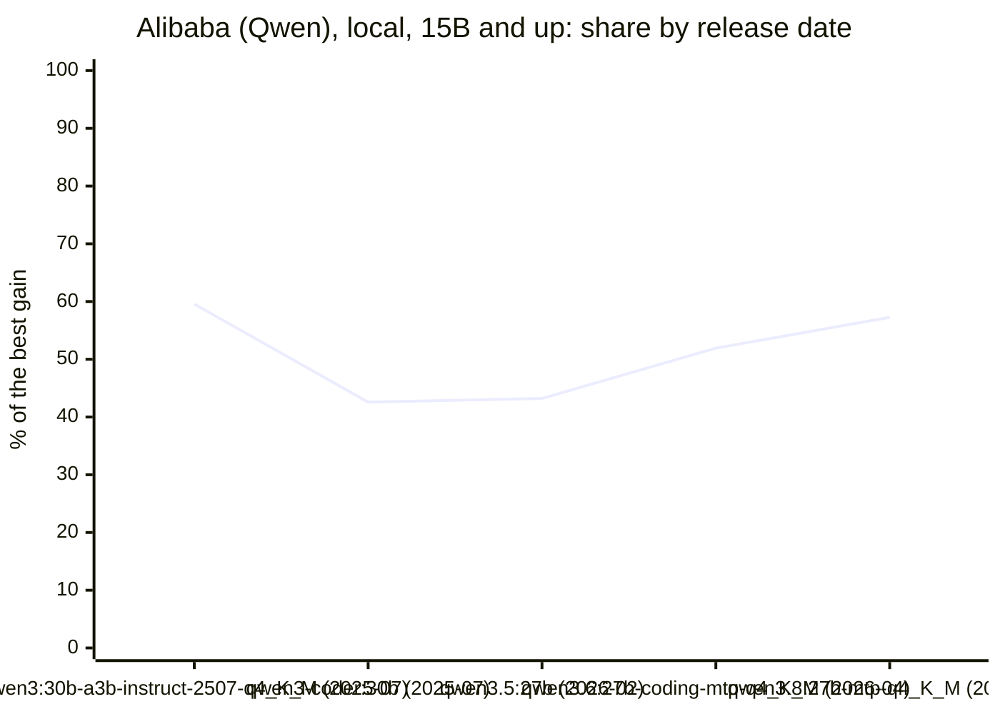

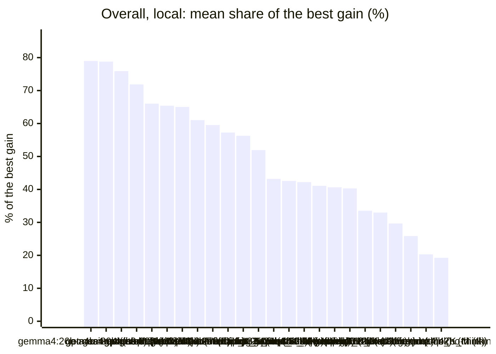

### Cloud models (OpenRouter)

| # | Model | Share of best gain | Geometric-mean gain | Wins | No gain | Examples |
|--:|---|--:|--:|--:|--:|--:|
| 1 | nvidia/nemotron-3-ultra-550b-a55b:free (think) | **85%** | ×6.11 | 0 | 0 | 2 |
| 2 | nvidia/nemotron-3-super-120b-a12b:free (think) | **84%** | ×5.77 | 1 | 0 | 2 |
| 3 | nvidia/nemotron-3-super-120b-a12b:free (no-think) | **76%** | ×6.25 | 1 | 0 | 2 |
| 4 | cohere/north-mini-code:free (no-think) | **40%** | ×4.33 | 0 | 0 | 2 |
| 5 | poolside/laguna-s-2.1:free (no-think) | **36%** | ×4.30 | 0 | 0 | 2 |
| 6 | nvidia/nemotron-3-ultra-550b-a55b:free (no-think) | **25%** | ×3.90 | 0 | 1 | 2 |
| 7 | cohere/north-mini-code:free (think) | **0%** | ×1.00 | 0 | 2 | 2 |
| 8 | poolside/laguna-s-2.1:free (think) | **0%** | ×1.00 | 0 | 2 | 2 |

#### By developer

The ranked models above, grouped by the company that develops them: the developer's best single model, the mean share over all its models, and the mean share when its best model is picked for each example separately (which favours developers with many models).

| Developer | Models | Best model | Best model's share | Mean over its models | Best per example |
|---|--:|---|--:|--:|--:|
| NVIDIA | 4 | nvidia/nemotron-3-ultra-550b-a55b:free (think) | **85%** | 67% | 100% |
| Cohere | 2 | cohere/north-mini-code:free (no-think) | **40%** | 20% | 40% |
| Poolside | 2 | poolside/laguna-s-2.1:free (no-think) | **36%** | 18% | 36% |

#### By country

Each country is represented by its best ranked model; the country of a model is that of its developer's headquarters. The lag is how far its share falls short of the leading country's, relative to that share.

| # | Country | Best model | Developer | Share | Lag behind #1 | Models |
|--:|---|---|---|--:|--:|--:|
| 1 | USA | nvidia/nemotron-3-ultra-550b-a55b:free (think) | NVIDIA | **85%** | – | 4 |
| 2 | Canada | cohere/north-mini-code:free (no-think) | Cohere | **40%** | −53% | 2 |
| 3 | France | poolside/laguna-s-2.1:free (no-think) | Poolside | **36%** | −58% | 2 |

#### Progress over time

Each developer's ranked models by release date (the original publication on Hugging Face, or OpenRouter's listing date), with the share of the better of their two modes. Models are compared only within a size class (total parameters, under 15B, 15B and up), so that a newer but smaller model does not read as a step back; mixture-of-experts models use only part of their parameters per token. Variants of one release share its date. A chart is drawn where a developer has three or more release dates in one size class.

| Developer | Size class | Released | Model | Parameters | Share |
|---|---|---|---|--:|--:|
| Cohere | 15B and up | 2026-06-17 | cohere/north-mini-code:free (no-think) | 30B | 40% |
| NVIDIA | 15B and up | 2026-03-11 | nvidia/nemotron-3-super-120b-a12b:free (think) | 120B | 84% |
| NVIDIA | 15B and up | 2026-06-04 | nvidia/nemotron-3-ultra-550b-a55b:free (think) | 550B | 85% |
| Poolside | size unknown | 2026-07-21 | poolside/laguna-s-2.1:free (no-think) | ? | 36% |

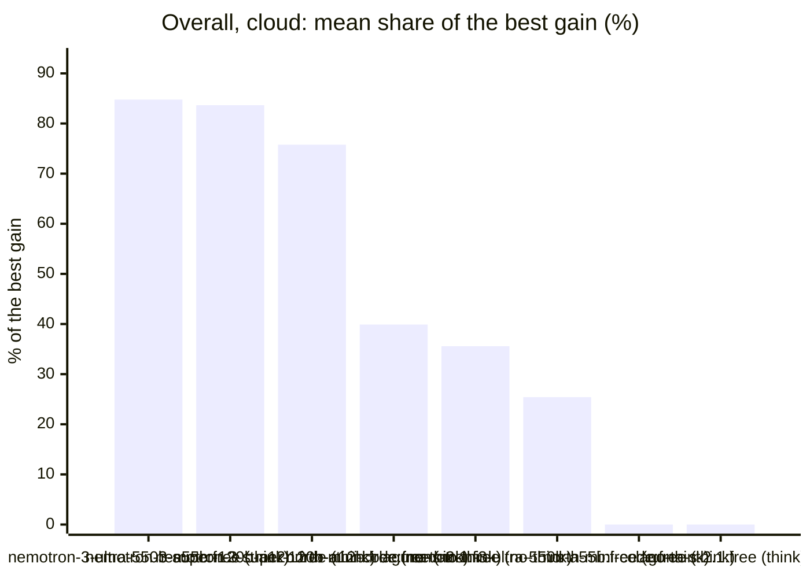

## bin_packing_1d

24 models, 15 minutes each, latest run per model.

### Local models

Ollama on this machine.

| Model | Params | Initial | Best | Gain | LLM calls | s/call | Valid | New bests | Min to best |
|---|---|--:|--:|--:|--:|--:|--:|--:|--:|
| gpt-oss:20b (no-think) | 20.9B | 0.79426 | **0.95416** | ×1.20 | 18 | 52 | 89% | 2 | 6.7 |
| gemma4:12b-it-qat (no-think) | 11.9B | 0.79426 | **0.9541** | ×1.20 | 21 | 43 | 81% | 2 | 8.3 |
| gemma4:26b-a4b-it-qat (no-think) | 25.2B | 0.79426 | **0.95304** | ×1.20 | 33 | 27 | 82% | 3 | 11.5 |
| gpt-oss:20b (think) | 20.9B | 0.79426 | **0.95304** | ×1.20 | 19 | 49 | 84% | 2 | 9.6 |
| gemma4:e4b-it-qat (no-think) | 7.5B | 0.79426 | **0.95128** | ×1.20 | 63 | 14 | 60% | 1 | 1.1 |
| qwen3.5:latest (no-think) | 9.7B | 0.79426 | **0.95128** | ×1.20 | 26 | 34 | 65% | 2 | 3.5 |
| gemma4:e2b (no-think) | 5.1B | 0.79426 | **0.95128** | ×1.20 | 65 | 14 | 51% | 2 | 1.2 |
| gemma4:latest (no-think) |  | 0.79426 | **0.95128** | ×1.20 | 61 | 14 | 80% | 1 | 1.9 |
| qwen3.5:27b (no-think) | 27.8B | 0.79426 | **0.95128** | ×1.20 | 8 | 122 | 100% | 1 | 5.4 |
| qwen3.8:27b-mtp-q4_K_M (no-think) | 27.3B | 0.79426 | **0.95128** | ×1.20 | 4 | 227 | 100% | 1 | 12.5 |
| qwen3.6:27b-coding-mtp-q4_K_M (no-think) | 27.3B | 0.79426 | **0.95128** | ×1.20 | 8 | 118 | 62% | 1 | 5.2 |
| qwen3:30b-a3b-instruct-2507-q4_K_M (no-think) | 30.5B | 0.79426 | **0.95128** | ×1.20 | 44 | 20 | 48% | 1 | 2.5 |
| qwen3-coder:30b (no-think) | 30.5B | 0.79426 | **0.95128** | ×1.20 | 25 | 36 | 80% | 1 | 2.5 |
| gemma4:e4b-it-qat (think) | 7.5B | 0.79426 | **0.95128** | ×1.20 | 20 | 46 | 75% | 1 | 1.9 |
| qwen3.5:latest (think) | 9.7B | 0.79426 | **0.95128** | ×1.20 | 22 | 43 | 50% | 1 | 3.4 |
| gemma4:12b-it-qat (think) | 11.9B | 0.79426 | **0.95128** | ×1.20 | 3 | 408 | 100% | 1 | 6.1 |
| gemma4:e2b (think) | 5.1B | 0.79426 | **0.95128** | ×1.20 | 26 | 34 | 69% | 2 | 1.9 |
| gemma4:latest (think) |  | 0.79426 | **0.95128** | ×1.20 | 22 | 41 | 82% | 1 | 2.2 |
| gemma4:26b-a4b-it-qat (think) | 25.2B | 0.79426 | **0.95128** | ×1.20 | 4 | 234 | 25% | 1 | 10.2 |
| qwen3.5:27b (think) | 27.8B | 0.79426 | **0.95128** | ×1.20 | 5 | 185 | 80% | 1 | 5.7 |
| qwen3.6:27b-coding-mtp-q4_K_M (think) | 27.3B | 0.79426 | **0.95128** | ×1.20 | 1 | 1045 | 100% | 1 | 17.4 |
| qwen3:30b-a3b-instruct-2507-q4_K_M (think) | 30.5B | 0.79426 | **0.95128** | ×1.20 | 41 | 22 | 44% | 1 | 3.2 |
| qwen2.5-coder:7b (no-think) | 7.6B | 0.79426 | **0.79426** | ×1.00 | 42 | 21 | 14% | 0 | - |
| qwen3.8:27b-mtp-q4_K_M (think) | 27.3B | | | | | | | | failed: all 1 model requests failed: qwen3.8:27b-mtp-q4_K_M: answer  |

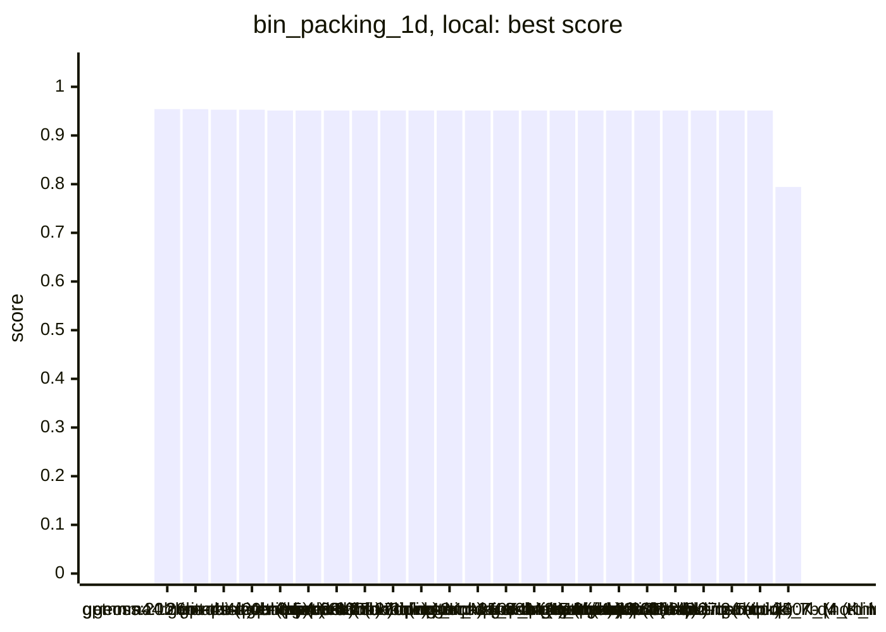

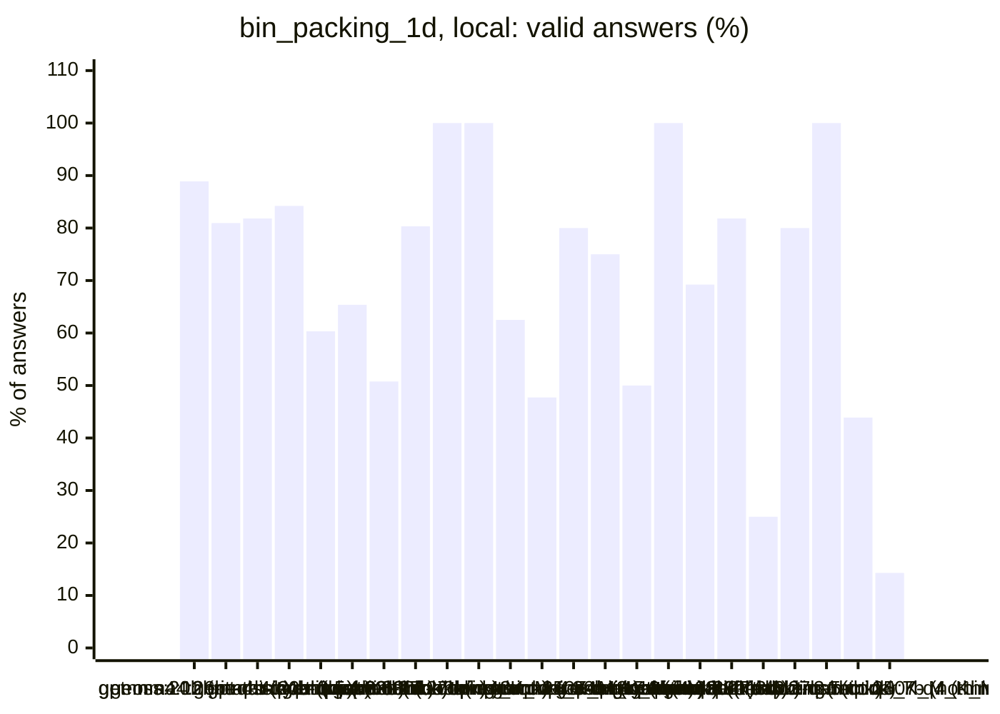

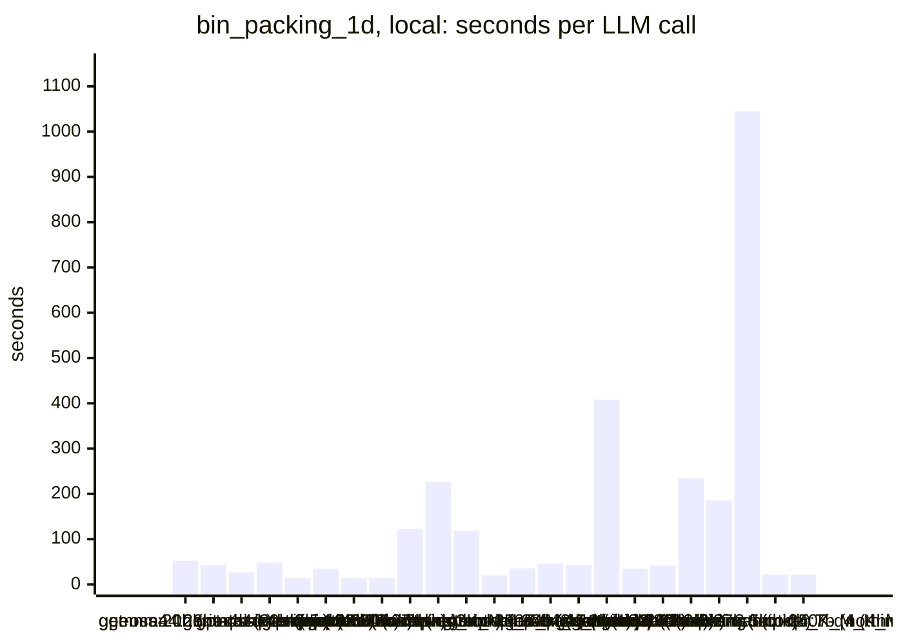

#### Inference speed and memory

RAM is what Ollama reports for the loaded model (weights, context cache and buffers; on Apple silicon this is shared memory). Load is the time to bring the model into memory. Prompt and generation speeds are tokens per second over all calls of the run.

| Model | Params | RAM GB | Load s | Prompt tok/s | Gen tok/s | Median s/call | p90 s/call | Tokens/answer | Stopped |
|---|---|--:|--:|--:|--:|--:|--:|--:|--:|
| gemma4:e4b-it-qat (no-think) | 7.5B | 5.7 | 58 | 651 | 61.5 | 13 | 22 | 479 | 0 |
| gemma4:e4b-it-qat (think) | 7.5B | 5.7 | 84 | 728 | 60.5 | 42 | 80 | 2273 | 0 |
| gemma4:e2b (no-think) | 5.1B | 6.6 | 33 | 963 | 78.7 | 10 | 26 | 710 | 0 |
| gemma4:e2b (think) | 5.1B | 6.6 | 64 | 1075 | 78.2 | 31 | 46 | 2271 | 0 |
| qwen2.5-coder:7b (no-think) | 7.6B | 6.6 | 50 | 546 | 39.7 | 21 | 32 | 581 | 1 |
| qwen3.5:latest (no-think) | 9.7B | 6.8 | 28 | 435 | 36.0 | 26 | 75 | 842 | 1 |
| qwen3.5:latest (think) | 9.7B | 6.8 | 49 | 453 | 36.0 | 47 | 56 | 1231 | 0 |
| gemma4:12b-it-qat (no-think) | 11.9B | 8.0 | 66 | 252 | 30.4 | 36 | 84 | 818 | 0 |
| gemma4:12b-it-qat (think) | 11.9B | 8.0 | 88 | 296 | 29.5 | 368 | 492 | 10958 | 0 |
| gemma4:latest (think) |  | 12.1 | 108 | 1052 | 48.2 | 31 | 59 | 1618 | 0 |
| gpt-oss:20b (no-think) | 20.9B | 12.9 | 55 | 741 | 52.4 | 50 | 96 | 2370 | 0 |
| gpt-oss:20b (think) | 20.9B | 12.9 | 150 | 739 | 51.5 | 40 | 75 | 1893 | 0 |
| gemma4:26b-a4b-it-qat (no-think) | 25.2B | 15.4 | 203 | 635 | 63.3 | 22 | 36 | 855 | 0 |
| gemma4:26b-a4b-it-qat (think) | 25.2B | 15.4 | 0 | 1689 | 61.8 | 208 | 492 | 7190 | 2 |
| gemma4:latest (no-think) |  | 16.6 | 102 | 1097 | 54.2 | 12 | 19 | 493 | 0 |
| qwen3.6:27b-coding-mtp-q4_K_M (think) | 27.3B | 17.4 | 322 | 94 | 13.6 | 1045 | 1045 | 5307 | 0 |
| qwen3.8:27b-mtp-q4_K_M (no-think) | 27.3B | 17.6 | 306 | 115 | 15.7 | 69 | 751 | 541 | 0 |
| qwen3.6:27b-coding-mtp-q4_K_M (no-think) | 27.3B | 18.2 | 243 | 105 | 15.4 | 83 | 309 | 971 | 0 |
| qwen3.5:27b (no-think) | 27.8B | 18.6 | 237 | 106 | 10.9 | 98 | 325 | 738 | 0 |
| qwen3.5:27b (think) | 27.8B | 18.6 | 234 | 104 | 11.2 | 164 | 343 | 1308 | 0 |
| qwen3:30b-a3b-instruct-2507-q4_K_M (no-think) | 30.5B | 21.8 | 138 | 713 | 55.2 | 16 | 32 | 645 | 0 |
| qwen3-coder:30b (no-think) | 30.5B | 21.8 | 131 | 633 | 51.9 | 29 | 51 | 1239 | 0 |
| qwen3:30b-a3b-instruct-2507-q4_K_M (think) | 30.5B | 21.8 | 181 | 670 | 47.2 | 15 | 43 | 530 | 1 |

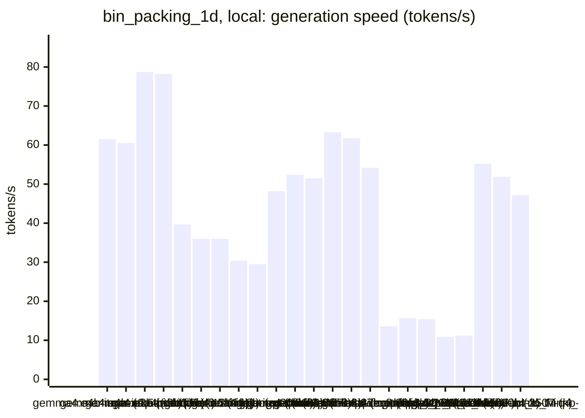

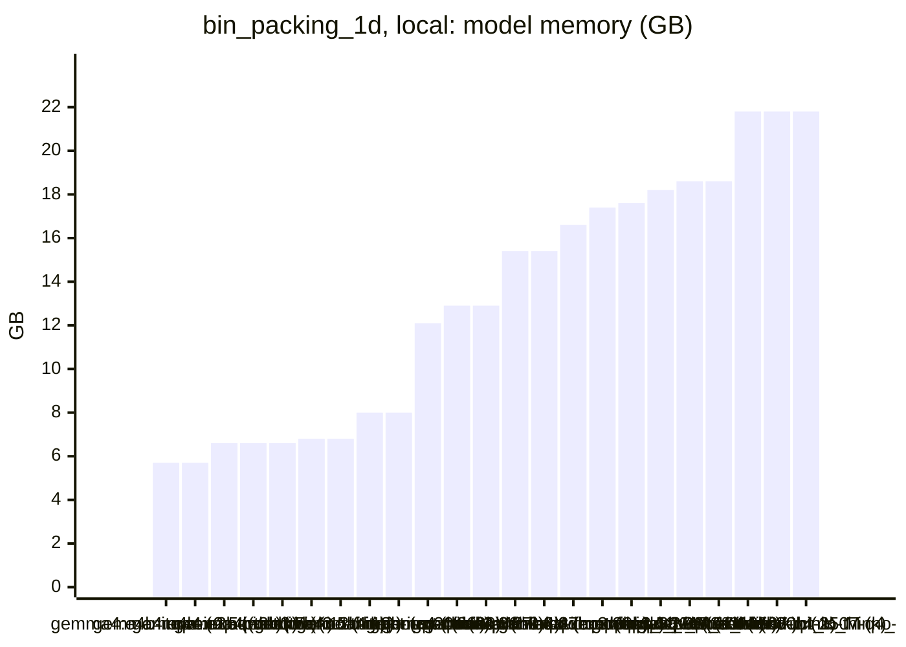

#### Best score over time

| Model | 3.75 min | 7.5 min | 11.25 min | 15 min |
|---|--:|--:|--:|--:|
| gpt-oss:20b (no-think) | 0.95128 | 0.95416 | 0.95416 | 0.95416 |
| gemma4:12b-it-qat (no-think) | 0.95128 | 0.95128 | 0.9541 | 0.9541 |
| gemma4:26b-a4b-it-qat (no-think) | 0.95128 | 0.95233 | 0.95233 | 0.95304 |
| gpt-oss:20b (think) | 0.79426 | 0.95128 | 0.95304 | 0.95304 |
| gemma4:e4b-it-qat (no-think) | 0.95128 | 0.95128 | 0.95128 | 0.95128 |
| qwen3.5:latest (no-think) | 0.95128 | 0.95128 | 0.95128 | 0.95128 |
| gemma4:e2b (no-think) | 0.95128 | 0.95128 | 0.95128 | 0.95128 |
| gemma4:latest (no-think) | 0.95128 | 0.95128 | 0.95128 | 0.95128 |
| qwen3.5:27b (no-think) | 0.79426 | 0.95128 | 0.95128 | 0.95128 |
| qwen3.8:27b-mtp-q4_K_M (no-think) | 0.79426 | 0.79426 | 0.79426 | 0.95128 |
| qwen3.6:27b-coding-mtp-q4_K_M (no-think) | 0.79426 | 0.95128 | 0.95128 | 0.95128 |
| qwen3:30b-a3b-instruct-2507-q4_K_M (no-think) | 0.95128 | 0.95128 | 0.95128 | 0.95128 |
| qwen3-coder:30b (no-think) | 0.95128 | 0.95128 | 0.95128 | 0.95128 |
| gemma4:e4b-it-qat (think) | 0.95128 | 0.95128 | 0.95128 | 0.95128 |
| qwen3.5:latest (think) | 0.95128 | 0.95128 | 0.95128 | 0.95128 |
| gemma4:12b-it-qat (think) | 0.79426 | 0.95128 | 0.95128 | 0.95128 |
| gemma4:e2b (think) | 0.95128 | 0.95128 | 0.95128 | 0.95128 |
| gemma4:latest (think) | 0.95128 | 0.95128 | 0.95128 | 0.95128 |
| gemma4:26b-a4b-it-qat (think) | 0.79426 | 0.79426 | 0.95128 | 0.95128 |
| qwen3.5:27b (think) | 0.79426 | 0.95128 | 0.95128 | 0.95128 |
| qwen3.6:27b-coding-mtp-q4_K_M (think) | 0.79426 | 0.79426 | 0.79426 | 0.79426 |
| qwen3:30b-a3b-instruct-2507-q4_K_M (think) | 0.95128 | 0.95128 | 0.95128 | 0.95128 |
| qwen2.5-coder:7b (no-think) | 0.79426 | 0.79426 | 0.79426 | 0.79426 |

#### Outcome of the LLM answers

| Model | duplicate | edit error | invalid | llm error | ok | timeout |
|---|--:|--:|--:|--:|--:|--:|
| gpt-oss:20b (no-think) | 0 | 0 | 1 | 0 | 16 | 1 |
| gemma4:12b-it-qat (no-think) | 1 | 1 | 2 | 0 | 17 | 0 |
| gemma4:26b-a4b-it-qat (no-think) | 0 | 6 | 0 | 0 | 27 | 0 |
| gpt-oss:20b (think) | 1 | 1 | 1 | 0 | 16 | 0 |
| gemma4:e4b-it-qat (no-think) | 3 | 7 | 15 | 0 | 38 | 0 |
| qwen3.5:latest (no-think) | 0 | 1 | 7 | 1 | 17 | 0 |
| gemma4:e2b (no-think) | 17 | 6 | 9 | 0 | 33 | 0 |
| gemma4:latest (no-think) | 2 | 3 | 7 | 0 | 49 | 0 |
| qwen3.5:27b (no-think) | 0 | 0 | 0 | 0 | 8 | 0 |
| qwen3.8:27b-mtp-q4_K_M (no-think) | 0 | 0 | 0 | 0 | 4 | 0 |
| qwen3.6:27b-coding-mtp-q4_K_M (no-think) | 1 | 1 | 1 | 0 | 5 | 0 |
| qwen3:30b-a3b-instruct-2507-q4_K_M (no-think) | 1 | 4 | 17 | 0 | 21 | 1 |
| qwen3-coder:30b (no-think) | 0 | 0 | 4 | 0 | 20 | 1 |
| gemma4:e4b-it-qat (think) | 2 | 0 | 3 | 0 | 15 | 0 |
| qwen3.5:latest (think) | 1 | 1 | 9 | 0 | 11 | 0 |
| gemma4:12b-it-qat (think) | 0 | 0 | 0 | 0 | 3 | 0 |
| gemma4:e2b (think) | 0 | 4 | 4 | 0 | 18 | 0 |
| gemma4:latest (think) | 1 | 0 | 3 | 0 | 18 | 0 |
| gemma4:26b-a4b-it-qat (think) | 0 | 1 | 0 | 2 | 1 | 0 |
| qwen3.5:27b (think) | 0 | 0 | 1 | 0 | 4 | 0 |
| qwen3.6:27b-coding-mtp-q4_K_M (think) | 0 | 0 | 0 | 0 | 1 | 0 |
| qwen3:30b-a3b-instruct-2507-q4_K_M (think) | 7 | 2 | 12 | 1 | 18 | 1 |
| qwen2.5-coder:7b (no-think) | 6 | 1 | 28 | 1 | 6 | 0 |

#### Best idea per model

- **gpt-oss:20b (no-think)**: Add a lightweight improvement phase after the initial first‑fit decreasing packing that repeatedly re‑assigns items to other bins to reduce slack and drop empty bins, using random …
- **gemma4:12b-it-qat (no-think)**: Fix the bug where `bin_loads` and `bins` list indices become desynchronized by ensuring that when an empty bin is removed, the `bin_loads` list is updated correctly and the …
- **gemma4:26b-a4b-it-qat (no-think)**: Implement a randomized First Fit Decreasing approach combined with a local search that attempts to empty the least-loaded bins and performs 1-1 swaps to increase bin density.
- **gpt-oss:20b (think)**: Add a simple post‑packing improvement that tries to empty bins by moving their items into other bins, reducing the total bin count with negligible extra cost.
- **gemma4:e4b-it-qat (no-think)**: Implement First Fit Decreasing (FFD) by sorting items by decreasing size and then packing them using the First Fit heuristic to improve bin packing density significantly over Next …
- **qwen3.5:latest (no-think)**: Remove the broken local optimization loop and redundant re-implementation, replacing them with a single efficient Best-Fit Decreasing pass that correctly initializes bin_loads as …
- **gemma4:e2b (no-think)**: Implement Best Fit Decreasing (BFD) instead of First Fit Decreasing (FFD) by always placing the item into the bin that results in the minimum remaining space, which tends to …
- **gemma4:latest (no-think)**: Implement First Fit Decreasing (FFD) by sorting items by size in descending order and then applying the First Fit strategy.
- **qwen3.5:27b (no-think)**: Replace the Next Fit heuristic with First Fit Decreasing (FFD) by sorting items in descending order before packing, which is a standard improvement that significantly reduces the …
- **qwen3.8:27b-mtp-q4_K_M (no-think)**: Replace next-fit with First-Fit-Decreasing (a substantially different greedy construction) which is known to land near the lower bound on these instances and runs in milliseconds …
- **qwen3.6:27b-coding-mtp-q4_K_M (no-think)**: Replace next-fit with First Fit Decreasing (FFD), which sorts items by size descending and places each in the first bin that fits, significantly reducing bin count for these …
- **qwen3:30b-a3b-instruct-2507-q4_K_M (no-think)**: Replace next-fit with First-Fit Decreasing (FFD) to improve bin utilization by packing larger items first, reducing fragmentation and enabling better packing efficiency …
- **qwen3-coder:30b (no-think)**: Replace the simple next-fit heuristic with a first-fit decreasing approach combined with local search optimization to reduce the number of bins used, especially effective for the …
- **gemma4:e4b-it-qat (think)**: Implement First Fit Decreasing (FFD) instead of Next Fit by sorting items by decreasing size and then placing each item into the first bin that can accommodate it, significantly …
- **qwen3.5:latest (think)**: Replace Next-Fit with First-Fit Decreasing (sort items descending, place in first-fitting bin) which is provably much better; add SWEEP for optional local search iteration limit.
- **gemma4:12b-it-qat (think)**: Replace the current Next Fit heuristic with First Fit Decreasing (FFD), which sorts items by size in descending order and places each item into the first bin that can accommodate …
- **gemma4:e2b (think)**: Sort items by decreasing size and use First Fit (FFD) to place items into existing bins to reduce fragmentation.
- **gemma4:latest (think)**: Replace the Next Fit heuristic with the First Fit Decreasing (FFD) heuristic by sorting items by size descendingly while preserving original indices, which is a significant …
- **gemma4:26b-a4b-it-qat (think)**: Implement First-Fit Decreasing (FFD) to significantly improve bin packing efficiency over the current next-fit approach.
- **qwen3.5:27b (think)**: Implement First-Fit Decreasing (FFD) which sorts items by decreasing size before packing and uses first-fit placement, a well-known heuristic that significantly improves bin …
- **qwen3.6:27b-coding-mtp-q4_K_M (think)**: Replace the naive next-fit heuristic with Best Fit Decreasing (BFD), which sorts items by size descending and places each into the bin that leaves the least remaining space …
- **qwen3:30b-a3b-instruct-2507-q4_K_M (think)**: Replace next-fit with First-Fit Decreasing (FFD) to improve packing efficiency by sorting items in descending order and placing each item in the first bin that can accommodate it …
- **qwen2.5-coder:7b (no-think)**: initial program

## circle_packing_26

32 models, 15 minutes each, latest run per model.

### Local models

Ollama on this machine.

| Model | Params | Initial | Best | Gain | LLM calls | s/call | Valid | New bests | Min to best |
|---|---|--:|--:|--:|--:|--:|--:|--:|--:|
| gpt-oss:20b (think) | 20.9B | 1.4901 | **2.46941** | ×1.66 | 20 | 48 | 70% | 6 | 10.1 |
| gemma4:26b-a4b-it-qat (no-think) | 25.2B | 1.4901 | **2.26342** | ×1.52 | 23 | 40 | 57% | 2 | 10.2 |
| gemma4:26b-a4b-it-qat (think) | 25.2B | 1.4901 | **2.01811** | ×1.35 | 3 | 304 | 33% | 1 | 15.2 |
| gemma4:latest (no-think) |  | 1.4901 | **1.95098** | ×1.31 | 56 | 16 | 57% | 3 | 14.3 |
| qwen3:30b-a3b-instruct-2507-q4_K_M (no-think) | 30.5B | 1.4901 | **1.92574** | ×1.29 | 45 | 19 | 60% | 2 | 9.2 |
| qwen3.5:latest (no-think) | 9.7B | 1.4901 | **1.88064** | ×1.26 | 20 | 46 | 30% | 1 | 6.2 |
| qwen3:30b-a3b-instruct-2507-q4_K_M (think) | 30.5B | 1.4901 | **1.81593** | ×1.22 | 43 | 20 | 63% | 15 | 14.3 |
| gemma4:12b-it-qat (no-think) | 11.9B | 1.4901 | **1.77142** | ×1.19 | 20 | 45 | 80% | 2 | 11.8 |
| gemma4:latest (think) |  | 1.4901 | **1.67672** | ×1.13 | 15 | 63 | 80% | 3 | 14.3 |
| gemma4:e4b-it-qat (think) | 7.5B | 1.4901 | **1.64644** | ×1.10 | 14 | 65 | 93% | 2 | 14.5 |
| qwen3-coder:30b (no-think) | 30.5B | 1.4901 | **1.62233** | ×1.09 | 34 | 27 | 71% | 2 | 15.4 |
| gemma4:e2b (no-think) | 5.1B | 1.4901 | **1.60406** | ×1.08 | 54 | 18 | 39% | 1 | 6.6 |
| qwen3.8:27b-mtp-q4_K_M (no-think) | 27.3B | 1.4901 | **1.60406** | ×1.08 | 7 | 148 | 57% | 1 | 8.0 |
| qwen3.6:27b-coding-mtp-q4_K_M (no-think) | 27.3B | 1.4901 | **1.49537** | ×1.00 | 7 | 135 | 57% | 1 | 8.6 |
| qwen3.5:latest (think) | 9.7B | 1.4901 | **1.4901** | ×1.00 | 19 | 49 | 11% | 0 | - |
| gemma4:e2b (think) | 5.1B | 1.4901 | **1.4901** | ×1.00 | 22 | 41 | 14% | 0 | - |
| qwen2.5-coder:7b (no-think) | 7.6B | 1.4901 | **1.4901** | ×1.00 | 37 | 24 | 27% | 0 | - |
| gemma4:e4b-it-qat (no-think) | 7.5B | 1.4901 | **1.4901** | ×1.00 | 52 | 17 | 56% | 0 | - |
| gpt-oss:20b (no-think) | 20.9B | 1.4901 | **1.4901** | ×1.00 | 9 | 118 | 33% | 0 | - |
| qwen3.5:27b (no-think) | 27.8B | 1.4901 | **1.4901** | ×1.00 | 6 | 182 | 83% | 0 | - |
| gemma4:12b-it-qat (think) | 11.9B | 1.4901 | **1.4901** | ×1.00 | 2 | 527 | 0% | 0 | - |
| qwen3.5:27b (think) | 27.8B | 1.4901 | **1.4901** | ×1.00 | 3 | 468 | 33% | 0 | - |
| qwen3.8:27b-mtp-q4_K_M (think) | 27.3B | 1.4901 | **1.4901** | ×1.00 | 2 | 838 | 50% | 0 | - |
| qwen3.6:27b-coding-mtp-q4_K_M (think) | 27.3B | 1.4901 | **1.4901** | ×1.00 | 1 | 942 | 0% | 0 | - |

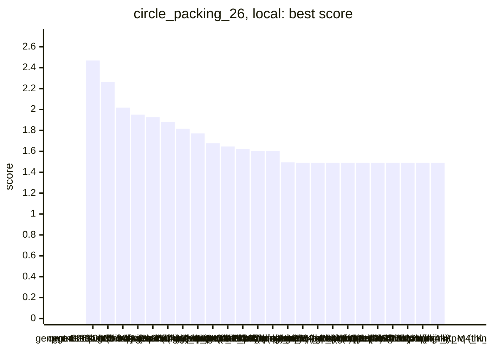

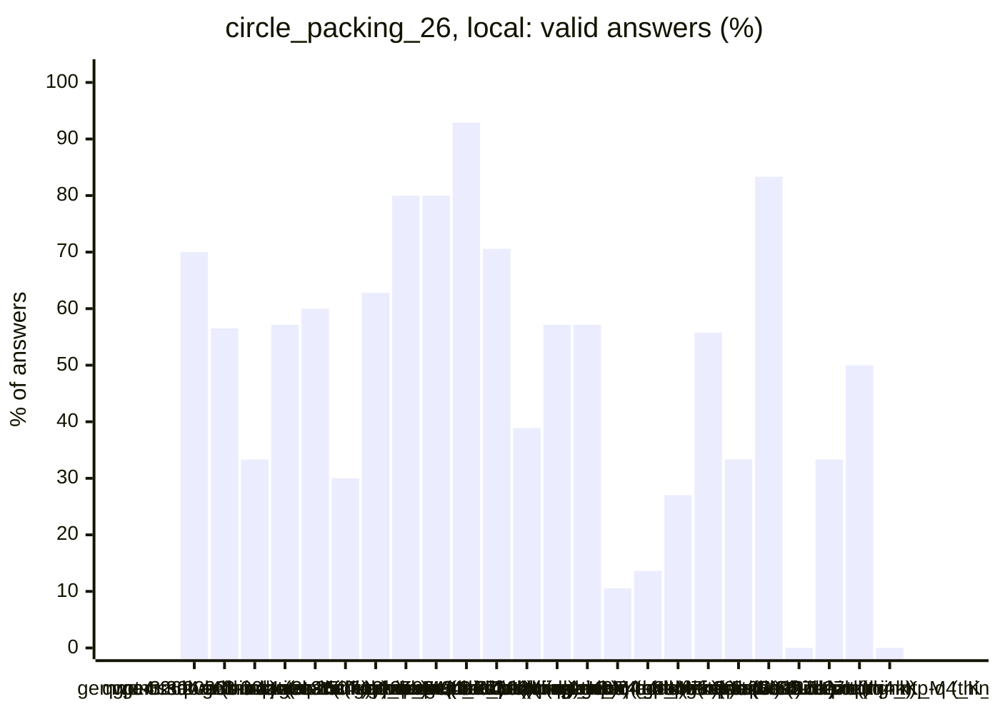

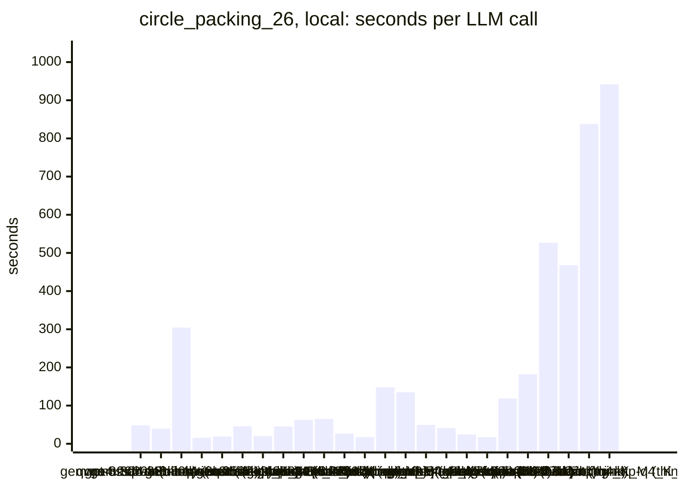

#### Inference speed and memory

RAM is what Ollama reports for the loaded model (weights, context cache and buffers; on Apple silicon this is shared memory). Load is the time to bring the model into memory. Prompt and generation speeds are tokens per second over all calls of the run.

| Model | Params | RAM GB | Load s | Prompt tok/s | Gen tok/s | Median s/call | p90 s/call | Tokens/answer | Stopped |
|---|---|--:|--:|--:|--:|--:|--:|--:|--:|
| gemma4:e4b-it-qat (think) | 7.5B | 5.7 | 85 | 674 | 58.0 | 56 | 109 | 3185 | 0 |
| gemma4:e4b-it-qat (no-think) | 7.5B | 5.7 | 85 | 578 | 55.8 | 16 | 26 | 559 | 0 |
| gemma4:e2b (no-think) | 5.1B | 6.6 | 35 | 891 | 65.8 | 12 | 42 | 853 | 1 |
| gemma4:e2b (think) | 5.1B | 6.6 | 34 | 1142 | 77.3 | 42 | 55 | 2652 | 4 |
| qwen2.5-coder:7b (no-think) | 7.6B | 6.6 | 54 | 465 | 37.0 | 24 | 31 | 637 | 0 |
| qwen3.5:latest (no-think) | 9.7B | 6.8 | 49 | 374 | 34.0 | 32 | 100 | 969 | 2 |
| qwen3.5:latest (think) | 9.7B | 6.8 | 47 | 423 | 35.8 | 49 | 74 | 1498 | 0 |
| gemma4:12b-it-qat (no-think) | 11.9B | 8.0 | 66 | 220 | 28.6 | 40 | 86 | 723 | 0 |
| gemma4:12b-it-qat (think) | 11.9B | 8.0 | 90 | 251 | 28.9 | 576 | 576 | 13740 | 0 |
| gemma4:latest (think) |  | 11.4 | 109 | 835 | 45.7 | 58 | 92 | 2363 | 0 |
| gpt-oss:20b (think) | 20.9B | 12.8 | 104 | 525 | 47.5 | 46 | 97 | 1742 | 0 |
| gpt-oss:20b (no-think) | 20.9B | 12.9 | 56 | 666 | 48.0 | 156 | 181 | 5260 | 0 |
| gemma4:26b-a4b-it-qat (no-think) | 25.2B | 15.2 | 223 | 528 | 57.0 | 29 | 49 | 1150 | 2 |
| gemma4:26b-a4b-it-qat (think) | 25.2B | 15.2 | 0 | 556 | 56.7 | 243 | 434 | 13573 | 2 |
| gemma4:latest (no-think) |  | 15.4 | 124 | 909 | 45.2 | 12 | 26 | 448 | 0 |
| qwen3.6:27b-coding-mtp-q4_K_M (think) | 27.3B | 17.4 | 209 | 95 | 12.7 | 942 | 942 | 9117 | 0 |
| qwen3.8:27b-mtp-q4_K_M (no-think) | 27.3B | 17.6 | 220 | 99 | 15.0 | 101 | 365 | 1374 | 0 |
| qwen3.8:27b-mtp-q4_K_M (think) | 27.3B | 17.6 | 202 | 129 | 12.7 | 878 | 878 | 9202 | 0 |
| qwen3.6:27b-coding-mtp-q4_K_M (no-think) | 27.3B | 18.2 | 196 | 100 | 15.6 | 98 | 327 | 1319 | 0 |
| qwen3.5:27b (think) | 27.8B | 18.4 | 85 | 120 | 10.8 | 367 | 898 | 4607 | 0 |
| qwen3.5:27b (no-think) | 27.8B | 18.6 | 130 | 90 | 10.8 | 152 | 286 | 1456 | 0 |
| qwen3:30b-a3b-instruct-2507-q4_K_M (no-think) | 30.5B | 21.8 | 149 | 651 | 52.6 | 13 | 29 | 528 | 0 |
| qwen3:30b-a3b-instruct-2507-q4_K_M (think) | 30.5B | 21.8 | 133 | 600 | 50.6 | 15 | 28 | 514 | 0 |
| qwen3-coder:30b (no-think) | 30.5B | 21.8 | 218 | 687 | 54.8 | 23 | 28 | 865 | 1 |

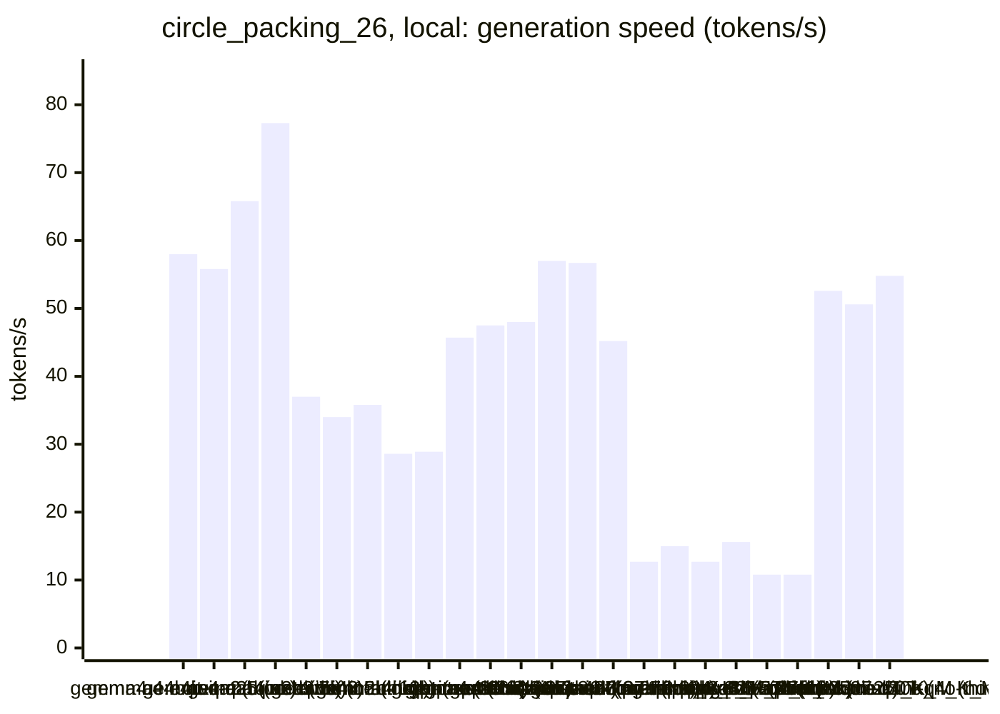

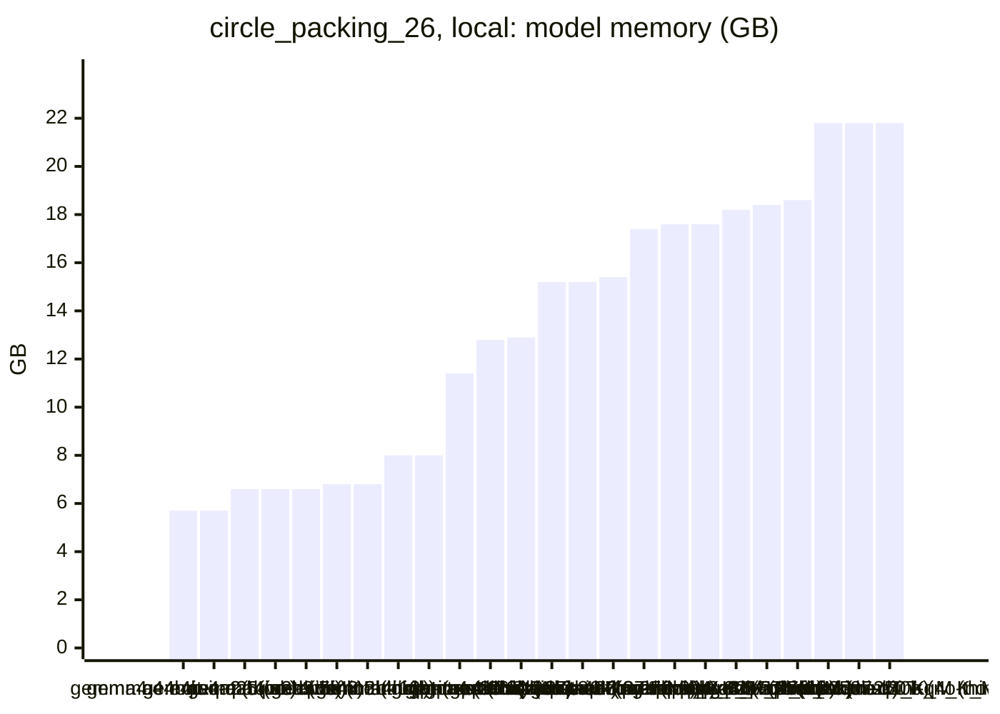

#### Best score over time

| Model | 3.75 min | 7.5 min | 11.25 min | 15 min |
|---|--:|--:|--:|--:|
| gpt-oss:20b (think) | 1.4901 | 2.25061 | 2.46941 | 2.46941 |
| gemma4:26b-a4b-it-qat (no-think) | 1.4901 | 1.55726 | 2.26342 | 2.26342 |
| gemma4:26b-a4b-it-qat (think) | 1.4901 | 1.4901 | 1.4901 | 1.4901 |
| gemma4:latest (no-think) | 1.4901 | 1.4901 | 1.4901 | 1.95098 |
| qwen3:30b-a3b-instruct-2507-q4_K_M (no-think) | 1.4901 | 1.4901 | 1.92574 | 1.92574 |
| qwen3.5:latest (no-think) | 1.4901 | 1.88064 | 1.88064 | 1.88064 |
| qwen3:30b-a3b-instruct-2507-q4_K_M (think) | 1.49537 | 1.5268 | 1.64029 | 1.81593 |
| gemma4:12b-it-qat (no-think) | 1.74142 | 1.74142 | 1.74142 | 1.77142 |
| gemma4:latest (think) | 1.4901 | 1.4901 | 1.51909 | 1.67672 |
| gemma4:e4b-it-qat (think) | 1.4901 | 1.50363 | 1.50363 | 1.64644 |
| qwen3-coder:30b (no-think) | 1.4901 | 1.61875 | 1.61875 | 1.61875 |
| gemma4:e2b (no-think) | 1.4901 | 1.60406 | 1.60406 | 1.60406 |
| qwen3.8:27b-mtp-q4_K_M (no-think) | 1.4901 | 1.4901 | 1.60406 | 1.60406 |
| qwen3.6:27b-coding-mtp-q4_K_M (no-think) | 1.4901 | 1.4901 | 1.49537 | 1.49537 |
| qwen3.5:latest (think) | 1.4901 | 1.4901 | 1.4901 | 1.4901 |
| gemma4:e2b (think) | 1.4901 | 1.4901 | 1.4901 | 1.4901 |
| qwen2.5-coder:7b (no-think) | 1.4901 | 1.4901 | 1.4901 | 1.4901 |
| gemma4:e4b-it-qat (no-think) | 1.4901 | 1.4901 | 1.4901 | 1.4901 |
| gpt-oss:20b (no-think) | 1.4901 | 1.4901 | 1.4901 | 1.4901 |
| qwen3.5:27b (no-think) | 1.4901 | 1.4901 | 1.4901 | 1.4901 |
| gemma4:12b-it-qat (think) | 1.4901 | 1.4901 | 1.4901 | 1.4901 |
| qwen3.5:27b (think) | 1.4901 | 1.4901 | 1.4901 | 1.4901 |
| qwen3.8:27b-mtp-q4_K_M (think) | 1.4901 | 1.4901 | 1.4901 | 1.4901 |
| qwen3.6:27b-coding-mtp-q4_K_M (think) | 1.4901 | 1.4901 | 1.4901 | 1.4901 |

#### Outcome of the LLM answers

| Model | duplicate | edit error | invalid | llm error | ok | timeout |
|---|--:|--:|--:|--:|--:|--:|
| gpt-oss:20b (think) | 1 | 3 | 2 | 0 | 14 | 0 |
| gemma4:26b-a4b-it-qat (no-think) | 1 | 3 | 4 | 2 | 13 | 0 |
| gemma4:26b-a4b-it-qat (think) | 0 | 0 | 0 | 2 | 1 | 0 |
| gemma4:latest (no-think) | 1 | 4 | 19 | 0 | 32 | 0 |
| qwen3:30b-a3b-instruct-2507-q4_K_M (no-think) | 0 | 5 | 12 | 0 | 27 | 1 |
| qwen3.5:latest (no-think) | 0 | 2 | 10 | 2 | 6 | 0 |
| qwen3:30b-a3b-instruct-2507-q4_K_M (think) | 0 | 10 | 6 | 0 | 27 | 0 |
| gemma4:12b-it-qat (no-think) | 0 | 3 | 1 | 0 | 16 | 0 |
| gemma4:latest (think) | 0 | 1 | 2 | 0 | 12 | 0 |
| gemma4:e4b-it-qat (think) | 0 | 0 | 1 | 0 | 13 | 0 |
| qwen3-coder:30b (no-think) | 3 | 0 | 6 | 1 | 24 | 0 |
| gemma4:e2b (no-think) | 0 | 7 | 25 | 1 | 21 | 0 |
| qwen3.8:27b-mtp-q4_K_M (no-think) | 0 | 0 | 3 | 0 | 4 | 0 |
| qwen3.6:27b-coding-mtp-q4_K_M (no-think) | 0 | 1 | 1 | 0 | 4 | 1 |
| qwen3.5:latest (think) | 0 | 1 | 15 | 0 | 2 | 1 |
| gemma4:e2b (think) | 0 | 4 | 11 | 4 | 3 | 0 |
| qwen2.5-coder:7b (no-think) | 9 | 1 | 17 | 0 | 10 | 0 |
| gemma4:e4b-it-qat (no-think) | 1 | 7 | 15 | 0 | 29 | 0 |
| gpt-oss:20b (no-think) | 0 | 4 | 2 | 0 | 3 | 0 |
| qwen3.5:27b (no-think) | 0 | 0 | 0 | 0 | 5 | 1 |
| gemma4:12b-it-qat (think) | 0 | 1 | 1 | 0 | 0 | 0 |
| qwen3.5:27b (think) | 0 | 1 | 1 | 0 | 1 | 0 |
| qwen3.8:27b-mtp-q4_K_M (think) | 0 | 0 | 1 | 0 | 1 | 0 |
| qwen3.6:27b-coding-mtp-q4_K_M (think) | 0 | 0 | 1 | 0 | 0 | 0 |

#### Best idea per model

- **gpt-oss:20b (think)**: tuned INIT_TEMP=0.1, STEP=0.05, COOL_RATE=0.998, TOTAL_ITERS=4000 on top of: In each annealing iteration, perturb all circles in random order instead of just one, allowing broader …
- **gemma4:26b-a4b-it-qat (no-think)**: tuned ITERATIONS=20, REPULSION_STRENGTH=0.01, REPULSION_DIST=0.3, WALL_DIST=0.1 on top of: Introduce named constants for optimization parameters and provide a sweep to find the …
- **gemma4:26b-a4b-it-qat (think)**: Use a hill-climbing optimization with multiple initializations (grid, random, and jittered grid) to find better circle centers and maximize the sum of radii.
- **gemma4:latest (no-think)**: tuned ITERATIONS=150, LEARNING_RATE=0.01 on top of: Expose the iteration count and the learning rate in `max_radii` as named constants to allow for systematic searching for better …
- **qwen3:30b-a3b-instruct-2507-q4_K_M (no-think)**: tuned h_spacing=0.1084, v_spacing=0.1594 on top of: Replace the fixed hexagonal lattice with a dynamic circle packing algorithm using Lloyd's relaxation to iteratively adjust …
- **qwen3.5:latest (no-think)**: Replace the O(N²) pairwise overlap resolution with a single-pass linear sweep using sorted distances to shrink radii efficiently while respecting all constraints simultaneously.
- **qwen3:30b-a3b-instruct-2507-q4_K_M (think)**: tuned spacing_factor=1.035, offset_factor=0.1434 on top of: Replace the fixed hexagonal lattice with an adaptive Voronoi-based radius assignment followed by iterative center …
- **gemma4:12b-it-qat (no-think)**: tuned SAMPLES=10 on top of: Increase sampling density and use a more refined local search (hill climbing) to improve circle positions and maximize the radii sum.
- **gemma4:latest (think)**: Introduce a simple hill-climbing optimization loop into construct_packing by randomly perturbing the centers and accepting moves that increase the total sum of radii, thus …
- **gemma4:e4b-it-qat (think)**: tuned C_PACK=5, R_PACK=6 on top of: Parameterize the grid dimensions by sweeping the number of columns ($C_{PACK}$) and rows ($R_{PACK}$) in the hexagonal lattice structure, as …
- **qwen3-coder:30b (no-think)**: tuned HEX_PACKING_RATIO=1.1, HEX_OFFSET_FACTOR=0.75 on top of: Replace fixed hexagonal parameters with sweepable constants to allow optimization of packing density and spacing for …
- **gemma4:e2b (no-think)**: Modify the center placement to use a uniform square grid instead of the hexagonal approximation to test a simpler, highly structured packing that might be easier to optimize …
- **qwen3.8:27b-mtp-q4_K_M (no-think)**: edit: N_COLS = 5 / N_ROWS = 6
- **qwen3.6:27b-coding-mtp-q4_K_M (no-think)**: Replace the naive grid packing with a hexagonal lattice initialization and a local optimization loop that iteratively adjusts centers and radii to maximize the sum of radii while …
- **qwen3.5:latest (think)**: initial program
- **gemma4:e2b (think)**: initial program
- **qwen2.5-coder:7b (no-think)**: initial program
- **gemma4:e4b-it-qat (no-think)**: initial program
- **gpt-oss:20b (no-think)**: initial program
- **qwen3.5:27b (no-think)**: initial program
- **gemma4:12b-it-qat (think)**: initial program
- **qwen3.5:27b (think)**: initial program
- **qwen3.8:27b-mtp-q4_K_M (think)**: initial program
- **qwen3.6:27b-coding-mtp-q4_K_M (think)**: initial program

### Cloud models (OpenRouter)

Free OpenRouter models; times include the network and the provider's queue.

| Model | Params | Initial | Best | Gain | LLM calls | s/call | Valid | New bests | Min to best |
|---|---|--:|--:|--:|--:|--:|--:|--:|--:|
| nvidia/nemotron-3-super-120b-a12b:free (think) |  | 1.4901 | **2.5045** | ×1.68 | 23 | 39 | 83% | 4 | 10.7 |
| nvidia/nemotron-3-ultra-550b-a55b:free (think) |  | 1.4901 | **2.40507** | ×1.61 | 10 | 112 | 30% | 2 | 13.0 |
| nvidia/nemotron-3-super-120b-a12b:free (no-think) |  | 1.4901 | **2.01309** | ×1.35 | 108 | 8 | 58% | 13 | 15.0 |
| cohere/north-mini-code:free (no-think) |  | 1.4901 | **1.75953** | ×1.18 | 81 | 10 | 58% | 7 | 14.6 |
| poolside/laguna-s-2.1:free (no-think) |  | 1.4901 | **1.63899** | ×1.10 | 21 | 45 | 14% | 1 | 12.3 |
| nvidia/nemotron-3-ultra-550b-a55b:free (no-think) |  | | | | | | | | failed: all 3 model requests failed: nvidia/nemotron-3-ultra-550b-a5 |
| cohere/north-mini-code:free (think) |  | 1.4901 | **1.4901** | ×1.00 | 11 | 84 | 0% | 0 | - |
| poolside/laguna-s-2.1:free (think) |  | 1.4901 | **1.4901** | ×1.00 | 6 | 158 | 0% | 0 | - |

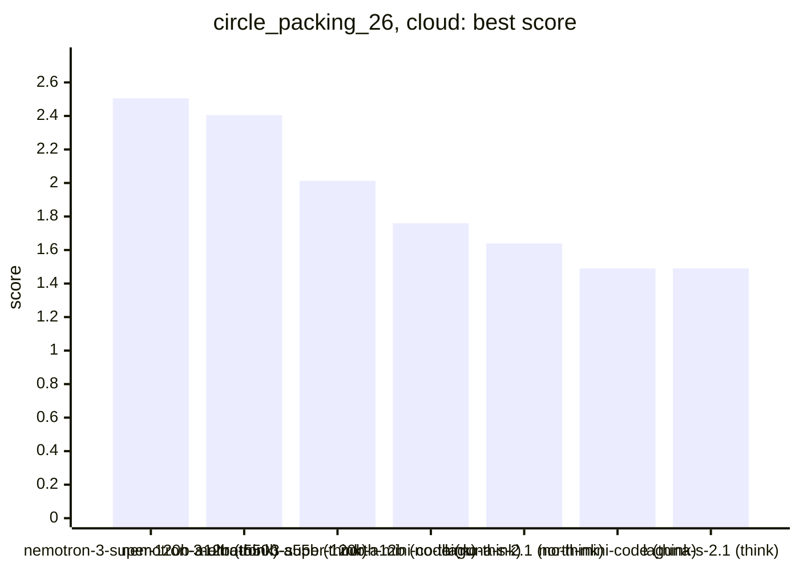

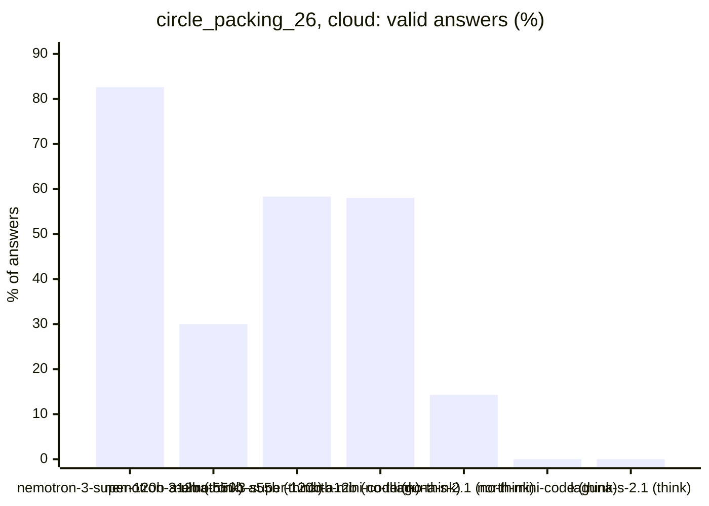

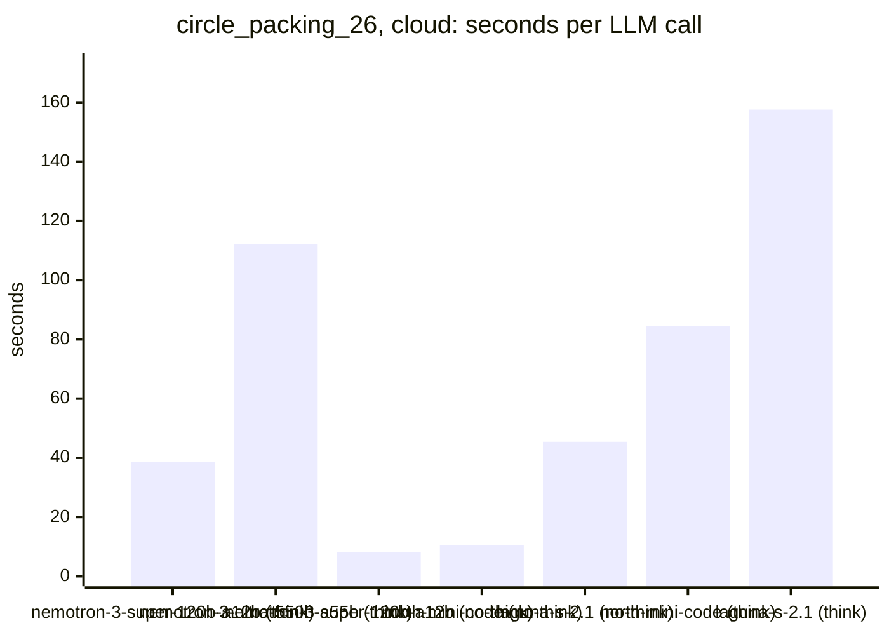

#### Inference speed and cost

Generation speed is measured from the first to the last streamed token; the time to the first token is counted as prompt time. Cost is what OpenRouter charged for the run.

| Model | Gen tok/s | Median s/call | p90 s/call | Tokens/answer | Stopped | Cost $ |
|---|--:|--:|--:|--:|--:|--:|
| nvidia/nemotron-3-super-120b-a12b:free (no-think) | 132.7 | 7 | 15 | 895 | 6 | 0.000 |
| cohere/north-mini-code:free (no-think) | 115.8 | 8 | 21 | 1154 | 2 | 0.000 |
| nvidia/nemotron-3-super-120b-a12b:free (think) | 115.7 | 36 | 57 | 4438 | 1 | 0.000 |
| cohere/north-mini-code:free (think) | 109.0 | 79 | 110 | 7542 | 10 | 0.000 |
| nvidia/nemotron-3-ultra-550b-a55b:free (think) | 54.5 | 71 | 300 | 4908 | 1 | 0.000 |
| poolside/laguna-s-2.1:free (no-think) | 53.1 | 33 | 59 | 1125 | 3 | 0.000 |
| poolside/laguna-s-2.1:free (think) | 50.8 | 187 | 263 | 2915 | 3 | 0.000 |

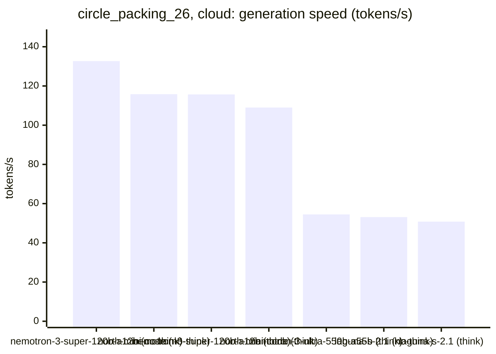

#### Best score over time

| Model | 3.75 min | 7.5 min | 11.25 min | 15 min |
|---|--:|--:|--:|--:|
| nvidia/nemotron-3-super-120b-a12b:free (think) | 2.46819 | 2.46819 | 2.5045 | 2.5045 |
| nvidia/nemotron-3-ultra-550b-a55b:free (think) | 1.4901 | 1.4901 | 1.4901 | 2.40507 |
| nvidia/nemotron-3-super-120b-a12b:free (no-think) | 1.67937 | 1.69674 | 1.94393 | 2.01309 |
| cohere/north-mini-code:free (no-think) | 1.60406 | 1.60406 | 1.60406 | 1.75953 |
| poolside/laguna-s-2.1:free (no-think) | 1.4901 | 1.4901 | 1.4901 | 1.63899 |
| cohere/north-mini-code:free (think) | 1.4901 | 1.4901 | 1.4901 | 1.4901 |
| poolside/laguna-s-2.1:free (think) | 1.4901 | 1.4901 | 1.4901 | 1.4901 |

#### Outcome of the LLM answers

| Model | duplicate | edit error | invalid | llm error | ok |
|---|--:|--:|--:|--:|--:|
| nvidia/nemotron-3-super-120b-a12b:free (think) | 0 | 1 | 2 | 1 | 19 |
| nvidia/nemotron-3-ultra-550b-a55b:free (think) | 0 | 1 | 5 | 1 | 3 |
| nvidia/nemotron-3-super-120b-a12b:free (no-think) | 16 | 5 | 18 | 6 | 63 |
| cohere/north-mini-code:free (no-think) | 11 | 5 | 16 | 2 | 47 |
| poolside/laguna-s-2.1:free (no-think) | 0 | 5 | 6 | 7 | 3 |
| cohere/north-mini-code:free (think) | 0 | 0 | 1 | 10 | 0 |
| poolside/laguna-s-2.1:free (think) | 0 | 1 | 1 | 4 | 0 |

#### Best idea per model

- **nvidia/nemotron-3-super-120b-a12b:free (think)**: tuned INITIAL_STEP=0.07883, STEP_DECAY=0.9843, MIN_STEP=0.0001, INITIAL_OFFSET=0.09298 on top of: Expose the initial offset of the grid points as a tunable constant to allow the …
- **nvidia/nemotron-3-ultra-550b-a55b:free (think)**: tuned OPT_STEPS=4245, PERTURB=0.04072, HEX_OFFSET=0.666 on top of: Replace the simple grid initialization with a hexagonal grid and an exact maximal-radius solver, then add a …
- **nvidia/nemotron-3-super-120b-a12b:free (no-think)**: tuned cols=6, rows=5, scale_x=0.98, scale_y=1.02 on top of: Increase the number of local optimization steps from 0 to 200 to iteratively improve circle positions and sum of radii …
- **cohere/north-mini-code:free (no-think)**: tuned JITTER_MAG=0.012, R0_SCALE_FACTOR=1.05 on top of: Replace the third gradient‑based local optimization with a fast vectorized radius‑only shrink loop to reduce runtime and …
- **poolside/laguna-s-2.1:free (no-think)**: tuned HEX_RADIUS=0.1 on top of: Replace the naive grid layout with a fixed-radius hexagonal lattice packing optimized for 26 circles, which yields a much larger sum of radii by …
- **cohere/north-mini-code:free (think)**: initial program
- **poolside/laguna-s-2.1:free (think)**: initial program

## circles_in_circle_21

24 models, 15 minutes each, latest run per model.

### Local models

Ollama on this machine.

| Model | Params | Initial | Best | Gain | LLM calls | s/call | Valid | New bests | Min to best |
|---|---|--:|--:|--:|--:|--:|--:|--:|--:|
| gpt-oss:20b (no-think) | 20.9B | 3.18905 | **4.05278** | ×1.27 | 8 | 118 | 62% | 2 | 10.3 |
| qwen3:30b-a3b-instruct-2507-q4_K_M (no-think) | 30.5B | 3.18905 | **4.05117** | ×1.27 | 35 | 25 | 74% | 8 | 15.2 |
| qwen3:30b-a3b-instruct-2507-q4_K_M (think) | 30.5B | 3.18905 | **4.05042** | ×1.27 | 49 | 18 | 59% | 5 | 9.8 |
| gemma4:e4b-it-qat (think) | 7.5B | 3.18905 | **4.03803** | ×1.27 | 19 | 49 | 74% | 5 | 11.6 |
| gemma4:26b-a4b-it-qat (no-think) | 25.2B | 3.18905 | **3.9964** | ×1.25 | 23 | 35 | 65% | 3 | 10.4 |
| qwen3.8:27b-mtp-q4_K_M (no-think) | 27.3B | 3.18905 | **3.99294** | ×1.25 | 9 | 103 | 56% | 2 | 14.7 |
| gpt-oss:20b (think) | 20.9B | 3.18905 | **3.99** | ×1.25 | 11 | 85 | 55% | 1 | 7.6 |
| qwen3-coder:30b (no-think) | 30.5B | 3.18905 | **3.96005** | ×1.24 | 36 | 25 | 44% | 3 | 10.3 |
| gemma4:e4b-it-qat (no-think) | 7.5B | 3.18905 | **3.9302** | ×1.23 | 44 | 20 | 55% | 3 | 13.6 |
| gemma4:12b-it-qat (no-think) | 11.9B | 3.18905 | **3.9302** | ×1.23 | 17 | 56 | 65% | 2 | 11.4 |
| gemma4:latest (no-think) |  | 3.18905 | **3.90376** | ×1.22 | 46 | 19 | 65% | 4 | 14.4 |
| gemma4:e2b (no-think) | 5.1B | 3.18905 | **3.70711** | ×1.16 | 59 | 15 | 56% | 2 | 8.2 |
| gemma4:latest (think) |  | 3.18905 | **3.57552** | ×1.12 | 18 | 50 | 83% | 3 | 11.8 |
| qwen3.5:27b (think) | 27.8B | 3.18905 | **3.41478** | ×1.07 | 4 | 229 | 50% | 2 | 10.3 |
| qwen2.5-coder:7b (no-think) | 7.6B | 3.18905 | **3.18905** | ×1.00 | 39 | 24 | 21% | 0 | - |
| qwen3.5:latest (no-think) | 9.7B | 3.18905 | **3.18905** | ×1.00 | 23 | 40 | 0% | 0 | - |
| qwen3.5:27b (no-think) | 27.8B | 3.18905 | **3.18905** | ×1.00 | 7 | 131 | 0% | 0 | - |
| qwen3.6:27b-coding-mtp-q4_K_M (no-think) | 27.3B | 3.18905 | **3.18905** | ×1.00 | 7 | 130 | 86% | 0 | - |
| qwen3.5:latest (think) | 9.7B | 3.18905 | **3.18905** | ×1.00 | 9 | 112 | 0% | 0 | - |
| gemma4:12b-it-qat (think) | 11.9B | | | | | | | | failed: all 2 model requests failed: gemma4:12b-it-qat: answer stopp |
| gemma4:e2b (think) | 5.1B | 3.18905 | **3.18905** | ×1.00 | 20 | 46 | 40% | 0 | - |
| gemma4:26b-a4b-it-qat (think) | 25.2B | 3.18905 | **3.18905** | ×1.00 | 3 | 351 | 0% | 0 | - |
| qwen3.8:27b-mtp-q4_K_M (think) | 27.3B | | | | | | | | failed: all 1 model requests failed: qwen3.8:27b-mtp-q4_K_M: answer  |
| qwen3.6:27b-coding-mtp-q4_K_M (think) | 27.3B | 3.18905 | **3.18905** | ×1.00 | 2 | 708 | 0% | 0 | - |

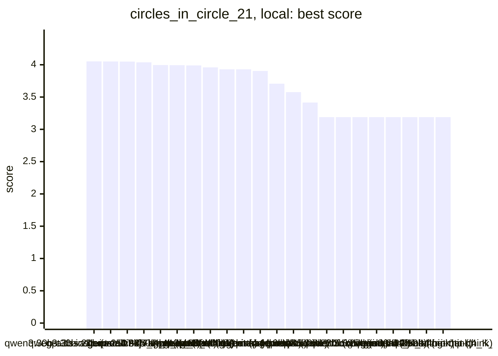

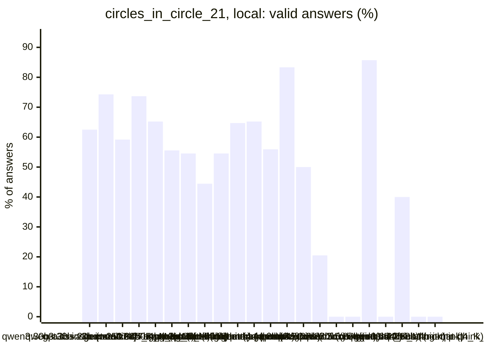

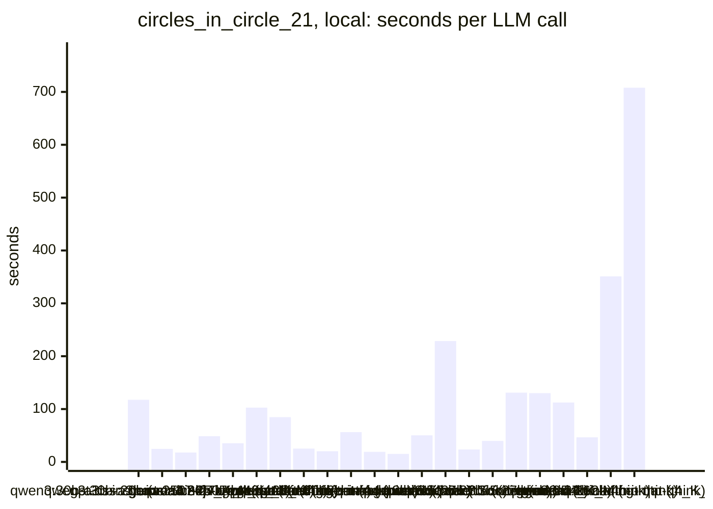

#### Inference speed and memory

RAM is what Ollama reports for the loaded model (weights, context cache and buffers; on Apple silicon this is shared memory). Load is the time to bring the model into memory. Prompt and generation speeds are tokens per second over all calls of the run.

| Model | Params | RAM GB | Load s | Prompt tok/s | Gen tok/s | Median s/call | p90 s/call | Tokens/answer | Stopped |
|---|---|--:|--:|--:|--:|--:|--:|--:|--:|
| gemma4:e4b-it-qat (think) | 7.5B | 5.7 | 94 | 644 | 56.1 | 42 | 87 | 2179 | 0 |
| gemma4:e4b-it-qat (no-think) | 7.5B | 5.7 | 61 | 664 | 61.2 | 18 | 35 | 817 | 0 |
| gemma4:e2b (no-think) | 5.1B | 6.6 | 34 | 866 | 78.5 | 12 | 28 | 700 | 0 |
| qwen2.5-coder:7b (no-think) | 7.6B | 6.6 | 36 | 547 | 39.8 | 23 | 39 | 700 | 1 |
| gemma4:e2b (think) | 5.1B | 6.6 | 80 | 1245 | 73.5 | 39 | 80 | 2979 | 0 |
| qwen3.5:latest (no-think) | 9.7B | 6.8 | 28 | 494 | 36.2 | 33 | 74 | 1031 | 3 |
| qwen3.5:latest (think) | 9.7B | 6.8 | 28 | 469 | 32.3 | 56 | 511 | 3393 | 0 |
| gemma4:12b-it-qat (no-think) | 11.9B | 8.0 | 65 | 256 | 30.6 | 52 | 86 | 1247 | 0 |
| gemma4:latest (think) |  | 11.7 | 121 | 952 | 48.8 | 43 | 77 | 1977 | 0 |
| gpt-oss:20b (think) | 20.9B | 12.8 | 209 | 558 | 48.2 | 57 | 199 | 2955 | 0 |
| gpt-oss:20b (no-think) | 20.9B | 12.9 | 54 | 747 | 52.1 | 132 | 192 | 5601 | 0 |
| gemma4:latest (no-think) |  | 14.8 | 121 | 985 | 52.2 | 16 | 27 | 658 | 0 |
| gemma4:26b-a4b-it-qat (think) | 25.2B | 15.2 | 316 | 601 | 57.6 | 257 | 562 | 14038 | 2 |
| gemma4:26b-a4b-it-qat (no-think) | 25.2B | 15.4 | 199 | 611 | 63.9 | 28 | 38 | 1233 | 0 |
| qwen3.6:27b-coding-mtp-q4_K_M (no-think) | 27.3B | 18.2 | 255 | 139 | 15.6 | 92 | 357 | 1242 | 0 |
| qwen3.6:27b-coding-mtp-q4_K_M (think) | 27.3B | 18.2 | 265 | 135 | 13.2 | 852 | 852 | 7446 | 0 |
| qwen3.8:27b-mtp-q4_K_M (no-think) | 27.3B | 18.3 | 239 | 107 | 14.2 | 76 | 353 | 810 | 0 |
| qwen3.5:27b (think) | 27.8B | 18.4 | 181 | 109 | 10.9 | 299 | 307 | 1799 | 0 |
| qwen3.5:27b (no-think) | 27.8B | 18.6 | 129 | 110 | 11.4 | 117 | 265 | 1099 | 0 |
| qwen3:30b-a3b-instruct-2507-q4_K_M (no-think) | 30.5B | 21.8 | 213 | 624 | 51.3 | 19 | 27 | 556 | 0 |
| qwen3:30b-a3b-instruct-2507-q4_K_M (think) | 30.5B | 21.8 | 183 | 706 | 52.8 | 13 | 23 | 435 | 0 |
| qwen3-coder:30b (no-think) | 30.5B | 21.8 | 130 | 702 | 53.3 | 23 | 38 | 889 | 0 |

```mermaid
xychart-beta
    title "circles_in_circle_21, local: generation speed (tokens/s)"
    x-axis ["gemma4:e4b-it-qat (think)", "gemma4:e4b-it-qat (no-think)", "gemma4:e2b (no-think)", "qwen2.5-coder:7b (no-think)", "gemma4:e2b (think)", "qwen3.5 (no-think)", "qwen3.5 (think)", "gemma4:12b-it-qat (no-think)", "gemma4 (think)", "gpt-oss:20b (think)", "gpt-oss:20b (no-think)", "gemma4 (no-think)", "gemma4:26b-a4b-it-qat (think)", "gemma4:26b-a4b-it-qat (no-think)", "qwen3.6:27b-coding-mtp-q4_K_M (no-think)", "qwen3.6:27b-coding-mtp-q4_K_M (think)", "qwen3.8:27b-mtp-q4_K_M (no-think)", "qwen3.5:27b (think)", "qwen3.5:27b (no-think)", "qwen3:30b-a3b-instruct-2507-q4_K_M (no-think)", "qwen3:30b-a3b-instruct-2507-q4_K_M (think)", "qwen3-coder:30b (no-think)"]
    y-axis "tokens/s" 0 --> 86.35
    bar [56.1, 61.2, 78.5, 39.8, 73.5, 36.2, 32.3, 30.6, 48.8, 48.2, 52.1, 52.2, 57.6, 63.9, 15.6, 13.2, 14.2, 10.9, 11.4, 51.3, 52.8, 53.3]
```

```mermaid
xychart-beta
    title "circles_in_circle_21, local: model memory (GB)"
    x-axis ["gemma4:e4b-it-qat (think)", "gemma4:e4b-it-qat (no-think)", "gemma4:e2b (no-think)", "qwen2.5-coder:7b (no-think)", "gemma4:e2b (think)", "qwen3.5 (no-think)", "qwen3.5 (think)", "gemma4:12b-it-qat (no-think)", "gemma4 (think)", "gpt-oss:20b (think)", "gpt-oss:20b (no-think)", "gemma4 (no-think)", "gemma4:26b-a4b-it-qat (think)", "gemma4:26b-a4b-it-qat (no-think)", "qwen3.6:27b-coding-mtp-q4_K_M (no-think)", "qwen3.6:27b-coding-mtp-q4_K_M (think)", "qwen3.8:27b-mtp-q4_K_M (no-think)", "qwen3.5:27b (think)", "qwen3.5:27b (no-think)", "qwen3:30b-a3b-instruct-2507-q4_K_M (no-think)", "qwen3:30b-a3b-instruct-2507-q4_K_M (think)", "qwen3-coder:30b (no-think)"]
    y-axis "GB" 0 --> 23.98
    bar [5.7, 5.7, 6.6, 6.6, 6.6, 6.8, 6.8, 8, 11.7, 12.8, 12.9, 14.8, 15.2, 15.4, 18.2, 18.2, 18.3, 18.4, 18.6, 21.8, 21.8, 21.8]
```

#### Best score over time

| Model | 3.75 min | 7.5 min | 11.25 min | 15 min |
|---|--:|--:|--:|--:|
| gpt-oss:20b (no-think) | 3.18905 | 4.05278 | 4.05278 | 4.05278 |
| qwen3:30b-a3b-instruct-2507-q4_K_M (no-think) | 3.18905 | 3.98521 | 4.05106 | 4.05106 |
| qwen3:30b-a3b-instruct-2507-q4_K_M (think) | 3.52218 | 4.00469 | 4.05042 | 4.05042 |
| gemma4:e4b-it-qat (think) | 3.59395 | 4.00883 | 4.00883 | 4.03803 |
| gemma4:26b-a4b-it-qat (no-think) | 3.18905 | 3.98733 | 3.9964 | 3.9964 |
| qwen3.8:27b-mtp-q4_K_M (no-think) | 3.18905 | 3.18905 | 3.99294 | 3.99294 |
| gpt-oss:20b (think) | 3.18905 | 3.18905 | 3.99 | 3.99 |
| qwen3-coder:30b (no-think) | 3.60536 | 3.72861 | 3.96005 | 3.96005 |
| gemma4:e4b-it-qat (no-think) | 3.18905 | 3.5047 | 3.64462 | 3.9302 |
| gemma4:12b-it-qat (no-think) | 3.18905 | 3.18905 | 3.61636 | 3.9302 |
| gemma4:latest (no-think) | 3.64462 | 3.64462 | 3.73835 | 3.90376 |
| gemma4:e2b (no-think) | 3.57134 | 3.57134 | 3.70711 | 3.70711 |
| gemma4:latest (think) | 3.18905 | 3.57134 | 3.57134 | 3.57552 |
| qwen3.5:27b (think) | 3.18905 | 3.31792 | 3.41478 | 3.41478 |
| qwen2.5-coder:7b (no-think) | 3.18905 | 3.18905 | 3.18905 | 3.18905 |
| qwen3.5:latest (no-think) | 3.18905 | 3.18905 | 3.18905 | 3.18905 |
| qwen3.5:27b (no-think) | 3.18905 | 3.18905 | 3.18905 | 3.18905 |
| qwen3.6:27b-coding-mtp-q4_K_M (no-think) | 3.18905 | 3.18905 | 3.18905 | 3.18905 |
| qwen3.5:latest (think) | 3.18905 | 3.18905 | 3.18905 | 3.18905 |
| gemma4:e2b (think) | 3.18905 | 3.18905 | 3.18905 | 3.18905 |
| gemma4:26b-a4b-it-qat (think) | 3.18905 | 3.18905 | 3.18905 | 3.18905 |
| qwen3.6:27b-coding-mtp-q4_K_M (think) | 3.18905 | 3.18905 | 3.18905 | 3.18905 |

#### Outcome of the LLM answers

| Model | duplicate | edit error | invalid | llm error | ok | timeout |
|---|--:|--:|--:|--:|--:|--:|
| gpt-oss:20b (no-think) | 0 | 3 | 0 | 0 | 5 | 0 |
| qwen3:30b-a3b-instruct-2507-q4_K_M (no-think) | 2 | 3 | 4 | 0 | 26 | 0 |
| qwen3:30b-a3b-instruct-2507-q4_K_M (think) | 5 | 3 | 12 | 0 | 29 | 0 |
| gemma4:e4b-it-qat (think) | 0 | 0 | 5 | 0 | 14 | 0 |
| gemma4:26b-a4b-it-qat (no-think) | 0 | 2 | 3 | 0 | 15 | 3 |
| qwen3.8:27b-mtp-q4_K_M (no-think) | 0 | 0 | 4 | 0 | 5 | 0 |
| gpt-oss:20b (think) | 0 | 1 | 4 | 0 | 6 | 0 |
| qwen3-coder:30b (no-think) | 5 | 6 | 9 | 0 | 16 | 0 |
| gemma4:e4b-it-qat (no-think) | 3 | 3 | 14 | 0 | 24 | 0 |
| gemma4:12b-it-qat (no-think) | 0 | 2 | 4 | 0 | 11 | 0 |
| gemma4:latest (no-think) | 1 | 0 | 15 | 0 | 30 | 0 |
| gemma4:e2b (no-think) | 0 | 16 | 10 | 0 | 33 | 0 |
| gemma4:latest (think) | 0 | 1 | 2 | 0 | 15 | 0 |
| qwen3.5:27b (think) | 0 | 0 | 2 | 0 | 2 | 0 |
| qwen2.5-coder:7b (no-think) | 7 | 4 | 19 | 1 | 8 | 0 |
| qwen3.5:latest (no-think) | 0 | 8 | 11 | 3 | 0 | 1 |
| qwen3.5:27b (no-think) | 0 | 2 | 5 | 0 | 0 | 0 |
| qwen3.6:27b-coding-mtp-q4_K_M (no-think) | 0 | 0 | 0 | 0 | 6 | 1 |
| qwen3.5:latest (think) | 0 | 2 | 7 | 0 | 0 | 0 |
| gemma4:e2b (think) | 0 | 2 | 10 | 0 | 8 | 0 |
| gemma4:26b-a4b-it-qat (think) | 0 | 1 | 0 | 2 | 0 | 0 |
| qwen3.6:27b-coding-mtp-q4_K_M (think) | 0 | 0 | 2 | 0 | 0 | 0 |

#### Best idea per model

- **gpt-oss:20b (no-think)**: Replace the equal‑radius construction with an analytic solution that computes distinct radii for the center, inner ring, and outer ring using sin(pi/7) and sin(pi/13), yielding a …
- **qwen3:30b-a3b-instruct-2507-q4_K_M (no-think)**: Expose the inner and outer ring radii as sweepable constants to optimize their spacing for better gap filling and radius sum, leveraging the proven success of tuned ring layouts …
- **qwen3:30b-a3b-instruct-2507-q4_K_M (think)**: tuned RING1_RADIUS=0.4306, RING2_RADIUS=0.8075, ITERATIONS=121 on top of: Replace fixed ring radii (0.35, 0.75) with tunable constants and increase relaxation iterations to allow …
- **gemma4:e4b-it-qat (think)**: tuned MAX_ITER=10000, STEP_SIZE=0.003875 on top of: Replace hardcoded optimization parameters with named constants to allow the evolutionary search to find the optimal iteration …
- **gemma4:26b-a4b-it-qat (no-think)**: Import the `random` module to fix the NameError.
- **qwen3.8:27b-mtp-q4_K_M (no-think)**: edit: for count, ring in ((7, 0.42), (n - 8, 0.80)): / radii = [1.0 - math.hypot(x, y) for x, y in centers]
- **gpt-oss:20b (think)**: Use a center circle with two rings of different sizes; optimize ring radii and circle radii by a simple grid search to increase the sum of radii.
- **qwen3-coder:30b (no-think)**: Replace the fixed ring-based construction with a gradient-free optimization approach that jointly adjusts circle positions and radii using a penalty method, starting from a good …
- **gemma4:e4b-it-qat (no-think)**: Instead of setting a single radius $r$ based on the tightest constraint (which forces all circles to be equal size, leading to wasted space), I will implement the full feasibility …
- **gemma4:12b-it-qat (no-think)**: The current symmetric ring structure is very rigid; by making the radii of circles in different rings independent and optimizing the rings' radii, we can better maximize the sum …
- **gemma4:latest (no-think)**: Instead of assigning a single radius `r` to all circles, which is a significant simplification and likely suboptimal, I will assign radii based on the circle's location (center …
- **gemma4:e2b (no-think)**: tuned R_base=0.4, R_outer=0.8 on top of: Sweep the radii used for the concentric rings to explore better symmetric packings, as suggested by the lineage, to maximize the sum of …
- **gemma4:latest (think)**: Introduce a small, randomized perturbation to the radial distance of the concentric rings to break geometric symmetry and improve packing locally.
- **qwen3.5:27b (think)**: tuned INITIAL_R=0.4, NUM_SAMPLES=200 on top of: Make the initial circle radius and number of random samples per iteration tunable constants to explore the search space more …
- **qwen2.5-coder:7b (no-think)**: initial program
- **qwen3.5:latest (no-think)**: initial program
- **qwen3.5:27b (no-think)**: initial program
- **qwen3.6:27b-coding-mtp-q4_K_M (no-think)**: initial program
- **qwen3.5:latest (think)**: initial program
- **gemma4:e2b (think)**: initial program
- **gemma4:26b-a4b-it-qat (think)**: initial program
- **qwen3.6:27b-coding-mtp-q4_K_M (think)**: initial program

## feature_engineering

24 models, 15 minutes each, latest run per model.

### Local models

Ollama on this machine.

| Model | Params | Initial | Best | Gain | LLM calls | s/call | Valid | New bests | Min to best |
|---|---|--:|--:|--:|--:|--:|--:|--:|--:|
| gpt-oss:20b (think) | 20.9B | 0.623 | **0.94** | ×1.51 | 16 | 58 | 81% | 3 | 11.8 |
| qwen3.8:27b-mtp-q4_K_M (think) | 27.3B | 0.623 | **0.931** | ×1.49 | 4 | 340 | 100% | 3 | 22.6 |
| gemma4:e4b-it-qat (no-think) | 7.5B | 0.623 | **0.891** | ×1.43 | 66 | 13 | 85% | 10 | 12.4 |
| gemma4:latest (no-think) |  | 0.623 | **0.889** | ×1.43 | 72 | 12 | 83% | 11 | 12.1 |
| qwen3-coder:30b (no-think) | 30.5B | 0.623 | **0.88** | ×1.41 | 32 | 28 | 72% | 4 | 7.6 |
| gemma4:26b-a4b-it-qat (no-think) | 25.2B | 0.623 | **0.859** | ×1.38 | 38 | 24 | 71% | 4 | 8.9 |
| qwen3.6:27b-coding-mtp-q4_K_M (no-think) | 27.3B | 0.623 | **0.859** | ×1.38 | 8 | 113 | 100% | 1 | 5.5 |
| gpt-oss:20b (no-think) | 20.9B | 0.623 | **0.858** | ×1.38 | 13 | 71 | 77% | 4 | 8.1 |
| qwen2.5-coder:7b (no-think) | 7.6B | 0.623 | **0.837** | ×1.34 | 43 | 20 | 53% | 4 | 14.6 |
| qwen3.5:latest (think) | 9.7B | 0.623 | **0.825** | ×1.32 | 14 | 64 | 79% | 3 | 9.7 |
| qwen3.5:latest (no-think) | 9.7B | 0.623 | **0.82** | ×1.32 | 27 | 34 | 74% | 4 | 9.0 |
| gemma4:12b-it-qat (no-think) | 11.9B | 0.623 | **0.813** | ×1.30 | 30 | 30 | 87% | 2 | 13.3 |
| qwen3:30b-a3b-instruct-2507-q4_K_M (no-think) | 30.5B | 0.623 | **0.805** | ×1.29 | 52 | 16 | 71% | 6 | 15.0 |
| gemma4:12b-it-qat (think) | 11.9B | 0.623 | **0.799** | ×1.28 | 3 | 366 | 100% | 3 | 18.3 |
| gemma4:e4b-it-qat (think) | 7.5B | 0.623 | **0.793** | ×1.27 | 27 | 33 | 96% | 6 | 7.0 |
| gemma4:26b-a4b-it-qat (think) | 25.2B | 0.623 | **0.793** | ×1.27 | 6 | 173 | 67% | 2 | 17.3 |
| gemma4:e2b (no-think) | 5.1B | 0.623 | **0.774** | ×1.24 | 66 | 13 | 73% | 8 | 14.2 |
| qwen3.8:27b-mtp-q4_K_M (no-think) | 27.3B | 0.623 | **0.765** | ×1.23 | 10 | 91 | 90% | 3 | 13.7 |
| qwen3:30b-a3b-instruct-2507-q4_K_M (think) | 30.5B | 0.623 | **0.764** | ×1.23 | 35 | 24 | 74% | 2 | 10.5 |
| gemma4:latest (think) |  | 0.623 | **0.761** | ×1.22 | 25 | 35 | 28% | 4 | 10.4 |
| qwen3.6:27b-coding-mtp-q4_K_M (think) | 27.3B | 0.623 | **0.76** | ×1.22 | 3 | 383 | 100% | 2 | 13.4 |
| qwen3.5:27b (think) | 27.8B | 0.623 | **0.756** | ×1.21 | 7 | 150 | 100% | 3 | 17.5 |
| qwen3.5:27b (no-think) | 27.8B | 0.623 | **0.732** | ×1.17 | 9 | 101 | 89% | 4 | 15.2 |
| gemma4:e2b (think) | 5.1B | 0.623 | **0.732** | ×1.17 | 39 | 23 | 59% | 2 | 1.2 |

```mermaid
xychart-beta
    title "feature_engineering, local: best score"
    x-axis ["gpt-oss:20b (think)", "qwen3.8:27b-mtp-q4_K_M (think)", "gemma4:e4b-it-qat (no-think)", "gemma4 (no-think)", "qwen3-coder:30b (no-think)", "gemma4:26b-a4b-it-qat (no-think)", "qwen3.6:27b-coding-mtp-q4_K_M (no-think)", "gpt-oss:20b (no-think)", "qwen2.5-coder:7b (no-think)", "qwen3.5 (think)", "qwen3.5 (no-think)", "gemma4:12b-it-qat (no-think)", "qwen3:30b-a3b-instruct-2507-q4_K_M (no-think)", "gemma4:12b-it-qat (think)", "gemma4:e4b-it-qat (think)", "gemma4:26b-a4b-it-qat (think)", "gemma4:e2b (no-think)", "qwen3.8:27b-mtp-q4_K_M (no-think)", "qwen3:30b-a3b-instruct-2507-q4_K_M (think)", "gemma4 (think)", "qwen3.6:27b-coding-mtp-q4_K_M (think)", "qwen3.5:27b (think)", "qwen3.5:27b (no-think)", "gemma4:e2b (think)"]
    y-axis "score" 0 --> 1.034
    bar [0.94, 0.931, 0.891, 0.889, 0.88, 0.859, 0.859, 0.858, 0.837, 0.825, 0.82, 0.813, 0.805, 0.799, 0.793, 0.793, 0.774, 0.765, 0.764, 0.761, 0.76, 0.756, 0.732, 0.732]
```

```mermaid
xychart-beta
    title "feature_engineering, local: valid answers (%)"
    x-axis ["gpt-oss:20b (think)", "qwen3.8:27b-mtp-q4_K_M (think)", "gemma4:e4b-it-qat (no-think)", "gemma4 (no-think)", "qwen3-coder:30b (no-think)", "gemma4:26b-a4b-it-qat (no-think)", "qwen3.6:27b-coding-mtp-q4_K_M (no-think)", "gpt-oss:20b (no-think)", "qwen2.5-coder:7b (no-think)", "qwen3.5 (think)", "qwen3.5 (no-think)", "gemma4:12b-it-qat (no-think)", "qwen3:30b-a3b-instruct-2507-q4_K_M (no-think)", "gemma4:12b-it-qat (think)", "gemma4:e4b-it-qat (think)", "gemma4:26b-a4b-it-qat (think)", "gemma4:e2b (no-think)", "qwen3.8:27b-mtp-q4_K_M (no-think)", "qwen3:30b-a3b-instruct-2507-q4_K_M (think)", "gemma4 (think)", "qwen3.6:27b-coding-mtp-q4_K_M (think)", "qwen3.5:27b (think)", "qwen3.5:27b (no-think)", "gemma4:e2b (think)"]
    y-axis "% of answers" 0 --> 110
    bar [81.25, 100, 84.85, 83.33, 71.88, 71.05, 100, 76.92, 53.49, 78.57, 74.07, 86.67, 71.15, 100, 96.3, 66.67, 72.73, 90, 74.29, 28, 100, 100, 88.89, 58.97]
```

```mermaid
xychart-beta
    title "feature_engineering, local: seconds per LLM call"
    x-axis ["gpt-oss:20b (think)", "qwen3.8:27b-mtp-q4_K_M (think)", "gemma4:e4b-it-qat (no-think)", "gemma4 (no-think)", "qwen3-coder:30b (no-think)", "gemma4:26b-a4b-it-qat (no-think)", "qwen3.6:27b-coding-mtp-q4_K_M (no-think)", "gpt-oss:20b (no-think)", "qwen2.5-coder:7b (no-think)", "qwen3.5 (think)", "qwen3.5 (no-think)", "gemma4:12b-it-qat (no-think)", "qwen3:30b-a3b-instruct-2507-q4_K_M (no-think)", "gemma4:12b-it-qat (think)", "gemma4:e4b-it-qat (think)", "gemma4:26b-a4b-it-qat (think)", "gemma4:e2b (no-think)", "qwen3.8:27b-mtp-q4_K_M (no-think)", "qwen3:30b-a3b-instruct-2507-q4_K_M (think)", "gemma4 (think)", "qwen3.6:27b-coding-mtp-q4_K_M (think)", "qwen3.5:27b (think)", "qwen3.5:27b (no-think)", "gemma4:e2b (think)"]
    y-axis "seconds" 0 --> 421.1
    bar [58.1, 339.6, 13.2, 12.1, 27.7, 23.6, 112.8, 70.6, 20.3, 64.4, 33.7, 29.9, 16.4, 366.5, 32.8, 173.3, 13.2, 91.2, 24.4, 34.9, 382.8, 149.6, 101.2, 22.9]
```

#### Inference speed and memory

RAM is what Ollama reports for the loaded model (weights, context cache and buffers; on Apple silicon this is shared memory). Load is the time to bring the model into memory. Prompt and generation speeds are tokens per second over all calls of the run.

| Model | Params | RAM GB | Load s | Prompt tok/s | Gen tok/s | Median s/call | p90 s/call | Tokens/answer | Stopped |
|---|---|--:|--:|--:|--:|--:|--:|--:|--:|
| gemma4:e4b-it-qat (no-think) | 7.5B | 5.7 | 94 | 669 | 60.6 | 12 | 16 | 323 | 0 |
| gemma4:e4b-it-qat (think) | 7.5B | 5.7 | 93 | 734 | 59.3 | 30 | 50 | 1483 | 0 |
| qwen2.5-coder:7b (no-think) | 7.6B | 6.6 | 69 | 509 | 39.1 | 20 | 28 | 478 | 0 |
| gemma4:e2b (no-think) | 5.1B | 6.6 | 34 | 990 | 77.0 | 13 | 24 | 629 | 0 |
| gemma4:e2b (think) | 5.1B | 6.6 | 35 | 1057 | 78.6 | 22 | 30 | 1483 | 0 |
| qwen3.5:latest (think) | 9.7B | 6.8 | 34 | 448 | 35.8 | 41 | 89 | 1268 | 1 |
| qwen3.5:latest (no-think) | 9.7B | 6.8 | 70 | 409 | 34.7 | 30 | 44 | 761 | 0 |
| gemma4:12b-it-qat (no-think) | 11.9B | 8.0 | 66 | 265 | 30.1 | 28 | 41 | 441 | 0 |
| gemma4:12b-it-qat (think) | 11.9B | 8.0 | 89 | 289 | 29.4 | 394 | 476 | 9673 | 0 |
| gemma4:latest (think) |  | 12.2 | 110 | 1075 | 50.2 | 27 | 50 | 1399 | 0 |
| gpt-oss:20b (think) | 20.9B | 12.8 | 108 | 518 | 50.6 | 55 | 98 | 2252 | 0 |
| gpt-oss:20b (no-think) | 20.9B | 12.9 | 55 | 738 | 52.1 | 58 | 118 | 3238 | 0 |
| gemma4:26b-a4b-it-qat (think) | 25.2B | 15.2 | 241 | 590 | 61.4 | 160 | 333 | 6875 | 1 |
| gemma4:26b-a4b-it-qat (no-think) | 25.2B | 15.4 | 200 | 624 | 63.1 | 18 | 31 | 640 | 0 |
| gemma4:latest (no-think) |  | 17.9 | 106 | 1082 | 50.0 | 10 | 18 | 333 | 0 |
| qwen3.6:27b-coding-mtp-q4_K_M (no-think) | 27.3B | 18.2 | 246 | 104 | 16.4 | 91 | 328 | 862 | 0 |
| qwen3.6:27b-coding-mtp-q4_K_M (think) | 27.3B | 18.2 | 9 | 107 | 12.6 | 380 | 422 | 4542 | 0 |
| qwen3.8:27b-mtp-q4_K_M (think) | 27.3B | 18.3 | 182 | 107 | 12.3 | 391 | 578 | 3369 | 0 |
| qwen3.8:27b-mtp-q4_K_M (no-think) | 27.3B | 18.3 | 235 | 103 | 14.3 | 72 | 313 | 601 | 0 |
| qwen3.5:27b (think) | 27.8B | 18.4 | 84 | 103 | 10.9 | 133 | 201 | 1221 | 0 |
| qwen3.5:27b (no-think) | 27.8B | 18.6 | 131 | 106 | 11.3 | 98 | 198 | 695 | 0 |
| qwen3-coder:30b (no-think) | 30.5B | 21.8 | 134 | 632 | 48.8 | 27 | 36 | 792 | 0 |
| qwen3:30b-a3b-instruct-2507-q4_K_M (no-think) | 30.5B | 21.8 | 153 | 712 | 50.8 | 13 | 19 | 368 | 0 |
| qwen3:30b-a3b-instruct-2507-q4_K_M (think) | 30.5B | 21.8 | 210 | 618 | 48.1 | 18 | 32 | 465 | 0 |

```mermaid
xychart-beta
    title "feature_engineering, local: generation speed (tokens/s)"
    x-axis ["gemma4:e4b-it-qat (no-think)", "gemma4:e4b-it-qat (think)", "qwen2.5-coder:7b (no-think)", "gemma4:e2b (no-think)", "gemma4:e2b (think)", "qwen3.5 (think)", "qwen3.5 (no-think)", "gemma4:12b-it-qat (no-think)", "gemma4:12b-it-qat (think)", "gemma4 (think)", "gpt-oss:20b (think)", "gpt-oss:20b (no-think)", "gemma4:26b-a4b-it-qat (think)", "gemma4:26b-a4b-it-qat (no-think)", "gemma4 (no-think)", "qwen3.6:27b-coding-mtp-q4_K_M (no-think)", "qwen3.6:27b-coding-mtp-q4_K_M (think)", "qwen3.8:27b-mtp-q4_K_M (think)", "qwen3.8:27b-mtp-q4_K_M (no-think)", "qwen3.5:27b (think)", "qwen3.5:27b (no-think)", "qwen3-coder:30b (no-think)", "qwen3:30b-a3b-instruct-2507-q4_K_M (no-think)", "qwen3:30b-a3b-instruct-2507-q4_K_M (think)"]
    y-axis "tokens/s" 0 --> 86.46
    bar [60.6, 59.3, 39.1, 77, 78.6, 35.8, 34.7, 30.1, 29.4, 50.2, 50.6, 52.1, 61.4, 63.1, 50, 16.4, 12.6, 12.3, 14.3, 10.9, 11.3, 48.8, 50.8, 48.1]
```

```mermaid
xychart-beta
    title "feature_engineering, local: model memory (GB)"
    x-axis ["gemma4:e4b-it-qat (no-think)", "gemma4:e4b-it-qat (think)", "qwen2.5-coder:7b (no-think)", "gemma4:e2b (no-think)", "gemma4:e2b (think)", "qwen3.5 (think)", "qwen3.5 (no-think)", "gemma4:12b-it-qat (no-think)", "gemma4:12b-it-qat (think)", "gemma4 (think)", "gpt-oss:20b (think)", "gpt-oss:20b (no-think)", "gemma4:26b-a4b-it-qat (think)", "gemma4:26b-a4b-it-qat (no-think)", "gemma4 (no-think)", "qwen3.6:27b-coding-mtp-q4_K_M (no-think)", "qwen3.6:27b-coding-mtp-q4_K_M (think)", "qwen3.8:27b-mtp-q4_K_M (think)", "qwen3.8:27b-mtp-q4_K_M (no-think)", "qwen3.5:27b (think)", "qwen3.5:27b (no-think)", "qwen3-coder:30b (no-think)", "qwen3:30b-a3b-instruct-2507-q4_K_M (no-think)", "qwen3:30b-a3b-instruct-2507-q4_K_M (think)"]
    y-axis "GB" 0 --> 23.98
    bar [5.7, 5.7, 6.6, 6.6, 6.6, 6.8, 6.8, 8, 8, 12.2, 12.8, 12.9, 15.2, 15.4, 17.9, 18.2, 18.2, 18.3, 18.3, 18.4, 18.6, 21.8, 21.8, 21.8]
```

#### Best score over time

| Model | 3.75 min | 7.5 min | 11.25 min | 15 min |
|---|--:|--:|--:|--:|
| gpt-oss:20b (think) | 0.833 | 0.864 | 0.864 | 0.94 |
| qwen3.8:27b-mtp-q4_K_M (think) | 0.623 | 0.788 | 0.788 | 0.882 |
| gemma4:e4b-it-qat (no-think) | 0.76 | 0.873 | 0.89 | 0.891 |
| gemma4:latest (no-think) | 0.763 | 0.808 | 0.883 | 0.889 |
| qwen3-coder:30b (no-think) | 0.864 | 0.864 | 0.88 | 0.88 |
| gemma4:26b-a4b-it-qat (no-think) | 0.788 | 0.839 | 0.859 | 0.859 |
| qwen3.6:27b-coding-mtp-q4_K_M (no-think) | 0.623 | 0.859 | 0.859 | 0.859 |
| gpt-oss:20b (no-think) | 0.829 | 0.837 | 0.858 | 0.858 |
| qwen2.5-coder:7b (no-think) | 0.793 | 0.793 | 0.793 | 0.837 |
| qwen3.5:latest (think) | 0.717 | 0.717 | 0.825 | 0.825 |
| qwen3.5:latest (no-think) | 0.767 | 0.817 | 0.82 | 0.82 |
| gemma4:12b-it-qat (no-think) | 0.812 | 0.812 | 0.812 | 0.813 |
| qwen3:30b-a3b-instruct-2507-q4_K_M (no-think) | 0.725 | 0.768 | 0.803 | 0.803 |
| gemma4:12b-it-qat (think) | 0.623 | 0.789 | 0.79 | 0.79 |
| gemma4:e4b-it-qat (think) | 0.732 | 0.793 | 0.793 | 0.793 |
| gemma4:26b-a4b-it-qat (think) | 0.623 | 0.788 | 0.788 | 0.788 |
| gemma4:e2b (no-think) | 0.734 | 0.765 | 0.772 | 0.774 |
| qwen3.8:27b-mtp-q4_K_M (no-think) | 0.623 | 0.755 | 0.759 | 0.765 |
| qwen3:30b-a3b-instruct-2507-q4_K_M (think) | 0.623 | 0.76 | 0.764 | 0.764 |
| gemma4:latest (think) | 0.623 | 0.678 | 0.761 | 0.761 |
| qwen3.6:27b-coding-mtp-q4_K_M (think) | 0.623 | 0.757 | 0.757 | 0.76 |
| qwen3.5:27b (think) | 0.731 | 0.733 | 0.733 | 0.733 |
| qwen3.5:27b (no-think) | 0.712 | 0.725 | 0.728 | 0.728 |
| gemma4:e2b (think) | 0.732 | 0.732 | 0.732 | 0.732 |

#### Outcome of the LLM answers

| Model | duplicate | edit error | invalid | llm error | ok |
|---|--:|--:|--:|--:|--:|
| gpt-oss:20b (think) | 3 | 0 | 0 | 0 | 13 |
| qwen3.8:27b-mtp-q4_K_M (think) | 0 | 0 | 0 | 0 | 4 |
| gemma4:e4b-it-qat (no-think) | 5 | 2 | 3 | 0 | 56 |
| gemma4:latest (no-think) | 5 | 2 | 5 | 0 | 60 |
| qwen3-coder:30b (no-think) | 8 | 0 | 1 | 0 | 23 |
| gemma4:26b-a4b-it-qat (no-think) | 2 | 5 | 4 | 0 | 27 |
| qwen3.6:27b-coding-mtp-q4_K_M (no-think) | 0 | 0 | 0 | 0 | 8 |
| gpt-oss:20b (no-think) | 1 | 1 | 1 | 0 | 10 |
| qwen2.5-coder:7b (no-think) | 5 | 1 | 14 | 0 | 23 |
| qwen3.5:latest (think) | 0 | 0 | 2 | 1 | 11 |
| qwen3.5:latest (no-think) | 1 | 2 | 4 | 0 | 20 |
| gemma4:12b-it-qat (no-think) | 0 | 0 | 4 | 0 | 26 |
| qwen3:30b-a3b-instruct-2507-q4_K_M (no-think) | 4 | 1 | 10 | 0 | 37 |
| gemma4:12b-it-qat (think) | 0 | 0 | 0 | 0 | 3 |
| gemma4:e4b-it-qat (think) | 1 | 0 | 0 | 0 | 26 |
| gemma4:26b-a4b-it-qat (think) | 0 | 1 | 0 | 1 | 4 |
| gemma4:e2b (no-think) | 8 | 7 | 3 | 0 | 48 |
| qwen3.8:27b-mtp-q4_K_M (no-think) | 0 | 0 | 1 | 0 | 9 |
| qwen3:30b-a3b-instruct-2507-q4_K_M (think) | 1 | 2 | 6 | 0 | 26 |
| gemma4:latest (think) | 0 | 3 | 15 | 0 | 7 |
| qwen3.6:27b-coding-mtp-q4_K_M (think) | 0 | 0 | 0 | 0 | 3 |
| qwen3.5:27b (think) | 0 | 0 | 0 | 0 | 7 |
| qwen3.5:27b (no-think) | 0 | 1 | 0 | 0 | 8 |
| gemma4:e2b (think) | 16 | 0 | 0 | 0 | 23 |

#### Best idea per model

- **gpt-oss:20b (think)**: Add sign(x1*x2), x6>0 indicator, cross terms x4*x6 and x5*x6, and sqrt(radius) to give the linear model more expressive power for interactions involving the normal‑like features.
- **qwen3.8:27b-mtp-q4_K_M (think)**: Replace the unbounded polynomial basis with a bounded multi-scale tanh activation set plus hard threshold indicators and sign/quadrant features, which directly captures …
- **gemma4:e4b-it-qat (no-think)**: Introduce sign features for the interaction between $\log(1+x_3)$ and the strong features $x_1$ and $x_2$ to capture quadrant information related to the linearized skewed variable.
- **gemma4:latest (no-think)**: Replace the simple absolute difference features with signed difference features to allow the linear model to learn directional dependence, which might be more discriminative than …
- **qwen3-coder:30b (no-think)**: Replace pairwise products with radial distance features (euclidean norms) to better capture circular or spherical decision boundaries, which are common in hidden nonlinear …
- **gemma4:26b-a4b-it-qat (no-think)**: tuned X3_T1=1.124, X3_S1=0.1, X6_T1=-0.2104, X6_S1=0.1884 on top of: Refine the feature set by replacing redundant indicators with a soft sigmoid-based threshold for $x_3$ and …
- **qwen3.6:27b-coding-mtp-q4_K_M (no-think)**: Introduce log(x3) to handle the skewed input, pairwise products of the normal-like inputs (x1, x2, x6) to capture XOR-like interactions, and soft threshold features for the …
- **gpt-oss:20b (no-think)**: tuned THRESH_X3=1, THRESH_RADIUS=2.5 on top of: Add radius‐based features and sweep x3 and radius thresholds to better capture nonlinear patterns in the uniform inputs.
- **qwen2.5-coder:7b (no-think)**: Define `min_log` and `max_log` to avoid the `NameError` and ensure the binning logic works correctly.
- **qwen3.5:latest (think)**: Fix the domain error by using abs() before log(x6), since x6 is normal-like (can be negative) but we want a bounded monotonic transformation of its magnitude
- **qwen3.5:latest (no-think)**: Replace the noisy raw product `x4 * x5` (which varies by magnitude) with its sign-aware indicator `sign(x4 * x5)` to align with high-performing architectures that treat …
- **gemma4:12b-it-qat (no-think)**: tuned K=0.5 on top of: Add a soft-thresholding feature for x6 because it has the largest standardized weight (f6=+0.772) and a sigmoid-like transformation can capture step-like …
- **qwen3:30b-a3b-instruct-2507-q4_K_M (no-think)**: Add signed quadratic terms for x4 and x5 to capture symmetric curvature in the decision boundary, as their uniform distribution around zero suggests potential radial or circular …
- **gemma4:12b-it-qat (think)**: Replace the less useful `x6**2` feature with `x3**0.5` to better capture the non-linear behavior of the right-skewed input `x3`.
- **gemma4:e4b-it-qat (think)**: Replace the linear features $x_4$ and $x_5$ with their squared counterparts ($x_4^2, x_5^2$) to allow the linear model to capture non-linear relationships related to the magnitude …
- **gemma4:26b-a4b-it-qat (think)**: I will refine the highly-performing 0.788 feature set by adding absolute value transformations for the uniform variables $x_4$ and $x_5$ to capture potential non-linearities in …
- **gemma4:e2b (no-think)**: Incorporate binning for the uniform features $x_4$ and $x_5$ to capture the piecewise linear structure suggested by the leaderboard, as this was a strong direction.
- **qwen3.8:27b-mtp-q4_K_M (no-think)**: The weak weight on x6 (f5) and the fact that the strongest features are the x1*x2 product and its sign suggest the hidden rule is primarily the x1*x2 quadrant/XOR with log(x3) as …
- **qwen3:30b-a3b-instruct-2507-q4_K_M (think)**: tuned THRESHOLD_P12=0.01391, THRESHOLD_P13=0.001472, THRESHOLD_P23=0.6577 on top of: Replace the hard-coded threshold for `s12`, `s13`, `s23` (set to 0.0) with sweepable smooth …
- **gemma4:latest (think)**: Introduce cross-interactions between the skewed input $x_3$ and bounded input $x_4$, and add the squared feature $x_4^2$ to capture non-linear effects from the bounded variable.
- **qwen3.6:27b-coding-mtp-q4_K_M (think)**: tuned LOG_THRESH=0.7459 on top of: Introduce a log-transform of the skewed input, pairwise products and their signs for the Gaussian-like inputs, a radius term, and a threshold …
- **qwen3.5:27b (think)**: Add radius features (sqrt of sum of squares) and sign features to capture distance-based and quadrant-based nonlinear patterns that products alone cannot express.
- **qwen3.5:27b (no-think)**: The feedback shows x2 is the dominant feature, and the hidden rule is likely nonlinear; adding the pairwise product x1*x2 captures XOR-like or quadrant interactions involving the …
- **gemma4:e2b (think)**: Add the log transformation of $x_3$ to capture the non-linear relationship in the skewed variable, which is suggested by the hints.

## float_parse_single_thread

24 models, 15 minutes each, latest run per model.

### Local models

Ollama on this machine.

| Model | Params | Initial | Best | Gain | LLM calls | s/call | Valid | New bests | Min to best |
|---|---|--:|--:|--:|--:|--:|--:|--:|--:|
| gemma4:latest (no-think) |  | 316.3600 | **347.6860** | ×1.10 | 65 | 13 | 71% | 6 | 15.1 |
| gemma4:e4b-it-qat (think) | 7.5B | 306.1580 | **341.7630** | ×1.12 | 13 | 76 | 23% | 2 | 10.3 |
| qwen2.5-coder:7b (no-think) | 7.6B | 315.6030 | **341.3640** | ×1.08 | 39 | 23 | 26% | 3 | 13.6 |
| gemma4:26b-a4b-it-qat (no-think) | 25.2B | 317.7260 | **338.0720** | ×1.06 | 23 | 40 | 65% | 4 | 12.2 |
| qwen3-coder:30b (no-think) | 30.5B | 322.4690 | **335.8920** | ×1.04 | 22 | 45 | 32% | 1 | 6.5 |
| gemma4:latest (think) |  | 314.4390 | **334.9880** | ×1.07 | 16 | 57 | 38% | 3 | 10.6 |
| gpt-oss:20b (think) | 20.9B | 312.7560 | **334.6440** | ×1.07 | 10 | 96 | 70% | 2 | 5.3 |
| gpt-oss:20b (no-think) | 20.9B | 320.5860 | **334.3880** | ×1.04 | 11 | 89 | 64% | 1 | 3.7 |
| qwen3.8:27b-mtp-q4_K_M (no-think) | 27.3B | 314.5260 | **330.6950** | ×1.05 | 4 | 277 | 50% | 1 | 8.7 |
| qwen3.5:latest (think) | 9.7B | 314.7740 | **328.9980** | ×1.05 | 5 | 198 | 20% | 1 | 14.3 |
| gemma4:e2b (think) | 5.1B | 315.4670 | **322.6780** | ×1.02 | 17 | 55 | 47% | 1 | 6.2 |
| qwen3:30b-a3b-instruct-2507-q4_K_M (no-think) | 30.5B | 320.9740 | **320.9740** | ×1.00 | 19 | 49 | 0% | 0 | - |
| qwen3.5:latest (no-think) | 9.7B | 320.7090 | **320.7090** | ×1.00 | 9 | 106 | 0% | 0 | - |
| gemma4:e2b (no-think) | 5.1B | 319.9610 | **319.9610** | ×1.00 | 38 | 24 | 16% | 0 | - |
| qwen3.5:27b (no-think) | 27.8B | 317.8080 | **317.8080** | ×1.00 | 4 | 292 | 0% | 0 | - |
| gemma4:12b-it-qat (no-think) | 11.9B | 317.6940 | **317.6940** | ×1.00 | 11 | 88 | 9% | 0 | - |
| gemma4:e4b-it-qat (no-think) | 7.5B | 314.8930 | **315.1790** | ×1.00 | 41 | 22 | 12% | 1 | 8.8 |
| qwen3.6:27b-coding-mtp-q4_K_M (no-think) | 27.3B | 313.9800 | **313.9800** | ×1.00 | 2 | 450 | 0% | 0 | - |
| gemma4:12b-it-qat (think) | 11.9B | 311.7360 | **311.7360** | ×1.00 | 2 | 695 | 0% | 0 | - |
| qwen3.5:27b (think) | 27.8B | 311.0700 | **311.0700** | ×1.00 | 2 | 654 | 0% | 0 | - |
| qwen3.6:27b-coding-mtp-q4_K_M (think) | 27.3B | 307.5350 | **307.5350** | ×1.00 | 1 | 1063 | 0% | 0 | - |
| gemma4:26b-a4b-it-qat (think) | 25.2B | | | | | | | | failed: all 2 model requests failed: gemma4:26b-a4b-it-qat: answer s |
| qwen3.8:27b-mtp-q4_K_M (think) | 27.3B | 301.9280 | **301.9280** | ×1.00 | 1 | 1798 | 0% | 0 | - |
| qwen3:30b-a3b-instruct-2507-q4_K_M (think) | 30.5B | 300.1980 | **300.1980** | ×1.00 | 22 | 42 | 0% | 0 | - |

```mermaid
xychart-beta
    title "float_parse_single_thread, local: best score"
    x-axis ["gemma4 (no-think)", "gemma4:e4b-it-qat (think)", "qwen2.5-coder:7b (no-think)", "gemma4:26b-a4b-it-qat (no-think)", "qwen3-coder:30b (no-think)", "gemma4 (think)", "gpt-oss:20b (think)", "gpt-oss:20b (no-think)", "qwen3.8:27b-mtp-q4_K_M (no-think)", "qwen3.5 (think)", "gemma4:e2b (think)", "qwen3:30b-a3b-instruct-2507-q4_K_M (no-think)", "qwen3.5 (no-think)", "gemma4:e2b (no-think)", "qwen3.5:27b (no-think)", "gemma4:12b-it-qat (no-think)", "gemma4:e4b-it-qat (no-think)", "qwen3.6:27b-coding-mtp-q4_K_M (no-think)", "gemma4:12b-it-qat (think)", "qwen3.5:27b (think)", "qwen3.6:27b-coding-mtp-q4_K_M (think)", "qwen3.8:27b-mtp-q4_K_M (think)", "qwen3:30b-a3b-instruct-2507-q4_K_M (think)"]
    y-axis "score" 0 --> 382.5
    bar [347.7, 341.8, 341.4, 338.1, 335.9, 335, 334.6, 334.4, 330.7, 329, 322.7, 321, 320.7, 320, 317.8, 317.7, 315.2, 314, 311.7, 311.1, 307.5, 301.9, 300.2]
```

```mermaid
xychart-beta
    title "float_parse_single_thread, local: valid answers (%)"
    x-axis ["gemma4 (no-think)", "gemma4:e4b-it-qat (think)", "qwen2.5-coder:7b (no-think)", "gemma4:26b-a4b-it-qat (no-think)", "qwen3-coder:30b (no-think)", "gemma4 (think)", "gpt-oss:20b (think)", "gpt-oss:20b (no-think)", "qwen3.8:27b-mtp-q4_K_M (no-think)", "qwen3.5 (think)", "gemma4:e2b (think)", "qwen3:30b-a3b-instruct-2507-q4_K_M (no-think)", "qwen3.5 (no-think)", "gemma4:e2b (no-think)", "qwen3.5:27b (no-think)", "gemma4:12b-it-qat (no-think)", "gemma4:e4b-it-qat (no-think)", "qwen3.6:27b-coding-mtp-q4_K_M (no-think)", "gemma4:12b-it-qat (think)", "qwen3.5:27b (think)", "qwen3.6:27b-coding-mtp-q4_K_M (think)", "qwen3.8:27b-mtp-q4_K_M (think)", "qwen3:30b-a3b-instruct-2507-q4_K_M (think)"]
    y-axis "% of answers" 0 --> 77.85
    bar [70.77, 23.08, 25.64, 65.22, 31.82, 37.5, 70, 63.64, 50, 20, 47.06, 0, 0, 15.79, 0, 9.091, 12.2, 0, 0, 0, 0, 0, 0]
```

```mermaid
xychart-beta
    title "float_parse_single_thread, local: seconds per LLM call"
    x-axis ["gemma4 (no-think)", "gemma4:e4b-it-qat (think)", "qwen2.5-coder:7b (no-think)", "gemma4:26b-a4b-it-qat (no-think)", "qwen3-coder:30b (no-think)", "gemma4 (think)", "gpt-oss:20b (think)", "gpt-oss:20b (no-think)", "qwen3.8:27b-mtp-q4_K_M (no-think)", "qwen3.5 (think)", "gemma4:e2b (think)", "qwen3:30b-a3b-instruct-2507-q4_K_M (no-think)", "qwen3.5 (no-think)", "gemma4:e2b (no-think)", "qwen3.5:27b (no-think)", "gemma4:12b-it-qat (no-think)", "gemma4:e4b-it-qat (no-think)", "qwen3.6:27b-coding-mtp-q4_K_M (no-think)", "gemma4:12b-it-qat (think)", "qwen3.5:27b (think)", "qwen3.6:27b-coding-mtp-q4_K_M (think)", "qwen3.8:27b-mtp-q4_K_M (think)", "qwen3:30b-a3b-instruct-2507-q4_K_M (think)"]
    y-axis "seconds" 0 --> 1978
    bar [13.2, 76.5, 22.8, 39.5, 44.7, 56.9, 96.5, 89.4, 276.6, 197.5, 55.3, 48.7, 106.4, 23.8, 291.6, 87.7, 21.9, 450.3, 694.9, 654.3, 1063, 1798, 42.4]
```

#### Inference speed and memory

RAM is what Ollama reports for the loaded model (weights, context cache and buffers; on Apple silicon this is shared memory). Load is the time to bring the model into memory. Prompt and generation speeds are tokens per second over all calls of the run.

| Model | Params | RAM GB | Load s | Prompt tok/s | Gen tok/s | Median s/call | p90 s/call | Tokens/answer | Stopped |
|---|---|--:|--:|--:|--:|--:|--:|--:|--:|
| gemma4:e4b-it-qat (think) | 7.5B | 5.7 | 71 | 575 | 57.9 | 75 | 108 | 3378 | 1 |
| gemma4:e4b-it-qat (no-think) | 7.5B | 5.7 | 77 | 580 | 59.2 | 19 | 34 | 492 | 1 |
| qwen2.5-coder:7b (no-think) | 7.6B | 6.6 | 59 | 950 | 36.5 | 22 | 31 | 543 | 0 |
| gemma4:e2b (think) | 5.1B | 6.6 | 138 | 799 | 64.7 | 46 | 61 | 2552 | 0 |
| gemma4:e2b (no-think) | 5.1B | 6.6 | 60 | 797 | 75.3 | 21 | 31 | 1036 | 1 |
| qwen3.5:latest (think) | 9.7B | 6.8 | 58 | 399 | 32.9 | 137 | 388 | 4013 | 1 |
| qwen3.5:latest (no-think) | 9.7B | 6.8 | 0 | 408 | 35.0 | 102 | 239 | 3360 | 4 |
| gemma4:12b-it-qat (no-think) | 11.9B | 8.0 | 95 | 233 | 29.2 | 46 | 150 | 1541 | 3 |
| gemma4:12b-it-qat (think) | 11.9B | 8.0 | 158 | 194 | 26.2 | 810 | 810 | 16384 | 1 |
| gemma4:latest (think) |  | 11.5 | 120 | 1394 | 42.6 | 39 | 96 | 1905 | 0 |
| gpt-oss:20b (think) | 20.9B | 12.8 | 161 | 511 | 45.6 | 90 | 255 | 3181 | 0 |
| gpt-oss:20b (no-think) | 20.9B | 12.9 | 55 | 1360 | 49.8 | 103 | 172 | 4015 | 0 |
| gemma4:26b-a4b-it-qat (no-think) | 25.2B | 15.4 | 226 | 498 | 57.6 | 26 | 72 | 684 | 3 |
| gemma4:latest (no-think) |  | 16.8 | 163 | 1883 | 44.0 | 10 | 16 | 301 | 0 |
| qwen3.6:27b-coding-mtp-q4_K_M (think) | 27.3B | 17.4 | 254 | 91 | 12.2 | 1063 | 1063 | 9204 | 0 |
| qwen3.8:27b-mtp-q4_K_M (no-think) | 27.3B | 17.6 | 304 | 115 | 13.0 | 382 | 516 | 1939 | 0 |
| qwen3.8:27b-mtp-q4_K_M (think) | 27.3B | 17.6 | 324 | 94 | 11.5 | 1798 | 1798 | 16384 | 0 |
| qwen3.6:27b-coding-mtp-q4_K_M (no-think) | 27.3B | 18.2 | 188 | 174 | 15.5 | 668 | 668 | 5073 | 0 |
| qwen3.5:27b (think) | 27.8B | 18.4 | 127 | 167 | 10.4 | 802 | 802 | 5850 | 0 |
| qwen3.5:27b (no-think) | 27.8B | 18.6 | 135 | 121 | 10.4 | 309 | 526 | 2245 | 0 |
| qwen3-coder:30b (no-think) | 30.5B | 21.8 | 132 | 1027 | 44.5 | 39 | 63 | 1436 | 2 |
| qwen3:30b-a3b-instruct-2507-q4_K_M (no-think) | 30.5B | 21.8 | 203 | 1215 | 48.0 | 38 | 78 | 1453 | 2 |
| qwen3:30b-a3b-instruct-2507-q4_K_M (think) | 30.5B | 21.8 | 190 | 1149 | 43.9 | 38 | 70 | 1190 | 1 |

```mermaid
xychart-beta
    title "float_parse_single_thread, local: generation speed (tokens/s)"
    x-axis ["gemma4:e4b-it-qat (think)", "gemma4:e4b-it-qat (no-think)", "qwen2.5-coder:7b (no-think)", "gemma4:e2b (think)", "gemma4:e2b (no-think)", "qwen3.5 (think)", "qwen3.5 (no-think)", "gemma4:12b-it-qat (no-think)", "gemma4:12b-it-qat (think)", "gemma4 (think)", "gpt-oss:20b (think)", "gpt-oss:20b (no-think)", "gemma4:26b-a4b-it-qat (no-think)", "gemma4 (no-think)", "qwen3.6:27b-coding-mtp-q4_K_M (think)", "qwen3.8:27b-mtp-q4_K_M (no-think)", "qwen3.8:27b-mtp-q4_K_M (think)", "qwen3.6:27b-coding-mtp-q4_K_M (no-think)", "qwen3.5:27b (think)", "qwen3.5:27b (no-think)", "qwen3-coder:30b (no-think)", "qwen3:30b-a3b-instruct-2507-q4_K_M (no-think)", "qwen3:30b-a3b-instruct-2507-q4_K_M (think)"]
    y-axis "tokens/s" 0 --> 82.83
    bar [57.9, 59.2, 36.5, 64.7, 75.3, 32.9, 35, 29.2, 26.2, 42.6, 45.6, 49.8, 57.6, 44, 12.2, 13, 11.5, 15.5, 10.4, 10.4, 44.5, 48, 43.9]
```

```mermaid
xychart-beta
    title "float_parse_single_thread, local: model memory (GB)"
    x-axis ["gemma4:e4b-it-qat (think)", "gemma4:e4b-it-qat (no-think)", "qwen2.5-coder:7b (no-think)", "gemma4:e2b (think)", "gemma4:e2b (no-think)", "qwen3.5 (think)", "qwen3.5 (no-think)", "gemma4:12b-it-qat (no-think)", "gemma4:12b-it-qat (think)", "gemma4 (think)", "gpt-oss:20b (think)", "gpt-oss:20b (no-think)", "gemma4:26b-a4b-it-qat (no-think)", "gemma4 (no-think)", "qwen3.6:27b-coding-mtp-q4_K_M (think)", "qwen3.8:27b-mtp-q4_K_M (no-think)", "qwen3.8:27b-mtp-q4_K_M (think)", "qwen3.6:27b-coding-mtp-q4_K_M (no-think)", "qwen3.5:27b (think)", "qwen3.5:27b (no-think)", "qwen3-coder:30b (no-think)", "qwen3:30b-a3b-instruct-2507-q4_K_M (no-think)", "qwen3:30b-a3b-instruct-2507-q4_K_M (think)"]
    y-axis "GB" 0 --> 23.98
    bar [5.7, 5.7, 6.6, 6.6, 6.6, 6.8, 6.8, 8, 8, 11.5, 12.8, 12.9, 15.4, 16.8, 17.4, 17.6, 17.6, 18.2, 18.4, 18.6, 21.8, 21.8, 21.8]
```

#### Best score over time

| Model | 3.75 min | 7.5 min | 11.25 min | 15 min |
|---|--:|--:|--:|--:|
| gemma4:latest (no-think) | 316.3600 | 342.6620 | 342.6620 | 342.6620 |
| gemma4:e4b-it-qat (think) | 331.3050 | 331.3050 | 341.7630 | 341.7630 |
| qwen2.5-coder:7b (no-think) | 315.6030 | 339.0930 | 340.7250 | 341.3640 |
| gemma4:26b-a4b-it-qat (no-think) | 317.7260 | 317.7260 | 331.1120 | 338.0720 |
| qwen3-coder:30b (no-think) | 322.4690 | 335.8920 | 335.8920 | 335.8920 |
| gemma4:latest (think) | 314.4390 | 319.4860 | 334.9880 | 334.9880 |
| gpt-oss:20b (think) | 312.7560 | 334.6440 | 334.6440 | 334.6440 |
| gpt-oss:20b (no-think) | 334.3880 | 334.3880 | 334.3880 | 334.3880 |
| qwen3.8:27b-mtp-q4_K_M (no-think) | 314.5260 | 314.5260 | 330.6950 | 330.6950 |
| qwen3.5:latest (think) | 314.7740 | 314.7740 | 314.7740 | 328.9980 |
| gemma4:e2b (think) | 315.4670 | 322.6780 | 322.6780 | 322.6780 |
| qwen3:30b-a3b-instruct-2507-q4_K_M (no-think) | 320.9740 | 320.9740 | 320.9740 | 320.9740 |
| qwen3.5:latest (no-think) | 320.7090 | 320.7090 | 320.7090 | 320.7090 |
| gemma4:e2b (no-think) | 319.9610 | 319.9610 | 319.9610 | 319.9610 |
| qwen3.5:27b (no-think) | 317.8080 | 317.8080 | 317.8080 | 317.8080 |
| gemma4:12b-it-qat (no-think) | 317.6940 | 317.6940 | 317.6940 | 317.6940 |
| gemma4:e4b-it-qat (no-think) | 314.8930 | 314.8930 | 315.1790 | 315.1790 |
| qwen3.6:27b-coding-mtp-q4_K_M (no-think) | 313.9800 | 313.9800 | 313.9800 | 313.9800 |
| gemma4:12b-it-qat (think) | 311.7360 | 311.7360 | 311.7360 | 311.7360 |
| qwen3.5:27b (think) | 311.0700 | 311.0700 | 311.0700 | 311.0700 |
| qwen3.6:27b-coding-mtp-q4_K_M (think) | 307.5350 | 307.5350 | 307.5350 | 307.5350 |
| qwen3.8:27b-mtp-q4_K_M (think) | 301.9280 | 301.9280 | 301.9280 | 301.9280 |
| qwen3:30b-a3b-instruct-2507-q4_K_M (think) | 300.1980 | 300.1980 | 300.1980 | 300.1980 |

#### Outcome of the LLM answers

| Model | compile error | duplicate | edit error | invalid | llm error | ok | timeout |
|---|--:|--:|--:|--:|--:|--:|--:|
| gemma4:latest (no-think) | 14 | 2 | 1 | 2 | 0 | 46 | 0 |
| gemma4:e4b-it-qat (think) | 3 | 3 | 0 | 3 | 1 | 3 | 0 |
| qwen2.5-coder:7b (no-think) | 7 | 8 | 0 | 13 | 0 | 10 | 1 |
| gemma4:26b-a4b-it-qat (no-think) | 0 | 0 | 0 | 5 | 3 | 15 | 0 |
| qwen3-coder:30b (no-think) | 3 | 4 | 0 | 6 | 2 | 7 | 0 |
| gemma4:latest (think) | 4 | 6 | 0 | 0 | 0 | 6 | 0 |
| gpt-oss:20b (think) | 0 | 0 | 1 | 2 | 0 | 7 | 0 |
| gpt-oss:20b (no-think) | 0 | 1 | 2 | 1 | 0 | 7 | 0 |
| qwen3.8:27b-mtp-q4_K_M (no-think) | 0 | 0 | 0 | 2 | 0 | 2 | 0 |
| qwen3.5:latest (think) | 1 | 0 | 1 | 1 | 1 | 1 | 0 |
| gemma4:e2b (think) | 6 | 0 | 2 | 0 | 0 | 8 | 1 |
| qwen3:30b-a3b-instruct-2507-q4_K_M (no-think) | 7 | 1 | 2 | 7 | 2 | 0 | 0 |
| qwen3.5:latest (no-think) | 4 | 0 | 1 | 0 | 4 | 0 | 0 |
| gemma4:e2b (no-think) | 18 | 0 | 9 | 4 | 1 | 6 | 0 |
| qwen3.5:27b (no-think) | 1 | 0 | 0 | 3 | 0 | 0 | 0 |
| gemma4:12b-it-qat (no-think) | 1 | 0 | 1 | 5 | 3 | 1 | 0 |
| gemma4:e4b-it-qat (no-think) | 24 | 2 | 1 | 8 | 1 | 5 | 0 |
| qwen3.6:27b-coding-mtp-q4_K_M (no-think) | 0 | 0 | 0 | 2 | 0 | 0 | 0 |
| gemma4:12b-it-qat (think) | 0 | 0 | 1 | 0 | 1 | 0 | 0 |
| qwen3.5:27b (think) | 1 | 0 | 0 | 1 | 0 | 0 | 0 |
| qwen3.6:27b-coding-mtp-q4_K_M (think) | 0 | 0 | 0 | 1 | 0 | 0 | 0 |
| qwen3.8:27b-mtp-q4_K_M (think) | 0 | 0 | 1 | 0 | 0 | 0 | 0 |
| qwen3:30b-a3b-instruct-2507-q4_K_M (think) | 7 | 1 | 6 | 7 | 1 | 0 | 0 |

#### Best idea per model

- **gemma4:latest (no-think)**: Replace the `while (p < end)` loop condition with a comparison against the guaranteed buffer length for potential branch prediction benefits, as the termination condition is …
- **gemma4:e4b-it-qat (think)**: Simplify the pointer advancement logic by assuming the guaranteed single '\n' separator follows every number, removing the unnecessary `while` loop iteration.
- **qwen2.5-coder:7b (no-think)**: Use NEON intrinsics to process 8 digits at a time in parallel, avoiding branches and improving performance.
- **gemma4:26b-a4b-it-qat (no-think)**: The current `parse_doubles` is essentially just a wrapper around `std::strtod` with a redundant check for `\n`. Since the input format is strictly one number followed by one `\n` …
- **qwen3-coder:30b (no-think)**: Replace the simple strtod loop with a SIMD-optimized parser that processes 8 characters at a time using NEON intrinsics, significantly reducing branch mispredictions and memory …
- **gemma4:latest (think)**: Remove the conditional branch for advancing the pointer after parsing, relying on the guaranteed input format that every number is followed by exactly one newline, which should …
- **gpt-oss:20b (think)**: Remove the per-iteration loop that skips the single newline after each number; just advance the pointer by one character after strtod, reducing branch overhead and improving …
- **gpt-oss:20b (no-think)**: Replace the inner newline‑skipping loop with a single pointer increment (p = next + 1) to reduce branching and loop overhead, giving a measurable speed gain while preserving …
- **qwen3.8:27b-mtp-q4_K_M (no-think)**: Replace the per-number strtod call with a custom parser that uses Clinger's fast path (exact multiply/divide by small powers of ten) for the common short-integer and short-decimal …
- **qwen3.5:latest (think)**: Replace the naive std::strtod wrapper with a manual decimal parser that accumulates up to ~19 significant digits into a uint64_t mantissa, tracks decimal exponent, uses Clinger's …
- **gemma4:e2b (think)**: Implement a fast path by utilizing NEON to rapidly scan the buffer for newline characters and then process the resulting substrings, minimizing the overhead of repeated pointer …
- **qwen3:30b-a3b-instruct-2507-q4_K_M (no-think)**: initial program
- **qwen3.5:latest (no-think)**: initial program
- **gemma4:e2b (no-think)**: initial program
- **qwen3.5:27b (no-think)**: initial program
- **gemma4:12b-it-qat (no-think)**: initial program
- **gemma4:e4b-it-qat (no-think)**: Replace the repeated calls to std::strtod with a state machine that parses the number manually, accumulating digits and tracking the exponent, and only calls std::strtod as a …
- **qwen3.6:27b-coding-mtp-q4_K_M (no-think)**: initial program
- **gemma4:12b-it-qat (think)**: initial program
- **qwen3.5:27b (think)**: initial program
- **qwen3.6:27b-coding-mtp-q4_K_M (think)**: initial program
- **qwen3.8:27b-mtp-q4_K_M (think)**: initial program
- **qwen3:30b-a3b-instruct-2507-q4_K_M (think)**: initial program

## heilbronn_13

24 models, 15 minutes each, latest run per model.

### Local models

Ollama on this machine.

| Model | Params | Initial | Best | Gain | LLM calls | s/call | Valid | New bests | Min to best |
|---|---|--:|--:|--:|--:|--:|--:|--:|--:|
| gemma4:latest (think) |  | 0.00479 | **0.02049** | ×4.28 | 21 | 43 | 71% | 2 | 5.9 |
| gemma4:e4b-it-qat (think) | 7.5B | 0.00479 | **0.01814** | ×3.79 | 20 | 47 | 65% | 3 | 14.1 |
| gemma4:12b-it-qat (no-think) | 11.9B | 0.00479 | **0.01662** | ×3.47 | 19 | 49 | 63% | 4 | 17.4 |
| qwen3.6:27b-coding-mtp-q4_K_M (think) | 27.3B | 0.00479 | **0.01543** | ×3.22 | 1 | 1258 | 100% | 1 | 21.0 |
| gemma4:26b-a4b-it-qat (no-think) | 25.2B | 0.00479 | **0.0141** | ×2.94 | 19 | 48 | 63% | 6 | 12.7 |
| qwen3:30b-a3b-instruct-2507-q4_K_M (think) | 30.5B | 0.00479 | **0.01394** | ×2.91 | 33 | 27 | 73% | 3 | 11.3 |
| qwen3:30b-a3b-instruct-2507-q4_K_M (no-think) | 30.5B | 0.00479 | **0.01332** | ×2.78 | 55 | 15 | 64% | 9 | 12.3 |
| gemma4:e4b-it-qat (no-think) | 7.5B | 0.00479 | **0.01331** | ×2.78 | 62 | 14 | 55% | 4 | 4.5 |
| gemma4:e2b (no-think) | 5.1B | 0.00479 | **0.01331** | ×2.78 | 102 | 9 | 29% | 2 | 2.8 |
| gemma4:latest (no-think) |  | 0.00479 | **0.01331** | ×2.78 | 58 | 15 | 67% | 1 | 4.7 |
| gpt-oss:20b (no-think) | 20.9B | 0.00479 | **0.01331** | ×2.78 | 7 | 152 | 57% | 1 | 11.7 |
| gpt-oss:20b (think) | 20.9B | 0.00479 | **0.01331** | ×2.78 | 20 | 46 | 70% | 2 | 7.3 |
| qwen3.5:27b (think) | 27.8B | 0.00479 | **0.01287** | ×2.69 | 3 | 320 | 67% | 2 | 7.3 |
| gemma4:26b-a4b-it-qat (think) | 25.2B | 0.00479 | **0.01072** | ×2.24 | 3 | 361 | 100% | 3 | 18.1 |
| qwen3.6:27b-coding-mtp-q4_K_M (no-think) | 27.3B | 0.00479 | **0.00896** | ×1.87 | 6 | 160 | 50% | 1 | 11.6 |
| qwen3.8:27b-mtp-q4_K_M (no-think) | 27.3B | 0.00479 | **0.00834** | ×1.74 | 7 | 131 | 57% | 2 | 9.8 |
| qwen2.5-coder:7b (no-think) | 7.6B | 0.00479 | **0.00479** | ×1.00 | 35 | 26 | 29% | 0 | - |
| qwen3.5:latest (no-think) | 9.7B | 0.00479 | **0.00479** | ×1.00 | 30 | 29 | 47% | 0 | - |
| qwen3.5:27b (no-think) | 27.8B | 0.00479 | **0.00479** | ×1.00 | 7 | 129 | 86% | 0 | - |
| qwen3-coder:30b (no-think) | 30.5B | 0.00479 | **0.00479** | ×1.00 | 38 | 24 | 0% | 0 | - |
| qwen3.5:latest (think) | 9.7B | 0.00479 | **0.00479** | ×1.00 | 21 | 44 | 43% | 0 | - |
| gemma4:12b-it-qat (think) | 11.9B | | | | | | | | failed: all 2 model requests failed: gemma4:12b-it-qat: answer stopp |
| gemma4:e2b (think) | 5.1B | 0.00479 | **0.00479** | ×1.00 | 24 | 38 | 33% | 0 | - |
| qwen3.8:27b-mtp-q4_K_M (think) | 27.3B | 0.00479 | **0.00479** | ×1.00 | 1 | 1019 | 100% | 0 | - |

```mermaid
xychart-beta
    title "heilbronn_13, local: best score"
    x-axis ["gemma4 (think)", "gemma4:e4b-it-qat (think)", "gemma4:12b-it-qat (no-think)", "qwen3.6:27b-coding-mtp-q4_K_M (think)", "gemma4:26b-a4b-it-qat (no-think)", "qwen3:30b-a3b-instruct-2507-q4_K_M (think)", "qwen3:30b-a3b-instruct-2507-q4_K_M (no-think)", "gemma4:e4b-it-qat (no-think)", "gemma4:e2b (no-think)", "gemma4 (no-think)", "gpt-oss:20b (no-think)", "gpt-oss:20b (think)", "qwen3.5:27b (think)", "gemma4:26b-a4b-it-qat (think)", "qwen3.6:27b-coding-mtp-q4_K_M (no-think)", "qwen3.8:27b-mtp-q4_K_M (no-think)", "qwen2.5-coder:7b (no-think)", "qwen3.5 (no-think)", "qwen3.5:27b (no-think)", "qwen3-coder:30b (no-think)", "qwen3.5 (think)", "gemma4:e2b (think)", "qwen3.8:27b-mtp-q4_K_M (think)"]
    y-axis "score" 0 --> 0.02253
    bar [0.02049, 0.01814, 0.01662, 0.01543, 0.0141, 0.01394, 0.01332, 0.01331, 0.01331, 0.01331, 0.01331, 0.01331, 0.01287, 0.01072, 0.008962, 0.008339, 0.004791, 0.004791, 0.004791, 0.004791, 0.004791, 0.004791, 0.004791]
```

```mermaid
xychart-beta
    title "heilbronn_13, local: valid answers (%)"
    x-axis ["gemma4 (think)", "gemma4:e4b-it-qat (think)", "gemma4:12b-it-qat (no-think)", "qwen3.6:27b-coding-mtp-q4_K_M (think)", "gemma4:26b-a4b-it-qat (no-think)", "qwen3:30b-a3b-instruct-2507-q4_K_M (think)", "qwen3:30b-a3b-instruct-2507-q4_K_M (no-think)", "gemma4:e4b-it-qat (no-think)", "gemma4:e2b (no-think)", "gemma4 (no-think)", "gpt-oss:20b (no-think)", "gpt-oss:20b (think)", "qwen3.5:27b (think)", "gemma4:26b-a4b-it-qat (think)", "qwen3.6:27b-coding-mtp-q4_K_M (no-think)", "qwen3.8:27b-mtp-q4_K_M (no-think)", "qwen2.5-coder:7b (no-think)", "qwen3.5 (no-think)", "qwen3.5:27b (no-think)", "qwen3-coder:30b (no-think)", "qwen3.5 (think)", "gemma4:e2b (think)", "qwen3.8:27b-mtp-q4_K_M (think)"]
    y-axis "% of answers" 0 --> 110
    bar [71.43, 65, 63.16, 100, 63.16, 72.73, 63.64, 54.84, 29.41, 67.24, 57.14, 70, 66.67, 100, 50, 57.14, 28.57, 46.67, 85.71, 0, 42.86, 33.33, 100]
```

```mermaid
xychart-beta
    title "heilbronn_13, local: seconds per LLM call"
    x-axis ["gemma4 (think)", "gemma4:e4b-it-qat (think)", "gemma4:12b-it-qat (no-think)", "qwen3.6:27b-coding-mtp-q4_K_M (think)", "gemma4:26b-a4b-it-qat (no-think)", "qwen3:30b-a3b-instruct-2507-q4_K_M (think)", "qwen3:30b-a3b-instruct-2507-q4_K_M (no-think)", "gemma4:e4b-it-qat (no-think)", "gemma4:e2b (no-think)", "gemma4 (no-think)", "gpt-oss:20b (no-think)", "gpt-oss:20b (think)", "qwen3.5:27b (think)", "gemma4:26b-a4b-it-qat (think)", "qwen3.6:27b-coding-mtp-q4_K_M (no-think)", "qwen3.8:27b-mtp-q4_K_M (no-think)", "qwen2.5-coder:7b (no-think)", "qwen3.5 (no-think)", "qwen3.5:27b (no-think)", "qwen3-coder:30b (no-think)", "qwen3.5 (think)", "gemma4:e2b (think)", "qwen3.8:27b-mtp-q4_K_M (think)"]
    y-axis "seconds" 0 --> 1384
    bar [42.9, 46.9, 49, 1258, 48.2, 26.7, 15.1, 14.2, 8.6, 15.3, 152, 45.8, 319.5, 361.3, 159.8, 131.4, 25.8, 29.2, 128.7, 23.5, 44.3, 37.8, 1019]
```

#### Inference speed and memory

RAM is what Ollama reports for the loaded model (weights, context cache and buffers; on Apple silicon this is shared memory). Load is the time to bring the model into memory. Prompt and generation speeds are tokens per second over all calls of the run.

| Model | Params | RAM GB | Load s | Prompt tok/s | Gen tok/s | Median s/call | p90 s/call | Tokens/answer | Stopped |
|---|---|--:|--:|--:|--:|--:|--:|--:|--:|
| gemma4:e4b-it-qat (think) | 7.5B | 5.7 | 64 | 648 | 51.7 | 40 | 102 | 2022 | 0 |
| gemma4:e4b-it-qat (no-think) | 7.5B | 5.7 | 59 | 596 | 53.2 | 12 | 23 | 372 | 0 |
| gemma4:e2b (no-think) | 5.1B | 6.6 | 161 | 976 | 76.1 | 6 | 13 | 235 | 0 |
| qwen2.5-coder:7b (no-think) | 7.6B | 6.6 | 133 | 475 | 34.3 | 23 | 37 | 582 | 0 |
| gemma4:e2b (think) | 5.1B | 6.6 | 54 | 1061 | 67.9 | 36 | 47 | 2249 | 0 |
| qwen3.5:latest (no-think) | 9.7B | 6.8 | 28 | 436 | 33.3 | 26 | 48 | 747 | 0 |
| qwen3.5:latest (think) | 9.7B | 6.8 | 91 | 441 | 31.2 | 44 | 61 | 1085 | 0 |
| gemma4:12b-it-qat (no-think) | 11.9B | 8.0 | 65 | 240 | 29.2 | 48 | 78 | 913 | 0 |
| gemma4:latest (think) |  | 12.1 | 109 | 872 | 44.5 | 41 | 50 | 1508 | 0 |
| gpt-oss:20b (no-think) | 20.9B | 12.8 | 29 | 604 | 50.8 | 82 | 645 | 4082 | 0 |
| gpt-oss:20b (think) | 20.9B | 12.8 | 132 | 457 | 45.2 | 26 | 152 | 1538 | 0 |
| gemma4:26b-a4b-it-qat (no-think) | 25.2B | 15.2 | 200 | 487 | 55.2 | 37 | 82 | 1510 | 0 |
| gemma4:26b-a4b-it-qat (think) | 25.2B | 15.2 | 286 | 591 | 47.9 | 276 | 559 | 12529 | 0 |
| gemma4:latest (no-think) |  | 15.9 | 135 | 1076 | 48.8 | 12 | 23 | 456 | 1 |
| qwen3.6:27b-coding-mtp-q4_K_M (think) | 27.3B | 17.4 | 324 | 83 | 12.5 | 1258 | 1258 | 7640 | 0 |
| qwen3.6:27b-coding-mtp-q4_K_M (no-think) | 27.3B | 17.4 | 244 | 102 | 15.6 | 131 | 374 | 1468 | 0 |
| qwen3.8:27b-mtp-q4_K_M (no-think) | 27.3B | 17.6 | 310 | 99 | 14.2 | 119 | 394 | 903 | 0 |
| qwen3.8:27b-mtp-q4_K_M (think) | 27.3B | 18.3 | 306 | 90 | 13.1 | 1019 | 1019 | 9114 | 0 |
| qwen3.5:27b (think) | 27.8B | 18.4 | 164 | 98 | 9.8 | 316 | 436 | 2366 | 0 |
| qwen3.5:27b (no-think) | 27.8B | 18.4 | 218 | 104 | 11.0 | 94 | 338 | 872 | 0 |
| qwen3:30b-a3b-instruct-2507-q4_K_M (think) | 30.5B | 21.8 | 139 | 602 | 43.9 | 20 | 44 | 688 | 1 |
| qwen3:30b-a3b-instruct-2507-q4_K_M (no-think) | 30.5B | 21.8 | 180 | 692 | 50.5 | 12 | 19 | 237 | 0 |
| qwen3-coder:30b (no-think) | 30.5B | 21.8 | 4 | 930 | 57.0 | 12 | 24 | 589 | 0 |

```mermaid
xychart-beta
    title "heilbronn_13, local: generation speed (tokens/s)"
    x-axis ["gemma4:e4b-it-qat (think)", "gemma4:e4b-it-qat (no-think)", "gemma4:e2b (no-think)", "qwen2.5-coder:7b (no-think)", "gemma4:e2b (think)", "qwen3.5 (no-think)", "qwen3.5 (think)", "gemma4:12b-it-qat (no-think)", "gemma4 (think)", "gpt-oss:20b (no-think)", "gpt-oss:20b (think)", "gemma4:26b-a4b-it-qat (no-think)", "gemma4:26b-a4b-it-qat (think)", "gemma4 (no-think)", "qwen3.6:27b-coding-mtp-q4_K_M (think)", "qwen3.6:27b-coding-mtp-q4_K_M (no-think)", "qwen3.8:27b-mtp-q4_K_M (no-think)", "qwen3.8:27b-mtp-q4_K_M (think)", "qwen3.5:27b (think)", "qwen3.5:27b (no-think)", "qwen3:30b-a3b-instruct-2507-q4_K_M (think)", "qwen3:30b-a3b-instruct-2507-q4_K_M (no-think)", "qwen3-coder:30b (no-think)"]
    y-axis "tokens/s" 0 --> 83.71
    bar [51.7, 53.2, 76.1, 34.3, 67.9, 33.3, 31.2, 29.2, 44.5, 50.8, 45.2, 55.2, 47.9, 48.8, 12.5, 15.6, 14.2, 13.1, 9.8, 11, 43.9, 50.5, 57]
```

```mermaid
xychart-beta
    title "heilbronn_13, local: model memory (GB)"
    x-axis ["gemma4:e4b-it-qat (think)", "gemma4:e4b-it-qat (no-think)", "gemma4:e2b (no-think)", "qwen2.5-coder:7b (no-think)", "gemma4:e2b (think)", "qwen3.5 (no-think)", "qwen3.5 (think)", "gemma4:12b-it-qat (no-think)", "gemma4 (think)", "gpt-oss:20b (no-think)", "gpt-oss:20b (think)", "gemma4:26b-a4b-it-qat (no-think)", "gemma4:26b-a4b-it-qat (think)", "gemma4 (no-think)", "qwen3.6:27b-coding-mtp-q4_K_M (think)", "qwen3.6:27b-coding-mtp-q4_K_M (no-think)", "qwen3.8:27b-mtp-q4_K_M (no-think)", "qwen3.8:27b-mtp-q4_K_M (think)", "qwen3.5:27b (think)", "qwen3.5:27b (no-think)", "qwen3:30b-a3b-instruct-2507-q4_K_M (think)", "qwen3:30b-a3b-instruct-2507-q4_K_M (no-think)", "qwen3-coder:30b (no-think)"]
    y-axis "GB" 0 --> 23.98
    bar [5.7, 5.7, 6.6, 6.6, 6.6, 6.8, 6.8, 8, 12.1, 12.8, 12.8, 15.2, 15.2, 15.9, 17.4, 17.4, 17.6, 18.3, 18.4, 18.4, 21.8, 21.8, 21.8]
```

#### Best score over time

| Model | 3.75 min | 7.5 min | 11.25 min | 15 min |
|---|--:|--:|--:|--:|
| gemma4:latest (think) | 0.01331 | 0.02049 | 0.02049 | 0.02049 |
| gemma4:e4b-it-qat (think) | 0.01437 | 0.01516 | 0.01516 | 0.01814 |
| gemma4:12b-it-qat (no-think) | 0.00635 | 0.01636 | 0.01636 | 0.01636 |
| qwen3.6:27b-coding-mtp-q4_K_M (think) | 0.00479 | 0.00479 | 0.00479 | 0.00479 |
| gemma4:26b-a4b-it-qat (no-think) | 0.00479 | 0.01298 | 0.01409 | 0.0141 |
| qwen3:30b-a3b-instruct-2507-q4_K_M (think) | 0.00479 | 0.00479 | 0.00686 | 0.01394 |
| qwen3:30b-a3b-instruct-2507-q4_K_M (no-think) | 0.01331 | 0.01331 | 0.01332 | 0.01332 |
| gemma4:e4b-it-qat (no-think) | 0.01176 | 0.01331 | 0.01331 | 0.01331 |
| gemma4:e2b (no-think) | 0.01331 | 0.01331 | 0.01331 | 0.01331 |
| gemma4:latest (no-think) | 0.00479 | 0.01331 | 0.01331 | 0.01331 |
| gpt-oss:20b (no-think) | 0.00479 | 0.00479 | 0.00479 | 0.01331 |
| gpt-oss:20b (think) | 0.00479 | 0.01331 | 0.01331 | 0.01331 |
| qwen3.5:27b (think) | 0.00479 | 0.01287 | 0.01287 | 0.01287 |
| gemma4:26b-a4b-it-qat (think) | 0.00479 | 0.00479 | 0.00491 | 0.00852 |
| qwen3.6:27b-coding-mtp-q4_K_M (no-think) | 0.00479 | 0.00479 | 0.00479 | 0.00896 |
| qwen3.8:27b-mtp-q4_K_M (no-think) | 0.00479 | 0.00479 | 0.00834 | 0.00834 |
| qwen2.5-coder:7b (no-think) | 0.00479 | 0.00479 | 0.00479 | 0.00479 |
| qwen3.5:latest (no-think) | 0.00479 | 0.00479 | 0.00479 | 0.00479 |
| qwen3.5:27b (no-think) | 0.00479 | 0.00479 | 0.00479 | 0.00479 |
| qwen3-coder:30b (no-think) | 0.00479 | 0.00479 | 0.00479 | 0.00479 |
| qwen3.5:latest (think) | 0.00479 | 0.00479 | 0.00479 | 0.00479 |
| gemma4:e2b (think) | 0.00479 | 0.00479 | 0.00479 | 0.00479 |
| qwen3.8:27b-mtp-q4_K_M (think) | 0.00479 | 0.00479 | 0.00479 | 0.00479 |

#### Outcome of the LLM answers

| Model | duplicate | edit error | invalid | llm error | ok | timeout |
|---|--:|--:|--:|--:|--:|--:|
| gemma4:latest (think) | 3 | 2 | 1 | 0 | 15 | 0 |
| gemma4:e4b-it-qat (think) | 0 | 1 | 6 | 0 | 13 | 0 |
| gemma4:12b-it-qat (no-think) | 0 | 2 | 5 | 0 | 12 | 0 |
| qwen3.6:27b-coding-mtp-q4_K_M (think) | 0 | 0 | 0 | 0 | 1 | 0 |
| gemma4:26b-a4b-it-qat (no-think) | 0 | 6 | 1 | 0 | 12 | 0 |
| qwen3:30b-a3b-instruct-2507-q4_K_M (think) | 1 | 1 | 5 | 1 | 24 | 1 |
| qwen3:30b-a3b-instruct-2507-q4_K_M (no-think) | 12 | 1 | 7 | 0 | 35 | 0 |
| gemma4:e4b-it-qat (no-think) | 13 | 5 | 9 | 0 | 34 | 1 |
| gemma4:e2b (no-think) | 29 | 23 | 20 | 0 | 30 | 0 |
| gemma4:latest (no-think) | 1 | 4 | 13 | 1 | 39 | 0 |
| gpt-oss:20b (no-think) | 0 | 2 | 1 | 0 | 4 | 0 |
| gpt-oss:20b (think) | 2 | 0 | 4 | 0 | 14 | 0 |
| qwen3.5:27b (think) | 0 | 0 | 1 | 0 | 2 | 0 |
| gemma4:26b-a4b-it-qat (think) | 0 | 0 | 0 | 0 | 3 | 0 |
| qwen3.6:27b-coding-mtp-q4_K_M (no-think) | 2 | 0 | 1 | 0 | 3 | 0 |
| qwen3.8:27b-mtp-q4_K_M (no-think) | 0 | 1 | 2 | 0 | 4 | 0 |
| qwen2.5-coder:7b (no-think) | 7 | 3 | 15 | 0 | 10 | 0 |
| qwen3.5:latest (no-think) | 0 | 4 | 12 | 0 | 14 | 0 |
| qwen3.5:27b (no-think) | 0 | 0 | 1 | 0 | 6 | 0 |
| qwen3-coder:30b (no-think) | 1 | 17 | 20 | 0 | 0 | 0 |
| qwen3.5:latest (think) | 0 | 3 | 9 | 0 | 9 | 0 |
| gemma4:e2b (think) | 1 | 11 | 4 | 0 | 8 | 0 |
| qwen3.8:27b-mtp-q4_K_M (think) | 0 | 0 | 0 | 0 | 1 | 0 |

#### Best idea per model

- **gemma4:latest (think)**: Replace the heuristic acceptance criteria with a proper Simulated Annealing cooling schedule to allow for broader exploration while gradually converging towards local maxima.
- **gemma4:e4b-it-qat (think)**: Replace the fixed geometric initialization with a robust local search optimization routine initialized randomly, which is known to yield significantly higher scores by allowing …
- **gemma4:12b-it-qat (no-think)**: tuned START_TEMP=0.8, COOLING_RATE=0.995 on top of: Replace the fixed iteration count with a time-bound loop and introduce a variable for the starting temperature and cooling rate …
- **qwen3.6:27b-coding-mtp-q4_K_M (think)**: Replace the static circular layout with a randomized local search that iteratively perturbs point coordinates to maximize the minimum triangle area across multiple restarts …
- **gemma4:26b-a4b-it-qat (no-think)**: Increase the number of restarts and simulated annealing iterations to better explore the search space, as the leaderboard shows higher scores with more restarts.
- **qwen3:30b-a3b-instruct-2507-q4_K_M (think)**: Fix the overflow error in the acceptance probability by clamping the exponent to prevent overflow, which occurs when the soft-min difference is too large due to numerical …
- **qwen3:30b-a3b-instruct-2507-q4_K_M (no-think)**: tuned angle_offset=0.06039 on top of: Increase the angular offset slightly to further break symmetry and reduce the likelihood of degenerate triangles, potentially improving the …
- **gemma4:e4b-it-qat (no-think)**: tuned R=0.5 on top of: Parameterize the radius of the regular polygon placement to allow the evolutionary search to find a better fit for the unit square.
- **gemma4:e2b (no-think)**: tuned radius=0.5 on top of: Increase the initial radius to place points further apart, aiming for a larger minimum triangle area.
- **gemma4:latest (no-think)**: tuned radius=0.5, center_offset_x=0.5, center_offset_y=0.5 on top of: Introduce parameters for the radius and center offset of the regular polygon to enable systematic search for …
- **gpt-oss:20b (no-think)**: Increase the circle radius to 0.5 so points occupy the full unit square, which enlarges the smallest triangle area.
- **gpt-oss:20b (think)**: Increase the circle radius to 0.5 so points lie on the square boundary, maximizing the minimal triangle area.
- **qwen3.5:27b (think)**: tuned SEED=42, INITIAL_STEP_SIZE=0.2, STEPS_PER_RESTART=300, NUM_RESTARTS=7 on top of: Replace the wasteful regular polygon construction with simulated annealing that starts from …
- **gemma4:26b-a4b-it-qat (think)**: Improve the optimization by using a targeted simulated annealing approach that specifically moves vertices of the triangle with the current minimum area, and use a more …
- **qwen3.6:27b-coding-mtp-q4_K_M (no-think)**: Replace the initial circular layout with a multi-restart simulated annealing optimization that uses a soft-min objective function to maximize the minimum triangle area, leveraging …
- **qwen3.8:27b-mtp-q4_K_M (no-think)**: tuned _ITERS=52960, _TEMP0=0.03954, _COOL=0.9999 on top of: Add a seeded simulated-annealing local search over the 13 points that maximizes the smallest triangle area by nudging …
- **qwen2.5-coder:7b (no-think)**: initial program
- **qwen3.5:latest (no-think)**: initial program
- **qwen3.5:27b (no-think)**: initial program
- **qwen3-coder:30b (no-think)**: initial program
- **qwen3.5:latest (think)**: initial program
- **gemma4:e2b (think)**: initial program
- **qwen3.8:27b-mtp-q4_K_M (think)**: initial program

## log_compressor

24 models, 15 minutes each, latest run per model.

### Local models

Ollama on this machine.

| Model | Params | Initial | Best | Gain | LLM calls | s/call | Valid | New bests | Min to best |
|---|---|--:|--:|--:|--:|--:|--:|--:|--:|
| qwen3.5:latest (no-think) | 9.7B | 11.2861 | **26.8544** | ×2.38 | 25 | 37 | 32% | 2 | 7.6 |
| gemma4:latest (think) |  | 11.2861 | **26.8544** | ×2.38 | 27 | 34 | 41% | 3 | 10.7 |
| gemma4:26b-a4b-it-qat (no-think) | 25.2B | 11.2861 | **21.7984** | ×1.93 | 32 | 28 | 41% | 3 | 8.9 |
| gpt-oss:20b (think) | 20.9B | 11.2861 | **21.5518** | ×1.91 | 22 | 41 | 64% | 5 | 14.5 |
| qwen3.6:27b-coding-mtp-q4_K_M (no-think) | 27.3B | 11.2861 | **21.5508** | ×1.91 | 8 | 150 | 25% | 1 | 11.4 |
| gpt-oss:20b (no-think) | 20.9B | 11.2861 | **21.5163** | ×1.91 | 19 | 49 | 42% | 3 | 13.3 |
| gemma4:e4b-it-qat (no-think) | 7.5B | 11.2861 | **21.4570** | ×1.90 | 58 | 15 | 17% | 2 | 4.0 |
| gemma4:12b-it-qat (no-think) | 11.9B | 11.2861 | **21.4570** | ×1.90 | 24 | 39 | 58% | 3 | 11.3 |
| gemma4:e2b (no-think) | 5.1B | 11.2861 | **21.4570** | ×1.90 | 74 | 12 | 36% | 2 | 1.8 |
| gemma4:latest (no-think) |  | 11.2861 | **21.4570** | ×1.90 | 58 | 15 | 45% | 2 | 4.3 |
| gemma4:e4b-it-qat (think) | 7.5B | 11.2861 | **21.4570** | ×1.90 | 24 | 37 | 17% | 1 | 6.9 |
| qwen3:30b-a3b-instruct-2507-q4_K_M (no-think) | 30.5B | 11.2861 | **19.6626** | ×1.74 | 29 | 31 | 14% | 1 | 8.4 |
| qwen3:30b-a3b-instruct-2507-q4_K_M (think) | 30.5B | 11.2861 | **19.6617** | ×1.74 | 23 | 41 | 22% | 1 | 8.8 |
| qwen3.5:latest (think) | 9.7B | 11.2861 | **17.6320** | ×1.56 | 11 | 93 | 55% | 1 | 2.2 |
| qwen3-coder:30b (no-think) | 30.5B | 11.2861 | **17.6292** | ×1.56 | 20 | 46 | 25% | 1 | 11.3 |
| qwen2.5-coder:7b (no-think) | 7.6B | 11.2861 | **11.2861** | ×1.00 | 36 | 25 | 0% | 0 | - |
| qwen3.5:27b (no-think) | 27.8B | 11.2861 | **11.2861** | ×1.00 | 9 | 101 | 0% | 0 | - |
| qwen3.8:27b-mtp-q4_K_M (no-think) | 27.3B | 11.2861 | **11.2861** | ×1.00 | 2 | 570 | 0% | 0 | - |
| gemma4:12b-it-qat (think) | 11.9B | | | | | | | | failed: all 2 model requests failed: gemma4:12b-it-qat: answer stopp |
| gemma4:e2b (think) | 5.1B | 11.2861 | **11.2861** | ×1.00 | 26 | 34 | 8% | 0 | - |
| gemma4:26b-a4b-it-qat (think) | 25.2B | 11.2861 | **11.2861** | ×1.00 | 3 | 324 | 0% | 0 | - |
| qwen3.5:27b (think) | 27.8B | 11.2861 | **11.2861** | ×1.00 | 1 | 1194 | 0% | 0 | - |
| qwen3.8:27b-mtp-q4_K_M (think) | 27.3B | 11.2861 | **11.2861** | ×1.00 | 2 | 813 | 0% | 0 | - |
| qwen3.6:27b-coding-mtp-q4_K_M (think) | 27.3B | 11.2861 | **11.2861** | ×1.00 | 1 | 1293 | 0% | 0 | - |

```mermaid
xychart-beta
    title "log_compressor, local: best score"
    x-axis ["qwen3.5 (no-think)", "gemma4 (think)", "gemma4:26b-a4b-it-qat (no-think)", "gpt-oss:20b (think)", "qwen3.6:27b-coding-mtp-q4_K_M (no-think)", "gpt-oss:20b (no-think)", "gemma4:e4b-it-qat (no-think)", "gemma4:12b-it-qat (no-think)", "gemma4:e2b (no-think)", "gemma4 (no-think)", "gemma4:e4b-it-qat (think)", "qwen3:30b-a3b-instruct-2507-q4_K_M (no-think)", "qwen3:30b-a3b-instruct-2507-q4_K_M (think)", "qwen3.5 (think)", "qwen3-coder:30b (no-think)", "qwen2.5-coder:7b (no-think)", "qwen3.5:27b (no-think)", "qwen3.8:27b-mtp-q4_K_M (no-think)", "gemma4:e2b (think)", "gemma4:26b-a4b-it-qat (think)", "qwen3.5:27b (think)", "qwen3.8:27b-mtp-q4_K_M (think)", "qwen3.6:27b-coding-mtp-q4_K_M (think)"]
    y-axis "score" 0 --> 29.54
    bar [26.85, 26.85, 21.8, 21.55, 21.55, 21.52, 21.46, 21.46, 21.46, 21.46, 21.46, 19.66, 19.66, 17.63, 17.63, 11.29, 11.29, 11.29, 11.29, 11.29, 11.29, 11.29, 11.29]
```

```mermaid
xychart-beta
    title "log_compressor, local: valid answers (%)"
    x-axis ["qwen3.5 (no-think)", "gemma4 (think)", "gemma4:26b-a4b-it-qat (no-think)", "gpt-oss:20b (think)", "qwen3.6:27b-coding-mtp-q4_K_M (no-think)", "gpt-oss:20b (no-think)", "gemma4:e4b-it-qat (no-think)", "gemma4:12b-it-qat (no-think)", "gemma4:e2b (no-think)", "gemma4 (no-think)", "gemma4:e4b-it-qat (think)", "qwen3:30b-a3b-instruct-2507-q4_K_M (no-think)", "qwen3:30b-a3b-instruct-2507-q4_K_M (think)", "qwen3.5 (think)", "qwen3-coder:30b (no-think)", "qwen2.5-coder:7b (no-think)", "qwen3.5:27b (no-think)", "qwen3.8:27b-mtp-q4_K_M (no-think)", "gemma4:e2b (think)", "gemma4:26b-a4b-it-qat (think)", "qwen3.5:27b (think)", "qwen3.8:27b-mtp-q4_K_M (think)", "qwen3.6:27b-coding-mtp-q4_K_M (think)"]
    y-axis "% of answers" 0 --> 70
    bar [32, 40.74, 40.62, 63.64, 25, 42.11, 17.24, 58.33, 36.49, 44.83, 16.67, 13.79, 21.74, 54.55, 25, 0, 0, 0, 7.692, 0, 0, 0, 0]
```

```mermaid
xychart-beta
    title "log_compressor, local: seconds per LLM call"
    x-axis ["qwen3.5 (no-think)", "gemma4 (think)", "gemma4:26b-a4b-it-qat (no-think)", "gpt-oss:20b (think)", "qwen3.6:27b-coding-mtp-q4_K_M (no-think)", "gpt-oss:20b (no-think)", "gemma4:e4b-it-qat (no-think)", "gemma4:12b-it-qat (no-think)", "gemma4:e2b (no-think)", "gemma4 (no-think)", "gemma4:e4b-it-qat (think)", "qwen3:30b-a3b-instruct-2507-q4_K_M (no-think)", "qwen3:30b-a3b-instruct-2507-q4_K_M (think)", "qwen3.5 (think)", "qwen3-coder:30b (no-think)", "qwen2.5-coder:7b (no-think)", "qwen3.5:27b (no-think)", "qwen3.8:27b-mtp-q4_K_M (no-think)", "gemma4:e2b (think)", "gemma4:26b-a4b-it-qat (think)", "qwen3.5:27b (think)", "qwen3.8:27b-mtp-q4_K_M (think)", "qwen3.6:27b-coding-mtp-q4_K_M (think)"]
    y-axis "seconds" 0 --> 1422
    bar [37.1, 34.4, 27.8, 41, 150.2, 49.2, 15.3, 38.8, 11.9, 15.2, 36.8, 30.7, 40.6, 92.7, 45.7, 24.9, 100.9, 569.9, 34.1, 324.2, 1194, 812.8, 1293]
```

#### Inference speed and memory

RAM is what Ollama reports for the loaded model (weights, context cache and buffers; on Apple silicon this is shared memory). Load is the time to bring the model into memory. Prompt and generation speeds are tokens per second over all calls of the run.

| Model | Params | RAM GB | Load s | Prompt tok/s | Gen tok/s | Median s/call | p90 s/call | Tokens/answer | Stopped |
|---|---|--:|--:|--:|--:|--:|--:|--:|--:|
| gemma4:e4b-it-qat (no-think) | 7.5B | 5.7 | 55 | 666 | 59.6 | 13 | 35 | 551 | 0 |
| gemma4:e4b-it-qat (think) | 7.5B | 5.7 | 56 | 748 | 58.9 | 32 | 67 | 1735 | 1 |
| gemma4:e2b (no-think) | 5.1B | 6.6 | 34 | 955 | 78.1 | 9 | 28 | 583 | 1 |
| qwen2.5-coder:7b (no-think) | 7.6B | 6.6 | 130 | 640 | 39.1 | 13 | 61 | 602 | 1 |
| gemma4:e2b (think) | 5.1B | 6.6 | 36 | 1099 | 72.1 | 34 | 53 | 2169 | 0 |
| qwen3.5:latest (no-think) | 9.7B | 6.8 | 0 | 484 | 34.4 | 27 | 78 | 843 | 2 |
| qwen3.5:latest (think) | 9.7B | 6.8 | 48 | 426 | 34.2 | 104 | 131 | 2672 | 0 |
| gemma4:12b-it-qat (no-think) | 11.9B | 8.0 | 65 | 274 | 29.5 | 28 | 92 | 597 | 1 |
| gemma4:latest (think) |  | 12.4 | 126 | 1002 | 46.2 | 26 | 69 | 1236 | 0 |
| gpt-oss:20b (think) | 20.9B | 12.8 | 134 | 539 | 47.7 | 35 | 59 | 1439 | 0 |
| gpt-oss:20b (no-think) | 20.9B | 12.9 | 145 | 838 | 52.5 | 30 | 88 | 2009 | 0 |
| gemma4:26b-a4b-it-qat (think) | 25.2B | 15.2 | 1 | 872 | 57.6 | 277 | 528 | 12602 | 1 |
| gemma4:26b-a4b-it-qat (no-think) | 25.2B | 15.4 | 0 | 595 | 63.6 | 19 | 28 | 633 | 1 |
| gemma4:latest (no-think) |  | 15.8 | 121 | 1150 | 46.8 | 8 | 33 | 454 | 0 |
| qwen3.6:27b-coding-mtp-q4_K_M (think) | 27.3B | 17.4 | 299 | 94 | 13.4 | 1293 | 1293 | 13062 | 0 |
| qwen3.8:27b-mtp-q4_K_M (no-think) | 27.3B | 17.6 | 296 | 152 | 14.0 | 892 | 892 | 3294 | 0 |
| qwen3.8:27b-mtp-q4_K_M (think) | 27.3B | 17.6 | 315 | 145 | 13.4 | 889 | 889 | 6484 | 0 |
| qwen3.6:27b-coding-mtp-q4_K_M (no-think) | 27.3B | 18.2 | 304 | 110 | 16.6 | 92 | 360 | 694 | 2 |
| qwen3.5:27b (think) | 27.8B | 18.4 | 202 | 96 | 10.9 | 1194 | 1194 | 10549 | 0 |
| qwen3.5:27b (no-think) | 27.8B | 18.6 | 248 | 128 | 11.4 | 56 | 313 | 365 | 1 |
| qwen3:30b-a3b-instruct-2507-q4_K_M (no-think) | 30.5B | 21.8 | 0 | 826 | 53.4 | 11 | 53 | 482 | 2 |
| qwen3:30b-a3b-instruct-2507-q4_K_M (think) | 30.5B | 21.8 | 31 | 730 | 49.2 | 16 | 72 | 398 | 5 |
| qwen3-coder:30b (no-think) | 30.5B | 21.8 | 0 | 744 | 54.0 | 39 | 54 | 1470 | 5 |

```mermaid
xychart-beta
    title "log_compressor, local: generation speed (tokens/s)"
    x-axis ["gemma4:e4b-it-qat (no-think)", "gemma4:e4b-it-qat (think)", "gemma4:e2b (no-think)", "qwen2.5-coder:7b (no-think)", "gemma4:e2b (think)", "qwen3.5 (no-think)", "qwen3.5 (think)", "gemma4:12b-it-qat (no-think)", "gemma4 (think)", "gpt-oss:20b (think)", "gpt-oss:20b (no-think)", "gemma4:26b-a4b-it-qat (think)", "gemma4:26b-a4b-it-qat (no-think)", "gemma4 (no-think)", "qwen3.6:27b-coding-mtp-q4_K_M (think)", "qwen3.8:27b-mtp-q4_K_M (no-think)", "qwen3.8:27b-mtp-q4_K_M (think)", "qwen3.6:27b-coding-mtp-q4_K_M (no-think)", "qwen3.5:27b (think)", "qwen3.5:27b (no-think)", "qwen3:30b-a3b-instruct-2507-q4_K_M (no-think)", "qwen3:30b-a3b-instruct-2507-q4_K_M (think)", "qwen3-coder:30b (no-think)"]
    y-axis "tokens/s" 0 --> 85.91
    bar [59.6, 58.9, 78.1, 39.1, 72.1, 34.4, 34.2, 29.5, 46.2, 47.7, 52.5, 57.6, 63.6, 46.8, 13.4, 14, 13.4, 16.6, 10.9, 11.4, 53.4, 49.2, 54]
```

```mermaid
xychart-beta
    title "log_compressor, local: model memory (GB)"
    x-axis ["gemma4:e4b-it-qat (no-think)", "gemma4:e4b-it-qat (think)", "gemma4:e2b (no-think)", "qwen2.5-coder:7b (no-think)", "gemma4:e2b (think)", "qwen3.5 (no-think)", "qwen3.5 (think)", "gemma4:12b-it-qat (no-think)", "gemma4 (think)", "gpt-oss:20b (think)", "gpt-oss:20b (no-think)", "gemma4:26b-a4b-it-qat (think)", "gemma4:26b-a4b-it-qat (no-think)", "gemma4 (no-think)", "qwen3.6:27b-coding-mtp-q4_K_M (think)", "qwen3.8:27b-mtp-q4_K_M (no-think)", "qwen3.8:27b-mtp-q4_K_M (think)", "qwen3.6:27b-coding-mtp-q4_K_M (no-think)", "qwen3.5:27b (think)", "qwen3.5:27b (no-think)", "qwen3:30b-a3b-instruct-2507-q4_K_M (no-think)", "qwen3:30b-a3b-instruct-2507-q4_K_M (think)", "qwen3-coder:30b (no-think)"]
    y-axis "GB" 0 --> 23.98
    bar [5.7, 5.7, 6.6, 6.6, 6.6, 6.8, 6.8, 8, 12.4, 12.8, 12.9, 15.2, 15.4, 15.8, 17.4, 17.6, 17.6, 18.2, 18.4, 18.6, 21.8, 21.8, 21.8]
```

#### Best score over time

| Model | 3.75 min | 7.5 min | 11.25 min | 15 min |
|---|--:|--:|--:|--:|
| qwen3.5:latest (no-think) | 11.2861 | 17.6320 | 26.8544 | 26.8544 |
| gemma4:latest (think) | 17.6320 | 19.6626 | 26.8544 | 26.8544 |
| gemma4:26b-a4b-it-qat (no-think) | 11.2861 | 21.4892 | 21.7984 | 21.7984 |
| gpt-oss:20b (think) | 17.6320 | 21.4986 | 21.4986 | 21.5518 |
| qwen3.6:27b-coding-mtp-q4_K_M (no-think) | 11.2861 | 11.2861 | 11.2861 | 21.5508 |
| gpt-oss:20b (no-think) | 11.2861 | 21.4570 | 21.4570 | 21.5163 |
| gemma4:e4b-it-qat (no-think) | 17.6320 | 21.4570 | 21.4570 | 21.4570 |
| gemma4:12b-it-qat (no-think) | 17.6320 | 19.6626 | 19.6626 | 21.4570 |
| gemma4:e2b (no-think) | 21.4570 | 21.4570 | 21.4570 | 21.4570 |
| gemma4:latest (no-think) | 19.6617 | 21.4570 | 21.4570 | 21.4570 |
| gemma4:e4b-it-qat (think) | 11.2861 | 21.4570 | 21.4570 | 21.4570 |
| qwen3:30b-a3b-instruct-2507-q4_K_M (no-think) | 11.2861 | 11.2861 | 19.6626 | 19.6626 |
| qwen3:30b-a3b-instruct-2507-q4_K_M (think) | 11.2861 | 11.2861 | 19.6617 | 19.6617 |
| qwen3.5:latest (think) | 17.6320 | 17.6320 | 17.6320 | 17.6320 |
| qwen3-coder:30b (no-think) | 11.2861 | 11.2861 | 11.2861 | 17.6292 |
| qwen2.5-coder:7b (no-think) | 11.2861 | 11.2861 | 11.2861 | 11.2861 |
| qwen3.5:27b (no-think) | 11.2861 | 11.2861 | 11.2861 | 11.2861 |
| qwen3.8:27b-mtp-q4_K_M (no-think) | 11.2861 | 11.2861 | 11.2861 | 11.2861 |
| gemma4:e2b (think) | 11.2861 | 11.2861 | 11.2861 | 11.2861 |
| gemma4:26b-a4b-it-qat (think) | 11.2861 | 11.2861 | 11.2861 | 11.2861 |
| qwen3.5:27b (think) | 11.2861 | 11.2861 | 11.2861 | 11.2861 |
| qwen3.8:27b-mtp-q4_K_M (think) | 11.2861 | 11.2861 | 11.2861 | 11.2861 |
| qwen3.6:27b-coding-mtp-q4_K_M (think) | 11.2861 | 11.2861 | 11.2861 | 11.2861 |

#### Outcome of the LLM answers

| Model | duplicate | edit error | invalid | llm error | ok |
|---|--:|--:|--:|--:|--:|
| qwen3.5:latest (no-think) | 1 | 6 | 8 | 2 | 8 |
| gemma4:latest (think) | 3 | 4 | 9 | 0 | 11 |
| gemma4:26b-a4b-it-qat (no-think) | 1 | 7 | 10 | 1 | 13 |
| gpt-oss:20b (think) | 0 | 3 | 5 | 0 | 14 |
| qwen3.6:27b-coding-mtp-q4_K_M (no-think) | 0 | 1 | 3 | 2 | 2 |
| gpt-oss:20b (no-think) | 1 | 5 | 5 | 0 | 8 |
| gemma4:e4b-it-qat (no-think) | 21 | 9 | 18 | 0 | 10 |
| gemma4:12b-it-qat (no-think) | 3 | 1 | 5 | 1 | 14 |
| gemma4:e2b (no-think) | 16 | 11 | 19 | 1 | 27 |
| gemma4:latest (no-think) | 3 | 9 | 20 | 0 | 26 |
| gemma4:e4b-it-qat (think) | 1 | 6 | 12 | 1 | 4 |
| qwen3:30b-a3b-instruct-2507-q4_K_M (no-think) | 6 | 8 | 9 | 2 | 4 |
| qwen3:30b-a3b-instruct-2507-q4_K_M (think) | 1 | 5 | 7 | 5 | 5 |
| qwen3.5:latest (think) | 0 | 4 | 1 | 0 | 6 |
| qwen3-coder:30b (no-think) | 0 | 5 | 5 | 5 | 5 |
| qwen2.5-coder:7b (no-think) | 14 | 0 | 21 | 1 | 0 |
| qwen3.5:27b (no-think) | 0 | 3 | 5 | 1 | 0 |
| qwen3.8:27b-mtp-q4_K_M (no-think) | 0 | 1 | 1 | 0 | 0 |
| gemma4:e2b (think) | 1 | 8 | 15 | 0 | 2 |
| gemma4:26b-a4b-it-qat (think) | 0 | 0 | 2 | 1 | 0 |
| qwen3.5:27b (think) | 0 | 0 | 1 | 0 | 0 |
| qwen3.8:27b-mtp-q4_K_M (think) | 0 | 1 | 1 | 0 | 0 |
| qwen3.6:27b-coding-mtp-q4_K_M (think) | 0 | 0 | 1 | 0 | 0 |

#### Best idea per model

- **qwen3.5:latest (no-think)**: Switch from generic `zlib.compress` (level 1) to a hybrid approach that first attempts high-compression `lzma` (raw format) with fallback to `bz2` or `zlib`, while adding explicit …
- **gemma4:latest (think)**: Switch the compression algorithm from LZMA to BZ2, as BZ2 demonstrated a significantly higher compression ratio in the reference metrics, while still maintaining a high …
- **gemma4:26b-a4b-it-qat (no-think)**: tuned LC=2, LP=0, PB=0 on top of: Switch to raw LZMA2 with tuned filters (lc=3, lp=0, pb=0) to eliminate the LZMA container overhead and improve structured data compression.
- **gpt-oss:20b (think)**: Switch to raw LZMA with an extreme preset to drop the 16‑byte header and improve the compression ratio, while keeping a single‑format fallback for all data.
- **qwen3.6:27b-coding-mtp-q4_K_M (no-think)**: Switch from plain zlib level 1 to raw LZMA2 with high compression settings (preset 9 + PRESET_EXTREME) to significantly improve the compression ratio for the main log, while …
- **gpt-oss:20b (no-think)**: Use a valid LZMA preset (lzma.PRESET_EXTREME) for raw LZMA compression so the compressor works on empty input and other data.
- **gemma4:e4b-it-qat (no-think)**: Replace zlib compression with lzma compression at the maximum preset to leverage superior compression algorithms, as indicated by the reference scores.
- **gemma4:12b-it-qat (no-think)**: Use lzma.PRESET_EXTREME for maximum compression ratio as it is the highest quality preset for the lzma module.
- **gemma4:e2b (no-think)**: Switch the compression algorithm from zlib to lzma with the extreme preset to exploit the structural redundancy in the log data, which the hints strongly suggest yields better …
- **gemma4:latest (no-think)**: Change the decompression method in `decompress` to match the compression format (lzma.FORMAT_XZ) to fix the header error.
- **gemma4:e4b-it-qat (think)**: Replace the basic ZLIB compression with LZMA compression using the extreme preset to leverage LZMA's superior compression ratio for repetitive log data and unstructured bytes …
- **qwen3:30b-a3b-instruct-2507-q4_K_M (no-think)**: Replace plain zlib with lzma compression at preset 9 to significantly improve compression ratio on structured log data, leveraging better entropy coding and dictionary size for …
- **qwen3:30b-a3b-instruct-2507-q4_K_M (think)**: Fix the lzma decompression of empty data by ensuring the fallback path correctly handles empty payloads, as the current code raises LZMAError when decompressing an empty payload …
- **qwen3.5:latest (think)**: Parse log lines into structured fields and compress each column separately with lzma, using deltas for timestamps and indexes for repeated values like IPs/UA/referrers
- **qwen3-coder:30b (no-think)**: Replace the naive zlib compressor with a field-aware log compressor that parses lines, separates fields into columns, and compresses each column using specialized techniques for …
- **qwen2.5-coder:7b (no-think)**: initial program
- **qwen3.5:27b (no-think)**: initial program
- **qwen3.8:27b-mtp-q4_K_M (no-think)**: initial program
- **gemma4:e2b (think)**: initial program
- **gemma4:26b-a4b-it-qat (think)**: initial program
- **qwen3.5:27b (think)**: initial program
- **qwen3.8:27b-mtp-q4_K_M (think)**: initial program
- **qwen3.6:27b-coding-mtp-q4_K_M (think)**: initial program

## matmul_f32

24 models, 15 minutes each, latest run per model.

### Local models

Ollama on this machine.

| Model | Params | Initial | Best | Gain | LLM calls | s/call | Valid | New bests | Min to best |
|---|---|--:|--:|--:|--:|--:|--:|--:|--:|
| gemma4:latest (think) |  | 1.59883 | **174.1030** | ×108.89 | 17 | 53 | 65% | 8 | 15.8 |
| qwen3:30b-a3b-instruct-2507-q4_K_M (no-think) | 30.5B | 1.63177 | **167.9280** | ×102.91 | 48 | 18 | 4% | 2 | 15.2 |
| gemma4:26b-a4b-it-qat (no-think) | 25.2B | 1.59064 | **160.2310** | ×100.73 | 31 | 28 | 81% | 4 | 7.5 |
| qwen3.6:27b-coding-mtp-q4_K_M (no-think) | 27.3B | 1.65835 | **154.8540** | ×93.38 | 8 | 121 | 38% | 2 | 16.3 |
| gpt-oss:20b (no-think) | 20.9B | 1.65652 | **152.3910** | ×91.99 | 11 | 91 | 73% | 4 | 17.4 |
| gemma4:latest (no-think) |  | 1.58471 | **151.3840** | ×95.53 | 45 | 19 | 42% | 5 | 15.6 |
| gpt-oss:20b (think) | 20.9B | 1.63546 | **144.0540** | ×88.08 | 18 | 49 | 83% | 5 | 15.3 |
| gemma4:e4b-it-qat (no-think) | 7.5B | 1.63783 | **140.1020** | ×85.54 | 51 | 17 | 29% | 6 | 15.5 |
| gemma4:e4b-it-qat (think) | 7.5B | 1.51942 | **126.0000** | ×82.93 | 15 | 60 | 53% | 4 | 15.5 |
| qwen3.8:27b-mtp-q4_K_M (no-think) | 27.3B | 1.65734 | **120.7810** | ×72.88 | 8 | 122 | 50% | 1 | 16.4 |
| qwen3.8:27b-mtp-q4_K_M (think) | 27.3B | 1.54195 | **109.8530** | ×71.24 | 1 | 1092 | 100% | 1 | 18.3 |
| gemma4:12b-it-qat (no-think) | 11.9B | 1.64615 | **68.4243** | ×41.57 | 16 | 58 | 12% | 1 | 15.4 |
| gemma4:12b-it-qat (think) | 11.9B | 1.19814 | **66.2698** | ×55.31 | 2 | 540 | 50% | 1 | 18.3 |
| gemma4:26b-a4b-it-qat (think) | 25.2B | 1.5217 | **41.8195** | ×27.48 | 3 | 310 | 100% | 1 | 15.7 |
| qwen3.5:27b (no-think) | 27.8B | 1.65667 | **25.6098** | ×15.46 | 10 | 98 | 90% | 3 | 16.8 |
| qwen3:30b-a3b-instruct-2507-q4_K_M (think) | 30.5B | 1.61641 | **25.2873** | ×15.64 | 54 | 15 | 22% | 2 | 15.3 |
| qwen2.5-coder:7b (no-think) | 7.6B | 1.67317 | **12.1382** | ×7.25 | 48 | 18 | 8% | 2 | 15.4 |
| qwen3-coder:30b (no-think) | 30.5B | 1.66293 | **8.45239** | ×5.08 | 23 | 40 | 9% | 2 | 16.7 |
| gemma4:e2b (no-think) | 5.1B | 1.61153 | **1.68469** | ×1.05 | 56 | 12 | 16% | 3 | 15.8 |
| qwen3.5:latest (no-think) | 9.7B | 1.6743 | **1.6743** | ×1.00 | 14 | 68 | 0% | 0 | - |
| gemma4:e2b (think) | 5.1B | 0.97164 | **1.53353** | ×1.58 | 15 | 51 | 27% | 4 | 10.1 |
| qwen3.5:latest (think) | 9.7B | 1.33259 | **1.33259** | ×1.00 | 12 | 78 | 0% | 0 | - |
| qwen3.6:27b-coding-mtp-q4_K_M (think) | 27.3B | 1.32423 | **1.32423** | ×1.00 | 2 | 676 | 0% | 0 | - |
| qwen3.5:27b (think) | 27.8B | | | | | | | | failed: all 1 model requests failed: qwen3.5:27b: answer stopped: re |

```mermaid
xychart-beta
    title "matmul_f32, local: best score"
    x-axis ["gemma4 (think)", "qwen3:30b-a3b-instruct-2507-q4_K_M (no-think)", "gemma4:26b-a4b-it-qat (no-think)", "qwen3.6:27b-coding-mtp-q4_K_M (no-think)", "gpt-oss:20b (no-think)", "gemma4 (no-think)", "gpt-oss:20b (think)", "gemma4:e4b-it-qat (no-think)", "gemma4:e4b-it-qat (think)", "qwen3.8:27b-mtp-q4_K_M (no-think)", "qwen3.8:27b-mtp-q4_K_M (think)", "gemma4:12b-it-qat (no-think)", "gemma4:12b-it-qat (think)", "gemma4:26b-a4b-it-qat (think)", "qwen3.5:27b (no-think)", "qwen3:30b-a3b-instruct-2507-q4_K_M (think)", "qwen2.5-coder:7b (no-think)", "qwen3-coder:30b (no-think)", "gemma4:e2b (no-think)", "qwen3.5 (no-think)", "gemma4:e2b (think)", "qwen3.5 (think)", "qwen3.6:27b-coding-mtp-q4_K_M (think)"]
    y-axis "score" 0 --> 191.5
    bar [174.1, 167.9, 160.2, 154.9, 152.4, 151.4, 144.1, 140.1, 126, 120.8, 109.9, 68.42, 66.27, 41.82, 25.61, 25.29, 12.14, 8.452, 1.685, 1.674, 1.534, 1.333, 1.324]
```

```mermaid
xychart-beta
    title "matmul_f32, local: valid answers (%)"
    x-axis ["gemma4 (think)", "qwen3:30b-a3b-instruct-2507-q4_K_M (no-think)", "gemma4:26b-a4b-it-qat (no-think)", "qwen3.6:27b-coding-mtp-q4_K_M (no-think)", "gpt-oss:20b (no-think)", "gemma4 (no-think)", "gpt-oss:20b (think)", "gemma4:e4b-it-qat (no-think)", "gemma4:e4b-it-qat (think)", "qwen3.8:27b-mtp-q4_K_M (no-think)", "qwen3.8:27b-mtp-q4_K_M (think)", "gemma4:12b-it-qat (no-think)", "gemma4:12b-it-qat (think)", "gemma4:26b-a4b-it-qat (think)", "qwen3.5:27b (no-think)", "qwen3:30b-a3b-instruct-2507-q4_K_M (think)", "qwen2.5-coder:7b (no-think)", "qwen3-coder:30b (no-think)", "gemma4:e2b (no-think)", "qwen3.5 (no-think)", "gemma4:e2b (think)", "qwen3.5 (think)", "qwen3.6:27b-coding-mtp-q4_K_M (think)"]
    y-axis "% of answers" 0 --> 110
    bar [64.71, 4.167, 80.65, 37.5, 72.73, 42.22, 83.33, 29.41, 53.33, 50, 100, 12.5, 50, 100, 90, 22.22, 8.333, 8.696, 16.07, 0, 26.67, 0, 0]
```

```mermaid
xychart-beta
    title "matmul_f32, local: seconds per LLM call"
    x-axis ["gemma4 (think)", "qwen3:30b-a3b-instruct-2507-q4_K_M (no-think)", "gemma4:26b-a4b-it-qat (no-think)", "qwen3.6:27b-coding-mtp-q4_K_M (no-think)", "gpt-oss:20b (no-think)", "gemma4 (no-think)", "gpt-oss:20b (think)", "gemma4:e4b-it-qat (no-think)", "gemma4:e4b-it-qat (think)", "qwen3.8:27b-mtp-q4_K_M (no-think)", "qwen3.8:27b-mtp-q4_K_M (think)", "gemma4:12b-it-qat (no-think)", "gemma4:12b-it-qat (think)", "gemma4:26b-a4b-it-qat (think)", "qwen3.5:27b (no-think)", "qwen3:30b-a3b-instruct-2507-q4_K_M (think)", "qwen2.5-coder:7b (no-think)", "qwen3-coder:30b (no-think)", "gemma4:e2b (no-think)", "qwen3.5 (no-think)", "gemma4:e2b (think)", "qwen3.5 (think)", "qwen3.6:27b-coding-mtp-q4_K_M (think)"]
    y-axis "seconds" 0 --> 1201
    bar [53.2, 17.7, 28.4, 120.7, 91.4, 18.7, 49.4, 16.9, 60.5, 121.9, 1092, 57.5, 540, 309.8, 98.3, 15.4, 17.7, 40.1, 11.8, 68, 50.9, 78.1, 676.1]
```

#### Inference speed and memory

RAM is what Ollama reports for the loaded model (weights, context cache and buffers; on Apple silicon this is shared memory). Load is the time to bring the model into memory. Prompt and generation speeds are tokens per second over all calls of the run.

| Model | Params | RAM GB | Load s | Prompt tok/s | Gen tok/s | Median s/call | p90 s/call | Tokens/answer | Stopped |
|---|---|--:|--:|--:|--:|--:|--:|--:|--:|
| gemma4:e4b-it-qat (no-think) | 7.5B | 5.7 | 55 | 850 | 58.7 | 13 | 28 | 601 | 2 |
| gemma4:e4b-it-qat (think) | 7.5B | 5.7 | 112 | 1057 | 51.8 | 48 | 120 | 2596 | 0 |
| qwen2.5-coder:7b (no-think) | 7.6B | 6.6 | 48 | 697 | 39.1 | 16 | 24 | 484 | 0 |
| gemma4:e2b (no-think) | 5.1B | 6.6 | 33 | 1186 | 74.4 | 10 | 18 | 509 | 2 |
| gemma4:e2b (think) | 5.1B | 6.6 | 35 | 1409 | 60.7 | 49 | 89 | 2802 | 0 |
| qwen3.5:latest (no-think) | 9.7B | 6.8 | 73 | 551 | 33.4 | 68 | 103 | 1541 | 4 |
| qwen3.5:latest (think) | 9.7B | 6.8 | 89 | 569 | 30.8 | 73 | 118 | 2026 | 0 |
| gemma4:12b-it-qat (no-think) | 11.9B | 8.0 | 66 | 294 | 28.2 | 42 | 129 | 1044 | 2 |
| gemma4:12b-it-qat (think) | 11.9B | 8.0 | 0 | 416 | 24.8 | 730 | 730 | 8481 | 1 |
| gemma4:latest (think) |  | 11.4 | 109 | 1268 | 48.6 | 51 | 80 | 2149 | 0 |
| gpt-oss:20b (no-think) | 20.9B | 12.8 | 100 | 664 | 46.6 | 69 | 153 | 3638 | 0 |
| gpt-oss:20b (think) | 20.9B | 12.8 | 101 | 614 | 48.4 | 47 | 79 | 1873 | 0 |
| gemma4:latest (no-think) |  | 14.2 | 95 | 1276 | 50.9 | 14 | 37 | 676 | 0 |
| gemma4:26b-a4b-it-qat (no-think) | 25.2B | 15.2 | 200 | 516 | 56.7 | 21 | 37 | 612 | 4 |
| gemma4:26b-a4b-it-qat (think) | 25.2B | 15.2 | 278 | 1001 | 41.3 | 286 | 553 | 8845 | 0 |
| qwen3.6:27b-coding-mtp-q4_K_M (no-think) | 27.3B | 17.4 | 277 | 175 | 14.8 | 112 | 372 | 1060 | 0 |
| qwen3.6:27b-coding-mtp-q4_K_M (think) | 27.3B | 17.4 | 210 | 147 | 13.0 | 706 | 706 | 7180 | 0 |
| qwen3.8:27b-mtp-q4_K_M (no-think) | 27.3B | 17.6 | 209 | 130 | 13.2 | 102 | 272 | 1015 | 0 |
| qwen3.8:27b-mtp-q4_K_M (think) | 27.3B | 17.6 | 281 | 95 | 12.0 | 1092 | 1092 | 5725 | 0 |
| qwen3.5:27b (no-think) | 27.8B | 18.4 | 183 | 165 | 10.9 | 71 | 325 | 684 | 0 |
| qwen3:30b-a3b-instruct-2507-q4_K_M (no-think) | 30.5B | 21.8 | 141 | 900 | 47.1 | 11 | 29 | 422 | 1 |
| qwen3:30b-a3b-instruct-2507-q4_K_M (think) | 30.5B | 21.8 | 137 | 889 | 48.7 | 13 | 26 | 423 | 0 |
| qwen3-coder:30b (no-think) | 30.5B | 21.8 | 22 | 985 | 47.4 | 24 | 38 | 1026 | 4 |

```mermaid
xychart-beta
    title "matmul_f32, local: generation speed (tokens/s)"
    x-axis ["gemma4:e4b-it-qat (no-think)", "gemma4:e4b-it-qat (think)", "qwen2.5-coder:7b (no-think)", "gemma4:e2b (no-think)", "gemma4:e2b (think)", "qwen3.5 (no-think)", "qwen3.5 (think)", "gemma4:12b-it-qat (no-think)", "gemma4:12b-it-qat (think)", "gemma4 (think)", "gpt-oss:20b (no-think)", "gpt-oss:20b (think)", "gemma4 (no-think)", "gemma4:26b-a4b-it-qat (no-think)", "gemma4:26b-a4b-it-qat (think)", "qwen3.6:27b-coding-mtp-q4_K_M (no-think)", "qwen3.6:27b-coding-mtp-q4_K_M (think)", "qwen3.8:27b-mtp-q4_K_M (no-think)", "qwen3.8:27b-mtp-q4_K_M (think)", "qwen3.5:27b (no-think)", "qwen3:30b-a3b-instruct-2507-q4_K_M (no-think)", "qwen3:30b-a3b-instruct-2507-q4_K_M (think)", "qwen3-coder:30b (no-think)"]
    y-axis "tokens/s" 0 --> 81.84
    bar [58.7, 51.8, 39.1, 74.4, 60.7, 33.4, 30.8, 28.2, 24.8, 48.6, 46.6, 48.4, 50.9, 56.7, 41.3, 14.8, 13, 13.2, 12, 10.9, 47.1, 48.7, 47.4]
```

```mermaid
xychart-beta
    title "matmul_f32, local: model memory (GB)"
    x-axis ["gemma4:e4b-it-qat (no-think)", "gemma4:e4b-it-qat (think)", "qwen2.5-coder:7b (no-think)", "gemma4:e2b (no-think)", "gemma4:e2b (think)", "qwen3.5 (no-think)", "qwen3.5 (think)", "gemma4:12b-it-qat (no-think)", "gemma4:12b-it-qat (think)", "gemma4 (think)", "gpt-oss:20b (no-think)", "gpt-oss:20b (think)", "gemma4 (no-think)", "gemma4:26b-a4b-it-qat (no-think)", "gemma4:26b-a4b-it-qat (think)", "qwen3.6:27b-coding-mtp-q4_K_M (no-think)", "qwen3.6:27b-coding-mtp-q4_K_M (think)", "qwen3.8:27b-mtp-q4_K_M (no-think)", "qwen3.8:27b-mtp-q4_K_M (think)", "qwen3.5:27b (no-think)", "qwen3:30b-a3b-instruct-2507-q4_K_M (no-think)", "qwen3:30b-a3b-instruct-2507-q4_K_M (think)", "qwen3-coder:30b (no-think)"]
    y-axis "GB" 0 --> 23.98
    bar [5.7, 5.7, 6.6, 6.6, 6.6, 6.8, 6.8, 8, 8, 11.4, 12.8, 12.8, 14.2, 15.2, 15.2, 17.4, 17.4, 17.6, 17.6, 18.4, 21.8, 21.8, 21.8]
```

#### Best score over time

| Model | 3.75 min | 7.5 min | 11.25 min | 15 min |
|---|--:|--:|--:|--:|
| gemma4:latest (think) | 1.59883 | 1.59883 | 24.7383 | 133.5950 |
| qwen3:30b-a3b-instruct-2507-q4_K_M (no-think) | 1.63177 | 1.63177 | 3.60979 | 3.60979 |
| gemma4:26b-a4b-it-qat (no-think) | 1.59064 | 160.2310 | 160.2310 | 160.2310 |
| qwen3.6:27b-coding-mtp-q4_K_M (no-think) | 1.65835 | 1.65835 | 1.65835 | 1.65835 |
| gpt-oss:20b (no-think) | 1.65652 | 1.65652 | 1.65652 | 22.0148 |
| gemma4:latest (no-think) | 9.66047 | 9.66698 | 9.66698 | 9.89172 |
| gpt-oss:20b (think) | 1.63546 | 76.5920 | 76.5920 | 76.5920 |
| gemma4:e4b-it-qat (no-think) | 1.63783 | 25.9352 | 25.9352 | 128.8490 |
| gemma4:e4b-it-qat (think) | 1.51942 | 1.51942 | 1.51942 | 23.9803 |
| qwen3.8:27b-mtp-q4_K_M (no-think) | 1.65734 | 1.65734 | 1.65734 | 1.65734 |
| qwen3.8:27b-mtp-q4_K_M (think) | 1.54195 | 1.54195 | 1.54195 | 1.54195 |
| gemma4:12b-it-qat (no-think) | 1.64615 | 1.64615 | 1.64615 | 1.64615 |
| gemma4:12b-it-qat (think) | 1.19814 | 1.19814 | 1.19814 | 1.19814 |
| gemma4:26b-a4b-it-qat (think) | 1.5217 | 1.5217 | 1.5217 | 1.5217 |
| qwen3.5:27b (no-think) | 1.65667 | 1.65667 | 25.0144 | 25.0144 |
| qwen3:30b-a3b-instruct-2507-q4_K_M (think) | 1.61641 | 25.1689 | 25.1689 | 25.1689 |
| qwen2.5-coder:7b (no-think) | 1.67317 | 6.65771 | 6.65771 | 6.65771 |
| qwen3-coder:30b (no-think) | 1.66293 | 1.66293 | 1.66293 | 1.66293 |
| gemma4:e2b (no-think) | 1.61153 | 1.63627 | 1.63627 | 1.63627 |
| qwen3.5:latest (no-think) | 1.6743 | 1.6743 | 1.6743 | 1.6743 |
| gemma4:e2b (think) | 0.97164 | 1.46192 | 1.53353 | 1.53353 |
| qwen3.5:latest (think) | 1.33259 | 1.33259 | 1.33259 | 1.33259 |
| qwen3.6:27b-coding-mtp-q4_K_M (think) | 1.32423 | 1.32423 | 1.32423 | 1.32423 |

#### Outcome of the LLM answers

| Model | compile error | duplicate | edit error | invalid | llm error | ok | timeout |
|---|--:|--:|--:|--:|--:|--:|--:|
| gemma4:latest (think) | 4 | 2 | 0 | 0 | 0 | 11 | 0 |
| qwen3:30b-a3b-instruct-2507-q4_K_M (no-think) | 13 | 18 | 2 | 12 | 1 | 2 | 0 |
| gemma4:26b-a4b-it-qat (no-think) | 0 | 0 | 2 | 0 | 4 | 25 | 0 |
| qwen3.6:27b-coding-mtp-q4_K_M (no-think) | 0 | 0 | 1 | 4 | 0 | 3 | 0 |
| gpt-oss:20b (no-think) | 1 | 0 | 1 | 1 | 0 | 8 | 0 |
| gemma4:latest (no-think) | 13 | 0 | 7 | 6 | 0 | 19 | 0 |
| gpt-oss:20b (think) | 3 | 0 | 0 | 0 | 0 | 15 | 0 |
| gemma4:e4b-it-qat (no-think) | 24 | 0 | 1 | 9 | 2 | 15 | 0 |
| gemma4:e4b-it-qat (think) | 2 | 0 | 1 | 4 | 0 | 8 | 0 |
| qwen3.8:27b-mtp-q4_K_M (no-think) | 2 | 0 | 0 | 2 | 0 | 4 | 0 |
| qwen3.8:27b-mtp-q4_K_M (think) | 0 | 0 | 0 | 0 | 0 | 1 | 0 |
| gemma4:12b-it-qat (no-think) | 5 | 0 | 3 | 4 | 2 | 2 | 0 |
| gemma4:12b-it-qat (think) | 0 | 0 | 0 | 0 | 1 | 1 | 0 |
| gemma4:26b-a4b-it-qat (think) | 0 | 0 | 0 | 0 | 0 | 3 | 0 |
| qwen3.5:27b (no-think) | 0 | 0 | 1 | 0 | 0 | 9 | 0 |
| qwen3:30b-a3b-instruct-2507-q4_K_M (think) | 20 | 5 | 3 | 14 | 0 | 12 | 0 |
| qwen2.5-coder:7b (no-think) | 10 | 7 | 0 | 27 | 0 | 4 | 0 |
| qwen3-coder:30b (no-think) | 1 | 1 | 0 | 15 | 4 | 2 | 0 |
| gemma4:e2b (no-think) | 14 | 5 | 16 | 10 | 2 | 9 | 0 |
| qwen3.5:latest (no-think) | 8 | 0 | 2 | 0 | 4 | 0 | 0 |
| gemma4:e2b (think) | 6 | 0 | 3 | 1 | 0 | 4 | 1 |
| qwen3.5:latest (think) | 3 | 0 | 3 | 6 | 0 | 0 | 0 |
| qwen3.6:27b-coding-mtp-q4_K_M (think) | 0 | 0 | 0 | 2 | 0 | 0 | 0 |

#### Best idea per model

- **gemma4:latest (think)**: tuned NUM_THREADS=30 on top of: Implement multi-threading over the row dimension (i) combined with the i-k-j loop order to maximize cache locality and leverage multiple cores.
- **qwen3:30b-a3b-instruct-2507-q4_K_M (no-think)**: Fix the incorrect accumulation in the inner loop by initializing C to zero before the k-loop, as the current code assumes C is already zeroed but the harness does not guarantee …
- **gemma4:26b-a4b-it-qat (no-think)**: Use multithreading to distribute rows of the computation across available CPU cores to increase GFLOPS.
- **qwen3.6:27b-coding-mtp-q4_K_M (no-think)**: Switch to an i-k-j loop order with cache blocking to improve data locality and enable better vectorization, which is a foundational optimization for matrix multiplication that …
- **gpt-oss:20b (no-think)**: tuned TILE_K=73 on top of: Replace the naive triple loop with a row‑parallel, i‑k‑j loop that zeros C, uses a k‑blocking tile, and unrolls the inner j loop for better cache …
- **gemma4:latest (no-think)**: Initialize C elements to zero before the main calculation loop to ensure correctness when accumulation starts from arbitrary values.
- **gpt-oss:20b (think)**: Parallelize over row blocks with up to 10 threads to utilize all CPU cores and reduce total runtime while keeping the existing cache‑friendly i‑k‑j order.
- **gemma4:e4b-it-qat (no-think)**: Implement thread partitioning over the outer loop (i) using `std::thread` to utilize all 10 available cores, building upon the existing $i-k-j$ loop order for cache efficiency.
- **gemma4:e4b-it-qat (think)**: Initialize matrix C to zero at the start of matmul to ensure correct accumulation, as the input C is not guaranteed to be zeroed by the caller.
- **qwen3.8:27b-mtp-q4_K_M (no-think)**: The tiling loop is correct but slow/uninitialized-prone; replace the body with a correct tiled i-k-j implementation and add multithreading over row-blocks to raise GFLOPS.
- **qwen3.8:27b-mtp-q4_K_M (think)**: Replace the naive scalar triple-loop with a multithreaded i-k-j loop order using explicit NEON fma intrinsics (4-wide) on the inner j-loop, which streams contiguous rows of B and …
- **gemma4:12b-it-qat (no-think)**: Reorder loops to i-k-j to improve cache locality and use a multi-threaded approach with basic SIMD to significantly increase GFLOPS.
- **gemma4:12b-it-qat (think)**: Implement multithreading and the i-k-j loop order to significantly improve cache locality and utilize all 10 cores.
- **gemma4:26b-a4b-it-qat (think)**: Use i-k-j loop order with ARM NEON SIMD vectorization and multithreading to maximize cache locality and throughput.
- **qwen3.5:27b (no-think)**: Switch the loop order from i-j-k to i-k-j to stream contiguous rows of B and C in the inner loop, which drastically improves cache locality and enables the compiler to …
- **qwen3:30b-a3b-instruct-2507-q4_K_M (think)**: Reorder loops to i-k-j to enable streaming of rows of B and C, which improves cache locality and enables efficient NEON vectorization, while maintaining correctness by zeroing C …
- **qwen2.5-coder:7b (no-think)**: tuned UNROLL_FACTOR=7.793 on top of: Introduce a constant for the unroll factor to allow the engine to optimize it.
- **qwen3-coder:30b (no-think)**: tuned TILE_SIZE=32, THREAD_THRESHOLD=128 on top of: Introduce a cache-blocking approach with loop reordering i-k-j and NEON vectorization to improve memory access patterns and …
- **gemma4:e2b (no-think)**: tuned BLOCK_SIZE=32 on top of: Implement loop interchange ($j-i-k$) combined with cache blocking to improve data locality and leverage NEON vectorization for inner loop …
- **qwen3.5:latest (no-think)**: initial program
- **gemma4:e2b (think)**: Implement cache tiling over blocks of size $B=64$ and parallelize the outer loop over $i$ using threads to exploit the 10 cores, significantly reducing the constant factor for …
- **qwen3.5:latest (think)**: initial program
- **qwen3.6:27b-coding-mtp-q4_K_M (think)**: initial program

## matmul_f32_single_thread

32 models, 15 minutes each, latest run per model.

### Local models

Ollama on this machine.

| Model | Params | Initial | Best | Gain | LLM calls | s/call | Valid | New bests | Min to best |
|---|---|--:|--:|--:|--:|--:|--:|--:|--:|
| qwen3:30b-a3b-instruct-2507-q4_K_M (think) | 30.5B | 1.68841 | **62.9670** | ×37.29 | 48 | 18 | 25% | 2 | 4.5 |
| qwen3:30b-a3b-instruct-2507-q4_K_M (no-think) | 30.5B | 1.72147 | **31.1619** | ×18.10 | 52 | 17 | 37% | 5 | 14.7 |
| gemma4:e4b-it-qat (think) | 7.5B | 1.73148 | **28.5732** | ×16.50 | 11 | 87 | 82% | 3 | 12.8 |
| gemma4:latest (no-think) |  | 1.6753 | **28.0668** | ×16.75 | 50 | 18 | 34% | 5 | 11.2 |
| qwen3.6:27b-coding-mtp-q4_K_M (think) | 27.3B | 1.72669 | **27.7123** | ×16.05 | 2 | 621 | 50% | 2 | 20.9 |
| gemma4:26b-a4b-it-qat (no-think) | 25.2B | 1.75456 | **26.3310** | ×15.01 | 29 | 31 | 66% | 2 | 4.7 |
| qwen3.5:27b (no-think) | 27.8B | 1.68832 | **26.0561** | ×15.43 | 8 | 124 | 50% | 2 | 7.4 |
| gemma4:12b-it-qat (think) | 11.9B | 1.6991 | **26.0321** | ×15.32 | 2 | 458 | 50% | 1 | 15.3 |
| gemma4:12b-it-qat (no-think) | 11.9B | 1.70902 | **26.0112** | ×15.22 | 22 | 41 | 68% | 3 | 5.3 |
| gemma4:e4b-it-qat (no-think) | 7.5B | 1.75146 | **26.0030** | ×14.85 | 43 | 20 | 28% | 4 | 11.3 |
| qwen3.8:27b-mtp-q4_K_M (no-think) | 27.3B | 1.74491 | **25.9650** | ×14.88 | 6 | 156 | 33% | 2 | 15.7 |
| gpt-oss:20b (think) | 20.9B | 1.75184 | **25.9501** | ×14.81 | 16 | 57 | 81% | 3 | 3.1 |
| gemma4:latest (think) |  | 1.76788 | **25.8752** | ×14.64 | 14 | 65 | 64% | 1 | 4.2 |
| qwen3.5:27b (think) | 27.8B | 1.7191 | **25.6155** | ×14.90 | 4 | 233 | 100% | 1 | 6.2 |
| gemma4:26b-a4b-it-qat (think) | 25.2B | 1.71405 | **25.4129** | ×14.83 | 3 | 377 | 67% | 1 | 14.3 |
| qwen3.5:latest (think) | 9.7B | 1.71602 | **25.4115** | ×14.81 | 13 | 71 | 8% | 1 | 12.1 |
| gpt-oss:20b (no-think) | 20.9B | 1.69231 | **25.0933** | ×14.83 | 9 | 105 | 22% | 2 | 3.8 |
| qwen3.6:27b-coding-mtp-q4_K_M (no-think) | 27.3B | 1.75879 | **21.3526** | ×12.14 | 8 | 120 | 25% | 2 | 13.8 |
| qwen2.5-coder:7b (no-think) | 7.6B | 1.75104 | **6.93427** | ×3.96 | 44 | 20 | 14% | 5 | 10.6 |
| qwen3-coder:30b (no-think) | 30.5B | 1.76048 | **1.76048** | ×1.00 | 34 | 26 | 0% | 0 | - |
| gemma4:e2b (think) | 5.1B | 1.73554 | **1.73554** | ×1.00 | 18 | 52 | 0% | 0 | - |
| qwen3.8:27b-mtp-q4_K_M (think) | 27.3B | 1.7263 | **1.7263** | ×1.00 | 1 | 1783 | 0% | 0 | - |
| gemma4:e2b (no-think) | 5.1B | 1.67285 | **1.71127** | ×1.02 | 64 | 14 | 11% | 2 | 12.0 |
| qwen3.5:latest (no-think) | 9.7B | 1.59806 | **1.59806** | ×1.00 | 15 | 62 | 0% | 0 | - |

```mermaid
xychart-beta
    title "matmul_f32_single_thread, local: best score"
    x-axis ["qwen3:30b-a3b-instruct-2507-q4_K_M (think)", "qwen3:30b-a3b-instruct-2507-q4_K_M (no-think)", "gemma4:e4b-it-qat (think)", "gemma4 (no-think)", "qwen3.6:27b-coding-mtp-q4_K_M (think)", "gemma4:26b-a4b-it-qat (no-think)", "qwen3.5:27b (no-think)", "gemma4:12b-it-qat (think)", "gemma4:12b-it-qat (no-think)", "gemma4:e4b-it-qat (no-think)", "qwen3.8:27b-mtp-q4_K_M (no-think)", "gpt-oss:20b (think)", "gemma4 (think)", "qwen3.5:27b (think)", "gemma4:26b-a4b-it-qat (think)", "qwen3.5 (think)", "gpt-oss:20b (no-think)", "qwen3.6:27b-coding-mtp-q4_K_M (no-think)", "qwen2.5-coder:7b (no-think)", "qwen3-coder:30b (no-think)", "gemma4:e2b (think)", "qwen3.8:27b-mtp-q4_K_M (think)", "gemma4:e2b (no-think)", "qwen3.5 (no-think)"]
    y-axis "score" 0 --> 69.26
    bar [62.97, 31.16, 28.57, 28.07, 27.71, 26.33, 26.06, 26.03, 26.01, 26, 25.96, 25.95, 25.88, 25.62, 25.41, 25.41, 25.09, 21.35, 6.934, 1.76, 1.736, 1.726, 1.711, 1.598]
```

```mermaid
xychart-beta
    title "matmul_f32_single_thread, local: valid answers (%)"
    x-axis ["qwen3:30b-a3b-instruct-2507-q4_K_M (think)", "qwen3:30b-a3b-instruct-2507-q4_K_M (no-think)", "gemma4:e4b-it-qat (think)", "gemma4 (no-think)", "qwen3.6:27b-coding-mtp-q4_K_M (think)", "gemma4:26b-a4b-it-qat (no-think)", "qwen3.5:27b (no-think)", "gemma4:12b-it-qat (think)", "gemma4:12b-it-qat (no-think)", "gemma4:e4b-it-qat (no-think)", "qwen3.8:27b-mtp-q4_K_M (no-think)", "gpt-oss:20b (think)", "gemma4 (think)", "qwen3.5:27b (think)", "gemma4:26b-a4b-it-qat (think)", "qwen3.5 (think)", "gpt-oss:20b (no-think)", "qwen3.6:27b-coding-mtp-q4_K_M (no-think)", "qwen2.5-coder:7b (no-think)", "qwen3-coder:30b (no-think)", "gemma4:e2b (think)", "qwen3.8:27b-mtp-q4_K_M (think)", "gemma4:e2b (no-think)", "qwen3.5 (no-think)"]
    y-axis "% of answers" 0 --> 110
    bar [25, 36.54, 81.82, 34, 50, 65.52, 50, 50, 68.18, 27.91, 33.33, 81.25, 64.29, 100, 66.67, 7.692, 22.22, 25, 13.64, 0, 0, 0, 10.94, 0]
```

```mermaid
xychart-beta
    title "matmul_f32_single_thread, local: seconds per LLM call"
    x-axis ["qwen3:30b-a3b-instruct-2507-q4_K_M (think)", "qwen3:30b-a3b-instruct-2507-q4_K_M (no-think)", "gemma4:e4b-it-qat (think)", "gemma4 (no-think)", "qwen3.6:27b-coding-mtp-q4_K_M (think)", "gemma4:26b-a4b-it-qat (no-think)", "qwen3.5:27b (no-think)", "gemma4:12b-it-qat (think)", "gemma4:12b-it-qat (no-think)", "gemma4:e4b-it-qat (no-think)", "qwen3.8:27b-mtp-q4_K_M (no-think)", "gpt-oss:20b (think)", "gemma4 (think)", "qwen3.5:27b (think)", "gemma4:26b-a4b-it-qat (think)", "qwen3.5 (think)", "gpt-oss:20b (no-think)", "qwen3.6:27b-coding-mtp-q4_K_M (no-think)", "qwen2.5-coder:7b (no-think)", "qwen3-coder:30b (no-think)", "gemma4:e2b (think)", "qwen3.8:27b-mtp-q4_K_M (think)", "gemma4:e2b (no-think)", "qwen3.5 (no-think)"]
    y-axis "seconds" 0 --> 1961
    bar [18.4, 16.8, 87.1, 17.5, 620.9, 30.9, 123.6, 458.1, 41.1, 20.5, 156.2, 57.3, 65.2, 233, 377.1, 71, 105.3, 119.9, 20.3, 26.1, 52.5, 1783, 13.9, 61.5]
```

#### Inference speed and memory

RAM is what Ollama reports for the loaded model (weights, context cache and buffers; on Apple silicon this is shared memory). Load is the time to bring the model into memory. Prompt and generation speeds are tokens per second over all calls of the run.

| Model | Params | RAM GB | Load s | Prompt tok/s | Gen tok/s | Median s/call | p90 s/call | Tokens/answer | Stopped |
|---|---|--:|--:|--:|--:|--:|--:|--:|--:|
| gemma4:e4b-it-qat (think) | 7.5B | 5.7 | 127 | 601 | 58.2 | 72 | 124 | 4059 | 0 |
| gemma4:e4b-it-qat (no-think) | 7.5B | 5.7 | 97 | 653 | 59.5 | 19 | 27 | 686 | 0 |
| qwen2.5-coder:7b (no-think) | 7.6B | 6.6 | 48 | 629 | 38.6 | 19 | 30 | 516 | 0 |
| gemma4:e2b (think) | 5.1B | 6.6 | 35 | 1303 | 74.7 | 51 | 68 | 3570 | 0 |
| gemma4:e2b (no-think) | 5.1B | 6.6 | 34 | 955 | 60.7 | 13 | 21 | 537 | 0 |
| qwen3.5:latest (think) | 9.7B | 6.8 | 0 | 740 | 34.3 | 34 | 58 | 1184 | 1 |
| qwen3.5:latest (no-think) | 9.7B | 6.8 | 0 | 786 | 35.9 | 46 | 97 | 848 | 7 |
| gemma4:12b-it-qat (think) | 11.9B | 8.0 | 90 | 307 | 28.1 | 592 | 592 | 11374 | 0 |
| gemma4:12b-it-qat (no-think) | 11.9B | 8.0 | 133 | 236 | 30.3 | 36 | 50 | 541 | 0 |
| gemma4:latest (think) |  | 11.3 | 104 | 1059 | 44.5 | 54 | 109 | 2426 | 0 |
| gpt-oss:20b (think) | 20.9B | 12.8 | 109 | 533 | 48.0 | 46 | 150 | 2091 | 0 |
| gpt-oss:20b (no-think) | 20.9B | 12.9 | 115 | 735 | 50.4 | 114 | 169 | 4465 | 0 |
| gemma4:latest (no-think) |  | 14.9 | 105 | 1281 | 50.1 | 14 | 27 | 608 | 0 |
| gemma4:26b-a4b-it-qat (no-think) | 25.2B | 15.2 | 254 | 555 | 63.3 | 20 | 42 | 548 | 8 |
| gemma4:26b-a4b-it-qat (think) | 25.2B | 15.2 | 24 | 721 | 53.8 | 280 | 645 | 11913 | 0 |
| qwen3.6:27b-coding-mtp-q4_K_M (think) | 27.3B | 17.4 | 280 | 146 | 12.8 | 890 | 890 | 5914 | 0 |
| qwen3.8:27b-mtp-q4_K_M (no-think) | 27.3B | 17.6 | 313 | 110 | 15.8 | 86 | 369 | 1233 | 0 |
| qwen3.8:27b-mtp-q4_K_M (think) | 27.3B | 17.6 | 294 | 88 | 11.2 | 1783 | 1783 | 16384 | 0 |
| qwen3.6:27b-coding-mtp-q4_K_M (no-think) | 27.3B | 18.2 | 189 | 108 | 15.3 | 128 | 257 | 1101 | 0 |
| qwen3.5:27b (think) | 27.8B | 18.4 | 162 | 110 | 10.6 | 246 | 363 | 1758 | 0 |
| qwen3.5:27b (no-think) | 27.8B | 18.6 | 247 | 101 | 11.4 | 105 | 325 | 728 | 0 |
| qwen3:30b-a3b-instruct-2507-q4_K_M (think) | 30.5B | 21.8 | 134 | 707 | 45.4 | 14 | 31 | 412 | 0 |
| qwen3:30b-a3b-instruct-2507-q4_K_M (no-think) | 30.5B | 21.8 | 146 | 862 | 52.2 | 13 | 29 | 474 | 0 |
| qwen3-coder:30b (no-think) | 30.5B | 21.8 | 155 | 1118 | 56.2 | 21 | 31 | 1008 | 4 |

```mermaid
xychart-beta
    title "matmul_f32_single_thread, local: generation speed (tokens/s)"
    x-axis ["gemma4:e4b-it-qat (think)", "gemma4:e4b-it-qat (no-think)", "qwen2.5-coder:7b (no-think)", "gemma4:e2b (think)", "gemma4:e2b (no-think)", "qwen3.5 (think)", "qwen3.5 (no-think)", "gemma4:12b-it-qat (think)", "gemma4:12b-it-qat (no-think)", "gemma4 (think)", "gpt-oss:20b (think)", "gpt-oss:20b (no-think)", "gemma4 (no-think)", "gemma4:26b-a4b-it-qat (no-think)", "gemma4:26b-a4b-it-qat (think)", "qwen3.6:27b-coding-mtp-q4_K_M (think)", "qwen3.8:27b-mtp-q4_K_M (no-think)", "qwen3.8:27b-mtp-q4_K_M (think)", "qwen3.6:27b-coding-mtp-q4_K_M (no-think)", "qwen3.5:27b (think)", "qwen3.5:27b (no-think)", "qwen3:30b-a3b-instruct-2507-q4_K_M (think)", "qwen3:30b-a3b-instruct-2507-q4_K_M (no-think)", "qwen3-coder:30b (no-think)"]
    y-axis "tokens/s" 0 --> 82.17
    bar [58.2, 59.5, 38.6, 74.7, 60.7, 34.3, 35.9, 28.1, 30.3, 44.5, 48, 50.4, 50.1, 63.3, 53.8, 12.8, 15.8, 11.2, 15.3, 10.6, 11.4, 45.4, 52.2, 56.2]
```

```mermaid
xychart-beta
    title "matmul_f32_single_thread, local: model memory (GB)"
    x-axis ["gemma4:e4b-it-qat (think)", "gemma4:e4b-it-qat (no-think)", "qwen2.5-coder:7b (no-think)", "gemma4:e2b (think)", "gemma4:e2b (no-think)", "qwen3.5 (think)", "qwen3.5 (no-think)", "gemma4:12b-it-qat (think)", "gemma4:12b-it-qat (no-think)", "gemma4 (think)", "gpt-oss:20b (think)", "gpt-oss:20b (no-think)", "gemma4 (no-think)", "gemma4:26b-a4b-it-qat (no-think)", "gemma4:26b-a4b-it-qat (think)", "qwen3.6:27b-coding-mtp-q4_K_M (think)", "qwen3.8:27b-mtp-q4_K_M (no-think)", "qwen3.8:27b-mtp-q4_K_M (think)", "qwen3.6:27b-coding-mtp-q4_K_M (no-think)", "qwen3.5:27b (think)", "qwen3.5:27b (no-think)", "qwen3:30b-a3b-instruct-2507-q4_K_M (think)", "qwen3:30b-a3b-instruct-2507-q4_K_M (no-think)", "qwen3-coder:30b (no-think)"]
    y-axis "GB" 0 --> 23.98
    bar [5.7, 5.7, 6.6, 6.6, 6.6, 6.8, 6.8, 8, 8, 11.3, 12.8, 12.9, 14.9, 15.2, 15.2, 17.4, 17.6, 17.6, 18.2, 18.4, 18.6, 21.8, 21.8, 21.8]
```

#### Best score over time

| Model | 3.75 min | 7.5 min | 11.25 min | 15 min |
|---|--:|--:|--:|--:|
| qwen3:30b-a3b-instruct-2507-q4_K_M (think) | 24.9016 | 62.9670 | 62.9670 | 62.9670 |
| qwen3:30b-a3b-instruct-2507-q4_K_M (no-think) | 25.2001 | 30.8405 | 31.1255 | 31.1619 |
| gemma4:e4b-it-qat (think) | 1.73148 | 25.9717 | 25.9717 | 28.5732 |
| gemma4:latest (no-think) | 25.8310 | 25.9813 | 28.0668 | 28.0668 |
| qwen3.6:27b-coding-mtp-q4_K_M (think) | 1.72669 | 1.72669 | 1.72669 | 1.72669 |
| gemma4:26b-a4b-it-qat (no-think) | 1.75456 | 26.3310 | 26.3310 | 26.3310 |
| qwen3.5:27b (no-think) | 1.68832 | 26.0561 | 26.0561 | 26.0561 |
| gemma4:12b-it-qat (think) | 1.6991 | 1.6991 | 1.6991 | 1.6991 |
| gemma4:12b-it-qat (no-think) | 25.5383 | 26.0112 | 26.0112 | 26.0112 |
| gemma4:e4b-it-qat (no-think) | 24.1238 | 24.7668 | 25.5368 | 26.0030 |
| qwen3.8:27b-mtp-q4_K_M (no-think) | 1.74491 | 25.5289 | 25.5289 | 25.5289 |
| gpt-oss:20b (think) | 25.9501 | 25.9501 | 25.9501 | 25.9501 |
| gemma4:latest (think) | 1.76788 | 25.8752 | 25.8752 | 25.8752 |
| qwen3.5:27b (think) | 1.7191 | 25.6155 | 25.6155 | 25.6155 |
| gemma4:26b-a4b-it-qat (think) | 1.71405 | 1.71405 | 1.71405 | 25.4129 |
| qwen3.5:latest (think) | 1.71602 | 1.71602 | 1.71602 | 25.4115 |
| gpt-oss:20b (no-think) | 6.76713 | 25.0933 | 25.0933 | 25.0933 |
| qwen3.6:27b-coding-mtp-q4_K_M (no-think) | 1.75879 | 1.75879 | 1.75879 | 21.3526 |
| qwen2.5-coder:7b (no-think) | 6.86018 | 6.87101 | 6.93427 | 6.93427 |
| qwen3-coder:30b (no-think) | 1.76048 | 1.76048 | 1.76048 | 1.76048 |
| gemma4:e2b (think) | 1.73554 | 1.73554 | 1.73554 | 1.73554 |
| qwen3.8:27b-mtp-q4_K_M (think) | 1.7263 | 1.7263 | 1.7263 | 1.7263 |
| gemma4:e2b (no-think) | 1.70339 | 1.70339 | 1.70339 | 1.71127 |
| qwen3.5:latest (no-think) | 1.59806 | 1.59806 | 1.59806 | 1.59806 |

#### Outcome of the LLM answers

| Model | compile error | duplicate | edit error | invalid | llm error | ok |
|---|--:|--:|--:|--:|--:|--:|
| qwen3:30b-a3b-instruct-2507-q4_K_M (think) | 3 | 11 | 1 | 21 | 0 | 12 |
| qwen3:30b-a3b-instruct-2507-q4_K_M (no-think) | 4 | 9 | 3 | 17 | 0 | 19 |
| gemma4:e4b-it-qat (think) | 0 | 0 | 1 | 1 | 0 | 9 |
| gemma4:latest (no-think) | 10 | 1 | 4 | 18 | 0 | 17 |
| qwen3.6:27b-coding-mtp-q4_K_M (think) | 0 | 0 | 0 | 1 | 0 | 1 |
| gemma4:26b-a4b-it-qat (no-think) | 0 | 0 | 2 | 0 | 8 | 19 |
| qwen3.5:27b (no-think) | 0 | 0 | 3 | 1 | 0 | 4 |
| gemma4:12b-it-qat (think) | 1 | 0 | 0 | 0 | 0 | 1 |
| gemma4:12b-it-qat (no-think) | 4 | 1 | 1 | 1 | 0 | 15 |
| gemma4:e4b-it-qat (no-think) | 15 | 1 | 3 | 12 | 0 | 12 |
| qwen3.8:27b-mtp-q4_K_M (no-think) | 4 | 0 | 0 | 0 | 0 | 2 |
| gpt-oss:20b (think) | 0 | 0 | 2 | 1 | 0 | 13 |
| gemma4:latest (think) | 4 | 0 | 1 | 0 | 0 | 9 |
| qwen3.5:27b (think) | 0 | 0 | 0 | 0 | 0 | 4 |
| gemma4:26b-a4b-it-qat (think) | 1 | 0 | 0 | 0 | 0 | 2 |
| qwen3.5:latest (think) | 6 | 0 | 0 | 5 | 1 | 1 |
| gpt-oss:20b (no-think) | 1 | 0 | 5 | 1 | 0 | 2 |
| qwen3.6:27b-coding-mtp-q4_K_M (no-think) | 2 | 0 | 0 | 4 | 0 | 2 |
| qwen2.5-coder:7b (no-think) | 7 | 13 | 0 | 18 | 0 | 6 |
| qwen3-coder:30b (no-think) | 3 | 3 | 0 | 24 | 4 | 0 |
| gemma4:e2b (think) | 12 | 0 | 4 | 2 | 0 | 0 |
| qwen3.8:27b-mtp-q4_K_M (think) | 0 | 0 | 1 | 0 | 0 | 0 |
| gemma4:e2b (no-think) | 36 | 2 | 11 | 8 | 0 | 7 |
| qwen3.5:latest (no-think) | 3 | 0 | 1 | 4 | 7 | 0 |

#### Best idea per model

- **qwen3:30b-a3b-instruct-2507-q4_K_M (think)**: Use i-k-j loop order with 8x16 register blocking and NEON FMA intrinsics to maximize data reuse, enable vectorization, and reduce memory bandwidth, while ensuring correct …
- **qwen3:30b-a3b-instruct-2507-q4_K_M (no-think)**: tuned TILE_SIZE=24.61 on top of: Replace the fixed TILE_SIZE with a swept constant to find the optimal tile size for Apple Silicon's L1 cache and NEON vectorization, as prior …
- **gemma4:e4b-it-qat (think)**: Replace the overlapping vectorized and scalar J loops in the main K iteration with a single combined vectorized/scalar remainder loop structure to ensure every accumulation is …
- **gemma4:latest (no-think)**: tuned BLOCK_SIZE=128 on top of: Introduce a fixed tiling structure to improve data locality and prepare for SIMD/cache blocking.
- **qwen3.6:27b-coding-mtp-q4_K_M (think)**: tuned BLOCK=128 on top of: Switch to cache-blocked i-k-j loop order to improve data locality and enable compiler auto-vectorization of the contiguous inner loop over j, sweeping …
- **gemma4:26b-a4b-it-qat (no-think)**: Change loop order from i-j-k to i-k-j to allow contiguous access to rows of B and C, improving cache locality and enabling vectorization.
- **qwen3.5:27b (no-think)**: Switch the loop order to i-k-j to enable streaming accumulation into rows of C and reuse of scalar A[i][k], which significantly improves memory bandwidth utilization compared to …
- **gemma4:12b-it-qat (think)**: Switch the loop order from i-j-k to i-k-j to improve cache locality and enable better vectorization by the compiler, as the inner loop will now access both B and C contiguously.
- **gemma4:12b-it-qat (no-think)**: Reorder loops to i-k-j to improve spatial locality and enable auto-vectorization of the inner loop.
- **gemma4:e4b-it-qat (no-think)**: Replace the tiling approach with full $i-k-j$ loop ordering combined with explicit NEON vectorization on the inner $j$ loop to maximize SIMD throughput and leverage good cache …
- **qwen3.8:27b-mtp-q4_K_M (no-think)**: The current program is the naive i-j-k scalar loop; switching to the i-k-j order (hoisting A[i][k] and streaming contiguous B rows into C) lets the compiler auto-vectorize the …
- **gpt-oss:20b (think)**: Reorder loops to i‑k‑j and zero C first to allow in‑place accumulation, improving cache locality and eliminating the inner scalar sum.
- **gemma4:latest (think)**: Reorder the loops from i-j-k to i-k-j to improve data locality, allowing contiguous memory access for C (row-major) and B (row $k$), which significantly reduces memory bandwidth …
- **qwen3.5:27b (think)**: Change loop order from i-j-k to i-k-j so the inner loop streams rows of B and C sequentially, enabling auto-vectorization and much better cache behavior.
- **gemma4:26b-a4b-it-qat (think)**: Change the loop order from $i, j, k$ to $i, k, j$ to ensure that the innermost loop performs contiguous memory access on both matrices $B$ and $C$, which is significantly more …
- **qwen3.5:latest (think)**: Zero-initialize C before accumulating in i-k-j order to fix the n=1 bug where garbage initial values corrupt results
- **gpt-oss:20b (no-think)**: Reorder loops to i‑k‑j and zero each row of C before accumulating to eliminate column‑strided accesses to B, improving cache locality and overall speed.
- **qwen3.6:27b-coding-mtp-q4_K_M (no-think)**: Zero out matrix C at the start of matmul to match the reference computation's semantics (the harness writes garbage into C expecting it to be overwritten, and accumulation += …
- **qwen2.5-coder:7b (no-think)**: Define a named constant for the unroll factor and expose it for sweeping to find the optimal value.
- **qwen3-coder:30b (no-think)**: initial program
- **gemma4:e2b (think)**: initial program
- **qwen3.8:27b-mtp-q4_K_M (think)**: initial program
- **gemma4:e2b (no-think)**: The previous attempt failed due to incorrect indexing and loop structure when attempting to apply NEON to the innermost dot product; the fix simplifies the vectorization to …
- **qwen3.5:latest (no-think)**: initial program

### Cloud models (OpenRouter)

Free OpenRouter models; times include the network and the provider's queue.

| Model | Params | Initial | Best | Gain | LLM calls | s/call | Valid | New bests | Min to best |
|---|---|--:|--:|--:|--:|--:|--:|--:|--:|
| nvidia/nemotron-3-super-120b-a12b:free (no-think) |  | 1.69859 | **49.1573** | ×28.94 | 88 | 10 | 25% | 10 | 13.1 |
| nvidia/nemotron-3-ultra-550b-a55b:free (think) |  | 1.52545 | **35.3384** | ×23.17 | 12 | 80 | 67% | 4 | 16.1 |
| nvidia/nemotron-3-super-120b-a12b:free (think) |  | 1.57117 | **31.1191** | ×19.81 | 20 | 48 | 60% | 4 | 7.8 |
| poolside/laguna-s-2.1:free (no-think) |  | 1.67947 | **28.1830** | ×16.78 | 24 | 38 | 46% | 9 | 8.4 |
| cohere/north-mini-code:free (no-think) |  | 1.74962 | **27.7760** | ×15.88 | 75 | 12 | 16% | 4 | 8.5 |
| nvidia/nemotron-3-ultra-550b-a55b:free (no-think) |  | 1.69723 | **25.7986** | ×15.20 | 66 | 13 | 58% | 3 | 11.9 |
| poolside/laguna-s-2.1:free (think) |  | 1.6705 | **1.6705** | ×1.00 | 5 | 208 | 0% | 0 | - |
| cohere/north-mini-code:free (think) |  | 1.54957 | **1.54957** | ×1.00 | 9 | 110 | 0% | 0 | - |

```mermaid
xychart-beta
    title "matmul_f32_single_thread, cloud: best score"
    x-axis ["nemotron-3-super-120b-a12b (no-think)", "nemotron-3-ultra-550b-a55b (think)", "nemotron-3-super-120b-a12b (think)", "laguna-s-2.1 (no-think)", "north-mini-code (no-think)", "nemotron-3-ultra-550b-a55b (no-think)", "laguna-s-2.1 (think)", "north-mini-code (think)"]
    y-axis "score" 0 --> 54.07
    bar [49.16, 35.34, 31.12, 28.18, 27.78, 25.8, 1.671, 1.55]
```

```mermaid
xychart-beta
    title "matmul_f32_single_thread, cloud: valid answers (%)"
    x-axis ["nemotron-3-super-120b-a12b (no-think)", "nemotron-3-ultra-550b-a55b (think)", "nemotron-3-super-120b-a12b (think)", "laguna-s-2.1 (no-think)", "north-mini-code (no-think)", "nemotron-3-ultra-550b-a55b (no-think)", "laguna-s-2.1 (think)", "north-mini-code (think)"]
    y-axis "% of answers" 0 --> 73.33
    bar [25, 66.67, 60, 45.83, 16, 57.58, 0, 0]
```

```mermaid
xychart-beta
    title "matmul_f32_single_thread, cloud: seconds per LLM call"
    x-axis ["nemotron-3-super-120b-a12b (no-think)", "nemotron-3-ultra-550b-a55b (think)", "nemotron-3-super-120b-a12b (think)", "laguna-s-2.1 (no-think)", "north-mini-code (no-think)", "nemotron-3-ultra-550b-a55b (no-think)", "laguna-s-2.1 (think)", "north-mini-code (think)"]
    y-axis "seconds" 0 --> 228.8
    bar [10.1, 80.1, 48.5, 37.7, 11.7, 13.2, 208, 110.2]
```

#### Inference speed and cost

Generation speed is measured from the first to the last streamed token; the time to the first token is counted as prompt time. Cost is what OpenRouter charged for the run.

| Model | Gen tok/s | Median s/call | p90 s/call | Tokens/answer | Stopped | Cost $ |
|---|--:|--:|--:|--:|--:|--:|
| cohere/north-mini-code:free (no-think) | 150.6 | 10 | 22 | 1715 | 1 | 0.000 |
| nvidia/nemotron-3-super-120b-a12b:free (no-think) | 140.4 | 8 | 23 | 1149 | 13 | 0.000 |
| nvidia/nemotron-3-super-120b-a12b:free (think) | 127.5 | 43 | 101 | 5738 | 1 | 0.000 |
| cohere/north-mini-code:free (think) | 113.0 | 97 | 222 | 4886 | 7 | 0.000 |
| nvidia/nemotron-3-ultra-550b-a55b:free (no-think) | 57.5 | 10 | 28 | 663 | 0 | 0.000 |
| poolside/laguna-s-2.1:free (think) | 55.5 | 267 | 323 | 9830 | 0 | 0.000 |
| poolside/laguna-s-2.1:free (no-think) | 46.3 | 27 | 77 | 925 | 5 | 0.000 |
| nvidia/nemotron-3-ultra-550b-a55b:free (think) | 37.8 | 59 | 165 | 2969 | 0 | 0.000 |

```mermaid
xychart-beta
    title "matmul_f32_single_thread, cloud: generation speed (tokens/s)"
    x-axis ["north-mini-code (no-think)", "nemotron-3-super-120b-a12b (no-think)", "nemotron-3-super-120b-a12b (think)", "north-mini-code (think)", "nemotron-3-ultra-550b-a55b (no-think)", "laguna-s-2.1 (think)", "laguna-s-2.1 (no-think)", "nemotron-3-ultra-550b-a55b (think)"]
    y-axis "tokens/s" 0 --> 165.7
    bar [150.6, 140.4, 127.5, 113, 57.5, 55.5, 46.3, 37.8]
```

#### Best score over time

| Model | 3.75 min | 7.5 min | 11.25 min | 15 min |
|---|--:|--:|--:|--:|
| nvidia/nemotron-3-super-120b-a12b:free (no-think) | 37.5267 | 45.5444 | 47.7429 | 49.1573 |
| nvidia/nemotron-3-ultra-550b-a55b:free (think) | 24.3390 | 33.7080 | 33.7080 | 34.3014 |
| nvidia/nemotron-3-super-120b-a12b:free (think) | 19.9022 | 25.5203 | 31.1191 | 31.1191 |
| poolside/laguna-s-2.1:free (no-think) | 20.5189 | 27.5229 | 28.1830 | 28.1830 |
| cohere/north-mini-code:free (no-think) | 1.74962 | 26.2015 | 27.7760 | 27.7760 |
| nvidia/nemotron-3-ultra-550b-a55b:free (no-think) | 25.5239 | 25.5239 | 25.6831 | 25.7986 |
| poolside/laguna-s-2.1:free (think) | 1.6705 | 1.6705 | 1.6705 | 1.6705 |
| cohere/north-mini-code:free (think) | 1.54957 | 1.54957 | 1.54957 | 1.54957 |

#### Outcome of the LLM answers

| Model | compile error | duplicate | edit error | invalid | llm error | ok |
|---|--:|--:|--:|--:|--:|--:|
| nvidia/nemotron-3-super-120b-a12b:free (no-think) | 0 | 33 | 4 | 16 | 13 | 22 |
| nvidia/nemotron-3-ultra-550b-a55b:free (think) | 1 | 2 | 0 | 1 | 0 | 8 |
| nvidia/nemotron-3-super-120b-a12b:free (think) | 4 | 2 | 0 | 1 | 1 | 12 |
| poolside/laguna-s-2.1:free (no-think) | 0 | 4 | 1 | 2 | 6 | 11 |
| cohere/north-mini-code:free (no-think) | 18 | 6 | 11 | 27 | 1 | 12 |
| nvidia/nemotron-3-ultra-550b-a55b:free (no-think) | 6 | 16 | 0 | 6 | 0 | 38 |
| poolside/laguna-s-2.1:free (think) | 0 | 0 | 3 | 0 | 2 | 0 |
| cohere/north-mini-code:free (think) | 0 | 0 | 0 | 2 | 7 | 0 |

#### Best idea per model

- **nvidia/nemotron-3-super-120b-a12b:free (no-think)**: tuned BLOCK_SIZE=112, UNROLL=8 on top of: Increase UNROLL factor to 8 and add NEON vectorization of the inner j-loop to process 4 columns per iteration, improving …
- **nvidia/nemotron-3-ultra-550b-a55b:free (think)**: Unroll the inner k-loop in the 4x4 micro-kernel by a factor of 4 to reduce loop overhead and improve instruction-level parallelism, while handling remainder iterations.
- **nvidia/nemotron-3-super-120b-a12b:free (think)**: tuned IM=8, JM=8, BK=64 on top of: Replace the current panel‑update microkernel with a 2D blocked microkernel that computes a small IM×JM tile of C using registers, reloading a …
- **poolside/laguna-s-2.1:free (no-think)**: tuned MM_BC=320, MM_MR=8 on top of: Replace the scalar 4x16 micro-kernel with a true NEON register-blocked kernel using vfmaq_laneq_f32 for A broadcasts and 4x16 accumulators, and …
- **cohere/north-mini-code:free (no-think)**: Increase arithmetic intensity by switching to a wider 16×8 register tile (two NEON registers per C element) to halve memory traffic and better utilize FMA pipelines.
- **nvidia/nemotron-3-ultra-550b-a55b:free (no-think)**: Add `__restrict__` qualifiers and `alignas(64)` hints to pointers, plus `#pragma clang loop vectorize(enable) unroll(full)` on the inner j-loop to help Clang generate tighter NEON …
- **poolside/laguna-s-2.1:free (think)**: initial program
- **cohere/north-mini-code:free (think)**: initial program

## max_cut

24 models, 15 minutes each, latest run per model.

### Local models

Ollama on this machine.

| Model | Params | Initial | Best | Gain | LLM calls | s/call | Valid | New bests | Min to best |
|---|---|--:|--:|--:|--:|--:|--:|--:|--:|
| qwen3:30b-a3b-instruct-2507-q4_K_M (think) | 30.5B | 0.51218 | **0.7673** | ×1.50 | 33 | 28 | 67% | 5 | 8.0 |
| gpt-oss:20b (think) | 20.9B | 0.51218 | **0.76722** | ×1.50 | 11 | 87 | 100% | 8 | 16.4 |
| qwen3.8:27b-mtp-q4_K_M (think) | 27.3B | 0.51218 | **0.7654** | ×1.49 | 2 | 559 | 100% | 1 | 13.8 |
| gemma4:26b-a4b-it-qat (no-think) | 25.2B | 0.51218 | **0.76503** | ×1.49 | 24 | 38 | 67% | 3 | 5.4 |
| gemma4:latest (no-think) |  | 0.51218 | **0.7555** | ×1.48 | 45 | 20 | 62% | 8 | 14.1 |
| gemma4:e4b-it-qat (think) | 7.5B | 0.51218 | **0.75304** | ×1.47 | 14 | 65 | 64% | 4 | 15.2 |
| gpt-oss:20b (no-think) | 20.9B | 0.51218 | **0.75151** | ×1.47 | 12 | 79 | 92% | 4 | 14.9 |
| gemma4:e4b-it-qat (no-think) | 7.5B | 0.51218 | **0.75125** | ×1.47 | 40 | 22 | 80% | 7 | 10.5 |
| gemma4:latest (think) |  | 0.51218 | **0.75099** | ×1.47 | 16 | 59 | 75% | 5 | 15.7 |
| gemma4:e2b (no-think) | 5.1B | 0.51218 | **0.75025** | ×1.46 | 67 | 13 | 51% | 4 | 11.9 |
| qwen3:30b-a3b-instruct-2507-q4_K_M (no-think) | 30.5B | 0.51218 | **0.74224** | ×1.45 | 36 | 25 | 56% | 4 | 13.7 |
| qwen3.5:latest (no-think) | 9.7B | 0.51218 | **0.73771** | ×1.44 | 19 | 48 | 63% | 3 | 7.6 |
| qwen3.8:27b-mtp-q4_K_M (no-think) | 27.3B | 0.51218 | **0.73771** | ×1.44 | 1 | 1055 | 100% | 1 | 17.6 |
| gemma4:e2b (think) | 5.1B | 0.51218 | **0.73531** | ×1.44 | 22 | 42 | 64% | 2 | 5.3 |
| gemma4:26b-a4b-it-qat (think) | 25.2B | 0.51218 | **0.73495** | ×1.43 | 3 | 328 | 67% | 2 | 12.9 |
| qwen3.5:latest (think) | 9.7B | 0.51218 | **0.72921** | ×1.42 | 14 | 65 | 50% | 2 | 11.5 |
| qwen3.6:27b-coding-mtp-q4_K_M (no-think) | 27.3B | 0.51218 | **0.71488** | ×1.40 | 4 | 240 | 100% | 2 | 9.2 |
| gemma4:12b-it-qat (no-think) | 11.9B | 0.51218 | **0.71177** | ×1.39 | 17 | 55 | 47% | 1 | 3.5 |
| qwen3-coder:30b (no-think) | 30.5B | 0.51218 | **0.69428** | ×1.36 | 17 | 56 | 59% | 2 | 12.3 |
| qwen3.5:27b (no-think) | 27.8B | 0.51218 | **0.69385** | ×1.35 | 7 | 149 | 71% | 1 | 9.2 |
| qwen2.5-coder:7b (no-think) | 7.6B | 0.51218 | **0.59204** | ×1.16 | 35 | 26 | 60% | 4 | 14.1 |
| gemma4:12b-it-qat (think) | 11.9B | 0.51218 | **0.51218** | ×1.00 | 2 | 541 | 0% | 0 | - |
| qwen3.5:27b (think) | 27.8B | 0.51218 | **0.51218** | ×1.00 | 2 | 532 | 100% | 0 | - |
| qwen3.6:27b-coding-mtp-q4_K_M (think) | 27.3B | | | | | | | | failed: all 1 model requests failed: qwen3.6:27b-coding-mtp-q4_K_M:  |

```mermaid
xychart-beta
    title "max_cut, local: best score"
    x-axis ["qwen3:30b-a3b-instruct-2507-q4_K_M (think)", "gpt-oss:20b (think)", "qwen3.8:27b-mtp-q4_K_M (think)", "gemma4:26b-a4b-it-qat (no-think)", "gemma4 (no-think)", "gemma4:e4b-it-qat (think)", "gpt-oss:20b (no-think)", "gemma4:e4b-it-qat (no-think)", "gemma4 (think)", "gemma4:e2b (no-think)", "qwen3:30b-a3b-instruct-2507-q4_K_M (no-think)", "qwen3.5 (no-think)", "qwen3.8:27b-mtp-q4_K_M (no-think)", "gemma4:e2b (think)", "gemma4:26b-a4b-it-qat (think)", "qwen3.5 (think)", "qwen3.6:27b-coding-mtp-q4_K_M (no-think)", "gemma4:12b-it-qat (no-think)", "qwen3-coder:30b (no-think)", "qwen3.5:27b (no-think)", "qwen2.5-coder:7b (no-think)", "gemma4:12b-it-qat (think)", "qwen3.5:27b (think)"]
    y-axis "score" 0 --> 0.844
    bar [0.7673, 0.7672, 0.7654, 0.765, 0.7555, 0.753, 0.7515, 0.7513, 0.751, 0.7503, 0.7422, 0.7377, 0.7377, 0.7353, 0.735, 0.7292, 0.7149, 0.7118, 0.6943, 0.6939, 0.592, 0.5122, 0.5122]
```

```mermaid
xychart-beta
    title "max_cut, local: valid answers (%)"
    x-axis ["qwen3:30b-a3b-instruct-2507-q4_K_M (think)", "gpt-oss:20b (think)", "qwen3.8:27b-mtp-q4_K_M (think)", "gemma4:26b-a4b-it-qat (no-think)", "gemma4 (no-think)", "gemma4:e4b-it-qat (think)", "gpt-oss:20b (no-think)", "gemma4:e4b-it-qat (no-think)", "gemma4 (think)", "gemma4:e2b (no-think)", "qwen3:30b-a3b-instruct-2507-q4_K_M (no-think)", "qwen3.5 (no-think)", "qwen3.8:27b-mtp-q4_K_M (no-think)", "gemma4:e2b (think)", "gemma4:26b-a4b-it-qat (think)", "qwen3.5 (think)", "qwen3.6:27b-coding-mtp-q4_K_M (no-think)", "gemma4:12b-it-qat (no-think)", "qwen3-coder:30b (no-think)", "qwen3.5:27b (no-think)", "qwen2.5-coder:7b (no-think)", "gemma4:12b-it-qat (think)", "qwen3.5:27b (think)"]
    y-axis "% of answers" 0 --> 110
    bar [66.67, 100, 100, 66.67, 62.22, 64.29, 91.67, 80, 75, 50.75, 55.56, 63.16, 100, 63.64, 66.67, 50, 100, 47.06, 58.82, 71.43, 60, 0, 100]
```

```mermaid
xychart-beta
    title "max_cut, local: seconds per LLM call"
    x-axis ["qwen3:30b-a3b-instruct-2507-q4_K_M (think)", "gpt-oss:20b (think)", "qwen3.8:27b-mtp-q4_K_M (think)", "gemma4:26b-a4b-it-qat (no-think)", "gemma4 (no-think)", "gemma4:e4b-it-qat (think)", "gpt-oss:20b (no-think)", "gemma4:e4b-it-qat (no-think)", "gemma4 (think)", "gemma4:e2b (no-think)", "qwen3:30b-a3b-instruct-2507-q4_K_M (no-think)", "qwen3.5 (no-think)", "qwen3.8:27b-mtp-q4_K_M (no-think)", "gemma4:e2b (think)", "gemma4:26b-a4b-it-qat (think)", "qwen3.5 (think)", "qwen3.6:27b-coding-mtp-q4_K_M (no-think)", "gemma4:12b-it-qat (no-think)", "qwen3-coder:30b (no-think)", "qwen3.5:27b (no-think)", "qwen2.5-coder:7b (no-think)", "gemma4:12b-it-qat (think)", "qwen3.5:27b (think)"]
    y-axis "seconds" 0 --> 1160
    bar [27.7, 86.9, 558.8, 37.7, 19.9, 64.9, 78.7, 21.9, 58.7, 13.2, 25.4, 47.8, 1055, 42.4, 327.8, 64.7, 240, 54.7, 55.5, 148.7, 25.6, 541.1, 531.8]
```

#### Inference speed and memory

RAM is what Ollama reports for the loaded model (weights, context cache and buffers; on Apple silicon this is shared memory). Load is the time to bring the model into memory. Prompt and generation speeds are tokens per second over all calls of the run.

| Model | Params | RAM GB | Load s | Prompt tok/s | Gen tok/s | Median s/call | p90 s/call | Tokens/answer | Stopped |
|---|---|--:|--:|--:|--:|--:|--:|--:|--:|
| gemma4:e4b-it-qat (think) | 7.5B | 5.7 | 77 | 600 | 52.2 | 65 | 80 | 2798 | 0 |
| gemma4:e4b-it-qat (no-think) | 7.5B | 5.7 | 56 | 578 | 58.5 | 22 | 34 | 705 | 0 |
| gemma4:e2b (no-think) | 5.1B | 6.6 | 78 | 1024 | 76.4 | 11 | 18 | 629 | 0 |
| gemma4:e2b (think) | 5.1B | 6.6 | 39 | 972 | 67.4 | 44 | 53 | 2444 | 1 |
| qwen2.5-coder:7b (no-think) | 7.6B | 6.6 | 52 | 459 | 38.4 | 25 | 33 | 652 | 1 |
| qwen3.5:latest (no-think) | 9.7B | 6.8 | 70 | 387 | 34.9 | 40 | 102 | 1117 | 0 |
| qwen3.5:latest (think) | 9.7B | 6.8 | 0 | 430 | 31.8 | 54 | 132 | 1615 | 1 |
| gemma4:12b-it-qat (no-think) | 11.9B | 8.0 | 116 | 247 | 29.9 | 48 | 76 | 1000 | 0 |
| gemma4:12b-it-qat (think) | 11.9B | 8.0 | 65 | 199 | 26.3 | 586 | 586 | 13493 | 1 |
| gemma4:latest (think) |  | 11.4 | 115 | 820 | 40.8 | 45 | 109 | 1951 | 0 |
| gpt-oss:20b (think) | 20.9B | 12.8 | 128 | 446 | 44.1 | 74 | 129 | 2974 | 0 |
| gpt-oss:20b (no-think) | 20.9B | 12.9 | 56 | 606 | 52.0 | 70 | 138 | 3580 | 0 |
| gemma4:latest (no-think) |  | 15.2 | 121 | 1002 | 54.1 | 16 | 28 | 687 | 0 |
| gemma4:26b-a4b-it-qat (think) | 25.2B | 15.2 | 21 | 647 | 53.6 | 214 | 566 | 11498 | 0 |
| gemma4:26b-a4b-it-qat (no-think) | 25.2B | 15.4 | 204 | 542 | 55.7 | 32 | 43 | 1057 | 0 |
| qwen3.8:27b-mtp-q4_K_M (think) | 27.3B | 17.6 | 304 | 122 | 12.1 | 823 | 823 | 4766 | 0 |
| qwen3.6:27b-coding-mtp-q4_K_M (no-think) | 27.3B | 18.2 | 13 | 105 | 15.8 | 222 | 494 | 1998 | 0 |
| qwen3.8:27b-mtp-q4_K_M (no-think) | 27.3B | 18.3 | 301 | 96 | 14.4 | 1055 | 1055 | 513 | 0 |
| qwen3.5:27b (think) | 27.8B | 18.4 | 191 | 128 | 10.4 | 647 | 647 | 4388 | 0 |
| qwen3.5:27b (no-think) | 27.8B | 18.6 | 233 | 107 | 11.1 | 90 | 397 | 1039 | 0 |
| qwen3:30b-a3b-instruct-2507-q4_K_M (think) | 30.5B | 21.8 | 155 | 575 | 45.6 | 23 | 47 | 678 | 0 |
| qwen3:30b-a3b-instruct-2507-q4_K_M (no-think) | 30.5B | 21.8 | 239 | 675 | 51.8 | 17 | 30 | 665 | 2 |
| qwen3-coder:30b (no-think) | 30.5B | 21.8 | 114 | 669 | 51.0 | 28 | 54 | 1267 | 0 |

```mermaid
xychart-beta
    title "max_cut, local: generation speed (tokens/s)"
    x-axis ["gemma4:e4b-it-qat (think)", "gemma4:e4b-it-qat (no-think)", "gemma4:e2b (no-think)", "gemma4:e2b (think)", "qwen2.5-coder:7b (no-think)", "qwen3.5 (no-think)", "qwen3.5 (think)", "gemma4:12b-it-qat (no-think)", "gemma4:12b-it-qat (think)", "gemma4 (think)", "gpt-oss:20b (think)", "gpt-oss:20b (no-think)", "gemma4 (no-think)", "gemma4:26b-a4b-it-qat (think)", "gemma4:26b-a4b-it-qat (no-think)", "qwen3.8:27b-mtp-q4_K_M (think)", "qwen3.6:27b-coding-mtp-q4_K_M (no-think)", "qwen3.8:27b-mtp-q4_K_M (no-think)", "qwen3.5:27b (think)", "qwen3.5:27b (no-think)", "qwen3:30b-a3b-instruct-2507-q4_K_M (think)", "qwen3:30b-a3b-instruct-2507-q4_K_M (no-think)", "qwen3-coder:30b (no-think)"]
    y-axis "tokens/s" 0 --> 84.04
    bar [52.2, 58.5, 76.4, 67.4, 38.4, 34.9, 31.8, 29.9, 26.3, 40.8, 44.1, 52, 54.1, 53.6, 55.7, 12.1, 15.8, 14.4, 10.4, 11.1, 45.6, 51.8, 51]
```

```mermaid
xychart-beta
    title "max_cut, local: model memory (GB)"
    x-axis ["gemma4:e4b-it-qat (think)", "gemma4:e4b-it-qat (no-think)", "gemma4:e2b (no-think)", "gemma4:e2b (think)", "qwen2.5-coder:7b (no-think)", "qwen3.5 (no-think)", "qwen3.5 (think)", "gemma4:12b-it-qat (no-think)", "gemma4:12b-it-qat (think)", "gemma4 (think)", "gpt-oss:20b (think)", "gpt-oss:20b (no-think)", "gemma4 (no-think)", "gemma4:26b-a4b-it-qat (think)", "gemma4:26b-a4b-it-qat (no-think)", "qwen3.8:27b-mtp-q4_K_M (think)", "qwen3.6:27b-coding-mtp-q4_K_M (no-think)", "qwen3.8:27b-mtp-q4_K_M (no-think)", "qwen3.5:27b (think)", "qwen3.5:27b (no-think)", "qwen3:30b-a3b-instruct-2507-q4_K_M (think)", "qwen3:30b-a3b-instruct-2507-q4_K_M (no-think)", "qwen3-coder:30b (no-think)"]
    y-axis "GB" 0 --> 23.98
    bar [5.7, 5.7, 6.6, 6.6, 6.6, 6.8, 6.8, 8, 8, 11.4, 12.8, 12.9, 15.2, 15.2, 15.4, 17.6, 18.2, 18.3, 18.4, 18.6, 21.8, 21.8, 21.8]
```

#### Best score over time

| Model | 3.75 min | 7.5 min | 11.25 min | 15 min |
|---|--:|--:|--:|--:|
| qwen3:30b-a3b-instruct-2507-q4_K_M (think) | 0.51218 | 0.76654 | 0.7673 | 0.7673 |
| gpt-oss:20b (think) | 0.72393 | 0.73862 | 0.75994 | 0.76212 |
| qwen3.8:27b-mtp-q4_K_M (think) | 0.51218 | 0.51218 | 0.51218 | 0.7654 |
| gemma4:26b-a4b-it-qat (no-think) | 0.72085 | 0.76503 | 0.76503 | 0.76503 |
| gemma4:latest (no-think) | 0.69385 | 0.754 | 0.754 | 0.7555 |
| gemma4:e4b-it-qat (think) | 0.72422 | 0.74837 | 0.74837 | 0.74837 |
| gpt-oss:20b (no-think) | 0.74208 | 0.74208 | 0.74832 | 0.75151 |
| gemma4:e4b-it-qat (no-think) | 0.73531 | 0.74192 | 0.75125 | 0.75125 |
| gemma4:latest (think) | 0.73005 | 0.74904 | 0.74904 | 0.74904 |
| gemma4:e2b (no-think) | 0.51218 | 0.73495 | 0.74794 | 0.75025 |
| qwen3:30b-a3b-instruct-2507-q4_K_M (no-think) | 0.51218 | 0.72146 | 0.73531 | 0.74224 |
| qwen3.5:latest (no-think) | 0.73388 | 0.73388 | 0.73771 | 0.73771 |
| qwen3.8:27b-mtp-q4_K_M (no-think) | 0.51218 | 0.51218 | 0.51218 | 0.51218 |
| gemma4:e2b (think) | 0.69385 | 0.73531 | 0.73531 | 0.73531 |
| gemma4:26b-a4b-it-qat (think) | 0.51218 | 0.51218 | 0.73306 | 0.73495 |
| qwen3.5:latest (think) | 0.51218 | 0.72836 | 0.72836 | 0.72921 |
| qwen3.6:27b-coding-mtp-q4_K_M (no-think) | 0.51218 | 0.51218 | 0.71488 | 0.71488 |
| gemma4:12b-it-qat (no-think) | 0.71177 | 0.71177 | 0.71177 | 0.71177 |
| qwen3-coder:30b (no-think) | 0.51218 | 0.51218 | 0.69385 | 0.69428 |
| qwen3.5:27b (no-think) | 0.51218 | 0.51218 | 0.69385 | 0.69385 |
| qwen2.5-coder:7b (no-think) | 0.56667 | 0.56667 | 0.56667 | 0.59204 |
| gemma4:12b-it-qat (think) | 0.51218 | 0.51218 | 0.51218 | 0.51218 |
| qwen3.5:27b (think) | 0.51218 | 0.51218 | 0.51218 | 0.51218 |

#### Outcome of the LLM answers

| Model | duplicate | edit error | invalid | llm error | ok | timeout |
|---|--:|--:|--:|--:|--:|--:|
| qwen3:30b-a3b-instruct-2507-q4_K_M (think) | 3 | 2 | 6 | 0 | 22 | 0 |
| gpt-oss:20b (think) | 0 | 0 | 0 | 0 | 11 | 0 |
| qwen3.8:27b-mtp-q4_K_M (think) | 0 | 0 | 0 | 0 | 2 | 0 |
| gemma4:26b-a4b-it-qat (no-think) | 1 | 7 | 0 | 0 | 16 | 0 |
| gemma4:latest (no-think) | 1 | 7 | 9 | 0 | 28 | 0 |
| gemma4:e4b-it-qat (think) | 0 | 0 | 1 | 0 | 9 | 4 |
| gpt-oss:20b (no-think) | 0 | 1 | 0 | 0 | 11 | 0 |
| gemma4:e4b-it-qat (no-think) | 1 | 1 | 6 | 0 | 32 | 0 |
| gemma4:latest (think) | 0 | 1 | 3 | 0 | 12 | 0 |
| gemma4:e2b (no-think) | 6 | 9 | 16 | 0 | 34 | 2 |
| qwen3:30b-a3b-instruct-2507-q4_K_M (no-think) | 11 | 1 | 2 | 2 | 20 | 0 |
| qwen3.5:latest (no-think) | 0 | 2 | 4 | 0 | 12 | 1 |
| qwen3.8:27b-mtp-q4_K_M (no-think) | 0 | 0 | 0 | 0 | 1 | 0 |
| gemma4:e2b (think) | 0 | 6 | 0 | 1 | 14 | 1 |
| gemma4:26b-a4b-it-qat (think) | 0 | 0 | 1 | 0 | 2 | 0 |
| qwen3.5:latest (think) | 0 | 0 | 5 | 1 | 7 | 1 |
| qwen3.6:27b-coding-mtp-q4_K_M (no-think) | 0 | 0 | 0 | 0 | 4 | 0 |
| gemma4:12b-it-qat (no-think) | 0 | 4 | 5 | 0 | 8 | 0 |
| qwen3-coder:30b (no-think) | 4 | 1 | 2 | 0 | 10 | 0 |
| qwen3.5:27b (no-think) | 0 | 2 | 0 | 0 | 5 | 0 |
| qwen2.5-coder:7b (no-think) | 7 | 0 | 6 | 1 | 21 | 0 |
| gemma4:12b-it-qat (think) | 0 | 0 | 1 | 1 | 0 | 0 |
| qwen3.5:27b (think) | 0 | 0 | 0 | 0 | 2 | 0 |

#### Best idea per model

- **qwen3:30b-a3b-instruct-2507-q4_K_M (think)**: tuned TIME_RATIO=0.9606, RESTART_RATIO=0.6253, MIN_RESTARTS=7, MAX_RESTARTS=29 on top of: Replace the naive gain computation in the local search with incremental updates to avoid …
- **gpt-oss:20b (think)**: tuned TIME_LIMIT=1.9, PERTURB_RATE=0.07, PERTURB_PROB=0.3 on top of: Replace the fixed greedy restarts with a perturbation‑based restart that starts from the current best solution …
- **qwen3.8:27b-mtp-q4_K_M (think)**: Replace the trivial alternating split with a full metaheuristic: greedy construction (place nodes in degree order on the side cutting more to placed nodes), one-flip local search …
- **gemma4:26b-a4b-it-qat (no-think)**: tuned tabu_tenure=35 on top of: Implement a Tabu Search mechanism to escape local optima when no positive gain remains, using the best solution found across iterations as the …
- **gemma4:latest (no-think)**: tuned MAX_FLIPS_PER_RESTART=200, NUM_RESTARTS=100 on top of: Introduce a mechanism to limit the number of local search iterations per restart to prevent excessive runtime on …
- **gemma4:e4b-it-qat (think)**: Implement multiple random restarts to explore the solution space more broadly, starting the local search from various random initial assignments and returning the best cut found …
- **gpt-oss:20b (no-think)**: tuned TIME_LIMIT=1.669, RESTARTS=11, PERTURB_RATE=0.03627 on top of: expose the time limit, number of restarts and perturbation rate as tunable constants so the search can find …
- **gemma4:e4b-it-qat (no-think)**: tuned NUM_RESTARTS=30 on top of: Implement a multi-start local search by running the entire local search process multiple times from different random initial assignments to escape …
- **gemma4:latest (think)**: Replace the undefined `intrange` function call with a fixed number of restarts to resolve the NameError while keeping the existing randomized search framework.
- **gemma4:e2b (no-think)**: Optimize the Simulated Annealing acceptance criterion by calculating the change in cut weight directly instead of recalculating the entire cut weight for every potential flip …
- **qwen3:30b-a3b-instruct-2507-q4_K_M (no-think)**: Replace the greedy construction with randomized greedy restarts using 100 iterations with shuffled node order to escape poor local optima and improve robustness across graphs …
- **qwen3.5:latest (no-think)**: Add an incremental local search phase that iteratively flips nodes with positive gain until no improvement is possible, refining the greedy solution to escape local optima without …
- **qwen3.8:27b-mtp-q4_K_M (no-think)**: Replace the alternating heuristic with a greedy node construction that places each node on the side that maximizes cut weight to already-placed nodes, then runs one-flip local …
- **gemma4:e2b (think)**: Implement a greedy construction followed by a one-flip local search to refine the initial assignment, aiming to improve the approximation quality found by the purely greedy method.
- **gemma4:26b-a4b-it-qat (think)**: Implement a greedy construction followed by a one-flip local search with multiple restarts to find a high-quality max-cut solution.
- **qwen3.5:latest (think)**: Add a restart mechanism that re-runs greedy placement when no positive gain is found for 10 consecutive flips, helping escape local optima on medium graphs like g200
- **qwen3.6:27b-coding-mtp-q4_K_M (no-think)**: Implement a greedy construction followed by one-flip local search to significantly improve the cut quality beyond random assignment.
- **gemma4:12b-it-qat (no-think)**: Implement a greedy construction followed by a local search (one-flip) to significantly improve the cut weight.
- **qwen3-coder:30b (no-think)**: Replace the randomized constructive heuristic with a memetic algorithm that combines two greedy constructions (one greedy, one using a global weight bias) followed by tabu search …
- **qwen3.5:27b (no-think)**: Implement a greedy construction heuristic that places nodes one by one onto the side that maximizes the cut weight with respect to already placed neighbors, which is a significant …
- **qwen2.5-coder:7b (no-think)**: Implement a hybrid approach combining a genetic algorithm with a tabu search mechanism.
- **gemma4:12b-it-qat (think)**: initial program
- **qwen3.5:27b (think)**: initial program

## prefix_sum_histogram_single_thread

24 models, 15 minutes each, latest run per model.

### Local models

Ollama on this machine.

| Model | Params | Initial | Best | Gain | LLM calls | s/call | Valid | New bests | Min to best |
|---|---|--:|--:|--:|--:|--:|--:|--:|--:|
| gemma4:e4b-it-qat (think) | 7.5B | 4.89476 | **17.2154** | ×3.52 | 13 | 70 | 85% | 4 | 15.5 |
| gemma4:12b-it-qat (no-think) | 11.9B | 4.99969 | **15.0602** | ×3.01 | 13 | 70 | 85% | 6 | 15.4 |
| gpt-oss:20b (no-think) | 20.9B | 4.92914 | **14.7140** | ×2.99 | 10 | 108 | 90% | 3 | 13.4 |
| gemma4:26b-a4b-it-qat (no-think) | 25.2B | 4.82247 | **14.6735** | ×3.04 | 21 | 44 | 86% | 4 | 7.6 |
| gpt-oss:20b (think) | 20.9B | 4.82276 | **14.5852** | ×3.02 | 10 | 99 | 80% | 3 | 16.6 |
| gemma4:26b-a4b-it-qat (think) | 25.2B | 4.84702 | **13.9689** | ×2.88 | 4 | 261 | 100% | 3 | 14.4 |
| qwen3.5:27b (no-think) | 27.8B | 4.94376 | **13.4003** | ×2.71 | 5 | 188 | 80% | 2 | 9.3 |
| qwen3.8:27b-mtp-q4_K_M (no-think) | 27.3B | 4.86145 | **13.3222** | ×2.74 | 6 | 162 | 83% | 3 | 16.4 |
| qwen3.8:27b-mtp-q4_K_M (think) | 27.3B | 4.75964 | **12.6223** | ×2.65 | 3 | 634 | 100% | 2 | 31.8 |
| gemma4:12b-it-qat (think) | 11.9B | 4.84848 | **12.3762** | ×2.55 | 3 | 386 | 67% | 1 | 8.1 |
| gemma4:e4b-it-qat (no-think) | 7.5B | 4.93644 | **12.0591** | ×2.44 | 38 | 24 | 55% | 4 | 6.6 |
| qwen3.5:27b (think) | 27.8B | 4.89297 | **11.7354** | ×2.40 | 4 | 264 | 75% | 2 | 9.9 |
| qwen3:30b-a3b-instruct-2507-q4_K_M (think) | 30.5B | 4.68961 | **11.5307** | ×2.46 | 31 | 29 | 23% | 2 | 3.1 |
| qwen3.6:27b-coding-mtp-q4_K_M (no-think) | 27.3B | 4.78813 | **11.0711** | ×2.31 | 5 | 202 | 60% | 2 | 9.0 |
| qwen3.5:latest (think) | 9.7B | 4.78555 | **10.8430** | ×2.27 | 4 | 312 | 25% | 1 | 8.1 |
| qwen3:30b-a3b-instruct-2507-q4_K_M (no-think) | 30.5B | 4.865 | **10.3306** | ×2.12 | 27 | 33 | 7% | 3 | 15.3 |
| qwen3-coder:30b (no-think) | 30.5B | 4.7976 | **10.3040** | ×2.15 | 18 | 52 | 6% | 1 | 6.9 |
| qwen3.5:latest (no-think) | 9.7B | 4.93005 | **6.00646** | ×1.22 | 17 | 53 | 29% | 1 | 6.5 |
| gemma4:latest (no-think) |  | 4.9125 | **5.93032** | ×1.21 | 35 | 26 | 31% | 4 | 15.2 |
| gemma4:e2b (no-think) | 5.1B | 4.99127 | **5.88495** | ×1.18 | 50 | 18 | 12% | 1 | 1.2 |
| qwen2.5-coder:7b (no-think) | 7.6B | 5.00125 | **5.00125** | ×1.00 | 34 | 27 | 9% | 0 | - |
| gemma4:latest (think) |  | 4.81957 | **4.81957** | ×1.00 | 11 | 84 | 73% | 0 | - |
| qwen3.6:27b-coding-mtp-q4_K_M (think) | 27.3B | 4.77071 | **4.77071** | ×1.00 | 1 | 1217 | 0% | 0 | - |
| gemma4:e2b (think) | 5.1B | 4.76105 | **4.76105** | ×1.00 | 14 | 66 | 0% | 0 | - |

```mermaid
xychart-beta
    title "prefix_sum_histogram_single_thread, local: best score"
    x-axis ["gemma4:e4b-it-qat (think)", "gemma4:12b-it-qat (no-think)", "gpt-oss:20b (no-think)", "gemma4:26b-a4b-it-qat (no-think)", "gpt-oss:20b (think)", "gemma4:26b-a4b-it-qat (think)", "qwen3.5:27b (no-think)", "qwen3.8:27b-mtp-q4_K_M (no-think)", "qwen3.8:27b-mtp-q4_K_M (think)", "gemma4:12b-it-qat (think)", "gemma4:e4b-it-qat (no-think)", "qwen3.5:27b (think)", "qwen3:30b-a3b-instruct-2507-q4_K_M (think)", "qwen3.6:27b-coding-mtp-q4_K_M (no-think)", "qwen3.5 (think)", "qwen3:30b-a3b-instruct-2507-q4_K_M (no-think)", "qwen3-coder:30b (no-think)", "qwen3.5 (no-think)", "gemma4 (no-think)", "gemma4:e2b (no-think)", "qwen2.5-coder:7b (no-think)", "gemma4 (think)", "qwen3.6:27b-coding-mtp-q4_K_M (think)", "gemma4:e2b (think)"]
    y-axis "score" 0 --> 18.94
    bar [17.22, 15.06, 14.71, 14.67, 14.59, 13.97, 13.4, 13.32, 12.62, 12.38, 12.06, 11.74, 11.53, 11.07, 10.84, 10.33, 10.3, 6.006, 5.93, 5.885, 5.001, 4.82, 4.771, 4.761]
```

```mermaid
xychart-beta
    title "prefix_sum_histogram_single_thread, local: valid answers (%)"
    x-axis ["gemma4:e4b-it-qat (think)", "gemma4:12b-it-qat (no-think)", "gpt-oss:20b (no-think)", "gemma4:26b-a4b-it-qat (no-think)", "gpt-oss:20b (think)", "gemma4:26b-a4b-it-qat (think)", "qwen3.5:27b (no-think)", "qwen3.8:27b-mtp-q4_K_M (no-think)", "qwen3.8:27b-mtp-q4_K_M (think)", "gemma4:12b-it-qat (think)", "gemma4:e4b-it-qat (no-think)", "qwen3.5:27b (think)", "qwen3:30b-a3b-instruct-2507-q4_K_M (think)", "qwen3.6:27b-coding-mtp-q4_K_M (no-think)", "qwen3.5 (think)", "qwen3:30b-a3b-instruct-2507-q4_K_M (no-think)", "qwen3-coder:30b (no-think)", "qwen3.5 (no-think)", "gemma4 (no-think)", "gemma4:e2b (no-think)", "qwen2.5-coder:7b (no-think)", "gemma4 (think)", "qwen3.6:27b-coding-mtp-q4_K_M (think)", "gemma4:e2b (think)"]
    y-axis "% of answers" 0 --> 110
    bar [84.62, 84.62, 90, 85.71, 80, 100, 80, 83.33, 100, 66.67, 55.26, 75, 22.58, 60, 25, 7.407, 5.556, 29.41, 31.43, 12, 8.824, 72.73, 0, 0]
```

```mermaid
xychart-beta
    title "prefix_sum_histogram_single_thread, local: seconds per LLM call"
    x-axis ["gemma4:e4b-it-qat (think)", "gemma4:12b-it-qat (no-think)", "gpt-oss:20b (no-think)", "gemma4:26b-a4b-it-qat (no-think)", "gpt-oss:20b (think)", "gemma4:26b-a4b-it-qat (think)", "qwen3.5:27b (no-think)", "qwen3.8:27b-mtp-q4_K_M (no-think)", "qwen3.8:27b-mtp-q4_K_M (think)", "gemma4:12b-it-qat (think)", "gemma4:e4b-it-qat (no-think)", "qwen3.5:27b (think)", "qwen3:30b-a3b-instruct-2507-q4_K_M (think)", "qwen3.6:27b-coding-mtp-q4_K_M (no-think)", "qwen3.5 (think)", "qwen3:30b-a3b-instruct-2507-q4_K_M (no-think)", "qwen3-coder:30b (no-think)", "qwen3.5 (no-think)", "gemma4 (no-think)", "gemma4:e2b (no-think)", "qwen2.5-coder:7b (no-think)", "gemma4 (think)", "qwen3.6:27b-coding-mtp-q4_K_M (think)", "gemma4:e2b (think)"]
    y-axis "seconds" 0 --> 1339
    bar [69.9, 70.3, 107.5, 43.8, 98.8, 261.1, 188.3, 162.5, 634, 385.5, 23.6, 263.8, 28.6, 201.7, 312.4, 33.3, 51.5, 53.1, 25.8, 17.9, 27, 83.5, 1217, 66]
```

#### Inference speed and memory

RAM is what Ollama reports for the loaded model (weights, context cache and buffers; on Apple silicon this is shared memory). Load is the time to bring the model into memory. Prompt and generation speeds are tokens per second over all calls of the run.

| Model | Params | RAM GB | Load s | Prompt tok/s | Gen tok/s | Median s/call | p90 s/call | Tokens/answer | Stopped |
|---|---|--:|--:|--:|--:|--:|--:|--:|--:|
| gemma4:e4b-it-qat (think) | 7.5B | 5.7 | 87 | 630 | 51.8 | 64 | 94 | 2915 | 0 |
| gemma4:e4b-it-qat (no-think) | 7.5B | 5.7 | 55 | 546 | 49.0 | 20 | 39 | 601 | 0 |
| gemma4:e2b (no-think) | 5.1B | 6.6 | 33 | 815 | 73.8 | 17 | 25 | 796 | 0 |
| qwen2.5-coder:7b (no-think) | 7.6B | 6.6 | 34 | 776 | 37.2 | 24 | 46 | 774 | 0 |
| gemma4:e2b (think) | 5.1B | 6.6 | 0 | 869 | 68.5 | 64 | 77 | 3915 | 1 |
| qwen3.5:latest (think) | 9.7B | 6.8 | 53 | 411 | 30.7 | 479 | 510 | 6758 | 1 |
| qwen3.5:latest (no-think) | 9.7B | 6.8 | 28 | 379 | 34.4 | 40 | 106 | 910 | 3 |
| gemma4:12b-it-qat (no-think) | 11.9B | 8.0 | 65 | 205 | 28.8 | 74 | 99 | 1124 | 0 |
| gemma4:12b-it-qat (think) | 11.9B | 8.0 | 99 | 252 | 26.1 | 388 | 481 | 8779 | 0 |
| gemma4:latest (think) |  | 11.0 | 98 | 1104 | 42.6 | 73 | 117 | 2995 | 0 |
| gpt-oss:20b (think) | 20.9B | 12.8 | 291 | 529 | 45.1 | 72 | 361 | 2774 | 0 |
| gpt-oss:20b (no-think) | 20.9B | 12.9 | 132 | 953 | 48.6 | 98 | 228 | 4349 | 0 |
| gemma4:latest (no-think) |  | 13.4 | 104 | 1437 | 47.1 | 21 | 39 | 897 | 1 |
| gemma4:26b-a4b-it-qat (think) | 25.2B | 15.2 | 276 | 578 | 53.8 | 192 | 492 | 9895 | 0 |
| gemma4:26b-a4b-it-qat (no-think) | 25.2B | 15.4 | 268 | 511 | 58.9 | 36 | 43 | 1120 | 0 |
| qwen3.6:27b-coding-mtp-q4_K_M (think) | 27.3B | 17.4 | 285 | 87 | 13.3 | 1217 | 1217 | 11835 | 0 |
| qwen3.8:27b-mtp-q4_K_M (think) | 27.3B | 17.6 | 286 | 121 | 10.8 | 562 | 1092 | 5507 | 0 |
| qwen3.6:27b-coding-mtp-q4_K_M (no-think) | 27.3B | 18.2 | 14 | 109 | 15.6 | 137 | 444 | 1452 | 0 |
| qwen3.8:27b-mtp-q4_K_M (no-think) | 27.3B | 18.3 | 14 | 128 | 14.1 | 133 | 454 | 984 | 0 |
| qwen3.5:27b (no-think) | 27.8B | 18.6 | 199 | 112 | 11.1 | 182 | 308 | 1236 | 0 |
| qwen3.5:27b (think) | 27.8B | 18.6 | 144 | 106 | 10.3 | 305 | 339 | 1978 | 0 |
| qwen3:30b-a3b-instruct-2507-q4_K_M (think) | 30.5B | 21.8 | 144 | 726 | 44.8 | 19 | 44 | 691 | 0 |
| qwen3:30b-a3b-instruct-2507-q4_K_M (no-think) | 30.5B | 21.8 | 3 | 1084 | 50.5 | 20 | 32 | 814 | 1 |
| qwen3-coder:30b (no-think) | 30.5B | 21.8 | 3 | 1021 | 49.5 | 37 | 63 | 1347 | 0 |

```mermaid
xychart-beta
    title "prefix_sum_histogram_single_thread, local: generation speed (tokens/s)"
    x-axis ["gemma4:e4b-it-qat (think)", "gemma4:e4b-it-qat (no-think)", "gemma4:e2b (no-think)", "qwen2.5-coder:7b (no-think)", "gemma4:e2b (think)", "qwen3.5 (think)", "qwen3.5 (no-think)", "gemma4:12b-it-qat (no-think)", "gemma4:12b-it-qat (think)", "gemma4 (think)", "gpt-oss:20b (think)", "gpt-oss:20b (no-think)", "gemma4 (no-think)", "gemma4:26b-a4b-it-qat (think)", "gemma4:26b-a4b-it-qat (no-think)", "qwen3.6:27b-coding-mtp-q4_K_M (think)", "qwen3.8:27b-mtp-q4_K_M (think)", "qwen3.6:27b-coding-mtp-q4_K_M (no-think)", "qwen3.8:27b-mtp-q4_K_M (no-think)", "qwen3.5:27b (no-think)", "qwen3.5:27b (think)", "qwen3:30b-a3b-instruct-2507-q4_K_M (think)", "qwen3:30b-a3b-instruct-2507-q4_K_M (no-think)", "qwen3-coder:30b (no-think)"]
    y-axis "tokens/s" 0 --> 81.18
    bar [51.8, 49, 73.8, 37.2, 68.5, 30.7, 34.4, 28.8, 26.1, 42.6, 45.1, 48.6, 47.1, 53.8, 58.9, 13.3, 10.8, 15.6, 14.1, 11.1, 10.3, 44.8, 50.5, 49.5]
```

```mermaid
xychart-beta
    title "prefix_sum_histogram_single_thread, local: model memory (GB)"
    x-axis ["gemma4:e4b-it-qat (think)", "gemma4:e4b-it-qat (no-think)", "gemma4:e2b (no-think)", "qwen2.5-coder:7b (no-think)", "gemma4:e2b (think)", "qwen3.5 (think)", "qwen3.5 (no-think)", "gemma4:12b-it-qat (no-think)", "gemma4:12b-it-qat (think)", "gemma4 (think)", "gpt-oss:20b (think)", "gpt-oss:20b (no-think)", "gemma4 (no-think)", "gemma4:26b-a4b-it-qat (think)", "gemma4:26b-a4b-it-qat (no-think)", "qwen3.6:27b-coding-mtp-q4_K_M (think)", "qwen3.8:27b-mtp-q4_K_M (think)", "qwen3.6:27b-coding-mtp-q4_K_M (no-think)", "qwen3.8:27b-mtp-q4_K_M (no-think)", "qwen3.5:27b (no-think)", "qwen3.5:27b (think)", "qwen3:30b-a3b-instruct-2507-q4_K_M (think)", "qwen3:30b-a3b-instruct-2507-q4_K_M (no-think)", "qwen3-coder:30b (no-think)"]
    y-axis "GB" 0 --> 23.98
    bar [5.7, 5.7, 6.6, 6.6, 6.6, 6.8, 6.8, 8, 8, 11, 12.8, 12.9, 13.4, 15.2, 15.4, 17.4, 17.6, 18.2, 18.3, 18.6, 18.6, 21.8, 21.8, 21.8]
```

#### Best score over time

| Model | 3.75 min | 7.5 min | 11.25 min | 15 min |
|---|--:|--:|--:|--:|
| gemma4:e4b-it-qat (think) | 4.89476 | 10.6995 | 16.8599 | 16.8599 |
| gemma4:12b-it-qat (no-think) | 11.3782 | 13.9252 | 14.8176 | 14.8176 |
| gpt-oss:20b (no-think) | 4.92914 | 14.2399 | 14.6789 | 14.7140 |
| gemma4:26b-a4b-it-qat (no-think) | 4.82247 | 13.1083 | 14.6735 | 14.6735 |
| gpt-oss:20b (think) | 4.82276 | 12.5471 | 12.5471 | 13.0484 |
| gemma4:26b-a4b-it-qat (think) | 4.84702 | 4.84702 | 13.9082 | 13.9689 |
| qwen3.5:27b (no-think) | 4.94376 | 11.7907 | 13.4003 | 13.4003 |
| qwen3.8:27b-mtp-q4_K_M (no-think) | 4.86145 | 4.86145 | 8.08489 | 12.9324 |
| qwen3.8:27b-mtp-q4_K_M (think) | 4.75964 | 4.75964 | 12.0355 | 12.0355 |
| gemma4:12b-it-qat (think) | 4.84848 | 4.84848 | 12.3762 | 12.3762 |
| gemma4:e4b-it-qat (no-think) | 10.8519 | 12.0591 | 12.0591 | 12.0591 |
| qwen3.5:27b (think) | 4.89297 | 4.89297 | 11.7354 | 11.7354 |
| qwen3:30b-a3b-instruct-2507-q4_K_M (think) | 11.5307 | 11.5307 | 11.5307 | 11.5307 |
| qwen3.6:27b-coding-mtp-q4_K_M (no-think) | 4.78813 | 10.7672 | 11.0711 | 11.0711 |
| qwen3.5:latest (think) | 4.78555 | 4.78555 | 10.8430 | 10.8430 |
| qwen3:30b-a3b-instruct-2507-q4_K_M (no-think) | 4.865 | 4.865 | 4.865 | 9.04568 |
| qwen3-coder:30b (no-think) | 4.7976 | 10.3040 | 10.3040 | 10.3040 |
| qwen3.5:latest (no-think) | 4.93005 | 6.00646 | 6.00646 | 6.00646 |
| gemma4:latest (no-think) | 4.9125 | 4.9125 | 4.9125 | 5.90362 |
| gemma4:e2b (no-think) | 5.88495 | 5.88495 | 5.88495 | 5.88495 |
| qwen2.5-coder:7b (no-think) | 5.00125 | 5.00125 | 5.00125 | 5.00125 |
| gemma4:latest (think) | 4.81957 | 4.81957 | 4.81957 | 4.81957 |
| qwen3.6:27b-coding-mtp-q4_K_M (think) | 4.77071 | 4.77071 | 4.77071 | 4.77071 |
| gemma4:e2b (think) | 4.76105 | 4.76105 | 4.76105 | 4.76105 |

#### Outcome of the LLM answers

| Model | compile error | duplicate | edit error | invalid | llm error | ok |
|---|--:|--:|--:|--:|--:|--:|
| gemma4:e4b-it-qat (think) | 0 | 0 | 0 | 2 | 0 | 11 |
| gemma4:12b-it-qat (no-think) | 0 | 0 | 0 | 2 | 0 | 11 |
| gpt-oss:20b (no-think) | 0 | 0 | 1 | 0 | 0 | 9 |
| gemma4:26b-a4b-it-qat (no-think) | 1 | 1 | 1 | 0 | 0 | 18 |
| gpt-oss:20b (think) | 1 | 0 | 1 | 0 | 0 | 8 |
| gemma4:26b-a4b-it-qat (think) | 0 | 0 | 0 | 0 | 0 | 4 |
| qwen3.5:27b (no-think) | 0 | 0 | 1 | 0 | 0 | 4 |
| qwen3.8:27b-mtp-q4_K_M (no-think) | 0 | 0 | 0 | 1 | 0 | 5 |
| qwen3.8:27b-mtp-q4_K_M (think) | 0 | 0 | 0 | 0 | 0 | 3 |
| gemma4:12b-it-qat (think) | 0 | 0 | 0 | 1 | 0 | 2 |
| gemma4:e4b-it-qat (no-think) | 7 | 2 | 0 | 8 | 0 | 21 |
| qwen3.5:27b (think) | 0 | 0 | 0 | 1 | 0 | 3 |
| qwen3:30b-a3b-instruct-2507-q4_K_M (think) | 12 | 3 | 8 | 1 | 0 | 7 |
| qwen3.6:27b-coding-mtp-q4_K_M (no-think) | 1 | 0 | 0 | 1 | 0 | 3 |
| qwen3.5:latest (think) | 1 | 0 | 1 | 0 | 1 | 1 |
| qwen3:30b-a3b-instruct-2507-q4_K_M (no-think) | 19 | 0 | 3 | 2 | 1 | 2 |
| qwen3-coder:30b (no-think) | 12 | 4 | 0 | 1 | 0 | 1 |
| qwen3.5:latest (no-think) | 2 | 0 | 1 | 6 | 3 | 5 |
| gemma4:latest (no-think) | 10 | 0 | 4 | 9 | 1 | 11 |
| gemma4:e2b (no-think) | 28 | 3 | 9 | 4 | 0 | 6 |
| qwen2.5-coder:7b (no-think) | 19 | 0 | 0 | 12 | 0 | 3 |
| gemma4:latest (think) | 0 | 0 | 1 | 2 | 0 | 8 |
| qwen3.6:27b-coding-mtp-q4_K_M (think) | 0 | 0 | 0 | 1 | 0 | 0 |
| gemma4:e2b (think) | 7 | 0 | 4 | 2 | 1 | 0 |

#### Best idea per model

- **gemma4:e4b-it-qat (think)**: Generalize the unrolling factor $U$ and the number of local histogram buffers $K$ as sweep parameters to find the optimal trade-off between instruction-level parallelism and …
- **gemma4:12b-it-qat (no-think)**: tuned BANKS=32, UNROLL=16 on top of: Use manual unrolling and a larger bank count for sub-histograms to improve instruction-level parallelism and reduce contention.
- **gpt-oss:20b (no-think)**: Increase sub‑histogram depth from 8 to 16 and unroll the main loop to 16 elements per iteration so that each element updates a different sub‑histogram, reducing cache‑line …
- **gemma4:26b-a4b-it-qat (no-think)**: Use 16 sub-histograms and unroll the loop 16 times to further reduce RMW dependency chains and maximize instruction-level parallelism.
- **gpt-oss:20b (think)**: Use 16 sub‑histograms and a fully unrolled 16‑element loop to reduce contention on hot bins and loop overhead, while keeping the prefix sum scalar.
- **gemma4:26b-a4b-it-qat (think)**: Use 16 sub-histograms and a 16-way unroll to further reduce cache contention and dependency chains, and add prefetching to improve memory throughput.
- **qwen3.5:27b (no-think)**: Replace the naive scalar loop with an unrolled vectorized loop using ARM NEON to process 4 `int64_t` values per iteration, reducing loop overhead and increasing instruction-level …
- **qwen3.8:27b-mtp-q4_K_M (no-think)**: Route each 4-element block to a single sub-histogram (indexed by block number & 7) instead of per-element i&7, so the four low-byte increments in a block target one cache line …
- **qwen3.8:27b-mtp-q4_K_M (think)**: Replace the naive single-loop with K=4 sub-histograms (uint32_t) to break the read-modify-write dependency chain on hot histogram bins, unroll the main loop by 4, and add …
- **gemma4:12b-it-qat (think)**: Use 256 sub-histograms of 16 bins each to break the store-to-load dependency chain on hot bins, while maintaining a sequential access pattern for the hot bins to benefit from …
- **gemma4:e4b-it-qat (no-think)**: Change the VLA usage to use dynamic allocation or a fixed-size array if $N$ is bounded, but since $N$ is large and dynamic allocation is slower, I will optimize the histogram …
- **qwen3.5:27b (think)**: tuned SUBHIST=16 on top of: Use 8 private uint32_t sub-histograms with element i going to sub-histogram[i & 7] to break the histogram bin dependency chain caused by consecutive …
- **qwen3:30b-a3b-instruct-2507-q4_K_M (think)**: tuned block_size=88 on top of: Use 8 private 32-bit sub-histograms to break long store-to-load chains on hot bins, reduce memory contention, and improve CPU throughput by enabling …
- **qwen3.6:27b-coding-mtp-q4_K_M (no-think)**: Use 8 private uint32_t sub-histograms to eliminate false sharing and store-to-load dependency chains on hot bins, and process the array in cache-friendly blocks with loop …
- **qwen3.5:latest (think)**: Use 4 private sub-histogram arrays to break store-to-load dependency chains for hot bins, add prefetching for memory bandwidth optimization, and use pointer arithmetic in the loop …
- **qwen3:30b-a3b-instruct-2507-q4_K_M (no-think)**: tuned kSubHistCount=11, block_size=27 on top of: Expose the sub-histogram count and block size as configurable constants to allow the evolutionary search to find optimal values …
- **qwen3-coder:30b (no-think)**: Use four private sub-histograms to reduce write-after-write dependencies when updating hot histogram bins, then merge them into the final histogram.
- **qwen3.5:latest (no-think)**: Fix the logic error where bin 0 was handled conditionally inside the `if (low_byte == 0)` block (causing non-zero bins to be skipped for that element) by ensuring every element …
- **gemma4:latest (no-think)**: tuned UNROLL_FACTOR=23 on top of: Increase the loop unrolling factor from 16 to expose more Instruction Level Parallelism (ILP) to reduce loop overhead, as this is the primary …
- **gemma4:e2b (no-think)**: Use AVX/ARM NEON to process data in chunks of 8 elements simultaneously to improve data throughput and reduce loop overhead.
- **qwen2.5-coder:7b (no-think)**: initial program
- **gemma4:latest (think)**: initial program
- **qwen3.6:27b-coding-mtp-q4_K_M (think)**: initial program
- **gemma4:e2b (think)**: initial program

## sort_u32_single_thread

24 models, 15 minutes each, latest run per model.

### Local models

Ollama on this machine.

| Model | Params | Initial | Best | Gain | LLM calls | s/call | Valid | New bests | Min to best |
|---|---|--:|--:|--:|--:|--:|--:|--:|--:|
| qwen3.8:27b-mtp-q4_K_M (think) | 27.3B | 22.7147 | **564.4614** | ×24.85 | 1 | 1515 | 100% | 1 | 25.4 |
| gemma4:26b-a4b-it-qat (no-think) | 25.2B | 23.9752 | **526.8705** | ×21.98 | 24 | 38 | 83% | 7 | 14.2 |
| qwen3.6:27b-coding-mtp-q4_K_M (no-think) | 27.3B | 23.1794 | **393.2984** | ×16.97 | 5 | 207 | 60% | 3 | 17.4 |
| gpt-oss:20b (think) | 20.9B | 22.3922 | **368.1891** | ×16.44 | 12 | 76 | 75% | 4 | 10.2 |
| qwen3.5:27b (think) | 27.8B | 22.8759 | **361.2984** | ×15.79 | 3 | 319 | 100% | 2 | 9.6 |
| gemma4:12b-it-qat (no-think) | 11.9B | 22.6276 | **323.4781** | ×14.30 | 16 | 58 | 75% | 4 | 10.5 |
| gpt-oss:20b (no-think) | 20.9B | 23.9722 | **322.2479** | ×13.44 | 9 | 100 | 33% | 2 | 10.1 |
| gemma4:latest (no-think) |  | 24.0007 | **295.2118** | ×12.30 | 43 | 21 | 51% | 6 | 12.8 |
| gemma4:26b-a4b-it-qat (think) | 25.2B | 22.8505 | **287.6700** | ×12.59 | 4 | 272 | 100% | 1 | 7.0 |
| gemma4:e4b-it-qat (think) | 7.5B | 22.7781 | **274.2287** | ×12.04 | 15 | 61 | 73% | 4 | 15.3 |
| gemma4:12b-it-qat (think) | 11.9B | 22.9697 | **252.1177** | ×10.98 | 2 | 553 | 50% | 1 | 8.8 |
| qwen3.5:27b (no-think) | 27.8B | 23.7668 | **239.7158** | ×10.09 | 5 | 206 | 40% | 2 | 17.3 |
| qwen3-coder:30b (no-think) | 30.5B | 22.9410 | **226.8907** | ×9.89 | 24 | 38 | 21% | 4 | 10.9 |
| qwen3.6:27b-coding-mtp-q4_K_M (think) | 27.3B | 22.9987 | **226.0805** | ×9.83 | 1 | 905 | 100% | 1 | 15.2 |
| qwen3.8:27b-mtp-q4_K_M (no-think) | 27.3B | 23.3327 | **220.0800** | ×9.43 | 3 | 320 | 33% | 1 | 12.9 |
| gemma4:e4b-it-qat (no-think) | 7.5B | 23.3271 | **216.9010** | ×9.30 | 40 | 23 | 20% | 6 | 10.1 |
| qwen3.5:latest (think) | 9.7B | 23.3290 | **216.6847** | ×9.29 | 7 | 166 | 14% | 1 | 19.5 |
| gemma4:latest (think) |  | 22.6636 | **208.4549** | ×9.20 | 15 | 64 | 67% | 4 | 16.1 |
| gemma4:e2b (no-think) | 5.1B | 24.0010 | **199.8160** | ×8.33 | 44 | 21 | 27% | 4 | 9.6 |
| qwen2.5-coder:7b (no-think) | 7.6B | 23.6181 | **45.5448** | ×1.93 | 36 | 25 | 25% | 3 | 9.9 |
| qwen3.5:latest (no-think) | 9.7B | 23.8223 | **31.0841** | ×1.30 | 12 | 80 | 8% | 1 | 16.1 |
| qwen3:30b-a3b-instruct-2507-q4_K_M (no-think) | 30.5B | 22.4985 | **25.8331** | ×1.15 | 44 | 20 | 9% | 4 | 5.4 |
| qwen3:30b-a3b-instruct-2507-q4_K_M (think) | 30.5B | 23.1855 | **23.3623** | ×1.01 | 39 | 23 | 5% | 1 | 5.1 |
| gemma4:e2b (think) | 5.1B | 22.9626 | **22.9626** | ×1.00 | 18 | 50 | 0% | 0 | - |

```mermaid
xychart-beta
    title "sort_u32_single_thread, local: best score"
    x-axis ["qwen3.8:27b-mtp-q4_K_M (think)", "gemma4:26b-a4b-it-qat (no-think)", "qwen3.6:27b-coding-mtp-q4_K_M (no-think)", "gpt-oss:20b (think)", "qwen3.5:27b (think)", "gemma4:12b-it-qat (no-think)", "gpt-oss:20b (no-think)", "gemma4 (no-think)", "gemma4:26b-a4b-it-qat (think)", "gemma4:e4b-it-qat (think)", "gemma4:12b-it-qat (think)", "qwen3.5:27b (no-think)", "qwen3-coder:30b (no-think)", "qwen3.6:27b-coding-mtp-q4_K_M (think)", "qwen3.8:27b-mtp-q4_K_M (no-think)", "gemma4:e4b-it-qat (no-think)", "qwen3.5 (think)", "gemma4 (think)", "gemma4:e2b (no-think)", "qwen2.5-coder:7b (no-think)", "qwen3.5 (no-think)", "qwen3:30b-a3b-instruct-2507-q4_K_M (no-think)", "qwen3:30b-a3b-instruct-2507-q4_K_M (think)", "gemma4:e2b (think)"]
    y-axis "score" 0 --> 620.9
    bar [564.5, 526.9, 393.3, 368.2, 361.3, 323.5, 322.2, 295.2, 287.7, 274.2, 252.1, 239.7, 226.9, 226.1, 220.1, 216.9, 216.7, 208.5, 199.8, 45.54, 31.08, 25.83, 23.36, 22.96]
```

```mermaid
xychart-beta
    title "sort_u32_single_thread, local: valid answers (%)"
    x-axis ["qwen3.8:27b-mtp-q4_K_M (think)", "gemma4:26b-a4b-it-qat (no-think)", "qwen3.6:27b-coding-mtp-q4_K_M (no-think)", "gpt-oss:20b (think)", "qwen3.5:27b (think)", "gemma4:12b-it-qat (no-think)", "gpt-oss:20b (no-think)", "gemma4 (no-think)", "gemma4:26b-a4b-it-qat (think)", "gemma4:e4b-it-qat (think)", "gemma4:12b-it-qat (think)", "qwen3.5:27b (no-think)", "qwen3-coder:30b (no-think)", "qwen3.6:27b-coding-mtp-q4_K_M (think)", "qwen3.8:27b-mtp-q4_K_M (no-think)", "gemma4:e4b-it-qat (no-think)", "qwen3.5 (think)", "gemma4 (think)", "gemma4:e2b (no-think)", "qwen2.5-coder:7b (no-think)", "qwen3.5 (no-think)", "qwen3:30b-a3b-instruct-2507-q4_K_M (no-think)", "qwen3:30b-a3b-instruct-2507-q4_K_M (think)", "gemma4:e2b (think)"]
    y-axis "% of answers" 0 --> 110
    bar [100, 83.33, 60, 75, 100, 75, 33.33, 51.16, 100, 73.33, 50, 40, 20.83, 100, 33.33, 20, 14.29, 66.67, 27.27, 25, 8.333, 9.091, 5.128, 0]
```

```mermaid
xychart-beta
    title "sort_u32_single_thread, local: seconds per LLM call"
    x-axis ["qwen3.8:27b-mtp-q4_K_M (think)", "gemma4:26b-a4b-it-qat (no-think)", "qwen3.6:27b-coding-mtp-q4_K_M (no-think)", "gpt-oss:20b (think)", "qwen3.5:27b (think)", "gemma4:12b-it-qat (no-think)", "gpt-oss:20b (no-think)", "gemma4 (no-think)", "gemma4:26b-a4b-it-qat (think)", "gemma4:e4b-it-qat (think)", "gemma4:12b-it-qat (think)", "qwen3.5:27b (no-think)", "qwen3-coder:30b (no-think)", "qwen3.6:27b-coding-mtp-q4_K_M (think)", "qwen3.8:27b-mtp-q4_K_M (no-think)", "gemma4:e4b-it-qat (no-think)", "qwen3.5 (think)", "gemma4 (think)", "gemma4:e2b (no-think)", "qwen2.5-coder:7b (no-think)", "qwen3.5 (no-think)", "qwen3:30b-a3b-instruct-2507-q4_K_M (no-think)", "qwen3:30b-a3b-instruct-2507-q4_K_M (think)", "gemma4:e2b (think)"]
    y-axis "seconds" 0 --> 1667
    bar [1515, 37.5, 207.3, 76.1, 319.2, 58.1, 100.1, 20.6, 272.4, 60.8, 553.1, 205.9, 37.6, 905.1, 320.5, 23.3, 166.2, 64, 20.7, 24.7, 79.6, 19.6, 23.3, 50.5]
```

#### Inference speed and memory

RAM is what Ollama reports for the loaded model (weights, context cache and buffers; on Apple silicon this is shared memory). Load is the time to bring the model into memory. Prompt and generation speeds are tokens per second over all calls of the run.

| Model | Params | RAM GB | Load s | Prompt tok/s | Gen tok/s | Median s/call | p90 s/call | Tokens/answer | Stopped |
|---|---|--:|--:|--:|--:|--:|--:|--:|--:|
| gemma4:e4b-it-qat (think) | 7.5B | 5.7 | 88 | 514 | 53.0 | 58 | 76 | 2381 | 0 |
| gemma4:e4b-it-qat (no-think) | 7.5B | 5.7 | 90 | 538 | 57.6 | 19 | 33 | 609 | 1 |
| gemma4:e2b (no-think) | 5.1B | 6.6 | 72 | 827 | 77.3 | 18 | 29 | 859 | 1 |
| qwen2.5-coder:7b (no-think) | 7.6B | 6.6 | 70 | 640 | 36.9 | 23 | 34 | 579 | 0 |
| gemma4:e2b (think) | 5.1B | 6.6 | 45 | 908 | 70.0 | 46 | 79 | 3049 | 0 |
| qwen3.5:latest (think) | 9.7B | 6.8 | 32 | 390 | 33.4 | 117 | 378 | 3892 | 1 |
| qwen3.5:latest (no-think) | 9.7B | 6.8 | 0 | 396 | 34.9 | 80 | 106 | 1612 | 5 |
| gemma4:12b-it-qat (no-think) | 11.9B | 8.0 | 126 | 216 | 30.1 | 51 | 72 | 818 | 0 |
| gemma4:12b-it-qat (think) | 11.9B | 8.0 | 93 | 196 | 26.1 | 588 | 588 | 10667 | 1 |
| gemma4:latest (think) |  | 11.6 | 108 | 1039 | 44.3 | 60 | 104 | 2274 | 1 |
| gpt-oss:20b (think) | 20.9B | 12.8 | 106 | 521 | 47.5 | 73 | 135 | 2814 | 0 |
| gpt-oss:20b (no-think) | 20.9B | 12.9 | 54 | 1157 | 51.4 | 84 | 165 | 4663 | 0 |
| gemma4:latest (no-think) |  | 14.9 | 107 | 1268 | 47.8 | 16 | 32 | 642 | 0 |
| gemma4:26b-a4b-it-qat (think) | 25.2B | 15.2 | 243 | 591 | 51.3 | 254 | 411 | 10457 | 0 |
| gemma4:26b-a4b-it-qat (no-think) | 25.2B | 15.4 | 196 | 524 | 61.6 | 28 | 54 | 955 | 2 |
| qwen3.6:27b-coding-mtp-q4_K_M (no-think) | 27.3B | 17.4 | 310 | 103 | 13.8 | 165 | 453 | 1464 | 0 |
| qwen3.6:27b-coding-mtp-q4_K_M (think) | 27.3B | 17.4 | 302 | 89 | 13.0 | 905 | 905 | 7378 | 0 |
| qwen3.8:27b-mtp-q4_K_M (think) | 27.3B | 17.6 | 307 | 88 | 11.8 | 1515 | 1515 | 10121 | 0 |
| qwen3.8:27b-mtp-q4_K_M (no-think) | 27.3B | 17.6 | 300 | 125 | 13.6 | 124 | 767 | 962 | 0 |
| qwen3.5:27b (think) | 27.8B | 18.4 | 160 | 120 | 10.5 | 390 | 398 | 2482 | 0 |
| qwen3.5:27b (no-think) | 27.8B | 18.6 | 140 | 105 | 10.2 | 190 | 272 | 1436 | 0 |
| qwen3-coder:30b (no-think) | 30.5B | 21.8 | 165 | 835 | 47.8 | 32 | 50 | 1151 | 1 |
| qwen3:30b-a3b-instruct-2507-q4_K_M (no-think) | 30.5B | 21.8 | 69 | 843 | 45.6 | 16 | 32 | 532 | 1 |
| qwen3:30b-a3b-instruct-2507-q4_K_M (think) | 30.5B | 21.8 | 170 | 933 | 48.1 | 16 | 38 | 620 | 1 |

```mermaid
xychart-beta
    title "sort_u32_single_thread, local: generation speed (tokens/s)"
    x-axis ["gemma4:e4b-it-qat (think)", "gemma4:e4b-it-qat (no-think)", "gemma4:e2b (no-think)", "qwen2.5-coder:7b (no-think)", "gemma4:e2b (think)", "qwen3.5 (think)", "qwen3.5 (no-think)", "gemma4:12b-it-qat (no-think)", "gemma4:12b-it-qat (think)", "gemma4 (think)", "gpt-oss:20b (think)", "gpt-oss:20b (no-think)", "gemma4 (no-think)", "gemma4:26b-a4b-it-qat (think)", "gemma4:26b-a4b-it-qat (no-think)", "qwen3.6:27b-coding-mtp-q4_K_M (no-think)", "qwen3.6:27b-coding-mtp-q4_K_M (think)", "qwen3.8:27b-mtp-q4_K_M (think)", "qwen3.8:27b-mtp-q4_K_M (no-think)", "qwen3.5:27b (think)", "qwen3.5:27b (no-think)", "qwen3-coder:30b (no-think)", "qwen3:30b-a3b-instruct-2507-q4_K_M (no-think)", "qwen3:30b-a3b-instruct-2507-q4_K_M (think)"]
    y-axis "tokens/s" 0 --> 85.03
    bar [53, 57.6, 77.3, 36.9, 70, 33.4, 34.9, 30.1, 26.1, 44.3, 47.5, 51.4, 47.8, 51.3, 61.6, 13.8, 13, 11.8, 13.6, 10.5, 10.2, 47.8, 45.6, 48.1]
```

```mermaid
xychart-beta
    title "sort_u32_single_thread, local: model memory (GB)"
    x-axis ["gemma4:e4b-it-qat (think)", "gemma4:e4b-it-qat (no-think)", "gemma4:e2b (no-think)", "qwen2.5-coder:7b (no-think)", "gemma4:e2b (think)", "qwen3.5 (think)", "qwen3.5 (no-think)", "gemma4:12b-it-qat (no-think)", "gemma4:12b-it-qat (think)", "gemma4 (think)", "gpt-oss:20b (think)", "gpt-oss:20b (no-think)", "gemma4 (no-think)", "gemma4:26b-a4b-it-qat (think)", "gemma4:26b-a4b-it-qat (no-think)", "qwen3.6:27b-coding-mtp-q4_K_M (no-think)", "qwen3.6:27b-coding-mtp-q4_K_M (think)", "qwen3.8:27b-mtp-q4_K_M (think)", "qwen3.8:27b-mtp-q4_K_M (no-think)", "qwen3.5:27b (think)", "qwen3.5:27b (no-think)", "qwen3-coder:30b (no-think)", "qwen3:30b-a3b-instruct-2507-q4_K_M (no-think)", "qwen3:30b-a3b-instruct-2507-q4_K_M (think)"]
    y-axis "GB" 0 --> 23.98
    bar [5.7, 5.7, 6.6, 6.6, 6.6, 6.8, 6.8, 8, 8, 11.6, 12.8, 12.9, 14.9, 15.2, 15.4, 17.4, 17.4, 17.6, 17.6, 18.4, 18.6, 21.8, 21.8, 21.8]
```

#### Best score over time

| Model | 3.75 min | 7.5 min | 11.25 min | 15 min |
|---|--:|--:|--:|--:|
| qwen3.8:27b-mtp-q4_K_M (think) | 22.7147 | 22.7147 | 22.7147 | 22.7147 |
| gemma4:26b-a4b-it-qat (no-think) | 233.8420 | 419.2873 | 419.2873 | 526.8705 |
| qwen3.6:27b-coding-mtp-q4_K_M (no-think) | 23.1794 | 23.1794 | 187.2028 | 390.6251 |
| gpt-oss:20b (think) | 180.4403 | 248.6821 | 368.1891 | 368.1891 |
| qwen3.5:27b (think) | 22.8759 | 192.3594 | 361.2984 | 361.2984 |
| gemma4:12b-it-qat (no-think) | 252.1434 | 312.6171 | 323.4781 | 323.4781 |
| gpt-oss:20b (no-think) | 221.8771 | 221.8771 | 322.2479 | 322.2479 |
| gemma4:latest (no-think) | 33.0596 | 199.1475 | 199.1475 | 295.2118 |
| gemma4:26b-a4b-it-qat (think) | 22.8505 | 287.6700 | 287.6700 | 287.6700 |
| gemma4:e4b-it-qat (think) | 186.1434 | 219.5582 | 270.0805 | 270.0805 |
| gemma4:12b-it-qat (think) | 22.9697 | 22.9697 | 252.1177 | 252.1177 |
| qwen3.5:27b (no-think) | 23.7668 | 180.8187 | 180.8187 | 180.8187 |
| qwen3-coder:30b (no-think) | 22.9410 | 174.7640 | 226.8907 | 226.8907 |
| qwen3.6:27b-coding-mtp-q4_K_M (think) | 22.9987 | 22.9987 | 22.9987 | 22.9987 |
| qwen3.8:27b-mtp-q4_K_M (no-think) | 23.3327 | 23.3327 | 23.3327 | 220.0800 |
| gemma4:e4b-it-qat (no-think) | 193.0204 | 193.1470 | 216.9010 | 216.9010 |
| qwen3.5:latest (think) | 23.3290 | 23.3290 | 23.3290 | 23.3290 |
| gemma4:latest (think) | 22.6636 | 192.2262 | 192.2262 | 192.2262 |
| gemma4:e2b (no-think) | 128.5346 | 128.5346 | 199.8160 | 199.8160 |
| qwen2.5-coder:7b (no-think) | 23.6181 | 43.9993 | 45.5448 | 45.5448 |
| qwen3.5:latest (no-think) | 23.8223 | 23.8223 | 23.8223 | 23.8223 |
| qwen3:30b-a3b-instruct-2507-q4_K_M (no-think) | 22.9240 | 25.8331 | 25.8331 | 25.8331 |
| qwen3:30b-a3b-instruct-2507-q4_K_M (think) | 23.1855 | 23.3623 | 23.3623 | 23.3623 |
| gemma4:e2b (think) | 22.9626 | 22.9626 | 22.9626 | 22.9626 |

#### Outcome of the LLM answers

| Model | compile error | duplicate | edit error | invalid | llm error | ok | timeout |
|---|--:|--:|--:|--:|--:|--:|--:|
| qwen3.8:27b-mtp-q4_K_M (think) | 0 | 0 | 0 | 0 | 0 | 1 | 0 |
| gemma4:26b-a4b-it-qat (no-think) | 0 | 0 | 1 | 1 | 2 | 20 | 0 |
| qwen3.6:27b-coding-mtp-q4_K_M (no-think) | 2 | 0 | 0 | 0 | 0 | 3 | 0 |
| gpt-oss:20b (think) | 1 | 0 | 2 | 0 | 0 | 9 | 0 |
| qwen3.5:27b (think) | 0 | 0 | 0 | 0 | 0 | 3 | 0 |
| gemma4:12b-it-qat (no-think) | 2 | 2 | 0 | 0 | 0 | 12 | 0 |
| gpt-oss:20b (no-think) | 1 | 0 | 5 | 0 | 0 | 3 | 0 |
| gemma4:latest (no-think) | 14 | 2 | 3 | 2 | 0 | 22 | 0 |
| gemma4:26b-a4b-it-qat (think) | 0 | 0 | 0 | 0 | 0 | 4 | 0 |
| gemma4:e4b-it-qat (think) | 1 | 0 | 2 | 1 | 0 | 11 | 0 |
| gemma4:12b-it-qat (think) | 0 | 0 | 0 | 0 | 1 | 1 | 0 |
| qwen3.5:27b (no-think) | 1 | 0 | 2 | 0 | 0 | 2 | 0 |
| qwen3-coder:30b (no-think) | 3 | 4 | 0 | 11 | 1 | 5 | 0 |
| qwen3.6:27b-coding-mtp-q4_K_M (think) | 0 | 0 | 0 | 0 | 0 | 1 | 0 |
| qwen3.8:27b-mtp-q4_K_M (no-think) | 0 | 0 | 0 | 2 | 0 | 1 | 0 |
| gemma4:e4b-it-qat (no-think) | 11 | 4 | 5 | 11 | 1 | 8 | 0 |
| qwen3.5:latest (think) | 1 | 0 | 0 | 3 | 1 | 1 | 1 |
| gemma4:latest (think) | 1 | 1 | 1 | 1 | 1 | 10 | 0 |
| gemma4:e2b (no-think) | 11 | 4 | 10 | 6 | 1 | 12 | 0 |
| qwen2.5-coder:7b (no-think) | 7 | 6 | 1 | 13 | 0 | 9 | 0 |
| qwen3.5:latest (no-think) | 2 | 0 | 0 | 4 | 5 | 1 | 0 |
| qwen3:30b-a3b-instruct-2507-q4_K_M (no-think) | 14 | 4 | 4 | 17 | 1 | 4 | 0 |
| qwen3:30b-a3b-instruct-2507-q4_K_M (think) | 10 | 5 | 5 | 16 | 1 | 2 | 0 |
| gemma4:e2b (think) | 8 | 0 | 4 | 6 | 0 | 0 | 0 |

#### Best idea per model

- **qwen3.8:27b-mtp-q4_K_M (think)**: Replace the O(n log n) merge sort with a hybrid approach: detect sorted/reverse in O(n) for early exit, then use LSD radix sort with 11-bit passes (1-3 passes depending on max …
- **gemma4:26b-a4b-it-qat (no-think)**: Implement a check to skip radix passes when all elements in the current pass share the same key, which significantly boosts performance on many duplicates and nearly sorted data.
- **qwen3.6:27b-coding-mtp-q4_K_M (no-think)**: Replace the slow recursive merge sort with a hybrid approach: use a fast 3-pass 11-bit LSD radix sort for large arrays (which handles random and duplicate data extremely well) and …
- **gpt-oss:20b (think)**: Add reverse‑sorted detection and an adaptive LSD radix sort that switches between 1‑, 2‑, and 4‑pass versions based on the maximum value, eliminating unnecessary passes for …
- **qwen3.5:27b (think)**: Replace the O(n log n) merge sort with an LSD radix sort (4 passes of 8 bits) which is O(n) and much faster for uniform/random data and especially for many duplicates, while also …
- **gemma4:12b-it-qat (no-think)**: Implement an optimized LSD radix sort with 3 passes of 11 bits, using a temporary buffer and correct pointer swapping to achieve high throughput.
- **gpt-oss:20b (no-think)**: Use a two‑pass 16‑bit LSD radix sort with a single temporary buffer, skipping the high‑bit pass when all high bits are identical and falling back to std::sort for very small …
- **gemma4:latest (no-think)**: Optimize the LSD Radix Sort to handle keys that are all zero for a given pass, allowing an early exit from the radix pass to save CPU cycles.
- **gemma4:26b-a4b-it-qat (think)**: Implement a high-performance 2-pass LSD radix sort (16 bits per pass) for large $n$, with special handling for already-sorted and reverse-sorted arrays, and fallback to …
- **gemma4:e4b-it-qat (think)**: Transition from 4 passes of 8-bit radix sort to 3 passes of 11-bit radix sort, leveraging the reduced loop overhead and fewer passes to improve constant factors and overall speed.
- **gemma4:12b-it-qat (think)**: Replace the merge sort with an LSD radix sort (4 passes of 8 bits) which is $O(n)$ and significantly faster for 32-bit integers, while adding $O(n)$ checks for already sorted or …
- **qwen3.5:27b (no-think)**: The current LSD Radix Sort uses 4 passes of 8-bit histograms, which incurs high overhead on sorted/reverse-sorted data due to 4 full memory scans and allocations; switching to 3 …
- **qwen3-coder:30b (no-think)**: tuned RADIX_BITS=11, INSERTION_SORT_THRESHOLD=32 on top of: Replace the fixed 8-bit radix sort with a configurable number of bits that can be tuned for optimal performance on the …
- **qwen3.6:27b-coding-mtp-q4_K_M (think)**: Replace the recursive merge sort with a 4-pass LSD radix sort (8 bits per pass) that accumulates all digit histograms in a single forward pass, skips passes where all keys share …
- **qwen3.8:27b-mtp-q4_K_M (no-think)**: edit: #include <algorithm> / #include <cstdint>
- **gemma4:e4b-it-qat (no-think)**: tuned BITS=16, PASSES=2 on top of: Replace fixed 8-bit passes with a parameter that allows sweeping over different bit widths and number of passes to find the optimal LSD radix …
- **qwen3.5:latest (think)**: Implement an adaptive hybrid sort that uses insertion sort for small arrays and sorted cases, detects already-sorted/reverse-sorted patterns to skip complex logic, and applies a …
- **gemma4:latest (think)**: Implement an O(N) check for already sorted input to allow an early exit, saving CPU time on the 'sorted' input distribution.
- **gemma4:e2b (no-think)**: Implement an LSD Radix Sort using 8-bit passes and NEON for efficient counting/distribution to leverage ARM NEON capabilities for high throughput, as suggested by the lineage …
- **qwen2.5-coder:7b (no-think)**: tuned INSERTION_SORT_THRESHOLD=26, QUICK_SORT_RECURSION_THRESHOLD=60 on top of: Define constants for the thresholds in quicksort and insertion sort to optimize for both large and …
- **qwen3.5:latest (no-think)**: Switch from recursive merge sort (O(n log n) with high constant overhead) to a hybrid Introsort that detects sorted/reverse runs, skips them if trivial, and uses Insertion Sort …
- **qwen3:30b-a3b-instruct-2507-q4_K_M (no-think)**: tuned INSERTION_SORT_THRESHOLD=23 on top of: Replace the fixed-width merge sort with a hybrid approach that switches to insertion sort for small subarrays, reducing overhead for …
- **qwen3:30b-a3b-instruct-2507-q4_K_M (think)**: Replace the recursive merge sort with an iterative bottom-up merge sort to eliminate recursion overhead and improve cache locality, which significantly improves performance on …
- **gemma4:e2b (think)**: initial program

## symbolic_regression

24 models, 15 minutes each, latest run per model.

### Local models

Ollama on this machine.

| Model | Params | Initial | Best | Gain | LLM calls | s/call | Valid | New bests | Min to best |
|---|---|--:|--:|--:|--:|--:|--:|--:|--:|
| qwen3.6:27b-coding-mtp-q4_K_M (no-think) | 27.3B | 0.31284 | **0.99869** | ×3.19 | 6 | 165 | 100% | 2 | 6.3 |
| qwen3.5:27b (think) | 27.8B | 0.31284 | **0.99866** | ×3.19 | 5 | 235 | 100% | 2 | 19.6 |
| qwen3.6:27b-coding-mtp-q4_K_M (think) | 27.3B | 0.31284 | **0.99865** | ×3.19 | 2 | 721 | 100% | 1 | 11.3 |
| gemma4:latest (no-think) |  | 0.31284 | **0.99864** | ×3.19 | 68 | 13 | 75% | 7 | 12.3 |
| qwen3.5:latest (think) | 9.7B | 0.31284 | **0.99862** | ×3.19 | 19 | 49 | 84% | 4 | 10.4 |
| qwen3:30b-a3b-instruct-2507-q4_K_M (think) | 30.5B | 0.31284 | **0.99801** | ×3.19 | 43 | 20 | 49% | 4 | 7.2 |
| gemma4:12b-it-qat (no-think) | 11.9B | 0.31284 | **0.9978** | ×3.19 | 21 | 44 | 86% | 4 | 9.8 |
| gemma4:26b-a4b-it-qat (no-think) | 25.2B | 0.31284 | **0.99772** | ×3.19 | 33 | 27 | 94% | 3 | 4.7 |
| gemma4:e4b-it-qat (no-think) | 7.5B | 0.31284 | **0.99768** | ×3.19 | 53 | 17 | 87% | 6 | 13.4 |
| gemma4:e4b-it-qat (think) | 7.5B | 0.31284 | **0.99759** | ×3.19 | 24 | 38 | 67% | 2 | 13.1 |
| qwen3.5:27b (no-think) | 27.8B | 0.31284 | **0.99752** | ×3.19 | 10 | 92 | 80% | 2 | 5.2 |
| gemma4:26b-a4b-it-qat (think) | 25.2B | 0.31284 | **0.99595** | ×3.18 | 2 | 530 | 100% | 1 | 14.2 |
| qwen3:30b-a3b-instruct-2507-q4_K_M (no-think) | 30.5B | 0.31284 | **0.99477** | ×3.18 | 35 | 26 | 63% | 2 | 10.2 |
| qwen3.8:27b-mtp-q4_K_M (no-think) | 27.3B | 0.31284 | **0.98968** | ×3.16 | 5 | 208 | 80% | 1 | 7.6 |
| gpt-oss:20b (think) | 20.9B | 0.31284 | **0.70451** | ×2.25 | 19 | 47 | 95% | 4 | 15.0 |
| gemma4:e2b (think) | 5.1B | 0.31284 | **0.49742** | ×1.59 | 36 | 25 | 33% | 4 | 15.4 |
| gpt-oss:20b (no-think) | 20.9B | 0.31284 | **0.49719** | ×1.59 | 10 | 94 | 80% | 4 | 11.7 |
| qwen2.5-coder:7b (no-think) | 7.6B | 0.31284 | **0.44035** | ×1.41 | 28 | 33 | 93% | 5 | 10.5 |
| qwen3.5:latest (no-think) | 9.7B | 0.31284 | **0.39952** | ×1.28 | 28 | 32 | 89% | 6 | 9.8 |
| gemma4:e2b (no-think) | 5.1B | 0.31284 | **0.38046** | ×1.22 | 70 | 13 | 37% | 6 | 12.9 |
| gemma4:latest (think) |  | 0.31284 | **0.3795** | ×1.21 | 26 | 35 | 62% | 2 | 9.8 |
| qwen3-coder:30b (no-think) | 30.5B | 0.31284 | **0.37689** | ×1.20 | 33 | 28 | 67% | 2 | 2.8 |
| gemma4:12b-it-qat (think) | 11.9B | 0.31284 | **0.37429** | ×1.20 | 2 | 574 | 50% | 1 | 19.1 |
| qwen3.8:27b-mtp-q4_K_M (think) | 27.3B | 0.31284 | **0.31284** | ×1.00 | 1 | 1515 | 0% | 0 | - |

```mermaid
xychart-beta
    title "symbolic_regression, local: best score"
    x-axis ["qwen3.6:27b-coding-mtp-q4_K_M (no-think)", "qwen3.5:27b (think)", "qwen3.6:27b-coding-mtp-q4_K_M (think)", "gemma4 (no-think)", "qwen3.5 (think)", "qwen3:30b-a3b-instruct-2507-q4_K_M (think)", "gemma4:12b-it-qat (no-think)", "gemma4:26b-a4b-it-qat (no-think)", "gemma4:e4b-it-qat (no-think)", "gemma4:e4b-it-qat (think)", "qwen3.5:27b (no-think)", "gemma4:26b-a4b-it-qat (think)", "qwen3:30b-a3b-instruct-2507-q4_K_M (no-think)", "qwen3.8:27b-mtp-q4_K_M (no-think)", "gpt-oss:20b (think)", "gemma4:e2b (think)", "gpt-oss:20b (no-think)", "qwen2.5-coder:7b (no-think)", "qwen3.5 (no-think)", "gemma4:e2b (no-think)", "gemma4 (think)", "qwen3-coder:30b (no-think)", "gemma4:12b-it-qat (think)", "qwen3.8:27b-mtp-q4_K_M (think)"]
    y-axis "score" 0 --> 1.099
    bar [0.9987, 0.9987, 0.9987, 0.9986, 0.9986, 0.998, 0.9978, 0.9977, 0.9977, 0.9976, 0.9975, 0.996, 0.9948, 0.9897, 0.7045, 0.4974, 0.4972, 0.4404, 0.3995, 0.3805, 0.3795, 0.3769, 0.3743, 0.3128]
```

```mermaid
xychart-beta
    title "symbolic_regression, local: valid answers (%)"
    x-axis ["qwen3.6:27b-coding-mtp-q4_K_M (no-think)", "qwen3.5:27b (think)", "qwen3.6:27b-coding-mtp-q4_K_M (think)", "gemma4 (no-think)", "qwen3.5 (think)", "qwen3:30b-a3b-instruct-2507-q4_K_M (think)", "gemma4:12b-it-qat (no-think)", "gemma4:26b-a4b-it-qat (no-think)", "gemma4:e4b-it-qat (no-think)", "gemma4:e4b-it-qat (think)", "qwen3.5:27b (no-think)", "gemma4:26b-a4b-it-qat (think)", "qwen3:30b-a3b-instruct-2507-q4_K_M (no-think)", "qwen3.8:27b-mtp-q4_K_M (no-think)", "gpt-oss:20b (think)", "gemma4:e2b (think)", "gpt-oss:20b (no-think)", "qwen2.5-coder:7b (no-think)", "qwen3.5 (no-think)", "gemma4:e2b (no-think)", "gemma4 (think)", "qwen3-coder:30b (no-think)", "gemma4:12b-it-qat (think)", "qwen3.8:27b-mtp-q4_K_M (think)"]
    y-axis "% of answers" 0 --> 110
    bar [100, 100, 100, 75, 84.21, 48.84, 85.71, 93.94, 86.79, 66.67, 80, 100, 62.86, 80, 94.74, 33.33, 80, 92.86, 89.29, 37.14, 61.54, 66.67, 50, 0]
```

```mermaid
xychart-beta
    title "symbolic_regression, local: seconds per LLM call"
    x-axis ["qwen3.6:27b-coding-mtp-q4_K_M (no-think)", "qwen3.5:27b (think)", "qwen3.6:27b-coding-mtp-q4_K_M (think)", "gemma4 (no-think)", "qwen3.5 (think)", "qwen3:30b-a3b-instruct-2507-q4_K_M (think)", "gemma4:12b-it-qat (no-think)", "gemma4:26b-a4b-it-qat (no-think)", "gemma4:e4b-it-qat (no-think)", "gemma4:e4b-it-qat (think)", "qwen3.5:27b (no-think)", "gemma4:26b-a4b-it-qat (think)", "qwen3:30b-a3b-instruct-2507-q4_K_M (no-think)", "qwen3.8:27b-mtp-q4_K_M (no-think)", "gpt-oss:20b (think)", "gemma4:e2b (think)", "gpt-oss:20b (no-think)", "qwen2.5-coder:7b (no-think)", "qwen3.5 (no-think)", "gemma4:e2b (no-think)", "gemma4 (think)", "qwen3-coder:30b (no-think)", "gemma4:12b-it-qat (think)", "qwen3.8:27b-mtp-q4_K_M (think)"]
    y-axis "seconds" 0 --> 1667
    bar [165, 234.9, 721.4, 12.7, 48.9, 20.2, 43.7, 27.1, 16.9, 38.5, 91.6, 530.1, 26.3, 208.1, 47.4, 25.3, 93.6, 33.2, 32.4, 12.6, 34.9, 27.6, 573.5, 1515]
```

#### Inference speed and memory

RAM is what Ollama reports for the loaded model (weights, context cache and buffers; on Apple silicon this is shared memory). Load is the time to bring the model into memory. Prompt and generation speeds are tokens per second over all calls of the run.

| Model | Params | RAM GB | Load s | Prompt tok/s | Gen tok/s | Median s/call | p90 s/call | Tokens/answer | Stopped |
|---|---|--:|--:|--:|--:|--:|--:|--:|--:|
| gemma4:e4b-it-qat (no-think) | 7.5B | 5.7 | 55 | 530 | 55.2 | 16 | 21 | 351 | 0 |
| gemma4:e4b-it-qat (think) | 7.5B | 5.7 | 97 | 549 | 55.3 | 36 | 50 | 1462 | 0 |
| gemma4:e2b (think) | 5.1B | 6.6 | 35 | 885 | 75.2 | 25 | 33 | 1447 | 0 |
| qwen2.5-coder:7b (no-think) | 7.6B | 6.6 | 52 | 481 | 35.5 | 34 | 45 | 780 | 0 |
| gemma4:e2b (no-think) | 5.1B | 6.6 | 37 | 795 | 72.4 | 10 | 23 | 422 | 0 |
| qwen3.5:latest (think) | 9.7B | 6.8 | 40 | 332 | 33.6 | 45 | 84 | 1133 | 0 |
| qwen3.5:latest (no-think) | 9.7B | 6.8 | 70 | 341 | 34.1 | 28 | 40 | 569 | 0 |
| gemma4:12b-it-qat (no-think) | 11.9B | 8.0 | 142 | 213 | 29.2 | 36 | 50 | 525 | 0 |
| gemma4:12b-it-qat (think) | 11.9B | 8.0 | 62 | 213 | 28.4 | 655 | 655 | 14980 | 0 |
| gemma4:latest (think) |  | 12.7 | 110 | 1075 | 47.7 | 31 | 43 | 1265 | 0 |
| gpt-oss:20b (think) | 20.9B | 12.8 | 243 | 535 | 48.7 | 34 | 58 | 1326 | 0 |
| gpt-oss:20b (no-think) | 20.9B | 12.9 | 55 | 601 | 47.0 | 83 | 193 | 3854 | 0 |
| gemma4:26b-a4b-it-qat (no-think) | 25.2B | 15.2 | 198 | 476 | 56.9 | 21 | 28 | 560 | 1 |
| gemma4:26b-a4b-it-qat (think) | 25.2B | 15.2 | 256 | 948 | 58.0 | 854 | 854 | 11982 | 0 |
| qwen3.6:27b-coding-mtp-q4_K_M (think) | 27.3B | 17.4 | 290 | 160 | 14.3 | 765 | 765 | 7964 | 0 |
| qwen3.8:27b-mtp-q4_K_M (no-think) | 27.3B | 17.6 | 322 | 126 | 13.0 | 160 | 457 | 1468 | 0 |
| qwen3.8:27b-mtp-q4_K_M (think) | 27.3B | 17.6 | 282 | 94 | 13.6 | 1515 | 1515 | 16384 | 0 |
| gemma4:latest (no-think) |  | 17.8 | 88 | 1061 | 45.6 | 11 | 15 | 296 | 1 |
| qwen3.6:27b-coding-mtp-q4_K_M (no-think) | 27.3B | 18.2 | 189 | 103 | 14.7 | 155 | 283 | 1362 | 0 |
| qwen3.5:27b (think) | 27.8B | 18.4 | 146 | 112 | 10.9 | 213 | 353 | 1901 | 0 |
| qwen3.5:27b (no-think) | 27.8B | 18.6 | 134 | 102 | 10.9 | 79 | 234 | 446 | 0 |
| qwen3:30b-a3b-instruct-2507-q4_K_M (think) | 30.5B | 21.8 | 137 | 660 | 43.3 | 14 | 39 | 372 | 0 |
| qwen3:30b-a3b-instruct-2507-q4_K_M (no-think) | 30.5B | 21.8 | 138 | 666 | 46.1 | 18 | 43 | 585 | 1 |
| qwen3-coder:30b (no-think) | 30.5B | 21.8 | 134 | 674 | 46.3 | 22 | 40 | 742 | 2 |

```mermaid
xychart-beta
    title "symbolic_regression, local: generation speed (tokens/s)"
    x-axis ["gemma4:e4b-it-qat (no-think)", "gemma4:e4b-it-qat (think)", "gemma4:e2b (think)", "qwen2.5-coder:7b (no-think)", "gemma4:e2b (no-think)", "qwen3.5 (think)", "qwen3.5 (no-think)", "gemma4:12b-it-qat (no-think)", "gemma4:12b-it-qat (think)", "gemma4 (think)", "gpt-oss:20b (think)", "gpt-oss:20b (no-think)", "gemma4:26b-a4b-it-qat (no-think)", "gemma4:26b-a4b-it-qat (think)", "qwen3.6:27b-coding-mtp-q4_K_M (think)", "qwen3.8:27b-mtp-q4_K_M (no-think)", "qwen3.8:27b-mtp-q4_K_M (think)", "gemma4 (no-think)", "qwen3.6:27b-coding-mtp-q4_K_M (no-think)", "qwen3.5:27b (think)", "qwen3.5:27b (no-think)", "qwen3:30b-a3b-instruct-2507-q4_K_M (think)", "qwen3:30b-a3b-instruct-2507-q4_K_M (no-think)", "qwen3-coder:30b (no-think)"]
    y-axis "tokens/s" 0 --> 82.72
    bar [55.2, 55.3, 75.2, 35.5, 72.4, 33.6, 34.1, 29.2, 28.4, 47.7, 48.7, 47, 56.9, 58, 14.3, 13, 13.6, 45.6, 14.7, 10.9, 10.9, 43.3, 46.1, 46.3]
```

```mermaid
xychart-beta
    title "symbolic_regression, local: model memory (GB)"
    x-axis ["gemma4:e4b-it-qat (no-think)", "gemma4:e4b-it-qat (think)", "gemma4:e2b (think)", "qwen2.5-coder:7b (no-think)", "gemma4:e2b (no-think)", "qwen3.5 (think)", "qwen3.5 (no-think)", "gemma4:12b-it-qat (no-think)", "gemma4:12b-it-qat (think)", "gemma4 (think)", "gpt-oss:20b (think)", "gpt-oss:20b (no-think)", "gemma4:26b-a4b-it-qat (no-think)", "gemma4:26b-a4b-it-qat (think)", "qwen3.6:27b-coding-mtp-q4_K_M (think)", "qwen3.8:27b-mtp-q4_K_M (no-think)", "qwen3.8:27b-mtp-q4_K_M (think)", "gemma4 (no-think)", "qwen3.6:27b-coding-mtp-q4_K_M (no-think)", "qwen3.5:27b (think)", "qwen3.5:27b (no-think)", "qwen3:30b-a3b-instruct-2507-q4_K_M (think)", "qwen3:30b-a3b-instruct-2507-q4_K_M (no-think)", "qwen3-coder:30b (no-think)"]
    y-axis "GB" 0 --> 23.98
    bar [5.7, 5.7, 6.6, 6.6, 6.6, 6.8, 6.8, 8, 8, 12.7, 12.8, 12.9, 15.2, 15.2, 17.4, 17.6, 17.6, 17.8, 18.2, 18.4, 18.6, 21.8, 21.8, 21.8]
```

#### Best score over time

| Model | 3.75 min | 7.5 min | 11.25 min | 15 min |
|---|--:|--:|--:|--:|
| qwen3.6:27b-coding-mtp-q4_K_M (no-think) | 0.31284 | 0.99869 | 0.99869 | 0.99869 |
| qwen3.5:27b (think) | 0.31284 | 0.37945 | 0.37945 | 0.37945 |
| qwen3.6:27b-coding-mtp-q4_K_M (think) | 0.31284 | 0.31284 | 0.31284 | 0.99865 |
| gemma4:latest (no-think) | 0.38367 | 0.38367 | 0.96341 | 0.99864 |
| qwen3.5:latest (think) | 0.37945 | 0.99843 | 0.99862 | 0.99862 |
| qwen3:30b-a3b-instruct-2507-q4_K_M (think) | 0.99458 | 0.99801 | 0.99801 | 0.99801 |
| gemma4:12b-it-qat (no-think) | 0.37621 | 0.37945 | 0.9978 | 0.9978 |
| gemma4:26b-a4b-it-qat (no-think) | 0.37813 | 0.99772 | 0.99772 | 0.99772 |
| gemma4:e4b-it-qat (no-think) | 0.8683 | 0.8683 | 0.8683 | 0.99768 |
| gemma4:e4b-it-qat (think) | 0.37945 | 0.37945 | 0.37945 | 0.99759 |
| qwen3.5:27b (no-think) | 0.31284 | 0.99752 | 0.99752 | 0.99752 |
| gemma4:26b-a4b-it-qat (think) | 0.31284 | 0.31284 | 0.31284 | 0.99595 |
| qwen3:30b-a3b-instruct-2507-q4_K_M (no-think) | 0.99458 | 0.99458 | 0.99477 | 0.99477 |
| qwen3.8:27b-mtp-q4_K_M (no-think) | 0.31284 | 0.31284 | 0.98968 | 0.98968 |
| gpt-oss:20b (think) | 0.31284 | 0.37945 | 0.37945 | 0.37945 |
| gemma4:e2b (think) | 0.37945 | 0.38132 | 0.38257 | 0.38257 |
| gpt-oss:20b (no-think) | 0.37945 | 0.49719 | 0.49719 | 0.49719 |
| qwen2.5-coder:7b (no-think) | 0.38236 | 0.38236 | 0.44035 | 0.44035 |
| qwen3.5:latest (no-think) | 0.38095 | 0.38153 | 0.39952 | 0.39952 |
| gemma4:e2b (no-think) | 0.37945 | 0.37945 | 0.37948 | 0.38046 |
| gemma4:latest (think) | 0.37945 | 0.37945 | 0.3795 | 0.3795 |
| qwen3-coder:30b (no-think) | 0.37689 | 0.37689 | 0.37689 | 0.37689 |
| gemma4:12b-it-qat (think) | 0.31284 | 0.31284 | 0.31284 | 0.31284 |
| qwen3.8:27b-mtp-q4_K_M (think) | 0.31284 | 0.31284 | 0.31284 | 0.31284 |

#### Outcome of the LLM answers

| Model | duplicate | edit error | invalid | llm error | ok | timeout |
|---|--:|--:|--:|--:|--:|--:|
| qwen3.6:27b-coding-mtp-q4_K_M (no-think) | 0 | 0 | 0 | 0 | 6 | 0 |
| qwen3.5:27b (think) | 0 | 0 | 0 | 0 | 5 | 0 |
| qwen3.6:27b-coding-mtp-q4_K_M (think) | 0 | 0 | 0 | 0 | 2 | 0 |
| gemma4:latest (no-think) | 11 | 2 | 3 | 1 | 51 | 0 |
| qwen3.5:latest (think) | 2 | 0 | 1 | 0 | 16 | 0 |
| qwen3:30b-a3b-instruct-2507-q4_K_M (think) | 6 | 7 | 9 | 0 | 21 | 0 |
| gemma4:12b-it-qat (no-think) | 0 | 0 | 3 | 0 | 18 | 0 |
| gemma4:26b-a4b-it-qat (no-think) | 0 | 0 | 1 | 1 | 31 | 0 |
| gemma4:e4b-it-qat (no-think) | 4 | 2 | 1 | 0 | 46 | 0 |
| gemma4:e4b-it-qat (think) | 8 | 0 | 0 | 0 | 16 | 0 |
| qwen3.5:27b (no-think) | 0 | 2 | 0 | 0 | 8 | 0 |
| gemma4:26b-a4b-it-qat (think) | 0 | 0 | 0 | 0 | 2 | 0 |
| qwen3:30b-a3b-instruct-2507-q4_K_M (no-think) | 1 | 4 | 6 | 1 | 22 | 1 |
| qwen3.8:27b-mtp-q4_K_M (no-think) | 0 | 0 | 1 | 0 | 4 | 0 |
| gpt-oss:20b (think) | 0 | 1 | 0 | 0 | 18 | 0 |
| gemma4:e2b (think) | 17 | 5 | 2 | 0 | 12 | 0 |
| gpt-oss:20b (no-think) | 0 | 2 | 0 | 0 | 8 | 0 |
| qwen2.5-coder:7b (no-think) | 0 | 0 | 2 | 0 | 26 | 0 |
| qwen3.5:latest (no-think) | 1 | 1 | 1 | 0 | 25 | 0 |
| gemma4:e2b (no-think) | 24 | 14 | 6 | 0 | 26 | 0 |
| gemma4:latest (think) | 8 | 0 | 2 | 0 | 16 | 0 |
| qwen3-coder:30b (no-think) | 8 | 0 | 1 | 2 | 22 | 0 |
| gemma4:12b-it-qat (think) | 0 | 1 | 0 | 0 | 1 | 0 |
| qwen3.8:27b-mtp-q4_K_M (think) | 0 | 1 | 0 | 0 | 0 | 0 |

#### Best idea per model

- **qwen3.6:27b-coding-mtp-q4_K_M (no-think)**: Replace the simple linear basis with a candidate set including quadratic terms, interaction terms, and trigonometric functions, then use forward selection to pick the best subset …
- **qwen3.5:27b (think)**: Add sin(x1), cos(x1), sin(x1)*x2, and cos(x1)*x2 to the basis to capture periodic behavior in x1 that polynomials cannot extrapolate, which is suggested by the sign-flipping …
- **qwen3.6:27b-coding-mtp-q4_K_M (think)**: Expand the basis to include quadratic terms, pairwise interactions, and sinusoidal functions of x1 to capture nonlinearities and periodic behavior that linear models miss …
- **gemma4:latest (no-think)**: Replace the linear scaling of $x_3$ with a term that is more sensitive to the upper bound of $x_3$, like $x_3^2$, as the feedback suggests high errors at large $x_3$.
- **qwen3.5:latest (think)**: Add sin/cos trigonometric basis terms for x1 with their interactions to capture oscillatory behavior that polynomials cannot represent, enabling proper extrapolation beyond …
- **qwen3:30b-a3b-instruct-2507-q4_K_M (think)**: Expose the coefficient of the x3*sin(x3) term as a tunable parameter to better fit the periodic growth in x3, especially in extrapolation where the model underpredicts at large x3 …
- **gemma4:12b-it-qat (no-think)**: The current basis might be over-parameterized or missing the correct interaction for extrapolation; I will add a term for $x_1 \cdot \sin(x_2)$ and $x_2 \cdot \sin(x_1)$ to better …
- **gemma4:26b-a4b-it-qat (no-think)**: The large extrapolation errors suggest a trigonometric component, specifically `sin(x1)` or similar, because polynomials diverge rapidly while the errors don't follow a polynomial …
- **gemma4:e4b-it-qat (no-think)**: The large extrapolation errors at large $|x_1|$ and $|x_2|$ suggest that the simple product terms and low-order polynomials might not capture the curvature or growth rate …
- **gemma4:e4b-it-qat (think)**: Introduce interaction terms between linear and trigonometric functions (e.g., $x_1 \sin(x_2)$) to allow the model to capture dependencies between different input features that are …
- **qwen3.5:27b (no-think)**: The current linear model fails to extrapolate because the true underlying function likely contains non-linear terms (periodic, polynomial, or interaction terms) which manifest as …
- **gemma4:26b-a4b-it-qat (think)**: Expand the basis functions to include higher-order polynomials, trigonometric functions, and their interactions to better capture non-linearities and periodicities that might be …
- **qwen3:30b-a3b-instruct-2507-q4_K_M (no-think)**: Add x3-dependent frequency modulation to trigonometric terms (e.g., sin(f*x1) where f is a learned scale like x3) to better capture periodic behavior that varies with x3 …
- **qwen3.8:27b-mtp-q4_K_M (no-think)**: Replace the raw-linear basis with a richer set of elementary basis functions (polynomial, cross terms, trigonometric and exp terms) and fit them all with one least-squares call …
- **gpt-oss:20b (think)**: tuned RIDGE=0.001 on top of: Replace the exploding exponential and trigonometric terms with bounded tanh functions and scale inputs to avoid large magnitudes; keep a modest ridge …
- **gemma4:e2b (think)**: Expand the polynomial basis to include cubic terms and higher-order interactions as suggested by the search history to better capture the non-linear functional form.
- **gpt-oss:20b (no-think)**: tuned RIDGE=0.0001 on top of: Scale the inputs and use a richer polynomial basis up to degree 4 with a small ridge penalty to improve extrapolation while keeping the model linear …
- **qwen2.5-coder:7b (no-think)**: Introduce a periodic term to capture any potential sinusoidal dependence in the data.
- **qwen3.5:latest (no-think)**: The current basis set lacks trigonometric terms (`sin`, `cos`) which are essential to model periodic behaviors that can exist even within the limited training range but fail when …
- **gemma4:e2b (no-think)**: Try a non-polynomial transformation on $x_3$ to capture potential exponential or power-law behavior suggested by the extrapolation failures.
- **gemma4:latest (think)**: Introduce $\sin(x_3)$ and $\cos(x_3)$ terms to the basis functions to introduce bounded behavior and improve extrapolation, as suggested by previous successful attempts.
- **qwen3-coder:30b (no-think)**: Expand the basis functions to include interaction terms, powers, and transcendental functions that can capture the underlying structure better than a simple linear model.
- **gemma4:12b-it-qat (think)**: Expand the basis functions to include quadratic, cubic, and trigonometric terms, as well as pairwise products and exponentials, to better capture the non-linear and periodic …
- **qwen3.8:27b-mtp-q4_K_M (think)**: initial program

## tammes_30

24 models, 15 minutes each, latest run per model.

### Local models

Ollama on this machine.

| Model | Params | Initial | Best | Gain | LLM calls | s/call | Valid | New bests | Min to best |
|---|---|--:|--:|--:|--:|--:|--:|--:|--:|
| qwen3.5:27b (no-think) | 27.8B | 3.20136 | **38.5505** | ×12.04 | 9 | 122 | 89% | 5 | 15.0 |
| qwen3.8:27b-mtp-q4_K_M (think) | 27.3B | 3.20136 | **38.5061** | ×12.03 | 1 | 938 | 100% | 1 | 15.7 |
| gemma4:26b-a4b-it-qat (no-think) | 25.2B | 3.20136 | **38.2264** | ×11.94 | 25 | 37 | 80% | 4 | 8.1 |
| gemma4:12b-it-qat (no-think) | 11.9B | 3.20136 | **38.2018** | ×11.93 | 16 | 56 | 88% | 4 | 10.8 |
| qwen3.6:27b-coding-mtp-q4_K_M (no-think) | 27.3B | 3.20136 | **37.9644** | ×11.86 | 8 | 125 | 100% | 4 | 14.5 |
| qwen3:30b-a3b-instruct-2507-q4_K_M (no-think) | 30.5B | 3.20136 | **37.7428** | ×11.79 | 36 | 24 | 86% | 6 | 7.0 |
| gemma4:latest (think) |  | 3.20136 | **37.0936** | ×11.59 | 20 | 46 | 80% | 6 | 15.5 |
| gemma4:latest (no-think) |  | 3.20136 | **37.0129** | ×11.56 | 49 | 18 | 67% | 7 | 11.3 |
| gpt-oss:20b (no-think) | 20.9B | 3.20136 | **36.8947** | ×11.52 | 16 | 57 | 88% | 7 | 15.3 |
| qwen2.5-coder:7b (no-think) | 7.6B | 3.20136 | **36.8186** | ×11.50 | 29 | 31 | 55% | 7 | 9.5 |
| gemma4:e4b-it-qat (think) | 7.5B | 3.20136 | **36.6117** | ×11.44 | 20 | 46 | 70% | 3 | 6.0 |
| gpt-oss:20b (think) | 20.9B | 3.20136 | **36.4916** | ×11.40 | 21 | 42 | 76% | 5 | 8.3 |
| gemma4:e4b-it-qat (no-think) | 7.5B | 3.20136 | **34.9872** | ×10.93 | 52 | 17 | 65% | 5 | 14.2 |
| qwen3.5:27b (think) | 27.8B | 3.20136 | **34.7277** | ×10.85 | 4 | 240 | 100% | 3 | 9.0 |
| qwen3-coder:30b (no-think) | 30.5B | 3.20136 | **34.0461** | ×10.63 | 29 | 31 | 83% | 4 | 14.3 |
| qwen3:30b-a3b-instruct-2507-q4_K_M (think) | 30.5B | 3.20136 | **33.1981** | ×10.37 | 34 | 26 | 76% | 6 | 9.4 |
| qwen3.5:latest (no-think) | 9.7B | 3.20136 | **32.7402** | ×10.23 | 30 | 31 | 70% | 1 | 1.3 |
| qwen3.5:latest (think) | 9.7B | 3.20136 | **32.7402** | ×10.23 | 13 | 70 | 77% | 2 | 9.7 |
| qwen3.8:27b-mtp-q4_K_M (no-think) | 27.3B | 3.20136 | **29.5856** | ×9.24 | 6 | 158 | 100% | 2 | 13.5 |
| gemma4:12b-it-qat (think) | 11.9B | 3.20136 | **14.3392** | ×4.48 | 2 | 452 | 50% | 1 | 5.2 |
| gemma4:e2b (no-think) | 5.1B | 3.20136 | **12.0000** | ×3.75 | 89 | 10 | 56% | 5 | 13.0 |
| gemma4:e2b (think) | 5.1B | 3.20136 | **10.8343** | ×3.38 | 30 | 30 | 73% | 2 | 2.4 |
| gemma4:26b-a4b-it-qat (think) | 25.2B | | | | | | | | failed: all 3 model requests failed: gemma4:26b-a4b-it-qat: answer s |
| qwen3.6:27b-coding-mtp-q4_K_M (think) | 27.3B | | | | | | | | failed: all 1 model requests failed: qwen3.6:27b-coding-mtp-q4_K_M:  |

```mermaid
xychart-beta
    title "tammes_30, local: best score"
    x-axis ["qwen3.5:27b (no-think)", "qwen3.8:27b-mtp-q4_K_M (think)", "gemma4:26b-a4b-it-qat (no-think)", "gemma4:12b-it-qat (no-think)", "qwen3.6:27b-coding-mtp-q4_K_M (no-think)", "qwen3:30b-a3b-instruct-2507-q4_K_M (no-think)", "gemma4 (think)", "gemma4 (no-think)", "gpt-oss:20b (no-think)", "qwen2.5-coder:7b (no-think)", "gemma4:e4b-it-qat (think)", "gpt-oss:20b (think)", "gemma4:e4b-it-qat (no-think)", "qwen3.5:27b (think)", "qwen3-coder:30b (no-think)", "qwen3:30b-a3b-instruct-2507-q4_K_M (think)", "qwen3.5 (no-think)", "qwen3.5 (think)", "qwen3.8:27b-mtp-q4_K_M (no-think)", "gemma4:12b-it-qat (think)", "gemma4:e2b (no-think)", "gemma4:e2b (think)"]
    y-axis "score" 0 --> 42.41
    bar [38.55, 38.51, 38.23, 38.2, 37.96, 37.74, 37.09, 37.01, 36.89, 36.82, 36.61, 36.49, 34.99, 34.73, 34.05, 33.2, 32.74, 32.74, 29.59, 14.34, 12, 10.83]
```

```mermaid
xychart-beta
    title "tammes_30, local: valid answers (%)"
    x-axis ["qwen3.5:27b (no-think)", "qwen3.8:27b-mtp-q4_K_M (think)", "gemma4:26b-a4b-it-qat (no-think)", "gemma4:12b-it-qat (no-think)", "qwen3.6:27b-coding-mtp-q4_K_M (no-think)", "qwen3:30b-a3b-instruct-2507-q4_K_M (no-think)", "gemma4 (think)", "gemma4 (no-think)", "gpt-oss:20b (no-think)", "qwen2.5-coder:7b (no-think)", "gemma4:e4b-it-qat (think)", "gpt-oss:20b (think)", "gemma4:e4b-it-qat (no-think)", "qwen3.5:27b (think)", "qwen3-coder:30b (no-think)", "qwen3:30b-a3b-instruct-2507-q4_K_M (think)", "qwen3.5 (no-think)", "qwen3.5 (think)", "qwen3.8:27b-mtp-q4_K_M (no-think)", "gemma4:12b-it-qat (think)", "gemma4:e2b (no-think)", "gemma4:e2b (think)"]
    y-axis "% of answers" 0 --> 110
    bar [88.89, 100, 80, 87.5, 100, 86.11, 80, 67.35, 87.5, 55.17, 70, 76.19, 65.38, 100, 82.76, 76.47, 70, 76.92, 100, 50, 56.18, 73.33]
```

```mermaid
xychart-beta
    title "tammes_30, local: seconds per LLM call"
    x-axis ["qwen3.5:27b (no-think)", "qwen3.8:27b-mtp-q4_K_M (think)", "gemma4:26b-a4b-it-qat (no-think)", "gemma4:12b-it-qat (no-think)", "qwen3.6:27b-coding-mtp-q4_K_M (no-think)", "qwen3:30b-a3b-instruct-2507-q4_K_M (no-think)", "gemma4 (think)", "gemma4 (no-think)", "gpt-oss:20b (no-think)", "qwen2.5-coder:7b (no-think)", "gemma4:e4b-it-qat (think)", "gpt-oss:20b (think)", "gemma4:e4b-it-qat (no-think)", "qwen3.5:27b (think)", "qwen3-coder:30b (no-think)", "qwen3:30b-a3b-instruct-2507-q4_K_M (think)", "qwen3.5 (no-think)", "qwen3.5 (think)", "qwen3.8:27b-mtp-q4_K_M (no-think)", "gemma4:12b-it-qat (think)", "gemma4:e2b (no-think)", "gemma4:e2b (think)"]
    y-axis "seconds" 0 --> 1032
    bar [122.5, 938.2, 36.7, 56.4, 125.3, 24.2, 45.7, 17.9, 57.2, 30.7, 45.8, 42.4, 16.9, 240.1, 31.2, 26.3, 31.2, 70.5, 158.1, 451.5, 9.9, 30.1]
```

#### Inference speed and memory

RAM is what Ollama reports for the loaded model (weights, context cache and buffers; on Apple silicon this is shared memory). Load is the time to bring the model into memory. Prompt and generation speeds are tokens per second over all calls of the run.

| Model | Params | RAM GB | Load s | Prompt tok/s | Gen tok/s | Median s/call | p90 s/call | Tokens/answer | Stopped |
|---|---|--:|--:|--:|--:|--:|--:|--:|--:|
| gemma4:e4b-it-qat (think) | 7.5B | 5.7 | 98 | 694 | 57.5 | 40 | 78 | 2107 | 0 |
| gemma4:e4b-it-qat (no-think) | 7.5B | 5.7 | 55 | 688 | 58.2 | 14 | 31 | 653 | 0 |
| qwen2.5-coder:7b (no-think) | 7.6B | 6.6 | 48 | 420 | 36.6 | 30 | 52 | 756 | 0 |
| gemma4:e2b (no-think) | 5.1B | 6.6 | 33 | 1034 | 77.0 | 7 | 22 | 485 | 0 |
| gemma4:e2b (think) | 5.1B | 6.6 | 47 | 1016 | 76.4 | 27 | 48 | 1943 | 0 |
| qwen3.5:latest (think) | 9.7B | 6.7 | 57 | 339 | 33.7 | 48 | 107 | 1965 | 0 |
| qwen3.5:latest (no-think) | 9.7B | 6.8 | 29 | 409 | 35.4 | 21 | 63 | 839 | 0 |
| gemma4:12b-it-qat (no-think) | 11.9B | 8.0 | 65 | 227 | 30.1 | 61 | 96 | 1055 | 0 |
| gemma4:12b-it-qat (think) | 11.9B | 8.0 | 88 | 264 | 28.5 | 589 | 589 | 11448 | 0 |
| gemma4:latest (think) |  | 12.1 | 103 | 911 | 49.3 | 39 | 90 | 1812 | 0 |
| gpt-oss:20b (think) | 20.9B | 12.8 | 108 | 519 | 49.0 | 39 | 54 | 1560 | 0 |
| gpt-oss:20b (no-think) | 20.9B | 12.9 | 56 | 629 | 50.9 | 54 | 96 | 2401 | 0 |
| gemma4:latest (no-think) |  | 15.0 | 103 | 984 | 53.9 | 16 | 29 | 662 | 0 |
| gemma4:26b-a4b-it-qat (no-think) | 25.2B | 15.4 | 196 | 565 | 60.2 | 29 | 46 | 1226 | 0 |
| qwen3.8:27b-mtp-q4_K_M (think) | 27.3B | 17.6 | 321 | 92 | 13.2 | 938 | 938 | 7946 | 0 |
| qwen3.6:27b-coding-mtp-q4_K_M (no-think) | 27.3B | 18.2 | 242 | 100 | 14.9 | 131 | 284 | 1011 | 0 |
| qwen3.8:27b-mtp-q4_K_M (no-think) | 27.3B | 18.3 | 236 | 102 | 14.2 | 149 | 379 | 1280 | 0 |
| qwen3.5:27b (think) | 27.8B | 18.4 | 161 | 107 | 10.6 | 264 | 421 | 1941 | 0 |
| qwen3.5:27b (no-think) | 27.8B | 18.6 | 130 | 113 | 11.1 | 111 | 243 | 917 | 0 |
| qwen3:30b-a3b-instruct-2507-q4_K_M (no-think) | 30.5B | 21.8 | 156 | 602 | 44.5 | 19 | 46 | 504 | 0 |
| qwen3-coder:30b (no-think) | 30.5B | 21.8 | 4 | 659 | 50.5 | 17 | 37 | 669 | 0 |
| qwen3:30b-a3b-instruct-2507-q4_K_M (think) | 30.5B | 21.8 | 145 | 600 | 45.0 | 16 | 50 | 570 | 1 |

```mermaid
xychart-beta
    title "tammes_30, local: generation speed (tokens/s)"
    x-axis ["gemma4:e4b-it-qat (think)", "gemma4:e4b-it-qat (no-think)", "qwen2.5-coder:7b (no-think)", "gemma4:e2b (no-think)", "gemma4:e2b (think)", "qwen3.5 (think)", "qwen3.5 (no-think)", "gemma4:12b-it-qat (no-think)", "gemma4:12b-it-qat (think)", "gemma4 (think)", "gpt-oss:20b (think)", "gpt-oss:20b (no-think)", "gemma4 (no-think)", "gemma4:26b-a4b-it-qat (no-think)", "qwen3.8:27b-mtp-q4_K_M (think)", "qwen3.6:27b-coding-mtp-q4_K_M (no-think)", "qwen3.8:27b-mtp-q4_K_M (no-think)", "qwen3.5:27b (think)", "qwen3.5:27b (no-think)", "qwen3:30b-a3b-instruct-2507-q4_K_M (no-think)", "qwen3-coder:30b (no-think)", "qwen3:30b-a3b-instruct-2507-q4_K_M (think)"]
    y-axis "tokens/s" 0 --> 84.7
    bar [57.5, 58.2, 36.6, 77, 76.4, 33.7, 35.4, 30.1, 28.5, 49.3, 49, 50.9, 53.9, 60.2, 13.2, 14.9, 14.2, 10.6, 11.1, 44.5, 50.5, 45]
```

```mermaid
xychart-beta
    title "tammes_30, local: model memory (GB)"
    x-axis ["gemma4:e4b-it-qat (think)", "gemma4:e4b-it-qat (no-think)", "qwen2.5-coder:7b (no-think)", "gemma4:e2b (no-think)", "gemma4:e2b (think)", "qwen3.5 (think)", "qwen3.5 (no-think)", "gemma4:12b-it-qat (no-think)", "gemma4:12b-it-qat (think)", "gemma4 (think)", "gpt-oss:20b (think)", "gpt-oss:20b (no-think)", "gemma4 (no-think)", "gemma4:26b-a4b-it-qat (no-think)", "qwen3.8:27b-mtp-q4_K_M (think)", "qwen3.6:27b-coding-mtp-q4_K_M (no-think)", "qwen3.8:27b-mtp-q4_K_M (no-think)", "qwen3.5:27b (think)", "qwen3.5:27b (no-think)", "qwen3:30b-a3b-instruct-2507-q4_K_M (no-think)", "qwen3-coder:30b (no-think)", "qwen3:30b-a3b-instruct-2507-q4_K_M (think)"]
    y-axis "GB" 0 --> 23.98
    bar [5.7, 5.7, 6.6, 6.6, 6.6, 6.7, 6.8, 8, 8, 12.1, 12.8, 12.9, 15, 15.4, 17.6, 18.2, 18.3, 18.4, 18.6, 21.8, 21.8, 21.8]
```

#### Best score over time

| Model | 3.75 min | 7.5 min | 11.25 min | 15 min |
|---|--:|--:|--:|--:|
| qwen3.5:27b (no-think) | 3.20136 | 35.2597 | 38.3056 | 38.5505 |
| qwen3.8:27b-mtp-q4_K_M (think) | 3.20136 | 3.20136 | 3.20136 | 3.20136 |
| gemma4:26b-a4b-it-qat (no-think) | 3.20136 | 38.2264 | 38.2264 | 38.2264 |
| gemma4:12b-it-qat (no-think) | 36.7966 | 36.9197 | 38.2018 | 38.2018 |
| qwen3.6:27b-coding-mtp-q4_K_M (no-think) | 3.20136 | 35.6391 | 36.8341 | 37.9644 |
| qwen3:30b-a3b-instruct-2507-q4_K_M (no-think) | 32.7418 | 37.7428 | 37.7428 | 37.7428 |
| gemma4:latest (think) | 10.0205 | 31.6055 | 37.0208 | 37.0224 |
| gemma4:latest (no-think) | 9.55566 | 23.4258 | 35.5187 | 37.0129 |
| gpt-oss:20b (no-think) | 35.7780 | 36.3292 | 36.5496 | 36.8716 |
| qwen2.5-coder:7b (no-think) | 9.72012 | 36.8186 | 36.8186 | 36.8186 |
| gemma4:e4b-it-qat (think) | 9.72012 | 36.6117 | 36.6117 | 36.6117 |
| gpt-oss:20b (think) | 34.6963 | 34.8291 | 36.4916 | 36.4916 |
| gemma4:e4b-it-qat (no-think) | 21.0395 | 21.0395 | 25.0180 | 34.9872 |
| qwen3.5:27b (think) | 3.20136 | 32.7402 | 34.7277 | 34.7277 |
| qwen3-coder:30b (no-think) | 3.20136 | 21.4033 | 32.7402 | 34.0461 |
| qwen3:30b-a3b-instruct-2507-q4_K_M (think) | 33.1587 | 33.1924 | 33.1981 | 33.1981 |
| qwen3.5:latest (no-think) | 32.7402 | 32.7402 | 32.7402 | 32.7402 |
| qwen3.5:latest (think) | 32.7402 | 32.7402 | 32.7402 | 32.7402 |
| qwen3.8:27b-mtp-q4_K_M (no-think) | 3.20136 | 25.7584 | 25.7584 | 29.5856 |
| gemma4:12b-it-qat (think) | 3.20136 | 14.3392 | 14.3392 | 14.3392 |
| gemma4:e2b (no-think) | 11.9340 | 11.9340 | 11.9340 | 12.0000 |
| gemma4:e2b (think) | 10.8343 | 10.8343 | 10.8343 | 10.8343 |

#### Outcome of the LLM answers

| Model | duplicate | edit error | invalid | llm error | ok |
|---|--:|--:|--:|--:|--:|
| qwen3.5:27b (no-think) | 1 | 0 | 0 | 0 | 8 |
| qwen3.8:27b-mtp-q4_K_M (think) | 0 | 0 | 0 | 0 | 1 |
| gemma4:26b-a4b-it-qat (no-think) | 0 | 2 | 3 | 0 | 20 |
| gemma4:12b-it-qat (no-think) | 0 | 1 | 1 | 0 | 14 |
| qwen3.6:27b-coding-mtp-q4_K_M (no-think) | 0 | 0 | 0 | 0 | 8 |
| qwen3:30b-a3b-instruct-2507-q4_K_M (no-think) | 1 | 3 | 1 | 0 | 31 |
| gemma4:latest (think) | 0 | 0 | 4 | 0 | 16 |
| gemma4:latest (no-think) | 1 | 4 | 11 | 0 | 33 |
| gpt-oss:20b (no-think) | 1 | 1 | 0 | 0 | 14 |
| qwen2.5-coder:7b (no-think) | 3 | 0 | 10 | 0 | 16 |
| gemma4:e4b-it-qat (think) | 2 | 1 | 3 | 0 | 14 |
| gpt-oss:20b (think) | 0 | 2 | 3 | 0 | 16 |
| gemma4:e4b-it-qat (no-think) | 5 | 2 | 11 | 0 | 34 |
| qwen3.5:27b (think) | 0 | 0 | 0 | 0 | 4 |
| qwen3-coder:30b (no-think) | 5 | 0 | 0 | 0 | 24 |
| qwen3:30b-a3b-instruct-2507-q4_K_M (think) | 1 | 3 | 3 | 1 | 26 |
| qwen3.5:latest (no-think) | 1 | 1 | 7 | 0 | 21 |
| qwen3.5:latest (think) | 0 | 0 | 3 | 0 | 10 |
| qwen3.8:27b-mtp-q4_K_M (no-think) | 0 | 0 | 0 | 0 | 6 |
| gemma4:12b-it-qat (think) | 0 | 1 | 0 | 0 | 1 |
| gemma4:e2b (no-think) | 10 | 18 | 11 | 0 | 50 |
| gemma4:e2b (think) | 0 | 7 | 1 | 0 | 22 |

#### Best idea per model

- **qwen3.5:27b (no-think)**: tuned n_polish=4000, polish_step=0.05, polish_decay=0.999 on top of: Add a dedicated "max-min polish" phase that targets only the closest pairs to push them apart, as the feedback …
- **qwen3.8:27b-mtp-q4_K_M (think)**: edit: import math as _math / import random as _random
- **gemma4:26b-a4b-it-qat (no-think)**: Implement a Fibonacci spiral initialization followed by a repulsion-based gradient descent optimization to maximize the minimum distance.
- **gemma4:12b-it-qat (no-think)**: tuned S_POWER=4, GLOBAL_ITER=400, REFINEMENT_STEP=0.02 on top of: Introduce a larger initial repulsion stage with higher power and more iterations, followed by a more aggressive …
- **qwen3.6:27b-coding-mtp-q4_K_M (no-think)**: Add a local search polish phase that explicitly pushes apart the closest pairs with a shrinking step size to maximize the minimum angle directly, rather than relying solely on the …
- **qwen3:30b-a3b-instruct-2507-q4_K_M (no-think)**: tuned golden_angle=2.345, cooling_rate=0.9903, initial_step_size=0.003163, margin=0.0001434 on top of: Expose the golden angle, cooling rate, and final polish step size as tunable …
- **gemma4:latest (think)**: tuned MAX_ITER=9800, STEP_SIZE=0.002065, FORCE_EXPONENT=4, MIN_DIST_SQ=6.564e-09 on top of: Expose the core optimization parameters (MAX_ITER, STEP_SIZE, FORCE_EXPONENT …
- **gemma4:latest (no-think)**: tuned S=8, STEPS=2000, STEP_SCALE=7.776e-05 on top of: Promote the heuristic parameters (S, STEPS, STEP_SCALE) to constants to allow the evolutionary search to tune the repulsion …
- **gpt-oss:20b (no-think)**: tuned POST_RELAX_STEPS=3, POST_RELAX_EPSILON=0.001 on top of: Add a short post‑polish Coulomb relaxation with a smaller step size to fine‑tune the configuration after the max‑min …
- **qwen2.5-coder:7b (no-think)**: Increase the number of iterations in the gradient descent optimization to allow for more refinement of the initial Fibonacci spiral configuration.
- **gemma4:e4b-it-qat (think)**: Implement the Fibonacci spiral initial configuration followed by a gradient descent optimization routine to maximize the minimum angular separation between all points.
- **gpt-oss:20b (think)**: tuned STEP_SIZE=0.009105, ITERATIONS=23, FORCE_EXP=4, REPEL_STRENGTH=1.683 on top of: Expose the step size, iteration count, force exponent, and repulsion strength as tunable …
- **gemma4:e4b-it-qat (no-think)**: Implement Simulated Annealing (SA) starting from the Fibonacci configuration and iteratively minimize the repulsive energy $E = \sum_{i<j} 1/d_{ij}^2$ projected onto the tangent …
- **qwen3.5:27b (think)**: Add a gradient-based repulsion optimization to push points apart and increase the minimum angle, as the current Fibonacci-only initialization has no optimization step.
- **qwen3-coder:30b (no-think)**: Replace Lloyd relaxation with a gradient-based energy minimization using simulated annealing on the minimum angle to escape local minima and achieve better uniformity.
- **qwen3:30b-a3b-instruct-2507-q4_K_M (think)**: tuned golden_angle=2.411 on top of: Replace the fixed golden_angle with a swept parameter to find a more optimal spiral distribution that maximizes the minimum angle, as prior …
- **qwen3.5:latest (no-think)**: Replace the random initialization with a deterministic Fibonacci lattice on the sphere to ensure uniform initial spacing, avoiding local minima caused by random clustering.
- **qwen3.5:latest (think)**: Replace random initialization with Fibonacci golden-spiral lattice and add local optimization loop to push closest pairs apart, achieving uniform spherical coverage
- **qwen3.8:27b-mtp-q4_K_M (no-think)**: tuned ANNEAL_EXPO=6, POLISH_MARGIN=0.05, POLISH_STEP=0.02 on top of: The current push-apart polish uses a broken tangent formula (garbage `break`/`ax/ay/az` terms) that barely …
- **gemma4:12b-it-qat (think)**: Use a Fibonacci sphere for initialization and then perform gradient descent to maximize the minimum distance.
- **gemma4:e2b (no-think)**: The `math.acos` argument must be constrained to the domain $[-1, 1]$ to avoid the `ValueError`, which is fixed by using $\min(1.0, \max(-1.0, ...))$ to ensure the argument remains …
- **gemma4:e2b (think)**: Replace the purely random initialization with a deterministic placement based on the Fibonacci spiral principle to achieve a structured, potentially better initial configuration.

## tsp_heuristic

24 models, 15 minutes each, latest run per model.

### Local models

Ollama on this machine.

| Model | Params | Initial | Best | Gain | LLM calls | s/call | Valid | New bests | Min to best |
|---|---|--:|--:|--:|--:|--:|--:|--:|--:|
| gemma4:e4b-it-qat (no-think) | 7.5B | 1 | **1.13768** | ×1.14 | 43 | 21 | 60% | 4 | 7.4 |
| gpt-oss:20b (think) | 20.9B | 1 | **1.12957** | ×1.13 | 13 | 76 | 69% | 3 | 13.8 |
| gpt-oss:20b (no-think) | 20.9B | 1 | **1.12373** | ×1.12 | 12 | 76 | 75% | 3 | 6.5 |
| qwen3.5:27b (no-think) | 27.8B | 1 | **1.11744** | ×1.12 | 7 | 132 | 71% | 1 | 7.6 |
| gemma4:latest (no-think) |  | 1 | **1.11505** | ×1.12 | 38 | 24 | 58% | 3 | 13.3 |
| qwen3.8:27b-mtp-q4_K_M (think) | 27.3B | 1 | **1.1141** | ×1.11 | 2 | 654 | 100% | 3 | 21.8 |
| gemma4:latest (think) |  | 1 | **1.11397** | ×1.11 | 12 | 79 | 58% | 4 | 13.2 |
| qwen3.8:27b-mtp-q4_K_M (no-think) | 27.3B | 1 | **1.10094** | ×1.10 | 4 | 225 | 50% | 1 | 11.4 |
| gemma4:12b-it-qat (no-think) | 11.9B | 1 | **1.0975** | ×1.10 | 14 | 66 | 50% | 3 | 15.4 |
| gemma4:e4b-it-qat (think) | 7.5B | 1 | **1.09408** | ×1.09 | 13 | 71 | 85% | 1 | 2.5 |
| gemma4:26b-a4b-it-qat (no-think) | 25.2B | 1 | **1.08016** | ×1.08 | 18 | 50 | 44% | 3 | 10.8 |
| gemma4:12b-it-qat (think) | 11.9B | 1 | **1.07929** | ×1.08 | 2 | 534 | 100% | 1 | 9.7 |
| qwen3.5:27b (think) | 27.8B | 1 | **1.05746** | ×1.06 | 4 | 256 | 100% | 2 | 9.7 |
| qwen3-coder:30b (no-think) | 30.5B | 1 | **1.03514** | ×1.04 | 38 | 24 | 55% | 1 | 12.8 |
| qwen3:30b-a3b-instruct-2507-q4_K_M (no-think) | 30.5B | 1 | **1.0154** | ×1.02 | 23 | 39 | 70% | 1 | 3.0 |
| qwen2.5-coder:7b (no-think) | 7.6B | 1 | **1.00546** | ×1.01 | 35 | 26 | 43% | 1 | 3.0 |
| qwen3.5:latest (no-think) | 9.7B | 1 | **1** | ×1.00 | 17 | 58 | 18% | 0 | - |
| gemma4:e2b (no-think) | 5.1B | 1 | **1** | ×1.00 | 81 | 11 | 36% | 0 | - |
| qwen3.6:27b-coding-mtp-q4_K_M (no-think) | 27.3B | 1 | **1** | ×1.00 | 1 | 1371 | 100% | 0 | - |
| qwen3.5:latest (think) | 9.7B | 1 | **1** | ×1.00 | 16 | 61 | 6% | 0 | - |
| gemma4:e2b (think) | 5.1B | 1 | **1** | ×1.00 | 20 | 46 | 0% | 0 | - |
| gemma4:26b-a4b-it-qat (think) | 25.2B | | | | | | | | failed: all 2 model requests failed: gemma4:26b-a4b-it-qat: answer s |
| qwen3.6:27b-coding-mtp-q4_K_M (think) | 27.3B | | | | | | | | failed: all 1 model requests failed: qwen3.6:27b-coding-mtp-q4_K_M:  |
| qwen3:30b-a3b-instruct-2507-q4_K_M (think) | 30.5B | 1 | **1** | ×1.00 | 22 | 40 | 45% | 0 | - |

```mermaid
xychart-beta
    title "tsp_heuristic, local: best score"
    x-axis ["gemma4:e4b-it-qat (no-think)", "gpt-oss:20b (think)", "gpt-oss:20b (no-think)", "qwen3.5:27b (no-think)", "gemma4 (no-think)", "qwen3.8:27b-mtp-q4_K_M (think)", "gemma4 (think)", "qwen3.8:27b-mtp-q4_K_M (no-think)", "gemma4:12b-it-qat (no-think)", "gemma4:e4b-it-qat (think)", "gemma4:26b-a4b-it-qat (no-think)", "gemma4:12b-it-qat (think)", "qwen3.5:27b (think)", "qwen3-coder:30b (no-think)", "qwen3:30b-a3b-instruct-2507-q4_K_M (no-think)", "qwen2.5-coder:7b (no-think)", "qwen3.5 (no-think)", "gemma4:e2b (no-think)", "qwen3.6:27b-coding-mtp-q4_K_M (no-think)", "qwen3.5 (think)", "gemma4:e2b (think)", "qwen3:30b-a3b-instruct-2507-q4_K_M (think)"]
    y-axis "score" 0 --> 1.251
    bar [1.138, 1.13, 1.124, 1.117, 1.115, 1.114, 1.114, 1.101, 1.097, 1.094, 1.08, 1.079, 1.057, 1.035, 1.015, 1.005, 1, 1, 1, 1, 1, 1]
```

```mermaid
xychart-beta
    title "tsp_heuristic, local: valid answers (%)"
    x-axis ["gemma4:e4b-it-qat (no-think)", "gpt-oss:20b (think)", "gpt-oss:20b (no-think)", "qwen3.5:27b (no-think)", "gemma4 (no-think)", "qwen3.8:27b-mtp-q4_K_M (think)", "gemma4 (think)", "qwen3.8:27b-mtp-q4_K_M (no-think)", "gemma4:12b-it-qat (no-think)", "gemma4:e4b-it-qat (think)", "gemma4:26b-a4b-it-qat (no-think)", "gemma4:12b-it-qat (think)", "qwen3.5:27b (think)", "qwen3-coder:30b (no-think)", "qwen3:30b-a3b-instruct-2507-q4_K_M (no-think)", "qwen2.5-coder:7b (no-think)", "qwen3.5 (no-think)", "gemma4:e2b (no-think)", "qwen3.6:27b-coding-mtp-q4_K_M (no-think)", "qwen3.5 (think)", "gemma4:e2b (think)", "qwen3:30b-a3b-instruct-2507-q4_K_M (think)"]
    y-axis "% of answers" 0 --> 110
    bar [60.47, 69.23, 75, 71.43, 57.89, 100, 58.33, 50, 50, 84.62, 44.44, 100, 100, 55.26, 69.57, 42.86, 17.65, 35.8, 100, 6.25, 0, 45.45]
```

```mermaid
xychart-beta
    title "tsp_heuristic, local: seconds per LLM call"
    x-axis ["gemma4:e4b-it-qat (no-think)", "gpt-oss:20b (think)", "gpt-oss:20b (no-think)", "qwen3.5:27b (no-think)", "gemma4 (no-think)", "qwen3.8:27b-mtp-q4_K_M (think)", "gemma4 (think)", "qwen3.8:27b-mtp-q4_K_M (no-think)", "gemma4:12b-it-qat (no-think)", "gemma4:e4b-it-qat (think)", "gemma4:26b-a4b-it-qat (no-think)", "gemma4:12b-it-qat (think)", "qwen3.5:27b (think)", "qwen3-coder:30b (no-think)", "qwen3:30b-a3b-instruct-2507-q4_K_M (no-think)", "qwen2.5-coder:7b (no-think)", "qwen3.5 (no-think)", "gemma4:e2b (no-think)", "qwen3.6:27b-coding-mtp-q4_K_M (no-think)", "qwen3.5 (think)", "gemma4:e2b (think)", "qwen3:30b-a3b-instruct-2507-q4_K_M (think)"]
    y-axis "seconds" 0 --> 1508
    bar [21.1, 75.7, 76.3, 132.1, 23.9, 654.1, 78.7, 225.1, 65.6, 70.8, 50.5, 534.5, 255.7, 24.1, 39.2, 25.9, 57.5, 10.9, 1371, 60.9, 46.5, 40.4]
```

#### Inference speed and memory

RAM is what Ollama reports for the loaded model (weights, context cache and buffers; on Apple silicon this is shared memory). Load is the time to bring the model into memory. Prompt and generation speeds are tokens per second over all calls of the run.

| Model | Params | RAM GB | Load s | Prompt tok/s | Gen tok/s | Median s/call | p90 s/call | Tokens/answer | Stopped |
|---|---|--:|--:|--:|--:|--:|--:|--:|--:|
| gemma4:e4b-it-qat (no-think) | 7.5B | 5.7 | 94 | 600 | 59.4 | 16 | 35 | 624 | 1 |
| gemma4:e4b-it-qat (think) | 7.5B | 5.7 | 98 | 617 | 53.7 | 65 | 94 | 3047 | 0 |
| qwen2.5-coder:7b (no-think) | 7.6B | 6.6 | 79 | 462 | 37.4 | 24 | 35 | 639 | 0 |
| gemma4:e2b (no-think) | 5.1B | 6.6 | 33 | 1066 | 75.0 | 8 | 19 | 540 | 0 |
| gemma4:e2b (think) | 5.1B | 6.6 | 0 | 1428 | 72.4 | 46 | 69 | 3025 | 1 |
| qwen3.5:latest (no-think) | 9.7B | 6.8 | 29 | 477 | 35.5 | 56 | 100 | 1564 | 3 |
| qwen3.5:latest (think) | 9.7B | 6.8 | 62 | 440 | 33.0 | 58 | 99 | 1708 | 0 |
| gemma4:12b-it-qat (no-think) | 11.9B | 8.0 | 127 | 230 | 28.0 | 58 | 84 | 1127 | 0 |
| gemma4:12b-it-qat (think) | 11.9B | 8.0 | 118 | 268 | 27.0 | 576 | 576 | 12660 | 0 |
| gemma4:latest (think) |  | 11.2 | 117 | 891 | 45.8 | 65 | 144 | 2971 | 0 |
| gpt-oss:20b (think) | 20.9B | 12.8 | 125 | 530 | 44.7 | 52 | 134 | 2685 | 0 |
| gpt-oss:20b (no-think) | 20.9B | 12.9 | 103 | 681 | 50.9 | 63 | 142 | 3200 | 0 |
| gemma4:latest (no-think) |  | 14.4 | 111 | 974 | 56.0 | 21 | 36 | 916 | 0 |
| gemma4:26b-a4b-it-qat (no-think) | 25.2B | 15.2 | 200 | 550 | 62.6 | 31 | 89 | 1629 | 4 |
| qwen3.6:27b-coding-mtp-q4_K_M (no-think) | 27.3B | 17.4 | 309 | 94 | 14.8 | 1371 | 1371 | 1457 | 0 |
| qwen3.8:27b-mtp-q4_K_M (think) | 27.3B | 17.6 | 317 | 138 | 13.1 | 874 | 874 | 6305 | 0 |
| qwen3.8:27b-mtp-q4_K_M (no-think) | 27.3B | 18.3 | 227 | 108 | 12.6 | 218 | 405 | 1919 | 0 |
| qwen3.5:27b (think) | 27.8B | 18.4 | 185 | 108 | 10.6 | 248 | 424 | 1995 | 0 |
| qwen3.5:27b (no-think) | 27.8B | 18.6 | 132 | 102 | 11.1 | 118 | 278 | 985 | 0 |
| qwen3-coder:30b (no-think) | 30.5B | 21.8 | 142 | 733 | 53.9 | 20 | 30 | 847 | 0 |
| qwen3:30b-a3b-instruct-2507-q4_K_M (no-think) | 30.5B | 21.8 | 152 | 587 | 44.8 | 35 | 54 | 1115 | 0 |
| qwen3:30b-a3b-instruct-2507-q4_K_M (think) | 30.5B | 21.8 | 259 | 585 | 43.9 | 25 | 55 | 964 | 0 |

```mermaid
xychart-beta
    title "tsp_heuristic, local: generation speed (tokens/s)"
    x-axis ["gemma4:e4b-it-qat (no-think)", "gemma4:e4b-it-qat (think)", "qwen2.5-coder:7b (no-think)", "gemma4:e2b (no-think)", "gemma4:e2b (think)", "qwen3.5 (no-think)", "qwen3.5 (think)", "gemma4:12b-it-qat (no-think)", "gemma4:12b-it-qat (think)", "gemma4 (think)", "gpt-oss:20b (think)", "gpt-oss:20b (no-think)", "gemma4 (no-think)", "gemma4:26b-a4b-it-qat (no-think)", "qwen3.6:27b-coding-mtp-q4_K_M (no-think)", "qwen3.8:27b-mtp-q4_K_M (think)", "qwen3.8:27b-mtp-q4_K_M (no-think)", "qwen3.5:27b (think)", "qwen3.5:27b (no-think)", "qwen3-coder:30b (no-think)", "qwen3:30b-a3b-instruct-2507-q4_K_M (no-think)", "qwen3:30b-a3b-instruct-2507-q4_K_M (think)"]
    y-axis "tokens/s" 0 --> 82.5
    bar [59.4, 53.7, 37.4, 75, 72.4, 35.5, 33, 28, 27, 45.8, 44.7, 50.9, 56, 62.6, 14.8, 13.1, 12.6, 10.6, 11.1, 53.9, 44.8, 43.9]
```

```mermaid
xychart-beta
    title "tsp_heuristic, local: model memory (GB)"
    x-axis ["gemma4:e4b-it-qat (no-think)", "gemma4:e4b-it-qat (think)", "qwen2.5-coder:7b (no-think)", "gemma4:e2b (no-think)", "gemma4:e2b (think)", "qwen3.5 (no-think)", "qwen3.5 (think)", "gemma4:12b-it-qat (no-think)", "gemma4:12b-it-qat (think)", "gemma4 (think)", "gpt-oss:20b (think)", "gpt-oss:20b (no-think)", "gemma4 (no-think)", "gemma4:26b-a4b-it-qat (no-think)", "qwen3.6:27b-coding-mtp-q4_K_M (no-think)", "qwen3.8:27b-mtp-q4_K_M (think)", "qwen3.8:27b-mtp-q4_K_M (no-think)", "qwen3.5:27b (think)", "qwen3.5:27b (no-think)", "qwen3-coder:30b (no-think)", "qwen3:30b-a3b-instruct-2507-q4_K_M (no-think)", "qwen3:30b-a3b-instruct-2507-q4_K_M (think)"]
    y-axis "GB" 0 --> 23.98
    bar [5.7, 5.7, 6.6, 6.6, 6.6, 6.8, 6.8, 8, 8, 11.2, 12.8, 12.9, 14.4, 15.2, 17.4, 17.6, 18.3, 18.4, 18.6, 21.8, 21.8, 21.8]
```

#### Best score over time

| Model | 3.75 min | 7.5 min | 11.25 min | 15 min |
|---|--:|--:|--:|--:|
| gemma4:e4b-it-qat (no-think) | 1.13508 | 1.13768 | 1.13768 | 1.13768 |
| gpt-oss:20b (think) | 1 | 1.08015 | 1.12954 | 1.12957 |
| gpt-oss:20b (no-think) | 1.02576 | 1.12373 | 1.12373 | 1.12373 |
| qwen3.5:27b (no-think) | 1 | 1 | 1.11744 | 1.11744 |
| gemma4:latest (no-think) | 1.09463 | 1.11437 | 1.11437 | 1.11505 |
| qwen3.8:27b-mtp-q4_K_M (think) | 1 | 1 | 1 | 1.08464 |
| gemma4:latest (think) | 1.10038 | 1.11211 | 1.11211 | 1.11397 |
| qwen3.8:27b-mtp-q4_K_M (no-think) | 1 | 1 | 1 | 1.10094 |
| gemma4:12b-it-qat (no-think) | 1.05633 | 1.05633 | 1.05633 | 1.05965 |
| gemma4:e4b-it-qat (think) | 1.09408 | 1.09408 | 1.09408 | 1.09408 |
| gemma4:26b-a4b-it-qat (no-think) | 1 | 1.07588 | 1.08016 | 1.08016 |
| gemma4:12b-it-qat (think) | 1 | 1 | 1.07929 | 1.07929 |
| qwen3.5:27b (think) | 1 | 1.03779 | 1.05746 | 1.05746 |
| qwen3-coder:30b (no-think) | 1 | 1 | 1 | 1.03514 |
| qwen3:30b-a3b-instruct-2507-q4_K_M (no-think) | 1.0154 | 1.0154 | 1.0154 | 1.0154 |
| qwen2.5-coder:7b (no-think) | 1.00546 | 1.00546 | 1.00546 | 1.00546 |
| qwen3.5:latest (no-think) | 1 | 1 | 1 | 1 |
| gemma4:e2b (no-think) | 1 | 1 | 1 | 1 |
| qwen3.6:27b-coding-mtp-q4_K_M (no-think) | 1 | 1 | 1 | 1 |
| qwen3.5:latest (think) | 1 | 1 | 1 | 1 |
| gemma4:e2b (think) | 1 | 1 | 1 | 1 |
| qwen3:30b-a3b-instruct-2507-q4_K_M (think) | 1 | 1 | 1 | 1 |

#### Outcome of the LLM answers

| Model | duplicate | edit error | invalid | llm error | ok | timeout |
|---|--:|--:|--:|--:|--:|--:|
| gemma4:e4b-it-qat (no-think) | 0 | 4 | 12 | 1 | 26 | 0 |
| gpt-oss:20b (think) | 0 | 4 | 0 | 0 | 9 | 0 |
| gpt-oss:20b (no-think) | 0 | 3 | 0 | 0 | 9 | 0 |
| qwen3.5:27b (no-think) | 0 | 2 | 0 | 0 | 5 | 0 |
| gemma4:latest (no-think) | 0 | 5 | 8 | 0 | 22 | 3 |
| qwen3.8:27b-mtp-q4_K_M (think) | 0 | 0 | 0 | 0 | 2 | 0 |
| gemma4:latest (think) | 0 | 1 | 4 | 0 | 7 | 0 |
| qwen3.8:27b-mtp-q4_K_M (no-think) | 0 | 0 | 2 | 0 | 2 | 0 |
| gemma4:12b-it-qat (no-think) | 0 | 4 | 3 | 0 | 7 | 0 |
| gemma4:e4b-it-qat (think) | 0 | 0 | 2 | 0 | 11 | 0 |
| gemma4:26b-a4b-it-qat (no-think) | 1 | 5 | 0 | 4 | 8 | 0 |
| gemma4:12b-it-qat (think) | 0 | 0 | 0 | 0 | 2 | 0 |
| qwen3.5:27b (think) | 0 | 0 | 0 | 0 | 4 | 0 |
| qwen3-coder:30b (no-think) | 10 | 0 | 7 | 0 | 21 | 0 |
| qwen3:30b-a3b-instruct-2507-q4_K_M (no-think) | 0 | 6 | 1 | 0 | 16 | 0 |
| qwen2.5-coder:7b (no-think) | 5 | 0 | 14 | 0 | 15 | 1 |
| qwen3.5:latest (no-think) | 0 | 3 | 7 | 3 | 3 | 1 |
| gemma4:e2b (no-think) | 12 | 14 | 23 | 0 | 29 | 3 |
| qwen3.6:27b-coding-mtp-q4_K_M (no-think) | 0 | 0 | 0 | 0 | 1 | 0 |
| qwen3.5:latest (think) | 0 | 2 | 11 | 0 | 1 | 2 |
| gemma4:e2b (think) | 0 | 4 | 13 | 1 | 0 | 2 |
| qwen3:30b-a3b-instruct-2507-q4_K_M (think) | 6 | 3 | 2 | 0 | 10 | 1 |

#### Best idea per model

- **gemma4:e4b-it-qat (no-think)**: Replace the greedy first-improvement strategy in 2-opt with a full pass iteration (iteratively improving until no local improvement is found in one pass) to avoid premature …
- **gpt-oss:20b (think)**: tuned MAX_TIME_FACTOR=0.95 on top of: Allow more time for the 2‑opt loop by introducing a tunable time‑limit factor so the search can perform additional passes and potentially …
- **gpt-oss:20b (no-think)**: Switch the 2‑opt loop to a best‑improvement strategy and use squared distances for speed, which yields tighter local optima for large instances while staying within the time limit.
- **qwen3.5:27b (no-think)**: Implement a 2-opt local search to iteratively remove crossing edges, which is the standard and most effective first step to significantly shorten a tour compared to the initial …
- **gemma4:latest (no-think)**: Introduce a limited 2-opt local search after the initial nearest-neighbour construction, incorporating time checks to prevent timeouts and improve the tour length.
- **qwen3.8:27b-mtp-q4_K_M (think)**: Replace the plain nearest-neighbour with NN construction + precomputed distance matrix + 2-opt local search, which should improve the tour by 15-25% over NN on all instances.
- **gemma4:latest (think)**: Implement a greedy 2-opt local search after the initial nearest-neighbour construction to iteratively reverse segments that reduce the total tour length, significantly improving …
- **qwen3.8:27b-mtp-q4_K_M (no-think)**: Replace the plain NN construction with a nearest-neighbour initial tour (no set) plus a grid-restricted 2-opt local search using don't-look bits, which should yield a 1.2-1.25x …
- **gemma4:12b-it-qat (no-think)**: Implement a more robust 2-opt search with a spatially-informed candidate list for the 1000-city instance, avoiding the slow global search while maintaining coverage.
- **gemma4:e4b-it-qat (think)**: Implement a standard 2-opt local search algorithm immediately following the nearest-neighbor tour construction to iteratively improve the tour length by swapping edges …
- **gemma4:26b-a4b-it-qat (no-think)**: Implement a more efficient 2-opt by using a 2D grid to restrict neighbor searches to nearby cities, significantly increasing the number of iterations possible within the time …
- **gemma4:12b-it-qat (think)**: Implement a first-improvement 2-opt local search starting from the nearest-neighbour tour, using a precomputed distance matrix to speed up the evaluation of edge swaps.
- **qwen3.5:27b (think)**: Add a 2-opt local search phase after the initial nearest-neighbour construction to eliminate crossing edges and significantly reduce tour length.
- **qwen3-coder:30b (no-think)**: Replace the Hilbert curve initialization with a greedy edge matching heuristic followed by 2-opt local search, which has proven more reliable than space-filling curves for TSP …
- **qwen3:30b-a3b-instruct-2507-q4_K_M (no-think)**: tuned grid_size=0.04154 on top of: Replace the slow O(n²) nearest neighbor search with a greedy construction using a grid-based spatial index to quickly find the nearest unvisited …
- **qwen2.5-coder:7b (no-think)**: Improve the efficiency of the 2-opt local search by limiting the number of candidate neighbors to the 10 nearest cities of each city, found using a grid of cells, and use a …
- **qwen3.5:latest (no-think)**: initial program
- **gemma4:e2b (no-think)**: initial program
- **qwen3.6:27b-coding-mtp-q4_K_M (no-think)**: initial program
- **qwen3.5:latest (think)**: initial program
- **gemma4:e2b (think)**: initial program
- **qwen3:30b-a3b-instruct-2507-q4_K_M (think)**: initial program
