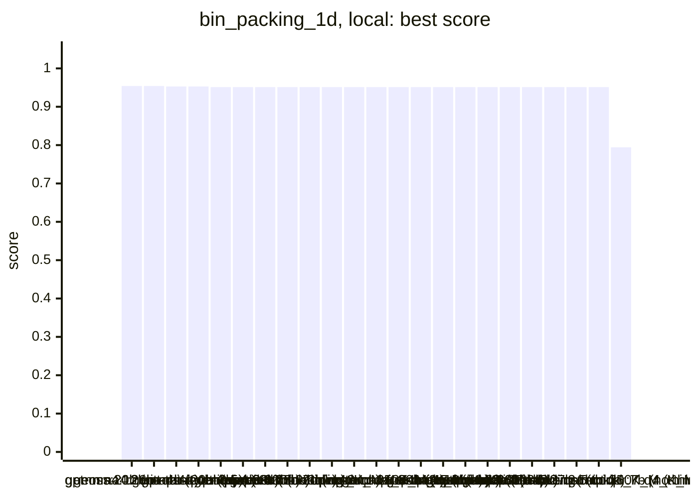
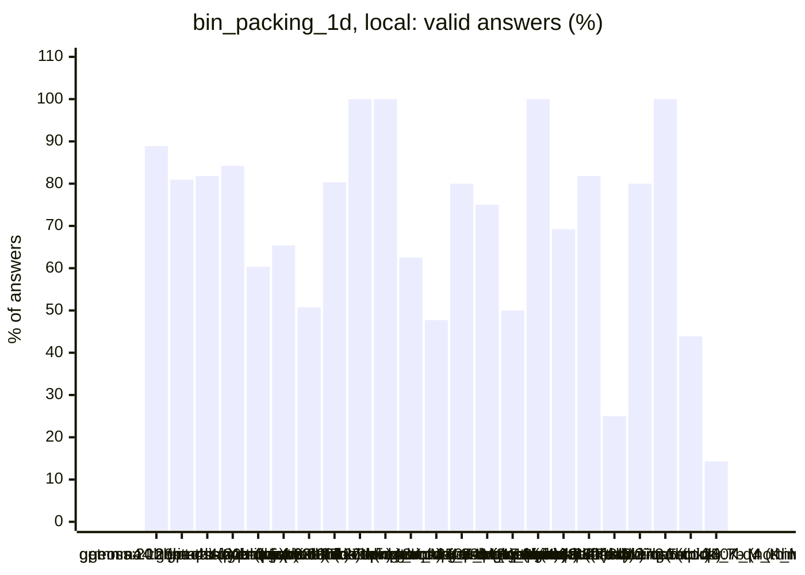
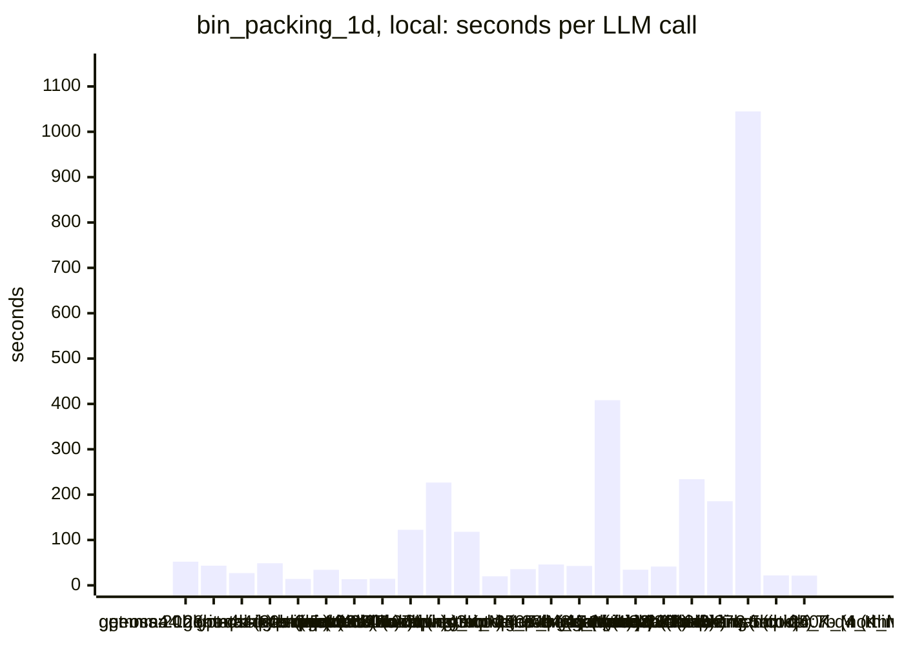
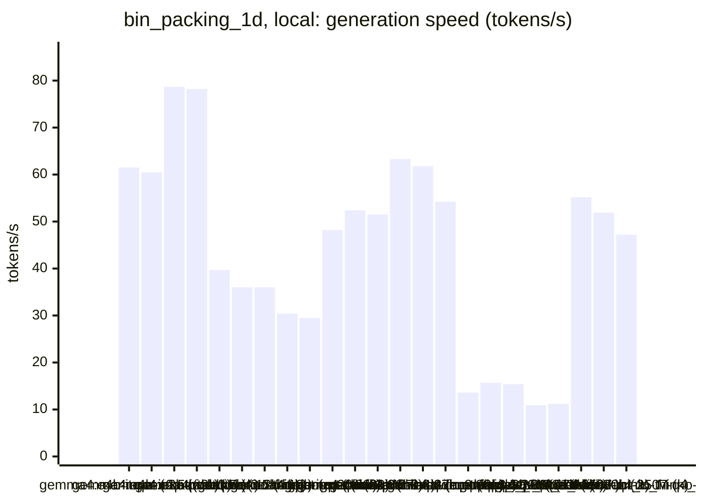
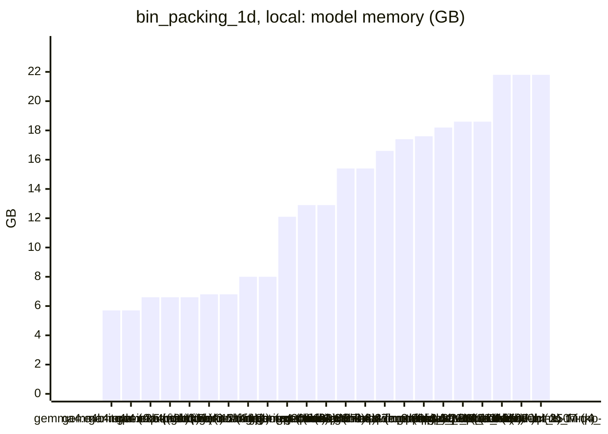

<!-- Copyright (c) 2026 by C. Klukas -->
<!-- SPDX-License-Identifier: GPL-3.0-only -->
<!-- Generated by `omega report` from bench/results/*.json. Do not edit by hand. -->

# bin_packing_1d

24 models, 15 minutes each, latest run per model. The [overall ranking](../benchmarks.md#overall-ranking) compares the models over all examples.

Machine: Apple M1 Max (Mac13,1), 10 cores, 32 GB.

## Local models

Ollama on this machine.

| Model | Params | Initial | Best | Gain | LLM calls | s/call | Valid | New bests | Min to best |
|---|---|--:|--:|--:|--:|--:|--:|--:|--:|
| gpt-oss:20b (no-think) | 20.9B | 0.79426 | **0.95416** | ×1.20 | 18 | 52 | 89% | 2 | 6.7 |
| gemma4:12b-it-qat (no-think) | 11.9B | 0.79426 | **0.9541** | ×1.20 | 21 | 43 | 81% | 2 | 8.3 |
| gemma4:26b-a4b-it-qat (no-think) | 25.2B | 0.79426 | **0.95304** | ×1.20 | 33 | 27 | 82% | 3 | 11.5 |
| gpt-oss:20b (think) | 20.9B | 0.79426 | **0.95304** | ×1.20 | 19 | 49 | 84% | 2 | 9.6 |
| gemma4:e4b-it-qat (no-think) | 7.5B | 0.79426 | **0.95128** | ×1.20 | 63 | 14 | 60% | 1 | 1.1 |
| qwen3.5:latest (no-think) | 9.7B | 0.79426 | **0.95128** | ×1.20 | 26 | 34 | 65% | 2 | 3.5 |
| gemma4:e2b (no-think) | 5.1B | 0.79426 | **0.95128** | ×1.20 | 65 | 14 | 51% | 2 | 1.2 |
| gemma4:latest (no-think) |  | 0.79426 | **0.95128** | ×1.20 | 61 | 14 | 80% | 1 | 1.9 |
| qwen3.5:27b (no-think) | 27.8B | 0.79426 | **0.95128** | ×1.20 | 8 | 122 | 100% | 1 | 5.4 |
| qwen3.8:27b-mtp-q4_K_M (no-think) | 27.3B | 0.79426 | **0.95128** | ×1.20 | 4 | 227 | 100% | 1 | 12.5 |
| qwen3.6:27b-coding-mtp-q4_K_M (no-think) | 27.3B | 0.79426 | **0.95128** | ×1.20 | 8 | 118 | 62% | 1 | 5.2 |
| qwen3:30b-a3b-instruct-2507-q4_K_M (no-think) | 30.5B | 0.79426 | **0.95128** | ×1.20 | 44 | 20 | 48% | 1 | 2.5 |
| qwen3-coder:30b (no-think) | 30.5B | 0.79426 | **0.95128** | ×1.20 | 25 | 36 | 80% | 1 | 2.5 |
| gemma4:e4b-it-qat (think) | 7.5B | 0.79426 | **0.95128** | ×1.20 | 20 | 46 | 75% | 1 | 1.9 |
| qwen3.5:latest (think) | 9.7B | 0.79426 | **0.95128** | ×1.20 | 22 | 43 | 50% | 1 | 3.4 |
| gemma4:12b-it-qat (think) | 11.9B | 0.79426 | **0.95128** | ×1.20 | 3 | 408 | 100% | 1 | 6.1 |
| gemma4:e2b (think) | 5.1B | 0.79426 | **0.95128** | ×1.20 | 26 | 34 | 69% | 2 | 1.9 |
| gemma4:latest (think) |  | 0.79426 | **0.95128** | ×1.20 | 22 | 41 | 82% | 1 | 2.2 |
| gemma4:26b-a4b-it-qat (think) | 25.2B | 0.79426 | **0.95128** | ×1.20 | 4 | 234 | 25% | 1 | 10.2 |
| qwen3.5:27b (think) | 27.8B | 0.79426 | **0.95128** | ×1.20 | 5 | 185 | 80% | 1 | 5.7 |
| qwen3.6:27b-coding-mtp-q4_K_M (think) | 27.3B | 0.79426 | **0.95128** | ×1.20 | 1 | 1045 | 100% | 1 | 17.4 |
| qwen3:30b-a3b-instruct-2507-q4_K_M (think) | 30.5B | 0.79426 | **0.95128** | ×1.20 | 41 | 22 | 44% | 1 | 3.2 |
| qwen2.5-coder:7b (no-think) | 7.6B | 0.79426 | **0.79426** | ×1.00 | 42 | 21 | 14% | 0 | - |
| qwen3.8:27b-mtp-q4_K_M (think) | 27.3B | | | | | | | | failed: all 1 model requests failed: qwen3.8:27b-mtp-q4_K_M: answer  |

### Inference speed and memory

RAM is what Ollama reports for the loaded model (weights, context cache and buffers; on Apple silicon this is shared memory). Load is the time to bring the model into memory. Prompt and generation speeds are tokens per second over all calls of the run.

| Model | Params | RAM GB | Load s | Prompt tok/s | Gen tok/s | Median s/call | p90 s/call | Tokens/answer | Stopped |
|---|---|--:|--:|--:|--:|--:|--:|--:|--:|
| gemma4:e4b-it-qat (no-think) | 7.5B | 5.7 | 58 | 651 | 61.5 | 13 | 22 | 479 | 0 |
| gemma4:e4b-it-qat (think) | 7.5B | 5.7 | 84 | 728 | 60.5 | 42 | 80 | 2273 | 0 |
| gemma4:e2b (no-think) | 5.1B | 6.6 | 33 | 963 | 78.7 | 10 | 26 | 710 | 0 |
| gemma4:e2b (think) | 5.1B | 6.6 | 64 | 1075 | 78.2 | 31 | 46 | 2271 | 0 |
| qwen2.5-coder:7b (no-think) | 7.6B | 6.6 | 50 | 546 | 39.7 | 21 | 32 | 581 | 1 |
| qwen3.5:latest (no-think) | 9.7B | 6.8 | 28 | 435 | 36.0 | 26 | 75 | 842 | 1 |
| qwen3.5:latest (think) | 9.7B | 6.8 | 49 | 453 | 36.0 | 47 | 56 | 1231 | 0 |
| gemma4:12b-it-qat (no-think) | 11.9B | 8.0 | 66 | 252 | 30.4 | 36 | 84 | 818 | 0 |
| gemma4:12b-it-qat (think) | 11.9B | 8.0 | 88 | 296 | 29.5 | 368 | 492 | 10958 | 0 |
| gemma4:latest (think) |  | 12.1 | 108 | 1052 | 48.2 | 31 | 59 | 1618 | 0 |
| gpt-oss:20b (no-think) | 20.9B | 12.9 | 55 | 741 | 52.4 | 50 | 96 | 2370 | 0 |
| gpt-oss:20b (think) | 20.9B | 12.9 | 150 | 739 | 51.5 | 40 | 75 | 1893 | 0 |
| gemma4:26b-a4b-it-qat (no-think) | 25.2B | 15.4 | 203 | 635 | 63.3 | 22 | 36 | 855 | 0 |
| gemma4:26b-a4b-it-qat (think) | 25.2B | 15.4 | 0 | 1689 | 61.8 | 208 | 492 | 7190 | 2 |
| gemma4:latest (no-think) |  | 16.6 | 102 | 1097 | 54.2 | 12 | 19 | 493 | 0 |
| qwen3.6:27b-coding-mtp-q4_K_M (think) | 27.3B | 17.4 | 322 | 94 | 13.6 | 1045 | 1045 | 5307 | 0 |
| qwen3.8:27b-mtp-q4_K_M (no-think) | 27.3B | 17.6 | 306 | 115 | 15.7 | 69 | 751 | 541 | 0 |
| qwen3.6:27b-coding-mtp-q4_K_M (no-think) | 27.3B | 18.2 | 243 | 105 | 15.4 | 83 | 309 | 971 | 0 |
| qwen3.5:27b (no-think) | 27.8B | 18.6 | 237 | 106 | 10.9 | 98 | 325 | 738 | 0 |
| qwen3.5:27b (think) | 27.8B | 18.6 | 234 | 104 | 11.2 | 164 | 343 | 1308 | 0 |
| qwen3:30b-a3b-instruct-2507-q4_K_M (no-think) | 30.5B | 21.8 | 138 | 713 | 55.2 | 16 | 32 | 645 | 0 |
| qwen3-coder:30b (no-think) | 30.5B | 21.8 | 131 | 633 | 51.9 | 29 | 51 | 1239 | 0 |
| qwen3:30b-a3b-instruct-2507-q4_K_M (think) | 30.5B | 21.8 | 181 | 670 | 47.2 | 15 | 43 | 530 | 1 |

### Best score over time

| Model | 3.75 min | 7.5 min | 11.25 min | 15 min |
|---|--:|--:|--:|--:|
| gpt-oss:20b (no-think) | 0.95128 | 0.95416 | 0.95416 | 0.95416 |
| gemma4:12b-it-qat (no-think) | 0.95128 | 0.95128 | 0.9541 | 0.9541 |
| gemma4:26b-a4b-it-qat (no-think) | 0.95128 | 0.95233 | 0.95233 | 0.95304 |
| gpt-oss:20b (think) | 0.79426 | 0.95128 | 0.95304 | 0.95304 |
| gemma4:e4b-it-qat (no-think) | 0.95128 | 0.95128 | 0.95128 | 0.95128 |
| qwen3.5:latest (no-think) | 0.95128 | 0.95128 | 0.95128 | 0.95128 |
| gemma4:e2b (no-think) | 0.95128 | 0.95128 | 0.95128 | 0.95128 |
| gemma4:latest (no-think) | 0.95128 | 0.95128 | 0.95128 | 0.95128 |
| qwen3.5:27b (no-think) | 0.79426 | 0.95128 | 0.95128 | 0.95128 |
| qwen3.8:27b-mtp-q4_K_M (no-think) | 0.79426 | 0.79426 | 0.79426 | 0.95128 |
| qwen3.6:27b-coding-mtp-q4_K_M (no-think) | 0.79426 | 0.95128 | 0.95128 | 0.95128 |
| qwen3:30b-a3b-instruct-2507-q4_K_M (no-think) | 0.95128 | 0.95128 | 0.95128 | 0.95128 |
| qwen3-coder:30b (no-think) | 0.95128 | 0.95128 | 0.95128 | 0.95128 |
| gemma4:e4b-it-qat (think) | 0.95128 | 0.95128 | 0.95128 | 0.95128 |
| qwen3.5:latest (think) | 0.95128 | 0.95128 | 0.95128 | 0.95128 |
| gemma4:12b-it-qat (think) | 0.79426 | 0.95128 | 0.95128 | 0.95128 |
| gemma4:e2b (think) | 0.95128 | 0.95128 | 0.95128 | 0.95128 |
| gemma4:latest (think) | 0.95128 | 0.95128 | 0.95128 | 0.95128 |
| gemma4:26b-a4b-it-qat (think) | 0.79426 | 0.79426 | 0.95128 | 0.95128 |
| qwen3.5:27b (think) | 0.79426 | 0.95128 | 0.95128 | 0.95128 |
| qwen3.6:27b-coding-mtp-q4_K_M (think) | 0.79426 | 0.79426 | 0.79426 | 0.79426 |
| qwen3:30b-a3b-instruct-2507-q4_K_M (think) | 0.95128 | 0.95128 | 0.95128 | 0.95128 |
| qwen2.5-coder:7b (no-think) | 0.79426 | 0.79426 | 0.79426 | 0.79426 |

### Outcome of the LLM answers

| Model | duplicate | edit error | invalid | llm error | ok | timeout |
|---|--:|--:|--:|--:|--:|--:|
| gpt-oss:20b (no-think) | 0 | 0 | 1 | 0 | 16 | 1 |
| gemma4:12b-it-qat (no-think) | 1 | 1 | 2 | 0 | 17 | 0 |
| gemma4:26b-a4b-it-qat (no-think) | 0 | 6 | 0 | 0 | 27 | 0 |
| gpt-oss:20b (think) | 1 | 1 | 1 | 0 | 16 | 0 |
| gemma4:e4b-it-qat (no-think) | 3 | 7 | 15 | 0 | 38 | 0 |
| qwen3.5:latest (no-think) | 0 | 1 | 7 | 1 | 17 | 0 |
| gemma4:e2b (no-think) | 17 | 6 | 9 | 0 | 33 | 0 |
| gemma4:latest (no-think) | 2 | 3 | 7 | 0 | 49 | 0 |
| qwen3.5:27b (no-think) | 0 | 0 | 0 | 0 | 8 | 0 |
| qwen3.8:27b-mtp-q4_K_M (no-think) | 0 | 0 | 0 | 0 | 4 | 0 |
| qwen3.6:27b-coding-mtp-q4_K_M (no-think) | 1 | 1 | 1 | 0 | 5 | 0 |
| qwen3:30b-a3b-instruct-2507-q4_K_M (no-think) | 1 | 4 | 17 | 0 | 21 | 1 |
| qwen3-coder:30b (no-think) | 0 | 0 | 4 | 0 | 20 | 1 |
| gemma4:e4b-it-qat (think) | 2 | 0 | 3 | 0 | 15 | 0 |
| qwen3.5:latest (think) | 1 | 1 | 9 | 0 | 11 | 0 |
| gemma4:12b-it-qat (think) | 0 | 0 | 0 | 0 | 3 | 0 |
| gemma4:e2b (think) | 0 | 4 | 4 | 0 | 18 | 0 |
| gemma4:latest (think) | 1 | 0 | 3 | 0 | 18 | 0 |
| gemma4:26b-a4b-it-qat (think) | 0 | 1 | 0 | 2 | 1 | 0 |
| qwen3.5:27b (think) | 0 | 0 | 1 | 0 | 4 | 0 |
| qwen3.6:27b-coding-mtp-q4_K_M (think) | 0 | 0 | 0 | 0 | 1 | 0 |
| qwen3:30b-a3b-instruct-2507-q4_K_M (think) | 7 | 2 | 12 | 1 | 18 | 1 |
| qwen2.5-coder:7b (no-think) | 6 | 1 | 28 | 1 | 6 | 0 |

### Best idea per model

- **gpt-oss:20b (no-think)**: Add a lightweight improvement phase after the initial first‑fit decreasing packing that repeatedly re‑assigns items to other bins to reduce slack and drop empty bins, using random …
- **gemma4:12b-it-qat (no-think)**: Fix the bug where `bin_loads` and `bins` list indices become desynchronized by ensuring that when an empty bin is removed, the `bin_loads` list is updated correctly and the …
- **gemma4:26b-a4b-it-qat (no-think)**: Implement a randomized First Fit Decreasing approach combined with a local search that attempts to empty the least-loaded bins and performs 1-1 swaps to increase bin density.
- **gpt-oss:20b (think)**: Add a simple post‑packing improvement that tries to empty bins by moving their items into other bins, reducing the total bin count with negligible extra cost.
- **gemma4:e4b-it-qat (no-think)**: Implement First Fit Decreasing (FFD) by sorting items by decreasing size and then packing them using the First Fit heuristic to improve bin packing density significantly over Next …
- **qwen3.5:latest (no-think)**: Remove the broken local optimization loop and redundant re-implementation, replacing them with a single efficient Best-Fit Decreasing pass that correctly initializes bin_loads as …
- **gemma4:e2b (no-think)**: Implement Best Fit Decreasing (BFD) instead of First Fit Decreasing (FFD) by always placing the item into the bin that results in the minimum remaining space, which tends to …
- **gemma4:latest (no-think)**: Implement First Fit Decreasing (FFD) by sorting items by size in descending order and then applying the First Fit strategy.
- **qwen3.5:27b (no-think)**: Replace the Next Fit heuristic with First Fit Decreasing (FFD) by sorting items in descending order before packing, which is a standard improvement that significantly reduces the …
- **qwen3.8:27b-mtp-q4_K_M (no-think)**: Replace next-fit with First-Fit-Decreasing (a substantially different greedy construction) which is known to land near the lower bound on these instances and runs in milliseconds …
- **qwen3.6:27b-coding-mtp-q4_K_M (no-think)**: Replace next-fit with First Fit Decreasing (FFD), which sorts items by size descending and places each in the first bin that fits, significantly reducing bin count for these …
- **qwen3:30b-a3b-instruct-2507-q4_K_M (no-think)**: Replace next-fit with First-Fit Decreasing (FFD) to improve bin utilization by packing larger items first, reducing fragmentation and enabling better packing efficiency …
- **qwen3-coder:30b (no-think)**: Replace the simple next-fit heuristic with a first-fit decreasing approach combined with local search optimization to reduce the number of bins used, especially effective for the …
- **gemma4:e4b-it-qat (think)**: Implement First Fit Decreasing (FFD) instead of Next Fit by sorting items by decreasing size and then placing each item into the first bin that can accommodate it, significantly …
- **qwen3.5:latest (think)**: Replace Next-Fit with First-Fit Decreasing (sort items descending, place in first-fitting bin) which is provably much better; add SWEEP for optional local search iteration limit.
- **gemma4:12b-it-qat (think)**: Replace the current Next Fit heuristic with First Fit Decreasing (FFD), which sorts items by size in descending order and places each item into the first bin that can accommodate …
- **gemma4:e2b (think)**: Sort items by decreasing size and use First Fit (FFD) to place items into existing bins to reduce fragmentation.
- **gemma4:latest (think)**: Replace the Next Fit heuristic with the First Fit Decreasing (FFD) heuristic by sorting items by size descendingly while preserving original indices, which is a significant …
- **gemma4:26b-a4b-it-qat (think)**: Implement First-Fit Decreasing (FFD) to significantly improve bin packing efficiency over the current next-fit approach.
- **qwen3.5:27b (think)**: Implement First-Fit Decreasing (FFD) which sorts items by decreasing size before packing and uses first-fit placement, a well-known heuristic that significantly improves bin …
- **qwen3.6:27b-coding-mtp-q4_K_M (think)**: Replace the naive next-fit heuristic with Best Fit Decreasing (BFD), which sorts items by size descending and places each into the bin that leaves the least remaining space …
- **qwen3:30b-a3b-instruct-2507-q4_K_M (think)**: Replace next-fit with First-Fit Decreasing (FFD) to improve packing efficiency by sorting items in descending order and placing each item in the first bin that can accommodate it …
- **qwen2.5-coder:7b (no-think)**: initial program
