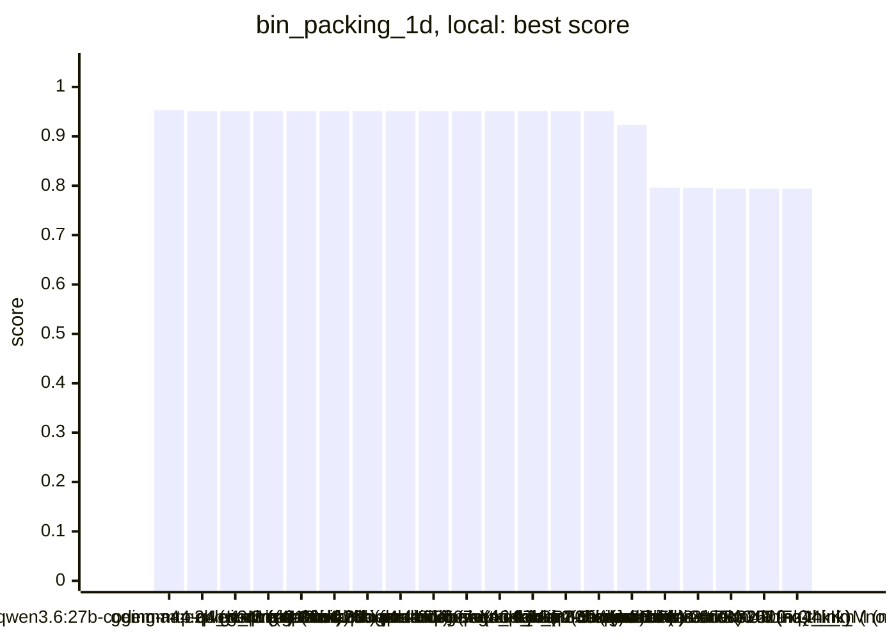
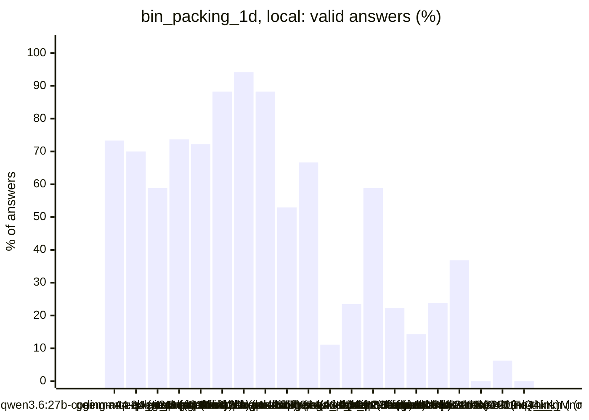
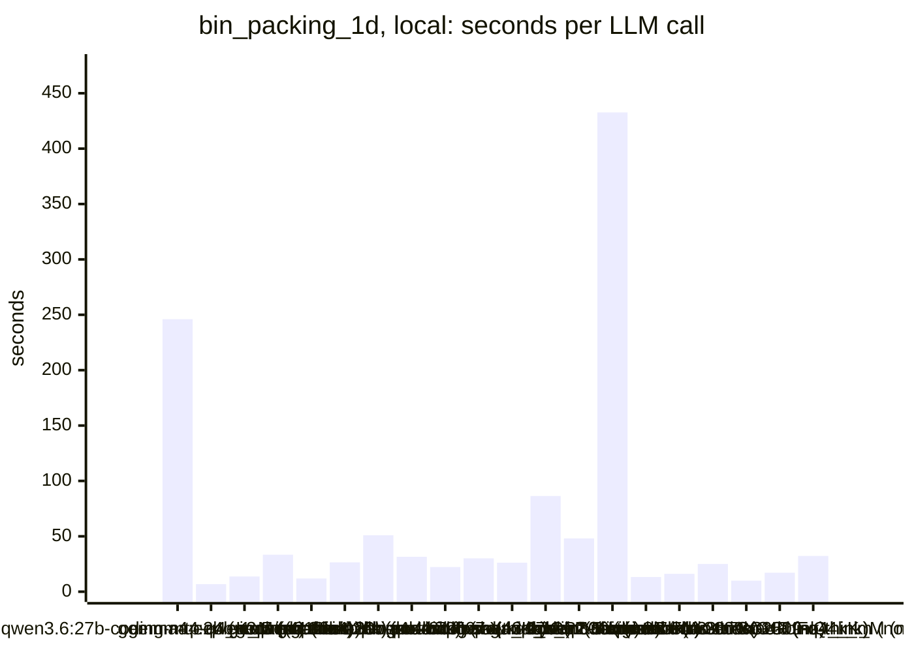
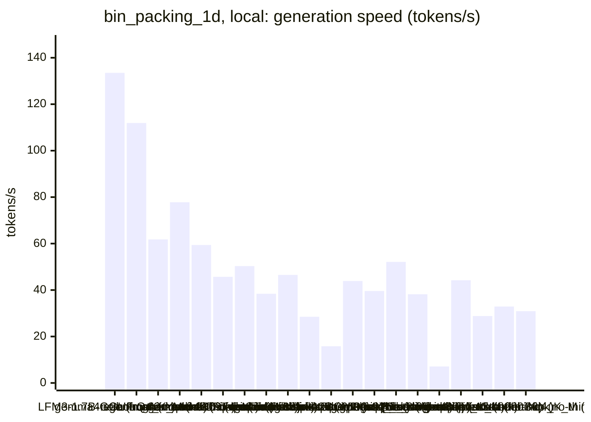
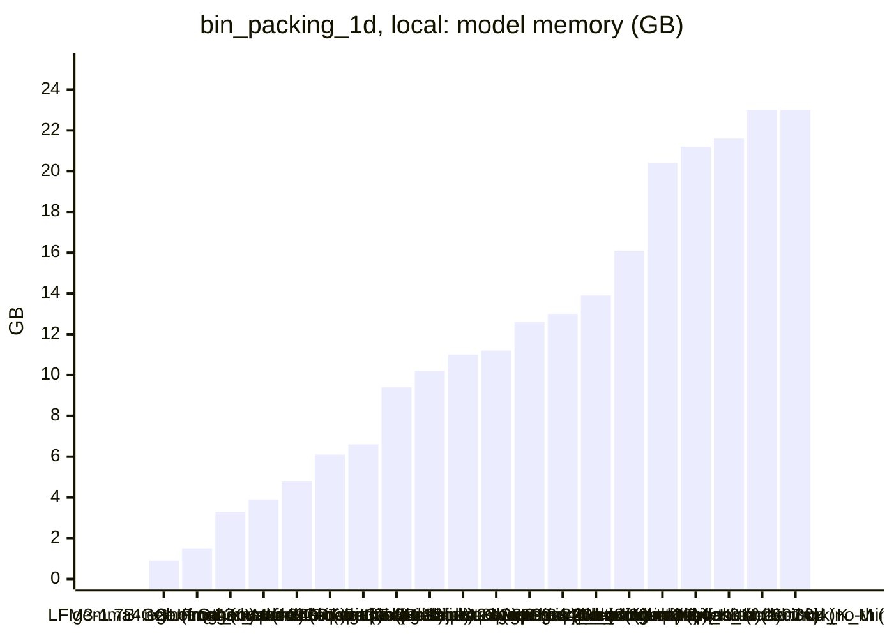
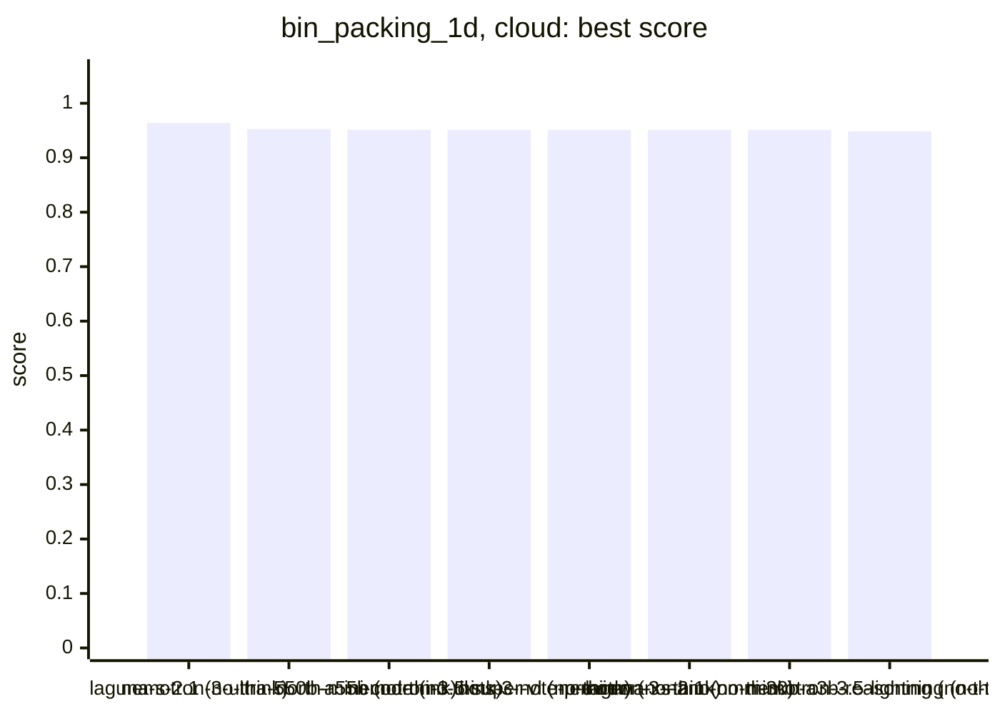
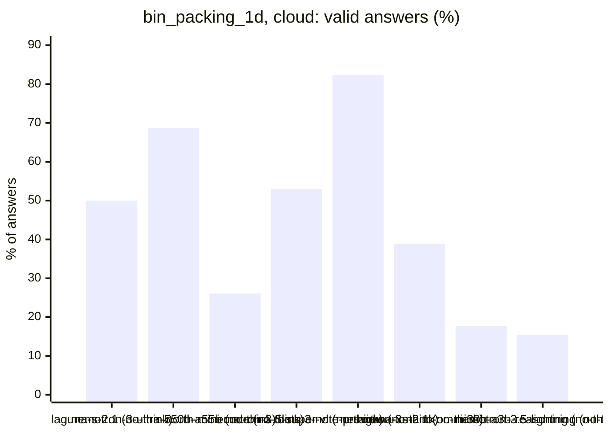
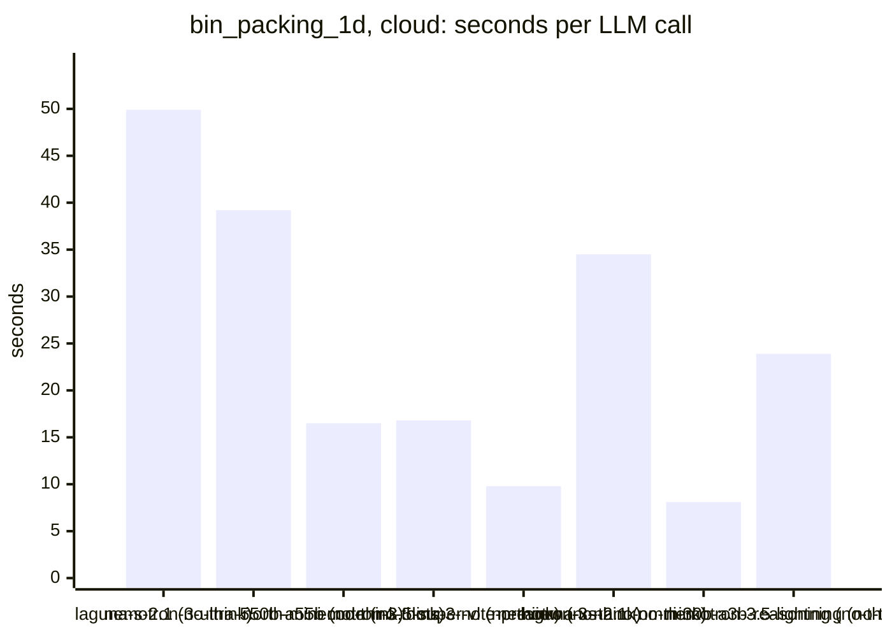
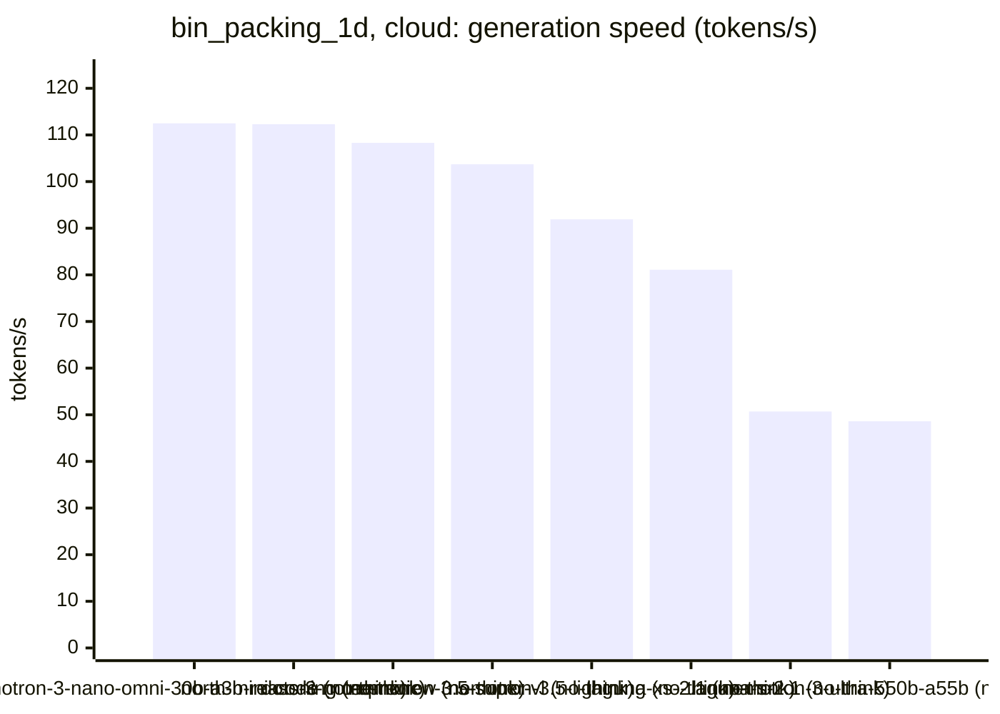

<!-- Copyright (c) 2026 by C. Klukas -->
<!-- SPDX-License-Identifier: GPL-3.0-only -->
<!-- Generated by `omega report` from bench/results/*.json. Do not edit by hand. -->

# bin_packing_1d

31 models, each run at most 60 minutes, ended earlier after 15 answers in a row without progress; one run per model. The [overall ranking](../benchmarks.md#overall-ranking) compares the models over all examples.

Machine: Intel(R) Core(TM) i7-8700K CPU @ 3.70GHz (MS-7A98), 12 cores, 64 GB, 2x NVIDIA GeForce GTX 1080 Ti, 11264 MiB.

## Local models

Ollama on this machine.

| Model | Params | Initial | Best | Gain | LLM calls | s/call | Valid | New bests | Min to best | Minutes | Stopped by |
|---|---|--:|--:|--:|--:|--:|--:|--:|--:|--:|---|
| qwen3.6:27b-coding-mtp-q4_K_M (no-think) | 27.3B | 0.79426 | **0.95304** | ×1.20 | 15 | 246 | 73% | 2 | 8.6 | 61.8 | time limit |
| gemma4:e2b (no-think) | 4.6B | 0.79426 | **0.95128** | ×1.20 | 20 | 7 | 70% | 2 | 0.7 | 2.7 | no progress |
| gemma4:e4b-it-qat (no-think) | 7.5B | 0.79426 | **0.95128** | ×1.20 | 17 | 14 | 59% | 1 | 0.5 | 4.2 | no progress |
| qwen3.5:latest (no-think) | 9.0B | 0.79426 | **0.95128** | ×1.20 | 19 | 33 | 74% | 2 | 1.7 | 10.9 | no progress |
| gemma4:latest (no-think) | 7.5B | 0.79426 | **0.95128** | ×1.20 | 18 | 12 | 72% | 1 | 0.7 | 3.8 | no progress |
| gemma4:12b-it-qat (no-think) | 11.9B | 0.79426 | **0.95128** | ×1.20 | 17 | 26 | 88% | 1 | 0.6 | 7.8 | no progress |
| gpt-oss:20b (no-think) | 20.9B | 0.79426 | **0.95128** | ×1.20 | 17 | 51 | 94% | 1 | 1.6 | 14.8 | no progress |
| gemma4:26b-a4b-it-qat (no-think) | 25.2B | 0.79426 | **0.95128** | ×1.20 | 17 | 32 | 88% | 1 | 1.4 | 9.2 | no progress |
| qwen3:30b-a3b-instruct-2507-q4_K_M (no-think) | 30.5B | 0.79426 | **0.95128** | ×1.20 | 17 | 22 | 53% | 1 | 1.1 | 6.6 | no progress |
| glm-4.7-flash:latest (no-think) | 29.9B | 0.79426 | **0.95128** | ×1.20 | 18 | 30 | 67% | 1 | 1.7 | 9.3 | no progress |
| llm-jp-4-8b-omega:q4_k_m (no-think) | 8.6B | 0.79426 | **0.95128** | ×1.20 | 18 | 26 | 11% | 1 | 1.1 | 8.2 | no progress |
| underdog-saluki-27b:iq2-mix (no-think) | 26.9B | 0.79426 | **0.95128** | ×1.20 | 17 | 86 | 24% | 1 | 2.1 | 24.8 | no progress |
| qwen3-coder:30b (no-think) | 30.5B | 0.79426 | **0.95128** | ×1.20 | 17 | 48 | 59% | 1 | 1.6 | 13.9 | no progress |
| frob/sarvam:30b (no-think) | 32.2B | 0.79426 | **0.95128** | ×1.20 | 9 | 433 | 22% | 1 | 12.8 | 65.2 | time limit |
| qwen2.5-coder:7b (no-think) | 7.6B | 0.79426 | **0.92325** | ×1.16 | 21 | 13 | 14% | 1 | 1.3 | 5.0 | no progress |
| yandex/YandexGPT-5-Lite-8B-instruct-GGUF:latest (no-think) | 8.0B | 0.79426 | **0.79587** | ×1.00 | 21 | 16 | 24% | 1 | 1.3 | 6.0 | no progress |
| richardyoung/frognano-4b-2609:latest (no-think) | 4.3B | 0.79426 | **0.79587** | ×1.00 | 19 | 25 | 37% | 1 | 1.1 | 8.2 | no progress |
| nemotron-3-nano:4b (no-think) | 4.0B | 0.79426 | **0.79426** | ×1.00 | 16 | 10 | 0% | 0 | - | 2.9 | no progress |
| MichelRosselli/apertus:8b-instruct-2509-q4_k_m (no-think) | 8.1B | 0.79426 | **0.79426** | ×1.00 | 16 | 17 | 6% | 0 | - | 4.8 | no progress |
| hf.co/LiquidAI/LFM3-1.7B-GGUF:Q4_K_M (no-think) | 1.73B | 0.79426 | **0.79426** | ×1.00 | 16 | 32 | 0% | 0 | - | 8.9 | no progress |

### Inference speed and memory

RAM is what Ollama reports for the loaded model (weights, context cache and buffers; on Apple silicon this is shared memory). Load is the time to bring the model into memory. Prompt and generation speeds are tokens per second over all calls of the run.

| Model | Params | RAM GB | Load s | Prompt tok/s | Gen tok/s | Median s/call | p90 s/call | Tokens/answer | Stopped |
|---|---|--:|--:|--:|--:|--:|--:|--:|--:|
| gemma4:e2b (no-think) | 4.6B | 0.9 | 17 | 2576 | 133.5 | 6 | 8 | 357 | 0 |
| hf.co/LiquidAI/LFM3-1.7B-GGUF:Q4_K_M (no-think) | 1.73B | 1.5 | 4 | 3883 | 111.9 | 29 | 61 | 912 | 13 |
| gemma4:latest (no-think) | 7.5B | 3.3 | 23 | 1347 | 61.8 | 9 | 30 | 404 | 0 |
| nemotron-3-nano:4b (no-think) | 4.0B | 3.9 | 10 | 1756 | 77.8 | 9 | 14 | 460 | 0 |
| richardyoung/frognano-4b-2609:latest (no-think) | 4.3B | 4.8 | 11 | 1647 | 59.4 | 23 | 41 | 1047 | 4 |
| gemma4:e4b-it-qat (no-think) | 7.5B | 6.1 | 21 | 1693 | 45.7 | 11 | 21 | 401 | 0 |
| qwen2.5-coder:7b (no-think) | 7.6B | 6.6 | 14 | 1817 | 50.3 | 11 | 21 | 474 | 0 |
| qwen3.5:latest (no-think) | 9.0B | 9.4 | 20 | 958 | 38.4 | 33 | 51 | 1015 | 0 |
| yandex/YandexGPT-5-Lite-8B-instruct-GGUF:latest (no-think) | 8.0B | 10.2 | 19 | 1651 | 46.5 | 15 | 22 | 541 | 0 |
| gemma4:12b-it-qat (no-think) | 11.9B | 11.0 | 22 | 641 | 28.5 | 19 | 41 | 511 | 0 |
| underdog-saluki-27b:iq2-mix (no-think) | 26.9B | 11.2 | 23 | 384 | 15.8 | 69 | 210 | 1179 | 0 |
| MichelRosselli/apertus:8b-instruct-2509-q4_k_m (no-think) | 8.1B | 12.6 | 16 | 1620 | 43.9 | 18 | 26 | 551 | 0 |
| llm-jp-4-8b-omega:q4_k_m (no-think) | 8.6B | 13.0 | 16 | 1329 | 39.6 | 24 | 46 | 812 | 1 |
| gpt-oss:20b (no-think) | 20.9B | 13.9 | 50 | 1716 | 52.1 | 38 | 119 | 2306 | 0 |
| gemma4:26b-a4b-it-qat (no-think) | 25.2B | 16.1 | 69 | 790 | 38.2 | 30 | 37 | 802 | 0 |
| qwen3.6:27b-coding-mtp-q4_K_M (no-think) | 27.3B | 20.4 | 53 | 192 | 7.1 | 200 | 434 | 1576 | 0 |
| frob/sarvam:30b (no-think) | 32.2B | 21.2 | 59 | 1332 | 44.2 | 564 | 611 | 19838 | 1 |
| glm-4.7-flash:latest (no-think) | 29.9B | 21.6 | 56 | 477 | 28.8 | 28 | 46 | 575 | 0 |
| qwen3:30b-a3b-instruct-2507-q4_K_M (no-think) | 30.5B | 23.0 | 52 | 687 | 32.9 | 16 | 34 | 436 | 0 |
| qwen3-coder:30b (no-think) | 30.5B | 23.0 | 53 | 580 | 30.9 | 48 | 64 | 1161 | 1 |

### Best score over time

| Model | 15 min | 30 min | 45 min | 60 min |
|---|--:|--:|--:|--:|
| qwen3.6:27b-coding-mtp-q4_K_M (no-think) | 0.95304 | 0.95304 | 0.95304 | 0.95304 |
| gemma4:e2b (no-think) | 0.95128 | 0.95128 | 0.95128 | 0.95128 |
| gemma4:e4b-it-qat (no-think) | 0.95128 | 0.95128 | 0.95128 | 0.95128 |
| qwen3.5:latest (no-think) | 0.95128 | 0.95128 | 0.95128 | 0.95128 |
| gemma4:latest (no-think) | 0.95128 | 0.95128 | 0.95128 | 0.95128 |
| gemma4:12b-it-qat (no-think) | 0.95128 | 0.95128 | 0.95128 | 0.95128 |
| gpt-oss:20b (no-think) | 0.95128 | 0.95128 | 0.95128 | 0.95128 |
| gemma4:26b-a4b-it-qat (no-think) | 0.95128 | 0.95128 | 0.95128 | 0.95128 |
| qwen3:30b-a3b-instruct-2507-q4_K_M (no-think) | 0.95128 | 0.95128 | 0.95128 | 0.95128 |
| glm-4.7-flash:latest (no-think) | 0.95128 | 0.95128 | 0.95128 | 0.95128 |
| llm-jp-4-8b-omega:q4_k_m (no-think) | 0.95128 | 0.95128 | 0.95128 | 0.95128 |
| underdog-saluki-27b:iq2-mix (no-think) | 0.95128 | 0.95128 | 0.95128 | 0.95128 |
| qwen3-coder:30b (no-think) | 0.95128 | 0.95128 | 0.95128 | 0.95128 |
| frob/sarvam:30b (no-think) | 0.95128 | 0.95128 | 0.95128 | 0.95128 |
| qwen2.5-coder:7b (no-think) | 0.92325 | 0.92325 | 0.92325 | 0.92325 |
| yandex/YandexGPT-5-Lite-8B-instruct-GGUF:latest (no-think) | 0.79587 | 0.79587 | 0.79587 | 0.79587 |
| richardyoung/frognano-4b-2609:latest (no-think) | 0.79587 | 0.79587 | 0.79587 | 0.79587 |
| nemotron-3-nano:4b (no-think) | 0.79426 | 0.79426 | 0.79426 | 0.79426 |
| MichelRosselli/apertus:8b-instruct-2509-q4_k_m (no-think) | 0.79426 | 0.79426 | 0.79426 | 0.79426 |
| hf.co/LiquidAI/LFM3-1.7B-GGUF:Q4_K_M (no-think) | 0.79426 | 0.79426 | 0.79426 | 0.79426 |

### Outcome of the LLM answers

| Model | duplicate | edit error | invalid | llm error | ok | timeout |
|---|--:|--:|--:|--:|--:|--:|
| qwen3.6:27b-coding-mtp-q4_K_M (no-think) | 3 | 0 | 1 | 0 | 11 | 0 |
| gemma4:e2b (no-think) | 3 | 2 | 1 | 0 | 14 | 0 |
| gemma4:e4b-it-qat (no-think) | 2 | 2 | 3 | 0 | 10 | 0 |
| qwen3.5:latest (no-think) | 0 | 2 | 3 | 0 | 14 | 0 |
| gemma4:latest (no-think) | 0 | 0 | 5 | 0 | 13 | 0 |
| gemma4:12b-it-qat (no-think) | 1 | 0 | 1 | 0 | 15 | 0 |
| gpt-oss:20b (no-think) | 0 | 1 | 0 | 0 | 16 | 0 |
| gemma4:26b-a4b-it-qat (no-think) | 0 | 2 | 0 | 0 | 15 | 0 |
| qwen3:30b-a3b-instruct-2507-q4_K_M (no-think) | 2 | 0 | 5 | 0 | 9 | 1 |
| glm-4.7-flash:latest (no-think) | 1 | 0 | 4 | 0 | 12 | 1 |
| llm-jp-4-8b-omega:q4_k_m (no-think) | 0 | 7 | 8 | 1 | 2 | 0 |
| underdog-saluki-27b:iq2-mix (no-think) | 1 | 5 | 7 | 0 | 4 | 0 |
| qwen3-coder:30b (no-think) | 2 | 0 | 4 | 1 | 10 | 0 |
| frob/sarvam:30b (no-think) | 0 | 6 | 0 | 1 | 2 | 0 |
| qwen2.5-coder:7b (no-think) | 6 | 0 | 12 | 0 | 3 | 0 |
| yandex/YandexGPT-5-Lite-8B-instruct-GGUF:latest (no-think) | 6 | 0 | 10 | 0 | 5 | 0 |
| richardyoung/frognano-4b-2609:latest (no-think) | 1 | 2 | 5 | 4 | 7 | 0 |
| nemotron-3-nano:4b (no-think) | 0 | 12 | 4 | 0 | 0 | 0 |
| MichelRosselli/apertus:8b-instruct-2509-q4_k_m (no-think) | 7 | 4 | 4 | 0 | 1 | 0 |
| hf.co/LiquidAI/LFM3-1.7B-GGUF:Q4_K_M (no-think) | 0 | 2 | 1 | 13 | 0 | 0 |

### Best idea per model

- **qwen3.6:27b-coding-mtp-q4_K_M (no-think)**: Implement a local search phase (swap items between bins to reduce bin count or improve density) after the initial FFD packing, which exploits the fact that FFD leaves suboptimal …
- **gemma4:e2b (no-think)**: Implement a Best Fit Decreasing (BFD) heuristic instead of First Fit Decreasing (FFD) to potentially reduce the number of bins used by placing larger items into existing bins that …
- **gemma4:e4b-it-qat (no-think)**: Implement First Fit Decreasing (FFD) by sorting items by size in descending order and then applying the First Fit heuristic to minimize bin count.
- **qwen3.5:latest (no-think)**: Replace the naive Next-Fit logic with a proper First-Fit Decreasing implementation that scans all existing bins to find the first one where the current item fits, which …
- **gemma4:latest (no-think)**: Implement First Fit Decreasing (FFD) by sorting the items by size in descending order and then applying the standard First Fit algorithm to reduce the number of bins.
- **gemma4:12b-it-qat (no-think)**: Implement First Fit Decreasing (FFD), which is a well-known strong heuristic for bin packing that yields significantly better results than Next Fit by attempting to place each …
- **gpt-oss:20b (no-think)**: Replace next‑fit with best‑fit decreasing to better pack items in fewer bins.
- **gemma4:26b-a4b-it-qat (no-think)**: Implement First Fit Decreasing (FFD) as a strong baseline, which is known to perform significantly better than Next Fit by placing items into the first available bin that can …
- **qwen3:30b-a3b-instruct-2507-q4_K_M (no-think)**: Replace next-fit with First Fit Decreasing (FFD) by sorting items in descending order and placing each item in the first bin that can accommodate it, which typically reduces the …
- **glm-4.7-flash:latest (no-think)**: Replace Next Fit with First Fit Decreasing (FFD) to improve space utilization across all instances.
- **llm-jp-4-8b-omega:q4_k_m (no-think)**: Replace the naive *next‑fit* packing with a **first‑fit decreasing (FFD)** heuristic that sorts items once before processing, then packs each item into the first existing bin that …
- **underdog-saluki-27b:iq2-mix (no-think)**: Replace next-fit with a fast Best-Fit-Decreasing (BFD) heuristic: sort by decreasing size, maintain per-bin slack, place each item into the tightest feasible bin (least slack) …
- **qwen3-coder:30b (no-think)**: Replace the simple next-fit heuristic with a first-fit decreasing (FFD) approach combined with local search optimization to improve bin utilization and reduce the total number of …
- **frob/sarvam:30b (no-think)**: Use best-fit decreasing (sort items by decreasing size and place each item in the bin that leaves the smallest remaining capacity) to reduce the number of bins.
- **qwen2.5-coder:7b (no-think)**: Implement the Best Fit Decreasing (BFD) algorithm, which sorts items by size in descending order and attempts to place each item in the best-fitting bin.
- **yandex/YandexGPT-5-Lite-8B-instruct-GGUF:latest (no-think)**: Use Best Fit Decreasing (BFD) to reduce the number of bins compared to Next Fit.
- **richardyoung/frognano-4b-2609:latest (no-think)**: Replace next-fit with First-Fit Decreasing (FFD) to sort items by size before packing, which significantly improves bin utilization and reduces the gap to the theoretical lower …
- **nemotron-3-nano:4b (no-think)**: initial program
- **MichelRosselli/apertus:8b-instruct-2509-q4_k_m (no-think)**: initial program
- **hf.co/LiquidAI/LFM3-1.7B-GGUF:Q4_K_M (no-think)**: initial program

## Cloud models (OpenRouter)

Free OpenRouter models; times include the network and the provider's queue.

| Model | Params | Initial | Best | Gain | LLM calls | s/call | Valid | New bests | Min to best | Minutes | Stopped by |
|---|---|--:|--:|--:|--:|--:|--:|--:|--:|--:|---|
| poolside/laguna-s-2.1:free (no-think) |  | 0.79426 | **0.9637** | ×1.21 | 20 | 50 | 50% | 2 | 3.9 | 16.8 | no progress |
| nvidia/nemotron-3-ultra-550b-a55b:free (no-think) |  | 0.79426 | **0.95271** | ×1.20 | 16 | 39 | 69% | 3 | 5.3 | 10.6 | no progress |
| cohere/north-mini-code:free (no-think) |  | 0.79426 | **0.95128** | ×1.20 | 23 | 16 | 26% | 1 | 1.7 | 6.5 | no progress |
| nvidia/nemotron-3.5-super-vl:free (no-think) |  | 0.79426 | **0.95128** | ×1.20 | 17 | 17 | 53% | 1 | 0.2 | 4.8 | no progress |
| dots-studio/dots-3-note-preview:free (no-think) |  | 0.79426 | **0.95128** | ×1.20 | 17 | 10 | 82% | 1 | 0.1 | 2.9 | no progress |
| poolside/laguna-xs-2.1:free (no-think) |  | 0.79426 | **0.95128** | ×1.20 | 18 | 34 | 39% | 1 | 2.4 | 10.4 | no progress |
| nvidia/nemotron-3-nano-omni-30b-a3b-reasoning:free (no-think) |  | 0.79426 | **0.95128** | ×1.20 | 17 | 8 | 18% | 1 | 0.1 | 2.3 | no progress |
| nvidia/nemotron-3.5-lightning:free (no-think) |  | 0.79426 | **0.94863** | ×1.19 | 26 | 24 | 15% | 1 | 3.7 | 10.5 | no progress |
| xingchen-agi/xing4.0-29b-a4b:free (no-think) |  | | | | | | | | | | failed: all 7 model requests failed: xingchen-agi/xing4.0-29b-a4b:fr |
| google/gemma-4-26b-a4b-it:free (no-think) |  | | | | | | | | | | failed: all 6 model requests failed: google/gemma-4-26b-a4b-it:free: |
| google/gemma-4-31b-it:free (no-think) |  | | | | | | | | | | failed: all 6 model requests failed: google/gemma-4-31b-it:free: rat |

### Inference speed and cost

Generation speed is measured from the first to the last streamed token; the time to the first token is counted as prompt time. Cost is what OpenRouter charged for the run.

| Model | Gen tok/s | Median s/call | p90 s/call | Tokens/answer | Stopped | Cost $ |
|---|--:|--:|--:|--:|--:|--:|
| nvidia/nemotron-3-nano-omni-30b-a3b-reasoning:free (no-think) | 112.5 | 6 | 17 | 786 | 1 | 0.000 |
| cohere/north-mini-code:free (no-think) | 112.3 | 15 | 32 | 1770 | 0 | 0.000 |
| dots-studio/dots-3-note-preview:free (no-think) | 108.3 | 8 | 19 | 827 | 0 | 0.000 |
| nvidia/nemotron-3.5-super-vl:free (no-think) | 103.7 | 12 | 58 | 1063 | 3 | 0.000 |
| nvidia/nemotron-3.5-lightning:free (no-think) | 91.9 | 24 | 38 | 2121 | 11 | 0.000 |
| poolside/laguna-xs-2.1:free (no-think) | 81.1 | 24 | 74 | 490 | 0 | 0.000 |
| poolside/laguna-s-2.1:free (no-think) | 50.7 | 40 | 113 | 1463 | 2 | 0.000 |
| nvidia/nemotron-3-ultra-550b-a55b:free (no-think) | 48.6 | 30 | 90 | 1618 | 0 | 0.000 |

### Best score over time

| Model | 15 min | 30 min | 45 min | 60 min |
|---|--:|--:|--:|--:|
| poolside/laguna-s-2.1:free (no-think) | 0.9637 | 0.9637 | 0.9637 | 0.9637 |
| nvidia/nemotron-3-ultra-550b-a55b:free (no-think) | 0.95271 | 0.95271 | 0.95271 | 0.95271 |
| cohere/north-mini-code:free (no-think) | 0.95128 | 0.95128 | 0.95128 | 0.95128 |
| nvidia/nemotron-3.5-super-vl:free (no-think) | 0.95128 | 0.95128 | 0.95128 | 0.95128 |
| dots-studio/dots-3-note-preview:free (no-think) | 0.95128 | 0.95128 | 0.95128 | 0.95128 |
| poolside/laguna-xs-2.1:free (no-think) | 0.95128 | 0.95128 | 0.95128 | 0.95128 |
| nvidia/nemotron-3-nano-omni-30b-a3b-reasoning:free (no-think) | 0.95128 | 0.95128 | 0.95128 | 0.95128 |
| nvidia/nemotron-3.5-lightning:free (no-think) | 0.94863 | 0.94863 | 0.94863 | 0.94863 |

### Outcome of the LLM answers

| Model | duplicate | edit error | invalid | llm error | ok |
|---|--:|--:|--:|--:|--:|
| poolside/laguna-s-2.1:free (no-think) | 1 | 4 | 3 | 2 | 10 |
| nvidia/nemotron-3-ultra-550b-a55b:free (no-think) | 0 | 1 | 4 | 0 | 11 |
| cohere/north-mini-code:free (no-think) | 4 | 2 | 11 | 0 | 6 |
| nvidia/nemotron-3.5-super-vl:free (no-think) | 0 | 2 | 3 | 3 | 9 |
| dots-studio/dots-3-note-preview:free (no-think) | 0 | 3 | 0 | 0 | 14 |
| poolside/laguna-xs-2.1:free (no-think) | 1 | 1 | 5 | 4 | 7 |
| nvidia/nemotron-3-nano-omni-30b-a3b-reasoning:free (no-think) | 0 | 11 | 2 | 1 | 3 |
| nvidia/nemotron-3.5-lightning:free (no-think) | 0 | 5 | 6 | 11 | 4 |

### Best idea per model

- **poolside/laguna-s-2.1:free (no-think)**: Add a bounded local-search improvement phase after FFD that repeatedly empties the least-filled bin and re-inserts its items via best-fit, then performs 1-1 and 1-2 swaps to …
- **nvidia/nemotron-3-ultra-550b-a55b:free (no-think)**: tuned TIME_LIMIT=1.9, PERTURB_PROB=0.4, MIN_TIME_PER_ITER=0.05 on top of: Replace First-Fit Decreasing with Best-Fit Decreasing (BFD) and add time-aware local search that …
- **cohere/north-mini-code:free (no-think)**: Move the timeout check into the inner improvement loops to stop earlier and replace the linear search for a free slot with a precomputed list of candidate bins for empty bin …
- **nvidia/nemotron-3.5-super-vl:free (no-think)**: Implement First Fit Decreasing with a priority-based bin selection (best fit among bins with smallest sufficient remaining space), followed by local search moves (empty the …
- **dots-studio/dots-3-note-preview:free (no-think)**: Replace next-fit with first-fit decreasing (FFD) which sorts items descending and places each in the first bin that can accommodate it, a proven heuristic that should …
- **poolside/laguna-xs-2.1:free (no-think)**: Sort items by decreasing size and use First Fit Decreasing (FFD) to reduce bin count significantly.
- **nvidia/nemotron-3-nano-omni-30b-a3b-reasoning:free (no-think)**: Replace next fit with a best fit decreasing heuristic that packs items into the bin with the least remaining space after the item is placed, using sorted items to improve packing …
- **nvidia/nemotron-3.5-lightning:free (no-think)**: Replace next-fit with first-fit decreasing, add best-fit placement within bins, and apply a time-aware first-improvement local search that re-inserts items from the least-filled …
