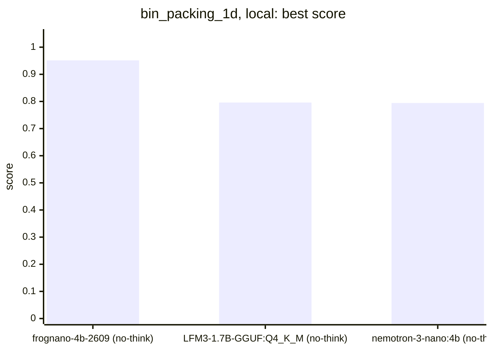
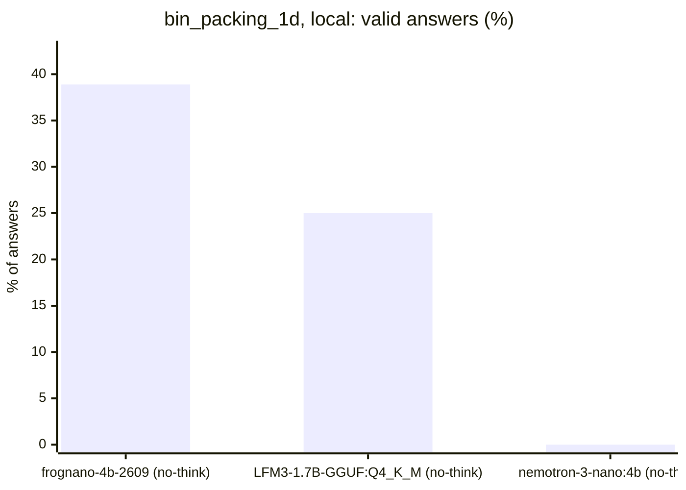
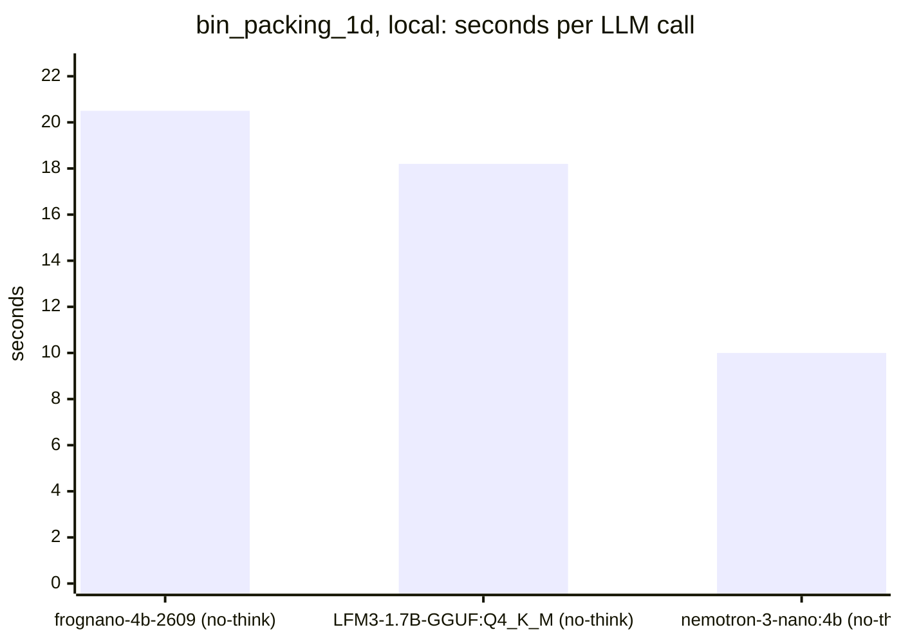
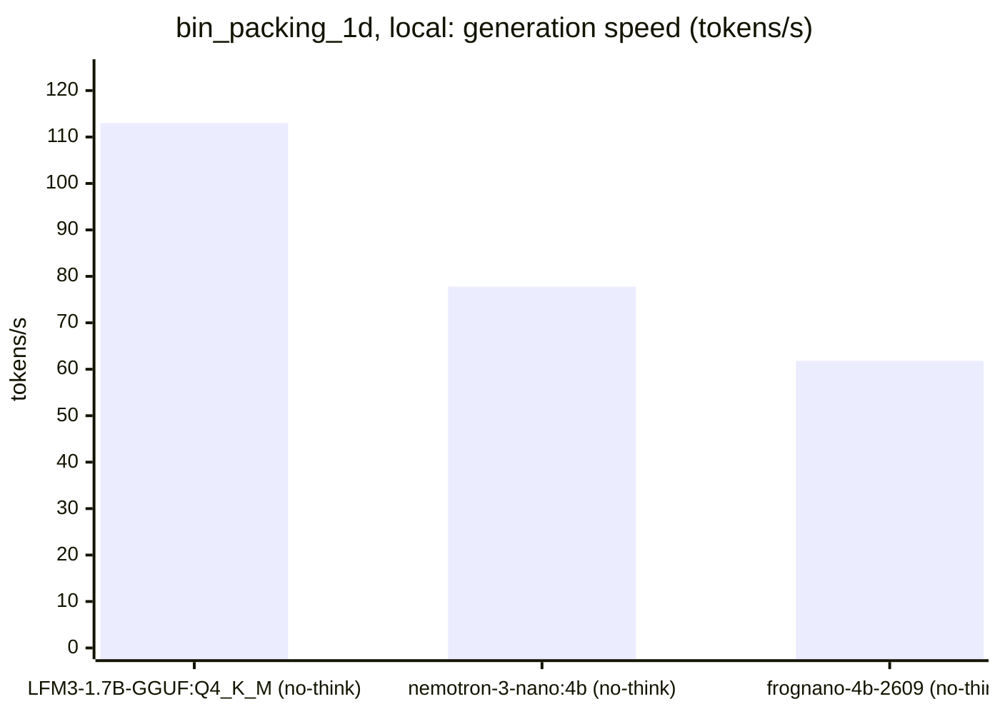
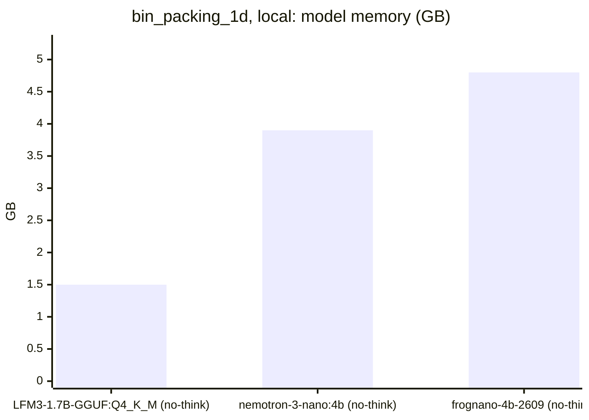

<!-- Copyright (c) 2026 by C. Klukas -->
<!-- SPDX-License-Identifier: GPL-3.0-only -->
<!-- Generated by `omega report` from bench/results/*.json. Do not edit by hand. -->

# bin_packing_1d

3 models, each run at most 60 minutes, ended earlier after 15 answers in a row without progress; one run per model. The [overall ranking](../benchmarks.md#overall-ranking) compares the models over all examples.

Machine: Intel(R) Core(TM) i7-8700K CPU @ 3.70GHz (MS-7A98), 12 cores, 64 GB, 2x NVIDIA GeForce GTX 1080 Ti, 11264 MiB.

## Local models

Ollama on this machine.

| Model | Params | Initial | Best | Gain | LLM calls | s/call | Valid | New bests | Min to best | Minutes | Stopped by |
|---|---|--:|--:|--:|--:|--:|--:|--:|--:|--:|---|
| richardyoung/frognano-4b-2609:latest (no-think) | 4.3B | 0.79426 | **0.95128** | ×1.20 | 18 | 20 | 39% | 1 | 0.6 | 6.4 | no progress |
| hf.co/LiquidAI/LFM3-1.7B-GGUF:Q4_K_M (no-think) | 1.73B | 0.79426 | **0.79587** | ×1.00 | 24 | 18 | 25% | 1 | 2.9 | 7.7 | no progress |
| nemotron-3-nano:4b (no-think) | 4.0B | 0.79426 | **0.79426** | ×1.00 | 16 | 10 | 0% | 0 | - | 2.9 | no progress |

### Inference speed and memory

RAM is what Ollama reports for the loaded model (weights, context cache and buffers; on Apple silicon this is shared memory). Load is the time to bring the model into memory. Prompt and generation speeds are tokens per second over all calls of the run.

| Model | Params | RAM GB | Load s | Prompt tok/s | Gen tok/s | Median s/call | p90 s/call | Tokens/answer | Stopped |
|---|---|--:|--:|--:|--:|--:|--:|--:|--:|
| hf.co/LiquidAI/LFM3-1.7B-GGUF:Q4_K_M (no-think) | 1.73B | 1.5 | 0 | 4102 | 113.0 | 20 | 28 | 991 | 13 |
| nemotron-3-nano:4b (no-think) | 4.0B | 3.9 | 10 | 1756 | 77.8 | 9 | 14 | 460 | 0 |
| richardyoung/frognano-4b-2609:latest (no-think) | 4.3B | 4.8 | 12 | 1861 | 61.8 | 19 | 44 | 835 | 4 |

### Best score over time

| Model | 15 min | 30 min | 45 min | 60 min |
|---|--:|--:|--:|--:|
| richardyoung/frognano-4b-2609:latest (no-think) | 0.95128 | 0.95128 | 0.95128 | 0.95128 |
| hf.co/LiquidAI/LFM3-1.7B-GGUF:Q4_K_M (no-think) | 0.79587 | 0.79587 | 0.79587 | 0.79587 |
| nemotron-3-nano:4b (no-think) | 0.79426 | 0.79426 | 0.79426 | 0.79426 |

### Outcome of the LLM answers

| Model | edit error | invalid | llm error | ok |
|---|--:|--:|--:|--:|
| richardyoung/frognano-4b-2609:latest (no-think) | 1 | 6 | 4 | 7 |
| hf.co/LiquidAI/LFM3-1.7B-GGUF:Q4_K_M (no-think) | 2 | 3 | 13 | 6 |
| nemotron-3-nano:4b (no-think) | 12 | 4 | 0 | 0 |

### Best idea per model

- **richardyoung/frognano-4b-2609:latest (no-think)**: Replace the slow Next-Fit heuristic with First-Fit Decreasing (FFD) by sorting items descending and using a simple O(N*M) scan to place items, which significantly reduces bins for …
- **hf.co/LiquidAI/LFM3-1.7B-GGUF:Q4_K_M (no-think)**: edit: # Copyright (c) 2026 by C. Klukas / # SPDX-License-Identifier: MIT
- **nemotron-3-nano:4b (no-think)**: initial program
