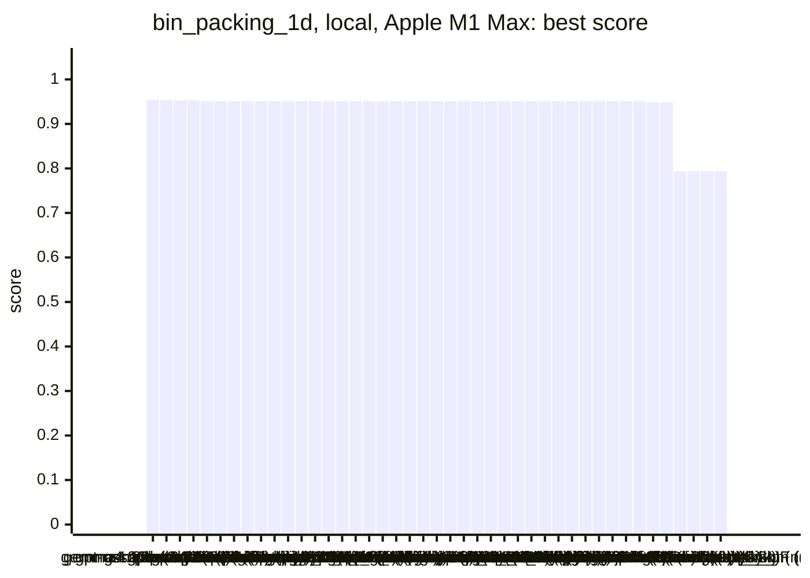
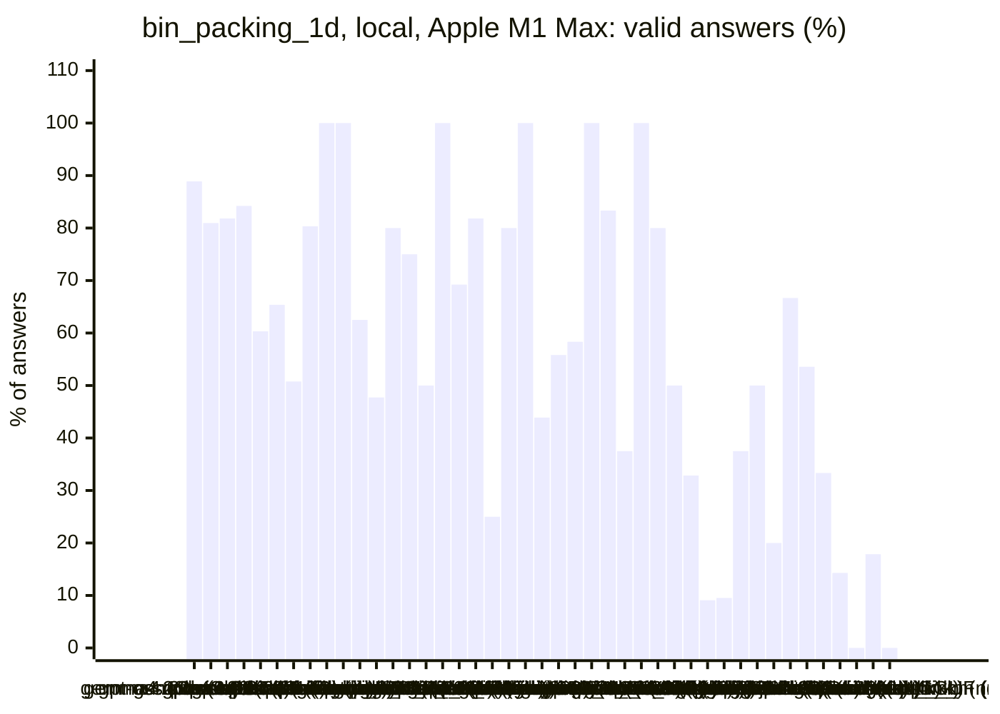
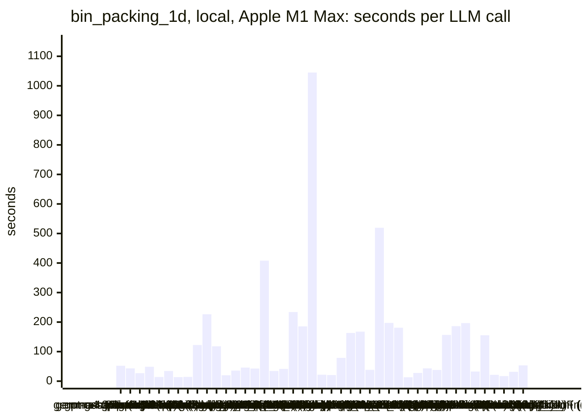
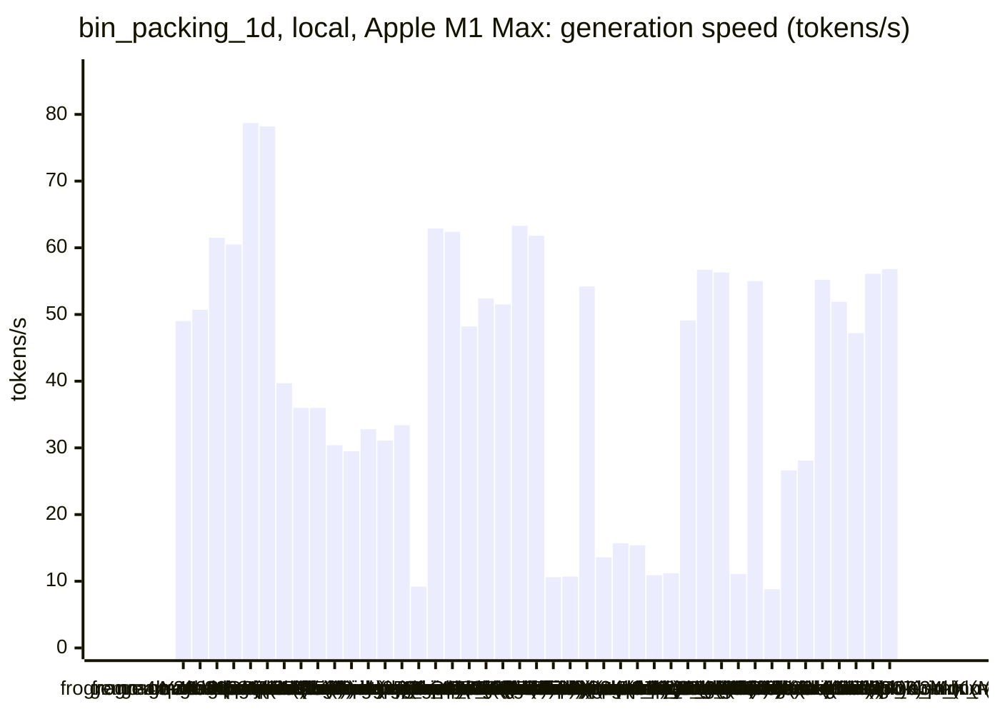
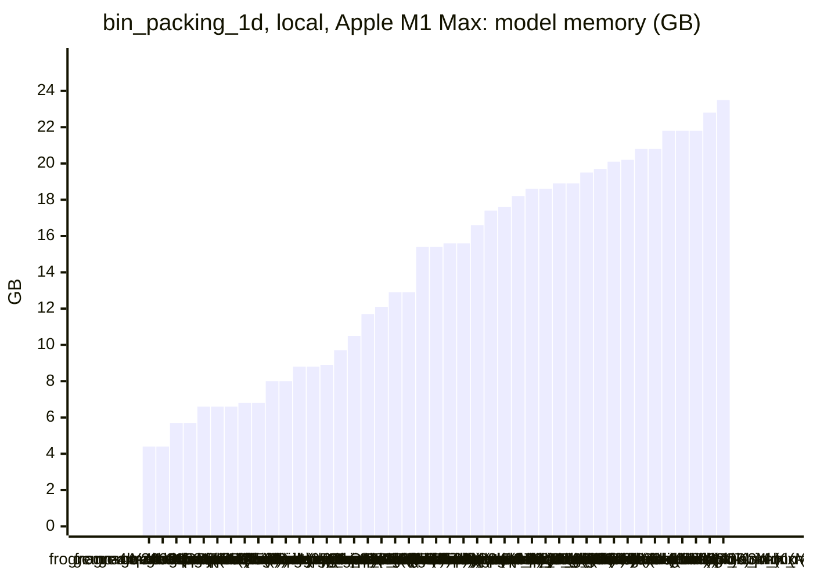
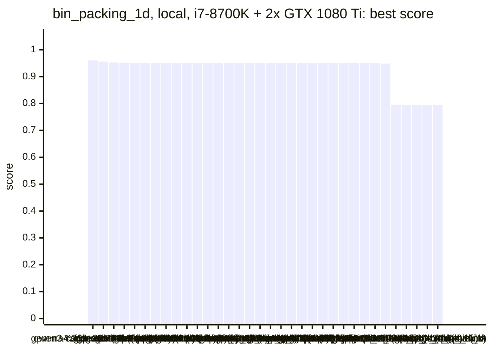
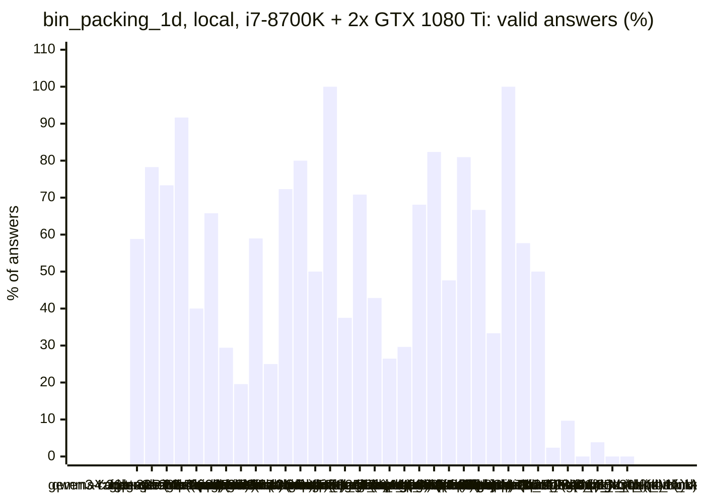
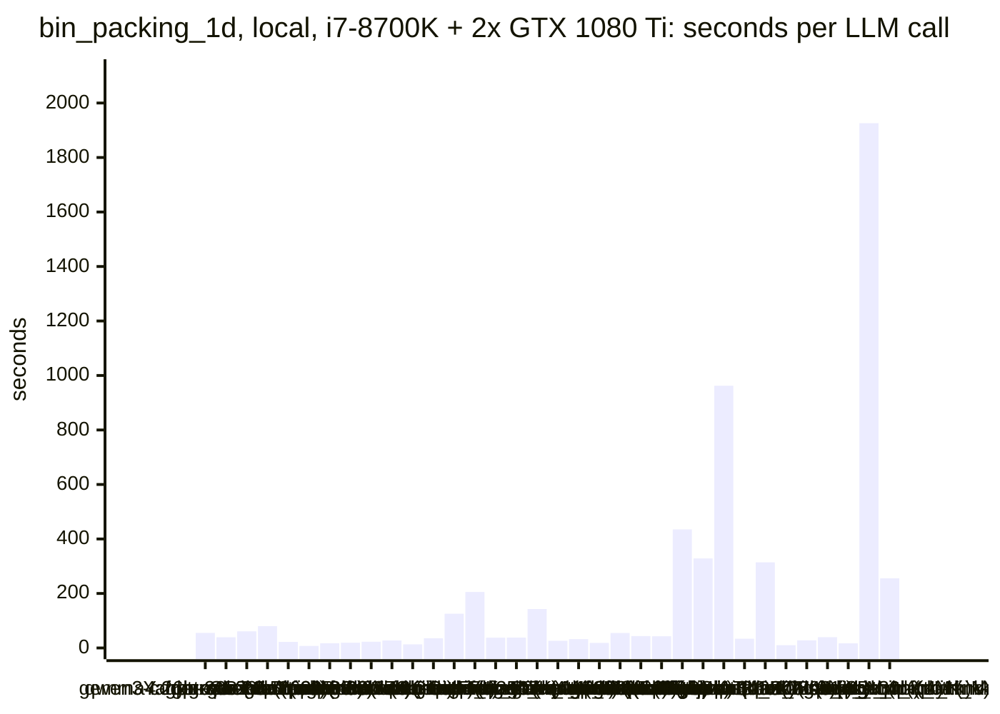
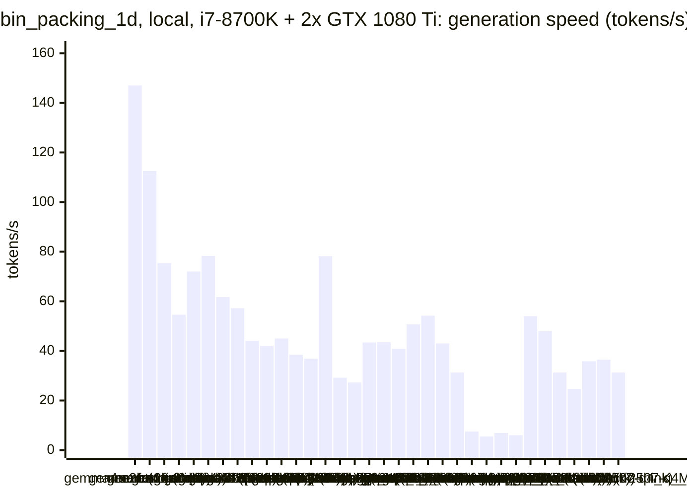
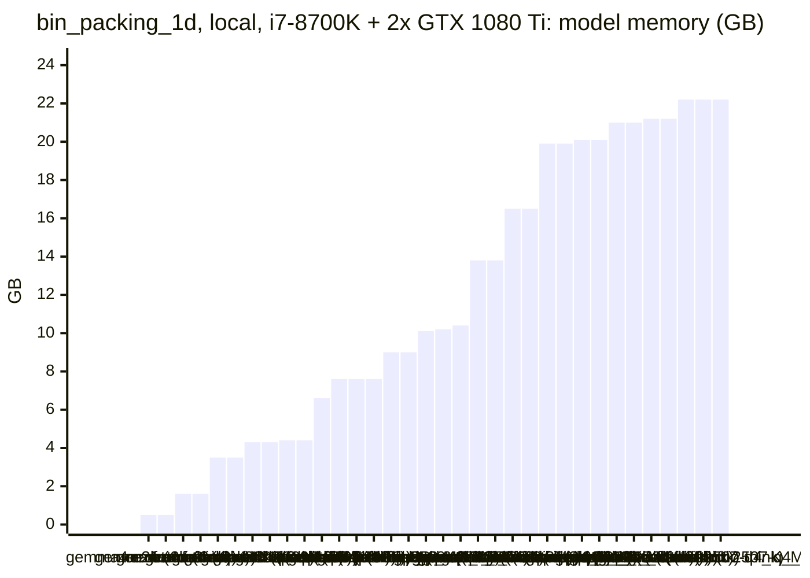

<!-- Copyright (c) 2026 by C. Klukas -->
<!-- SPDX-License-Identifier: GPL-3.0-only -->
<!-- Generated by `omega report` from bench/results/*.json. Do not edit by hand. -->

# bin_packing_1d

46 models, 15 minutes each, one run per model. The [overall ranking](../benchmarks.md#overall-ranking) compares the models over all examples.

Machines: **Apple M1 Max**: Apple M1 Max (Mac13,1), 10 cores, 32 GB, 45 runs; **i7-8700K + 2x GTX 1080 Ti**: Intel(R) Core(TM) i7-8700K CPU @ 3.70GHz (MS-7A98), 12 cores, 64 GB, 2x NVIDIA GeForce GTX 1080 Ti, 11264 MiB, 34 runs.

## Local models on Apple M1 Max

Ollama on this machine.

| Model | Params | Initial | Best | Gain | LLM calls | s/call | Valid | New bests | Min to best |
|---|---|--:|--:|--:|--:|--:|--:|--:|--:|
| gpt-oss:20b (no-think) | 20.9B | 0.79426 | **0.95416** | ×1.20 | 18 | 52 | 89% | 2 | 6.7 |
| gemma4:12b-it-qat (no-think) | 11.9B | 0.79426 | **0.9541** | ×1.20 | 21 | 43 | 81% | 2 | 8.3 |
| gemma4:26b-a4b-it-qat (no-think) | 25.2B | 0.79426 | **0.95304** | ×1.20 | 33 | 27 | 82% | 3 | 11.5 |
| gpt-oss:20b (think) | 20.9B | 0.79426 | **0.95304** | ×1.20 | 19 | 49 | 84% | 2 | 9.6 |
| gemma4:e4b-it-qat (no-think) | 7.5B | 0.79426 | **0.95128** | ×1.20 | 63 | 14 | 60% | 1 | 1.1 |
| qwen3.5:latest (no-think) | 9.7B | 0.79426 | **0.95128** | ×1.20 | 26 | 34 | 65% | 2 | 3.5 |
| gemma4:e2b (no-think) | 5.1B | 0.79426 | **0.95128** | ×1.20 | 65 | 14 | 51% | 2 | 1.2 |
| gemma4:latest (no-think) |  | 0.79426 | **0.95128** | ×1.20 | 61 | 14 | 80% | 1 | 1.9 |
| qwen3.5:27b (no-think) | 27.8B | 0.79426 | **0.95128** | ×1.20 | 8 | 122 | 100% | 1 | 5.4 |
| qwen3.8:27b-mtp-q4_K_M (no-think) | 27.3B | 0.79426 | **0.95128** | ×1.20 | 4 | 227 | 100% | 1 | 12.5 |
| qwen3.6:27b-coding-mtp-q4_K_M (no-think) | 27.3B | 0.79426 | **0.95128** | ×1.20 | 8 | 118 | 62% | 1 | 5.2 |
| qwen3:30b-a3b-instruct-2507-q4_K_M (no-think) | 30.5B | 0.79426 | **0.95128** | ×1.20 | 44 | 20 | 48% | 1 | 2.5 |
| qwen3-coder:30b (no-think) | 30.5B | 0.79426 | **0.95128** | ×1.20 | 25 | 36 | 80% | 1 | 2.5 |
| gemma4:e4b-it-qat (think) | 7.5B | 0.79426 | **0.95128** | ×1.20 | 20 | 46 | 75% | 1 | 1.9 |
| qwen3.5:latest (think) | 9.7B | 0.79426 | **0.95128** | ×1.20 | 22 | 43 | 50% | 1 | 3.4 |
| gemma4:12b-it-qat (think) | 11.9B | 0.79426 | **0.95128** | ×1.20 | 3 | 408 | 100% | 1 | 6.1 |
| gemma4:e2b (think) | 5.1B | 0.79426 | **0.95128** | ×1.20 | 26 | 34 | 69% | 2 | 1.9 |
| gemma4:latest (think) |  | 0.79426 | **0.95128** | ×1.20 | 22 | 41 | 82% | 1 | 2.2 |
| gemma4:26b-a4b-it-qat (think) | 25.2B | 0.79426 | **0.95128** | ×1.20 | 4 | 234 | 25% | 1 | 10.2 |
| qwen3.5:27b (think) | 27.8B | 0.79426 | **0.95128** | ×1.20 | 5 | 185 | 80% | 1 | 5.7 |
| qwen3.6:27b-coding-mtp-q4_K_M (think) | 27.3B | 0.79426 | **0.95128** | ×1.20 | 1 | 1045 | 100% | 1 | 17.4 |
| qwen3:30b-a3b-instruct-2507-q4_K_M (think) | 30.5B | 0.79426 | **0.95128** | ×1.20 | 41 | 22 | 44% | 1 | 3.2 |
| richardyoung/frognano-4b-2609:latest (no-think) | 4.3B | 0.79426 | **0.95128** | ×1.20 | 43 | 21 | 56% | 2 | 1.6 |
| devstral-small-2:24b (no-think) | 24.0B | 0.79426 | **0.95128** | ×1.20 | 12 | 79 | 58% | 2 | 2.2 |
| muse-glimmer:30b (no-think) | 27.9B | 0.79426 | **0.95128** | ×1.20 | 7 | 163 | 100% | 1 | 2.6 |
| ingu627/exaone4.0:32b (no-think) | 32.0B | 0.79426 | **0.95128** | ×1.20 | 6 | 168 | 83% | 1 | 2.7 |
| richardyoung/frognano-4b-2609:latest (think) | 4.3B | 0.79426 | **0.95128** | ×1.20 | 24 | 38 | 38% | 2 | 3.4 |
| muse-glimmer:30b (think) | 27.9B | 0.79426 | **0.95128** | ×1.20 | 3 | 519 | 100% | 1 | 5.0 |
| glm-4.7-flash:latest (think) | 29.9B | 0.79426 | **0.95128** | ×1.20 | 5 | 197 | 80% | 1 | 2.5 |
| frob/sarvam:30b (think) | 32.2B | 0.79426 | **0.95128** | ×1.20 | 6 | 181 | 50% | 1 | 10.1 |
| nemotron-3-nano:4b (no-think) |  | 0.79426 | **0.95128** | ×1.20 | 67 | 13 | 33% | 2 | 11.3 |
| nemotron-3-nano:30b-a3b-mlx (no-think) |  | 0.79426 | **0.95128** | ×1.20 | 33 | 28 | 9% | 1 | 13.4 |
| nemotron-3.5-lightning:30b-mlx (no-think) |  | 0.79426 | **0.95128** | ×1.20 | 21 | 43 | 10% | 1 | 11.4 |
| nemotron-3-nano:4b (think) |  | 0.79426 | **0.95128** | ×1.20 | 24 | 38 | 38% | 2 | 1.6 |
| nemotron-3-nano:30b-a3b-mlx (think) |  | 0.79426 | **0.95128** | ×1.20 | 6 | 157 | 50% | 1 | 3.6 |
| nemotron-3.5-lightning:30b-mlx (think) |  | 0.79426 | **0.95128** | ×1.20 | 5 | 186 | 20% | 1 | 8.1 |
| underdog-saluki-27b:iq2-mix (no-think) | 26.9B | 0.79426 | **0.95128** | ×1.20 | 6 | 197 | 67% | 1 | 2.3 |
| glm-4.7-flash:latest (no-think) | 29.9B | 0.79426 | **0.94863** | ×1.19 | 28 | 33 | 54% | 1 | 2.9 |
| frob/sarvam:30b (no-think) | 32.2B | 0.79426 | **0.94863** | ×1.19 | 6 | 155 | 33% | 1 | 11.2 |
| qwen2.5-coder:7b (no-think) | 7.6B | 0.79426 | **0.79426** | ×1.00 | 42 | 21 | 14% | 0 | - |
| qwen3.8:27b-mtp-q4_K_M (think) | 27.3B | | | | | | | | failed: all 1 model requests failed: qwen3.8:27b-mtp-q4_K_M: answer  |
| yandex/YandexGPT-5-Lite-8B-instruct-GGUF:latest (no-think) | 8.0B | 0.79426 | **0.79426** | ×1.00 | 51 | 17 | 0% | 0 | - |
| MichelRosselli/apertus:8b-instruct-2509-q4_k_m (no-think) | 8.1B | 0.79426 | **0.79426** | ×1.00 | 28 | 32 | 18% | 0 | - |
| llm-jp-4-8b-omega:q4_k_m (no-think) | 8.6B | 0.79426 | **0.79426** | ×1.00 | 17 | 54 | 0% | 0 | - |
| underdog-saluki-27b:iq2-mix (think) | 26.9B | | | | | | | | failed: all 1 model requests failed: underdog-saluki-27b:iq2-mix: an |

### Inference speed and memory

RAM is what Ollama reports for the loaded model (weights, context cache and buffers; on Apple silicon this is shared memory). Load is the time to bring the model into memory. Prompt and generation speeds are tokens per second over all calls of the run.

| Model | Params | RAM GB | Load s | Prompt tok/s | Gen tok/s | Median s/call | p90 s/call | Tokens/answer | Stopped |
|---|---|--:|--:|--:|--:|--:|--:|--:|--:|
| richardyoung/frognano-4b-2609:latest (no-think) | 4.3B | 4.4 | 11 | 760 | 49.0 | 18 | 35 | 669 | 5 |
| richardyoung/frognano-4b-2609:latest (think) | 4.3B | 4.4 | 0 | 851 | 50.7 | 38 | 55 | 1721 | 3 |
| gemma4:e4b-it-qat (no-think) | 7.5B | 5.7 | 58 | 651 | 61.5 | 13 | 22 | 479 | 0 |
| gemma4:e4b-it-qat (think) | 7.5B | 5.7 | 84 | 728 | 60.5 | 42 | 80 | 2273 | 0 |
| gemma4:e2b (no-think) | 5.1B | 6.6 | 33 | 963 | 78.7 | 10 | 26 | 710 | 0 |
| gemma4:e2b (think) | 5.1B | 6.6 | 64 | 1075 | 78.2 | 31 | 46 | 2271 | 0 |
| qwen2.5-coder:7b (no-think) | 7.6B | 6.6 | 50 | 546 | 39.7 | 21 | 32 | 581 | 1 |
| qwen3.5:latest (no-think) | 9.7B | 6.8 | 28 | 435 | 36.0 | 26 | 75 | 842 | 1 |
| qwen3.5:latest (think) | 9.7B | 6.8 | 49 | 453 | 36.0 | 47 | 56 | 1231 | 0 |
| gemma4:12b-it-qat (no-think) | 11.9B | 8.0 | 66 | 252 | 30.4 | 36 | 84 | 818 | 0 |
| gemma4:12b-it-qat (think) | 11.9B | 8.0 | 88 | 296 | 29.5 | 368 | 492 | 10958 | 0 |
| yandex/YandexGPT-5-Lite-8B-instruct-GGUF:latest (no-think) | 8.0B | 8.8 | 15 | 534 | 32.8 | 16 | 25 | 420 | 0 |
| llm-jp-4-8b-omega:q4_k_m (no-think) | 8.6B | 8.8 | 16 | 576 | 31.1 | 50 | 97 | 1380 | 3 |
| MichelRosselli/apertus:8b-instruct-2509-q4_k_m (no-think) | 8.1B | 8.9 | 16 | 453 | 33.4 | 28 | 46 | 628 | 5 |
| underdog-saluki-27b:iq2-mix (no-think) | 26.9B | 9.7 | 24 | 111 | 9.2 | 196 | 322 | 1351 | 1 |
| nemotron-3-nano:4b (think) |  | 10.5 | 8 | 676 | 62.9 | 32 | 67 | 2114 | 0 |
| nemotron-3-nano:4b (no-think) |  | 11.7 | 8 | 720 | 62.4 | 12 | 20 | 485 | 1 |
| gemma4:latest (think) |  | 12.1 | 108 | 1052 | 48.2 | 31 | 59 | 1618 | 0 |
| gpt-oss:20b (no-think) | 20.9B | 12.9 | 55 | 741 | 52.4 | 50 | 96 | 2370 | 0 |
| gpt-oss:20b (think) | 20.9B | 12.9 | 150 | 739 | 51.5 | 40 | 75 | 1893 | 0 |
| gemma4:26b-a4b-it-qat (no-think) | 25.2B | 15.4 | 203 | 635 | 63.3 | 22 | 36 | 855 | 0 |
| gemma4:26b-a4b-it-qat (think) | 25.2B | 15.4 | 0 | 1689 | 61.8 | 208 | 492 | 7190 | 2 |
| muse-glimmer:30b (no-think) | 27.9B | 15.6 | 52 | 100 | 10.6 | 159 | 298 | 1403 | 0 |
| muse-glimmer:30b (think) | 27.9B | 15.6 | 79 | 120 | 10.7 | 297 | 1054 | 5115 | 0 |
| gemma4:latest (no-think) |  | 16.6 | 102 | 1097 | 54.2 | 12 | 19 | 493 | 0 |
| qwen3.6:27b-coding-mtp-q4_K_M (think) | 27.3B | 17.4 | 322 | 94 | 13.6 | 1045 | 1045 | 5307 | 0 |
| qwen3.8:27b-mtp-q4_K_M (no-think) | 27.3B | 17.6 | 306 | 115 | 15.7 | 69 | 751 | 541 | 0 |
| qwen3.6:27b-coding-mtp-q4_K_M (no-think) | 27.3B | 18.2 | 243 | 105 | 15.4 | 83 | 309 | 971 | 0 |
| qwen3.5:27b (no-think) | 27.8B | 18.6 | 237 | 106 | 10.9 | 98 | 325 | 738 | 0 |
| qwen3.5:27b (think) | 27.8B | 18.6 | 234 | 104 | 11.2 | 164 | 343 | 1308 | 0 |
| frob/sarvam:30b (think) | 32.2B | 18.9 | 20 | 1115 | 49.1 | 184 | 269 | 7916 | 2 |
| frob/sarvam:30b (no-think) | 32.2B | 18.9 | 91 | 1120 | 56.7 | 149 | 242 | 7845 | 0 |
| nemotron-3-nano:30b-a3b-mlx (think) |  | 19.5 | 95 | 227 | 56.3 | 177 | 231 | 5572 | 2 |
| devstral-small-2:24b (no-think) | 24.0B | 19.7 | 41 | 123 | 11.1 | 79 | 119 | 589 | 0 |
| nemotron-3.5-lightning:30b-mlx (think) |  | 20.1 | 0 | 510 | 55.0 | 189 | 305 | 9807 | 4 |
| ingu627/exaone4.0:32b (no-think) | 32.0B | 20.2 | 52 | 71 | 8.8 | 192 | 196 | 1054 | 0 |
| glm-4.7-flash:latest (think) | 29.9B | 20.8 | 52 | 576 | 26.6 | 151 | 443 | 4889 | 0 |
| glm-4.7-flash:latest (no-think) | 29.9B | 20.8 | 51 | 459 | 28.1 | 30 | 44 | 696 | 0 |
| qwen3:30b-a3b-instruct-2507-q4_K_M (no-think) | 30.5B | 21.8 | 138 | 713 | 55.2 | 16 | 32 | 645 | 0 |
| qwen3-coder:30b (no-think) | 30.5B | 21.8 | 131 | 633 | 51.9 | 29 | 51 | 1239 | 0 |
| qwen3:30b-a3b-instruct-2507-q4_K_M (think) | 30.5B | 21.8 | 181 | 670 | 47.2 | 15 | 43 | 530 | 1 |
| nemotron-3.5-lightning:30b-mlx (no-think) |  | 22.8 | 110 | 381 | 56.1 | 40 | 48 | 1917 | 12 |
| nemotron-3-nano:30b-a3b-mlx (no-think) |  | 23.5 | 128 | 543 | 56.8 | 21 | 36 | 1114 | 5 |

### Best score over time

| Model | 3.75 min | 7.5 min | 11.25 min | 15 min |
|---|--:|--:|--:|--:|
| gpt-oss:20b (no-think) | 0.95128 | 0.95416 | 0.95416 | 0.95416 |
| gemma4:12b-it-qat (no-think) | 0.95128 | 0.95128 | 0.9541 | 0.9541 |
| gemma4:26b-a4b-it-qat (no-think) | 0.95128 | 0.95233 | 0.95233 | 0.95304 |
| gpt-oss:20b (think) | 0.79426 | 0.95128 | 0.95304 | 0.95304 |
| gemma4:e4b-it-qat (no-think) | 0.95128 | 0.95128 | 0.95128 | 0.95128 |
| qwen3.5:latest (no-think) | 0.95128 | 0.95128 | 0.95128 | 0.95128 |
| gemma4:e2b (no-think) | 0.95128 | 0.95128 | 0.95128 | 0.95128 |
| gemma4:latest (no-think) | 0.95128 | 0.95128 | 0.95128 | 0.95128 |
| qwen3.5:27b (no-think) | 0.79426 | 0.95128 | 0.95128 | 0.95128 |
| qwen3.8:27b-mtp-q4_K_M (no-think) | 0.79426 | 0.79426 | 0.79426 | 0.95128 |
| qwen3.6:27b-coding-mtp-q4_K_M (no-think) | 0.79426 | 0.95128 | 0.95128 | 0.95128 |
| qwen3:30b-a3b-instruct-2507-q4_K_M (no-think) | 0.95128 | 0.95128 | 0.95128 | 0.95128 |
| qwen3-coder:30b (no-think) | 0.95128 | 0.95128 | 0.95128 | 0.95128 |
| gemma4:e4b-it-qat (think) | 0.95128 | 0.95128 | 0.95128 | 0.95128 |
| qwen3.5:latest (think) | 0.95128 | 0.95128 | 0.95128 | 0.95128 |
| gemma4:12b-it-qat (think) | 0.79426 | 0.95128 | 0.95128 | 0.95128 |
| gemma4:e2b (think) | 0.95128 | 0.95128 | 0.95128 | 0.95128 |
| gemma4:latest (think) | 0.95128 | 0.95128 | 0.95128 | 0.95128 |
| gemma4:26b-a4b-it-qat (think) | 0.79426 | 0.79426 | 0.95128 | 0.95128 |
| qwen3.5:27b (think) | 0.79426 | 0.95128 | 0.95128 | 0.95128 |
| qwen3.6:27b-coding-mtp-q4_K_M (think) | 0.79426 | 0.79426 | 0.79426 | 0.79426 |
| qwen3:30b-a3b-instruct-2507-q4_K_M (think) | 0.95128 | 0.95128 | 0.95128 | 0.95128 |
| richardyoung/frognano-4b-2609:latest (no-think) | 0.95128 | 0.95128 | 0.95128 | 0.95128 |
| devstral-small-2:24b (no-think) | 0.95128 | 0.95128 | 0.95128 | 0.95128 |
| muse-glimmer:30b (no-think) | 0.95128 | 0.95128 | 0.95128 | 0.95128 |
| ingu627/exaone4.0:32b (no-think) | 0.95128 | 0.95128 | 0.95128 | 0.95128 |
| richardyoung/frognano-4b-2609:latest (think) | 0.95128 | 0.95128 | 0.95128 | 0.95128 |
| muse-glimmer:30b (think) | 0.79426 | 0.95128 | 0.95128 | 0.95128 |
| glm-4.7-flash:latest (think) | 0.95128 | 0.95128 | 0.95128 | 0.95128 |
| frob/sarvam:30b (think) | 0.79426 | 0.79426 | 0.95128 | 0.95128 |
| nemotron-3-nano:4b (no-think) | 0.94863 | 0.94863 | 0.94863 | 0.95128 |
| nemotron-3-nano:30b-a3b-mlx (no-think) | 0.79426 | 0.79426 | 0.79426 | 0.95128 |
| nemotron-3.5-lightning:30b-mlx (no-think) | 0.79426 | 0.79426 | 0.79426 | 0.95128 |
| nemotron-3-nano:4b (think) | 0.95128 | 0.95128 | 0.95128 | 0.95128 |
| nemotron-3-nano:30b-a3b-mlx (think) | 0.95128 | 0.95128 | 0.95128 | 0.95128 |
| nemotron-3.5-lightning:30b-mlx (think) | 0.79426 | 0.79426 | 0.95128 | 0.95128 |
| underdog-saluki-27b:iq2-mix (no-think) | 0.95128 | 0.95128 | 0.95128 | 0.95128 |
| glm-4.7-flash:latest (no-think) | 0.94863 | 0.94863 | 0.94863 | 0.94863 |
| frob/sarvam:30b (no-think) | 0.79426 | 0.79426 | 0.94863 | 0.94863 |
| qwen2.5-coder:7b (no-think) | 0.79426 | 0.79426 | 0.79426 | 0.79426 |
| yandex/YandexGPT-5-Lite-8B-instruct-GGUF:latest (no-think) | 0.79426 | 0.79426 | 0.79426 | 0.79426 |
| MichelRosselli/apertus:8b-instruct-2509-q4_k_m (no-think) | 0.79426 | 0.79426 | 0.79426 | 0.79426 |
| llm-jp-4-8b-omega:q4_k_m (no-think) | 0.79426 | 0.79426 | 0.79426 | 0.79426 |

### Outcome of the LLM answers

| Model | duplicate | edit error | invalid | llm error | ok | timeout |
|---|--:|--:|--:|--:|--:|--:|
| gpt-oss:20b (no-think) | 0 | 0 | 1 | 0 | 16 | 1 |
| gemma4:12b-it-qat (no-think) | 1 | 1 | 2 | 0 | 17 | 0 |
| gemma4:26b-a4b-it-qat (no-think) | 0 | 6 | 0 | 0 | 27 | 0 |
| gpt-oss:20b (think) | 1 | 1 | 1 | 0 | 16 | 0 |
| gemma4:e4b-it-qat (no-think) | 3 | 7 | 15 | 0 | 38 | 0 |
| qwen3.5:latest (no-think) | 0 | 1 | 7 | 1 | 17 | 0 |
| gemma4:e2b (no-think) | 17 | 6 | 9 | 0 | 33 | 0 |
| gemma4:latest (no-think) | 2 | 3 | 7 | 0 | 49 | 0 |
| qwen3.5:27b (no-think) | 0 | 0 | 0 | 0 | 8 | 0 |
| qwen3.8:27b-mtp-q4_K_M (no-think) | 0 | 0 | 0 | 0 | 4 | 0 |
| qwen3.6:27b-coding-mtp-q4_K_M (no-think) | 1 | 1 | 1 | 0 | 5 | 0 |
| qwen3:30b-a3b-instruct-2507-q4_K_M (no-think) | 1 | 4 | 17 | 0 | 21 | 1 |
| qwen3-coder:30b (no-think) | 0 | 0 | 4 | 0 | 20 | 1 |
| gemma4:e4b-it-qat (think) | 2 | 0 | 3 | 0 | 15 | 0 |
| qwen3.5:latest (think) | 1 | 1 | 9 | 0 | 11 | 0 |
| gemma4:12b-it-qat (think) | 0 | 0 | 0 | 0 | 3 | 0 |
| gemma4:e2b (think) | 0 | 4 | 4 | 0 | 18 | 0 |
| gemma4:latest (think) | 1 | 0 | 3 | 0 | 18 | 0 |
| gemma4:26b-a4b-it-qat (think) | 0 | 1 | 0 | 2 | 1 | 0 |
| qwen3.5:27b (think) | 0 | 0 | 1 | 0 | 4 | 0 |
| qwen3.6:27b-coding-mtp-q4_K_M (think) | 0 | 0 | 0 | 0 | 1 | 0 |
| qwen3:30b-a3b-instruct-2507-q4_K_M (think) | 7 | 2 | 12 | 1 | 18 | 1 |
| richardyoung/frognano-4b-2609:latest (no-think) | 3 | 5 | 6 | 5 | 24 | 0 |
| devstral-small-2:24b (no-think) | 2 | 1 | 2 | 0 | 7 | 0 |
| muse-glimmer:30b (no-think) | 0 | 0 | 0 | 0 | 7 | 0 |
| ingu627/exaone4.0:32b (no-think) | 0 | 0 | 1 | 0 | 5 | 0 |
| richardyoung/frognano-4b-2609:latest (think) | 0 | 3 | 9 | 3 | 9 | 0 |
| muse-glimmer:30b (think) | 0 | 0 | 0 | 0 | 3 | 0 |
| glm-4.7-flash:latest (think) | 0 | 0 | 1 | 0 | 4 | 0 |
| frob/sarvam:30b (think) | 0 | 0 | 1 | 2 | 3 | 0 |
| nemotron-3-nano:4b (no-think) | 5 | 23 | 16 | 1 | 22 | 0 |
| nemotron-3-nano:30b-a3b-mlx (no-think) | 0 | 13 | 12 | 5 | 3 | 0 |
| nemotron-3.5-lightning:30b-mlx (no-think) | 0 | 2 | 5 | 12 | 2 | 0 |
| nemotron-3-nano:4b (think) | 1 | 11 | 3 | 0 | 9 | 0 |
| nemotron-3-nano:30b-a3b-mlx (think) | 0 | 1 | 0 | 2 | 3 | 0 |
| nemotron-3.5-lightning:30b-mlx (think) | 0 | 0 | 0 | 4 | 1 | 0 |
| underdog-saluki-27b:iq2-mix (no-think) | 0 | 0 | 1 | 1 | 4 | 0 |
| glm-4.7-flash:latest (no-think) | 2 | 1 | 10 | 0 | 15 | 0 |
| frob/sarvam:30b (no-think) | 0 | 4 | 0 | 0 | 2 | 0 |
| qwen2.5-coder:7b (no-think) | 6 | 1 | 28 | 1 | 6 | 0 |
| yandex/YandexGPT-5-Lite-8B-instruct-GGUF:latest (no-think) | 10 | 1 | 40 | 0 | 0 | 0 |
| MichelRosselli/apertus:8b-instruct-2509-q4_k_m (no-think) | 4 | 7 | 7 | 5 | 5 | 0 |
| llm-jp-4-8b-omega:q4_k_m (no-think) | 0 | 5 | 9 | 3 | 0 | 0 |

### Best idea per model

- **gpt-oss:20b (no-think)**: Add a lightweight improvement phase after the initial first‑fit decreasing packing that repeatedly re‑assigns items to other bins to reduce slack and drop empty bins, using random …
- **gemma4:12b-it-qat (no-think)**: Fix the bug where `bin_loads` and `bins` list indices become desynchronized by ensuring that when an empty bin is removed, the `bin_loads` list is updated correctly and the …
- **gemma4:26b-a4b-it-qat (no-think)**: Implement a randomized First Fit Decreasing approach combined with a local search that attempts to empty the least-loaded bins and performs 1-1 swaps to increase bin density.
- **gpt-oss:20b (think)**: Add a simple post‑packing improvement that tries to empty bins by moving their items into other bins, reducing the total bin count with negligible extra cost.
- **gemma4:e4b-it-qat (no-think)**: Implement First Fit Decreasing (FFD) by sorting items by decreasing size and then packing them using the First Fit heuristic to improve bin packing density significantly over Next …
- **qwen3.5:latest (no-think)**: Remove the broken local optimization loop and redundant re-implementation, replacing them with a single efficient Best-Fit Decreasing pass that correctly initializes bin_loads as …
- **gemma4:e2b (no-think)**: Implement Best Fit Decreasing (BFD) instead of First Fit Decreasing (FFD) by always placing the item into the bin that results in the minimum remaining space, which tends to …
- **gemma4:latest (no-think)**: Implement First Fit Decreasing (FFD) by sorting items by size in descending order and then applying the First Fit strategy.
- **qwen3.5:27b (no-think)**: Replace the Next Fit heuristic with First Fit Decreasing (FFD) by sorting items in descending order before packing, which is a standard improvement that significantly reduces the …
- **qwen3.8:27b-mtp-q4_K_M (no-think)**: Replace next-fit with First-Fit-Decreasing (a substantially different greedy construction) which is known to land near the lower bound on these instances and runs in milliseconds …
- **qwen3.6:27b-coding-mtp-q4_K_M (no-think)**: Replace next-fit with First Fit Decreasing (FFD), which sorts items by size descending and places each in the first bin that fits, significantly reducing bin count for these …
- **qwen3:30b-a3b-instruct-2507-q4_K_M (no-think)**: Replace next-fit with First-Fit Decreasing (FFD) to improve bin utilization by packing larger items first, reducing fragmentation and enabling better packing efficiency …
- **qwen3-coder:30b (no-think)**: Replace the simple next-fit heuristic with a first-fit decreasing approach combined with local search optimization to reduce the number of bins used, especially effective for the …
- **gemma4:e4b-it-qat (think)**: Implement First Fit Decreasing (FFD) instead of Next Fit by sorting items by decreasing size and then placing each item into the first bin that can accommodate it, significantly …
- **qwen3.5:latest (think)**: Replace Next-Fit with First-Fit Decreasing (sort items descending, place in first-fitting bin) which is provably much better; add SWEEP for optional local search iteration limit.
- **gemma4:12b-it-qat (think)**: Replace the current Next Fit heuristic with First Fit Decreasing (FFD), which sorts items by size in descending order and places each item into the first bin that can accommodate …
- **gemma4:e2b (think)**: Sort items by decreasing size and use First Fit (FFD) to place items into existing bins to reduce fragmentation.
- **gemma4:latest (think)**: Replace the Next Fit heuristic with the First Fit Decreasing (FFD) heuristic by sorting items by size descendingly while preserving original indices, which is a significant …
- **gemma4:26b-a4b-it-qat (think)**: Implement First-Fit Decreasing (FFD) to significantly improve bin packing efficiency over the current next-fit approach.
- **qwen3.5:27b (think)**: Implement First-Fit Decreasing (FFD) which sorts items by decreasing size before packing and uses first-fit placement, a well-known heuristic that significantly improves bin …
- **qwen3.6:27b-coding-mtp-q4_K_M (think)**: Replace the naive next-fit heuristic with Best Fit Decreasing (BFD), which sorts items by size descending and places each into the bin that leaves the least remaining space …
- **qwen3:30b-a3b-instruct-2507-q4_K_M (think)**: Replace next-fit with First-Fit Decreasing (FFD) to improve packing efficiency by sorting items in descending order and placing each item in the first bin that can accommodate it …
- **richardyoung/frognano-4b-2609:latest (no-think)**: Fix the bug where the function creates too many empty bins and returns an invalid result by filtering out empty bins after sorting and removing empty bins from the start, and also …
- **devstral-small-2:24b (no-think)**: Use a First Fit Decreasing (FFD) heuristic with sorting by descending size to improve packing efficiency by reducing the number of bins needed.
- **muse-glimmer:30b (no-think)**: Replace next-fit with first-fit decreasing by sorting items by decreasing size and placing each item in the first bin with enough remaining capacity, which dramatically reduces …
- **ingu627/exaone4.0:32b (no-think)**: Implement a combination of first-fit decreasing (FFD) with local search optimization to reduce the number of bins by re-inserting items from the least-filled bins into other bins …
- **richardyoung/frognano-4b-2609:latest (think)**: Sort items by decreasing size and use First Fit instead of Next Fit, which is a well-known improvement that reduces bins for all three instances
- **muse-glimmer:30b (think)**: Use best-fit decreasing to place items in decreasing size order into the bin with the smallest fitting remaining space, which dramatically reduces bins compared to next-fit.
- **glm-4.7-flash:latest (think)**: Replace next-fit with First-Fit Decreasing, sorting items by size to place larger items first to reduce fragmentation and minimize bin count.
- **frob/sarvam:30b (think)**: Replace next‑fit with best‑fit decreasing and add a lightweight local search that moves items from lightly filled bins to heavier bins, checking the CPU time after each placement.
- **nemotron-3-nano:4b (no-think)**: Add a 3-item local fill heuristic for small bins to reduce bin count without increasing CPU time.
- **nemotron-3-nano:30b-a3b-mlx (no-think)**: Use decreasing-size sorting, pack bins by completing them with the subset of up to three items that yields the smallest slack, then optionally swap items between bins if it …
- **nemotron-3.5-lightning:30b-mlx (no-think)**: Replace next-fit with first-fit decreasing, add minimum bin slack triplet search after each bin, and a fast local search that re-inserts items from the least-filled bin to reduce …
- **nemotron-3-nano:4b (think)**: replace next‑fit with a best‑fit decreasing heuristic that sorts items by size descending for higher packing density.
- **nemotron-3-nano:30b-a3b-mlx (think)**: Replace next‑fit with first‑fit decreasing plus best‑fit bin selection and a lightweight local search that empties the sparsest bin while constantly checking the CPU timer.
- **nemotron-3.5-lightning:30b-mlx (think)**: Replace next-fit packing with best-fit decreasing: sort items by decreasing size and place each item in the bin that leaves the least remaining space, which significantly reduces …
- **underdog-saluki-27b:iq2-mix (no-think)**: Replace the next-fit baseline with a sorted-first-fit-decreasing heuristic plus a fast exact MBS-style best-pair fill for the final bins, using a per-bin free-space array and a …
- **glm-4.7-flash:latest (no-think)**: Replace the naive Next Fit with First Fit Decreasing to group larger items first, drastically reducing wasted space, which directly addresses the metrics showing excess bins.
- **frob/sarvam:30b (no-think)**: Sort items in decreasing order and use best‑fit decreasing to pack, then perform a limited local search of bin merging to reduce the number of bins.
- **qwen2.5-coder:7b (no-think)**: initial program
- **yandex/YandexGPT-5-Lite-8B-instruct-GGUF:latest (no-think)**: initial program
- **MichelRosselli/apertus:8b-instruct-2509-q4_k_m (no-think)**: initial program
- **llm-jp-4-8b-omega:q4_k_m (no-think)**: initial program

## Local models on i7-8700K + 2x GTX 1080 Ti

Ollama on this machine.

| Model | Params | Initial | Best | Gain | LLM calls | s/call | Valid | New bests | Min to best |
|---|---|--:|--:|--:|--:|--:|--:|--:|--:|
| qwen3-coder:30b (no-think) | 30.5B | 0.79426 | **0.96008** | ×1.21 | 17 | 55 | 59% | 1 | 3.3 |
| gemma4:26b-a4b-it-qat (no-think) | 25.2B | 0.79426 | **0.95593** | ×1.20 | 23 | 39 | 78% | 2 | 12.7 |
| gpt-oss:20b (think) | 20.9B | 0.79426 | **0.95271** | ×1.20 | 15 | 61 | 73% | 2 | 7.5 |
| gpt-oss:20b (no-think) | 20.9B | 0.79426 | **0.95199** | ×1.20 | 12 | 80 | 92% | 2 | 14.7 |
| richardyoung/frognano-4b-2609:latest (no-think) | 4.3B | 0.79426 | **0.95128** | ×1.20 | 40 | 22 | 40% | 3 | 10.9 |
| gemma4:e2b (no-think) | 4.6B | 0.79426 | **0.95128** | ×1.20 | 114 | 8 | 66% | 1 | 1.0 |
| qwen2.5-coder:7b (no-think) | 7.6B | 0.79426 | **0.95128** | ×1.20 | 51 | 17 | 29% | 1 | 8.3 |
| yandex/YandexGPT-5-Lite-8B-instruct-GGUF:latest (no-think) | 8.0B | 0.79426 | **0.95128** | ×1.20 | 46 | 19 | 20% | 2 | 6.1 |
| gemma4:e4b-it-qat (no-think) | 7.5B | 0.79426 | **0.95128** | ×1.20 | 39 | 23 | 59% | 1 | 1.8 |
| qwen3.5:latest (no-think) | 9.0B | 0.79426 | **0.95128** | ×1.20 | 32 | 27 | 25% | 1 | 3.1 |
| gemma4:latest (no-think) | 7.5B | 0.79426 | **0.95128** | ×1.20 | 65 | 13 | 72% | 1 | 1.5 |
| gemma4:12b-it-qat (no-think) | 11.9B | 0.79426 | **0.95128** | ×1.20 | 25 | 36 | 80% | 1 | 1.7 |
| qwen3.8:27b-mtp-q4_K_M (no-think) | 27.3B | 0.79426 | **0.95128** | ×1.20 | 8 | 126 | 50% | 1 | 4.8 |
| qwen3.6:27b-coding-mtp-q4_K_M (no-think) | 27.3B | 0.79426 | **0.95128** | ×1.20 | 5 | 205 | 100% | 1 | 4.1 |
| qwen3:30b-a3b-instruct-2507-q4_K_M (no-think) | 30.5B | 0.79426 | **0.95128** | ×1.20 | 24 | 38 | 38% | 1 | 2.6 |
| glm-4.7-flash:latest (no-think) | 29.9B | 0.79426 | **0.95128** | ×1.20 | 24 | 38 | 71% | 1 | 2.8 |
| frob/sarvam:30b (no-think) | 32.2B | 0.79426 | **0.95128** | ×1.20 | 7 | 143 | 43% | 1 | 8.9 |
| nemotron-3-nano:4b (think) | 4.0B | 0.79426 | **0.95128** | ×1.20 | 34 | 26 | 26% | 2 | 2.6 |
| richardyoung/frognano-4b-2609:latest (think) | 4.3B | 0.79426 | **0.95128** | ×1.20 | 27 | 32 | 30% | 2 | 2.8 |
| gemma4:e2b (think) | 4.6B | 0.79426 | **0.95128** | ×1.20 | 47 | 18 | 68% | 1 | 0.6 |
| gemma4:e4b-it-qat (think) | 7.5B | 0.79426 | **0.95128** | ×1.20 | 17 | 55 | 82% | 1 | 1.1 |
| qwen3.5:latest (think) | 9.0B | 0.79426 | **0.95128** | ×1.20 | 21 | 44 | 48% | 1 | 1.5 |
| gemma4:latest (think) | 7.5B | 0.79426 | **0.95128** | ×1.20 | 21 | 43 | 81% | 1 | 0.8 |
| gemma4:12b-it-qat (think) | 11.9B | 0.79426 | **0.95128** | ×1.20 | 3 | 435 | 67% | 1 | 5.8 |
| gemma4:26b-a4b-it-qat (think) | 25.2B | 0.79426 | **0.95128** | ×1.20 | 3 | 328 | 33% | 1 | 16.4 |
| qwen3.8:27b-mtp-q4_K_M (think) | 27.3B | 0.79426 | **0.95128** | ×1.20 | 1 | 962 | 100% | 1 | 16.1 |
| qwen3:30b-a3b-instruct-2507-q4_K_M (think) | 30.5B | 0.79426 | **0.95128** | ×1.20 | 26 | 34 | 58% | 1 | 1.5 |
| glm-4.7-flash:latest (think) | 29.9B | 0.79426 | **0.95128** | ×1.20 | 4 | 314 | 50% | 1 | 3.6 |
| nemotron-3-nano:4b (no-think) | 4.0B | 0.79426 | **0.94863** | ×1.19 | 84 | 10 | 2% | 1 | 6.9 |
| MichelRosselli/apertus:8b-instruct-2509-q4_k_m (no-think) | 8.1B | 0.79426 | **0.79587** | ×1.00 | 31 | 28 | 10% | 1 | 4.9 |
| llm-jp-4-8b-omega:q4_k_m (no-think) | 8.6B | 0.79426 | **0.79426** | ×1.00 | 23 | 40 | 0% | 0 | - |
| Bored/GigaChat3.1-10B-A1.8B-q4_K_M:latest (no-think) | 10.7B | 0.79426 | **0.79426** | ×1.00 | 52 | 17 | 4% | 0 | - |
| qwen3.6:27b-coding-mtp-q4_K_M (think) | 27.3B | 0.79426 | **0.79426** | ×1.00 | 1 | 1926 | 0% | 0 | - |
| frob/sarvam:30b (think) | 32.2B | 0.79426 | **0.79426** | ×1.00 | 4 | 256 | 0% | 0 | - |

### Inference speed and memory

RAM is what Ollama reports for the loaded model (weights, context cache and buffers; on Apple silicon this is shared memory). Load is the time to bring the model into memory. Prompt and generation speeds are tokens per second over all calls of the run.

| Model | Params | RAM GB | Load s | Prompt tok/s | Gen tok/s | Median s/call | p90 s/call | Tokens/answer | Stopped |
|---|---|--:|--:|--:|--:|--:|--:|--:|--:|
| gemma4:e2b (no-think) | 4.6B | 0.5 | 52 | 2118 | 147.0 | 7 | 10 | 447 | 0 |
| gemma4:e2b (think) | 4.6B | 0.5 | 18 | 2483 | 112.5 | 18 | 26 | 1649 | 0 |
| gemma4:latest (no-think) | 7.5B | 1.6 | 82 | 1224 | 75.4 | 10 | 21 | 490 | 0 |
| gemma4:latest (think) | 7.5B | 1.6 | 25 | 1451 | 54.6 | 32 | 78 | 2050 | 0 |
| nemotron-3-nano:4b (think) | 4.0B | 3.5 | 10 | 1835 | 72.0 | 22 | 42 | 1587 | 0 |
| nemotron-3-nano:4b (no-think) | 4.0B | 3.5 | 23 | 1911 | 78.3 | 9 | 15 | 454 | 2 |
| richardyoung/frognano-4b-2609:latest (no-think) | 4.3B | 4.3 | 30 | 1847 | 61.7 | 15 | 49 | 923 | 5 |
| richardyoung/frognano-4b-2609:latest (think) | 4.3B | 4.3 | 0 | 2012 | 57.2 | 31 | 47 | 1609 | 4 |
| gemma4:e4b-it-qat (no-think) | 7.5B | 4.4 | 90 | 1767 | 44.0 | 16 | 46 | 711 | 0 |
| gemma4:e4b-it-qat (think) | 7.5B | 4.4 | 24 | 1630 | 42.0 | 46 | 91 | 2080 | 0 |
| qwen2.5-coder:7b (no-think) | 7.6B | 6.6 | 68 | 1370 | 45.0 | 14 | 26 | 522 | 0 |
| qwen3.5:latest (no-think) | 9.0B | 7.6 | 112 | 1265 | 38.5 | 20 | 50 | 739 | 0 |
| qwen3.5:latest (think) | 9.0B | 7.6 | 22 | 1240 | 36.9 | 45 | 60 | 1391 | 0 |
| Bored/GigaChat3.1-10B-A1.8B-q4_K_M:latest (no-think) | 10.7B | 7.6 | 51 | 898 | 78.2 | 14 | 25 | 699 | 3 |
| gemma4:12b-it-qat (no-think) | 11.9B | 9.0 | 83 | 649 | 29.2 | 37 | 57 | 729 | 0 |
| gemma4:12b-it-qat (think) | 11.9B | 9.0 | 25 | 645 | 27.3 | 416 | 542 | 9936 | 1 |
| MichelRosselli/apertus:8b-instruct-2509-q4_k_m (no-think) | 8.1B | 10.1 | 0 | 1673 | 43.4 | 25 | 51 | 798 | 9 |
| yandex/YandexGPT-5-Lite-8B-instruct-GGUF:latest (no-think) | 8.0B | 10.2 | 36 | 1510 | 43.5 | 17 | 32 | 620 | 0 |
| llm-jp-4-8b-omega:q4_k_m (no-think) | 8.6B | 10.4 | 39 | 1703 | 40.8 | 38 | 58 | 1239 | 1 |
| gpt-oss:20b (think) | 20.9B | 13.8 | 37 | 1690 | 50.7 | 49 | 90 | 2773 | 0 |
| gpt-oss:20b (no-think) | 20.9B | 13.8 | 131 | 1608 | 54.2 | 79 | 157 | 3532 | 0 |
| gemma4:26b-a4b-it-qat (no-think) | 25.2B | 16.5 | 267 | 944 | 43.0 | 28 | 46 | 928 | 0 |
| gemma4:26b-a4b-it-qat (think) | 25.2B | 16.5 | 0 | 1709 | 31.3 | 298 | 455 | 8184 | 1 |
| qwen3.6:27b-coding-mtp-q4_K_M (no-think) | 27.3B | 19.9 | 166 | 191 | 7.5 | 245 | 265 | 1187 | 0 |
| qwen3.6:27b-coding-mtp-q4_K_M (think) | 27.3B | 19.9 | 70 | 163 | 5.5 | 1926 | 1926 | 10110 | 0 |
| qwen3.8:27b-mtp-q4_K_M (no-think) | 27.3B | 20.1 | 153 | 173 | 6.9 | 135 | 253 | 629 | 0 |
| qwen3.8:27b-mtp-q4_K_M (think) | 27.3B | 20.1 | 69 | 160 | 6.0 | 962 | 962 | 5267 | 0 |
| frob/sarvam:30b (no-think) | 32.2B | 21.0 | 136 | 1568 | 54.0 | 155 | 290 | 6467 | 0 |
| frob/sarvam:30b (think) | 32.2B | 21.0 | 63 | 918 | 47.9 | 252 | 287 | 10504 | 3 |
| glm-4.7-flash:latest (no-think) | 29.9B | 21.2 | 137 | 449 | 31.3 | 30 | 56 | 757 | 0 |
| glm-4.7-flash:latest (think) | 29.9B | 21.2 | 63 | 538 | 24.7 | 316 | 588 | 7248 | 0 |
| qwen3-coder:30b (no-think) | 30.5B | 22.2 | 155 | 625 | 35.8 | 54 | 72 | 1295 | 2 |
| qwen3:30b-a3b-instruct-2507-q4_K_M (no-think) | 30.5B | 22.2 | 142 | 744 | 36.5 | 25 | 64 | 935 | 0 |
| qwen3:30b-a3b-instruct-2507-q4_K_M (think) | 30.5B | 22.2 | 67 | 707 | 31.3 | 26 | 67 | 773 | 0 |

### Best score over time

| Model | 3.75 min | 7.5 min | 11.25 min | 15 min |
|---|--:|--:|--:|--:|
| qwen3-coder:30b (no-think) | 0.96008 | 0.96008 | 0.96008 | 0.96008 |
| gemma4:26b-a4b-it-qat (no-think) | 0.79426 | 0.95128 | 0.95128 | 0.95593 |
| gpt-oss:20b (think) | 0.95128 | 0.95271 | 0.95271 | 0.95271 |
| gpt-oss:20b (no-think) | 0.95128 | 0.95128 | 0.95128 | 0.95199 |
| richardyoung/frognano-4b-2609:latest (no-think) | 0.79587 | 0.94688 | 0.95128 | 0.95128 |
| gemma4:e2b (no-think) | 0.95128 | 0.95128 | 0.95128 | 0.95128 |
| qwen2.5-coder:7b (no-think) | 0.79426 | 0.79426 | 0.95128 | 0.95128 |
| yandex/YandexGPT-5-Lite-8B-instruct-GGUF:latest (no-think) | 0.79587 | 0.95128 | 0.95128 | 0.95128 |
| gemma4:e4b-it-qat (no-think) | 0.95128 | 0.95128 | 0.95128 | 0.95128 |
| qwen3.5:latest (no-think) | 0.95128 | 0.95128 | 0.95128 | 0.95128 |
| gemma4:latest (no-think) | 0.95128 | 0.95128 | 0.95128 | 0.95128 |
| gemma4:12b-it-qat (no-think) | 0.95128 | 0.95128 | 0.95128 | 0.95128 |
| qwen3.8:27b-mtp-q4_K_M (no-think) | 0.79426 | 0.95128 | 0.95128 | 0.95128 |
| qwen3.6:27b-coding-mtp-q4_K_M (no-think) | 0.79426 | 0.95128 | 0.95128 | 0.95128 |
| qwen3:30b-a3b-instruct-2507-q4_K_M (no-think) | 0.95128 | 0.95128 | 0.95128 | 0.95128 |
| glm-4.7-flash:latest (no-think) | 0.95128 | 0.95128 | 0.95128 | 0.95128 |
| frob/sarvam:30b (no-think) | 0.79426 | 0.79426 | 0.95128 | 0.95128 |
| nemotron-3-nano:4b (think) | 0.95128 | 0.95128 | 0.95128 | 0.95128 |
| richardyoung/frognano-4b-2609:latest (think) | 0.95128 | 0.95128 | 0.95128 | 0.95128 |
| gemma4:e2b (think) | 0.95128 | 0.95128 | 0.95128 | 0.95128 |
| gemma4:e4b-it-qat (think) | 0.95128 | 0.95128 | 0.95128 | 0.95128 |
| qwen3.5:latest (think) | 0.95128 | 0.95128 | 0.95128 | 0.95128 |
| gemma4:latest (think) | 0.95128 | 0.95128 | 0.95128 | 0.95128 |
| gemma4:12b-it-qat (think) | 0.79426 | 0.95128 | 0.95128 | 0.95128 |
| gemma4:26b-a4b-it-qat (think) | 0.79426 | 0.79426 | 0.79426 | 0.79426 |
| qwen3.8:27b-mtp-q4_K_M (think) | 0.79426 | 0.79426 | 0.79426 | 0.79426 |
| qwen3:30b-a3b-instruct-2507-q4_K_M (think) | 0.95128 | 0.95128 | 0.95128 | 0.95128 |
| glm-4.7-flash:latest (think) | 0.95128 | 0.95128 | 0.95128 | 0.95128 |
| nemotron-3-nano:4b (no-think) | 0.79426 | 0.94863 | 0.94863 | 0.94863 |
| MichelRosselli/apertus:8b-instruct-2509-q4_k_m (no-think) | 0.79426 | 0.79587 | 0.79587 | 0.79587 |
| llm-jp-4-8b-omega:q4_k_m (no-think) | 0.79426 | 0.79426 | 0.79426 | 0.79426 |
| Bored/GigaChat3.1-10B-A1.8B-q4_K_M:latest (no-think) | 0.79426 | 0.79426 | 0.79426 | 0.79426 |
| qwen3.6:27b-coding-mtp-q4_K_M (think) | 0.79426 | 0.79426 | 0.79426 | 0.79426 |
| frob/sarvam:30b (think) | 0.79426 | 0.79426 | 0.79426 | 0.79426 |

### Outcome of the LLM answers

| Model | duplicate | edit error | invalid | llm error | ok | runtime error | timeout |
|---|--:|--:|--:|--:|--:|--:|--:|
| qwen3-coder:30b (no-think) | 1 | 0 | 4 | 2 | 10 | 0 | 0 |
| gemma4:26b-a4b-it-qat (no-think) | 2 | 1 | 2 | 0 | 18 | 0 | 0 |
| gpt-oss:20b (think) | 0 | 2 | 2 | 0 | 11 | 0 | 0 |
| gpt-oss:20b (no-think) | 0 | 1 | 0 | 0 | 11 | 0 | 0 |
| richardyoung/frognano-4b-2609:latest (no-think) | 1 | 2 | 15 | 5 | 16 | 0 | 1 |
| gemma4:e2b (no-think) | 15 | 5 | 18 | 0 | 75 | 0 | 1 |
| qwen2.5-coder:7b (no-think) | 11 | 3 | 22 | 0 | 15 | 0 | 0 |
| yandex/YandexGPT-5-Lite-8B-instruct-GGUF:latest (no-think) | 3 | 0 | 34 | 0 | 9 | 0 | 0 |
| gemma4:e4b-it-qat (no-think) | 2 | 6 | 8 | 0 | 23 | 0 | 0 |
| qwen3.5:latest (no-think) | 5 | 4 | 15 | 0 | 8 | 0 | 0 |
| gemma4:latest (no-think) | 2 | 2 | 14 | 0 | 47 | 0 | 0 |
| gemma4:12b-it-qat (no-think) | 3 | 1 | 1 | 0 | 20 | 0 | 0 |
| qwen3.8:27b-mtp-q4_K_M (no-think) | 0 | 0 | 3 | 0 | 4 | 0 | 1 |
| qwen3.6:27b-coding-mtp-q4_K_M (no-think) | 0 | 0 | 0 | 0 | 5 | 0 | 0 |
| qwen3:30b-a3b-instruct-2507-q4_K_M (no-think) | 3 | 0 | 10 | 0 | 9 | 2 | 0 |
| glm-4.7-flash:latest (no-think) | 1 | 1 | 5 | 0 | 17 | 0 | 0 |
| frob/sarvam:30b (no-think) | 0 | 4 | 0 | 0 | 3 | 0 | 0 |
| nemotron-3-nano:4b (think) | 0 | 18 | 7 | 0 | 9 | 0 | 0 |
| richardyoung/frognano-4b-2609:latest (think) | 1 | 2 | 12 | 4 | 8 | 0 | 0 |
| gemma4:e2b (think) | 6 | 2 | 7 | 0 | 32 | 0 | 0 |
| gemma4:e4b-it-qat (think) | 1 | 0 | 2 | 0 | 14 | 0 | 0 |
| qwen3.5:latest (think) | 0 | 3 | 8 | 0 | 10 | 0 | 0 |
| gemma4:latest (think) | 1 | 1 | 2 | 0 | 17 | 0 | 0 |
| gemma4:12b-it-qat (think) | 0 | 0 | 0 | 1 | 2 | 0 | 0 |
| gemma4:26b-a4b-it-qat (think) | 0 | 1 | 0 | 1 | 1 | 0 | 0 |
| qwen3.8:27b-mtp-q4_K_M (think) | 0 | 0 | 0 | 0 | 1 | 0 | 0 |
| qwen3:30b-a3b-instruct-2507-q4_K_M (think) | 1 | 1 | 8 | 0 | 15 | 0 | 1 |
| glm-4.7-flash:latest (think) | 0 | 0 | 2 | 0 | 2 | 0 | 0 |
| nemotron-3-nano:4b (no-think) | 0 | 60 | 20 | 2 | 2 | 0 | 0 |
| MichelRosselli/apertus:8b-instruct-2509-q4_k_m (no-think) | 5 | 6 | 8 | 9 | 3 | 0 | 0 |
| llm-jp-4-8b-omega:q4_k_m (no-think) | 0 | 3 | 18 | 2 | 0 | 0 | 0 |
| Bored/GigaChat3.1-10B-A1.8B-q4_K_M:latest (no-think) | 0 | 30 | 17 | 3 | 2 | 0 | 0 |
| qwen3.6:27b-coding-mtp-q4_K_M (think) | 0 | 0 | 1 | 0 | 0 | 0 | 0 |
| frob/sarvam:30b (think) | 0 | 1 | 0 | 3 | 0 | 0 | 0 |

### Best idea per model

- **qwen3-coder:30b (no-think)**: Replace the simple next-fit heuristic with a first-fit decreasing (FFD) approach combined with local search improvements to significantly reduce the number of bins used.
- **gemma4:26b-a4b-it-qat (no-think)**: Introduce a local search mechanism that attempts to reduce bin count by swapping items between bins (2-2 swaps) or moving items, which can unlock better packing configurations …
- **gpt-oss:20b (think)**: Extend the improvement loop to run until time limit, allowing multiple passes and randomizing bin order each iteration, which increases chances of finding better packings for …
- **gpt-oss:20b (no-think)**: Add a merge pass and optional random 1‑1 swap local search after the BFD heuristic, exposing the parameters `MERGE_ENABLED`, `MAX_SWAPS`, and `SWAP_TIME_LIMIT` for tuning.
- **richardyoung/frognano-4b-2609:latest (no-think)**: Implement Best-Fit Decreasing (BFD) instead of simple Next-Fit during insertion by searching all existing bins first for the bin with minimum slack that fits the item, which …
- **gemma4:e2b (no-think)**: Implement a First Fit Decreasing (FFD) heuristic by sorting items by size descendingly before applying a greedy bin packing strategy, which is known to perform much better than …
- **qwen2.5-coder:7b (no-think)**: Ensure the local search does not choose from an empty sequence by adding a check before selecting an empty bin.
- **yandex/YandexGPT-5-Lite-8B-instruct-GGUF:latest (no-think)**: Implement a modified best-fit decreasing (BFD) algorithm to improve packing efficiency by strategically placing larger items in fewer bins.
- **gemma4:e4b-it-qat (no-think)**: Implement First Fit Decreasing (FFD) by sorting the items by decreasing size before applying the First Fit heuristic, as this is known to perform much better than Next Fit.
- **qwen3.5:latest (no-think)**: Switch from Next Fit to First Fit Decreasing (sort items by size descending) which is a standard improvement that significantly reduces the number of bins used compared to the …
- **gemma4:latest (no-think)**: Implement First Fit Decreasing (FFD) packing by sorting items by decreasing size before applying the First Fit heuristic, as this is a standard and effective improvement over Next …
- **gemma4:12b-it-qat (no-think)**: Implement the First Fit Decreasing (FFD) algorithm, which is a standard, high-performing heuristic for bin packing by sorting items by size descending and placing each into the …
- **qwen3.8:27b-mtp-q4_K_M (no-think)**: Replace next-fit with first-fit-decreasing (sort items by size descending, place each into the first bin with enough remaining space) — the classic, strong baseline the hints rank …
- **qwen3.6:27b-coding-mtp-q4_K_M (no-think)**: Replace the naive Next Fit algorithm with First Fit Decreasing (FFD), which sorts items by size descending and places each item into the first bin that can accommodate it; this is …
- **qwen3:30b-a3b-instruct-2507-q4_K_M (no-think)**: Replace next-fit with First Fit Decreasing (FFD) to pack larger items first, reducing fragmentation and improving bin utilization, especially for the 250-500 instance where items …
- **glm-4.7-flash:latest (no-think)**: Replace the simple Next Fit heuristic with First Fit Decreasing (FFD), which sorts items by size and places each into the first bin that can accommodate it, guaranteeing a packing …
- **frob/sarvam:30b (no-think)**: Switch from next‑fit to first‑fit decreasing by sorting items in decreasing size and placing each item in the first bin that fits.
- **nemotron-3-nano:4b (think)**: Replace the naive next‑fit algorithm with a first‑fit decreasing (FFD) heuristic, which packs larger items first and reduces bin count by grouping similar‑sized items together.
- **richardyoung/frognano-4b-2609:latest (think)**: Switch from Next Fit to First Fit Decreasing (sort descending, insert into first fitting existing bin) which dramatically improves bin utilization as proven by leaderboard
- **gemma4:e2b (think)**: Implement First Fit Decreasing (FFD) by sorting items by size descendingly before applying a greedy bin-filling strategy, which is a known strong heuristic for bin packing.
- **gemma4:e4b-it-qat (think)**: Implement First Fit Decreasing (FFD) by sorting items by size in descending order and placing each item into the first bin where it fits, as this significantly outperforms the …
- **qwen3.5:latest (think)**: Replace next-fit with First-Fit Decreasing (sort items by size descending, then first-fit each item into the first bin it fits in), optionally followed by local swap search to …
- **gemma4:latest (think)**: Implement First Fit Decreasing (FFD), which sorts items by size descending before placing them into the first available bin, as this standard improvement drastically reduces the …
- **gemma4:12b-it-qat (think)**: Replace the simple next-fit heuristic with the Best Fit Decreasing (BFD) algorithm, which sorts items by size descending and places each item in the bin that leaves the minimum …
- **gemma4:26b-a4b-it-qat (think)**: Implement the First Fit Decreasing (FFD) heuristic, which sorts items in descending order and places each item into the first bin that has enough remaining capacity, providing a …
- **qwen3.8:27b-mtp-q4_K_M (think)**: Replace next-fit with BFD (sort decreasing, best-fit placement) plus a local search that greedily eliminates the most-slack bin by re-inserting its items into other bins, which …
- **qwen3:30b-a3b-instruct-2507-q4_K_M (think)**: Replace next-fit with First Fit Decreasing (FFD) to improve bin utilization by sorting items by size and placing each in the first bin that can accommodate it, which is known to …
- **glm-4.7-flash:latest (think)**: Replace the naive Next-Fit algorithm with First-Fit Decreasing (sorted by size descending), placing each item into the bin with the smallest remaining capacity that can …
- **nemotron-3-nano:4b (no-think)**: Introduce a best-fit decreasing heuristic with sorted descending items and constant bin creation to maximize packing density within the time limit.
- **MichelRosselli/apertus:8b-instruct-2509-q4_k_m (no-think)**: Sort items by decreasing size and use Best Fit Decreasing (BFD) heuristic to improve bins used ratio by filling bins optimally.
- **llm-jp-4-8b-omega:q4_k_m (no-think)**: initial program
- **Bored/GigaChat3.1-10B-A1.8B-q4_K_M:latest (no-think)**: initial program
- **qwen3.6:27b-coding-mtp-q4_K_M (think)**: initial program
- **frob/sarvam:30b (think)**: initial program
