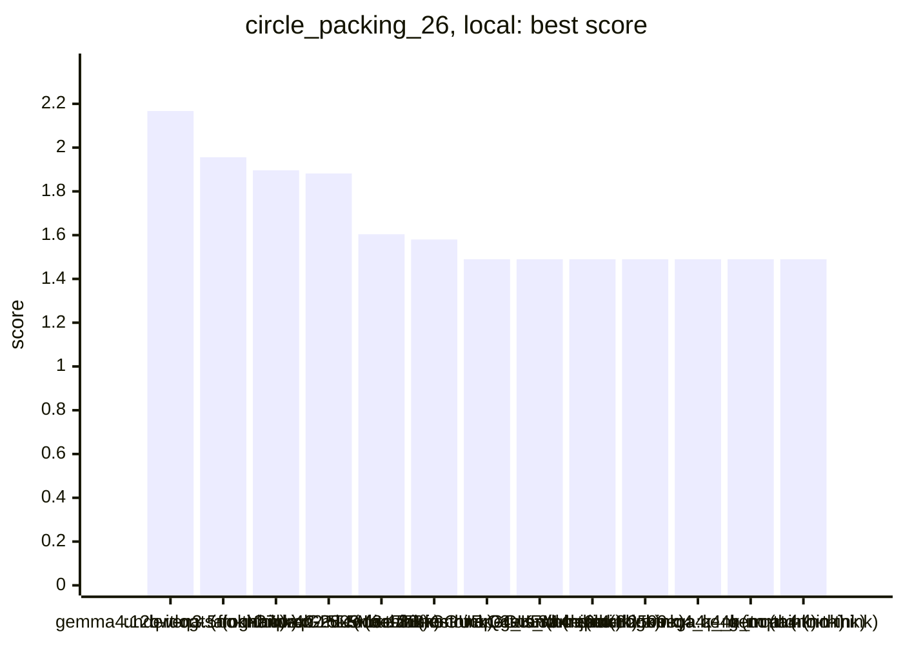
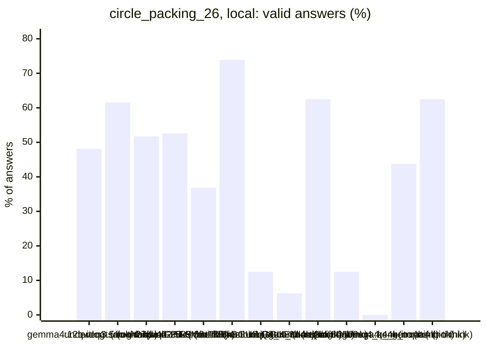
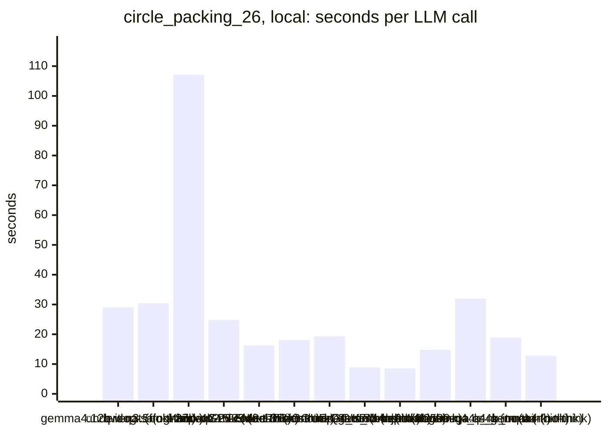
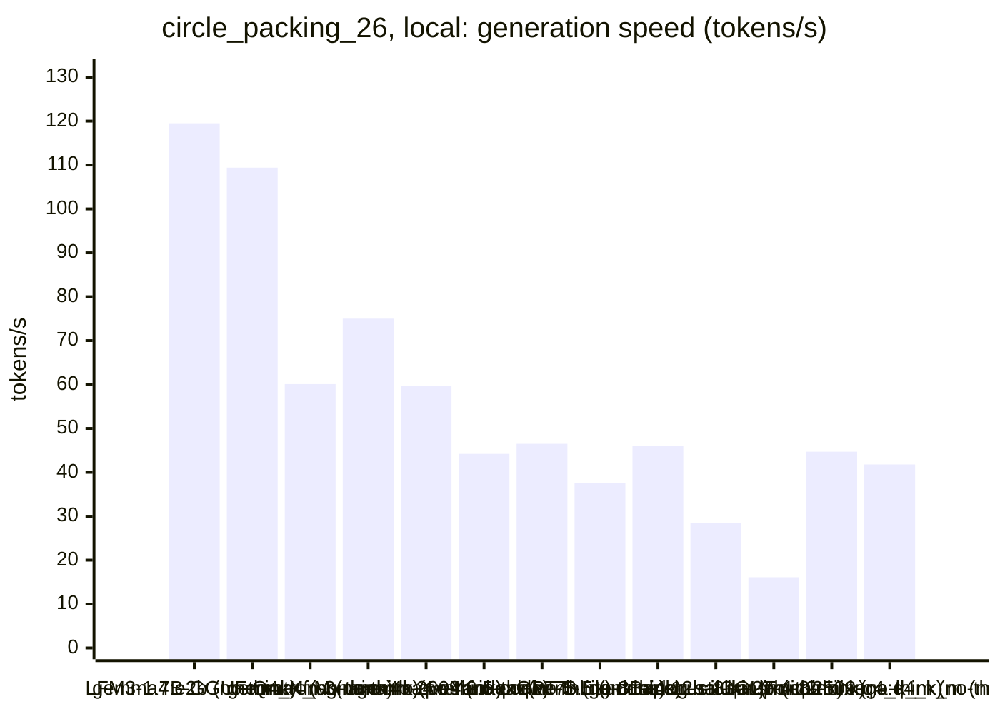
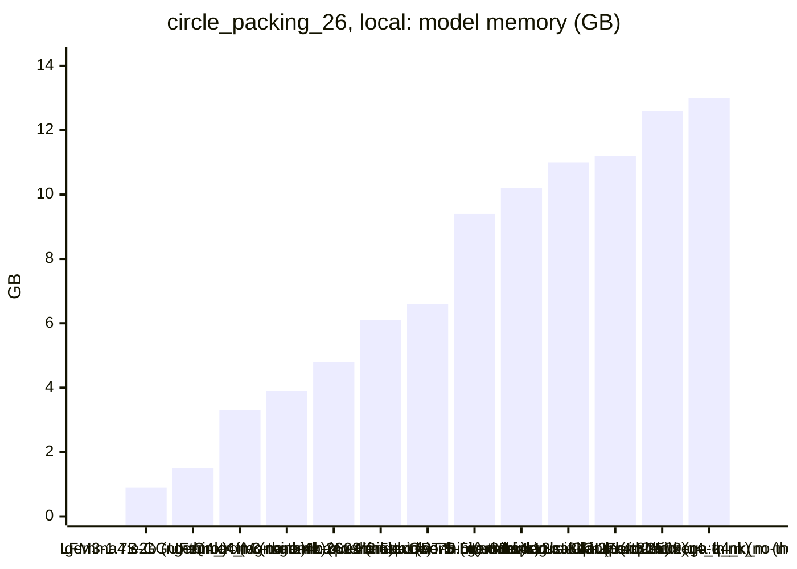
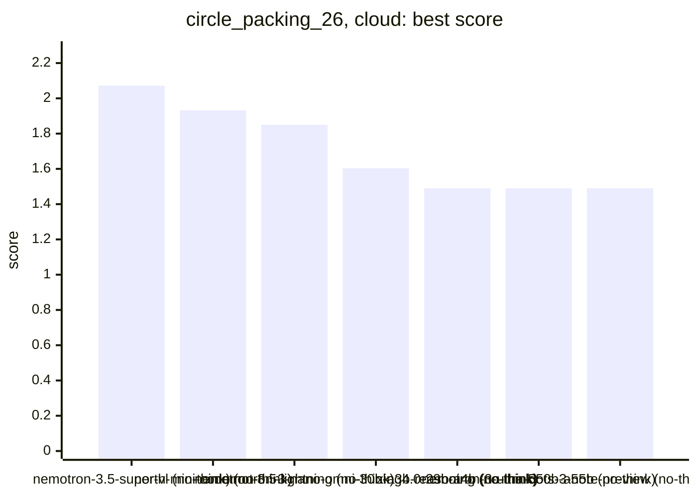
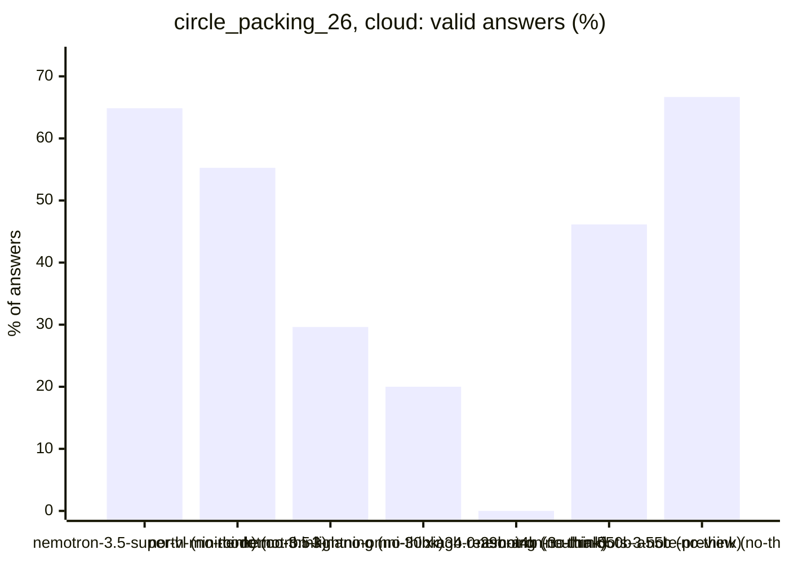
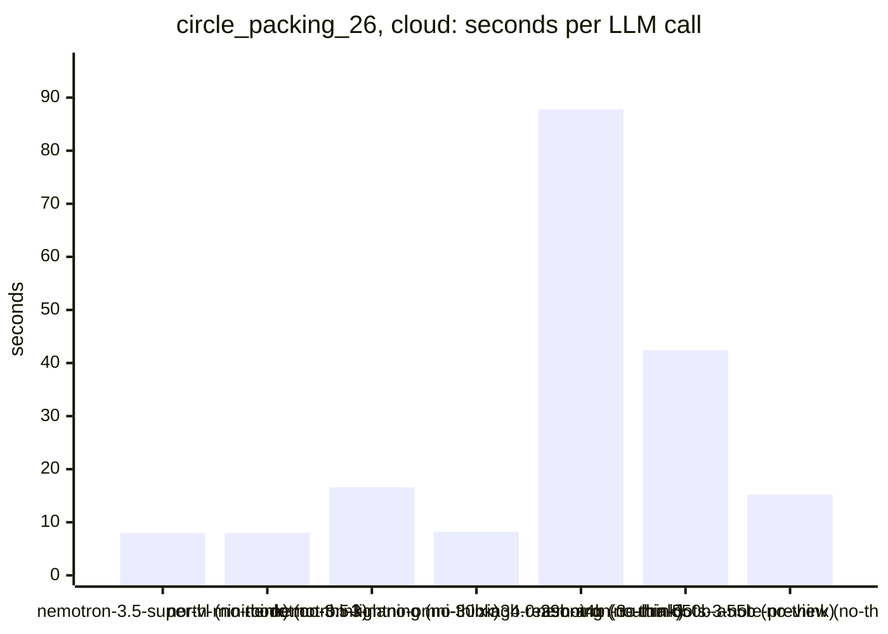
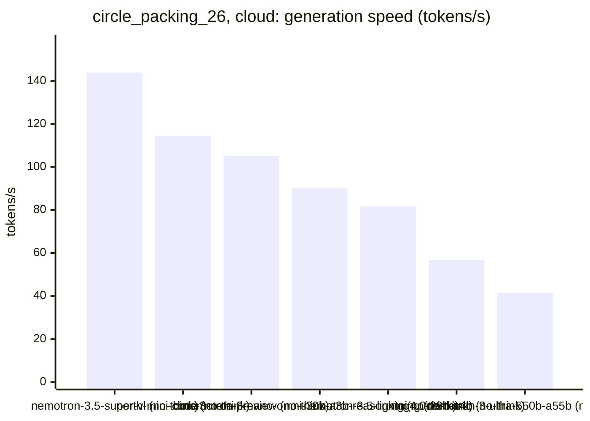

<!-- Copyright (c) 2026 by C. Klukas -->
<!-- SPDX-License-Identifier: GPL-3.0-only -->
<!-- Generated by `omega report` from bench/results/*.json. Do not edit by hand. -->

# circle_packing_26

20 models, each run at most 60 minutes, ended earlier after 15 answers in a row without progress; one run per model. The [overall ranking](../benchmarks.md#overall-ranking) compares the models over all examples.

Machine: Intel(R) Core(TM) i7-8700K CPU @ 3.70GHz (MS-7A98), 12 cores, 64 GB, 2x NVIDIA GeForce GTX 1080 Ti, 11264 MiB.

## Local models

Ollama on this machine.

| Model | Params | Initial | Best | Gain | LLM calls | s/call | Valid | New bests | Min to best | Minutes | Stopped by |
|---|---|--:|--:|--:|--:|--:|--:|--:|--:|--:|---|
| gemma4:12b-it-qat (no-think) | 11.9B | 1.4901 | **2.16667** | ×1.45 | 27 | 29 | 48% | 2 | 5.8 | 14.3 | no progress |
| qwen3.5:latest (no-think) | 9.0B | 1.4901 | **1.95644** | ×1.31 | 26 | 30 | 62% | 2 | 5.1 | 14.3 | no progress |
| underdog-saluki-27b:iq2-mix (no-think) | 26.9B | 1.4901 | **1.896** | ×1.27 | 29 | 107 | 52% | 2 | 30.5 | 53.5 | no progress |
| richardyoung/frognano-4b-2609:latest (no-think) | 4.3B | 1.4901 | **1.88223** | ×1.26 | 19 | 25 | 53% | 2 | 6.1 | 8.6 | no progress |
| qwen2.5-coder:7b (no-think) | 7.6B | 1.4901 | **1.60406** | ×1.08 | 19 | 16 | 37% | 1 | 1.2 | 5.9 | no progress |
| yandex/YandexGPT-5-Lite-8B-instruct-GGUF:latest (no-think) | 8.0B | 1.4901 | **1.58032** | ×1.06 | 23 | 18 | 74% | 2 | 3.0 | 7.8 | no progress |
| hf.co/LiquidAI/LFM3-1.7B-GGUF:Q4_K_M (no-think) | 1.73B | 1.4901 | **1.4901** | ×1.00 | 16 | 19 | 12% | 0 | - | 5.6 | no progress |
| nemotron-3-nano:4b (no-think) | 4.0B | 1.4901 | **1.4901** | ×1.00 | 16 | 9 | 6% | 0 | - | 2.9 | no progress |
| gemma4:e2b (no-think) | 4.6B | 1.4901 | **1.4901** | ×1.00 | 16 | 9 | 62% | 0 | - | 3.0 | no progress |
| MichelRosselli/apertus:8b-instruct-2509-q4_k_m (no-think) | 8.1B | 1.4901 | **1.4901** | ×1.00 | 16 | 15 | 12% | 0 | - | 4.6 | no progress |
| llm-jp-4-8b-omega:q4_k_m (no-think) | 8.6B | 1.4901 | **1.4901** | ×1.00 | 16 | 32 | 0% | 0 | - | 9.2 | no progress |
| gemma4:e4b-it-qat (no-think) | 7.5B | 1.4901 | **1.4901** | ×1.00 | 16 | 19 | 44% | 0 | - | 5.8 | no progress |
| gemma4:latest (no-think) | 7.5B | 1.4901 | **1.4901** | ×1.00 | 16 | 13 | 62% | 0 | - | 4.2 | no progress |

### Inference speed and memory

RAM is what Ollama reports for the loaded model (weights, context cache and buffers; on Apple silicon this is shared memory). Load is the time to bring the model into memory. Prompt and generation speeds are tokens per second over all calls of the run.

| Model | Params | RAM GB | Load s | Prompt tok/s | Gen tok/s | Median s/call | p90 s/call | Tokens/answer | Stopped |
|---|---|--:|--:|--:|--:|--:|--:|--:|--:|
| gemma4:e2b (no-think) | 4.6B | 0.9 | 0 | 2582 | 119.5 | 6 | 16 | 676 | 0 |
| hf.co/LiquidAI/LFM3-1.7B-GGUF:Q4_K_M (no-think) | 1.73B | 1.5 | 0 | 4358 | 109.4 | 14 | 55 | 809 | 9 |
| gemma4:latest (no-think) | 7.5B | 3.3 | 0 | 1367 | 60.1 | 11 | 23 | 548 | 0 |
| nemotron-3-nano:4b (no-think) | 4.0B | 3.9 | 0 | 1621 | 75.0 | 9 | 12 | 421 | 0 |
| richardyoung/frognano-4b-2609:latest (no-think) | 4.3B | 4.8 | 0 | 1672 | 59.7 | 22 | 40 | 1166 | 2 |
| gemma4:e4b-it-qat (no-think) | 7.5B | 6.1 | 0 | 1589 | 44.2 | 16 | 45 | 682 | 0 |
| qwen2.5-coder:7b (no-think) | 7.6B | 6.6 | 0 | 1366 | 46.5 | 16 | 22 | 570 | 0 |
| qwen3.5:latest (no-think) | 9.0B | 9.4 | 0 | 958 | 37.6 | 24 | 79 | 946 | 0 |
| yandex/YandexGPT-5-Lite-8B-instruct-GGUF:latest (no-think) | 8.0B | 10.2 | 0 | 1506 | 46.0 | 17 | 25 | 643 | 0 |
| gemma4:12b-it-qat (no-think) | 11.9B | 11.0 | 0 | 578 | 28.5 | 28 | 40 | 630 | 0 |
| underdog-saluki-27b:iq2-mix (no-think) | 26.9B | 11.2 | 0 | 403 | 16.1 | 88 | 162 | 1144 | 3 |
| MichelRosselli/apertus:8b-instruct-2509-q4_k_m (no-think) | 8.1B | 12.6 | 0 | 1403 | 44.7 | 15 | 21 | 451 | 2 |
| llm-jp-4-8b-omega:q4_k_m (no-think) | 8.6B | 13.0 | 0 | 1391 | 41.8 | 28 | 44 | 1181 | 0 |

### Best score over time

| Model | 15 min | 30 min | 45 min | 60 min |
|---|--:|--:|--:|--:|
| gemma4:12b-it-qat (no-think) | 2.16667 | 2.16667 | 2.16667 | 2.16667 |
| qwen3.5:latest (no-think) | 1.95644 | 1.95644 | 1.95644 | 1.95644 |
| underdog-saluki-27b:iq2-mix (no-think) | 1.831 | 1.831 | 1.896 | 1.896 |
| richardyoung/frognano-4b-2609:latest (no-think) | 1.88223 | 1.88223 | 1.88223 | 1.88223 |
| qwen2.5-coder:7b (no-think) | 1.60406 | 1.60406 | 1.60406 | 1.60406 |
| yandex/YandexGPT-5-Lite-8B-instruct-GGUF:latest (no-think) | 1.58032 | 1.58032 | 1.58032 | 1.58032 |
| hf.co/LiquidAI/LFM3-1.7B-GGUF:Q4_K_M (no-think) | 1.4901 | 1.4901 | 1.4901 | 1.4901 |
| nemotron-3-nano:4b (no-think) | 1.4901 | 1.4901 | 1.4901 | 1.4901 |
| gemma4:e2b (no-think) | 1.4901 | 1.4901 | 1.4901 | 1.4901 |
| MichelRosselli/apertus:8b-instruct-2509-q4_k_m (no-think) | 1.4901 | 1.4901 | 1.4901 | 1.4901 |
| llm-jp-4-8b-omega:q4_k_m (no-think) | 1.4901 | 1.4901 | 1.4901 | 1.4901 |
| gemma4:e4b-it-qat (no-think) | 1.4901 | 1.4901 | 1.4901 | 1.4901 |
| gemma4:latest (no-think) | 1.4901 | 1.4901 | 1.4901 | 1.4901 |

### Outcome of the LLM answers

| Model | duplicate | edit error | invalid | llm error | ok | timeout |
|---|--:|--:|--:|--:|--:|--:|
| gemma4:12b-it-qat (no-think) | 0 | 5 | 9 | 0 | 13 | 0 |
| qwen3.5:latest (no-think) | 2 | 3 | 5 | 0 | 16 | 0 |
| underdog-saluki-27b:iq2-mix (no-think) | 0 | 3 | 8 | 3 | 15 | 0 |
| richardyoung/frognano-4b-2609:latest (no-think) | 0 | 1 | 5 | 2 | 10 | 1 |
| qwen2.5-coder:7b (no-think) | 2 | 0 | 10 | 0 | 7 | 0 |
| yandex/YandexGPT-5-Lite-8B-instruct-GGUF:latest (no-think) | 3 | 2 | 1 | 0 | 17 | 0 |
| hf.co/LiquidAI/LFM3-1.7B-GGUF:Q4_K_M (no-think) | 0 | 3 | 2 | 9 | 2 | 0 |
| nemotron-3-nano:4b (no-think) | 0 | 11 | 4 | 0 | 1 | 0 |
| gemma4:e2b (no-think) | 0 | 3 | 3 | 0 | 10 | 0 |
| MichelRosselli/apertus:8b-instruct-2509-q4_k_m (no-think) | 2 | 4 | 6 | 2 | 2 | 0 |
| llm-jp-4-8b-omega:q4_k_m (no-think) | 0 | 7 | 9 | 0 | 0 | 0 |
| gemma4:e4b-it-qat (no-think) | 0 | 1 | 8 | 0 | 7 | 0 |
| gemma4:latest (no-think) | 0 | 1 | 5 | 0 | 10 | 0 |

### Best idea per model

- **gemma4:12b-it-qat (no-think)**: Re-calculate radii by greedily placing circles from largest to smallest to ensure zero overlap and maximize the sum of radii.
- **qwen3.5:latest (no-think)**: Switch from a deterministic grid layout to an optimized mixed-size initialization that places large circles in interior positions and small ones in corners/gaps, combined with a …
- **underdog-saluki-27b:iq2-mix (no-think)**: tuned INTERIOR_DX=0.15, INTERIOR_DY=0.2, INTERIOR_R=0.09 on top of: Expose the interior circle grid spacing (x/y step) and initial interior radius as named constants so the engine …
- **richardyoung/frognano-4b-2609:latest (no-think)**: Replace the fixed square grid with a hexagonal lattice using a vertical offset `H` and staggered row spacing, and tune the grid dimensions dynamically to maximize density before …
- **qwen2.5-coder:7b (no-think)**: tuned GRID_COLS=5.677, GRID_ROWS=15, SPACING_FACTOR=0.8 on top of: Define constants for the initial grid layout parameters to allow the evolutionary search to optimize them.
- **yandex/YandexGPT-5-Lite-8B-instruct-GGUF:latest (no-think)**: tuned offset_x=0.5, offset_y=0.45 on top of: adjust the initial arrangement of circles to better distribute them across the unit square, allowing for larger radii by varying the …
- **hf.co/LiquidAI/LFM3-1.7B-GGUF:Q4_K_M (no-think)**: initial program
- **nemotron-3-nano:4b (no-think)**: initial program
- **gemma4:e2b (no-think)**: initial program
- **MichelRosselli/apertus:8b-instruct-2509-q4_k_m (no-think)**: initial program
- **llm-jp-4-8b-omega:q4_k_m (no-think)**: initial program
- **gemma4:e4b-it-qat (no-think)**: initial program
- **gemma4:latest (no-think)**: initial program

## Cloud models (OpenRouter)

Free OpenRouter models; times include the network and the provider's queue.

| Model | Params | Initial | Best | Gain | LLM calls | s/call | Valid | New bests | Min to best | Minutes | Stopped by |
|---|---|--:|--:|--:|--:|--:|--:|--:|--:|--:|---|
| nvidia/nemotron-3.5-super-vl:free (no-think) |  | 1.4901 | **2.07195** | ×1.39 | 74 | 8 | 65% | 12 | 7.6 | 10.2 | no progress |
| cohere/north-mini-code:free (no-think) |  | 1.4901 | **1.93214** | ×1.30 | 38 | 8 | 55% | 3 | 3.1 | 5.4 | no progress |
| nvidia/nemotron-3.5-lightning:free (no-think) |  | 1.4901 | **1.85011** | ×1.24 | 27 | 17 | 30% | 4 | 4.4 | 7.6 | no progress |
| nvidia/nemotron-3-nano-omni-30b-a3b-reasoning:free (no-think) |  | 1.4901 | **1.60406** | ×1.08 | 20 | 8 | 20% | 1 | 0.6 | 2.8 | no progress |
| xingchen-agi/xing4.0-29b-a4b:free (no-think) |  | 1.4901 | **1.4901** | ×1.00 | 16 | 88 | 0% | 0 | - | 23.5 | no progress |
| nvidia/nemotron-3-ultra-550b-a55b:free (no-think) |  | 1.4901 | **1.4901** | ×1.00 | 13 | 42 | 46% | 0 | - | 9.2 | no progress |
| dots-studio/dots-3-note-preview:free (no-think) |  | 1.4901 | **1.4901** | ×1.00 | 15 | 15 | 67% | 0 | - | 3.8 | no progress |

### Inference speed and cost

Generation speed is measured from the first to the last streamed token; the time to the first token is counted as prompt time. Cost is what OpenRouter charged for the run.

| Model | Gen tok/s | Median s/call | p90 s/call | Tokens/answer | Stopped | Cost $ |
|---|--:|--:|--:|--:|--:|--:|
| nvidia/nemotron-3.5-super-vl:free (no-think) | 143.9 | 7 | 16 | 970 | 5 | 0.000 |
| cohere/north-mini-code:free (no-think) | 114.3 | 7 | 14 | 875 | 1 | 0.000 |
| dots-studio/dots-3-note-preview:free (no-think) | 105.2 | 14 | 20 | 1341 | 0 | 0.000 |
| nvidia/nemotron-3-nano-omni-30b-a3b-reasoning:free (no-think) | 90.1 | 7 | 18 | 666 | 1 | 0.000 |
| nvidia/nemotron-3.5-lightning:free (no-think) | 81.8 | 15 | 30 | 1205 | 4 | 0.000 |
| xingchen-agi/xing4.0-29b-a4b:free (no-think) | 56.9 | 75 | 175 | 1086 | 6 | 0.000 |
| nvidia/nemotron-3-ultra-550b-a55b:free (no-think) | 41.4 | 42 | 66 | 1698 | 0 | 0.000 |

### Best score over time

| Model | 15 min | 30 min | 45 min | 60 min |
|---|--:|--:|--:|--:|
| nvidia/nemotron-3.5-super-vl:free (no-think) | 2.07195 | 2.07195 | 2.07195 | 2.07195 |
| cohere/north-mini-code:free (no-think) | 1.93214 | 1.93214 | 1.93214 | 1.93214 |
| nvidia/nemotron-3.5-lightning:free (no-think) | 1.85011 | 1.85011 | 1.85011 | 1.85011 |
| nvidia/nemotron-3-nano-omni-30b-a3b-reasoning:free (no-think) | 1.60406 | 1.60406 | 1.60406 | 1.60406 |
| xingchen-agi/xing4.0-29b-a4b:free (no-think) | 1.4901 | 1.4901 | 1.4901 | 1.4901 |
| nvidia/nemotron-3-ultra-550b-a55b:free (no-think) | 1.4901 | 1.4901 | 1.4901 | 1.4901 |
| dots-studio/dots-3-note-preview:free (no-think) | 1.4901 | 1.4901 | 1.4901 | 1.4901 |

### Outcome of the LLM answers

| Model | duplicate | edit error | invalid | llm error | ok |
|---|--:|--:|--:|--:|--:|
| nvidia/nemotron-3.5-super-vl:free (no-think) | 5 | 8 | 8 | 5 | 48 |
| cohere/north-mini-code:free (no-think) | 6 | 2 | 8 | 1 | 21 |
| nvidia/nemotron-3.5-lightning:free (no-think) | 0 | 9 | 6 | 4 | 8 |
| nvidia/nemotron-3-nano-omni-30b-a3b-reasoning:free (no-think) | 1 | 9 | 5 | 1 | 4 |
| xingchen-agi/xing4.0-29b-a4b:free (no-think) | 0 | 1 | 4 | 11 | 0 |
| nvidia/nemotron-3-ultra-550b-a55b:free (no-think) | 1 | 1 | 5 | 0 | 6 |
| dots-studio/dots-3-note-preview:free (no-think) | 0 | 1 | 4 | 0 | 10 |

### Best idea per model

- **nvidia/nemotron-3.5-super-vl:free (no-think)**: Switch to the better mixed-size layout (center + 6 ring + 12 edge + 7 corner/gap) and compute exact feasible radii per circle via sequential shrink-projection plus a re-expansion …
- **cohere/north-mini-code:free (no-think)**: Increase total radii sum by reducing the number of circles near the square edges, allowing larger radii for interior circles via a more compact hexagonal lattice.
- **nvidia/nemotron-3.5-lightning:free (no-think)**: tuned cols=5, rows=6, lr=0.05, iters=10000 on top of: Replace the static grid initialization and single-pass max_radii shrink with a hexagonal-like initial placement and a joint …
- **nvidia/nemotron-3-nano-omni-30b-a3b-reasoning:free (no-think)**: Expose cols and rows as configurable constants so the grid layout can be finely tuned to better approximate a hexagonal packing and improve the sum of radii.
- **xingchen-agi/xing4.0-29b-a4b:free (no-think)**: initial program
- **nvidia/nemotron-3-ultra-550b-a55b:free (no-think)**: initial program
- **dots-studio/dots-3-note-preview:free (no-think)**: initial program
