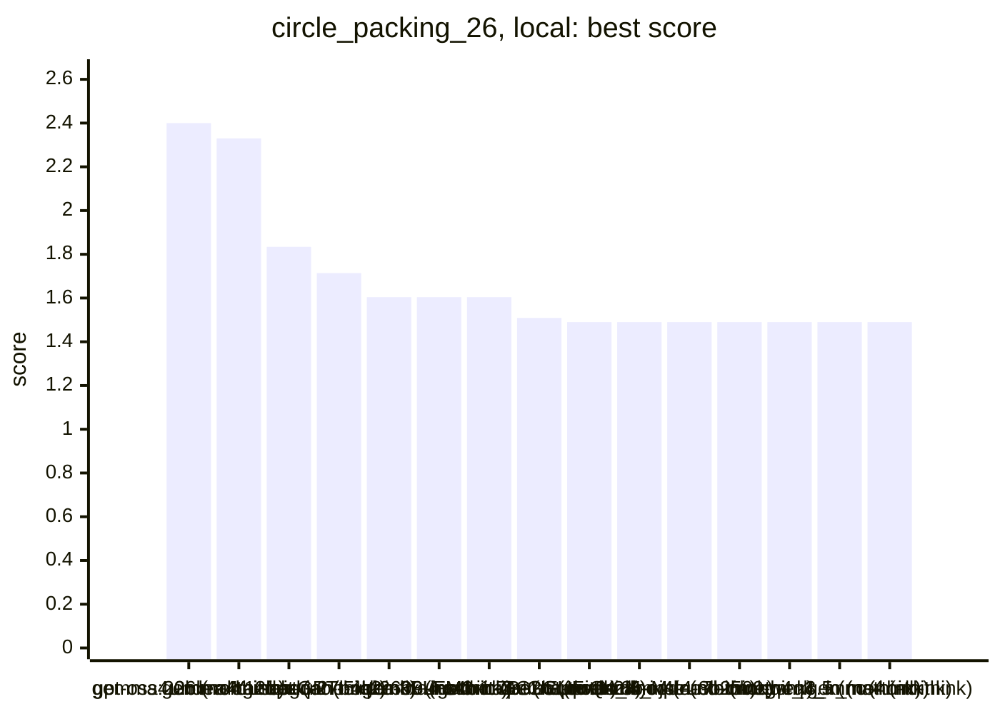
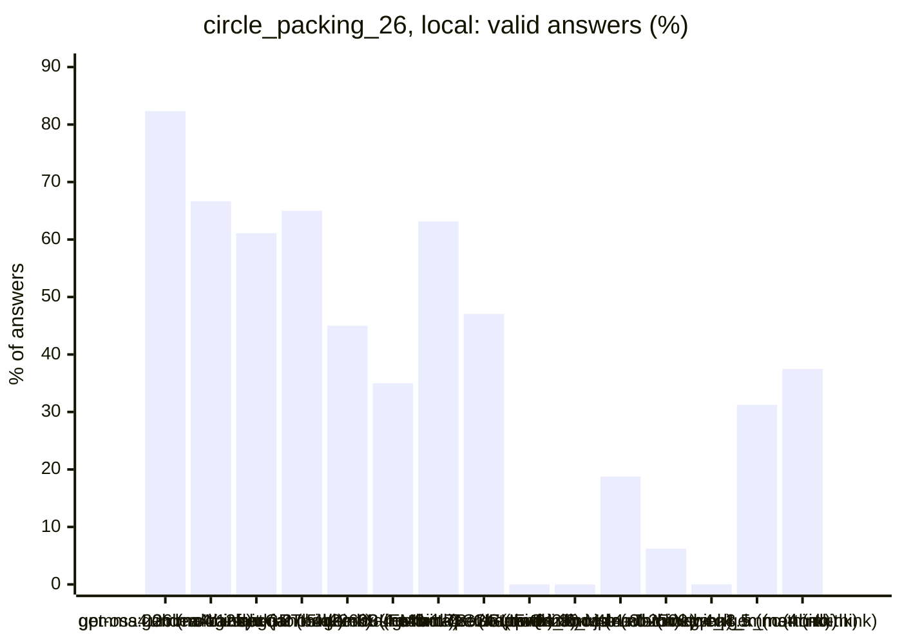
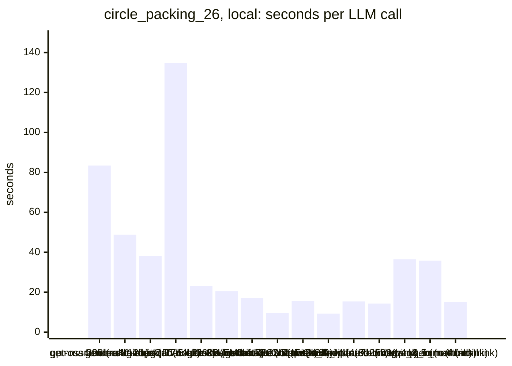
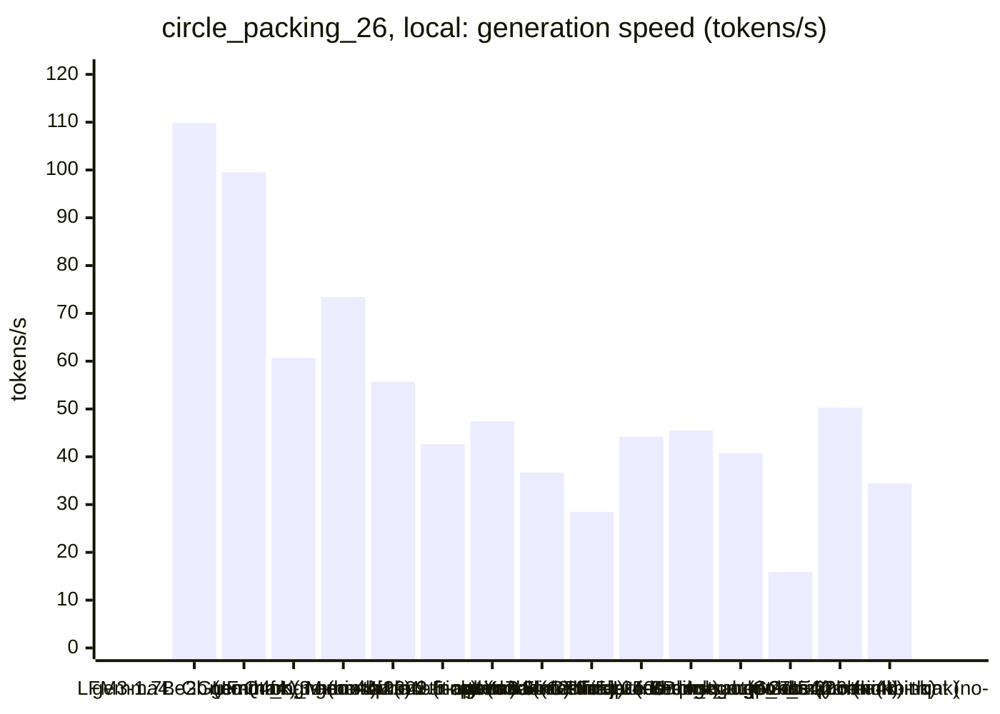
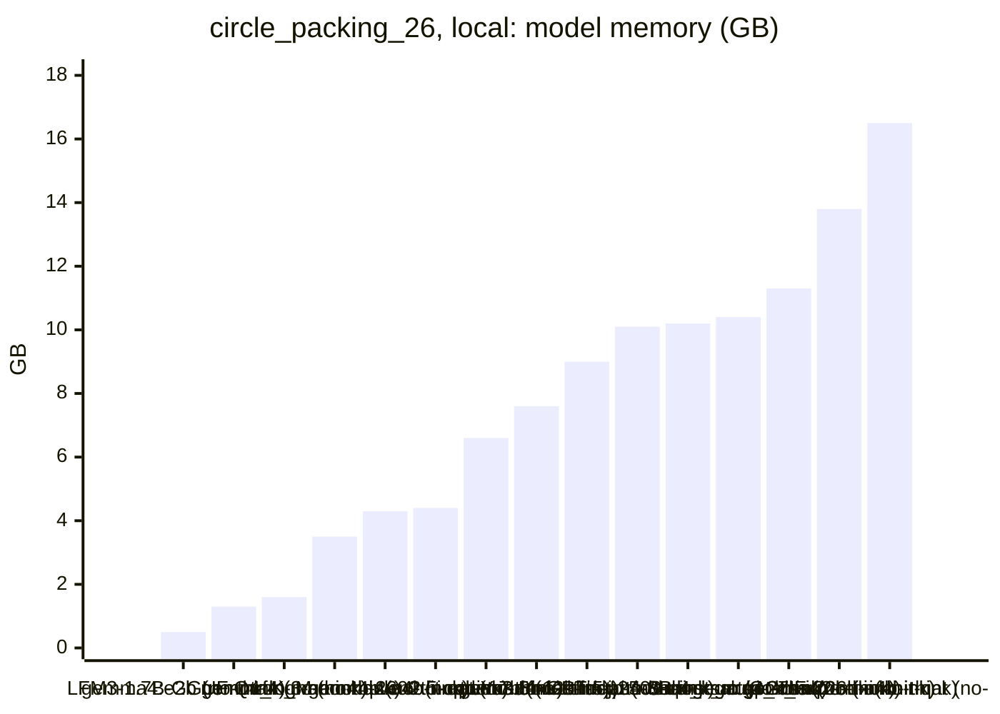

<!-- Copyright (c) 2026 by C. Klukas -->
<!-- SPDX-License-Identifier: GPL-3.0-only -->
<!-- Generated by `omega report` from bench/results/*.json. Do not edit by hand. -->

# circle_packing_26

26 models, each run at most 60 minutes, ended earlier after 15 answers in a row without progress; one run per model. The [overall ranking](../benchmarks.md#overall-ranking) compares the models over all examples.

Machine: Intel(R) Core(TM) i7-8700K CPU @ 3.70GHz (MS-7A98), 12 cores, 64 GB, 2x NVIDIA GeForce GTX 1080 Ti, 11264 MiB.

## Local models

Ollama on this machine.

| Model | Params | Initial | Best | Gain | LLM calls | s/call | Valid | New bests | Min to best | Minutes | Stopped by |
|---|---|--:|--:|--:|--:|--:|--:|--:|--:|--:|---|
| gpt-oss:20b (no-think) | 20.9B | 1.4901 | **2.4** | ×1.61 | 17 | 83 | 82% | 2 | 3.3 | 23.9 | no progress |
| gemma4:26b-a4b-it-qat (no-think) | 25.2B | 1.4901 | **2.32999** | ×1.56 | 18 | 49 | 67% | 1 | 3.5 | 15.3 | no progress |
| gemma4:12b-it-qat (no-think) | 11.9B | 1.4901 | **1.83433** | ×1.23 | 18 | 38 | 61% | 3 | 10.7 | 12.1 | no progress |
| underdog-saluki-27b:iq2-mix (no-think) | 26.9B | 1.4901 | **1.71373** | ×1.15 | 20 | 135 | 65% | 3 | 31.8 | 45.8 | no progress |
| richardyoung/frognano-4b-2609:latest (no-think) | 4.3B | 1.4901 | **1.60406** | ×1.08 | 20 | 23 | 45% | 4 | 6.0 | 8.2 | no progress |
| yandex/YandexGPT-5-Lite-8B-instruct-GGUF:latest (no-think) | 8.0B | 1.4901 | **1.60406** | ×1.08 | 20 | 20 | 35% | 1 | 1.7 | 7.3 | no progress |
| gemma4:e4b-it-qat (no-think) | 7.5B | 1.4901 | **1.60406** | ×1.08 | 19 | 17 | 63% | 1 | 1.1 | 5.6 | no progress |
| gemma4:e2b (no-think) | 4.6B | 1.4901 | **1.50935** | ×1.01 | 17 | 10 | 47% | 1 | 0.5 | 3.0 | no progress |
| hf.co/LiquidAI/LFM3-1.7B-GGUF:Q4_K_M (no-think) | 1.73B | 1.4901 | **1.4901** | ×1.00 | 16 | 16 | 0% | 0 | - | 4.4 | no progress |
| nemotron-3-nano:4b (no-think) | 4.0B | 1.4901 | **1.4901** | ×1.00 | 16 | 9 | 0% | 0 | - | 2.7 | no progress |
| qwen2.5-coder:7b (no-think) | 7.6B | 1.4901 | **1.4901** | ×1.00 | 16 | 15 | 19% | 0 | - | 4.4 | no progress |
| MichelRosselli/apertus:8b-instruct-2509-q4_k_m (no-think) | 8.1B | 1.4901 | **1.4901** | ×1.00 | 16 | 14 | 6% | 0 | - | 4.1 | no progress |
| llm-jp-4-8b-omega:q4_k_m (no-think) | 8.6B | 1.4901 | **1.4901** | ×1.00 | 16 | 36 | 0% | 0 | - | 10.0 | no progress |
| qwen3.5:latest (no-think) | 9.0B | 1.4901 | **1.4901** | ×1.00 | 16 | 36 | 31% | 0 | - | 9.8 | no progress |
| gemma4:latest (no-think) | 7.5B | 1.4901 | **1.4901** | ×1.00 | 16 | 15 | 38% | 0 | - | 4.3 | no progress |

### Inference speed and memory

RAM is what Ollama reports for the loaded model (weights, context cache and buffers; on Apple silicon this is shared memory). Load is the time to bring the model into memory. Prompt and generation speeds are tokens per second over all calls of the run.

| Model | Params | RAM GB | Load s | Prompt tok/s | Gen tok/s | Median s/call | p90 s/call | Tokens/answer | Stopped |
|---|---|--:|--:|--:|--:|--:|--:|--:|--:|
| gemma4:e2b (no-think) | 4.6B | 0.5 | 19 | 2359 | 109.8 | 9 | 15 | 580 | 0 |
| hf.co/LiquidAI/LFM3-1.7B-GGUF:Q4_K_M (no-think) | 1.73B | 1.3 | 0 | 4304 | 99.5 | 13 | 38 | 341 | 9 |
| gemma4:latest (no-think) | 7.5B | 1.6 | 27 | 1480 | 60.7 | 9 | 28 | 598 | 0 |
| nemotron-3-nano:4b (no-think) | 4.0B | 3.5 | 11 | 2008 | 73.4 | 8 | 12 | 401 | 0 |
| richardyoung/frognano-4b-2609:latest (no-think) | 4.3B | 4.3 | 14 | 1729 | 55.7 | 20 | 35 | 1028 | 0 |
| gemma4:e4b-it-qat (no-think) | 7.5B | 4.4 | 23 | 1715 | 42.6 | 15 | 45 | 515 | 0 |
| qwen2.5-coder:7b (no-think) | 7.6B | 6.6 | 16 | 1624 | 47.4 | 15 | 23 | 535 | 0 |
| qwen3.5:latest (no-think) | 9.0B | 7.6 | 23 | 1155 | 36.7 | 24 | 64 | 1109 | 0 |
| gemma4:12b-it-qat (no-think) | 11.9B | 9.0 | 24 | 692 | 28.5 | 37 | 65 | 845 | 0 |
| MichelRosselli/apertus:8b-instruct-2509-q4_k_m (no-think) | 8.1B | 10.1 | 17 | 1565 | 44.2 | 12 | 17 | 438 | 0 |
| yandex/YandexGPT-5-Lite-8B-instruct-GGUF:latest (no-think) | 8.0B | 10.2 | 16 | 1588 | 45.5 | 17 | 27 | 712 | 0 |
| llm-jp-4-8b-omega:q4_k_m (no-think) | 8.6B | 10.4 | 18 | 1569 | 40.8 | 34 | 66 | 1296 | 1 |
| underdog-saluki-27b:iq2-mix (no-think) | 26.9B | 11.3 | 25 | 363 | 15.9 | 133 | 204 | 1891 | 0 |
| gpt-oss:20b (no-think) | 20.9B | 13.8 | 42 | 1615 | 50.3 | 85 | 127 | 3871 | 0 |
| gemma4:26b-a4b-it-qat (no-think) | 25.2B | 16.5 | 61 | 960 | 34.4 | 47 | 76 | 1355 | 0 |

### Best score over time

| Model | 15 min | 30 min | 45 min | 60 min |
|---|--:|--:|--:|--:|
| gpt-oss:20b (no-think) | 2.4 | 2.4 | 2.4 | 2.4 |
| gemma4:26b-a4b-it-qat (no-think) | 2.32999 | 2.32999 | 2.32999 | 2.32999 |
| gemma4:12b-it-qat (no-think) | 1.83433 | 1.83433 | 1.83433 | 1.83433 |
| underdog-saluki-27b:iq2-mix (no-think) | 1.71358 | 1.71358 | 1.71373 | 1.71373 |
| richardyoung/frognano-4b-2609:latest (no-think) | 1.60406 | 1.60406 | 1.60406 | 1.60406 |
| yandex/YandexGPT-5-Lite-8B-instruct-GGUF:latest (no-think) | 1.60406 | 1.60406 | 1.60406 | 1.60406 |
| gemma4:e4b-it-qat (no-think) | 1.60406 | 1.60406 | 1.60406 | 1.60406 |
| gemma4:e2b (no-think) | 1.50935 | 1.50935 | 1.50935 | 1.50935 |
| hf.co/LiquidAI/LFM3-1.7B-GGUF:Q4_K_M (no-think) | 1.4901 | 1.4901 | 1.4901 | 1.4901 |
| nemotron-3-nano:4b (no-think) | 1.4901 | 1.4901 | 1.4901 | 1.4901 |
| qwen2.5-coder:7b (no-think) | 1.4901 | 1.4901 | 1.4901 | 1.4901 |
| MichelRosselli/apertus:8b-instruct-2509-q4_k_m (no-think) | 1.4901 | 1.4901 | 1.4901 | 1.4901 |
| llm-jp-4-8b-omega:q4_k_m (no-think) | 1.4901 | 1.4901 | 1.4901 | 1.4901 |
| qwen3.5:latest (no-think) | 1.4901 | 1.4901 | 1.4901 | 1.4901 |
| gemma4:latest (no-think) | 1.4901 | 1.4901 | 1.4901 | 1.4901 |

### Outcome of the LLM answers

| Model | duplicate | edit error | invalid | llm error | ok | timeout |
|---|--:|--:|--:|--:|--:|--:|
| gpt-oss:20b (no-think) | 0 | 3 | 0 | 0 | 14 | 0 |
| gemma4:26b-a4b-it-qat (no-think) | 0 | 4 | 2 | 0 | 12 | 0 |
| gemma4:12b-it-qat (no-think) | 0 | 5 | 2 | 0 | 11 | 0 |
| underdog-saluki-27b:iq2-mix (no-think) | 0 | 3 | 4 | 0 | 13 | 0 |
| richardyoung/frognano-4b-2609:latest (no-think) | 0 | 3 | 8 | 0 | 9 | 0 |
| yandex/YandexGPT-5-Lite-8B-instruct-GGUF:latest (no-think) | 6 | 1 | 6 | 0 | 7 | 0 |
| gemma4:e4b-it-qat (no-think) | 0 | 1 | 6 | 0 | 12 | 0 |
| gemma4:e2b (no-think) | 0 | 0 | 9 | 0 | 8 | 0 |
| hf.co/LiquidAI/LFM3-1.7B-GGUF:Q4_K_M (no-think) | 0 | 4 | 3 | 9 | 0 | 0 |
| nemotron-3-nano:4b (no-think) | 0 | 12 | 4 | 0 | 0 | 0 |
| qwen2.5-coder:7b (no-think) | 4 | 0 | 9 | 0 | 3 | 0 |
| MichelRosselli/apertus:8b-instruct-2509-q4_k_m (no-think) | 2 | 7 | 6 | 0 | 1 | 0 |
| llm-jp-4-8b-omega:q4_k_m (no-think) | 0 | 5 | 10 | 1 | 0 | 0 |
| qwen3.5:latest (no-think) | 0 | 1 | 9 | 0 | 5 | 1 |
| gemma4:latest (no-think) | 0 | 0 | 10 | 0 | 6 | 0 |

### Best idea per model

- **gpt-oss:20b (no-think)**: Replace the pairwise scaling shrink algorithm with a simple projection that reduces only the larger circle in each overlapping pair, and increase iterations to allow full …
- **gemma4:26b-a4b-it-qat (no-think)**: Replace the uniform grid with a stochastic optimization approach using a simulated annealing-like local search to maximize the sum of radii by perturbing circle centers.
- **gemma4:12b-it-qat (no-think)**: tuned side=6 on top of: Use a denser initial layout by increasing the side count and using a more refined hexagonal packing to capture more of the unit square's area.
- **underdog-saluki-27b:iq2-mix (no-think)**: Add a final local coordinate-descent pass that increases each circle's radius to its wall/neighbor limit whenever the neighbor constraint is already tight, and run extra …
- **richardyoung/frognano-4b-2609:latest (no-think)**: Fix the center generation to use the empirically validated 5x6 grid layout known to produce the 1.60406 score, and replace the naive single-pass shrinking with a more robust …
- **yandex/YandexGPT-5-Lite-8B-instruct-GGUF:latest (no-think)**: modify the grid layout and scaling factors to better distribute the circles and increase the radii by optimizing the number of columns and rows.
- **gemma4:e4b-it-qat (no-think)**: Improve the initial placement by using a more uniform grid layout instead of a simple square grid based on $\lceil\sqrt{n}\rceil$ and $\lceil n/\text{cols} \rceil$, which can lead …
- **gemma4:e2b (no-think)**: Implement a randomized iterative refinement approach starting from a known good lattice configuration to explore better packing geometries.
- **hf.co/LiquidAI/LFM3-1.7B-GGUF:Q4_K_M (no-think)**: initial program
- **nemotron-3-nano:4b (no-think)**: initial program
- **qwen2.5-coder:7b (no-think)**: initial program
- **MichelRosselli/apertus:8b-instruct-2509-q4_k_m (no-think)**: initial program
- **llm-jp-4-8b-omega:q4_k_m (no-think)**: initial program
- **qwen3.5:latest (no-think)**: initial program
- **gemma4:latest (no-think)**: initial program

## Cloud models (OpenRouter)

Free OpenRouter models; times include the network and the provider's queue.

| Model | Params | Initial | Best | Gain | LLM calls | s/call | Valid | New bests | Min to best | Minutes | Stopped by |
|---|---|--:|--:|--:|--:|--:|--:|--:|--:|--:|---|
| cohere/north-mini-code:free (no-think) |  | | | | | | | | | | failed: all 5 model requests failed: cohere/north-mini-code:free: ra |
| nvidia/nemotron-3.5-super-vl:free (no-think) |  | | | | | | | | | | failed: all 6 model requests failed: nvidia/nemotron-3.5-super-vl:fr |
| nvidia/nemotron-3-ultra-550b-a55b:free (no-think) |  | | | | | | | | | | failed: all 6 model requests failed: nvidia/nemotron-3-ultra-550b-a5 |
| dots-studio/dots-3-note-preview:free (no-think) |  | | | | | | | | | | failed: all 6 model requests failed: dots-studio/dots-3-note-preview |
| nvidia/nemotron-3.5-lightning:free (no-think) |  | | | | | | | | | | failed: all 6 model requests failed: nvidia/nemotron-3.5-lightning:f |
| nvidia/nemotron-3-nano-omni-30b-a3b-reasoning:free (no-think) |  | | | | | | | | | | failed: all 6 model requests failed: nvidia/nemotron-3-nano-omni-30b |
| xingchen-agi/xing4.0-29b-a4b:free (no-think) |  | | | | | | | | | | failed: all 10 model requests failed: xingchen-agi/xing4.0-29b-a4b:f |
| google/gemma-4-26b-a4b-it:free (no-think) |  | | | | | | | | | | failed: all 6 model requests failed: google/gemma-4-26b-a4b-it:free: |
| google/gemma-4-31b-it:free (no-think) |  | | | | | | | | | | failed: all 6 model requests failed: google/gemma-4-31b-it:free: rat |
| poolside/laguna-s-2.1:free (no-think) |  | | | | | | | | | | failed: RuntimeError: OpenRouter has no model 'poolside/laguna-s-2.1 |
| poolside/laguna-xs-2.1:free (no-think) |  | | | | | | | | | | failed: RuntimeError: OpenRouter has no model 'poolside/laguna-xs-2. |
