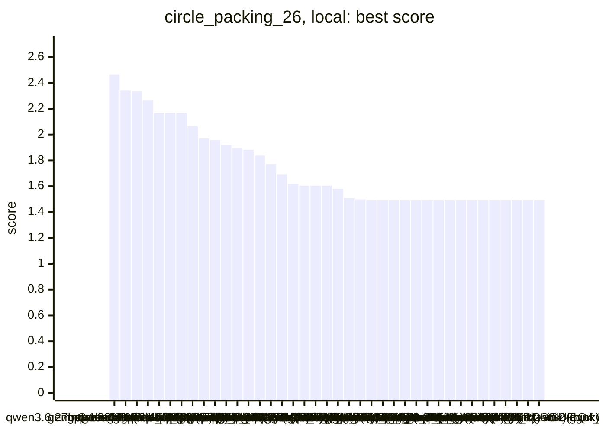
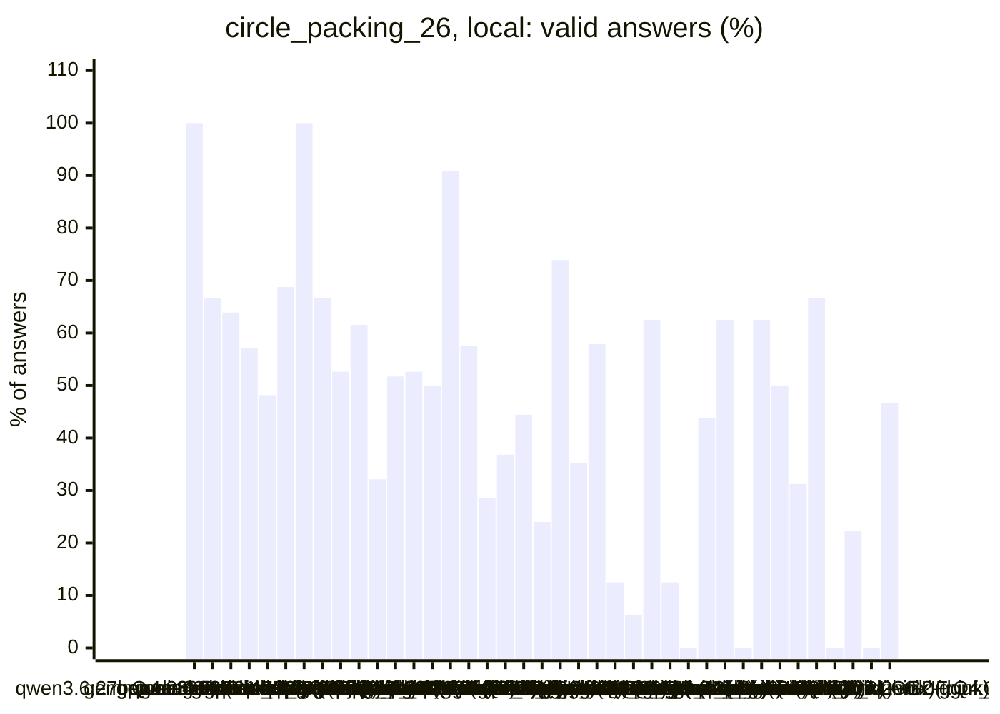
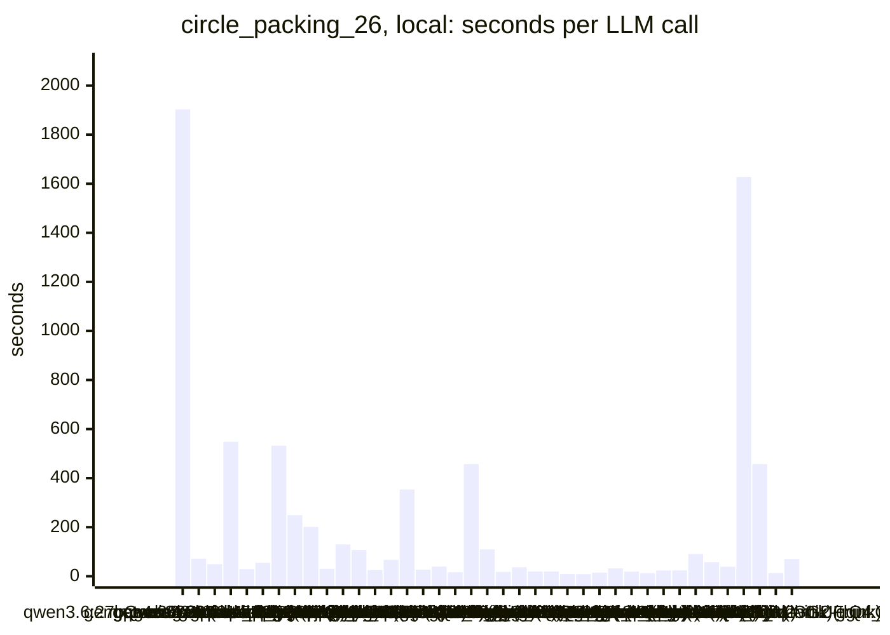
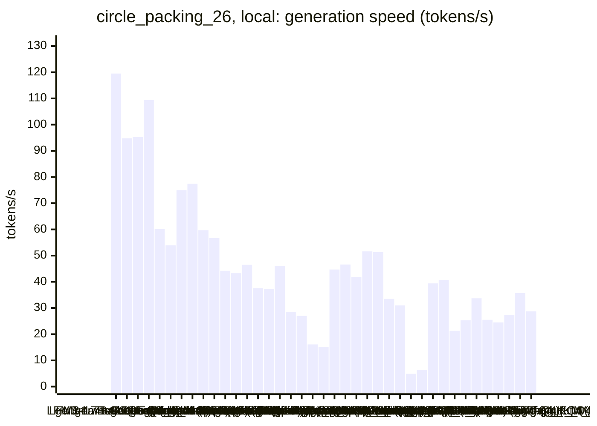
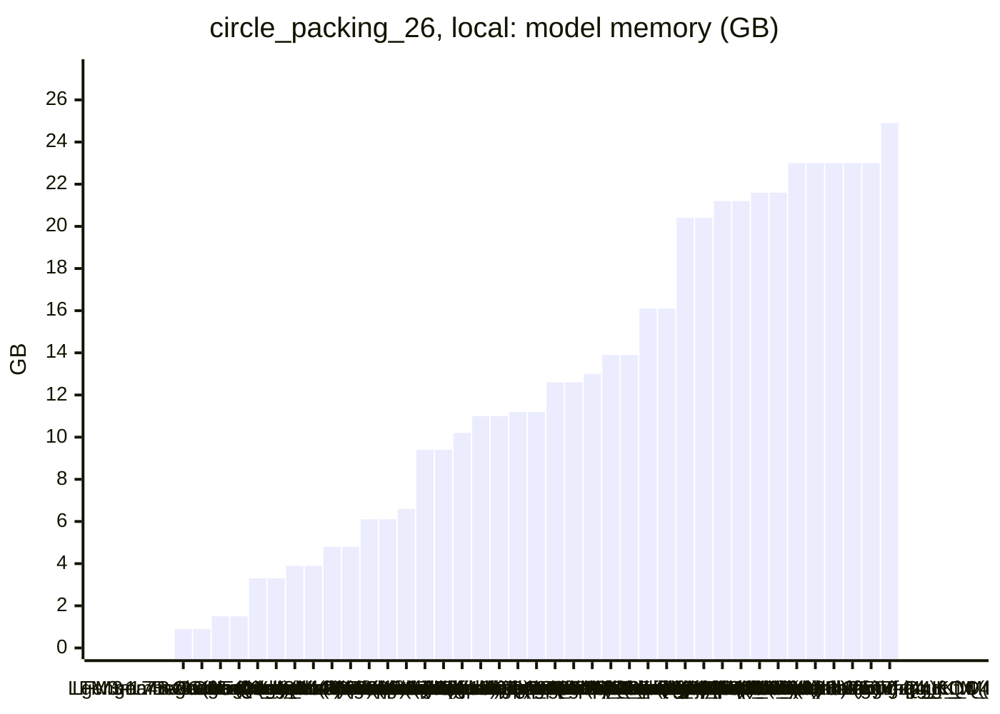
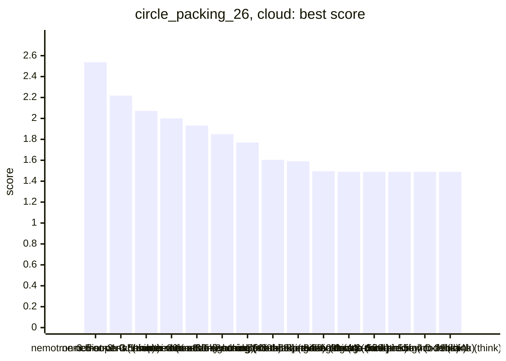
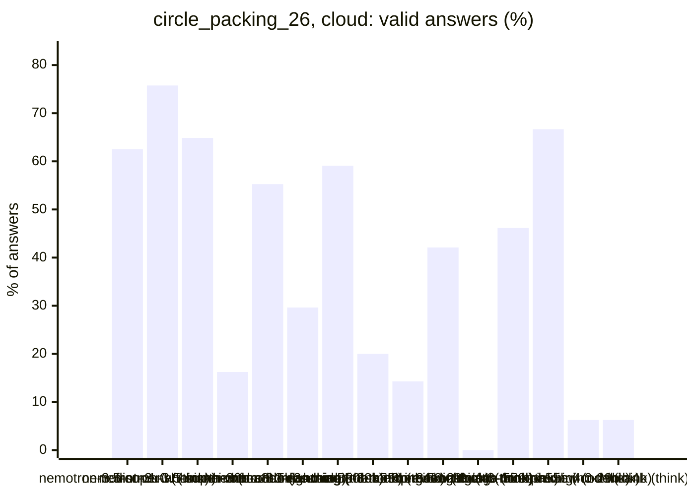
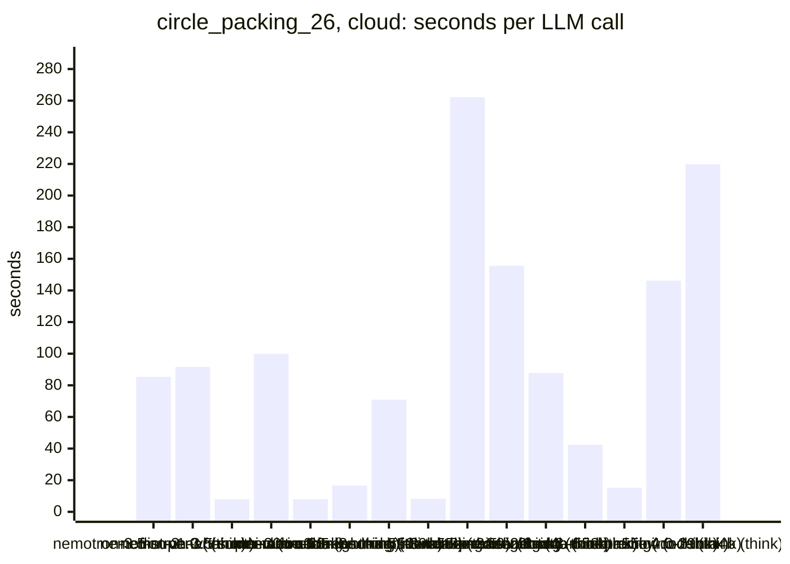
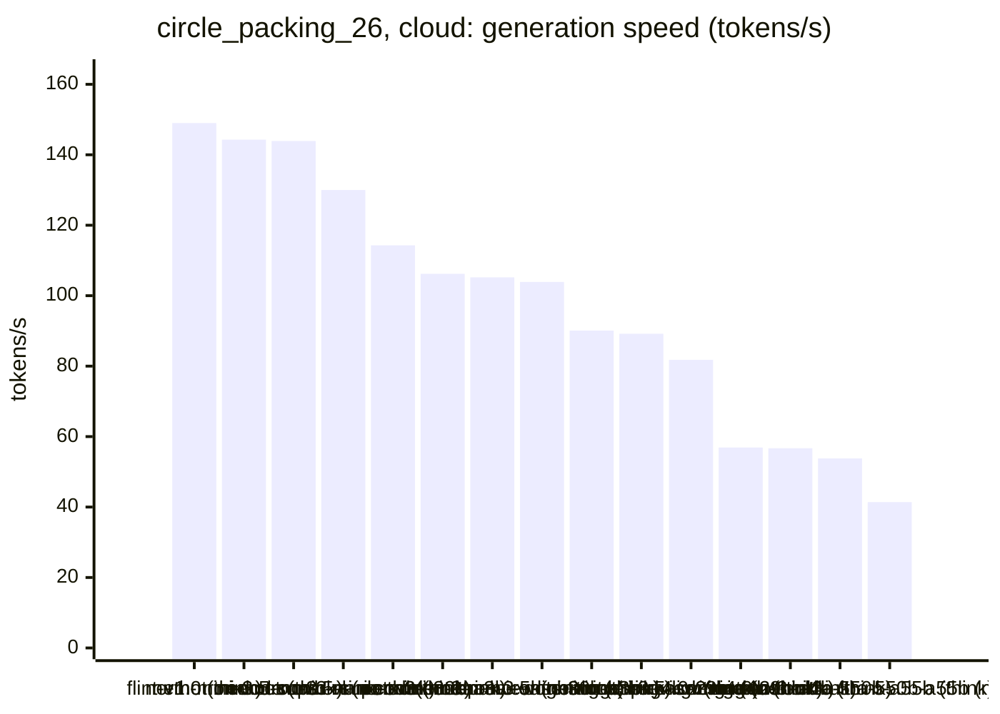

<!-- Copyright (c) 2026 by C. Klukas -->
<!-- SPDX-License-Identifier: GPL-3.0-only -->
<!-- Generated by `omega report` from bench/results/*.json. Do not edit by hand. -->

# circle_packing_26

54 models, each run at most 60 minutes, ended earlier after 15 answers in a row without progress; one run per model. The [overall ranking](../benchmarks.md#overall-ranking) compares the models over all examples.

Machine: Intel(R) Core(TM) i7-8700K CPU @ 3.70GHz (MS-7A98), 12 cores, 64 GB, 2x NVIDIA GeForce GTX 1080 Ti, 11264 MiB.

## Local models

Ollama on this machine.

| Model | Params | Initial | Best | Gain | LLM calls | s/call | Valid | New bests | Min to best | Minutes | Stopped by |
|---|---|--:|--:|--:|--:|--:|--:|--:|--:|--:|---|
| qwen3.6:27b-coding-mtp-q4_K_M (think) | 27.3B | 1.4901 | **2.46327** | ×1.65 | 3 | 1903 | 100% | 3 | 55.7 | 97.8 | time limit |
| gpt-oss:20b (no-think) | 20.9B | 1.4901 | **2.34047** | ×1.57 | 18 | 72 | 67% | 2 | 20.1 | 22.9 | no progress |
| gemma4:26b-a4b-it-qat (no-think) | 25.2B | 1.4901 | **2.33505** | ×1.57 | 72 | 49 | 64% | 12 | 54.5 | 63.2 | time limit |
| gemma4:26b-a4b-it-qat (think) | 25.2B | 1.4901 | **2.26317** | ×1.52 | 7 | 548 | 57% | 1 | 28.9 | 65.4 | time limit |
| gemma4:12b-it-qat (no-think) | 11.9B | 1.4901 | **2.16667** | ×1.45 | 27 | 29 | 48% | 2 | 5.8 | 14.3 | no progress |
| gpt-oss:20b (think) | 20.9B | 1.4901 | **2.16667** | ×1.45 | 16 | 55 | 69% | 1 | 2.1 | 23.7 | no progress |
| gemma4:12b-it-qat (think) | 11.9B | 1.4901 | **2.16667** | ×1.45 | 6 | 532 | 100% | 2 | 33.3 | 66.2 | time limit |
| qwen3.6:27b-coding-mtp-q4_K_M (no-think) | 27.3B | 1.4901 | **2.06524** | ×1.39 | 15 | 249 | 67% | 2 | 27.0 | 63.8 | time limit |
| hf.co/LiquidAI/LFM3-1.7B-GGUF:Q4_K_M (think) | 1.73B | 1.4901 | **1.97211** | ×1.32 | 19 | 201 | 53% | 2 | 59.3 | 64.2 | time limit |
| qwen3.5:latest (no-think) | 9.0B | 1.4901 | **1.95644** | ×1.31 | 26 | 30 | 62% | 2 | 5.1 | 14.3 | no progress |
| hf.co/mmnga-o/Qwen3-Swallow-30B-A3B-RL-v0.2-gguf:Q4_K_M (think) | 30.5B | 1.4901 | **1.91667** | ×1.29 | 28 | 130 | 32% | 2 | 43.2 | 62.7 | time limit |
| underdog-saluki-27b:iq2-mix (no-think) | 26.9B | 1.4901 | **1.896** | ×1.27 | 29 | 107 | 52% | 2 | 30.5 | 53.5 | no progress |
| richardyoung/frognano-4b-2609:latest (no-think) | 4.3B | 1.4901 | **1.88223** | ×1.26 | 19 | 25 | 53% | 2 | 6.1 | 8.6 | no progress |
| qwen3-coder:30b (no-think) | 30.5B | 1.4901 | **1.83699** | ×1.23 | 32 | 67 | 50% | 2 | 24.2 | 37.6 | no progress |
| glm-4.7-flash:latest (think) | 29.9B | 1.4901 | **1.7724** | ×1.19 | 11 | 354 | 91% | 1 | 19.3 | 67.2 | time limit |
| qwen3:30b-a3b-instruct-2507-q4_K_M (think) | 30.5B | 1.4901 | **1.68971** | ×1.13 | 40 | 27 | 58% | 6 | 17.1 | 20.6 | no progress |
| richardyoung/frognano-4b-2609:latest (think) | 4.3B | 1.4901 | **1.61875** | ×1.09 | 21 | 40 | 29% | 2 | 5.1 | 15.9 | no progress |
| qwen2.5-coder:7b (no-think) | 7.6B | 1.4901 | **1.60406** | ×1.08 | 19 | 16 | 37% | 1 | 1.2 | 5.9 | no progress |
| frob/sarvam:30b (no-think) | 32.2B | 1.4901 | **1.60406** | ×1.08 | 9 | 457 | 44% | 1 | 36.1 | 70.8 | time limit |
| hf.co/llm-jp/llm-jp-4.1-32b-a3b-thinking-gguf:Q4_K_M (no-think) | 32.1B | 1.4901 | **1.60406** | ×1.08 | 25 | 110 | 24% | 1 | 25.0 | 48.1 | no progress |
| yandex/YandexGPT-5-Lite-8B-instruct-GGUF:latest (no-think) | 8.0B | 1.4901 | **1.58032** | ×1.06 | 23 | 18 | 74% | 2 | 3.0 | 7.8 | no progress |
| glm-4.7-flash:latest (no-think) | 29.9B | 1.4901 | **1.50813** | ×1.01 | 17 | 37 | 35% | 1 | 1.3 | 12.7 | no progress |
| qwen3:30b-a3b-instruct-2507-q4_K_M (no-think) | 30.5B | 1.4901 | **1.49777** | ×1.01 | 19 | 19 | 58% | 2 | 6.1 | 7.9 | no progress |
| hf.co/LiquidAI/LFM3-1.7B-GGUF:Q4_K_M (no-think) | 1.73B | 1.4901 | **1.4901** | ×1.00 | 16 | 19 | 12% | 0 | - | 5.6 | no progress |
| nemotron-3-nano:4b (no-think) | 4.0B | 1.4901 | **1.4901** | ×1.00 | 16 | 9 | 6% | 0 | - | 2.9 | no progress |
| gemma4:e2b (no-think) | 4.6B | 1.4901 | **1.4901** | ×1.00 | 16 | 9 | 62% | 0 | - | 3.0 | no progress |
| MichelRosselli/apertus:8b-instruct-2509-q4_k_m (no-think) | 8.1B | 1.4901 | **1.4901** | ×1.00 | 16 | 15 | 12% | 0 | - | 4.6 | no progress |
| llm-jp-4-8b-omega:q4_k_m (no-think) | 8.6B | 1.4901 | **1.4901** | ×1.00 | 16 | 32 | 0% | 0 | - | 9.2 | no progress |
| gemma4:e4b-it-qat (no-think) | 7.5B | 1.4901 | **1.4901** | ×1.00 | 16 | 19 | 44% | 0 | - | 5.8 | no progress |
| gemma4:latest (no-think) | 7.5B | 1.4901 | **1.4901** | ×1.00 | 16 | 13 | 62% | 0 | - | 4.2 | no progress |
| nemotron-3-nano:4b (think) | 4.0B | 1.4901 | **1.4901** | ×1.00 | 16 | 24 | 0% | 0 | - | 7.0 | no progress |
| gemma4:e2b (think) | 4.6B | 1.4901 | **1.4901** | ×1.00 | 16 | 24 | 62% | 0 | - | 7.2 | no progress |
| gemma4:e4b-it-qat (think) | 7.5B | 1.4901 | **1.4901** | ×1.00 | 16 | 91 | 50% | 0 | - | 25.0 | no progress |
| qwen3.5:latest (think) | 9.0B | 1.4901 | **1.4901** | ×1.00 | 16 | 58 | 31% | 0 | - | 16.1 | no progress |
| gemma4:latest (think) | 7.5B | 1.4901 | **1.4901** | ×1.00 | 15 | 39 | 67% | 0 | - | 11.2 | no progress |
| underdog-saluki-27b:iq2-mix (think) | 26.9B | 1.4901 | **1.4901** | ×1.00 | 3 | 1627 | 0% | 0 | - | 82.1 | time limit |
| frob/sarvam:30b (think) | 32.2B | 1.4901 | **1.4901** | ×1.00 | 9 | 457 | 22% | 0 | - | 70.0 | time limit |
| hf.co/Colby/apertus-v1.5-8b-text-Q4_K_M-GGUF:Q4_K_M (no-think) | 8.05B | 1.4901 | **1.4901** | ×1.00 | 16 | 13 | 0% | 0 | - | 4.1 | no progress |
| hf.co/mmnga-o/Qwen3-Swallow-30B-A3B-RL-v0.2-gguf:Q4_K_M (no-think) | 30.5B | 1.4901 | **1.4901** | ×1.00 | 15 | 70 | 47% | 0 | - | 18.8 | no progress |

### Inference speed and memory

RAM is what Ollama reports for the loaded model (weights, context cache and buffers; on Apple silicon this is shared memory). Load is the time to bring the model into memory. Prompt and generation speeds are tokens per second over all calls of the run.

| Model | Params | RAM GB | Load s | Prompt tok/s | Gen tok/s | Median s/call | p90 s/call | Tokens/answer | Stopped |
|---|---|--:|--:|--:|--:|--:|--:|--:|--:|
| gemma4:e2b (no-think) | 4.6B | 0.9 | 0 | 2582 | 119.5 | 6 | 16 | 676 | 0 |
| gemma4:e2b (think) | 4.6B | 0.9 | 0 | 2420 | 94.8 | 23 | 33 | 1999 | 0 |
| hf.co/LiquidAI/LFM3-1.7B-GGUF:Q4_K_M (think) | 1.73B | 1.5 | 0 | 4098 | 95.3 | 191 | 264 | 18900 | 0 |
| hf.co/LiquidAI/LFM3-1.7B-GGUF:Q4_K_M (no-think) | 1.73B | 1.5 | 0 | 4358 | 109.4 | 14 | 55 | 809 | 9 |
| gemma4:latest (no-think) | 7.5B | 3.3 | 0 | 1367 | 60.1 | 11 | 23 | 548 | 0 |
| gemma4:latest (think) | 7.5B | 3.3 | 0 | 1272 | 53.9 | 32 | 60 | 1902 | 0 |
| nemotron-3-nano:4b (no-think) | 4.0B | 3.9 | 0 | 1621 | 75.0 | 9 | 12 | 421 | 0 |
| nemotron-3-nano:4b (think) | 4.0B | 3.9 | 0 | 1662 | 77.4 | 22 | 37 | 1588 | 0 |
| richardyoung/frognano-4b-2609:latest (no-think) | 4.3B | 4.8 | 0 | 1672 | 59.7 | 22 | 40 | 1166 | 2 |
| richardyoung/frognano-4b-2609:latest (think) | 4.3B | 4.8 | 0 | 1716 | 56.7 | 38 | 62 | 2024 | 0 |
| gemma4:e4b-it-qat (no-think) | 7.5B | 6.1 | 0 | 1589 | 44.2 | 16 | 45 | 682 | 0 |
| gemma4:e4b-it-qat (think) | 7.5B | 6.1 | 0 | 1506 | 43.3 | 106 | 137 | 3786 | 0 |
| qwen2.5-coder:7b (no-think) | 7.6B | 6.6 | 0 | 1366 | 46.5 | 16 | 22 | 570 | 0 |
| qwen3.5:latest (no-think) | 9.0B | 9.4 | 0 | 958 | 37.6 | 24 | 79 | 946 | 0 |
| qwen3.5:latest (think) | 9.0B | 9.4 | 0 | 1000 | 37.3 | 41 | 66 | 1995 | 0 |
| yandex/YandexGPT-5-Lite-8B-instruct-GGUF:latest (no-think) | 8.0B | 10.2 | 0 | 1506 | 46.0 | 17 | 25 | 643 | 0 |
| gemma4:12b-it-qat (no-think) | 11.9B | 11.0 | 0 | 578 | 28.5 | 28 | 40 | 630 | 0 |
| gemma4:12b-it-qat (think) | 11.9B | 11.0 | 0 | 553 | 27.0 | 466 | 829 | 14193 | 0 |
| underdog-saluki-27b:iq2-mix (no-think) | 26.9B | 11.2 | 0 | 403 | 16.1 | 88 | 162 | 1144 | 3 |
| underdog-saluki-27b:iq2-mix (think) | 26.9B | 11.2 | 0 | 337 | 15.2 | 1635 | 1636 | 24576 | 0 |
| MichelRosselli/apertus:8b-instruct-2509-q4_k_m (no-think) | 8.1B | 12.6 | 0 | 1403 | 44.7 | 15 | 21 | 451 | 2 |
| hf.co/Colby/apertus-v1.5-8b-text-Q4_K_M-GGUF:Q4_K_M (no-think) | 8.05B | 12.6 | 0 | 1432 | 46.6 | 11 | 19 | 450 | 0 |
| llm-jp-4-8b-omega:q4_k_m (no-think) | 8.6B | 13.0 | 0 | 1391 | 41.8 | 28 | 44 | 1181 | 0 |
| gpt-oss:20b (no-think) | 20.9B | 13.9 | 0 | 1642 | 51.6 | 62 | 127 | 3503 | 1 |
| gpt-oss:20b (think) | 20.9B | 13.9 | 0 | 1577 | 51.4 | 49 | 87 | 2619 | 0 |
| gemma4:26b-a4b-it-qat (no-think) | 25.2B | 16.1 | 0 | 769 | 33.5 | 46 | 78 | 1327 | 0 |
| gemma4:26b-a4b-it-qat (think) | 25.2B | 16.1 | 0 | 748 | 31.0 | 548 | 818 | 16802 | 0 |
| qwen3.6:27b-coding-mtp-q4_K_M (think) | 27.3B | 20.4 | 0 | 192 | 4.9 | 1905 | 2439 | 9298 | 0 |
| qwen3.6:27b-coding-mtp-q4_K_M (no-think) | 27.3B | 20.4 | 0 | 183 | 6.4 | 239 | 351 | 1477 | 0 |
| frob/sarvam:30b (no-think) | 32.2B | 21.2 | 0 | 1217 | 39.4 | 620 | 642 | 17851 | 0 |
| frob/sarvam:30b (think) | 32.2B | 21.2 | 0 | 1340 | 40.6 | 600 | 635 | 18389 | 0 |
| glm-4.7-flash:latest (think) | 29.9B | 21.6 | 0 | 415 | 21.3 | 330 | 492 | 7382 | 0 |
| glm-4.7-flash:latest (no-think) | 29.9B | 21.6 | 0 | 434 | 25.3 | 34 | 71 | 730 | 0 |
| hf.co/mmnga-o/Qwen3-Swallow-30B-A3B-RL-v0.2-gguf:Q4_K_M (think) | 30.5B | 23.0 | 0 | 601 | 33.7 | 104 | 305 | 4135 | 1 |
| qwen3-coder:30b (no-think) | 30.5B | 23.0 | 105 | 590 | 25.5 | 47 | 74 | 850 | 0 |
| qwen3:30b-a3b-instruct-2507-q4_K_M (think) | 30.5B | 23.0 | 0 | 622 | 24.5 | 22 | 64 | 478 | 0 |
| qwen3:30b-a3b-instruct-2507-q4_K_M (no-think) | 30.5B | 23.0 | 0 | 636 | 27.4 | 17 | 33 | 365 | 0 |
| hf.co/mmnga-o/Qwen3-Swallow-30B-A3B-RL-v0.2-gguf:Q4_K_M (no-think) | 30.5B | 23.0 | 0 | 674 | 35.7 | 70 | 114 | 2338 | 2 |
| hf.co/llm-jp/llm-jp-4.1-32b-a3b-thinking-gguf:Q4_K_M (no-think) | 32.1B | 24.9 | 0 | 509 | 28.7 | 64 | 143 | 1796 | 1 |

### Best score over time

| Model | 15 min | 30 min | 45 min | 60 min |
|---|--:|--:|--:|--:|
| qwen3.6:27b-coding-mtp-q4_K_M (think) | 1.4901 | 1.4901 | 1.80535 | 2.46327 |
| gpt-oss:20b (no-think) | 2.34006 | 2.34047 | 2.34047 | 2.34047 |
| gemma4:26b-a4b-it-qat (no-think) | 2.0646 | 2.12899 | 2.28714 | 2.33505 |
| gemma4:26b-a4b-it-qat (think) | 1.4901 | 2.26317 | 2.26317 | 2.26317 |
| gemma4:12b-it-qat (no-think) | 2.16667 | 2.16667 | 2.16667 | 2.16667 |
| gpt-oss:20b (think) | 2.16667 | 2.16667 | 2.16667 | 2.16667 |
| gemma4:12b-it-qat (think) | 1.4901 | 1.93583 | 2.16667 | 2.16667 |
| qwen3.6:27b-coding-mtp-q4_K_M (no-think) | 1.4901 | 2.06524 | 2.06524 | 2.06524 |
| hf.co/LiquidAI/LFM3-1.7B-GGUF:Q4_K_M (think) | 1.59403 | 1.59403 | 1.59403 | 1.97211 |
| qwen3.5:latest (no-think) | 1.95644 | 1.95644 | 1.95644 | 1.95644 |
| hf.co/mmnga-o/Qwen3-Swallow-30B-A3B-RL-v0.2-gguf:Q4_K_M (think) | 1.4901 | 1.5 | 1.91667 | 1.91667 |
| underdog-saluki-27b:iq2-mix (no-think) | 1.831 | 1.831 | 1.896 | 1.896 |
| richardyoung/frognano-4b-2609:latest (no-think) | 1.88223 | 1.88223 | 1.88223 | 1.88223 |
| qwen3-coder:30b (no-think) | 1.83113 | 1.83699 | 1.83699 | 1.83699 |
| glm-4.7-flash:latest (think) | 1.4901 | 1.7724 | 1.7724 | 1.7724 |
| qwen3:30b-a3b-instruct-2507-q4_K_M (think) | 1.67275 | 1.68971 | 1.68971 | 1.68971 |
| richardyoung/frognano-4b-2609:latest (think) | 1.61875 | 1.61875 | 1.61875 | 1.61875 |
| qwen2.5-coder:7b (no-think) | 1.60406 | 1.60406 | 1.60406 | 1.60406 |
| frob/sarvam:30b (no-think) | 1.4901 | 1.4901 | 1.60406 | 1.60406 |
| hf.co/llm-jp/llm-jp-4.1-32b-a3b-thinking-gguf:Q4_K_M (no-think) | 1.4901 | 1.60406 | 1.60406 | 1.60406 |
| yandex/YandexGPT-5-Lite-8B-instruct-GGUF:latest (no-think) | 1.58032 | 1.58032 | 1.58032 | 1.58032 |
| glm-4.7-flash:latest (no-think) | 1.50813 | 1.50813 | 1.50813 | 1.50813 |
| qwen3:30b-a3b-instruct-2507-q4_K_M (no-think) | 1.49777 | 1.49777 | 1.49777 | 1.49777 |
| hf.co/LiquidAI/LFM3-1.7B-GGUF:Q4_K_M (no-think) | 1.4901 | 1.4901 | 1.4901 | 1.4901 |
| nemotron-3-nano:4b (no-think) | 1.4901 | 1.4901 | 1.4901 | 1.4901 |
| gemma4:e2b (no-think) | 1.4901 | 1.4901 | 1.4901 | 1.4901 |
| MichelRosselli/apertus:8b-instruct-2509-q4_k_m (no-think) | 1.4901 | 1.4901 | 1.4901 | 1.4901 |
| llm-jp-4-8b-omega:q4_k_m (no-think) | 1.4901 | 1.4901 | 1.4901 | 1.4901 |
| gemma4:e4b-it-qat (no-think) | 1.4901 | 1.4901 | 1.4901 | 1.4901 |
| gemma4:latest (no-think) | 1.4901 | 1.4901 | 1.4901 | 1.4901 |
| nemotron-3-nano:4b (think) | 1.4901 | 1.4901 | 1.4901 | 1.4901 |
| gemma4:e2b (think) | 1.4901 | 1.4901 | 1.4901 | 1.4901 |
| gemma4:e4b-it-qat (think) | 1.4901 | 1.4901 | 1.4901 | 1.4901 |
| qwen3.5:latest (think) | 1.4901 | 1.4901 | 1.4901 | 1.4901 |
| gemma4:latest (think) | 1.4901 | 1.4901 | 1.4901 | 1.4901 |
| underdog-saluki-27b:iq2-mix (think) | 1.4901 | 1.4901 | 1.4901 | 1.4901 |
| frob/sarvam:30b (think) | 1.4901 | 1.4901 | 1.4901 | 1.4901 |
| hf.co/Colby/apertus-v1.5-8b-text-Q4_K_M-GGUF:Q4_K_M (no-think) | 1.4901 | 1.4901 | 1.4901 | 1.4901 |
| hf.co/mmnga-o/Qwen3-Swallow-30B-A3B-RL-v0.2-gguf:Q4_K_M (no-think) | 1.4901 | 1.4901 | 1.4901 | 1.4901 |

### Outcome of the LLM answers

| Model | duplicate | edit error | invalid | llm error | ok | timeout |
|---|--:|--:|--:|--:|--:|--:|
| qwen3.6:27b-coding-mtp-q4_K_M (think) | 0 | 0 | 0 | 0 | 3 | 0 |
| gpt-oss:20b (no-think) | 0 | 3 | 2 | 1 | 12 | 0 |
| gemma4:26b-a4b-it-qat (no-think) | 3 | 8 | 11 | 0 | 46 | 4 |
| gemma4:26b-a4b-it-qat (think) | 0 | 3 | 0 | 0 | 4 | 0 |
| gemma4:12b-it-qat (no-think) | 0 | 5 | 9 | 0 | 13 | 0 |
| gpt-oss:20b (think) | 0 | 2 | 3 | 0 | 11 | 0 |
| gemma4:12b-it-qat (think) | 0 | 0 | 0 | 0 | 6 | 0 |
| qwen3.6:27b-coding-mtp-q4_K_M (no-think) | 0 | 0 | 0 | 0 | 10 | 5 |
| hf.co/LiquidAI/LFM3-1.7B-GGUF:Q4_K_M (think) | 0 | 8 | 1 | 0 | 10 | 0 |
| qwen3.5:latest (no-think) | 2 | 3 | 5 | 0 | 16 | 0 |
| hf.co/mmnga-o/Qwen3-Swallow-30B-A3B-RL-v0.2-gguf:Q4_K_M (think) | 0 | 5 | 13 | 1 | 9 | 0 |
| underdog-saluki-27b:iq2-mix (no-think) | 0 | 3 | 8 | 3 | 15 | 0 |
| richardyoung/frognano-4b-2609:latest (no-think) | 0 | 1 | 5 | 2 | 10 | 1 |
| qwen3-coder:30b (no-think) | 8 | 0 | 7 | 1 | 16 | 0 |
| glm-4.7-flash:latest (think) | 0 | 0 | 1 | 0 | 10 | 0 |
| qwen3:30b-a3b-instruct-2507-q4_K_M (think) | 2 | 3 | 12 | 0 | 23 | 0 |
| richardyoung/frognano-4b-2609:latest (think) | 2 | 4 | 9 | 0 | 6 | 0 |
| qwen2.5-coder:7b (no-think) | 2 | 0 | 10 | 0 | 7 | 0 |
| frob/sarvam:30b (no-think) | 0 | 5 | 0 | 0 | 4 | 0 |
| hf.co/llm-jp/llm-jp-4.1-32b-a3b-thinking-gguf:Q4_K_M (no-think) | 0 | 13 | 4 | 2 | 6 | 0 |
| yandex/YandexGPT-5-Lite-8B-instruct-GGUF:latest (no-think) | 3 | 2 | 1 | 0 | 17 | 0 |
| glm-4.7-flash:latest (no-think) | 2 | 1 | 8 | 0 | 6 | 0 |
| qwen3:30b-a3b-instruct-2507-q4_K_M (no-think) | 3 | 1 | 4 | 0 | 11 | 0 |
| hf.co/LiquidAI/LFM3-1.7B-GGUF:Q4_K_M (no-think) | 0 | 3 | 2 | 9 | 2 | 0 |
| nemotron-3-nano:4b (no-think) | 0 | 11 | 4 | 0 | 1 | 0 |
| gemma4:e2b (no-think) | 0 | 3 | 3 | 0 | 10 | 0 |
| MichelRosselli/apertus:8b-instruct-2509-q4_k_m (no-think) | 2 | 4 | 6 | 2 | 2 | 0 |
| llm-jp-4-8b-omega:q4_k_m (no-think) | 0 | 7 | 9 | 0 | 0 | 0 |
| gemma4:e4b-it-qat (no-think) | 0 | 1 | 8 | 0 | 7 | 0 |
| gemma4:latest (no-think) | 0 | 1 | 5 | 0 | 10 | 0 |
| nemotron-3-nano:4b (think) | 0 | 12 | 4 | 0 | 0 | 0 |
| gemma4:e2b (think) | 0 | 1 | 5 | 0 | 10 | 0 |
| gemma4:e4b-it-qat (think) | 1 | 0 | 7 | 0 | 8 | 0 |
| qwen3.5:latest (think) | 0 | 0 | 10 | 0 | 5 | 1 |
| gemma4:latest (think) | 0 | 0 | 5 | 0 | 10 | 0 |
| underdog-saluki-27b:iq2-mix (think) | 0 | 3 | 0 | 0 | 0 | 0 |
| frob/sarvam:30b (think) | 0 | 5 | 2 | 0 | 2 | 0 |
| hf.co/Colby/apertus-v1.5-8b-text-Q4_K_M-GGUF:Q4_K_M (no-think) | 0 | 12 | 4 | 0 | 0 | 0 |
| hf.co/mmnga-o/Qwen3-Swallow-30B-A3B-RL-v0.2-gguf:Q4_K_M (no-think) | 0 | 1 | 4 | 2 | 7 | 1 |

### Best idea per model

- **qwen3.6:27b-coding-mtp-q4_K_M (think)**: tuned INIT_STEP=0.03, ITERS=20000, DECAY=0.98, DECAY_EVERY=2000 on top of: Replace the static grid layout with a hill-climbing optimizer that iteratively perturbs circle centers …
- **gpt-oss:20b (no-think)**: Add a small random jitter to circle centers to break symmetry and allow larger radii, and increase the shrink iterations for better convergence.
- **gemma4:26b-a4b-it-qat (no-think)**: tuned RESTARTS=12, LOCAL_ITERS=3000, ACCEPTANCE_PROB=0.01 on top of: Improve the radii solver by using an iterative approach that respects the $r_i + r_j \le d_{ij}$ constraint …
- **gemma4:26b-a4b-it-qat (think)**: Use a hill-climbing optimization with an iterative radius calculation to find better circle centers and radii.
- **gemma4:12b-it-qat (no-think)**: Re-calculate radii by greedily placing circles from largest to smallest to ensure zero overlap and maximize the sum of radii.
- **gpt-oss:20b (think)**: Replace the radius‑shrinking rule with an iterative pairwise reduction that only shrinks the larger circle in each overlapping pair, which keeps more radius for the other circles …
- **gemma4:12b-it-qat (think)**: Replace the order-dependent and inefficient `max_radii` function with an iterative update that ensures all circles are non-overlapping while maximizing their radii for the given …
- **qwen3.6:27b-coding-mtp-q4_K_M (no-think)**: tuned NUM_ITERATIONS=1000, LEARNING_RATE=0.1, PENALTY_WEIGHT=500, DECAY_RATE=0.995 on top of: Use a deterministic optimization approach that starts with a hexagonal lattice …
- **hf.co/LiquidAI/LFM3-1.7B-GGUF:Q4_K_M (think)**: Increase `MAX_ITER` to more passes (60) and slightly raise the tolerance (`OVERLAP_TOL=1e-8`), allowing circles to be shrunk aggressively until a tighter overlap window is …
- **qwen3.5:latest (no-think)**: Switch from a deterministic grid layout to an optimized mixed-size initialization that places large circles in interior positions and small ones in corners/gaps, combined with a …
- **hf.co/mmnga-o/Qwen3-Swallow-30B-A3B-RL-v0.2-gguf:Q4_K_M (think)**: Fix the missing indentation of the docstring and subsequent statements in `max_radii`, giving the function a proper body.
- **underdog-saluki-27b:iq2-mix (no-think)**: tuned INTERIOR_DX=0.15, INTERIOR_DY=0.2, INTERIOR_R=0.09 on top of: Expose the interior circle grid spacing (x/y step) and initial interior radius as named constants so the engine …
- **richardyoung/frognano-4b-2609:latest (no-think)**: Replace the fixed square grid with a hexagonal lattice using a vertical offset `H` and staggered row spacing, and tune the grid dimensions dynamically to maximize density before …
- **qwen3-coder:30b (no-think)**: Adjust the hexagonal packing parameters to better fit within the unit square while maintaining non-overlapping constraints, which should increase the total radius sum by …
- **glm-4.7-flash:latest (think)**: Replace the dynamic grid generation (which creates a dense 6x5 grid limiting radii to 0.083) with a sparse 5x5 grid (spacing 0.2) for 25 circles, then add the 26th circle in a …
- **qwen3:30b-a3b-instruct-2507-q4_K_M (think)**: tuned h_spacing=0.181, v_spacing=0.1561, lr=0.0001995 on top of: Replace the fixed hexagonal grid with a non-uniform hexagonal layout where circle radii are optimized iteratively …
- **richardyoung/frognano-4b-2609:latest (think)**: tuned COLS=5, STAGGER=1 on top of: Implement hexagonal staggered layout with STAGGER=0.5 like the winning program, fix radius clamping to prevent negatives, and add EPS check for …
- **qwen2.5-coder:7b (no-think)**: tuned GRID_COLS=5.677, GRID_ROWS=15, SPACING_FACTOR=0.8 on top of: Define constants for the initial grid layout parameters to allow the evolutionary search to optimize them.
- **frob/sarvam:30b (no-think)**: Use grid shape parameters and iterative radii scaling to increase the sum of radii.
- **hf.co/llm-jp/llm-jp-4.1-32b-a3b-thinking-gguf:Q4_K_M (no-think)**: Expose the grid‐size scaling and the number of shrink‑passes so the optimizer can find a tighter initial lattice and let the overlap‑reduction converge further.
- **yandex/YandexGPT-5-Lite-8B-instruct-GGUF:latest (no-think)**: tuned offset_x=0.5, offset_y=0.45 on top of: adjust the initial arrangement of circles to better distribute them across the unit square, allowing for larger radii by varying the …
- **glm-4.7-flash:latest (no-think)**: tuned HEX_ROWS=5, HEX_COLS=5 on top of: Initialize centers using a hexagonal lattice packing to better place large circles in the interior and small ones in the corners, as …
- **qwen3:30b-a3b-instruct-2507-q4_K_M (no-think)**: Replace the fixed hexagonal lattice spacing with a tunable offset and scaling factor to better balance inter-circle distances and boundary constraints, enabling higher total …
- **hf.co/LiquidAI/LFM3-1.7B-GGUF:Q4_K_M (no-think)**: initial program
- **nemotron-3-nano:4b (no-think)**: initial program
- **gemma4:e2b (no-think)**: initial program
- **MichelRosselli/apertus:8b-instruct-2509-q4_k_m (no-think)**: initial program
- **llm-jp-4-8b-omega:q4_k_m (no-think)**: initial program
- **gemma4:e4b-it-qat (no-think)**: initial program
- **gemma4:latest (no-think)**: initial program
- **nemotron-3-nano:4b (think)**: initial program
- **gemma4:e2b (think)**: initial program
- **gemma4:e4b-it-qat (think)**: initial program
- **qwen3.5:latest (think)**: initial program
- **gemma4:latest (think)**: initial program
- **underdog-saluki-27b:iq2-mix (think)**: initial program
- **frob/sarvam:30b (think)**: initial program
- **hf.co/Colby/apertus-v1.5-8b-text-Q4_K_M-GGUF:Q4_K_M (no-think)**: initial program
- **hf.co/mmnga-o/Qwen3-Swallow-30B-A3B-RL-v0.2-gguf:Q4_K_M (no-think)**: initial program

## Cloud models (OpenRouter)

Free OpenRouter models; times include the network and the provider's queue.

| Model | Params | Initial | Best | Gain | LLM calls | s/call | Valid | New bests | Min to best | Minutes | Stopped by |
|---|---|--:|--:|--:|--:|--:|--:|--:|--:|--:|---|
| nvidia/nemotron-3.5-super-vl:free (think) |  | 1.4901 | **2.53716** | ×1.70 | 24 | 85 | 62% | 5 | 26.8 | 34.5 | no progress |
| recursive/flint-v1.0:free (think) |  | 1.4901 | **2.2181** | ×1.49 | 33 | 92 | 76% | 6 | 34.2 | 51.0 | no progress |
| nvidia/nemotron-3.5-super-vl:free (no-think) |  | 1.4901 | **2.07195** | ×1.39 | 74 | 8 | 65% | 12 | 7.6 | 10.2 | no progress |
| nvidia/nemotron-3-nano-omni-30b-a3b-reasoning:free (think) |  | 1.4901 | **2** | ×1.34 | 37 | 100 | 16% | 3 | 31.0 | 61.9 | no progress |
| cohere/north-mini-code:free (no-think) |  | 1.4901 | **1.93214** | ×1.30 | 38 | 8 | 55% | 3 | 3.1 | 5.4 | no progress |
| nvidia/nemotron-3.5-lightning:free (no-think) |  | 1.4901 | **1.85011** | ×1.24 | 27 | 17 | 30% | 4 | 4.4 | 7.6 | no progress |
| nvidia/nemotron-3-ultra-550b-a55b:free (think) |  | 1.4901 | **1.76951** | ×1.19 | 22 | 71 | 59% | 3 | 24.9 | 26.4 | no progress |
| nvidia/nemotron-3-nano-omni-30b-a3b-reasoning:free (no-think) |  | 1.4901 | **1.60406** | ×1.08 | 20 | 8 | 20% | 1 | 0.6 | 2.8 | no progress |
| dots-studio/dots-3-note-preview:free (think) |  | 1.4901 | **1.59016** | ×1.07 | 14 | 262 | 14% | 1 | 49.9 | 61.2 | time limit |
| nvidia/nemotron-3.5-lightning:free (think) |  | 1.4901 | **1.4946** | ×1.00 | 19 | 156 | 42% | 1 | 10.9 | 49.3 | no progress |
| xingchen-agi/xing4.0-29b-a4b:free (no-think) |  | 1.4901 | **1.4901** | ×1.00 | 16 | 88 | 0% | 0 | - | 23.5 | no progress |
| nvidia/nemotron-3-ultra-550b-a55b:free (no-think) |  | 1.4901 | **1.4901** | ×1.00 | 13 | 42 | 46% | 0 | - | 9.2 | no progress |
| dots-studio/dots-3-note-preview:free (no-think) |  | 1.4901 | **1.4901** | ×1.00 | 15 | 15 | 67% | 0 | - | 3.8 | no progress |
| cohere/north-mini-code:free (think) |  | 1.4901 | **1.4901** | ×1.00 | 16 | 146 | 6% | 0 | - | 39.0 | no progress |
| xingchen-agi/xing4.0-29b-a4b:free (think) |  | 1.4901 | **1.4901** | ×1.00 | 16 | 220 | 6% | 0 | - | 58.7 | no progress |

### Inference speed and cost

Generation speed is measured from the first to the last streamed token; the time to the first token is counted as prompt time. Cost is what OpenRouter charged for the run.

| Model | Gen tok/s | Median s/call | p90 s/call | Tokens/answer | Stopped | Cost $ |
|---|--:|--:|--:|--:|--:|--:|
| recursive/flint-v1.0:free (think) | 149.0 | 92 | 161 | 13216 | 0 | 0.000 |
| cohere/north-mini-code:free (think) | 144.3 | 157 | 219 | 21005 | 0 | 0.000 |
| nvidia/nemotron-3.5-super-vl:free (no-think) | 143.9 | 7 | 16 | 970 | 5 | 0.000 |
| nvidia/nemotron-3.5-super-vl:free (think) | 130.0 | 62 | 176 | 10709 | 2 | 0.000 |
| cohere/north-mini-code:free (no-think) | 114.3 | 7 | 14 | 875 | 1 | 0.000 |
| nvidia/nemotron-3-nano-omni-30b-a3b-reasoning:free (think) | 106.2 | 66 | 227 | 10548 | 0 | 0.000 |
| dots-studio/dots-3-note-preview:free (no-think) | 105.2 | 14 | 20 | 1341 | 0 | 0.000 |
| nvidia/nemotron-3.5-lightning:free (think) | 103.9 | 155 | 260 | 16109 | 0 | 0.000 |
| nvidia/nemotron-3-nano-omni-30b-a3b-reasoning:free (no-think) | 90.1 | 7 | 18 | 666 | 1 | 0.000 |
| dots-studio/dots-3-note-preview:free (think) | 89.2 | 281 | 289 | 23131 | 0 | 0.000 |
| nvidia/nemotron-3.5-lightning:free (no-think) | 81.8 | 15 | 30 | 1205 | 4 | 0.000 |
| xingchen-agi/xing4.0-29b-a4b:free (no-think) | 56.9 | 75 | 175 | 1086 | 6 | 0.000 |
| xingchen-agi/xing4.0-29b-a4b:free (think) | 56.7 | 168 | 442 | 7555 | 3 | 0.000 |
| nvidia/nemotron-3-ultra-550b-a55b:free (think) | 53.8 | 58 | 148 | 3719 | 0 | 0.000 |
| nvidia/nemotron-3-ultra-550b-a55b:free (no-think) | 41.4 | 42 | 66 | 1698 | 0 | 0.000 |

### Best score over time

| Model | 15 min | 30 min | 45 min | 60 min |
|---|--:|--:|--:|--:|
| nvidia/nemotron-3.5-super-vl:free (think) | 2.50543 | 2.53716 | 2.53716 | 2.53716 |
| recursive/flint-v1.0:free (think) | 1.60406 | 2.12217 | 2.2181 | 2.2181 |
| nvidia/nemotron-3.5-super-vl:free (no-think) | 2.07195 | 2.07195 | 2.07195 | 2.07195 |
| nvidia/nemotron-3-nano-omni-30b-a3b-reasoning:free (think) | 1.60406 | 1.85714 | 2 | 2 |
| cohere/north-mini-code:free (no-think) | 1.93214 | 1.93214 | 1.93214 | 1.93214 |
| nvidia/nemotron-3.5-lightning:free (no-think) | 1.85011 | 1.85011 | 1.85011 | 1.85011 |
| nvidia/nemotron-3-ultra-550b-a55b:free (think) | 1.74448 | 1.76951 | 1.76951 | 1.76951 |
| nvidia/nemotron-3-nano-omni-30b-a3b-reasoning:free (no-think) | 1.60406 | 1.60406 | 1.60406 | 1.60406 |
| dots-studio/dots-3-note-preview:free (think) | 1.4901 | 1.4901 | 1.4901 | 1.59016 |
| nvidia/nemotron-3.5-lightning:free (think) | 1.4946 | 1.4946 | 1.4946 | 1.4946 |
| xingchen-agi/xing4.0-29b-a4b:free (no-think) | 1.4901 | 1.4901 | 1.4901 | 1.4901 |
| nvidia/nemotron-3-ultra-550b-a55b:free (no-think) | 1.4901 | 1.4901 | 1.4901 | 1.4901 |
| dots-studio/dots-3-note-preview:free (no-think) | 1.4901 | 1.4901 | 1.4901 | 1.4901 |
| cohere/north-mini-code:free (think) | 1.4901 | 1.4901 | 1.4901 | 1.4901 |
| xingchen-agi/xing4.0-29b-a4b:free (think) | 1.4901 | 1.4901 | 1.4901 | 1.4901 |

### Outcome of the LLM answers

| Model | duplicate | edit error | invalid | llm error | ok | timeout |
|---|--:|--:|--:|--:|--:|--:|
| nvidia/nemotron-3.5-super-vl:free (think) | 1 | 4 | 2 | 2 | 15 | 0 |
| recursive/flint-v1.0:free (think) | 0 | 5 | 2 | 1 | 25 | 0 |
| nvidia/nemotron-3.5-super-vl:free (no-think) | 5 | 8 | 8 | 5 | 48 | 0 |
| nvidia/nemotron-3-nano-omni-30b-a3b-reasoning:free (think) | 1 | 18 | 12 | 0 | 6 | 0 |
| cohere/north-mini-code:free (no-think) | 6 | 2 | 8 | 1 | 21 | 0 |
| nvidia/nemotron-3.5-lightning:free (no-think) | 0 | 9 | 6 | 4 | 8 | 0 |
| nvidia/nemotron-3-ultra-550b-a55b:free (think) | 3 | 0 | 6 | 0 | 13 | 0 |
| nvidia/nemotron-3-nano-omni-30b-a3b-reasoning:free (no-think) | 1 | 9 | 5 | 1 | 4 | 0 |
| dots-studio/dots-3-note-preview:free (think) | 0 | 12 | 0 | 0 | 2 | 0 |
| nvidia/nemotron-3.5-lightning:free (think) | 3 | 8 | 0 | 0 | 8 | 0 |
| xingchen-agi/xing4.0-29b-a4b:free (no-think) | 0 | 1 | 4 | 11 | 0 | 0 |
| nvidia/nemotron-3-ultra-550b-a55b:free (no-think) | 1 | 1 | 5 | 0 | 6 | 0 |
| dots-studio/dots-3-note-preview:free (no-think) | 0 | 1 | 4 | 0 | 10 | 0 |
| cohere/north-mini-code:free (think) | 0 | 12 | 3 | 0 | 1 | 0 |
| xingchen-agi/xing4.0-29b-a4b:free (think) | 0 | 0 | 4 | 9 | 1 | 2 |

### Best idea per model

- **nvidia/nemotron-3.5-super-vl:free (think)**: tuned POLISH_ROUNDS=6, POLISH_STEP=0.004 on top of: Add a center-polishing phase after the penalty optimization: greedily move each circle away from its binding constraint (wall …
- **recursive/flint-v1.0:free (think)**: tuned INIT_R=0.11, STEPS=8000, T0=0.005, PERTURB=0.01 on top of: I will use a deterministic simulated annealing search over circle centers to jointly maximize the sum of radii.
- **nvidia/nemotron-3.5-super-vl:free (no-think)**: Switch to the better mixed-size layout (center + 6 ring + 12 edge + 7 corner/gap) and compute exact feasible radii per circle via sequential shrink-projection plus a re-expansion …
- **nvidia/nemotron-3-nano-omni-30b-a3b-reasoning:free (think)**: tuned COLS=6, OVERLAP_ITERS=5 on top of: Increase the grid width and overlap iterations while tightening the radius bound to allow larger circles and more refinement, which should …
- **cohere/north-mini-code:free (no-think)**: Increase total radii sum by reducing the number of circles near the square edges, allowing larger radii for interior circles via a more compact hexagonal lattice.
- **nvidia/nemotron-3.5-lightning:free (no-think)**: tuned cols=5, rows=6, lr=0.05, iters=10000 on top of: Replace the static grid initialization and single-pass max_radii shrink with a hexagonal-like initial placement and a joint …
- **nvidia/nemotron-3-ultra-550b-a55b:free (think)**: tuned OPT_ITERATIONS=30, OPT_STEP=0.005, WALL_REPULSION=0.8 on top of: Add a force-directed optimization loop that iteratively adjusts circle centers to reduce overlaps and …
- **nvidia/nemotron-3-nano-omni-30b-a3b-reasoning:free (no-think)**: Expose cols and rows as configurable constants so the grid layout can be finely tuned to better approximate a hexagonal packing and improve the sum of radii.
- **dots-studio/dots-3-note-preview:free (think)**: tuned LEARNING_RATE=0.00157, PENALTY=20.33, ITERATIONS=133, INIT_RADIUS=0.2 on top of: Replace the static grid layout with a gradient-descent optimization that jointly adjusts …
- **nvidia/nemotron-3.5-lightning:free (think)**: Replace the square-grid initial layout with a hexagonal-like staggered arrangement and add iterative radius shrinkage to improve the sum of radii.
- **xingchen-agi/xing4.0-29b-a4b:free (no-think)**: initial program
- **nvidia/nemotron-3-ultra-550b-a55b:free (no-think)**: initial program
- **dots-studio/dots-3-note-preview:free (no-think)**: initial program
- **cohere/north-mini-code:free (think)**: initial program
- **xingchen-agi/xing4.0-29b-a4b:free (think)**: initial program
