<!-- Copyright (c) 2026 by C. Klukas -->
<!-- SPDX-License-Identifier: GPL-3.0-only -->
<!-- Generated by `omega report` from bench/results/*.json. Do not edit by hand. -->

# circle_packing_26

58 models, 15 minutes each, one run per model. The [overall ranking](../benchmarks.md#overall-ranking) compares the models over all examples.

Machines: **Apple M1 Max**: Apple M1 Max (Mac13,1), 10 cores, 32 GB, 57 runs; **i7-8700K + 2x GTX 1080 Ti**: Intel(R) Core(TM) i7-8700K CPU @ 3.70GHz (MS-7A98), 12 cores, 64 GB, 2x NVIDIA GeForce GTX 1080 Ti, 11264 MiB, 38 runs.

## Local models on Apple M1 Max

Ollama on this machine.

| Model | Params | Initial | Best | Gain | LLM calls | s/call | Valid | New bests | Min to best |
|---|---|--:|--:|--:|--:|--:|--:|--:|--:|
| gpt-oss:20b (think) | 20.9B | 1.4901 | **2.46941** | ×1.66 | 20 | 48 | 70% | 6 | 10.1 |
| underdog-saluki-27b:iq2-mix (no-think) | 26.9B | 1.4901 | **2.33171** | ×1.56 | 9 | 108 | 44% | 2 | 13.4 |
| gemma4:26b-a4b-it-qat (no-think) | 25.2B | 1.4901 | **2.26342** | ×1.52 | 23 | 40 | 57% | 2 | 10.2 |
| nemotron-3-nano:30b-a3b-mlx (think) |  | 1.4901 | **2.21898** | ×1.49 | 7 | 130 | 71% | 6 | 15.1 |
| muse-glimmer:30b (think) | 27.9B | 1.4901 | **2.17695** | ×1.46 | 2 | 867 | 100% | 2 | 28.9 |
| richardyoung/frognano-4b-2609:latest (no-think) | 4.3B | 1.4901 | **2.16667** | ×1.45 | 22 | 43 | 41% | 1 | 1.4 |
| nemotron-3-nano:4b (think) |  | 1.4901 | **2.16667** | ×1.45 | 30 | 30 | 13% | 1 | 13.7 |
| muse-glimmer:30b (no-think) | 27.9B | 1.4901 | **2.10507** | ×1.41 | 5 | 222 | 100% | 3 | 18.5 |
| yandex/YandexGPT-5-Lite-8B-instruct-GGUF:latest (no-think) | 8.0B | 1.4901 | **2.07584** | ×1.39 | 28 | 32 | 71% | 3 | 11.5 |
| gemma4:26b-a4b-it-qat (think) | 25.2B | 1.4901 | **2.01811** | ×1.35 | 3 | 304 | 33% | 1 | 15.2 |
| gemma4:latest (no-think) |  | 1.4901 | **1.95098** | ×1.31 | 56 | 16 | 57% | 3 | 14.3 |
| qwen3:30b-a3b-instruct-2507-q4_K_M (no-think) | 30.5B | 1.4901 | **1.92574** | ×1.29 | 45 | 19 | 60% | 2 | 9.2 |
| qwen3.5:latest (no-think) | 9.7B | 1.4901 | **1.88064** | ×1.26 | 20 | 46 | 30% | 1 | 6.2 |
| qwen3:30b-a3b-instruct-2507-q4_K_M (think) | 30.5B | 1.4901 | **1.81593** | ×1.22 | 43 | 20 | 63% | 15 | 14.3 |
| nemotron-3-nano:30b-a3b-mlx (no-think) |  | 1.4901 | **1.8089** | ×1.21 | 44 | 20 | 36% | 5 | 13.3 |
| devstral-small-2:24b (no-think) | 24.0B | 1.4901 | **1.79999** | ×1.21 | 13 | 74 | 46% | 2 | 9.9 |
| gemma4:12b-it-qat (no-think) | 11.9B | 1.4901 | **1.77142** | ×1.19 | 20 | 45 | 80% | 2 | 11.8 |
| glm-4.7-flash:latest (think) | 29.9B | 1.4901 | **1.7339** | ×1.16 | 5 | 264 | 80% | 3 | 13.9 |
| gemma4:latest (think) |  | 1.4901 | **1.67672** | ×1.13 | 15 | 63 | 80% | 3 | 14.3 |
| gemma4:e4b-it-qat (think) | 7.5B | 1.4901 | **1.64644** | ×1.10 | 14 | 65 | 93% | 2 | 14.5 |
| qwen3-coder:30b (no-think) | 30.5B | 1.4901 | **1.62233** | ×1.09 | 34 | 27 | 71% | 2 | 15.4 |
| gemma4:e2b (no-think) | 5.1B | 1.4901 | **1.60406** | ×1.08 | 54 | 18 | 39% | 1 | 6.6 |
| qwen3.8:27b-mtp-q4_K_M (no-think) | 27.3B | 1.4901 | **1.60406** | ×1.08 | 7 | 148 | 57% | 1 | 8.0 |
| nemotron-3-nano:4b (no-think) |  | 1.4901 | **1.60406** | ×1.08 | 79 | 11 | 29% | 1 | 1.6 |
| richardyoung/frognano-4b-2609:latest (think) | 4.3B | 1.4901 | **1.56387** | ×1.05 | 17 | 55 | 53% | 2 | 10.6 |
| glm-4.7-flash:latest (no-think) | 29.9B | 1.4901 | **1.54556** | ×1.04 | 27 | 33 | 59% | 1 | 8.7 |
| qwen3.6:27b-coding-mtp-q4_K_M (no-think) | 27.3B | 1.4901 | **1.49537** | ×1.00 | 7 | 135 | 57% | 1 | 8.6 |
| qwen2.5-coder:7b (no-think) | 7.6B | 1.4901 | **1.4901** | ×1.00 | 37 | 24 | 27% | 0 | - |
| gemma4:e4b-it-qat (no-think) | 7.5B | 1.4901 | **1.4901** | ×1.00 | 52 | 17 | 56% | 0 | - |
| gpt-oss:20b (no-think) | 20.9B | 1.4901 | **1.4901** | ×1.00 | 9 | 118 | 33% | 0 | - |
| qwen3.5:27b (no-think) | 27.8B | 1.4901 | **1.4901** | ×1.00 | 6 | 182 | 83% | 0 | - |
| qwen3.5:latest (think) | 9.7B | 1.4901 | **1.4901** | ×1.00 | 19 | 49 | 11% | 0 | - |
| gemma4:12b-it-qat (think) | 11.9B | 1.4901 | **1.4901** | ×1.00 | 2 | 527 | 0% | 0 | - |
| gemma4:e2b (think) | 5.1B | 1.4901 | **1.4901** | ×1.00 | 22 | 41 | 14% | 0 | - |
| qwen3.5:27b (think) | 27.8B | 1.4901 | **1.4901** | ×1.00 | 3 | 468 | 33% | 0 | - |
| qwen3.8:27b-mtp-q4_K_M (think) | 27.3B | 1.4901 | **1.4901** | ×1.00 | 2 | 838 | 50% | 0 | - |
| qwen3.6:27b-coding-mtp-q4_K_M (think) | 27.3B | 1.4901 | **1.4901** | ×1.00 | 1 | 942 | 0% | 0 | - |
| frob/sarvam:30b (think) | 32.2B | 1.4901 | **1.4901** | ×1.00 | 4 | 228 | 25% | 0 | - |
| MichelRosselli/apertus:8b-instruct-2509-q4_k_m (no-think) | 8.1B | 1.4901 | **1.4901** | ×1.00 | 50 | 17 | 34% | 0 | - |
| llm-jp-4-8b-omega:q4_k_m (no-think) | 8.6B | 1.4901 | **1.4901** | ×1.00 | 17 | 53 | 0% | 0 | - |
| ingu627/exaone4.0:32b (no-think) | 32.0B | 1.4901 | **1.4901** | ×1.00 | 8 | 120 | 50% | 0 | - |
| frob/sarvam:30b (no-think) | 32.2B | 1.4901 | **1.4901** | ×1.00 | 4 | 277 | 0% | 0 | - |
| nemotron-3.5-lightning:30b-mlx (no-think) |  | 1.4901 | **1.4901** | ×1.00 | 19 | 48 | 5% | 0 | - |
| nemotron-3.5-lightning:30b-mlx (think) |  | | | | | | | | failed: all 4 model requests failed: nemotron-3.5-lightning:30b-mlx: |
| underdog-saluki-27b:iq2-mix (think) | 26.9B | | | | | | | | failed: all 1 model requests failed: underdog-saluki-27b:iq2-mix: an |
| lfm3:latest (no-think) |  | 1.4901 | **1.4901** | ×1.00 | 32 | 28 | 6% | 0 | - |
| lfm3:latest (think) |  | | | | | | | | failed: all 10 model requests failed: lfm3:latest: answer stopped: r |
| hf.co/LiquidAI/LFM3-1.7B-GGUF:Q4_K_M (no-think) | 1.73B | 1.4901 | **1.4901** | ×1.00 | 67 | 13 | 13% | 0 | - |
| hf.co/LiquidAI/LFM3-1.7B-GGUF:Q4_K_M (think) | 1.73B | 1.4901 | **1.4901** | ×1.00 | 8 | 114 | 12% | 0 | - |

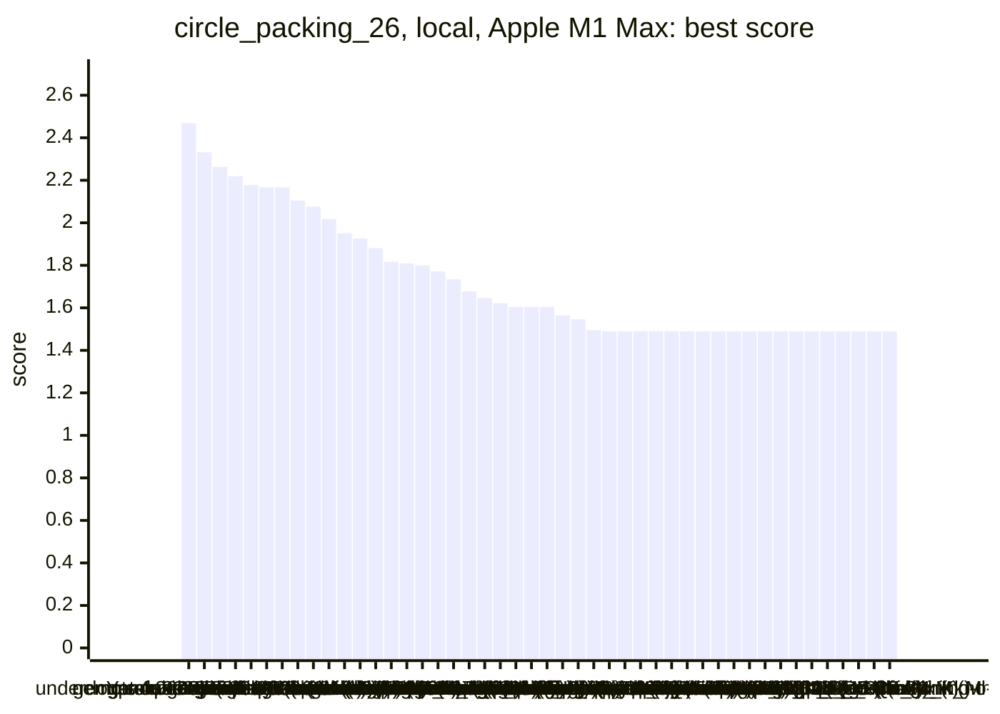

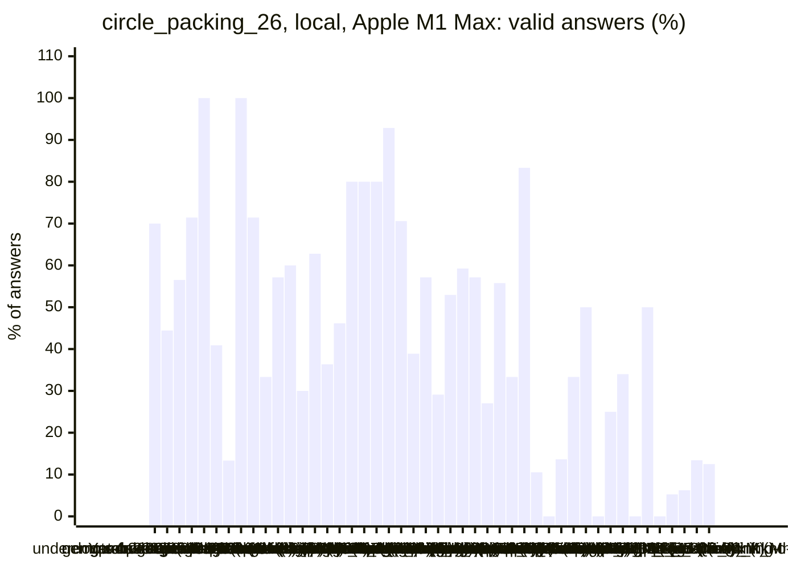

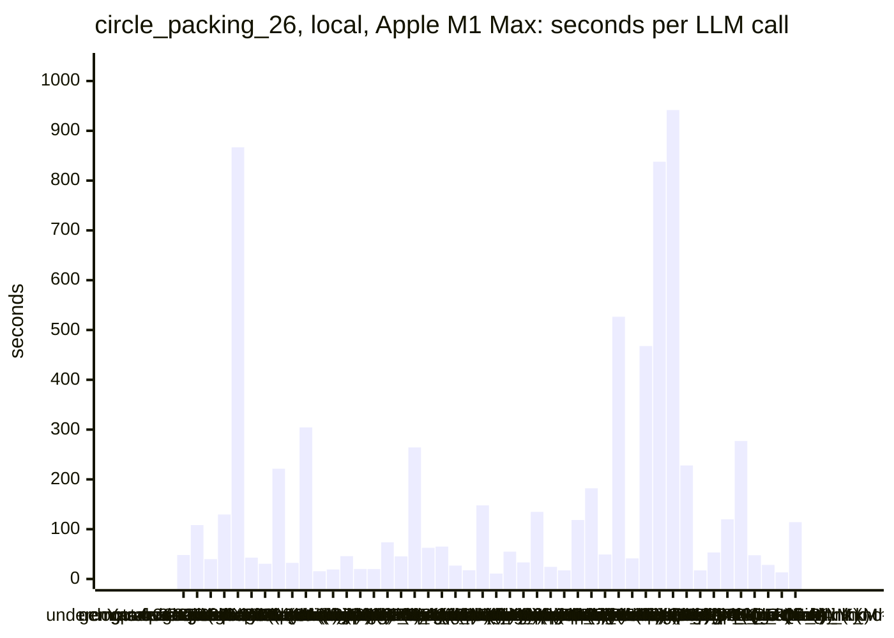

### Inference speed and memory

RAM is what Ollama reports for the loaded model (weights, context cache and buffers; on Apple silicon this is shared memory). Load is the time to bring the model into memory. Prompt and generation speeds are tokens per second over all calls of the run.

| Model | Params | RAM GB | Load s | Prompt tok/s | Gen tok/s | Median s/call | p90 s/call | Tokens/answer | Stopped |
|---|---|--:|--:|--:|--:|--:|--:|--:|--:|
| hf.co/LiquidAI/LFM3-1.7B-GGUF:Q4_K_M (no-think) | 1.73B | 1.3 | 0 | 1748 | 120.7 | 12 | 26 | 877 | 29 |
| hf.co/LiquidAI/LFM3-1.7B-GGUF:Q4_K_M (think) | 1.73B | 1.3 | 0 | 1615 | 92.6 | 115 | 126 | 9760 | 7 |
| lfm3:latest (no-think) |  | 3.7 | 4 | 3206 | 111.4 | 24 | 74 | 2954 | 19 |
| richardyoung/frognano-4b-2609:latest (no-think) | 4.3B | 4.4 | 12 | 739 | 30.2 | 39 | 79 | 1104 | 1 |
| richardyoung/frognano-4b-2609:latest (think) | 4.3B | 4.4 | 12 | 741 | 40.2 | 51 | 92 | 2055 | 0 |
| gemma4:e4b-it-qat (think) | 7.5B | 5.7 | 85 | 674 | 58.0 | 56 | 109 | 3185 | 0 |
| gemma4:e4b-it-qat (no-think) | 7.5B | 5.7 | 85 | 578 | 55.8 | 16 | 26 | 559 | 0 |
| gemma4:e2b (no-think) | 5.1B | 6.6 | 35 | 891 | 65.8 | 12 | 42 | 853 | 1 |
| qwen2.5-coder:7b (no-think) | 7.6B | 6.6 | 54 | 465 | 37.0 | 24 | 31 | 637 | 0 |
| gemma4:e2b (think) | 5.1B | 6.6 | 34 | 1142 | 77.3 | 42 | 55 | 2652 | 4 |
| qwen3.5:latest (no-think) | 9.7B | 6.8 | 49 | 374 | 34.0 | 32 | 100 | 969 | 2 |
| qwen3.5:latest (think) | 9.7B | 6.8 | 47 | 423 | 35.8 | 49 | 74 | 1498 | 0 |
| gemma4:12b-it-qat (no-think) | 11.9B | 8.0 | 66 | 220 | 28.6 | 40 | 86 | 723 | 0 |
| gemma4:12b-it-qat (think) | 11.9B | 8.0 | 90 | 251 | 28.9 | 576 | 576 | 13740 | 0 |
| yandex/YandexGPT-5-Lite-8B-instruct-GGUF:latest (no-think) | 8.0B | 8.7 | 19 | 427 | 28.5 | 32 | 46 | 713 | 0 |
| llm-jp-4-8b-omega:q4_k_m (no-think) | 8.6B | 8.8 | 16 | 500 | 32.8 | 49 | 93 | 1523 | 0 |
| MichelRosselli/apertus:8b-instruct-2509-q4_k_m (no-think) | 8.1B | 8.9 | 16 | 442 | 35.2 | 13 | 23 | 328 | 1 |
| underdog-saluki-27b:iq2-mix (no-think) | 26.9B | 9.8 | 2 | 120 | 11.3 | 111 | 176 | 1058 | 0 |
| gemma4:latest (think) |  | 11.4 | 109 | 835 | 45.7 | 58 | 92 | 2363 | 0 |
| nemotron-3-nano:4b (think) |  | 11.6 | 10 | 679 | 61.8 | 29 | 44 | 1692 | 0 |
| nemotron-3-nano:4b (no-think) |  | 11.6 | 9 | 684 | 62.7 | 11 | 16 | 352 | 1 |
| gpt-oss:20b (think) | 20.9B | 12.8 | 104 | 525 | 47.5 | 46 | 97 | 1742 | 0 |
| gpt-oss:20b (no-think) | 20.9B | 12.9 | 56 | 666 | 48.0 | 156 | 181 | 5260 | 0 |
| gemma4:26b-a4b-it-qat (no-think) | 25.2B | 15.2 | 223 | 528 | 57.0 | 29 | 49 | 1150 | 2 |
| gemma4:26b-a4b-it-qat (think) | 25.2B | 15.2 | 0 | 556 | 56.7 | 243 | 434 | 13573 | 2 |
| gemma4:latest (no-think) |  | 15.4 | 124 | 909 | 45.2 | 12 | 26 | 448 | 0 |
| muse-glimmer:30b (no-think) | 27.9B | 15.6 | 60 | 102 | 10.3 | 206 | 272 | 1987 | 0 |
| muse-glimmer:30b (think) | 27.9B | 16.5 | 52 | 132 | 10.0 | 902 | 902 | 8270 | 0 |
| qwen3.6:27b-coding-mtp-q4_K_M (think) | 27.3B | 17.4 | 209 | 95 | 12.7 | 942 | 942 | 9117 | 0 |
| qwen3.8:27b-mtp-q4_K_M (no-think) | 27.3B | 17.6 | 220 | 99 | 15.0 | 101 | 365 | 1374 | 0 |
| qwen3.8:27b-mtp-q4_K_M (think) | 27.3B | 17.6 | 202 | 129 | 12.7 | 878 | 878 | 9202 | 0 |
| qwen3.6:27b-coding-mtp-q4_K_M (no-think) | 27.3B | 18.2 | 196 | 100 | 15.6 | 98 | 327 | 1319 | 0 |
| qwen3.5:27b (think) | 27.8B | 18.4 | 85 | 120 | 10.8 | 367 | 898 | 4607 | 0 |
| qwen3.5:27b (no-think) | 27.8B | 18.6 | 130 | 90 | 10.8 | 152 | 286 | 1456 | 0 |
| frob/sarvam:30b (think) | 32.2B | 18.9 | 0 | 1217 | 66.2 | 282 | 288 | 7824 | 3 |
| nemotron-3-nano:30b-a3b-mlx (think) |  | 19.5 | 95 | 305 | 54.0 | 107 | 251 | 5914 | 0 |
| devstral-small-2:24b (no-think) | 24.0B | 19.7 | 42 | 122 | 11.1 | 64 | 93 | 584 | 0 |
| frob/sarvam:30b (no-think) | 32.2B | 19.8 | 61 | 872 | 31.6 | 298 | 322 | 8192 | 0 |
| ingu627/exaone4.0:32b (no-think) | 32.0B | 20.2 | 50 | 69 | 8.8 | 120 | 176 | 743 | 0 |
| glm-4.7-flash:latest (think) | 29.9B | 20.8 | 49 | 438 | 23.7 | 206 | 490 | 5902 | 0 |
| glm-4.7-flash:latest (no-think) | 29.9B | 20.8 | 50 | 466 | 31.4 | 29 | 55 | 834 | 0 |
| qwen3:30b-a3b-instruct-2507-q4_K_M (no-think) | 30.5B | 21.8 | 149 | 651 | 52.6 | 13 | 29 | 528 | 0 |
| qwen3:30b-a3b-instruct-2507-q4_K_M (think) | 30.5B | 21.8 | 133 | 600 | 50.6 | 15 | 28 | 514 | 0 |
| qwen3-coder:30b (no-think) | 30.5B | 21.8 | 218 | 687 | 54.8 | 23 | 28 | 865 | 1 |
| nemotron-3.5-lightning:30b-mlx (no-think) |  | 22.3 | 0 | 654 | 56.4 | 42 | 64 | 1746 | 8 |
| nemotron-3-nano:30b-a3b-mlx (no-think) |  | 25.6 | 111 | 580 | 56.8 | 17 | 24 | 653 | 3 |

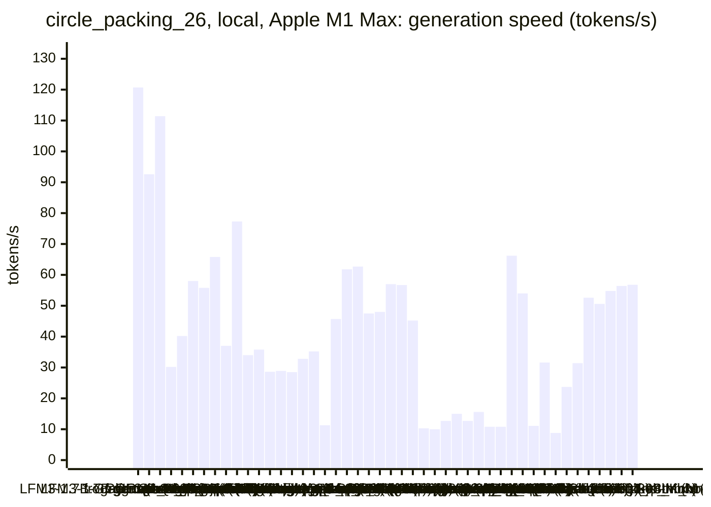

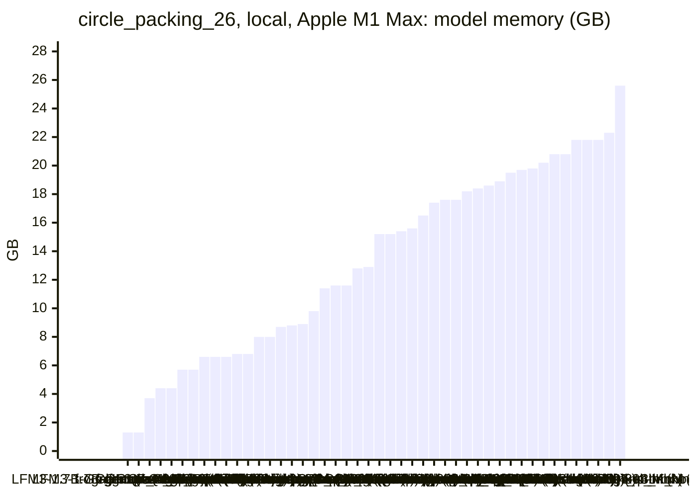

### Best score over time

| Model | 3.75 min | 7.5 min | 11.25 min | 15 min |
|---|--:|--:|--:|--:|
| gpt-oss:20b (think) | 1.4901 | 2.25061 | 2.46941 | 2.46941 |
| underdog-saluki-27b:iq2-mix (no-think) | 1.4901 | 1.4901 | 1.4901 | 2.33171 |
| gemma4:26b-a4b-it-qat (no-think) | 1.4901 | 1.55726 | 2.26342 | 2.26342 |
| nemotron-3-nano:30b-a3b-mlx (think) | 1.4901 | 1.4901 | 1.57991 | 1.6097 |
| muse-glimmer:30b (think) | 1.4901 | 1.4901 | 1.4901 | 1.80518 |
| richardyoung/frognano-4b-2609:latest (no-think) | 2.16667 | 2.16667 | 2.16667 | 2.16667 |
| nemotron-3-nano:4b (think) | 1.4901 | 1.4901 | 1.4901 | 2.16667 |
| muse-glimmer:30b (no-think) | 1.4901 | 1.88571 | 1.92262 | 1.92262 |
| yandex/YandexGPT-5-Lite-8B-instruct-GGUF:latest (no-think) | 1.62807 | 1.62807 | 1.62807 | 2.07584 |
| gemma4:26b-a4b-it-qat (think) | 1.4901 | 1.4901 | 1.4901 | 1.4901 |
| gemma4:latest (no-think) | 1.4901 | 1.4901 | 1.4901 | 1.95098 |
| qwen3:30b-a3b-instruct-2507-q4_K_M (no-think) | 1.4901 | 1.4901 | 1.92574 | 1.92574 |
| qwen3.5:latest (no-think) | 1.4901 | 1.88064 | 1.88064 | 1.88064 |
| qwen3:30b-a3b-instruct-2507-q4_K_M (think) | 1.49537 | 1.5268 | 1.64029 | 1.81593 |
| nemotron-3-nano:30b-a3b-mlx (no-think) | 1.4901 | 1.4901 | 1.61101 | 1.8089 |
| devstral-small-2:24b (no-think) | 1.4901 | 1.61875 | 1.79999 | 1.79999 |
| gemma4:12b-it-qat (no-think) | 1.74142 | 1.74142 | 1.74142 | 1.77142 |
| glm-4.7-flash:latest (think) | 1.4901 | 1.68974 | 1.68974 | 1.7339 |
| gemma4:latest (think) | 1.4901 | 1.4901 | 1.51909 | 1.67672 |
| gemma4:e4b-it-qat (think) | 1.4901 | 1.50363 | 1.50363 | 1.64644 |
| qwen3-coder:30b (no-think) | 1.4901 | 1.61875 | 1.61875 | 1.61875 |
| gemma4:e2b (no-think) | 1.4901 | 1.60406 | 1.60406 | 1.60406 |
| qwen3.8:27b-mtp-q4_K_M (no-think) | 1.4901 | 1.4901 | 1.60406 | 1.60406 |
| nemotron-3-nano:4b (no-think) | 1.60406 | 1.60406 | 1.60406 | 1.60406 |
| richardyoung/frognano-4b-2609:latest (think) | 1.4901 | 1.4901 | 1.56387 | 1.56387 |
| glm-4.7-flash:latest (no-think) | 1.4901 | 1.4901 | 1.54556 | 1.54556 |
| qwen3.6:27b-coding-mtp-q4_K_M (no-think) | 1.4901 | 1.4901 | 1.49537 | 1.49537 |
| qwen2.5-coder:7b (no-think) | 1.4901 | 1.4901 | 1.4901 | 1.4901 |
| gemma4:e4b-it-qat (no-think) | 1.4901 | 1.4901 | 1.4901 | 1.4901 |
| gpt-oss:20b (no-think) | 1.4901 | 1.4901 | 1.4901 | 1.4901 |
| qwen3.5:27b (no-think) | 1.4901 | 1.4901 | 1.4901 | 1.4901 |
| qwen3.5:latest (think) | 1.4901 | 1.4901 | 1.4901 | 1.4901 |
| gemma4:12b-it-qat (think) | 1.4901 | 1.4901 | 1.4901 | 1.4901 |
| gemma4:e2b (think) | 1.4901 | 1.4901 | 1.4901 | 1.4901 |
| qwen3.5:27b (think) | 1.4901 | 1.4901 | 1.4901 | 1.4901 |
| qwen3.8:27b-mtp-q4_K_M (think) | 1.4901 | 1.4901 | 1.4901 | 1.4901 |
| qwen3.6:27b-coding-mtp-q4_K_M (think) | 1.4901 | 1.4901 | 1.4901 | 1.4901 |
| frob/sarvam:30b (think) | 1.4901 | 1.4901 | 1.4901 | 1.4901 |
| MichelRosselli/apertus:8b-instruct-2509-q4_k_m (no-think) | 1.4901 | 1.4901 | 1.4901 | 1.4901 |
| llm-jp-4-8b-omega:q4_k_m (no-think) | 1.4901 | 1.4901 | 1.4901 | 1.4901 |
| ingu627/exaone4.0:32b (no-think) | 1.4901 | 1.4901 | 1.4901 | 1.4901 |
| frob/sarvam:30b (no-think) | 1.4901 | 1.4901 | 1.4901 | 1.4901 |
| nemotron-3.5-lightning:30b-mlx (no-think) | 1.4901 | 1.4901 | 1.4901 | 1.4901 |
| lfm3:latest (no-think) | 1.4901 | 1.4901 | 1.4901 | 1.4901 |
| hf.co/LiquidAI/LFM3-1.7B-GGUF:Q4_K_M (no-think) | 1.4901 | 1.4901 | 1.4901 | 1.4901 |
| hf.co/LiquidAI/LFM3-1.7B-GGUF:Q4_K_M (think) | 1.4901 | 1.4901 | 1.4901 | 1.4901 |

### Outcome of the LLM answers

| Model | duplicate | edit error | invalid | llm error | ok | timeout |
|---|--:|--:|--:|--:|--:|--:|
| gpt-oss:20b (think) | 1 | 3 | 2 | 0 | 14 | 0 |
| underdog-saluki-27b:iq2-mix (no-think) | 0 | 1 | 4 | 0 | 4 | 0 |
| gemma4:26b-a4b-it-qat (no-think) | 1 | 3 | 4 | 2 | 13 | 0 |
| nemotron-3-nano:30b-a3b-mlx (think) | 0 | 2 | 0 | 0 | 5 | 0 |
| muse-glimmer:30b (think) | 0 | 0 | 0 | 0 | 2 | 0 |
| richardyoung/frognano-4b-2609:latest (no-think) | 0 | 2 | 9 | 1 | 9 | 1 |
| nemotron-3-nano:4b (think) | 0 | 9 | 17 | 0 | 4 | 0 |
| muse-glimmer:30b (no-think) | 0 | 0 | 0 | 0 | 5 | 0 |
| yandex/YandexGPT-5-Lite-8B-instruct-GGUF:latest (no-think) | 2 | 0 | 6 | 0 | 20 | 0 |
| gemma4:26b-a4b-it-qat (think) | 0 | 0 | 0 | 2 | 1 | 0 |
| gemma4:latest (no-think) | 1 | 4 | 19 | 0 | 32 | 0 |
| qwen3:30b-a3b-instruct-2507-q4_K_M (no-think) | 0 | 5 | 12 | 0 | 27 | 1 |
| qwen3.5:latest (no-think) | 0 | 2 | 10 | 2 | 6 | 0 |
| qwen3:30b-a3b-instruct-2507-q4_K_M (think) | 0 | 10 | 6 | 0 | 27 | 0 |
| nemotron-3-nano:30b-a3b-mlx (no-think) | 1 | 14 | 10 | 3 | 16 | 0 |
| devstral-small-2:24b (no-think) | 0 | 0 | 7 | 0 | 6 | 0 |
| gemma4:12b-it-qat (no-think) | 0 | 3 | 1 | 0 | 16 | 0 |
| glm-4.7-flash:latest (think) | 0 | 0 | 1 | 0 | 4 | 0 |
| gemma4:latest (think) | 0 | 1 | 2 | 0 | 12 | 0 |
| gemma4:e4b-it-qat (think) | 0 | 0 | 1 | 0 | 13 | 0 |
| qwen3-coder:30b (no-think) | 3 | 0 | 6 | 1 | 24 | 0 |
| gemma4:e2b (no-think) | 0 | 7 | 25 | 1 | 21 | 0 |
| qwen3.8:27b-mtp-q4_K_M (no-think) | 0 | 0 | 3 | 0 | 4 | 0 |
| nemotron-3-nano:4b (no-think) | 5 | 26 | 24 | 1 | 23 | 0 |
| richardyoung/frognano-4b-2609:latest (think) | 0 | 0 | 8 | 0 | 9 | 0 |
| glm-4.7-flash:latest (no-think) | 2 | 2 | 7 | 0 | 16 | 0 |
| qwen3.6:27b-coding-mtp-q4_K_M (no-think) | 0 | 1 | 1 | 0 | 4 | 1 |
| qwen2.5-coder:7b (no-think) | 9 | 1 | 17 | 0 | 10 | 0 |
| gemma4:e4b-it-qat (no-think) | 1 | 7 | 15 | 0 | 29 | 0 |
| gpt-oss:20b (no-think) | 0 | 4 | 2 | 0 | 3 | 0 |
| qwen3.5:27b (no-think) | 0 | 0 | 0 | 0 | 5 | 1 |
| qwen3.5:latest (think) | 0 | 1 | 15 | 0 | 2 | 1 |
| gemma4:12b-it-qat (think) | 0 | 1 | 1 | 0 | 0 | 0 |
| gemma4:e2b (think) | 0 | 4 | 11 | 4 | 3 | 0 |
| qwen3.5:27b (think) | 0 | 1 | 1 | 0 | 1 | 0 |
| qwen3.8:27b-mtp-q4_K_M (think) | 0 | 0 | 1 | 0 | 1 | 0 |
| qwen3.6:27b-coding-mtp-q4_K_M (think) | 0 | 0 | 1 | 0 | 0 | 0 |
| frob/sarvam:30b (think) | 0 | 0 | 0 | 3 | 1 | 0 |
| MichelRosselli/apertus:8b-instruct-2509-q4_k_m (no-think) | 5 | 15 | 12 | 1 | 17 | 0 |
| llm-jp-4-8b-omega:q4_k_m (no-think) | 0 | 8 | 7 | 1 | 0 | 1 |
| ingu627/exaone4.0:32b (no-think) | 0 | 2 | 2 | 0 | 4 | 0 |
| frob/sarvam:30b (no-think) | 0 | 4 | 0 | 0 | 0 | 0 |
| nemotron-3.5-lightning:30b-mlx (no-think) | 0 | 4 | 5 | 8 | 1 | 1 |
| lfm3:latest (no-think) | 0 | 8 | 3 | 19 | 2 | 0 |
| hf.co/LiquidAI/LFM3-1.7B-GGUF:Q4_K_M (no-think) | 0 | 14 | 14 | 29 | 9 | 1 |
| hf.co/LiquidAI/LFM3-1.7B-GGUF:Q4_K_M (think) | 0 | 0 | 0 | 7 | 1 | 0 |

### Best idea per model

- **gpt-oss:20b (think)**: tuned INIT_TEMP=0.1, STEP=0.05, COOL_RATE=0.998, TOTAL_ITERS=4000 on top of: In each annealing iteration, perturb all circles in random order instead of just one, allowing broader …
- **underdog-saluki-27b:iq2-mix (no-think)**: Fix the bug where `best_centers` was stored as a flat list of floats instead of a list of (x, y) tuples, so the final zip/unpack works.
- **gemma4:26b-a4b-it-qat (no-think)**: tuned ITERATIONS=20, REPULSION_STRENGTH=0.01, REPULSION_DIST=0.3, WALL_DIST=0.1 on top of: Introduce named constants for optimization parameters and provide a sweep to find the …
- **nemotron-3-nano:30b-a3b-mlx (think)**: tuned COLS=5, HEX_OFFSET=0.4 on top of: Use a configurable hexagonal lattice with adjustable column count and offset, and compute radii via iterative constraint tightening that …
- **muse-glimmer:30b (think)**: Fix the radius scaling bug that increased radii, switch to hexagonal offset grids and iteratively project radii to satisfy wall and non-overlap constraints for a larger feasible …
- **richardyoung/frognano-4b-2609:latest (no-think)**: Replace the inefficient nested O(N^2) loop in max_radii with an O(N^2 log N) sorted approach and fix the radius scaling logic to preserve total sum better during overlap …
- **nemotron-3-nano:4b (think)**: Use a hexagonal‑like center grid with a fixed spacing and set each radius to the smaller of the distance to the nearest wall or half the distance to the nearest neighbor …
- **muse-glimmer:30b (no-think)**: replace the fixed lattice with multi-start hill climbing that perturbs centers locally and keeps moves that increase the sum of feasible radii from the iterative shrinker …
- **yandex/YandexGPT-5-Lite-8B-instruct-GGUF:latest (no-think)**: tuned NAME_EDGE_RADIUS_FACTOR=0.1, NAME_DENSITY_FACTOR=0.8607 on top of: Introduce parameters for varying radii based on distance from the edges and adjust the density factor …
- **gemma4:26b-a4b-it-qat (think)**: Use a hill-climbing optimization with multiple initializations (grid, random, and jittered grid) to find better circle centers and maximize the sum of radii.
- **gemma4:latest (no-think)**: tuned ITERATIONS=150, LEARNING_RATE=0.01 on top of: Expose the iteration count and the learning rate in `max_radii` as named constants to allow for systematic searching for better …
- **qwen3:30b-a3b-instruct-2507-q4_K_M (no-think)**: tuned h_spacing=0.1084, v_spacing=0.1594 on top of: Replace the fixed hexagonal lattice with a dynamic circle packing algorithm using Lloyd's relaxation to iteratively adjust …
- **qwen3.5:latest (no-think)**: Replace the O(N²) pairwise overlap resolution with a single-pass linear sweep using sorted distances to shrink radii efficiently while respecting all constraints simultaneously.
- **qwen3:30b-a3b-instruct-2507-q4_K_M (think)**: tuned spacing_factor=1.035, offset_factor=0.1434 on top of: Replace the fixed hexagonal lattice with an adaptive Voronoi-based radius assignment followed by iterative center …
- **nemotron-3-nano:30b-a3b-mlx (no-think)**: tuned H_SPACING=1, V_SPACING=1.2, JITTER=0.001, COLS=5 on top of: Use a finer staggered hexagonal lattice with adjustable horizontal and vertical spacings, add a small jitter, and …
- **devstral-small-2:24b (no-think)**: Fix the missing 26th circle by adjusting the centers list to include all 26 points and ensure no duplicates or missing entries.
- **gemma4:12b-it-qat (no-think)**: tuned SAMPLES=10 on top of: Increase sampling density and use a more refined local search (hill climbing) to improve circle positions and maximize the radii sum.
- **glm-4.7-flash:latest (think)**: Implement a repulsive force optimization to spread initial grid centers apart, allowing max_radii to assign larger radii by increasing inter-circle distances.
- **gemma4:latest (think)**: Introduce a simple hill-climbing optimization loop into construct_packing by randomly perturbing the centers and accepting moves that increase the total sum of radii, thus …
- **gemma4:e4b-it-qat (think)**: tuned C_PACK=5, R_PACK=6 on top of: Parameterize the grid dimensions by sweeping the number of columns ($C_{PACK}$) and rows ($R_{PACK}$) in the hexagonal lattice structure, as …
- **qwen3-coder:30b (no-think)**: tuned HEX_PACKING_RATIO=1.1, HEX_OFFSET_FACTOR=0.75 on top of: Replace fixed hexagonal parameters with sweepable constants to allow optimization of packing density and spacing for …
- **gemma4:e2b (no-think)**: Modify the center placement to use a uniform square grid instead of the hexagonal approximation to test a simpler, highly structured packing that might be easier to optimize …
- **qwen3.8:27b-mtp-q4_K_M (no-think)**: edit: N_COLS = 5 / N_ROWS = 6
- **nemotron-3-nano:4b (no-think)**: Reduce column spacing by 10% to allow larger circles near edges, increasing total radius sum.
- **richardyoung/frognano-4b-2609:latest (think)**: Switch to proven hexagonal lattice with fixed 6-row pattern for exactly 26 circles, add division-by-zero guard in max_radii, and fix x-coordinate spacing formula to properly fit …
- **glm-4.7-flash:latest (no-think)**: Replace the fixed grid layout with a hexagonal (triangular) lattice seed to better utilize the available area and reduce gaps, then compute radii by shrinking overlapping pairs.
- **qwen3.6:27b-coding-mtp-q4_K_M (no-think)**: Replace the naive grid packing with a hexagonal lattice initialization and a local optimization loop that iteratively adjusts centers and radii to maximize the sum of radii while …
- **qwen2.5-coder:7b (no-think)**: initial program
- **gemma4:e4b-it-qat (no-think)**: initial program
- **gpt-oss:20b (no-think)**: initial program
- **qwen3.5:27b (no-think)**: initial program
- **qwen3.5:latest (think)**: initial program
- **gemma4:12b-it-qat (think)**: initial program
- **gemma4:e2b (think)**: initial program
- **qwen3.5:27b (think)**: initial program
- **qwen3.8:27b-mtp-q4_K_M (think)**: initial program
- **qwen3.6:27b-coding-mtp-q4_K_M (think)**: initial program
- **frob/sarvam:30b (think)**: initial program
- **MichelRosselli/apertus:8b-instruct-2509-q4_k_m (no-think)**: initial program
- **llm-jp-4-8b-omega:q4_k_m (no-think)**: initial program
- **ingu627/exaone4.0:32b (no-think)**: initial program
- **frob/sarvam:30b (no-think)**: initial program
- **nemotron-3.5-lightning:30b-mlx (no-think)**: initial program
- **lfm3:latest (no-think)**: initial program
- **hf.co/LiquidAI/LFM3-1.7B-GGUF:Q4_K_M (no-think)**: initial program
- **hf.co/LiquidAI/LFM3-1.7B-GGUF:Q4_K_M (think)**: initial program

## Local models on i7-8700K + 2x GTX 1080 Ti

Ollama on this machine.

| Model | Params | Initial | Best | Gain | LLM calls | s/call | Valid | New bests | Min to best |
|---|---|--:|--:|--:|--:|--:|--:|--:|--:|
| gemma4:26b-a4b-it-qat (no-think) | 25.2B | 1.4901 | **2.38516** | ×1.60 | 25 | 37 | 44% | 6 | 17.0 |
| gpt-oss:20b (no-think) | 20.9B | 1.4901 | **2.36418** | ×1.59 | 10 | 96 | 60% | 4 | 16.1 |
| gemma4:26b-a4b-it-qat (think) | 25.2B | 1.4901 | **2.25597** | ×1.51 | 3 | 379 | 100% | 3 | 19.0 |
| gpt-oss:20b (think) | 20.9B | 1.4901 | **2.23356** | ×1.50 | 21 | 43 | 81% | 5 | 15.1 |
| gemma4:e2b (no-think) | 4.6B | 1.4901 | **2.16667** | ×1.45 | 92 | 10 | 52% | 2 | 6.7 |
| nemotron-3-nano:4b (think) | 4.0B | 1.4901 | **2.16667** | ×1.45 | 35 | 26 | 9% | 2 | 11.1 |
| qwen3.5:latest (think) | 9.0B | 1.4901 | **2.128** | ×1.43 | 17 | 66 | 18% | 3 | 18.6 |
| gemma4:12b-it-qat (no-think) | 11.9B | 1.4901 | **1.8536** | ×1.24 | 25 | 37 | 52% | 3 | 13.9 |
| yandex/YandexGPT-5-Lite-8B-instruct-GGUF:latest (no-think) | 8.0B | 1.4901 | **1.83712** | ×1.23 | 43 | 21 | 51% | 6 | 8.5 |
| qwen3:30b-a3b-instruct-2507-q4_K_M (think) | 30.5B | 1.4901 | **1.8129** | ×1.22 | 41 | 22 | 39% | 2 | 14.1 |
| qwen3-coder:30b (no-think) | 30.5B | 1.4901 | **1.70388** | ×1.14 | 25 | 36 | 68% | 2 | 13.2 |
| frob/sarvam:30b (think) | 32.2B | 1.4901 | **1.68922** | ×1.13 | 4 | 226 | 25% | 1 | 15.1 |
| gemma4:latest (no-think) | 7.5B | 1.4901 | **1.64472** | ×1.10 | 57 | 15 | 67% | 1 | 10.6 |
| MichelRosselli/apertus:8b-instruct-2509-q4_k_m (no-think) | 8.1B | 1.4901 | **1.60406** | ×1.08 | 51 | 17 | 16% | 1 | 5.8 |
| qwen3:30b-a3b-instruct-2507-q4_K_M (no-think) | 30.5B | 1.4901 | **1.59877** | ×1.07 | 39 | 23 | 64% | 2 | 1.7 |
| gemma4:e4b-it-qat (no-think) | 7.5B | 1.4901 | **1.52133** | ×1.02 | 45 | 20 | 44% | 2 | 5.9 |
| underdog-saluki-27b:iq2-mix (no-think) | 26.9B | 1.4901 | **1.5** | ×1.01 | 9 | 134 | 22% | 1 | 7.2 |
| gemma4:e4b-it-qat (think) | 7.5B | 1.4901 | **1.4973** | ×1.00 | 9 | 109 | 33% | 1 | 16.4 |
| richardyoung/frognano-4b-2609:latest (no-think) | 4.3B | 1.4901 | **1.49537** | ×1.00 | 33 | 28 | 33% | 1 | 0.8 |
| gemma4:e2b (think) | 4.6B | 1.4901 | **1.49537** | ×1.00 | 41 | 22 | 68% | 1 | 3.4 |
| glm-4.7-flash:latest (think) | 29.9B | 1.4901 | **1.49537** | ×1.00 | 4 | 258 | 75% | 1 | 17.2 |
| gemma4:latest (think) | 7.5B | 1.4901 | **1.4948** | ×1.00 | 24 | 37 | 88% | 5 | 12.5 |
| nemotron-3-nano:4b (no-think) | 4.0B | 1.4901 | **1.4901** | ×1.00 | 85 | 10 | 5% | 0 | - |
| qwen2.5-coder:7b (no-think) | 7.6B | 1.4901 | **1.4901** | ×1.00 | 52 | 17 | 21% | 0 | - |
| llm-jp-4-8b-omega:q4_k_m (no-think) | 8.6B | 1.4901 | **1.4901** | ×1.00 | 29 | 31 | 0% | 0 | - |
| Bored/GigaChat3.1-10B-A1.8B-q4_K_M:latest (no-think) | 10.7B | 1.4901 | **1.4901** | ×1.00 | 45 | 21 | 2% | 0 | - |
| qwen3.5:latest (no-think) | 9.0B | 1.4901 | **1.4901** | ×1.00 | 22 | 42 | 5% | 0 | - |
| qwen3.8:27b-mtp-q4_K_M (no-think) | 27.3B | 1.4901 | **1.4901** | ×1.00 | 4 | 226 | 75% | 0 | - |
| qwen3.6:27b-coding-mtp-q4_K_M (no-think) | 27.3B | 1.4901 | **1.4901** | ×1.00 | 4 | 238 | 75% | 0 | - |
| frob/sarvam:30b (no-think) | 32.2B | 1.4901 | **1.4901** | ×1.00 | 6 | 160 | 17% | 0 | - |
| glm-4.7-flash:latest (no-think) | 29.9B | 1.4901 | **1.4901** | ×1.00 | 27 | 33 | 44% | 0 | - |
| richardyoung/frognano-4b-2609:latest (think) | 4.3B | 1.4901 | **1.4901** | ×1.00 | 21 | 44 | 14% | 0 | - |
| gemma4:12b-it-qat (think) | 11.9B | 1.4901 | **1.4901** | ×1.00 | 2 | 492 | 0% | 0 | - |
| qwen3.8:27b-mtp-q4_K_M (think) | 27.3B | | | | | | | | failed: all 1 model requests failed: qwen3.8:27b-mtp-q4_K_M: an erro |
| qwen3.6:27b-coding-mtp-q4_K_M (think) | 27.3B | 1.4901 | **1.4901** | ×1.00 | 1 | 1512 | 0% | 0 | - |
| underdog-saluki-27b:iq2-mix (think) | 26.9B | | | | | | | | failed: all 1 model requests failed: underdog-saluki-27b:iq2-mix: an |
| hf.co/LiquidAI/LFM3-1.7B-GGUF:Q4_K_M (no-think) | 1.73B | 1.4901 | **1.4901** | ×1.00 | 58 | 15 | 14% | 0 | - |
| hf.co/LiquidAI/LFM3-1.7B-GGUF:Q4_K_M (think) | 1.73B | 1.4901 | **1.4901** | ×1.00 | 10 | 97 | 10% | 0 | - |

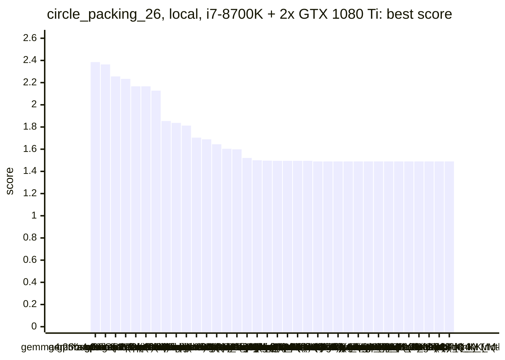

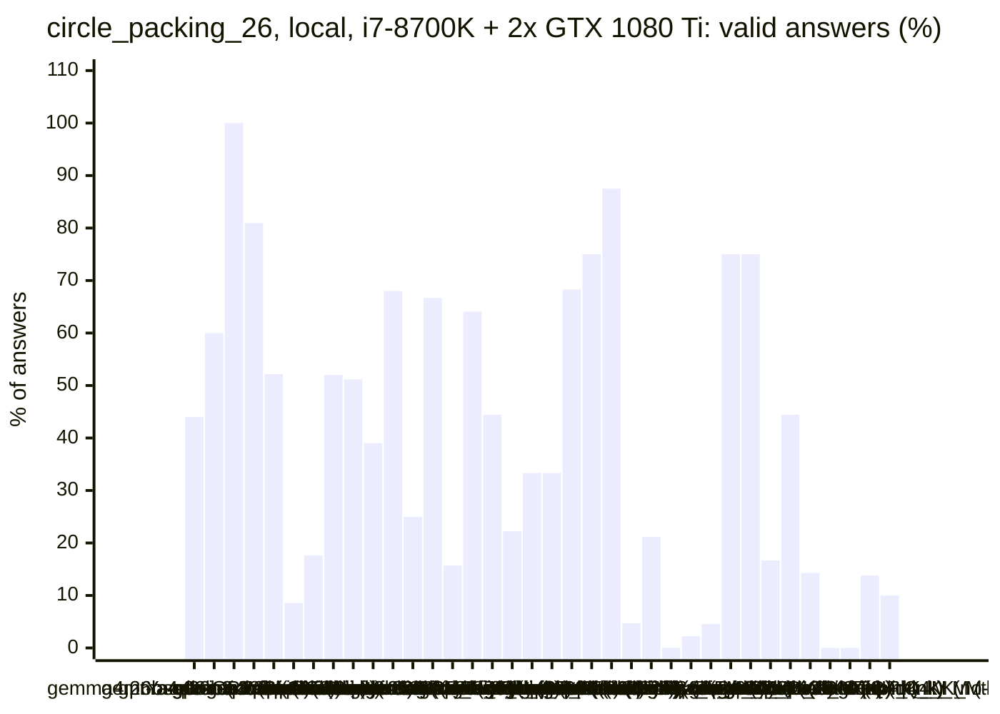

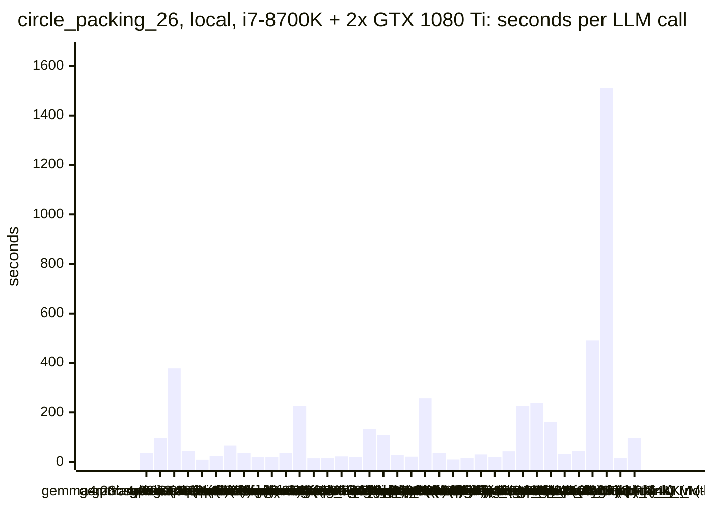

### Inference speed and memory

RAM is what Ollama reports for the loaded model (weights, context cache and buffers; on Apple silicon this is shared memory). Load is the time to bring the model into memory. Prompt and generation speeds are tokens per second over all calls of the run.

| Model | Params | RAM GB | Load s | Prompt tok/s | Gen tok/s | Median s/call | p90 s/call | Tokens/answer | Stopped |
|---|---|--:|--:|--:|--:|--:|--:|--:|--:|
| gemma4:e2b (no-think) | 4.6B | 0.5 | 21 | 2096 | 103.2 | 8 | 16 | 556 | 0 |
| gemma4:e2b (think) | 4.6B | 0.5 | 18 | 2188 | 109.3 | 21 | 30 | 1974 | 0 |
| hf.co/LiquidAI/LFM3-1.7B-GGUF:Q4_K_M (no-think) | 1.73B | 1.3 | 6 | 4219 | 116.3 | 12 | 28 | 801 | 25 |
| hf.co/LiquidAI/LFM3-1.7B-GGUF:Q4_K_M (think) | 1.73B | 1.3 | 0 | 4338 | 114.6 | 96 | 105 | 9779 | 9 |
| gemma4:latest (no-think) | 7.5B | 1.6 | 25 | 1233 | 66.1 | 15 | 26 | 664 | 0 |
| gemma4:latest (think) | 7.5B | 1.6 | 24 | 1269 | 56.8 | 34 | 62 | 1777 | 0 |
| nemotron-3-nano:4b (think) | 4.0B | 3.5 | 10 | 1692 | 72.4 | 24 | 38 | 1569 | 0 |
| nemotron-3-nano:4b (no-think) | 4.0B | 3.5 | 11 | 1733 | 67.5 | 9 | 14 | 414 | 1 |
| richardyoung/frognano-4b-2609:latest (no-think) | 4.3B | 4.3 | 14 | 1578 | 53.6 | 21 | 53 | 1072 | 3 |
| richardyoung/frognano-4b-2609:latest (think) | 4.3B | 4.3 | 12 | 2078 | 59.7 | 31 | 69 | 2017 | 1 |
| gemma4:e4b-it-qat (no-think) | 7.5B | 4.4 | 22 | 1776 | 44.0 | 14 | 43 | 678 | 0 |
| gemma4:e4b-it-qat (think) | 7.5B | 4.4 | 21 | 1670 | 43.3 | 118 | 138 | 4489 | 0 |
| qwen2.5-coder:7b (no-think) | 7.6B | 6.6 | 16 | 1479 | 43.4 | 16 | 22 | 552 | 0 |
| qwen3.5:latest (think) | 9.0B | 7.6 | 21 | 1150 | 36.2 | 47 | 84 | 2187 | 0 |
| Bored/GigaChat3.1-10B-A1.8B-q4_K_M:latest (no-think) | 10.7B | 7.6 | 19 | 977 | 74.6 | 19 | 31 | 1025 | 4 |
| qwen3.5:latest (no-think) | 9.0B | 7.6 | 53 | 1184 | 36.9 | 35 | 82 | 1109 | 2 |
| gemma4:12b-it-qat (no-think) | 11.9B | 7.7 | 24 | 526 | 29.0 | 33 | 60 | 795 | 0 |
| gemma4:12b-it-qat (think) | 11.9B | 9.0 | 21 | 581 | 27.3 | 501 | 501 | 13030 | 0 |
| MichelRosselli/apertus:8b-instruct-2509-q4_k_m (no-think) | 8.1B | 10.1 | 18 | 1605 | 42.1 | 15 | 28 | 530 | 2 |
| yandex/YandexGPT-5-Lite-8B-instruct-GGUF:latest (no-think) | 8.0B | 10.2 | 17 | 1471 | 43.9 | 19 | 31 | 684 | 1 |
| llm-jp-4-8b-omega:q4_k_m (no-think) | 8.6B | 10.4 | 18 | 1582 | 40.8 | 26 | 63 | 1086 | 0 |
| underdog-saluki-27b:iq2-mix (no-think) | 26.9B | 11.3 | 6 | 324 | 15.3 | 106 | 461 | 1275 | 1 |
| gpt-oss:20b (no-think) | 20.9B | 13.8 | 39 | 1532 | 50.8 | 107 | 166 | 4474 | 0 |
| gpt-oss:20b (think) | 20.9B | 13.8 | 37 | 1663 | 51.3 | 37 | 74 | 1838 | 1 |
| gemma4:26b-a4b-it-qat (no-think) | 25.2B | 16.5 | 60 | 982 | 36.8 | 38 | 55 | 1084 | 0 |
| gemma4:26b-a4b-it-qat (think) | 25.2B | 16.5 | 56 | 882 | 34.7 | 370 | 406 | 12378 | 0 |
| qwen3.6:27b-coding-mtp-q4_K_M (no-think) | 27.3B | 19.9 | 58 | 194 | 7.3 | 261 | 279 | 1550 | 0 |
| qwen3.6:27b-coding-mtp-q4_K_M (think) | 27.3B | 19.9 | 60 | 163 | 6.0 | 1512 | 1512 | 8658 | 0 |
| qwen3.8:27b-mtp-q4_K_M (no-think) | 27.3B | 20.1 | 58 | 184 | 7.1 | 250 | 264 | 1421 | 0 |
| frob/sarvam:30b (think) | 32.2B | 21.0 | 0 | 1644 | 57.7 | 292 | 322 | 2394 | 3 |
| frob/sarvam:30b (no-think) | 32.2B | 21.0 | 66 | 1521 | 51.1 | 164 | 228 | 7490 | 0 |
| glm-4.7-flash:latest (think) | 29.9B | 21.2 | 57 | 605 | 27.9 | 290 | 293 | 6675 | 0 |
| glm-4.7-flash:latest (no-think) | 29.9B | 21.2 | 62 | 482 | 29.6 | 29 | 57 | 722 | 0 |
| qwen3:30b-a3b-instruct-2507-q4_K_M (think) | 30.5B | 22.2 | 53 | 717 | 35.6 | 17 | 46 | 490 | 0 |
| qwen3-coder:30b (no-think) | 30.5B | 22.2 | 56 | 650 | 32.2 | 35 | 46 | 879 | 0 |
| qwen3:30b-a3b-instruct-2507-q4_K_M (no-think) | 30.5B | 22.2 | 56 | 713 | 33.1 | 17 | 49 | 464 | 0 |

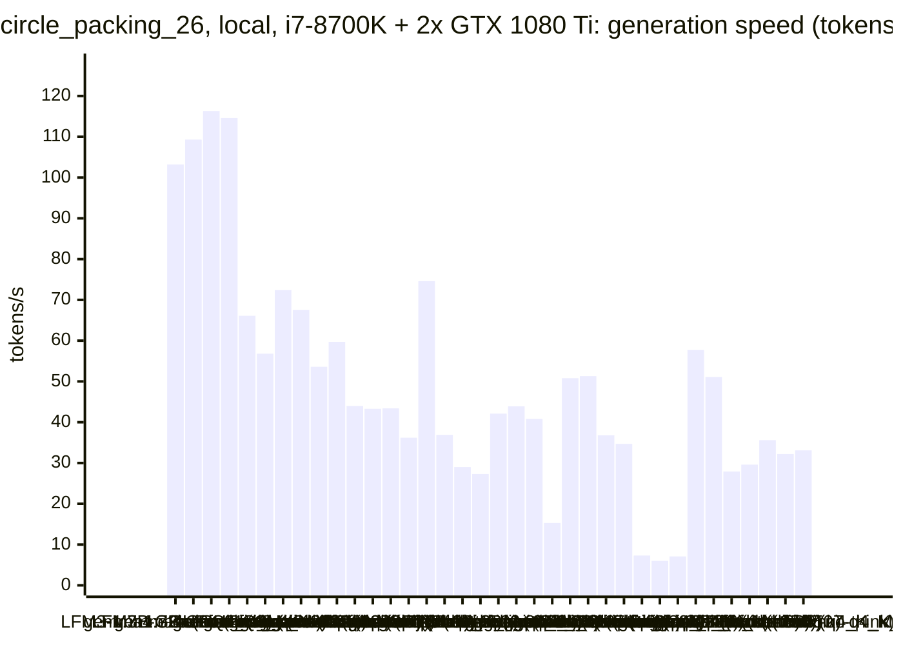

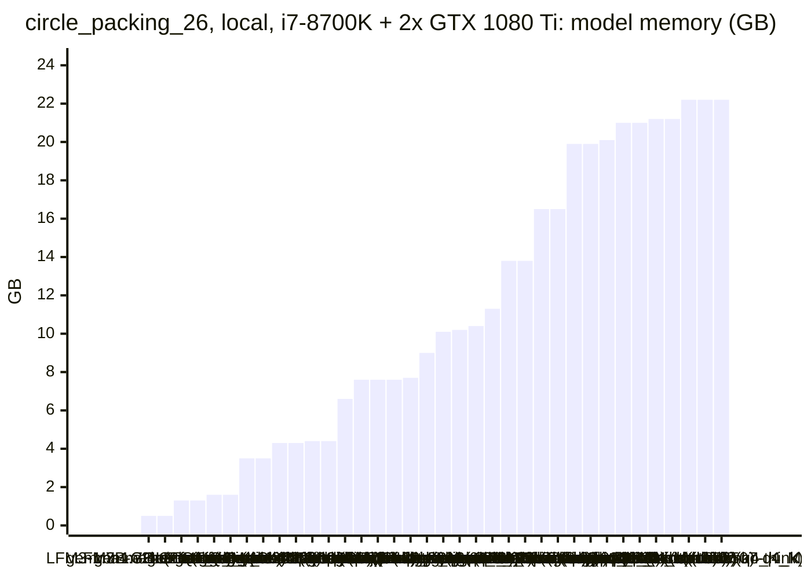

### Best score over time

| Model | 3.75 min | 7.5 min | 11.25 min | 15 min |
|---|--:|--:|--:|--:|
| gemma4:26b-a4b-it-qat (no-think) | 1.63579 | 2.33919 | 2.33919 | 2.33919 |
| gpt-oss:20b (no-think) | 2.1 | 2.22752 | 2.22752 | 2.22752 |
| gemma4:26b-a4b-it-qat (think) | 1.4901 | 2.04583 | 2.04583 | 2.10615 |
| gpt-oss:20b (think) | 1.4901 | 1.97211 | 1.97211 | 2.16667 |
| gemma4:e2b (no-think) | 1.60406 | 2.16667 | 2.16667 | 2.16667 |
| nemotron-3-nano:4b (think) | 1.5283 | 1.5283 | 2.16667 | 2.16667 |
| qwen3.5:latest (think) | 1.4901 | 1.98487 | 1.98487 | 2.025 |
| gemma4:12b-it-qat (no-think) | 1.4901 | 1.81965 | 1.81965 | 1.8536 |
| yandex/YandexGPT-5-Lite-8B-instruct-GGUF:latest (no-think) | 1.76501 | 1.80794 | 1.83712 | 1.83712 |
| qwen3:30b-a3b-instruct-2507-q4_K_M (think) | 1.4901 | 1.4901 | 1.4901 | 1.8129 |
| qwen3-coder:30b (no-think) | 1.66204 | 1.66204 | 1.66204 | 1.70388 |
| frob/sarvam:30b (think) | 1.4901 | 1.4901 | 1.4901 | 1.4901 |
| gemma4:latest (no-think) | 1.4901 | 1.4901 | 1.64472 | 1.64472 |
| MichelRosselli/apertus:8b-instruct-2509-q4_k_m (no-think) | 1.4901 | 1.60406 | 1.60406 | 1.60406 |
| qwen3:30b-a3b-instruct-2507-q4_K_M (no-think) | 1.59877 | 1.59877 | 1.59877 | 1.59877 |
| gemma4:e4b-it-qat (no-think) | 1.4901 | 1.52133 | 1.52133 | 1.52133 |
| underdog-saluki-27b:iq2-mix (no-think) | 1.4901 | 1.5 | 1.5 | 1.5 |
| gemma4:e4b-it-qat (think) | 1.4901 | 1.4901 | 1.4901 | 1.4901 |
| richardyoung/frognano-4b-2609:latest (no-think) | 1.49537 | 1.49537 | 1.49537 | 1.49537 |
| gemma4:e2b (think) | 1.49537 | 1.49537 | 1.49537 | 1.49537 |
| glm-4.7-flash:latest (think) | 1.4901 | 1.4901 | 1.4901 | 1.4901 |
| gemma4:latest (think) | 1.4901 | 1.4901 | 1.49467 | 1.4948 |
| nemotron-3-nano:4b (no-think) | 1.4901 | 1.4901 | 1.4901 | 1.4901 |
| qwen2.5-coder:7b (no-think) | 1.4901 | 1.4901 | 1.4901 | 1.4901 |
| llm-jp-4-8b-omega:q4_k_m (no-think) | 1.4901 | 1.4901 | 1.4901 | 1.4901 |
| Bored/GigaChat3.1-10B-A1.8B-q4_K_M:latest (no-think) | 1.4901 | 1.4901 | 1.4901 | 1.4901 |
| qwen3.5:latest (no-think) | 1.4901 | 1.4901 | 1.4901 | 1.4901 |
| qwen3.8:27b-mtp-q4_K_M (no-think) | 1.4901 | 1.4901 | 1.4901 | 1.4901 |
| qwen3.6:27b-coding-mtp-q4_K_M (no-think) | 1.4901 | 1.4901 | 1.4901 | 1.4901 |
| frob/sarvam:30b (no-think) | 1.4901 | 1.4901 | 1.4901 | 1.4901 |
| glm-4.7-flash:latest (no-think) | 1.4901 | 1.4901 | 1.4901 | 1.4901 |
| richardyoung/frognano-4b-2609:latest (think) | 1.4901 | 1.4901 | 1.4901 | 1.4901 |
| gemma4:12b-it-qat (think) | 1.4901 | 1.4901 | 1.4901 | 1.4901 |
| qwen3.6:27b-coding-mtp-q4_K_M (think) | 1.4901 | 1.4901 | 1.4901 | 1.4901 |
| hf.co/LiquidAI/LFM3-1.7B-GGUF:Q4_K_M (no-think) | 1.4901 | 1.4901 | 1.4901 | 1.4901 |
| hf.co/LiquidAI/LFM3-1.7B-GGUF:Q4_K_M (think) | 1.4901 | 1.4901 | 1.4901 | 1.4901 |

### Outcome of the LLM answers

| Model | duplicate | edit error | invalid | llm error | ok | timeout |
|---|--:|--:|--:|--:|--:|--:|
| gemma4:26b-a4b-it-qat (no-think) | 0 | 4 | 7 | 0 | 11 | 3 |
| gpt-oss:20b (no-think) | 0 | 3 | 1 | 0 | 6 | 0 |
| gemma4:26b-a4b-it-qat (think) | 0 | 0 | 0 | 0 | 3 | 0 |
| gpt-oss:20b (think) | 1 | 0 | 2 | 1 | 17 | 0 |
| gemma4:e2b (no-think) | 3 | 12 | 29 | 0 | 48 | 0 |
| nemotron-3-nano:4b (think) | 0 | 23 | 9 | 0 | 3 | 0 |
| qwen3.5:latest (think) | 0 | 3 | 11 | 0 | 3 | 0 |
| gemma4:12b-it-qat (no-think) | 1 | 5 | 6 | 0 | 13 | 0 |
| yandex/YandexGPT-5-Lite-8B-instruct-GGUF:latest (no-think) | 8 | 2 | 10 | 1 | 22 | 0 |
| qwen3:30b-a3b-instruct-2507-q4_K_M (think) | 1 | 6 | 18 | 0 | 16 | 0 |
| qwen3-coder:30b (no-think) | 8 | 0 | 0 | 0 | 17 | 0 |
| frob/sarvam:30b (think) | 0 | 0 | 0 | 3 | 1 | 0 |
| gemma4:latest (no-think) | 1 | 0 | 18 | 0 | 38 | 0 |
| MichelRosselli/apertus:8b-instruct-2509-q4_k_m (no-think) | 4 | 18 | 19 | 2 | 8 | 0 |
| qwen3:30b-a3b-instruct-2507-q4_K_M (no-think) | 4 | 2 | 8 | 0 | 25 | 0 |
| gemma4:e4b-it-qat (no-think) | 1 | 2 | 21 | 0 | 20 | 1 |
| underdog-saluki-27b:iq2-mix (no-think) | 1 | 1 | 4 | 1 | 2 | 0 |
| gemma4:e4b-it-qat (think) | 0 | 0 | 6 | 0 | 3 | 0 |
| richardyoung/frognano-4b-2609:latest (no-think) | 0 | 1 | 17 | 3 | 11 | 1 |
| gemma4:e2b (think) | 1 | 6 | 5 | 0 | 28 | 1 |
| glm-4.7-flash:latest (think) | 0 | 0 | 1 | 0 | 3 | 0 |
| gemma4:latest (think) | 1 | 0 | 2 | 0 | 21 | 0 |
| nemotron-3-nano:4b (no-think) | 0 | 57 | 23 | 1 | 4 | 0 |
| qwen2.5-coder:7b (no-think) | 12 | 0 | 29 | 0 | 11 | 0 |
| llm-jp-4-8b-omega:q4_k_m (no-think) | 0 | 14 | 15 | 0 | 0 | 0 |
| Bored/GigaChat3.1-10B-A1.8B-q4_K_M:latest (no-think) | 0 | 20 | 20 | 4 | 1 | 0 |
| qwen3.5:latest (no-think) | 0 | 4 | 15 | 2 | 1 | 0 |
| qwen3.8:27b-mtp-q4_K_M (no-think) | 0 | 0 | 1 | 0 | 3 | 0 |
| qwen3.6:27b-coding-mtp-q4_K_M (no-think) | 0 | 0 | 0 | 0 | 3 | 1 |
| frob/sarvam:30b (no-think) | 0 | 5 | 0 | 0 | 1 | 0 |
| glm-4.7-flash:latest (no-think) | 0 | 1 | 14 | 0 | 12 | 0 |
| richardyoung/frognano-4b-2609:latest (think) | 0 | 0 | 16 | 1 | 3 | 1 |
| gemma4:12b-it-qat (think) | 0 | 2 | 0 | 0 | 0 | 0 |
| qwen3.6:27b-coding-mtp-q4_K_M (think) | 0 | 0 | 1 | 0 | 0 | 0 |
| hf.co/LiquidAI/LFM3-1.7B-GGUF:Q4_K_M (no-think) | 1 | 15 | 9 | 25 | 8 | 0 |
| hf.co/LiquidAI/LFM3-1.7B-GGUF:Q4_K_M (think) | 0 | 0 | 0 | 9 | 1 | 0 |

### Best idea per model

- **gemma4:26b-a4b-it-qat (no-think)**: Implement a multi-start hill-climbing optimization with a decaying step size and a more robust iterative radii solver to escape local optima and increase the sum of radii.
- **gpt-oss:20b (no-think)**: tuned SA_STEPS=4000, SA_STEP_SIZE=0.06, SA_T_START=1, SA_T_END=0.001 on top of: Replace the grid layout and simple shrink with a hexagonal initial layout, iterative shrink radii …
- **gemma4:26b-a4b-it-qat (think)**: Use a more effective hill-climbing search with 4-direction moves and a decaying step size, starting from a 5x5 grid plus one central circle.
- **gpt-oss:20b (think)**: tuned HEX_SHIFT=1, INITIAL_RADIUS_FACTOR=0.97, MAX_ITER=300 on top of: Reduce only the larger radius in each overlapping pair (improves total radius sum) and enable hexagonal …
- **gemma4:e2b (no-think)**: Implement a direct radius calculation based on a fixed hexagonal lattice structure, leveraging the known optimal configuration dimensions (5x6) explicitly, which is known to yield …
- **nemotron-3-nano:4b (think)**: Reduce the aggressive scaling factor to a direct mutual‑fit calculation, so interior circles can reach the distance/2 constraint while still respecting the wall limits, increasing …
- **qwen3.5:latest (think)**: tuned offset=0.45, scale=1.02 on top of: Explore different center offset values (0.25 to 0.45) and scaling factors (0.95 to 1.05) to find configurations that maximize interior …
- **gemma4:12b-it-qat (no-think)**: tuned GRID_DIM=5, JITTER=0.01, ITERATIONS=20 on top of: Replace the fixed grid layout with a jittered hexagonal-like layout to improve initial density and use a multi-pass …
- **yandex/YandexGPT-5-Lite-8B-instruct-GGUF:latest (no-think)**: tuned scale_factor=1.15 on top of: adjust the grid dimensions and radii scaling methods by introducing a scaling factor to improve the distribution of circles and allow larger …
- **qwen3:30b-a3b-instruct-2507-q4_K_M (think)**: Replace the square grid with a hexagonal lattice layout to improve packing density and allow larger total radius sum by reducing wasted space between circles.
- **qwen3-coder:30b (no-think)**: tuned RING_START_RADIUS=0.25, RING_RADIUS_INCREMENT=0.15, SPACING_FACTOR=0.18 on top of: Replace hardcoded ring parameters with sweepable constants to allow optimization of the …
- **frob/sarvam:30b (think)**: Use a hexagonal‑like grid with a tunable number of columns and offset rows, while exposing the column count as a constant for sweep optimization.
- **gemma4:latest (no-think)**: Implement a multi-iteration radius refinement loop, similar to the relaxation strategy suggested in earlier successful attempts, to allow the radii to converge better after an …
- **MichelRosselli/apertus:8b-instruct-2509-q4_k_m (no-think)**: Start with an equidistant grid and adapt radii to avoid overlaps, using an iterative relaxation method.
- **qwen3:30b-a3b-instruct-2507-q4_K_M (no-think)**: tuned cols=5, rows=5 on top of: Replace the regular grid layout with a hexagonal packing pattern to better utilize space and reduce wasted gaps, especially in the interior, while …
- **gemma4:e4b-it-qat (no-think)**: Modify the initial center placement to use a hexagonal packing arrangement instead of a simple grid arrangement for better initial density.
- **underdog-saluki-27b:iq2-mix (no-think)**: tuned BIG_R=0.1, STEP=0.01, ITERS=20 on top of: Replace the naive grid with a hand-placed "big corner circles + interior cluster" layout, then run a short alternating local …
- **gemma4:e4b-it-qat (think)**: Adjust the vertical spacing calculation `h` to ensure the centers are symmetrically placed within the unit height, maximizing the available space for radii while preventing …
- **richardyoung/frognano-4b-2609:latest (no-think)**: Replace the naive row-major grid layout with a hexagonal lattice initialization using the `tiling` package pattern logic (or manual angle offset) to significantly increase the …
- **gemma4:e2b (think)**: Implement a staggered grid placement for circle centers to approximate a hexagonal packing density, which is known to yield better results for maximizing the sum of radii.
- **glm-4.7-flash:latest (think)**: tuned COLS=5, ROWS=6 on top of: Switch from a fixed rectangular grid to a staggered hexagonal-like grid initialization to allow larger circles by increasing spacing between …
- **gemma4:latest (think)**: tuned STAGGER_FACTOR=0.178 on top of: Expose STAGGER_FACTOR as a sweepable constant to find the optimal magnitude for hexagonal staggering, as indicated by previous evaluation …
- **nemotron-3-nano:4b (no-think)**: initial program
- **qwen2.5-coder:7b (no-think)**: initial program
- **llm-jp-4-8b-omega:q4_k_m (no-think)**: initial program
- **Bored/GigaChat3.1-10B-A1.8B-q4_K_M:latest (no-think)**: initial program
- **qwen3.5:latest (no-think)**: initial program
- **qwen3.8:27b-mtp-q4_K_M (no-think)**: initial program
- **qwen3.6:27b-coding-mtp-q4_K_M (no-think)**: initial program
- **frob/sarvam:30b (no-think)**: initial program
- **glm-4.7-flash:latest (no-think)**: initial program
- **richardyoung/frognano-4b-2609:latest (think)**: initial program
- **gemma4:12b-it-qat (think)**: initial program
- **qwen3.6:27b-coding-mtp-q4_K_M (think)**: initial program
- **hf.co/LiquidAI/LFM3-1.7B-GGUF:Q4_K_M (no-think)**: initial program
- **hf.co/LiquidAI/LFM3-1.7B-GGUF:Q4_K_M (think)**: initial program

## Cloud models (OpenRouter) on Apple M1 Max

Free OpenRouter models; times include the network and the provider's queue.

| Model | Params | Initial | Best | Gain | LLM calls | s/call | Valid | New bests | Min to best |
|---|---|--:|--:|--:|--:|--:|--:|--:|--:|
| nvidia/nemotron-3-super-120b-a12b:free (think) |  | 1.4901 | **2.5045** | ×1.68 | 23 | 39 | 83% | 4 | 10.7 |
| nvidia/nemotron-3-ultra-550b-a55b:free (think) |  | 1.4901 | **2.40507** | ×1.61 | 10 | 112 | 30% | 2 | 13.0 |
| nvidia/nemotron-3-super-120b-a12b:free (no-think) |  | 1.4901 | **2.01309** | ×1.35 | 108 | 8 | 58% | 13 | 15.0 |
| cohere/north-mini-code:free (no-think) |  | 1.4901 | **1.75953** | ×1.18 | 81 | 10 | 58% | 7 | 14.6 |
| poolside/laguna-s-2.1:free (no-think) |  | 1.4901 | **1.63899** | ×1.10 | 21 | 45 | 14% | 1 | 12.3 |
| nvidia/nemotron-3-ultra-550b-a55b:free (no-think) |  | | | | | | | | failed: all 3 model requests failed: nvidia/nemotron-3-ultra-550b-a5 |
| cohere/north-mini-code:free (think) |  | 1.4901 | **1.4901** | ×1.00 | 11 | 84 | 0% | 0 | - |
| poolside/laguna-s-2.1:free (think) |  | 1.4901 | **1.4901** | ×1.00 | 6 | 158 | 0% | 0 | - |

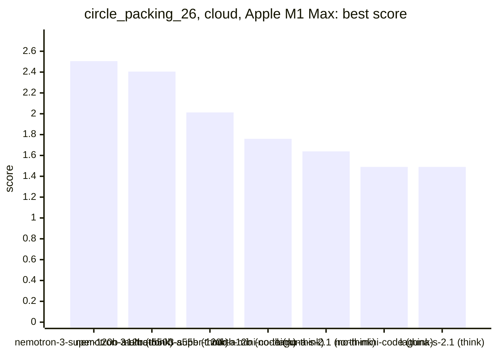

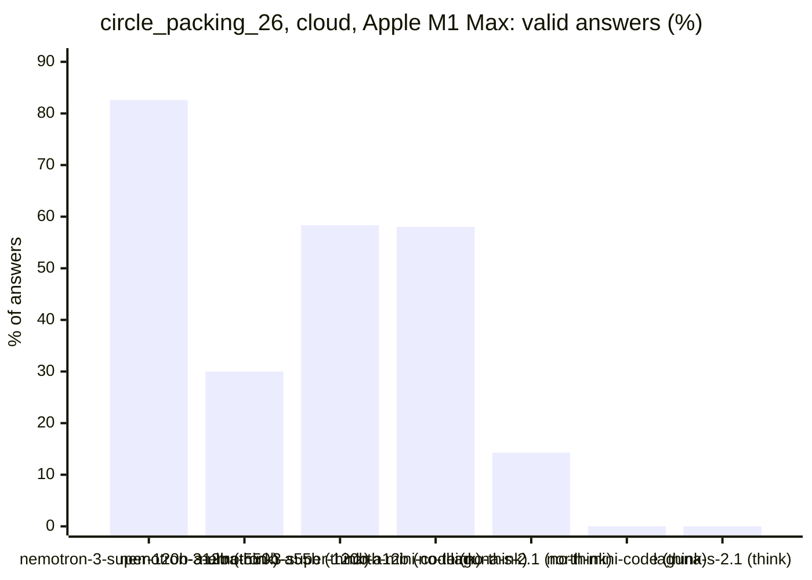

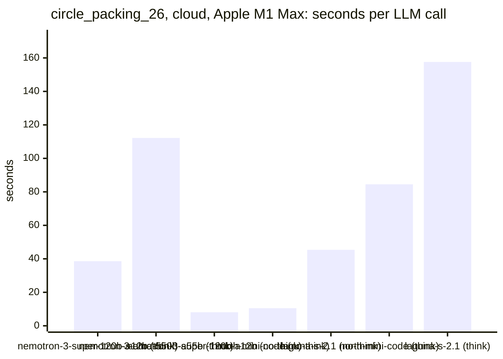

### Inference speed and cost

Generation speed is measured from the first to the last streamed token; the time to the first token is counted as prompt time. Cost is what OpenRouter charged for the run.

| Model | Gen tok/s | Median s/call | p90 s/call | Tokens/answer | Stopped | Cost $ |
|---|--:|--:|--:|--:|--:|--:|
| nvidia/nemotron-3-super-120b-a12b:free (no-think) | 132.7 | 7 | 15 | 895 | 6 | 0.000 |
| cohere/north-mini-code:free (no-think) | 115.8 | 8 | 21 | 1154 | 2 | 0.000 |
| nvidia/nemotron-3-super-120b-a12b:free (think) | 115.7 | 36 | 57 | 4438 | 1 | 0.000 |
| cohere/north-mini-code:free (think) | 109.0 | 79 | 110 | 7542 | 10 | 0.000 |
| nvidia/nemotron-3-ultra-550b-a55b:free (think) | 54.5 | 71 | 300 | 4908 | 1 | 0.000 |
| poolside/laguna-s-2.1:free (no-think) | 53.1 | 33 | 59 | 1125 | 3 | 0.000 |
| poolside/laguna-s-2.1:free (think) | 50.8 | 187 | 263 | 2915 | 3 | 0.000 |

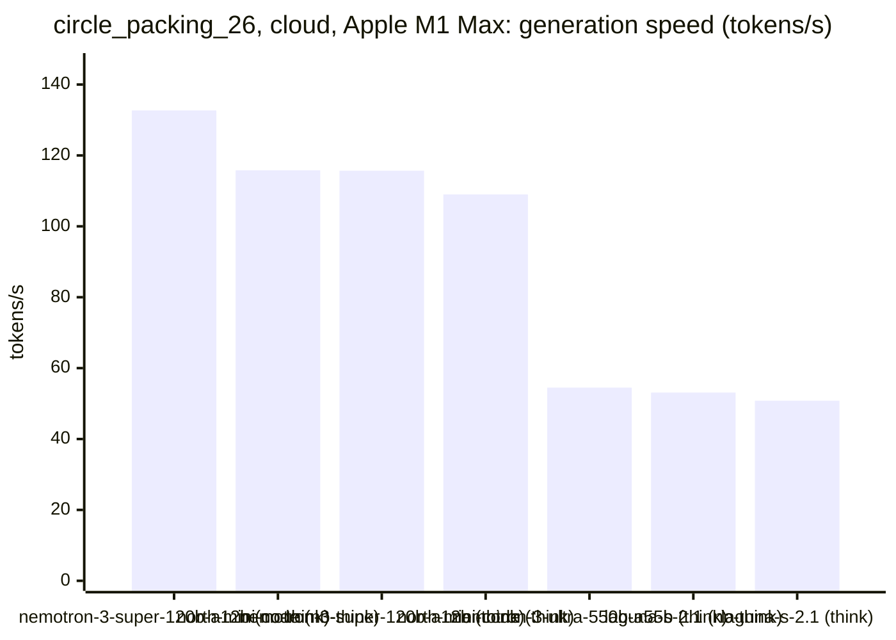

### Best score over time

| Model | 3.75 min | 7.5 min | 11.25 min | 15 min |
|---|--:|--:|--:|--:|
| nvidia/nemotron-3-super-120b-a12b:free (think) | 2.46819 | 2.46819 | 2.5045 | 2.5045 |
| nvidia/nemotron-3-ultra-550b-a55b:free (think) | 1.4901 | 1.4901 | 1.4901 | 2.40507 |
| nvidia/nemotron-3-super-120b-a12b:free (no-think) | 1.67937 | 1.69674 | 1.94393 | 2.01309 |
| cohere/north-mini-code:free (no-think) | 1.60406 | 1.60406 | 1.60406 | 1.75953 |
| poolside/laguna-s-2.1:free (no-think) | 1.4901 | 1.4901 | 1.4901 | 1.63899 |
| cohere/north-mini-code:free (think) | 1.4901 | 1.4901 | 1.4901 | 1.4901 |
| poolside/laguna-s-2.1:free (think) | 1.4901 | 1.4901 | 1.4901 | 1.4901 |

### Outcome of the LLM answers

| Model | duplicate | edit error | invalid | llm error | ok |
|---|--:|--:|--:|--:|--:|
| nvidia/nemotron-3-super-120b-a12b:free (think) | 0 | 1 | 2 | 1 | 19 |
| nvidia/nemotron-3-ultra-550b-a55b:free (think) | 0 | 1 | 5 | 1 | 3 |
| nvidia/nemotron-3-super-120b-a12b:free (no-think) | 16 | 5 | 18 | 6 | 63 |
| cohere/north-mini-code:free (no-think) | 11 | 5 | 16 | 2 | 47 |
| poolside/laguna-s-2.1:free (no-think) | 0 | 5 | 6 | 7 | 3 |
| cohere/north-mini-code:free (think) | 0 | 0 | 1 | 10 | 0 |
| poolside/laguna-s-2.1:free (think) | 0 | 1 | 1 | 4 | 0 |

### Best idea per model

- **nvidia/nemotron-3-super-120b-a12b:free (think)**: tuned INITIAL_STEP=0.07883, STEP_DECAY=0.9843, MIN_STEP=0.0001, INITIAL_OFFSET=0.09298 on top of: Expose the initial offset of the grid points as a tunable constant to allow the …
- **nvidia/nemotron-3-ultra-550b-a55b:free (think)**: tuned OPT_STEPS=4245, PERTURB=0.04072, HEX_OFFSET=0.666 on top of: Replace the simple grid initialization with a hexagonal grid and an exact maximal-radius solver, then add a …
- **nvidia/nemotron-3-super-120b-a12b:free (no-think)**: tuned cols=6, rows=5, scale_x=0.98, scale_y=1.02 on top of: Increase the number of local optimization steps from 0 to 200 to iteratively improve circle positions and sum of radii …
- **cohere/north-mini-code:free (no-think)**: tuned JITTER_MAG=0.012, R0_SCALE_FACTOR=1.05 on top of: Replace the third gradient‑based local optimization with a fast vectorized radius‑only shrink loop to reduce runtime and …
- **poolside/laguna-s-2.1:free (no-think)**: tuned HEX_RADIUS=0.1 on top of: Replace the naive grid layout with a fixed-radius hexagonal lattice packing optimized for 26 circles, which yields a much larger sum of radii by …
- **cohere/north-mini-code:free (think)**: initial program
- **poolside/laguna-s-2.1:free (think)**: initial program
