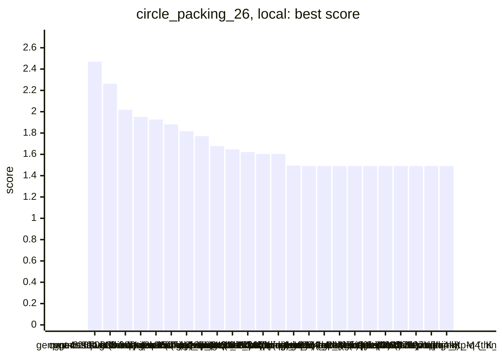
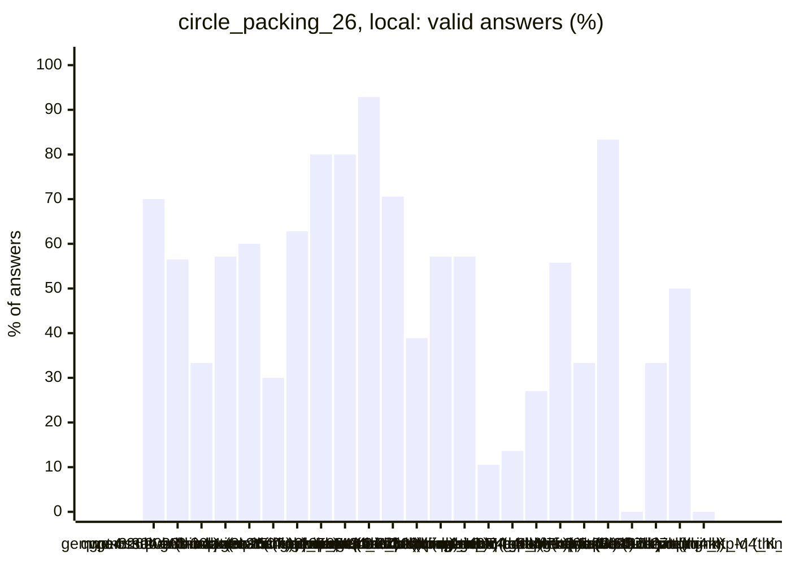
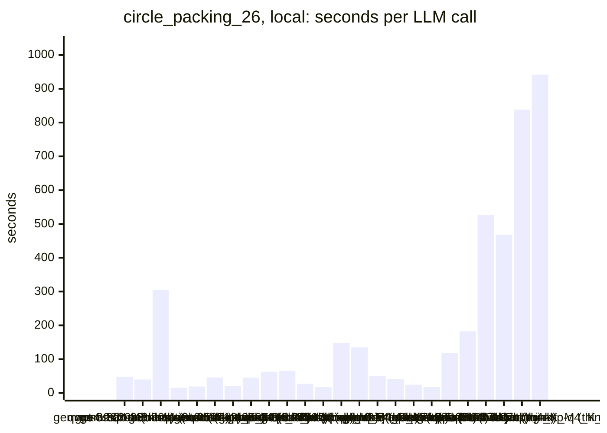
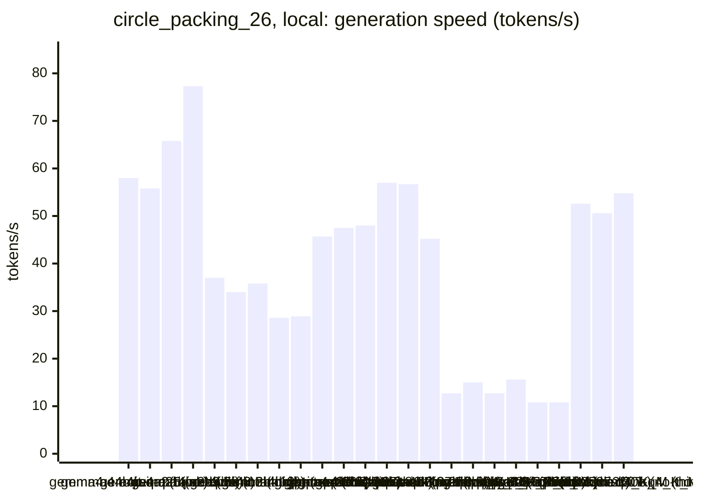
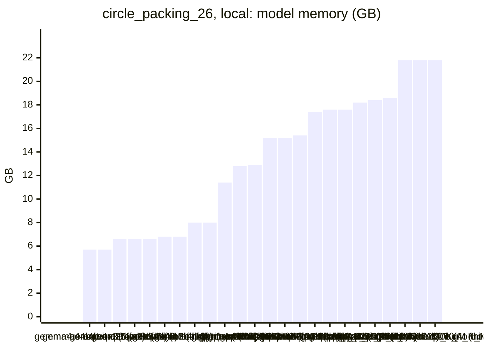
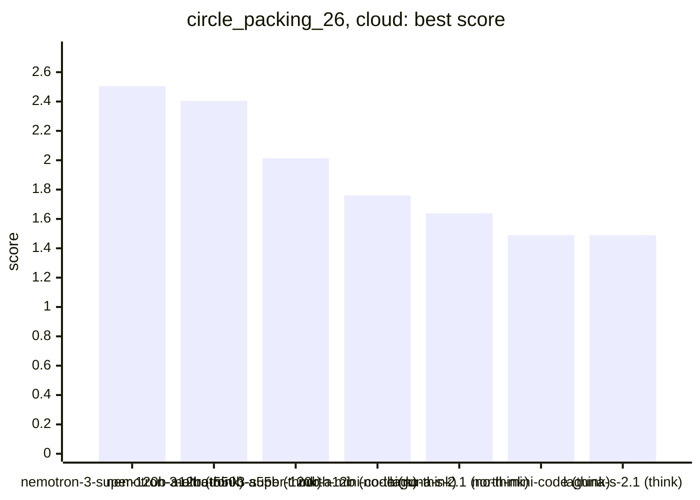
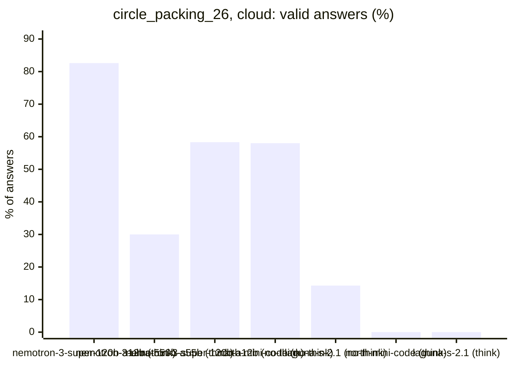
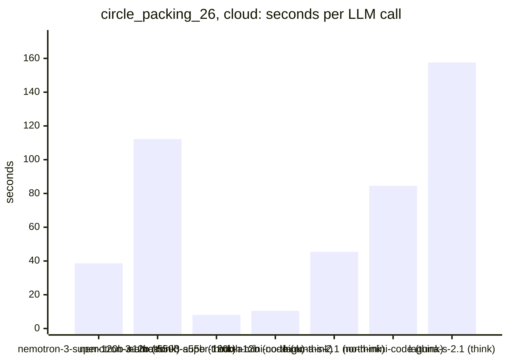
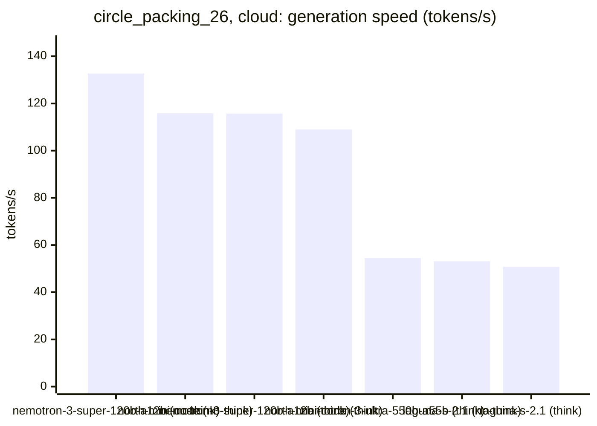

<!-- Copyright (c) 2026 by C. Klukas -->
<!-- SPDX-License-Identifier: GPL-3.0-only -->
<!-- Generated by `omega report` from bench/results/*.json. Do not edit by hand. -->

# circle_packing_26

32 models, 15 minutes each, latest run per model. The [overall ranking](../benchmarks.md#overall-ranking) compares the models over all examples.

Machine: Apple M1 Max (Mac13,1), 10 cores, 32 GB.

## Local models

Ollama on this machine.

| Model | Params | Initial | Best | Gain | LLM calls | s/call | Valid | New bests | Min to best |
|---|---|--:|--:|--:|--:|--:|--:|--:|--:|
| gpt-oss:20b (think) | 20.9B | 1.4901 | **2.46941** | ×1.66 | 20 | 48 | 70% | 6 | 10.1 |
| gemma4:26b-a4b-it-qat (no-think) | 25.2B | 1.4901 | **2.26342** | ×1.52 | 23 | 40 | 57% | 2 | 10.2 |
| gemma4:26b-a4b-it-qat (think) | 25.2B | 1.4901 | **2.01811** | ×1.35 | 3 | 304 | 33% | 1 | 15.2 |
| gemma4:latest (no-think) |  | 1.4901 | **1.95098** | ×1.31 | 56 | 16 | 57% | 3 | 14.3 |
| qwen3:30b-a3b-instruct-2507-q4_K_M (no-think) | 30.5B | 1.4901 | **1.92574** | ×1.29 | 45 | 19 | 60% | 2 | 9.2 |
| qwen3.5:latest (no-think) | 9.7B | 1.4901 | **1.88064** | ×1.26 | 20 | 46 | 30% | 1 | 6.2 |
| qwen3:30b-a3b-instruct-2507-q4_K_M (think) | 30.5B | 1.4901 | **1.81593** | ×1.22 | 43 | 20 | 63% | 15 | 14.3 |
| gemma4:12b-it-qat (no-think) | 11.9B | 1.4901 | **1.77142** | ×1.19 | 20 | 45 | 80% | 2 | 11.8 |
| gemma4:latest (think) |  | 1.4901 | **1.67672** | ×1.13 | 15 | 63 | 80% | 3 | 14.3 |
| gemma4:e4b-it-qat (think) | 7.5B | 1.4901 | **1.64644** | ×1.10 | 14 | 65 | 93% | 2 | 14.5 |
| qwen3-coder:30b (no-think) | 30.5B | 1.4901 | **1.62233** | ×1.09 | 34 | 27 | 71% | 2 | 15.4 |
| gemma4:e2b (no-think) | 5.1B | 1.4901 | **1.60406** | ×1.08 | 54 | 18 | 39% | 1 | 6.6 |
| qwen3.8:27b-mtp-q4_K_M (no-think) | 27.3B | 1.4901 | **1.60406** | ×1.08 | 7 | 148 | 57% | 1 | 8.0 |
| qwen3.6:27b-coding-mtp-q4_K_M (no-think) | 27.3B | 1.4901 | **1.49537** | ×1.00 | 7 | 135 | 57% | 1 | 8.6 |
| qwen3.5:latest (think) | 9.7B | 1.4901 | **1.4901** | ×1.00 | 19 | 49 | 11% | 0 | - |
| gemma4:e2b (think) | 5.1B | 1.4901 | **1.4901** | ×1.00 | 22 | 41 | 14% | 0 | - |
| qwen2.5-coder:7b (no-think) | 7.6B | 1.4901 | **1.4901** | ×1.00 | 37 | 24 | 27% | 0 | - |
| gemma4:e4b-it-qat (no-think) | 7.5B | 1.4901 | **1.4901** | ×1.00 | 52 | 17 | 56% | 0 | - |
| gpt-oss:20b (no-think) | 20.9B | 1.4901 | **1.4901** | ×1.00 | 9 | 118 | 33% | 0 | - |
| qwen3.5:27b (no-think) | 27.8B | 1.4901 | **1.4901** | ×1.00 | 6 | 182 | 83% | 0 | - |
| gemma4:12b-it-qat (think) | 11.9B | 1.4901 | **1.4901** | ×1.00 | 2 | 527 | 0% | 0 | - |
| qwen3.5:27b (think) | 27.8B | 1.4901 | **1.4901** | ×1.00 | 3 | 468 | 33% | 0 | - |
| qwen3.8:27b-mtp-q4_K_M (think) | 27.3B | 1.4901 | **1.4901** | ×1.00 | 2 | 838 | 50% | 0 | - |
| qwen3.6:27b-coding-mtp-q4_K_M (think) | 27.3B | 1.4901 | **1.4901** | ×1.00 | 1 | 942 | 0% | 0 | - |

### Inference speed and memory

RAM is what Ollama reports for the loaded model (weights, context cache and buffers; on Apple silicon this is shared memory). Load is the time to bring the model into memory. Prompt and generation speeds are tokens per second over all calls of the run.

| Model | Params | RAM GB | Load s | Prompt tok/s | Gen tok/s | Median s/call | p90 s/call | Tokens/answer | Stopped |
|---|---|--:|--:|--:|--:|--:|--:|--:|--:|
| gemma4:e4b-it-qat (think) | 7.5B | 5.7 | 85 | 674 | 58.0 | 56 | 109 | 3185 | 0 |
| gemma4:e4b-it-qat (no-think) | 7.5B | 5.7 | 85 | 578 | 55.8 | 16 | 26 | 559 | 0 |
| gemma4:e2b (no-think) | 5.1B | 6.6 | 35 | 891 | 65.8 | 12 | 42 | 853 | 1 |
| gemma4:e2b (think) | 5.1B | 6.6 | 34 | 1142 | 77.3 | 42 | 55 | 2652 | 4 |
| qwen2.5-coder:7b (no-think) | 7.6B | 6.6 | 54 | 465 | 37.0 | 24 | 31 | 637 | 0 |
| qwen3.5:latest (no-think) | 9.7B | 6.8 | 49 | 374 | 34.0 | 32 | 100 | 969 | 2 |
| qwen3.5:latest (think) | 9.7B | 6.8 | 47 | 423 | 35.8 | 49 | 74 | 1498 | 0 |
| gemma4:12b-it-qat (no-think) | 11.9B | 8.0 | 66 | 220 | 28.6 | 40 | 86 | 723 | 0 |
| gemma4:12b-it-qat (think) | 11.9B | 8.0 | 90 | 251 | 28.9 | 576 | 576 | 13740 | 0 |
| gemma4:latest (think) |  | 11.4 | 109 | 835 | 45.7 | 58 | 92 | 2363 | 0 |
| gpt-oss:20b (think) | 20.9B | 12.8 | 104 | 525 | 47.5 | 46 | 97 | 1742 | 0 |
| gpt-oss:20b (no-think) | 20.9B | 12.9 | 56 | 666 | 48.0 | 156 | 181 | 5260 | 0 |
| gemma4:26b-a4b-it-qat (no-think) | 25.2B | 15.2 | 223 | 528 | 57.0 | 29 | 49 | 1150 | 2 |
| gemma4:26b-a4b-it-qat (think) | 25.2B | 15.2 | 0 | 556 | 56.7 | 243 | 434 | 13573 | 2 |
| gemma4:latest (no-think) |  | 15.4 | 124 | 909 | 45.2 | 12 | 26 | 448 | 0 |
| qwen3.6:27b-coding-mtp-q4_K_M (think) | 27.3B | 17.4 | 209 | 95 | 12.7 | 942 | 942 | 9117 | 0 |
| qwen3.8:27b-mtp-q4_K_M (no-think) | 27.3B | 17.6 | 220 | 99 | 15.0 | 101 | 365 | 1374 | 0 |
| qwen3.8:27b-mtp-q4_K_M (think) | 27.3B | 17.6 | 202 | 129 | 12.7 | 878 | 878 | 9202 | 0 |
| qwen3.6:27b-coding-mtp-q4_K_M (no-think) | 27.3B | 18.2 | 196 | 100 | 15.6 | 98 | 327 | 1319 | 0 |
| qwen3.5:27b (think) | 27.8B | 18.4 | 85 | 120 | 10.8 | 367 | 898 | 4607 | 0 |
| qwen3.5:27b (no-think) | 27.8B | 18.6 | 130 | 90 | 10.8 | 152 | 286 | 1456 | 0 |
| qwen3:30b-a3b-instruct-2507-q4_K_M (no-think) | 30.5B | 21.8 | 149 | 651 | 52.6 | 13 | 29 | 528 | 0 |
| qwen3:30b-a3b-instruct-2507-q4_K_M (think) | 30.5B | 21.8 | 133 | 600 | 50.6 | 15 | 28 | 514 | 0 |
| qwen3-coder:30b (no-think) | 30.5B | 21.8 | 218 | 687 | 54.8 | 23 | 28 | 865 | 1 |

### Best score over time

| Model | 3.75 min | 7.5 min | 11.25 min | 15 min |
|---|--:|--:|--:|--:|
| gpt-oss:20b (think) | 1.4901 | 2.25061 | 2.46941 | 2.46941 |
| gemma4:26b-a4b-it-qat (no-think) | 1.4901 | 1.55726 | 2.26342 | 2.26342 |
| gemma4:26b-a4b-it-qat (think) | 1.4901 | 1.4901 | 1.4901 | 1.4901 |
| gemma4:latest (no-think) | 1.4901 | 1.4901 | 1.4901 | 1.95098 |
| qwen3:30b-a3b-instruct-2507-q4_K_M (no-think) | 1.4901 | 1.4901 | 1.92574 | 1.92574 |
| qwen3.5:latest (no-think) | 1.4901 | 1.88064 | 1.88064 | 1.88064 |
| qwen3:30b-a3b-instruct-2507-q4_K_M (think) | 1.49537 | 1.5268 | 1.64029 | 1.81593 |
| gemma4:12b-it-qat (no-think) | 1.74142 | 1.74142 | 1.74142 | 1.77142 |
| gemma4:latest (think) | 1.4901 | 1.4901 | 1.51909 | 1.67672 |
| gemma4:e4b-it-qat (think) | 1.4901 | 1.50363 | 1.50363 | 1.64644 |
| qwen3-coder:30b (no-think) | 1.4901 | 1.61875 | 1.61875 | 1.61875 |
| gemma4:e2b (no-think) | 1.4901 | 1.60406 | 1.60406 | 1.60406 |
| qwen3.8:27b-mtp-q4_K_M (no-think) | 1.4901 | 1.4901 | 1.60406 | 1.60406 |
| qwen3.6:27b-coding-mtp-q4_K_M (no-think) | 1.4901 | 1.4901 | 1.49537 | 1.49537 |
| qwen3.5:latest (think) | 1.4901 | 1.4901 | 1.4901 | 1.4901 |
| gemma4:e2b (think) | 1.4901 | 1.4901 | 1.4901 | 1.4901 |
| qwen2.5-coder:7b (no-think) | 1.4901 | 1.4901 | 1.4901 | 1.4901 |
| gemma4:e4b-it-qat (no-think) | 1.4901 | 1.4901 | 1.4901 | 1.4901 |
| gpt-oss:20b (no-think) | 1.4901 | 1.4901 | 1.4901 | 1.4901 |
| qwen3.5:27b (no-think) | 1.4901 | 1.4901 | 1.4901 | 1.4901 |
| gemma4:12b-it-qat (think) | 1.4901 | 1.4901 | 1.4901 | 1.4901 |
| qwen3.5:27b (think) | 1.4901 | 1.4901 | 1.4901 | 1.4901 |
| qwen3.8:27b-mtp-q4_K_M (think) | 1.4901 | 1.4901 | 1.4901 | 1.4901 |
| qwen3.6:27b-coding-mtp-q4_K_M (think) | 1.4901 | 1.4901 | 1.4901 | 1.4901 |

### Outcome of the LLM answers

| Model | duplicate | edit error | invalid | llm error | ok | timeout |
|---|--:|--:|--:|--:|--:|--:|
| gpt-oss:20b (think) | 1 | 3 | 2 | 0 | 14 | 0 |
| gemma4:26b-a4b-it-qat (no-think) | 1 | 3 | 4 | 2 | 13 | 0 |
| gemma4:26b-a4b-it-qat (think) | 0 | 0 | 0 | 2 | 1 | 0 |
| gemma4:latest (no-think) | 1 | 4 | 19 | 0 | 32 | 0 |
| qwen3:30b-a3b-instruct-2507-q4_K_M (no-think) | 0 | 5 | 12 | 0 | 27 | 1 |
| qwen3.5:latest (no-think) | 0 | 2 | 10 | 2 | 6 | 0 |
| qwen3:30b-a3b-instruct-2507-q4_K_M (think) | 0 | 10 | 6 | 0 | 27 | 0 |
| gemma4:12b-it-qat (no-think) | 0 | 3 | 1 | 0 | 16 | 0 |
| gemma4:latest (think) | 0 | 1 | 2 | 0 | 12 | 0 |
| gemma4:e4b-it-qat (think) | 0 | 0 | 1 | 0 | 13 | 0 |
| qwen3-coder:30b (no-think) | 3 | 0 | 6 | 1 | 24 | 0 |
| gemma4:e2b (no-think) | 0 | 7 | 25 | 1 | 21 | 0 |
| qwen3.8:27b-mtp-q4_K_M (no-think) | 0 | 0 | 3 | 0 | 4 | 0 |
| qwen3.6:27b-coding-mtp-q4_K_M (no-think) | 0 | 1 | 1 | 0 | 4 | 1 |
| qwen3.5:latest (think) | 0 | 1 | 15 | 0 | 2 | 1 |
| gemma4:e2b (think) | 0 | 4 | 11 | 4 | 3 | 0 |
| qwen2.5-coder:7b (no-think) | 9 | 1 | 17 | 0 | 10 | 0 |
| gemma4:e4b-it-qat (no-think) | 1 | 7 | 15 | 0 | 29 | 0 |
| gpt-oss:20b (no-think) | 0 | 4 | 2 | 0 | 3 | 0 |
| qwen3.5:27b (no-think) | 0 | 0 | 0 | 0 | 5 | 1 |
| gemma4:12b-it-qat (think) | 0 | 1 | 1 | 0 | 0 | 0 |
| qwen3.5:27b (think) | 0 | 1 | 1 | 0 | 1 | 0 |
| qwen3.8:27b-mtp-q4_K_M (think) | 0 | 0 | 1 | 0 | 1 | 0 |
| qwen3.6:27b-coding-mtp-q4_K_M (think) | 0 | 0 | 1 | 0 | 0 | 0 |

### Best idea per model

- **gpt-oss:20b (think)**: tuned INIT_TEMP=0.1, STEP=0.05, COOL_RATE=0.998, TOTAL_ITERS=4000 on top of: In each annealing iteration, perturb all circles in random order instead of just one, allowing broader …
- **gemma4:26b-a4b-it-qat (no-think)**: tuned ITERATIONS=20, REPULSION_STRENGTH=0.01, REPULSION_DIST=0.3, WALL_DIST=0.1 on top of: Introduce named constants for optimization parameters and provide a sweep to find the …
- **gemma4:26b-a4b-it-qat (think)**: Use a hill-climbing optimization with multiple initializations (grid, random, and jittered grid) to find better circle centers and maximize the sum of radii.
- **gemma4:latest (no-think)**: tuned ITERATIONS=150, LEARNING_RATE=0.01 on top of: Expose the iteration count and the learning rate in `max_radii` as named constants to allow for systematic searching for better …
- **qwen3:30b-a3b-instruct-2507-q4_K_M (no-think)**: tuned h_spacing=0.1084, v_spacing=0.1594 on top of: Replace the fixed hexagonal lattice with a dynamic circle packing algorithm using Lloyd's relaxation to iteratively adjust …
- **qwen3.5:latest (no-think)**: Replace the O(N²) pairwise overlap resolution with a single-pass linear sweep using sorted distances to shrink radii efficiently while respecting all constraints simultaneously.
- **qwen3:30b-a3b-instruct-2507-q4_K_M (think)**: tuned spacing_factor=1.035, offset_factor=0.1434 on top of: Replace the fixed hexagonal lattice with an adaptive Voronoi-based radius assignment followed by iterative center …
- **gemma4:12b-it-qat (no-think)**: tuned SAMPLES=10 on top of: Increase sampling density and use a more refined local search (hill climbing) to improve circle positions and maximize the radii sum.
- **gemma4:latest (think)**: Introduce a simple hill-climbing optimization loop into construct_packing by randomly perturbing the centers and accepting moves that increase the total sum of radii, thus …
- **gemma4:e4b-it-qat (think)**: tuned C_PACK=5, R_PACK=6 on top of: Parameterize the grid dimensions by sweeping the number of columns ($C_{PACK}$) and rows ($R_{PACK}$) in the hexagonal lattice structure, as …
- **qwen3-coder:30b (no-think)**: tuned HEX_PACKING_RATIO=1.1, HEX_OFFSET_FACTOR=0.75 on top of: Replace fixed hexagonal parameters with sweepable constants to allow optimization of packing density and spacing for …
- **gemma4:e2b (no-think)**: Modify the center placement to use a uniform square grid instead of the hexagonal approximation to test a simpler, highly structured packing that might be easier to optimize …
- **qwen3.8:27b-mtp-q4_K_M (no-think)**: edit: N_COLS = 5 / N_ROWS = 6
- **qwen3.6:27b-coding-mtp-q4_K_M (no-think)**: Replace the naive grid packing with a hexagonal lattice initialization and a local optimization loop that iteratively adjusts centers and radii to maximize the sum of radii while …
- **qwen3.5:latest (think)**: initial program
- **gemma4:e2b (think)**: initial program
- **qwen2.5-coder:7b (no-think)**: initial program
- **gemma4:e4b-it-qat (no-think)**: initial program
- **gpt-oss:20b (no-think)**: initial program
- **qwen3.5:27b (no-think)**: initial program
- **gemma4:12b-it-qat (think)**: initial program
- **qwen3.5:27b (think)**: initial program
- **qwen3.8:27b-mtp-q4_K_M (think)**: initial program
- **qwen3.6:27b-coding-mtp-q4_K_M (think)**: initial program

## Cloud models (OpenRouter)

Free OpenRouter models; times include the network and the provider's queue.

| Model | Params | Initial | Best | Gain | LLM calls | s/call | Valid | New bests | Min to best |
|---|---|--:|--:|--:|--:|--:|--:|--:|--:|
| nvidia/nemotron-3-super-120b-a12b:free (think) |  | 1.4901 | **2.5045** | ×1.68 | 23 | 39 | 83% | 4 | 10.7 |
| nvidia/nemotron-3-ultra-550b-a55b:free (think) |  | 1.4901 | **2.40507** | ×1.61 | 10 | 112 | 30% | 2 | 13.0 |
| nvidia/nemotron-3-super-120b-a12b:free (no-think) |  | 1.4901 | **2.01309** | ×1.35 | 108 | 8 | 58% | 13 | 15.0 |
| cohere/north-mini-code:free (no-think) |  | 1.4901 | **1.75953** | ×1.18 | 81 | 10 | 58% | 7 | 14.6 |
| poolside/laguna-s-2.1:free (no-think) |  | 1.4901 | **1.63899** | ×1.10 | 21 | 45 | 14% | 1 | 12.3 |
| nvidia/nemotron-3-ultra-550b-a55b:free (no-think) |  | | | | | | | | failed: all 3 model requests failed: nvidia/nemotron-3-ultra-550b-a5 |
| cohere/north-mini-code:free (think) |  | 1.4901 | **1.4901** | ×1.00 | 11 | 84 | 0% | 0 | - |
| poolside/laguna-s-2.1:free (think) |  | 1.4901 | **1.4901** | ×1.00 | 6 | 158 | 0% | 0 | - |

### Inference speed and cost

Generation speed is measured from the first to the last streamed token; the time to the first token is counted as prompt time. Cost is what OpenRouter charged for the run.

| Model | Gen tok/s | Median s/call | p90 s/call | Tokens/answer | Stopped | Cost $ |
|---|--:|--:|--:|--:|--:|--:|
| nvidia/nemotron-3-super-120b-a12b:free (no-think) | 132.7 | 7 | 15 | 895 | 6 | 0.000 |
| cohere/north-mini-code:free (no-think) | 115.8 | 8 | 21 | 1154 | 2 | 0.000 |
| nvidia/nemotron-3-super-120b-a12b:free (think) | 115.7 | 36 | 57 | 4438 | 1 | 0.000 |
| cohere/north-mini-code:free (think) | 109.0 | 79 | 110 | 7542 | 10 | 0.000 |
| nvidia/nemotron-3-ultra-550b-a55b:free (think) | 54.5 | 71 | 300 | 4908 | 1 | 0.000 |
| poolside/laguna-s-2.1:free (no-think) | 53.1 | 33 | 59 | 1125 | 3 | 0.000 |
| poolside/laguna-s-2.1:free (think) | 50.8 | 187 | 263 | 2915 | 3 | 0.000 |

### Best score over time

| Model | 3.75 min | 7.5 min | 11.25 min | 15 min |
|---|--:|--:|--:|--:|
| nvidia/nemotron-3-super-120b-a12b:free (think) | 2.46819 | 2.46819 | 2.5045 | 2.5045 |
| nvidia/nemotron-3-ultra-550b-a55b:free (think) | 1.4901 | 1.4901 | 1.4901 | 2.40507 |
| nvidia/nemotron-3-super-120b-a12b:free (no-think) | 1.67937 | 1.69674 | 1.94393 | 2.01309 |
| cohere/north-mini-code:free (no-think) | 1.60406 | 1.60406 | 1.60406 | 1.75953 |
| poolside/laguna-s-2.1:free (no-think) | 1.4901 | 1.4901 | 1.4901 | 1.63899 |
| cohere/north-mini-code:free (think) | 1.4901 | 1.4901 | 1.4901 | 1.4901 |
| poolside/laguna-s-2.1:free (think) | 1.4901 | 1.4901 | 1.4901 | 1.4901 |

### Outcome of the LLM answers

| Model | duplicate | edit error | invalid | llm error | ok |
|---|--:|--:|--:|--:|--:|
| nvidia/nemotron-3-super-120b-a12b:free (think) | 0 | 1 | 2 | 1 | 19 |
| nvidia/nemotron-3-ultra-550b-a55b:free (think) | 0 | 1 | 5 | 1 | 3 |
| nvidia/nemotron-3-super-120b-a12b:free (no-think) | 16 | 5 | 18 | 6 | 63 |
| cohere/north-mini-code:free (no-think) | 11 | 5 | 16 | 2 | 47 |
| poolside/laguna-s-2.1:free (no-think) | 0 | 5 | 6 | 7 | 3 |
| cohere/north-mini-code:free (think) | 0 | 0 | 1 | 10 | 0 |
| poolside/laguna-s-2.1:free (think) | 0 | 1 | 1 | 4 | 0 |

### Best idea per model

- **nvidia/nemotron-3-super-120b-a12b:free (think)**: tuned INITIAL_STEP=0.07883, STEP_DECAY=0.9843, MIN_STEP=0.0001, INITIAL_OFFSET=0.09298 on top of: Expose the initial offset of the grid points as a tunable constant to allow the …
- **nvidia/nemotron-3-ultra-550b-a55b:free (think)**: tuned OPT_STEPS=4245, PERTURB=0.04072, HEX_OFFSET=0.666 on top of: Replace the simple grid initialization with a hexagonal grid and an exact maximal-radius solver, then add a …
- **nvidia/nemotron-3-super-120b-a12b:free (no-think)**: tuned cols=6, rows=5, scale_x=0.98, scale_y=1.02 on top of: Increase the number of local optimization steps from 0 to 200 to iteratively improve circle positions and sum of radii …
- **cohere/north-mini-code:free (no-think)**: tuned JITTER_MAG=0.012, R0_SCALE_FACTOR=1.05 on top of: Replace the third gradient‑based local optimization with a fast vectorized radius‑only shrink loop to reduce runtime and …
- **poolside/laguna-s-2.1:free (no-think)**: tuned HEX_RADIUS=0.1 on top of: Replace the naive grid layout with a fixed-radius hexagonal lattice packing optimized for 26 circles, which yields a much larger sum of radii by …
- **cohere/north-mini-code:free (think)**: initial program
- **poolside/laguna-s-2.1:free (think)**: initial program
