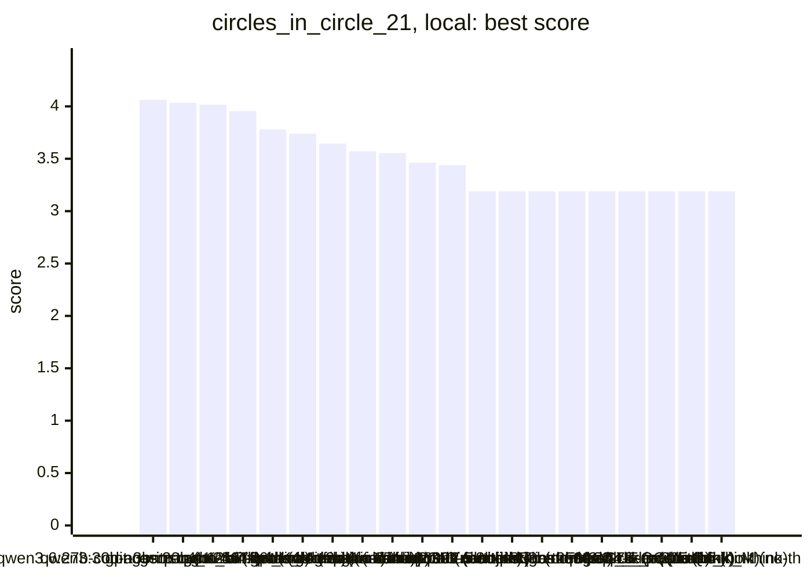
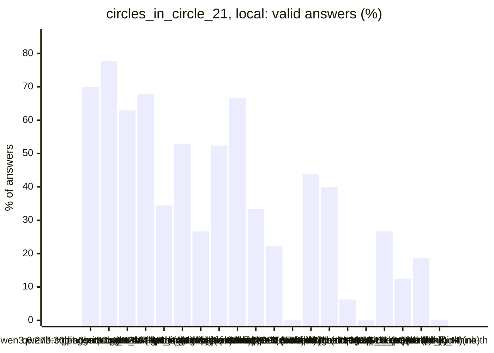
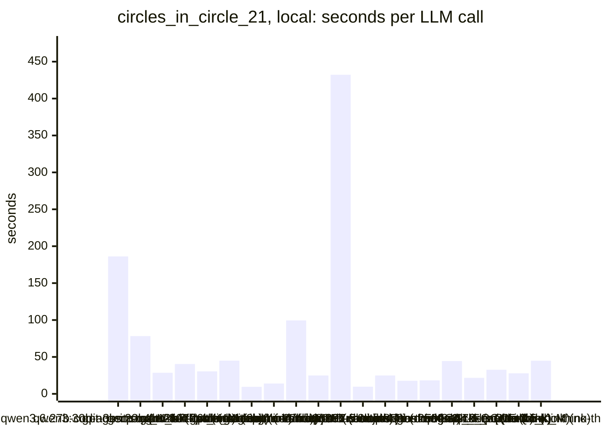
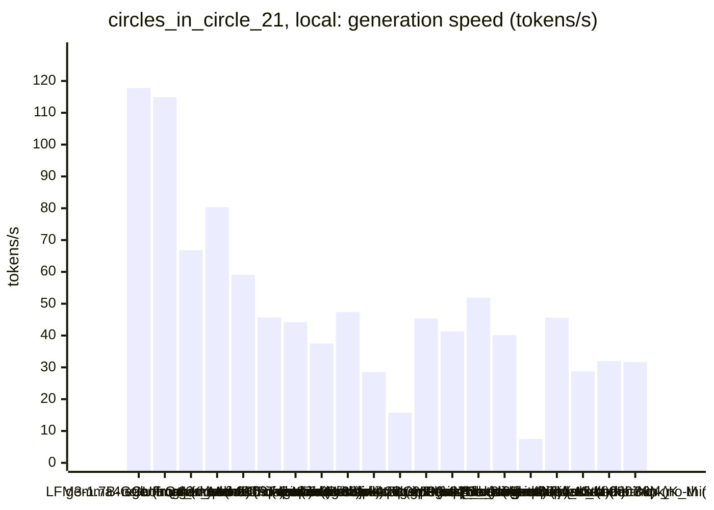
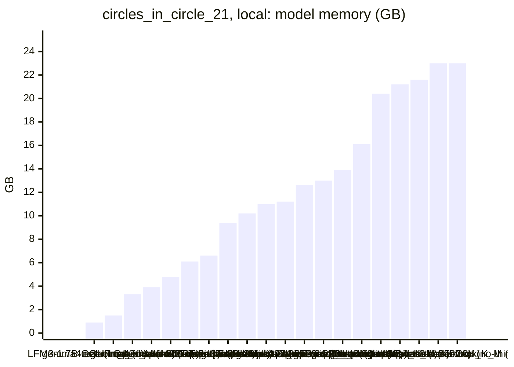
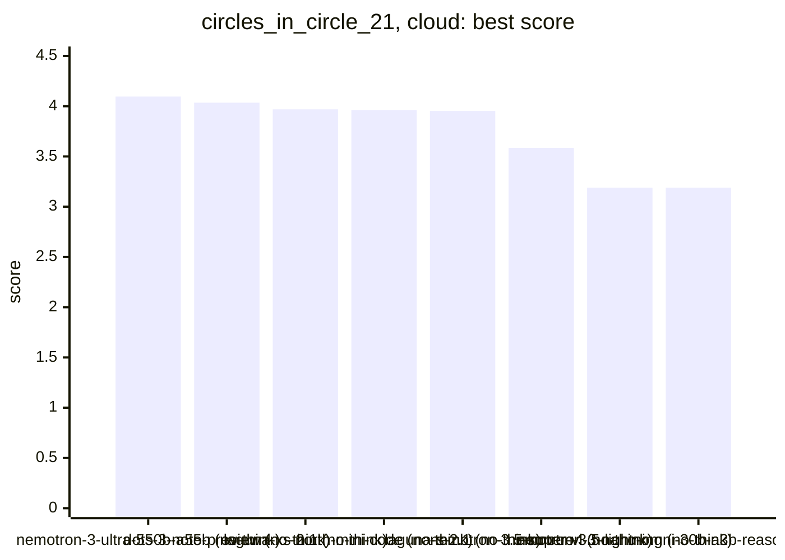
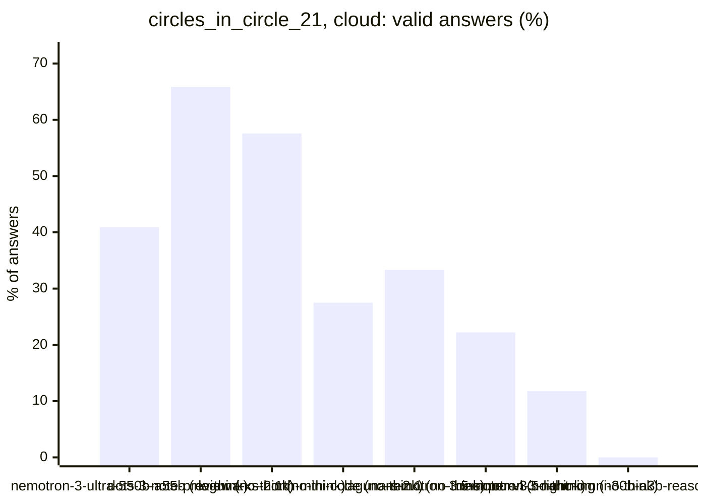
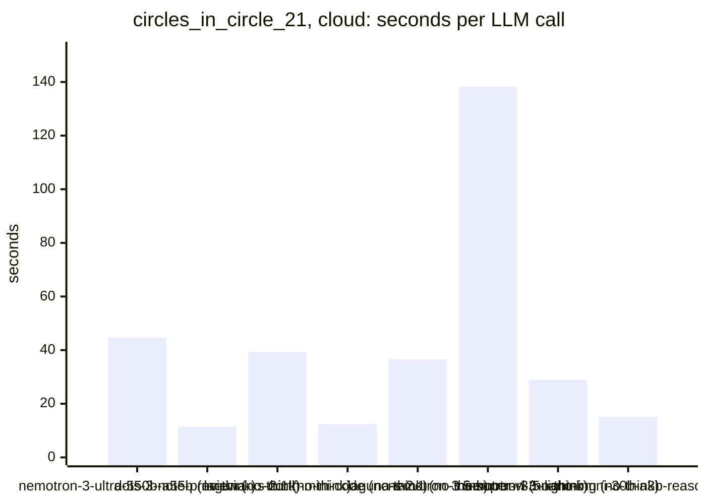
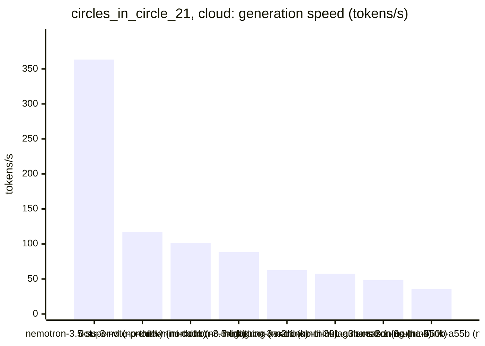

<!-- Copyright (c) 2026 by C. Klukas -->
<!-- SPDX-License-Identifier: GPL-3.0-only -->
<!-- Generated by `omega report` from bench/results/*.json. Do not edit by hand. -->

# circles_in_circle_21

31 models, each run at most 60 minutes, ended earlier after 15 answers in a row without progress; one run per model. The [overall ranking](../benchmarks.md#overall-ranking) compares the models over all examples.

Machine: Intel(R) Core(TM) i7-8700K CPU @ 3.70GHz (MS-7A98), 12 cores, 64 GB, 2x NVIDIA GeForce GTX 1080 Ti, 11264 MiB.

## Local models

Ollama on this machine.

| Model | Params | Initial | Best | Gain | LLM calls | s/call | Valid | New bests | Min to best | Minutes | Stopped by |
|---|---|--:|--:|--:|--:|--:|--:|--:|--:|--:|---|
| qwen3.6:27b-coding-mtp-q4_K_M (no-think) | 27.3B | 3.18905 | **4.06244** | ×1.27 | 20 | 186 | 70% | 3 | 55.5 | 65.5 | no progress |
| gpt-oss:20b (no-think) | 20.9B | 3.18905 | **4.03445** | ×1.27 | 27 | 78 | 78% | 6 | 22.1 | 36.1 | no progress |
| qwen3:30b-a3b-instruct-2507-q4_K_M (no-think) | 30.5B | 3.18905 | **4.01734** | ×1.26 | 27 | 29 | 63% | 6 | 6.6 | 13.7 | no progress |
| gemma4:12b-it-qat (no-think) | 11.9B | 3.18905 | **3.95426** | ×1.24 | 28 | 40 | 68% | 2 | 9.4 | 19.6 | no progress |
| glm-4.7-flash:latest (no-think) | 29.9B | 3.18905 | **3.78** | ×1.19 | 29 | 30 | 34% | 3 | 8.6 | 15.4 | no progress |
| gemma4:26b-a4b-it-qat (no-think) | 25.2B | 3.18905 | **3.73964** | ×1.17 | 17 | 45 | 53% | 1 | 2.6 | 13.0 | no progress |
| gemma4:e2b (no-think) | 4.6B | 3.18905 | **3.64462** | ×1.14 | 30 | 10 | 27% | 1 | 2.7 | 5.2 | no progress |
| gemma4:latest (no-think) | 7.5B | 3.18905 | **3.57134** | ×1.12 | 21 | 14 | 52% | 1 | 1.7 | 5.3 | no progress |
| underdog-saluki-27b:iq2-mix (no-think) | 26.9B | 3.18905 | **3.55408** | ×1.11 | 36 | 100 | 67% | 9 | 53.7 | 62.0 | time limit |
| richardyoung/frognano-4b-2609:latest (no-think) | 4.3B | 3.18905 | **3.46239** | ×1.09 | 30 | 25 | 33% | 2 | 5.4 | 12.9 | no progress |
| frob/sarvam:30b (no-think) | 32.2B | 3.18905 | **3.43893** | ×1.08 | 9 | 432 | 22% | 1 | 16.9 | 65.1 | time limit |
| nemotron-3-nano:4b (no-think) | 4.0B | 3.18905 | **3.18905** | ×1.00 | 16 | 10 | 0% | 0 | - | 2.8 | no progress |
| qwen2.5-coder:7b (no-think) | 7.6B | 3.18905 | **3.18905** | ×1.00 | 16 | 25 | 44% | 0 | - | 6.9 | no progress |
| yandex/YandexGPT-5-Lite-8B-instruct-GGUF:latest (no-think) | 8.0B | 3.18905 | **3.18905** | ×1.00 | 15 | 18 | 40% | 0 | - | 4.7 | no progress |
| MichelRosselli/apertus:8b-instruct-2509-q4_k_m (no-think) | 8.1B | 3.18905 | **3.18905** | ×1.00 | 16 | 18 | 6% | 0 | - | 5.2 | no progress |
| llm-jp-4-8b-omega:q4_k_m (no-think) | 8.6B | 3.18905 | **3.18905** | ×1.00 | 16 | 44 | 0% | 0 | - | 12.2 | no progress |
| gemma4:e4b-it-qat (no-think) | 7.5B | 3.18905 | **3.18905** | ×1.00 | 15 | 22 | 27% | 0 | - | 5.7 | no progress |
| qwen3-coder:30b (no-think) | 30.5B | 3.18905 | **3.18905** | ×1.00 | 16 | 33 | 12% | 0 | - | 9.0 | no progress |
| hf.co/LiquidAI/LFM3-1.7B-GGUF:Q4_K_M (no-think) | 1.73B | 3.18905 | **3.18905** | ×1.00 | 16 | 28 | 19% | 0 | - | 7.7 | no progress |
| qwen3.5:latest (no-think) | 9.0B | 3.18905 | **3.18905** | ×1.00 | 16 | 45 | 0% | 0 | - | 12.2 | no progress |

### Inference speed and memory

RAM is what Ollama reports for the loaded model (weights, context cache and buffers; on Apple silicon this is shared memory). Load is the time to bring the model into memory. Prompt and generation speeds are tokens per second over all calls of the run.

| Model | Params | RAM GB | Load s | Prompt tok/s | Gen tok/s | Median s/call | p90 s/call | Tokens/answer | Stopped |
|---|---|--:|--:|--:|--:|--:|--:|--:|--:|
| gemma4:e2b (no-think) | 4.6B | 0.9 | 16 | 2141 | 117.8 | 8 | 18 | 638 | 0 |
| hf.co/LiquidAI/LFM3-1.7B-GGUF:Q4_K_M (no-think) | 1.73B | 1.5 | 0 | 4314 | 114.9 | 18 | 66 | 909 | 9 |
| gemma4:latest (no-think) | 7.5B | 3.3 | 23 | 1312 | 66.8 | 13 | 17 | 573 | 0 |
| nemotron-3-nano:4b (no-think) | 4.0B | 3.9 | 9 | 1688 | 80.3 | 10 | 15 | 463 | 0 |
| richardyoung/frognano-4b-2609:latest (no-think) | 4.3B | 4.8 | 12 | 1574 | 59.1 | 22 | 47 | 1060 | 3 |
| gemma4:e4b-it-qat (no-think) | 7.5B | 6.1 | 20 | 1464 | 45.7 | 21 | 32 | 769 | 0 |
| qwen2.5-coder:7b (no-think) | 7.6B | 6.6 | 14 | 1460 | 44.2 | 24 | 31 | 888 | 0 |
| qwen3.5:latest (no-think) | 9.0B | 9.4 | 20 | 901 | 37.5 | 42 | 85 | 1464 | 0 |
| yandex/YandexGPT-5-Lite-8B-instruct-GGUF:latest (no-think) | 8.0B | 10.2 | 14 | 1525 | 47.4 | 17 | 24 | 631 | 0 |
| gemma4:12b-it-qat (no-think) | 11.9B | 11.0 | 0 | 584 | 28.5 | 38 | 53 | 820 | 1 |
| underdog-saluki-27b:iq2-mix (no-think) | 26.9B | 11.2 | 23 | 413 | 15.8 | 97 | 154 | 1318 | 1 |
| MichelRosselli/apertus:8b-instruct-2509-q4_k_m (no-think) | 8.1B | 12.6 | 15 | 1509 | 45.4 | 16 | 25 | 635 | 0 |
| llm-jp-4-8b-omega:q4_k_m (no-think) | 8.6B | 13.0 | 16 | 1402 | 41.3 | 43 | 68 | 1647 | 1 |
| gpt-oss:20b (no-think) | 20.9B | 13.9 | 37 | 1749 | 51.9 | 53 | 173 | 3755 | 1 |
| gemma4:26b-a4b-it-qat (no-think) | 25.2B | 16.1 | 51 | 814 | 40.1 | 42 | 55 | 1400 | 0 |
| qwen3.6:27b-coding-mtp-q4_K_M (no-think) | 27.3B | 20.4 | 52 | 190 | 7.5 | 167 | 378 | 1226 | 0 |
| frob/sarvam:30b (no-think) | 32.2B | 21.2 | 58 | 1295 | 45.6 | 490 | 558 | 19255 | 0 |
| glm-4.7-flash:latest (no-think) | 29.9B | 21.6 | 56 | 421 | 28.7 | 26 | 55 | 556 | 0 |
| qwen3:30b-a3b-instruct-2507-q4_K_M (no-think) | 30.5B | 23.0 | 53 | 638 | 32.0 | 24 | 67 | 573 | 0 |
| qwen3-coder:30b (no-think) | 30.5B | 23.0 | 52 | 729 | 31.7 | 37 | 48 | 809 | 1 |

### Best score over time

| Model | 15 min | 30 min | 45 min | 60 min |
|---|--:|--:|--:|--:|
| qwen3.6:27b-coding-mtp-q4_K_M (no-think) | 3.85745 | 4.04069 | 4.04069 | 4.06244 |
| gpt-oss:20b (no-think) | 4.01048 | 4.03445 | 4.03445 | 4.03445 |
| qwen3:30b-a3b-instruct-2507-q4_K_M (no-think) | 4.01734 | 4.01734 | 4.01734 | 4.01734 |
| gemma4:12b-it-qat (no-think) | 3.95426 | 3.95426 | 3.95426 | 3.95426 |
| glm-4.7-flash:latest (no-think) | 3.78 | 3.78 | 3.78 | 3.78 |
| gemma4:26b-a4b-it-qat (no-think) | 3.73964 | 3.73964 | 3.73964 | 3.73964 |
| gemma4:e2b (no-think) | 3.64462 | 3.64462 | 3.64462 | 3.64462 |
| gemma4:latest (no-think) | 3.57134 | 3.57134 | 3.57134 | 3.57134 |
| underdog-saluki-27b:iq2-mix (no-think) | 3.47455 | 3.51852 | 3.54853 | 3.55408 |
| richardyoung/frognano-4b-2609:latest (no-think) | 3.46239 | 3.46239 | 3.46239 | 3.46239 |
| frob/sarvam:30b (no-think) | 3.18905 | 3.43893 | 3.43893 | 3.43893 |
| nemotron-3-nano:4b (no-think) | 3.18905 | 3.18905 | 3.18905 | 3.18905 |
| qwen2.5-coder:7b (no-think) | 3.18905 | 3.18905 | 3.18905 | 3.18905 |
| yandex/YandexGPT-5-Lite-8B-instruct-GGUF:latest (no-think) | 3.18905 | 3.18905 | 3.18905 | 3.18905 |
| MichelRosselli/apertus:8b-instruct-2509-q4_k_m (no-think) | 3.18905 | 3.18905 | 3.18905 | 3.18905 |
| llm-jp-4-8b-omega:q4_k_m (no-think) | 3.18905 | 3.18905 | 3.18905 | 3.18905 |
| gemma4:e4b-it-qat (no-think) | 3.18905 | 3.18905 | 3.18905 | 3.18905 |
| qwen3-coder:30b (no-think) | 3.18905 | 3.18905 | 3.18905 | 3.18905 |
| hf.co/LiquidAI/LFM3-1.7B-GGUF:Q4_K_M (no-think) | 3.18905 | 3.18905 | 3.18905 | 3.18905 |
| qwen3.5:latest (no-think) | 3.18905 | 3.18905 | 3.18905 | 3.18905 |

### Outcome of the LLM answers

| Model | duplicate | edit error | invalid | llm error | ok | timeout |
|---|--:|--:|--:|--:|--:|--:|
| qwen3.6:27b-coding-mtp-q4_K_M (no-think) | 1 | 2 | 2 | 0 | 14 | 1 |
| gpt-oss:20b (no-think) | 3 | 2 | 0 | 1 | 21 | 0 |
| qwen3:30b-a3b-instruct-2507-q4_K_M (no-think) | 2 | 0 | 8 | 0 | 17 | 0 |
| gemma4:12b-it-qat (no-think) | 1 | 2 | 5 | 1 | 19 | 0 |
| glm-4.7-flash:latest (no-think) | 2 | 2 | 15 | 0 | 10 | 0 |
| gemma4:26b-a4b-it-qat (no-think) | 1 | 6 | 1 | 0 | 9 | 0 |
| gemma4:e2b (no-think) | 0 | 10 | 12 | 0 | 8 | 0 |
| gemma4:latest (no-think) | 2 | 0 | 8 | 0 | 11 | 0 |
| underdog-saluki-27b:iq2-mix (no-think) | 0 | 6 | 4 | 1 | 24 | 1 |
| richardyoung/frognano-4b-2609:latest (no-think) | 3 | 3 | 11 | 3 | 10 | 0 |
| frob/sarvam:30b (no-think) | 0 | 5 | 2 | 0 | 2 | 0 |
| nemotron-3-nano:4b (no-think) | 0 | 13 | 3 | 0 | 0 | 0 |
| qwen2.5-coder:7b (no-think) | 5 | 0 | 4 | 0 | 7 | 0 |
| yandex/YandexGPT-5-Lite-8B-instruct-GGUF:latest (no-think) | 0 | 0 | 9 | 0 | 6 | 0 |
| MichelRosselli/apertus:8b-instruct-2509-q4_k_m (no-think) | 1 | 5 | 9 | 0 | 1 | 0 |
| llm-jp-4-8b-omega:q4_k_m (no-think) | 0 | 0 | 15 | 1 | 0 | 0 |
| gemma4:e4b-it-qat (no-think) | 0 | 2 | 9 | 0 | 4 | 0 |
| qwen3-coder:30b (no-think) | 0 | 4 | 9 | 1 | 2 | 0 |
| hf.co/LiquidAI/LFM3-1.7B-GGUF:Q4_K_M (no-think) | 0 | 2 | 2 | 9 | 3 | 0 |
| qwen3.5:latest (no-think) | 0 | 4 | 12 | 0 | 0 | 0 |

### Best idea per model

- **qwen3.6:27b-coding-mtp-q4_K_M (no-think)**: tuned NUM_RESTARTS=30, MAX_ITER=2000, INIT_TEMP=0.08 on top of: The current optimization uses a single restart with a fixed cooling schedule, which often gets stuck in local …
- **gpt-oss:20b (no-think)**: tuned HILL_ITER=30, HILL_TRIALS=15, STEP_SIZE=0.02 on top of: Increase the depth and breadth of hill‑climbing and use a larger step size to explore more center perturbations …
- **qwen3:30b-a3b-instruct-2507-q4_K_M (no-think)**: tuned inner_ring_radius=0.4352, outer_ring_radius=0.8068 on top of: Increase the outer ring radius slightly to better utilize space near the container wall, while maintaining …
- **gemma4:12b-it-qat (no-think)**: tuned r1=0.45, r2=0.8 on top of: Replace the rigid concentric ring layout with a flexible radius assignment that optimizes each circle's radius individually based on the fixed …
- **glm-4.7-flash:latest (no-think)**: tuned RING_RADIUS_1=0.42, RING_RADIUS_2=0.78 on top of: Replace the fixed 7/13 ring division with a dynamic 6/13+1 layout to better accommodate the container boundary, which …
- **gemma4:26b-a4b-it-qat (no-think)**: Implement a stochastic optimization (Simulated Annealing) that optimizes circle centers to maximize the sum of radii, where radii are derived by maximizing individual radii …
- **gemma4:e2b (no-think)**: tuned RING1_R_FACTOR=0.4, RING2_R_FACTOR=0.75 on top of: Introduce a sweep over the radius distribution parameters to explore better geometric configurations for the 21 circles.
- **gemma4:latest (no-think)**: Change the initial placement strategy from equal radii to allow for different radii based on the circle's distance from the origin to better utilize space.
- **underdog-saluki-27b:iq2-mix (no-think)**: tuned STARTS=6, REFINE_ITERS=100, REFINE_STEP=0.001, SA_STEPS=6000 on top of: Replace the slow, ineffective local-optimum repair with the proven fast coordinate-descent refinement …
- **richardyoung/frognano-4b-2609:latest (no-think)**: tuned INNER_RING_R=0.38, OUTER_RING_R=0.71 on top of: Increase the initial radius estimate for the inner ring from 0.35 to 0.37 and the outer ring from 0.75 to 0.72 based on known …
- **frob/sarvam:30b (no-think)**: Replace the equal-radius ring packing with a mixed-size packing where the central circle is larger and the inner ring circles are tangent to each other and to the central circle …
- **nemotron-3-nano:4b (no-think)**: initial program
- **qwen2.5-coder:7b (no-think)**: initial program
- **yandex/YandexGPT-5-Lite-8B-instruct-GGUF:latest (no-think)**: initial program
- **MichelRosselli/apertus:8b-instruct-2509-q4_k_m (no-think)**: initial program
- **llm-jp-4-8b-omega:q4_k_m (no-think)**: initial program
- **gemma4:e4b-it-qat (no-think)**: initial program
- **qwen3-coder:30b (no-think)**: initial program
- **hf.co/LiquidAI/LFM3-1.7B-GGUF:Q4_K_M (no-think)**: initial program
- **qwen3.5:latest (no-think)**: initial program

## Cloud models (OpenRouter)

Free OpenRouter models; times include the network and the provider's queue.

| Model | Params | Initial | Best | Gain | LLM calls | s/call | Valid | New bests | Min to best | Minutes | Stopped by |
|---|---|--:|--:|--:|--:|--:|--:|--:|--:|--:|---|
| nvidia/nemotron-3-ultra-550b-a55b:free (no-think) |  | 3.18905 | **4.09612** | ×1.28 | 22 | 45 | 41% | 1 | 6.8 | 16.6 | no progress |
| dots-studio/dots-3-note-preview:free (no-think) |  | 3.18905 | **4.03488** | ×1.27 | 41 | 11 | 66% | 8 | 12.0 | 12.2 | no progress |
| poolside/laguna-xs-2.1:free (no-think) |  | 3.18905 | **3.96887** | ×1.24 | 33 | 39 | 58% | 3 | 13.1 | 24.8 | no progress |
| cohere/north-mini-code:free (no-think) |  | 3.18905 | **3.9615** | ×1.24 | 40 | 12 | 28% | 3 | 6.1 | 8.7 | no progress |
| poolside/laguna-s-2.1:free (no-think) |  | 3.18905 | **3.95262** | ×1.24 | 33 | 37 | 33% | 3 | 20.3 | 20.4 | no progress |
| nvidia/nemotron-3.5-super-vl:free (no-think) |  | 3.18905 | **3.58559** | ×1.12 | 18 | 138 | 22% | 6 | 29.4 | 43.8 | model errors |
| nvidia/nemotron-3.5-lightning:free (no-think) |  | 3.18905 | **3.18905** | ×1.00 | 17 | 29 | 12% | 0 | - | 8.6 | no progress |
| nvidia/nemotron-3-nano-omni-30b-a3b-reasoning:free (no-think) |  | 3.18905 | **3.18905** | ×1.00 | 16 | 15 | 0% | 0 | - | 4.0 | no progress |
| xingchen-agi/xing4.0-29b-a4b:free (no-think) |  | | | | | | | | | | failed: all 6 model requests failed: xingchen-agi/xing4.0-29b-a4b:fr |
| google/gemma-4-26b-a4b-it:free (no-think) |  | | | | | | | | | | failed: all 6 model requests failed: google/gemma-4-26b-a4b-it:free: |
| google/gemma-4-31b-it:free (no-think) |  | | | | | | | | | | failed: all 6 model requests failed: google/gemma-4-31b-it:free: rat |

### Inference speed and cost

Generation speed is measured from the first to the last streamed token; the time to the first token is counted as prompt time. Cost is what OpenRouter charged for the run.

| Model | Gen tok/s | Median s/call | p90 s/call | Tokens/answer | Stopped | Cost $ |
|---|--:|--:|--:|--:|--:|--:|
| nvidia/nemotron-3.5-super-vl:free (no-think) | 363.3 | 135 | 149 | 473 | 0 | 0.000 |
| dots-studio/dots-3-note-preview:free (no-think) | 117.4 | 11 | 17 | 1158 | 1 | 0.000 |
| cohere/north-mini-code:free (no-think) | 101.5 | 10 | 22 | 1056 | 2 | 0.000 |
| nvidia/nemotron-3.5-lightning:free (no-think) | 88.3 | 24 | 60 | 1722 | 5 | 0.000 |
| poolside/laguna-xs-2.1:free (no-think) | 62.7 | 29 | 71 | 1021 | 0 | 0.000 |
| nvidia/nemotron-3-nano-omni-30b-a3b-reasoning:free (no-think) | 57.6 | 15 | 23 | 832 | 0 | 0.000 |
| poolside/laguna-s-2.1:free (no-think) | 48.2 | 26 | 96 | 1048 | 3 | 0.000 |
| nvidia/nemotron-3-ultra-550b-a55b:free (no-think) | 35.4 | 47 | 84 | 1531 | 0 | 0.000 |

### Best score over time

| Model | 15 min | 30 min | 45 min | 60 min |
|---|--:|--:|--:|--:|
| nvidia/nemotron-3-ultra-550b-a55b:free (no-think) | 4.09612 | 4.09612 | 4.09612 | 4.09612 |
| dots-studio/dots-3-note-preview:free (no-think) | 4.03488 | 4.03488 | 4.03488 | 4.03488 |
| poolside/laguna-xs-2.1:free (no-think) | 3.96887 | 3.96887 | 3.96887 | 3.96887 |
| cohere/north-mini-code:free (no-think) | 3.9615 | 3.9615 | 3.9615 | 3.9615 |
| poolside/laguna-s-2.1:free (no-think) | 3.82685 | 3.95262 | 3.95262 | 3.95262 |
| nvidia/nemotron-3.5-super-vl:free (no-think) | 3.54607 | 3.58559 | 3.58559 | 3.58559 |
| nvidia/nemotron-3.5-lightning:free (no-think) | 3.18905 | 3.18905 | 3.18905 | 3.18905 |
| nvidia/nemotron-3-nano-omni-30b-a3b-reasoning:free (no-think) | 3.18905 | 3.18905 | 3.18905 | 3.18905 |

### Outcome of the LLM answers

| Model | duplicate | edit error | invalid | llm error | ok | timeout |
|---|--:|--:|--:|--:|--:|--:|
| nvidia/nemotron-3-ultra-550b-a55b:free (no-think) | 0 | 3 | 10 | 0 | 9 | 0 |
| dots-studio/dots-3-note-preview:free (no-think) | 0 | 7 | 6 | 1 | 27 | 0 |
| poolside/laguna-xs-2.1:free (no-think) | 1 | 1 | 4 | 7 | 19 | 1 |
| cohere/north-mini-code:free (no-think) | 7 | 4 | 16 | 2 | 11 | 0 |
| poolside/laguna-s-2.1:free (no-think) | 1 | 3 | 12 | 5 | 11 | 1 |
| nvidia/nemotron-3.5-super-vl:free (no-think) | 0 | 1 | 0 | 13 | 4 | 0 |
| nvidia/nemotron-3.5-lightning:free (no-think) | 0 | 5 | 5 | 5 | 2 | 0 |
| nvidia/nemotron-3-nano-omni-30b-a3b-reasoning:free (no-think) | 0 | 11 | 5 | 0 | 0 | 0 |

### Best idea per model

- **nvidia/nemotron-3-ultra-550b-a55b:free (no-think)**: Add the missing `import random` statement at the top of the OMEGA-BLOCK to fix the NameError and allow the physics simulation to run correctly.
- **dots-studio/dots-3-note-preview:free (no-think)**: tuned RESTARTS=12, ITERATIONS=4000, PERTURB_SCALE=0.01 on top of: Replace the greedy hexagonal selection with a randomized local search that perturbs centers and uses iterative …
- **poolside/laguna-xs-2.1:free (no-think)**: Replace the equal-radius hexagonal pattern with a simulated annealing optimizer that starts from random centers and iteratively improves them using a feasible-radius projection …
- **cohere/north-mini-code:free (no-think)**: tuned INNER_RING_RADIUS=0.45, INNER_RING_COUNT=7 on top of: Expose the inner ring radius and its count as sweepable constants to find a better inner‑ring configuration that …
- **poolside/laguna-s-2.1:free (no-think)**: The optimization diverges because centers drift outside the unit circle during gradient steps; I will add a feasibility projection inside each iteration to keep circles valid, and …
- **nvidia/nemotron-3.5-super-vl:free (no-think)**: tuned _MAX_TIME=55 on top of: Replace simulated annealing with basin-hopping local coordinate descent on centers (accept only improvements, adaptive step sizes) plus the same …
- **nvidia/nemotron-3.5-lightning:free (no-think)**: initial program
- **nvidia/nemotron-3-nano-omni-30b-a3b-reasoning:free (no-think)**: initial program
