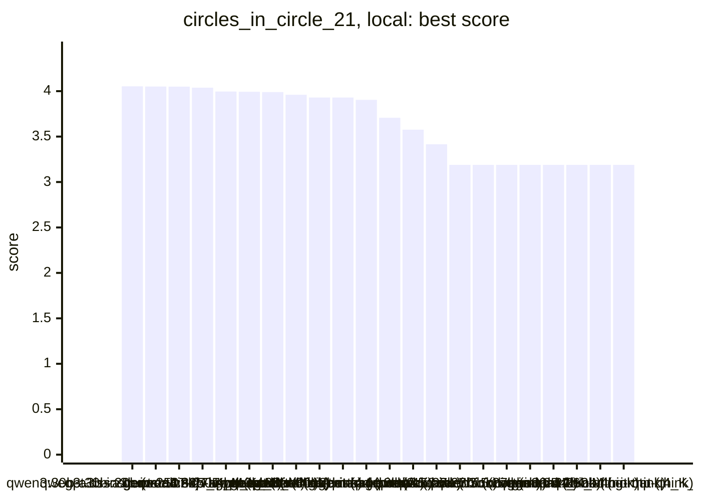
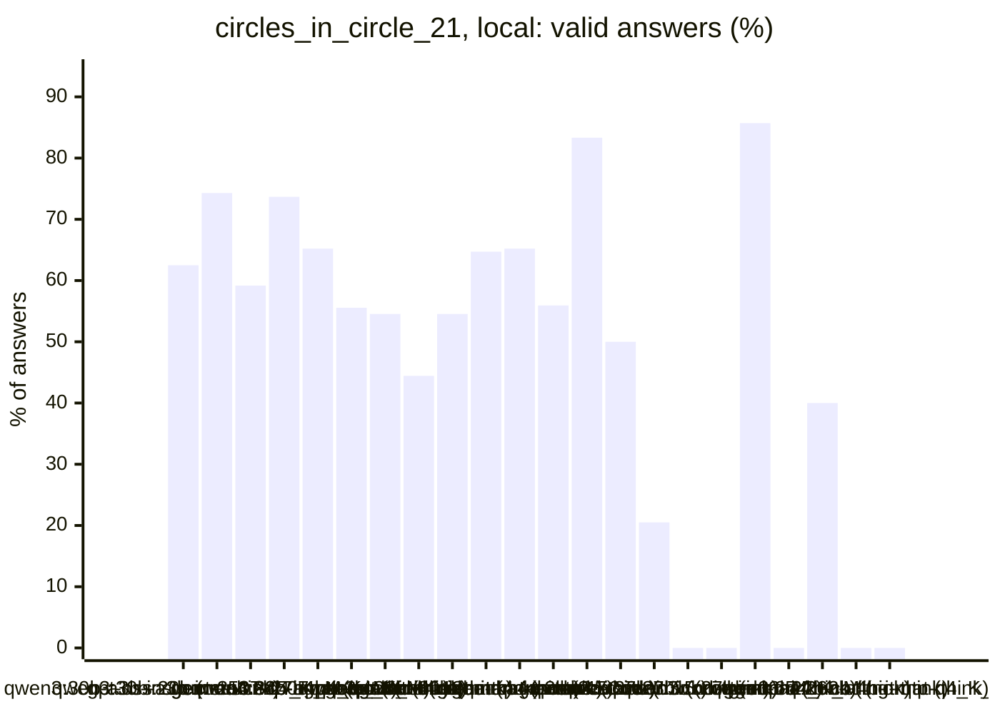
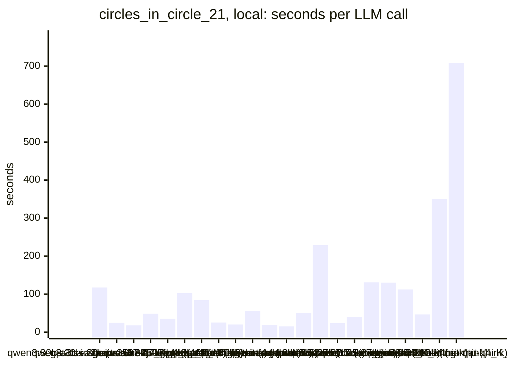
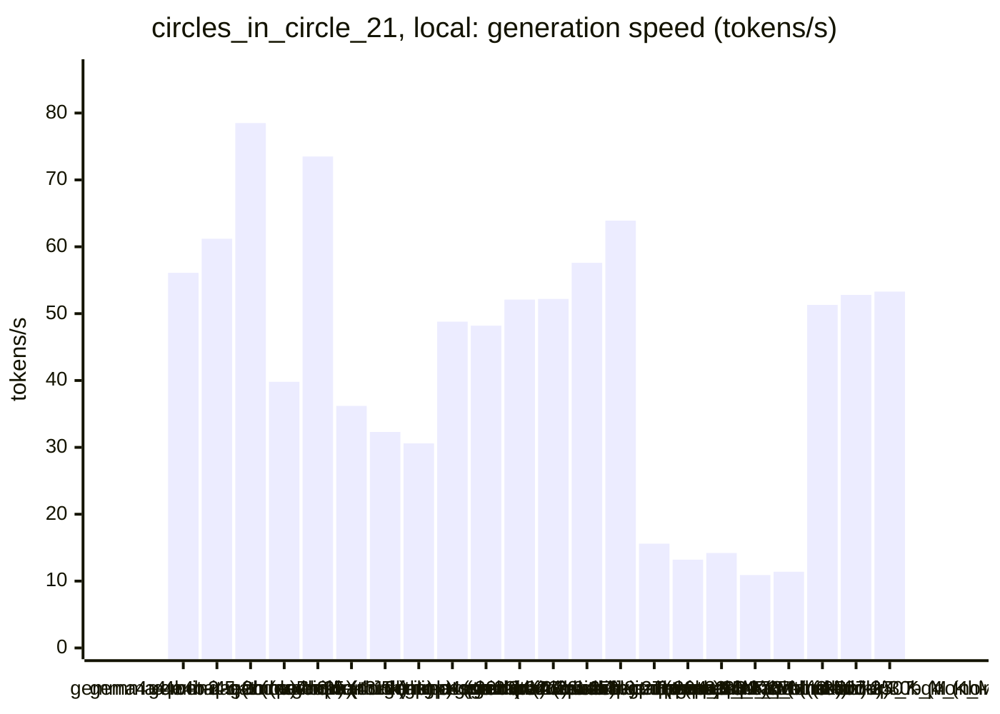
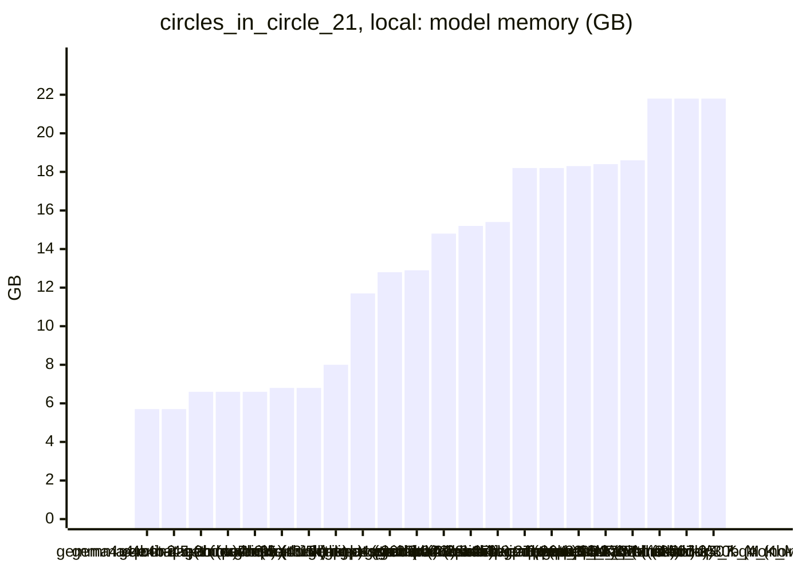

<!-- Copyright (c) 2026 by C. Klukas -->
<!-- SPDX-License-Identifier: GPL-3.0-only -->
<!-- Generated by `omega report` from bench/results/*.json. Do not edit by hand. -->

# circles_in_circle_21

24 models, 15 minutes each, latest run per model. The [overall ranking](../benchmarks.md#overall-ranking) compares the models over all examples.

Machine: Apple M1 Max (Mac13,1), 10 cores, 32 GB.

## Local models

Ollama on this machine.

| Model | Params | Initial | Best | Gain | LLM calls | s/call | Valid | New bests | Min to best |
|---|---|--:|--:|--:|--:|--:|--:|--:|--:|
| gpt-oss:20b (no-think) | 20.9B | 3.18905 | **4.05278** | ×1.27 | 8 | 118 | 62% | 2 | 10.3 |
| qwen3:30b-a3b-instruct-2507-q4_K_M (no-think) | 30.5B | 3.18905 | **4.05117** | ×1.27 | 35 | 25 | 74% | 8 | 15.2 |
| qwen3:30b-a3b-instruct-2507-q4_K_M (think) | 30.5B | 3.18905 | **4.05042** | ×1.27 | 49 | 18 | 59% | 5 | 9.8 |
| gemma4:e4b-it-qat (think) | 7.5B | 3.18905 | **4.03803** | ×1.27 | 19 | 49 | 74% | 5 | 11.6 |
| gemma4:26b-a4b-it-qat (no-think) | 25.2B | 3.18905 | **3.9964** | ×1.25 | 23 | 35 | 65% | 3 | 10.4 |
| qwen3.8:27b-mtp-q4_K_M (no-think) | 27.3B | 3.18905 | **3.99294** | ×1.25 | 9 | 103 | 56% | 2 | 14.7 |
| gpt-oss:20b (think) | 20.9B | 3.18905 | **3.99** | ×1.25 | 11 | 85 | 55% | 1 | 7.6 |
| qwen3-coder:30b (no-think) | 30.5B | 3.18905 | **3.96005** | ×1.24 | 36 | 25 | 44% | 3 | 10.3 |
| gemma4:e4b-it-qat (no-think) | 7.5B | 3.18905 | **3.9302** | ×1.23 | 44 | 20 | 55% | 3 | 13.6 |
| gemma4:12b-it-qat (no-think) | 11.9B | 3.18905 | **3.9302** | ×1.23 | 17 | 56 | 65% | 2 | 11.4 |
| gemma4:latest (no-think) |  | 3.18905 | **3.90376** | ×1.22 | 46 | 19 | 65% | 4 | 14.4 |
| gemma4:e2b (no-think) | 5.1B | 3.18905 | **3.70711** | ×1.16 | 59 | 15 | 56% | 2 | 8.2 |
| gemma4:latest (think) |  | 3.18905 | **3.57552** | ×1.12 | 18 | 50 | 83% | 3 | 11.8 |
| qwen3.5:27b (think) | 27.8B | 3.18905 | **3.41478** | ×1.07 | 4 | 229 | 50% | 2 | 10.3 |
| qwen2.5-coder:7b (no-think) | 7.6B | 3.18905 | **3.18905** | ×1.00 | 39 | 24 | 21% | 0 | - |
| qwen3.5:latest (no-think) | 9.7B | 3.18905 | **3.18905** | ×1.00 | 23 | 40 | 0% | 0 | - |
| qwen3.5:27b (no-think) | 27.8B | 3.18905 | **3.18905** | ×1.00 | 7 | 131 | 0% | 0 | - |
| qwen3.6:27b-coding-mtp-q4_K_M (no-think) | 27.3B | 3.18905 | **3.18905** | ×1.00 | 7 | 130 | 86% | 0 | - |
| qwen3.5:latest (think) | 9.7B | 3.18905 | **3.18905** | ×1.00 | 9 | 112 | 0% | 0 | - |
| gemma4:12b-it-qat (think) | 11.9B | | | | | | | | failed: all 2 model requests failed: gemma4:12b-it-qat: answer stopp |
| gemma4:e2b (think) | 5.1B | 3.18905 | **3.18905** | ×1.00 | 20 | 46 | 40% | 0 | - |
| gemma4:26b-a4b-it-qat (think) | 25.2B | 3.18905 | **3.18905** | ×1.00 | 3 | 351 | 0% | 0 | - |
| qwen3.8:27b-mtp-q4_K_M (think) | 27.3B | | | | | | | | failed: all 1 model requests failed: qwen3.8:27b-mtp-q4_K_M: answer  |
| qwen3.6:27b-coding-mtp-q4_K_M (think) | 27.3B | 3.18905 | **3.18905** | ×1.00 | 2 | 708 | 0% | 0 | - |

### Inference speed and memory

RAM is what Ollama reports for the loaded model (weights, context cache and buffers; on Apple silicon this is shared memory). Load is the time to bring the model into memory. Prompt and generation speeds are tokens per second over all calls of the run.

| Model | Params | RAM GB | Load s | Prompt tok/s | Gen tok/s | Median s/call | p90 s/call | Tokens/answer | Stopped |
|---|---|--:|--:|--:|--:|--:|--:|--:|--:|
| gemma4:e4b-it-qat (think) | 7.5B | 5.7 | 94 | 644 | 56.1 | 42 | 87 | 2179 | 0 |
| gemma4:e4b-it-qat (no-think) | 7.5B | 5.7 | 61 | 664 | 61.2 | 18 | 35 | 817 | 0 |
| gemma4:e2b (no-think) | 5.1B | 6.6 | 34 | 866 | 78.5 | 12 | 28 | 700 | 0 |
| qwen2.5-coder:7b (no-think) | 7.6B | 6.6 | 36 | 547 | 39.8 | 23 | 39 | 700 | 1 |
| gemma4:e2b (think) | 5.1B | 6.6 | 80 | 1245 | 73.5 | 39 | 80 | 2979 | 0 |
| qwen3.5:latest (no-think) | 9.7B | 6.8 | 28 | 494 | 36.2 | 33 | 74 | 1031 | 3 |
| qwen3.5:latest (think) | 9.7B | 6.8 | 28 | 469 | 32.3 | 56 | 511 | 3393 | 0 |
| gemma4:12b-it-qat (no-think) | 11.9B | 8.0 | 65 | 256 | 30.6 | 52 | 86 | 1247 | 0 |
| gemma4:latest (think) |  | 11.7 | 121 | 952 | 48.8 | 43 | 77 | 1977 | 0 |
| gpt-oss:20b (think) | 20.9B | 12.8 | 209 | 558 | 48.2 | 57 | 199 | 2955 | 0 |
| gpt-oss:20b (no-think) | 20.9B | 12.9 | 54 | 747 | 52.1 | 132 | 192 | 5601 | 0 |
| gemma4:latest (no-think) |  | 14.8 | 121 | 985 | 52.2 | 16 | 27 | 658 | 0 |
| gemma4:26b-a4b-it-qat (think) | 25.2B | 15.2 | 316 | 601 | 57.6 | 257 | 562 | 14038 | 2 |
| gemma4:26b-a4b-it-qat (no-think) | 25.2B | 15.4 | 199 | 611 | 63.9 | 28 | 38 | 1233 | 0 |
| qwen3.6:27b-coding-mtp-q4_K_M (no-think) | 27.3B | 18.2 | 255 | 139 | 15.6 | 92 | 357 | 1242 | 0 |
| qwen3.6:27b-coding-mtp-q4_K_M (think) | 27.3B | 18.2 | 265 | 135 | 13.2 | 852 | 852 | 7446 | 0 |
| qwen3.8:27b-mtp-q4_K_M (no-think) | 27.3B | 18.3 | 239 | 107 | 14.2 | 76 | 353 | 810 | 0 |
| qwen3.5:27b (think) | 27.8B | 18.4 | 181 | 109 | 10.9 | 299 | 307 | 1799 | 0 |
| qwen3.5:27b (no-think) | 27.8B | 18.6 | 129 | 110 | 11.4 | 117 | 265 | 1099 | 0 |
| qwen3:30b-a3b-instruct-2507-q4_K_M (no-think) | 30.5B | 21.8 | 213 | 624 | 51.3 | 19 | 27 | 556 | 0 |
| qwen3:30b-a3b-instruct-2507-q4_K_M (think) | 30.5B | 21.8 | 183 | 706 | 52.8 | 13 | 23 | 435 | 0 |
| qwen3-coder:30b (no-think) | 30.5B | 21.8 | 130 | 702 | 53.3 | 23 | 38 | 889 | 0 |

### Best score over time

| Model | 3.75 min | 7.5 min | 11.25 min | 15 min |
|---|--:|--:|--:|--:|
| gpt-oss:20b (no-think) | 3.18905 | 4.05278 | 4.05278 | 4.05278 |
| qwen3:30b-a3b-instruct-2507-q4_K_M (no-think) | 3.18905 | 3.98521 | 4.05106 | 4.05106 |
| qwen3:30b-a3b-instruct-2507-q4_K_M (think) | 3.52218 | 4.00469 | 4.05042 | 4.05042 |
| gemma4:e4b-it-qat (think) | 3.59395 | 4.00883 | 4.00883 | 4.03803 |
| gemma4:26b-a4b-it-qat (no-think) | 3.18905 | 3.98733 | 3.9964 | 3.9964 |
| qwen3.8:27b-mtp-q4_K_M (no-think) | 3.18905 | 3.18905 | 3.99294 | 3.99294 |
| gpt-oss:20b (think) | 3.18905 | 3.18905 | 3.99 | 3.99 |
| qwen3-coder:30b (no-think) | 3.60536 | 3.72861 | 3.96005 | 3.96005 |
| gemma4:e4b-it-qat (no-think) | 3.18905 | 3.5047 | 3.64462 | 3.9302 |
| gemma4:12b-it-qat (no-think) | 3.18905 | 3.18905 | 3.61636 | 3.9302 |
| gemma4:latest (no-think) | 3.64462 | 3.64462 | 3.73835 | 3.90376 |
| gemma4:e2b (no-think) | 3.57134 | 3.57134 | 3.70711 | 3.70711 |
| gemma4:latest (think) | 3.18905 | 3.57134 | 3.57134 | 3.57552 |
| qwen3.5:27b (think) | 3.18905 | 3.31792 | 3.41478 | 3.41478 |
| qwen2.5-coder:7b (no-think) | 3.18905 | 3.18905 | 3.18905 | 3.18905 |
| qwen3.5:latest (no-think) | 3.18905 | 3.18905 | 3.18905 | 3.18905 |
| qwen3.5:27b (no-think) | 3.18905 | 3.18905 | 3.18905 | 3.18905 |
| qwen3.6:27b-coding-mtp-q4_K_M (no-think) | 3.18905 | 3.18905 | 3.18905 | 3.18905 |
| qwen3.5:latest (think) | 3.18905 | 3.18905 | 3.18905 | 3.18905 |
| gemma4:e2b (think) | 3.18905 | 3.18905 | 3.18905 | 3.18905 |
| gemma4:26b-a4b-it-qat (think) | 3.18905 | 3.18905 | 3.18905 | 3.18905 |
| qwen3.6:27b-coding-mtp-q4_K_M (think) | 3.18905 | 3.18905 | 3.18905 | 3.18905 |

### Outcome of the LLM answers

| Model | duplicate | edit error | invalid | llm error | ok | timeout |
|---|--:|--:|--:|--:|--:|--:|
| gpt-oss:20b (no-think) | 0 | 3 | 0 | 0 | 5 | 0 |
| qwen3:30b-a3b-instruct-2507-q4_K_M (no-think) | 2 | 3 | 4 | 0 | 26 | 0 |
| qwen3:30b-a3b-instruct-2507-q4_K_M (think) | 5 | 3 | 12 | 0 | 29 | 0 |
| gemma4:e4b-it-qat (think) | 0 | 0 | 5 | 0 | 14 | 0 |
| gemma4:26b-a4b-it-qat (no-think) | 0 | 2 | 3 | 0 | 15 | 3 |
| qwen3.8:27b-mtp-q4_K_M (no-think) | 0 | 0 | 4 | 0 | 5 | 0 |
| gpt-oss:20b (think) | 0 | 1 | 4 | 0 | 6 | 0 |
| qwen3-coder:30b (no-think) | 5 | 6 | 9 | 0 | 16 | 0 |
| gemma4:e4b-it-qat (no-think) | 3 | 3 | 14 | 0 | 24 | 0 |
| gemma4:12b-it-qat (no-think) | 0 | 2 | 4 | 0 | 11 | 0 |
| gemma4:latest (no-think) | 1 | 0 | 15 | 0 | 30 | 0 |
| gemma4:e2b (no-think) | 0 | 16 | 10 | 0 | 33 | 0 |
| gemma4:latest (think) | 0 | 1 | 2 | 0 | 15 | 0 |
| qwen3.5:27b (think) | 0 | 0 | 2 | 0 | 2 | 0 |
| qwen2.5-coder:7b (no-think) | 7 | 4 | 19 | 1 | 8 | 0 |
| qwen3.5:latest (no-think) | 0 | 8 | 11 | 3 | 0 | 1 |
| qwen3.5:27b (no-think) | 0 | 2 | 5 | 0 | 0 | 0 |
| qwen3.6:27b-coding-mtp-q4_K_M (no-think) | 0 | 0 | 0 | 0 | 6 | 1 |
| qwen3.5:latest (think) | 0 | 2 | 7 | 0 | 0 | 0 |
| gemma4:e2b (think) | 0 | 2 | 10 | 0 | 8 | 0 |
| gemma4:26b-a4b-it-qat (think) | 0 | 1 | 0 | 2 | 0 | 0 |
| qwen3.6:27b-coding-mtp-q4_K_M (think) | 0 | 0 | 2 | 0 | 0 | 0 |

### Best idea per model

- **gpt-oss:20b (no-think)**: Replace the equal‑radius construction with an analytic solution that computes distinct radii for the center, inner ring, and outer ring using sin(pi/7) and sin(pi/13), yielding a …
- **qwen3:30b-a3b-instruct-2507-q4_K_M (no-think)**: Expose the inner and outer ring radii as sweepable constants to optimize their spacing for better gap filling and radius sum, leveraging the proven success of tuned ring layouts …
- **qwen3:30b-a3b-instruct-2507-q4_K_M (think)**: tuned RING1_RADIUS=0.4306, RING2_RADIUS=0.8075, ITERATIONS=121 on top of: Replace fixed ring radii (0.35, 0.75) with tunable constants and increase relaxation iterations to allow …
- **gemma4:e4b-it-qat (think)**: tuned MAX_ITER=10000, STEP_SIZE=0.003875 on top of: Replace hardcoded optimization parameters with named constants to allow the evolutionary search to find the optimal iteration …
- **gemma4:26b-a4b-it-qat (no-think)**: Import the `random` module to fix the NameError.
- **qwen3.8:27b-mtp-q4_K_M (no-think)**: edit: for count, ring in ((7, 0.42), (n - 8, 0.80)): / radii = [1.0 - math.hypot(x, y) for x, y in centers]
- **gpt-oss:20b (think)**: Use a center circle with two rings of different sizes; optimize ring radii and circle radii by a simple grid search to increase the sum of radii.
- **qwen3-coder:30b (no-think)**: Replace the fixed ring-based construction with a gradient-free optimization approach that jointly adjusts circle positions and radii using a penalty method, starting from a good …
- **gemma4:e4b-it-qat (no-think)**: Instead of setting a single radius $r$ based on the tightest constraint (which forces all circles to be equal size, leading to wasted space), I will implement the full feasibility …
- **gemma4:12b-it-qat (no-think)**: The current symmetric ring structure is very rigid; by making the radii of circles in different rings independent and optimizing the rings' radii, we can better maximize the sum …
- **gemma4:latest (no-think)**: Instead of assigning a single radius `r` to all circles, which is a significant simplification and likely suboptimal, I will assign radii based on the circle's location (center …
- **gemma4:e2b (no-think)**: tuned R_base=0.4, R_outer=0.8 on top of: Sweep the radii used for the concentric rings to explore better symmetric packings, as suggested by the lineage, to maximize the sum of …
- **gemma4:latest (think)**: Introduce a small, randomized perturbation to the radial distance of the concentric rings to break geometric symmetry and improve packing locally.
- **qwen3.5:27b (think)**: tuned INITIAL_R=0.4, NUM_SAMPLES=200 on top of: Make the initial circle radius and number of random samples per iteration tunable constants to explore the search space more …
- **qwen2.5-coder:7b (no-think)**: initial program
- **qwen3.5:latest (no-think)**: initial program
- **qwen3.5:27b (no-think)**: initial program
- **qwen3.6:27b-coding-mtp-q4_K_M (no-think)**: initial program
- **qwen3.5:latest (think)**: initial program
- **gemma4:e2b (think)**: initial program
- **gemma4:26b-a4b-it-qat (think)**: initial program
- **qwen3.6:27b-coding-mtp-q4_K_M (think)**: initial program
