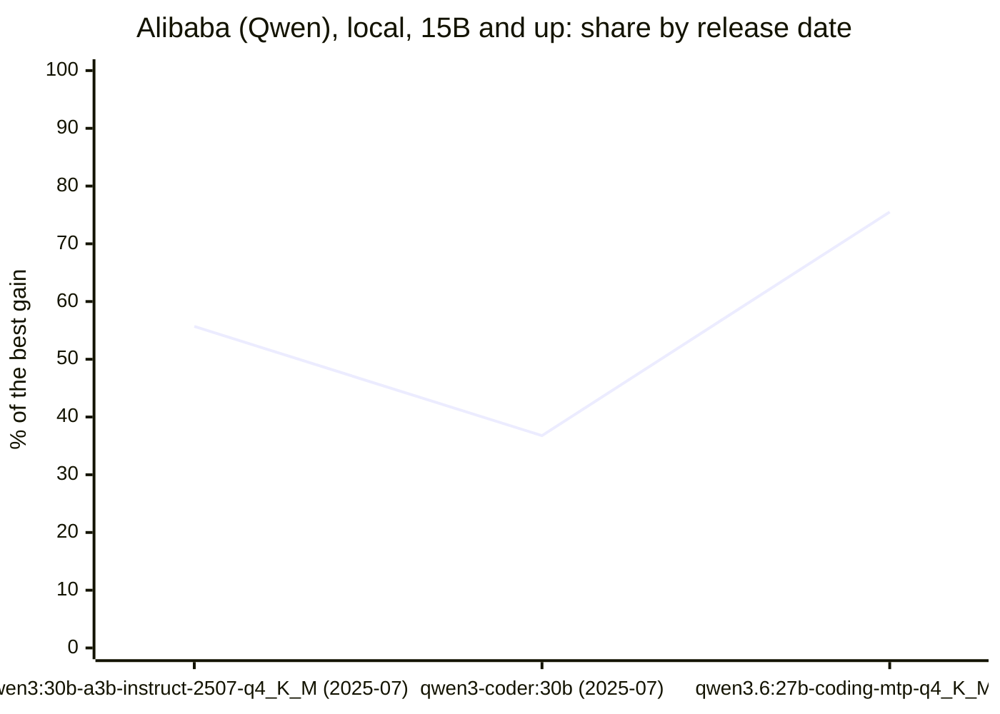

<!-- Copyright (c) 2026 by C. Klukas -->
<!-- SPDX-License-Identifier: GPL-3.0-only -->
<!-- Generated by `omega report` from bench/results/*.json. Do not edit by hand. -->

# Models by developer

The models of the [overall ranking](../benchmarks.md#overall-ranking), grouped by the company that develops them. A model's **share** is its gain over the starting program as a fraction of the best gain on each example, averaged over the examples (100% = the best model everywhere); released is the model's original publication on Hugging Face, or OpenRouter's listing date. See also [Models by country](countries.md).

## Who develops which model

Every benchmarked model and the company that develops it, which the comparisons below group by.

| Developer | Local models (Ollama) | Cloud models (OpenRouter) |
|---|---|---|
| Alibaba (Qwen) | qwen2.5-coder:7b, qwen3-coder:30b, qwen3.5:latest, qwen3.6:27b-coding-mtp-q4_K_M, qwen3:30b-a3b-instruct-2507-q4_K_M | – |
| Cohere | – | cohere/north-mini-code:free |
| Conway | underdog-saluki-27b:iq2-mix | – |
| Google | gemma4:12b-it-qat, gemma4:26b-a4b-it-qat, gemma4:e2b, gemma4:e4b-it-qat, gemma4:latest | – |
| Liquid AI | hf.co/LiquidAI/LFM3-1.7B-GGUF:Q4_K_M | – |
| Microsoft | richardyoung/frognano-4b-2609:latest | – |
| NII (LLM-jp) | llm-jp-4-8b-omega:q4_k_m | – |
| NVIDIA | nemotron-3-nano:4b | nvidia/nemotron-3-nano-omni-30b-a3b-reasoning:free, nvidia/nemotron-3-ultra-550b-a55b:free, nvidia/nemotron-3.5-lightning:free, nvidia/nemotron-3.5-super-vl:free |
| OpenAI | gpt-oss:20b | – |
| Sarvam AI | frob/sarvam:30b | – |
| Swiss AI Initiative | MichelRosselli/apertus:8b-instruct-2509-q4_k_m | – |
| Yandex | yandex/YandexGPT-5-Lite-8B-instruct-GGUF:latest | – |
| Z.ai | glm-4.7-flash:latest | – |
| other | – | dots-studio/dots-3-note-preview:free, recursive/flint-v1.0:free, xingchen-agi/xing4.0-29b-a4b:free |

**About the developers** (as of October 2026; many of these companies and their open models are only a few years old):

- **Alibaba (Qwen)** (founded 1999, Hangzhou, China): China's largest e-commerce and cloud group. Its Qwen team has released open-weight models since 2023, in many sizes and mostly under Apache 2.0; Qwen is among the most widely used open model families.
- **Cohere** (founded 2019, Toronto, Canada): Builds language models for enterprise use (the Command family); some are published as open weights.
- **Conway** (founded 2026, USA): AI lab (Conway Research) behind Underdog, an assistant that runs on the user's own devices; its open-weight Saluki 27B (October 2026, Apache 2.0) is a 2-bit build of Alibaba's Qwen3.8-27B that is tuned to keep tool calling intact.
- **Google** (founded 1998, Mountain View, USA): Publishes the Gemma family as open-weight models since 2024, built from the research behind its larger proprietary models, from phone-sized to mid-sized models.
- **Liquid AI** (founded 2023, Cambridge, USA): A spin-off of MIT's computer science lab; its LFM models use a hybrid architecture built for running on devices. LFM3 (October 2026, LFM Open License) is a family of six open-weight models of about 2B parameters for text, vision, audio and both, which share one 1.7B backbone of short convolutions and attention with a 256K context.
- **Microsoft** (founded 1975, Redmond, USA): Publishes small open models under the MIT license: the Phi family since 2023 and, in 2026, FrogNano, a 4B coding agent built on Qwen3.5-4B and trained with reinforcement learning on software-engineering tasks.
- **NII (LLM-jp)** (founded 2000, Tokyo, Japan): Japan's National Institute of Informatics leads LLM-jp, a consortium of universities and companies that has trained fully open Japanese-English models from scratch since 2023 (LLM-jp-4 in 2026, Apache 2.0).
- **NVIDIA** (founded 1993, Santa Clara, USA): The leading maker of AI accelerators. Its Nemotron models are open-weight, often with their training data published, and partly built on other open models.
- **OpenAI** (founded 2015, San Francisco, USA): Best known for ChatGPT and its proprietary GPT models; gpt-oss (August 2025, Apache 2.0) were its first open-weight language models since GPT-2 in 2019.
- **Sarvam AI** (founded 2023, Bengaluru, India): Builds models for India's languages; released the Sarvam 30B and 105B mixture-of-experts models (March 2026, Apache 2.0), trained in India under the national IndiaAI mission.
- **Swiss AI Initiative** (founded 2023, Lausanne and Zurich, Switzerland): A joint effort of EPFL, ETH Zurich and the national supercomputing centre CSCS; its Apertus models (2025) are fully open, with training data and recipes, under Apache 2.0.
- **Yandex** (founded 1997, Moscow, Russia): Russia's largest search engine; published YandexGPT 5 Lite (8B) as open weights in 2025, while its flagship models (now Alice AI) remain proprietary.
- **Z.ai** (founded 2019, Beijing, China): Founded as Zhipu AI, a spin-off of Tsinghua University; develops the GLM family, whose recent models are among the strongest open-weight coding models.

## Local models

### Ranking by developer

The developer's best single model, the mean share over all its models, and the mean share when its best model is picked for each example separately (which favours developers with many models).

| Developer | Models | Best model | Released | Best model's share | Mean over its models | Best per example |
|---|--:|---|---|--:|--:|--:|
| OpenAI | 1 | gpt-oss:20b (no-think) | 2025-08-04 | **81%** | 81% | 81% |
| Alibaba (Qwen) | 5 | qwen3.6:27b-coding-mtp-q4_K_M (no-think) | 2026-04-21 | **76%** | 48% | 86% |
| Google | 5 | gemma4:12b-it-qat (no-think) | 2026-05-23 | **71%** | 53% | 87% |
| Conway | 1 | underdog-saluki-27b:iq2-mix (no-think) | 2026-10-08 | **45%** | 45% | 45% |
| Z.ai | 1 | glm-4.7-flash:latest (no-think) | 2026-01-19 | **38%** | 38% | 38% |
| Sarvam AI | 1 | frob/sarvam:30b (no-think) | 2026-03-03 | **37%** | 37% | 37% |
| Yandex | 1 | yandex/YandexGPT-5-Lite-8B-instruct-GGUF:latest (no-think) | 2025-03-28 | **24%** | 24% | 24% |
| Microsoft | 1 | richardyoung/frognano-4b-2609:latest (no-think) | 2026-09-17 | **23%** | 23% | 23% |
| NII (LLM-jp) | 1 | llm-jp-4-8b-omega:q4_k_m (no-think) | 2026-03-16 | **14%** | 14% | 14% |
| Swiss AI Initiative | 1 | MichelRosselli/apertus:8b-instruct-2509-q4_k_m (no-think) | 2025-08-13 | **13%** | 13% | 13% |
| Liquid AI | 1 | hf.co/LiquidAI/LFM3-1.7B-GGUF:Q4_K_M (no-think) | 2026-10-23 | **2%** | 2% | 2% |
| NVIDIA | 1 | nemotron-3-nano:4b (no-think) | 2026-03-07 | **2%** | 2% | 2% |

### Progress over time

Each developer's ranked models by release date (the original publication on Hugging Face, or OpenRouter's listing date), with the share of the better of their two modes. Models are compared only within a size class (total parameters, under 15B, 15B and up), so that a newer but smaller model does not read as a step back; mixture-of-experts models use only part of their parameters per token. Variants of one release share its date. A chart is drawn where a developer has three or more release dates in one size class.

| Developer | Size class | Released | Model | Parameters | Share |
|---|---|---|---|--:|--:|
| Alibaba (Qwen) | under 15B | 2024-09-17 | qwen2.5-coder:7b (no-think) | 7.6B | 30% |
| Alibaba (Qwen) | under 15B | 2026-02-27 | qwen3.5:latest (no-think) | 9.7B | 43% |
| Alibaba (Qwen) | 15B and up | 2025-07-28 | qwen3:30b-a3b-instruct-2507-q4_K_M (no-think) | 30.5B | 56% |
| Alibaba (Qwen) | 15B and up | 2025-07-31 | qwen3-coder:30b (no-think) | 30.5B | 37% |
| Alibaba (Qwen) | 15B and up | 2026-04-21 | qwen3.6:27b-coding-mtp-q4_K_M (no-think) | 27.3B | 76% |
| Conway | 15B and up | 2026-10-08 | underdog-saluki-27b:iq2-mix (no-think) | 26.9B | 45% |
| Google | under 15B | 2026-03-02 | gemma4:e2b (no-think) | 5.1B | 35% |
| Google | under 15B | 2026-03-02 | gemma4:e4b-it-qat (no-think) | 7.5B | 42% |
| Google | under 15B | 2026-03-02 | gemma4:latest (no-think) | 8.1B | 65% |
| Google | under 15B | 2026-05-23 | gemma4:12b-it-qat (no-think) | 11.9B | 71% |
| Google | 15B and up | 2026-03-11 | gemma4:26b-a4b-it-qat (no-think) | 25.2B | 55% |
| Liquid AI | under 15B | 2026-10-23 | hf.co/LiquidAI/LFM3-1.7B-GGUF:Q4_K_M (no-think) | 1.73B | 2% |
| Microsoft | under 15B | 2026-09-17 | richardyoung/frognano-4b-2609:latest (no-think) | 4.3B | 23% |
| NII (LLM-jp) | under 15B | 2026-03-16 | llm-jp-4-8b-omega:q4_k_m (no-think) | 8.6B | 14% |
| NVIDIA | under 15B | 2026-03-07 | nemotron-3-nano:4b (no-think) | 4B | 2% |
| OpenAI | 15B and up | 2025-08-04 | gpt-oss:20b (no-think) | 20.9B | 81% |
| Sarvam AI | 15B and up | 2026-03-03 | frob/sarvam:30b (no-think) | 32.2B | 37% |
| Swiss AI Initiative | under 15B | 2025-08-13 | MichelRosselli/apertus:8b-instruct-2509-q4_k_m (no-think) | 8.1B | 13% |
| Yandex | under 15B | 2025-03-28 | yandex/YandexGPT-5-Lite-8B-instruct-GGUF:latest (no-think) | 8B | 24% |
| Z.ai | 15B and up | 2026-01-19 | glm-4.7-flash:latest (no-think) | 29.9B | 38% |

## Cloud models (OpenRouter)

### Ranking by developer

The developer's best single model, the mean share over all its models, and the mean share when its best model is picked for each example separately (which favours developers with many models).

| Developer | Models | Best model | Released | Best model's share | Mean over its models | Best per example |
|---|--:|---|---|--:|--:|--:|
| NVIDIA | 4 | nvidia/nemotron-3.5-super-vl:free (no-think) | 2026-10-15 | **70%** | 47% | 96% |
| other | 2 | dots-studio/dots-3-note-preview:free (no-think) | 2026-08-14 | **64%** | 39% | 66% |
| Cohere | 1 | cohere/north-mini-code:free (no-think) | 2026-06-17 | **43%** | 43% | 43% |

### Progress over time

Each developer's ranked models by release date (the original publication on Hugging Face, or OpenRouter's listing date), with the share of the better of their two modes. Models are compared only within a size class (total parameters, under 15B, 15B and up), so that a newer but smaller model does not read as a step back; mixture-of-experts models use only part of their parameters per token. Variants of one release share its date. A chart is drawn where a developer has three or more release dates in one size class.

| Developer | Size class | Released | Model | Parameters | Share |
|---|---|---|---|--:|--:|
| Cohere | 15B and up | 2026-06-17 | cohere/north-mini-code:free (no-think) | 30B | 43% |
| NVIDIA | 15B and up | 2026-04-28 | nvidia/nemotron-3-nano-omni-30b-a3b-reasoning:free (no-think) | 30B | 22% |
| NVIDIA | 15B and up | 2026-06-04 | nvidia/nemotron-3-ultra-550b-a55b:free (no-think) | 550B | 68% |
| NVIDIA | size unknown | 2026-08-11 | nvidia/nemotron-3.5-lightning:free (no-think) | ? | 28% |
| NVIDIA | size unknown | 2026-10-15 | nvidia/nemotron-3.5-super-vl:free (no-think) | ? | 70% |
| other | 15B and up | 2026-10-16 | xingchen-agi/xing4.0-29b-a4b:free (no-think) | 29B | 13% |
| other | size unknown | 2026-08-14 | dots-studio/dots-3-note-preview:free (no-think) | ? | 64% |
