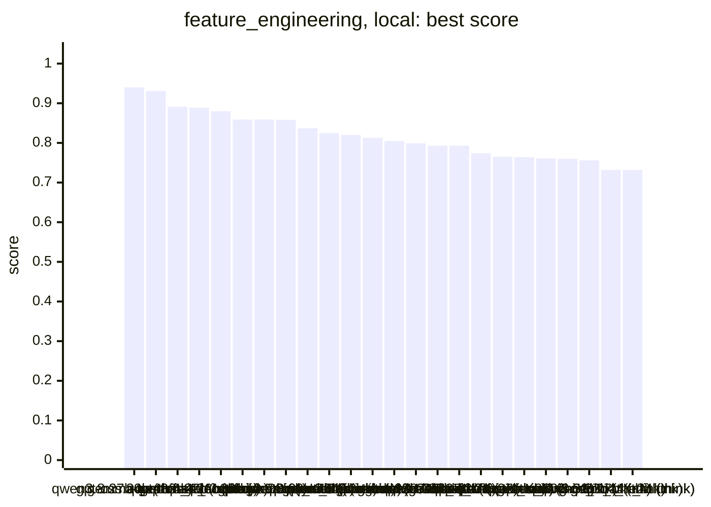
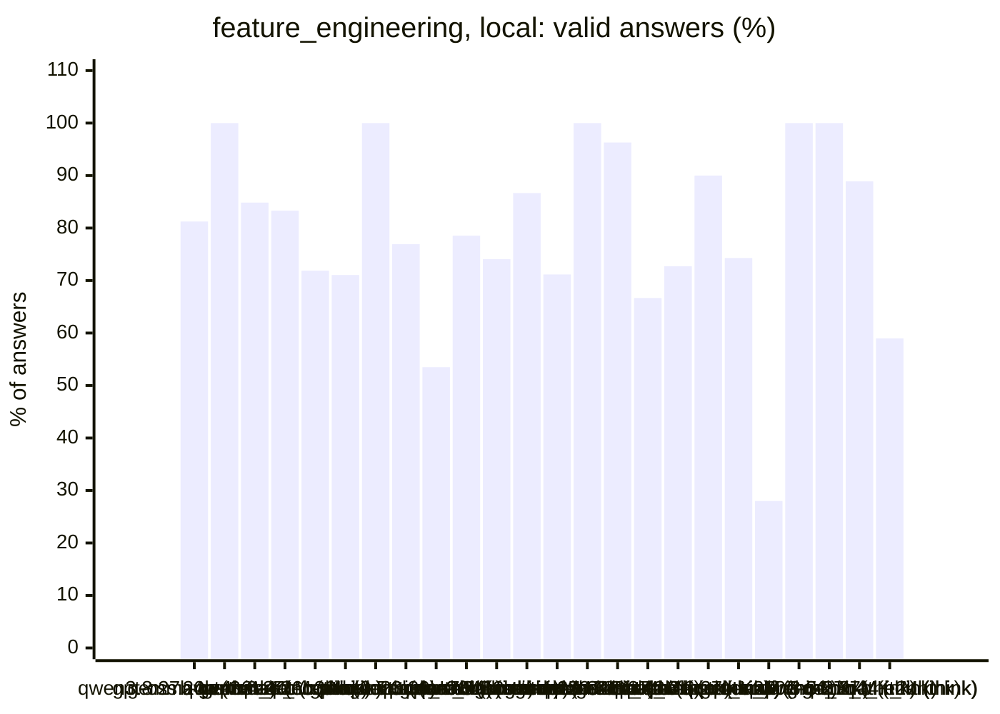
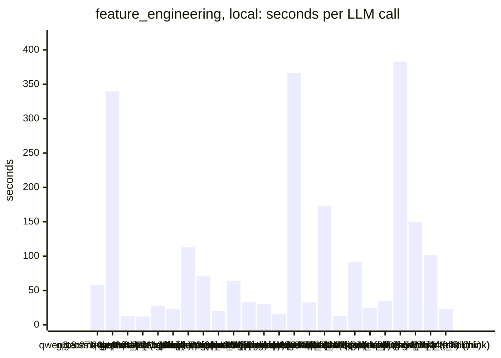
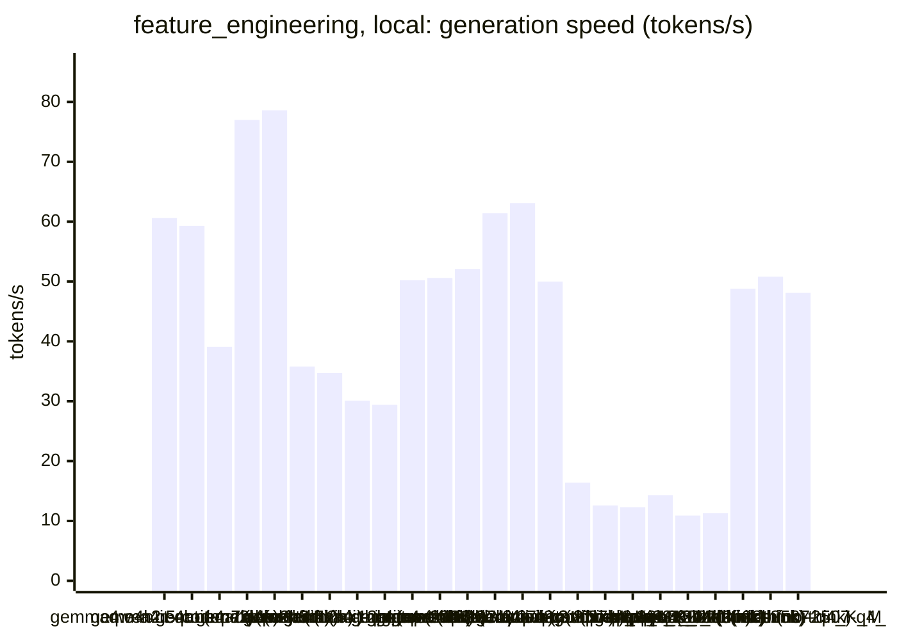
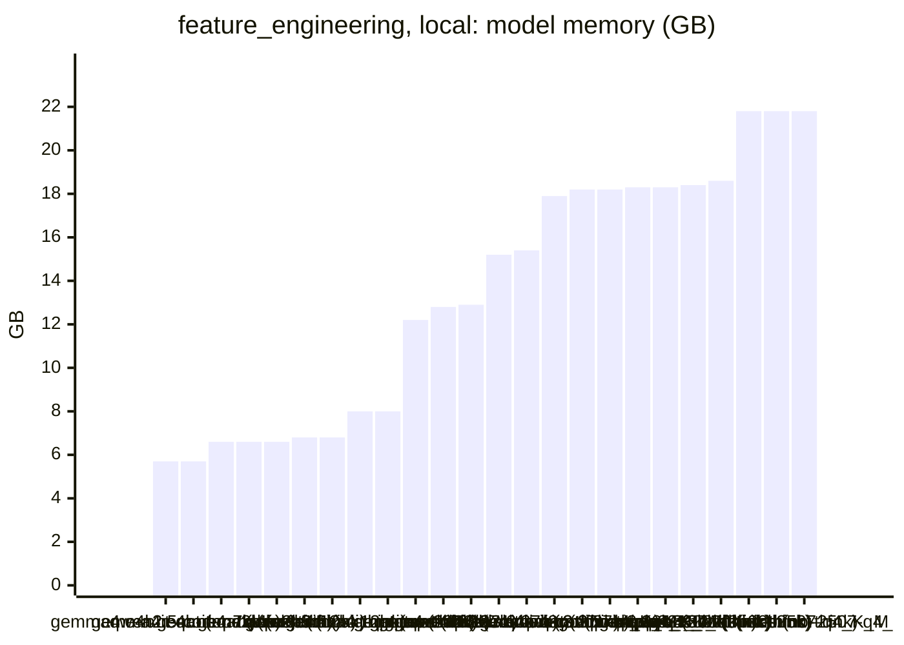

<!-- Copyright (c) 2026 by C. Klukas -->
<!-- SPDX-License-Identifier: GPL-3.0-only -->
<!-- Generated by `omega report` from bench/results/*.json. Do not edit by hand. -->

# feature_engineering

24 models, 15 minutes each, latest run per model. The [overall ranking](../benchmarks.md#overall-ranking) compares the models over all examples.

Machine: Apple M1 Max (Mac13,1), 10 cores, 32 GB.

## Local models

Ollama on this machine.

| Model | Params | Initial | Best | Gain | LLM calls | s/call | Valid | New bests | Min to best |
|---|---|--:|--:|--:|--:|--:|--:|--:|--:|
| gpt-oss:20b (think) | 20.9B | 0.623 | **0.94** | ×1.51 | 16 | 58 | 81% | 3 | 11.8 |
| qwen3.8:27b-mtp-q4_K_M (think) | 27.3B | 0.623 | **0.931** | ×1.49 | 4 | 340 | 100% | 3 | 22.6 |
| gemma4:e4b-it-qat (no-think) | 7.5B | 0.623 | **0.891** | ×1.43 | 66 | 13 | 85% | 10 | 12.4 |
| gemma4:latest (no-think) |  | 0.623 | **0.889** | ×1.43 | 72 | 12 | 83% | 11 | 12.1 |
| qwen3-coder:30b (no-think) | 30.5B | 0.623 | **0.88** | ×1.41 | 32 | 28 | 72% | 4 | 7.6 |
| gemma4:26b-a4b-it-qat (no-think) | 25.2B | 0.623 | **0.859** | ×1.38 | 38 | 24 | 71% | 4 | 8.9 |
| qwen3.6:27b-coding-mtp-q4_K_M (no-think) | 27.3B | 0.623 | **0.859** | ×1.38 | 8 | 113 | 100% | 1 | 5.5 |
| gpt-oss:20b (no-think) | 20.9B | 0.623 | **0.858** | ×1.38 | 13 | 71 | 77% | 4 | 8.1 |
| qwen2.5-coder:7b (no-think) | 7.6B | 0.623 | **0.837** | ×1.34 | 43 | 20 | 53% | 4 | 14.6 |
| qwen3.5:latest (think) | 9.7B | 0.623 | **0.825** | ×1.32 | 14 | 64 | 79% | 3 | 9.7 |
| qwen3.5:latest (no-think) | 9.7B | 0.623 | **0.82** | ×1.32 | 27 | 34 | 74% | 4 | 9.0 |
| gemma4:12b-it-qat (no-think) | 11.9B | 0.623 | **0.813** | ×1.30 | 30 | 30 | 87% | 2 | 13.3 |
| qwen3:30b-a3b-instruct-2507-q4_K_M (no-think) | 30.5B | 0.623 | **0.805** | ×1.29 | 52 | 16 | 71% | 6 | 15.0 |
| gemma4:12b-it-qat (think) | 11.9B | 0.623 | **0.799** | ×1.28 | 3 | 366 | 100% | 3 | 18.3 |
| gemma4:e4b-it-qat (think) | 7.5B | 0.623 | **0.793** | ×1.27 | 27 | 33 | 96% | 6 | 7.0 |
| gemma4:26b-a4b-it-qat (think) | 25.2B | 0.623 | **0.793** | ×1.27 | 6 | 173 | 67% | 2 | 17.3 |
| gemma4:e2b (no-think) | 5.1B | 0.623 | **0.774** | ×1.24 | 66 | 13 | 73% | 8 | 14.2 |
| qwen3.8:27b-mtp-q4_K_M (no-think) | 27.3B | 0.623 | **0.765** | ×1.23 | 10 | 91 | 90% | 3 | 13.7 |
| qwen3:30b-a3b-instruct-2507-q4_K_M (think) | 30.5B | 0.623 | **0.764** | ×1.23 | 35 | 24 | 74% | 2 | 10.5 |
| gemma4:latest (think) |  | 0.623 | **0.761** | ×1.22 | 25 | 35 | 28% | 4 | 10.4 |
| qwen3.6:27b-coding-mtp-q4_K_M (think) | 27.3B | 0.623 | **0.76** | ×1.22 | 3 | 383 | 100% | 2 | 13.4 |
| qwen3.5:27b (think) | 27.8B | 0.623 | **0.756** | ×1.21 | 7 | 150 | 100% | 3 | 17.5 |
| qwen3.5:27b (no-think) | 27.8B | 0.623 | **0.732** | ×1.17 | 9 | 101 | 89% | 4 | 15.2 |
| gemma4:e2b (think) | 5.1B | 0.623 | **0.732** | ×1.17 | 39 | 23 | 59% | 2 | 1.2 |

### Inference speed and memory

RAM is what Ollama reports for the loaded model (weights, context cache and buffers; on Apple silicon this is shared memory). Load is the time to bring the model into memory. Prompt and generation speeds are tokens per second over all calls of the run.

| Model | Params | RAM GB | Load s | Prompt tok/s | Gen tok/s | Median s/call | p90 s/call | Tokens/answer | Stopped |
|---|---|--:|--:|--:|--:|--:|--:|--:|--:|
| gemma4:e4b-it-qat (no-think) | 7.5B | 5.7 | 94 | 669 | 60.6 | 12 | 16 | 323 | 0 |
| gemma4:e4b-it-qat (think) | 7.5B | 5.7 | 93 | 734 | 59.3 | 30 | 50 | 1483 | 0 |
| qwen2.5-coder:7b (no-think) | 7.6B | 6.6 | 69 | 509 | 39.1 | 20 | 28 | 478 | 0 |
| gemma4:e2b (no-think) | 5.1B | 6.6 | 34 | 990 | 77.0 | 13 | 24 | 629 | 0 |
| gemma4:e2b (think) | 5.1B | 6.6 | 35 | 1057 | 78.6 | 22 | 30 | 1483 | 0 |
| qwen3.5:latest (think) | 9.7B | 6.8 | 34 | 448 | 35.8 | 41 | 89 | 1268 | 1 |
| qwen3.5:latest (no-think) | 9.7B | 6.8 | 70 | 409 | 34.7 | 30 | 44 | 761 | 0 |
| gemma4:12b-it-qat (no-think) | 11.9B | 8.0 | 66 | 265 | 30.1 | 28 | 41 | 441 | 0 |
| gemma4:12b-it-qat (think) | 11.9B | 8.0 | 89 | 289 | 29.4 | 394 | 476 | 9673 | 0 |
| gemma4:latest (think) |  | 12.2 | 110 | 1075 | 50.2 | 27 | 50 | 1399 | 0 |
| gpt-oss:20b (think) | 20.9B | 12.8 | 108 | 518 | 50.6 | 55 | 98 | 2252 | 0 |
| gpt-oss:20b (no-think) | 20.9B | 12.9 | 55 | 738 | 52.1 | 58 | 118 | 3238 | 0 |
| gemma4:26b-a4b-it-qat (think) | 25.2B | 15.2 | 241 | 590 | 61.4 | 160 | 333 | 6875 | 1 |
| gemma4:26b-a4b-it-qat (no-think) | 25.2B | 15.4 | 200 | 624 | 63.1 | 18 | 31 | 640 | 0 |
| gemma4:latest (no-think) |  | 17.9 | 106 | 1082 | 50.0 | 10 | 18 | 333 | 0 |
| qwen3.6:27b-coding-mtp-q4_K_M (no-think) | 27.3B | 18.2 | 246 | 104 | 16.4 | 91 | 328 | 862 | 0 |
| qwen3.6:27b-coding-mtp-q4_K_M (think) | 27.3B | 18.2 | 9 | 107 | 12.6 | 380 | 422 | 4542 | 0 |
| qwen3.8:27b-mtp-q4_K_M (think) | 27.3B | 18.3 | 182 | 107 | 12.3 | 391 | 578 | 3369 | 0 |
| qwen3.8:27b-mtp-q4_K_M (no-think) | 27.3B | 18.3 | 235 | 103 | 14.3 | 72 | 313 | 601 | 0 |
| qwen3.5:27b (think) | 27.8B | 18.4 | 84 | 103 | 10.9 | 133 | 201 | 1221 | 0 |
| qwen3.5:27b (no-think) | 27.8B | 18.6 | 131 | 106 | 11.3 | 98 | 198 | 695 | 0 |
| qwen3-coder:30b (no-think) | 30.5B | 21.8 | 134 | 632 | 48.8 | 27 | 36 | 792 | 0 |
| qwen3:30b-a3b-instruct-2507-q4_K_M (no-think) | 30.5B | 21.8 | 153 | 712 | 50.8 | 13 | 19 | 368 | 0 |
| qwen3:30b-a3b-instruct-2507-q4_K_M (think) | 30.5B | 21.8 | 210 | 618 | 48.1 | 18 | 32 | 465 | 0 |

### Best score over time

| Model | 3.75 min | 7.5 min | 11.25 min | 15 min |
|---|--:|--:|--:|--:|
| gpt-oss:20b (think) | 0.833 | 0.864 | 0.864 | 0.94 |
| qwen3.8:27b-mtp-q4_K_M (think) | 0.623 | 0.788 | 0.788 | 0.882 |
| gemma4:e4b-it-qat (no-think) | 0.76 | 0.873 | 0.89 | 0.891 |
| gemma4:latest (no-think) | 0.763 | 0.808 | 0.883 | 0.889 |
| qwen3-coder:30b (no-think) | 0.864 | 0.864 | 0.88 | 0.88 |
| gemma4:26b-a4b-it-qat (no-think) | 0.788 | 0.839 | 0.859 | 0.859 |
| qwen3.6:27b-coding-mtp-q4_K_M (no-think) | 0.623 | 0.859 | 0.859 | 0.859 |
| gpt-oss:20b (no-think) | 0.829 | 0.837 | 0.858 | 0.858 |
| qwen2.5-coder:7b (no-think) | 0.793 | 0.793 | 0.793 | 0.837 |
| qwen3.5:latest (think) | 0.717 | 0.717 | 0.825 | 0.825 |
| qwen3.5:latest (no-think) | 0.767 | 0.817 | 0.82 | 0.82 |
| gemma4:12b-it-qat (no-think) | 0.812 | 0.812 | 0.812 | 0.813 |
| qwen3:30b-a3b-instruct-2507-q4_K_M (no-think) | 0.725 | 0.768 | 0.803 | 0.803 |
| gemma4:12b-it-qat (think) | 0.623 | 0.789 | 0.79 | 0.79 |
| gemma4:e4b-it-qat (think) | 0.732 | 0.793 | 0.793 | 0.793 |
| gemma4:26b-a4b-it-qat (think) | 0.623 | 0.788 | 0.788 | 0.788 |
| gemma4:e2b (no-think) | 0.734 | 0.765 | 0.772 | 0.774 |
| qwen3.8:27b-mtp-q4_K_M (no-think) | 0.623 | 0.755 | 0.759 | 0.765 |
| qwen3:30b-a3b-instruct-2507-q4_K_M (think) | 0.623 | 0.76 | 0.764 | 0.764 |
| gemma4:latest (think) | 0.623 | 0.678 | 0.761 | 0.761 |
| qwen3.6:27b-coding-mtp-q4_K_M (think) | 0.623 | 0.757 | 0.757 | 0.76 |
| qwen3.5:27b (think) | 0.731 | 0.733 | 0.733 | 0.733 |
| qwen3.5:27b (no-think) | 0.712 | 0.725 | 0.728 | 0.728 |
| gemma4:e2b (think) | 0.732 | 0.732 | 0.732 | 0.732 |

### Outcome of the LLM answers

| Model | duplicate | edit error | invalid | llm error | ok |
|---|--:|--:|--:|--:|--:|
| gpt-oss:20b (think) | 3 | 0 | 0 | 0 | 13 |
| qwen3.8:27b-mtp-q4_K_M (think) | 0 | 0 | 0 | 0 | 4 |
| gemma4:e4b-it-qat (no-think) | 5 | 2 | 3 | 0 | 56 |
| gemma4:latest (no-think) | 5 | 2 | 5 | 0 | 60 |
| qwen3-coder:30b (no-think) | 8 | 0 | 1 | 0 | 23 |
| gemma4:26b-a4b-it-qat (no-think) | 2 | 5 | 4 | 0 | 27 |
| qwen3.6:27b-coding-mtp-q4_K_M (no-think) | 0 | 0 | 0 | 0 | 8 |
| gpt-oss:20b (no-think) | 1 | 1 | 1 | 0 | 10 |
| qwen2.5-coder:7b (no-think) | 5 | 1 | 14 | 0 | 23 |
| qwen3.5:latest (think) | 0 | 0 | 2 | 1 | 11 |
| qwen3.5:latest (no-think) | 1 | 2 | 4 | 0 | 20 |
| gemma4:12b-it-qat (no-think) | 0 | 0 | 4 | 0 | 26 |
| qwen3:30b-a3b-instruct-2507-q4_K_M (no-think) | 4 | 1 | 10 | 0 | 37 |
| gemma4:12b-it-qat (think) | 0 | 0 | 0 | 0 | 3 |
| gemma4:e4b-it-qat (think) | 1 | 0 | 0 | 0 | 26 |
| gemma4:26b-a4b-it-qat (think) | 0 | 1 | 0 | 1 | 4 |
| gemma4:e2b (no-think) | 8 | 7 | 3 | 0 | 48 |
| qwen3.8:27b-mtp-q4_K_M (no-think) | 0 | 0 | 1 | 0 | 9 |
| qwen3:30b-a3b-instruct-2507-q4_K_M (think) | 1 | 2 | 6 | 0 | 26 |
| gemma4:latest (think) | 0 | 3 | 15 | 0 | 7 |
| qwen3.6:27b-coding-mtp-q4_K_M (think) | 0 | 0 | 0 | 0 | 3 |
| qwen3.5:27b (think) | 0 | 0 | 0 | 0 | 7 |
| qwen3.5:27b (no-think) | 0 | 1 | 0 | 0 | 8 |
| gemma4:e2b (think) | 16 | 0 | 0 | 0 | 23 |

### Best idea per model

- **gpt-oss:20b (think)**: Add sign(x1*x2), x6>0 indicator, cross terms x4*x6 and x5*x6, and sqrt(radius) to give the linear model more expressive power for interactions involving the normal‑like features.
- **qwen3.8:27b-mtp-q4_K_M (think)**: Replace the unbounded polynomial basis with a bounded multi-scale tanh activation set plus hard threshold indicators and sign/quadrant features, which directly captures …
- **gemma4:e4b-it-qat (no-think)**: Introduce sign features for the interaction between $\log(1+x_3)$ and the strong features $x_1$ and $x_2$ to capture quadrant information related to the linearized skewed variable.
- **gemma4:latest (no-think)**: Replace the simple absolute difference features with signed difference features to allow the linear model to learn directional dependence, which might be more discriminative than …
- **qwen3-coder:30b (no-think)**: Replace pairwise products with radial distance features (euclidean norms) to better capture circular or spherical decision boundaries, which are common in hidden nonlinear …
- **gemma4:26b-a4b-it-qat (no-think)**: tuned X3_T1=1.124, X3_S1=0.1, X6_T1=-0.2104, X6_S1=0.1884 on top of: Refine the feature set by replacing redundant indicators with a soft sigmoid-based threshold for $x_3$ and …
- **qwen3.6:27b-coding-mtp-q4_K_M (no-think)**: Introduce log(x3) to handle the skewed input, pairwise products of the normal-like inputs (x1, x2, x6) to capture XOR-like interactions, and soft threshold features for the …
- **gpt-oss:20b (no-think)**: tuned THRESH_X3=1, THRESH_RADIUS=2.5 on top of: Add radius‐based features and sweep x3 and radius thresholds to better capture nonlinear patterns in the uniform inputs.
- **qwen2.5-coder:7b (no-think)**: Define `min_log` and `max_log` to avoid the `NameError` and ensure the binning logic works correctly.
- **qwen3.5:latest (think)**: Fix the domain error by using abs() before log(x6), since x6 is normal-like (can be negative) but we want a bounded monotonic transformation of its magnitude
- **qwen3.5:latest (no-think)**: Replace the noisy raw product `x4 * x5` (which varies by magnitude) with its sign-aware indicator `sign(x4 * x5)` to align with high-performing architectures that treat …
- **gemma4:12b-it-qat (no-think)**: tuned K=0.5 on top of: Add a soft-thresholding feature for x6 because it has the largest standardized weight (f6=+0.772) and a sigmoid-like transformation can capture step-like …
- **qwen3:30b-a3b-instruct-2507-q4_K_M (no-think)**: Add signed quadratic terms for x4 and x5 to capture symmetric curvature in the decision boundary, as their uniform distribution around zero suggests potential radial or circular …
- **gemma4:12b-it-qat (think)**: Replace the less useful `x6**2` feature with `x3**0.5` to better capture the non-linear behavior of the right-skewed input `x3`.
- **gemma4:e4b-it-qat (think)**: Replace the linear features $x_4$ and $x_5$ with their squared counterparts ($x_4^2, x_5^2$) to allow the linear model to capture non-linear relationships related to the magnitude …
- **gemma4:26b-a4b-it-qat (think)**: I will refine the highly-performing 0.788 feature set by adding absolute value transformations for the uniform variables $x_4$ and $x_5$ to capture potential non-linearities in …
- **gemma4:e2b (no-think)**: Incorporate binning for the uniform features $x_4$ and $x_5$ to capture the piecewise linear structure suggested by the leaderboard, as this was a strong direction.
- **qwen3.8:27b-mtp-q4_K_M (no-think)**: The weak weight on x6 (f5) and the fact that the strongest features are the x1*x2 product and its sign suggest the hidden rule is primarily the x1*x2 quadrant/XOR with log(x3) as …
- **qwen3:30b-a3b-instruct-2507-q4_K_M (think)**: tuned THRESHOLD_P12=0.01391, THRESHOLD_P13=0.001472, THRESHOLD_P23=0.6577 on top of: Replace the hard-coded threshold for `s12`, `s13`, `s23` (set to 0.0) with sweepable smooth …
- **gemma4:latest (think)**: Introduce cross-interactions between the skewed input $x_3$ and bounded input $x_4$, and add the squared feature $x_4^2$ to capture non-linear effects from the bounded variable.
- **qwen3.6:27b-coding-mtp-q4_K_M (think)**: tuned LOG_THRESH=0.7459 on top of: Introduce a log-transform of the skewed input, pairwise products and their signs for the Gaussian-like inputs, a radius term, and a threshold …
- **qwen3.5:27b (think)**: Add radius features (sqrt of sum of squares) and sign features to capture distance-based and quadrant-based nonlinear patterns that products alone cannot express.
- **qwen3.5:27b (no-think)**: The feedback shows x2 is the dominant feature, and the hidden rule is likely nonlinear; adding the pairwise product x1*x2 captures XOR-like or quadrant interactions involving the …
- **gemma4:e2b (think)**: Add the log transformation of $x_3$ to capture the non-linear relationship in the skewed variable, which is suggested by the hints.
