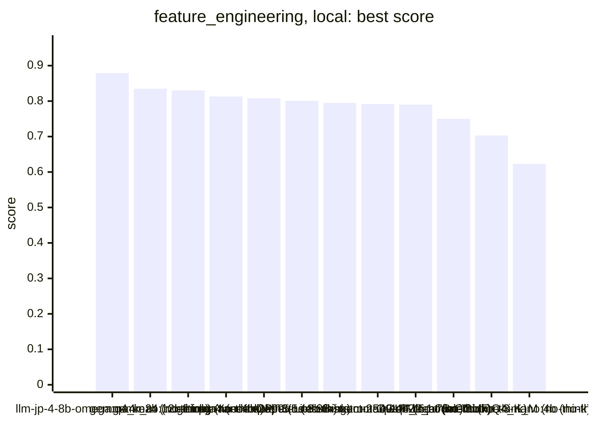
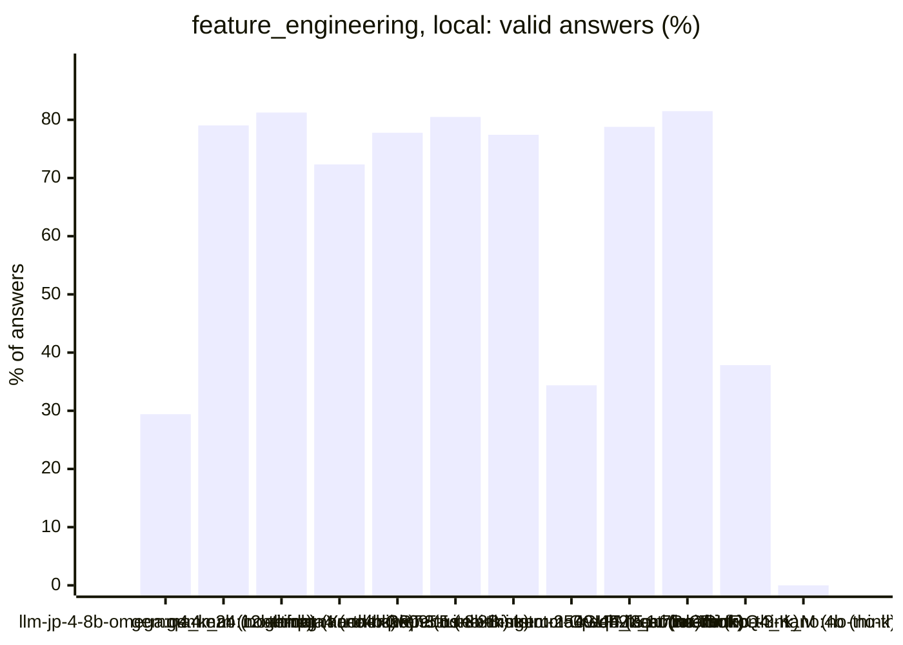
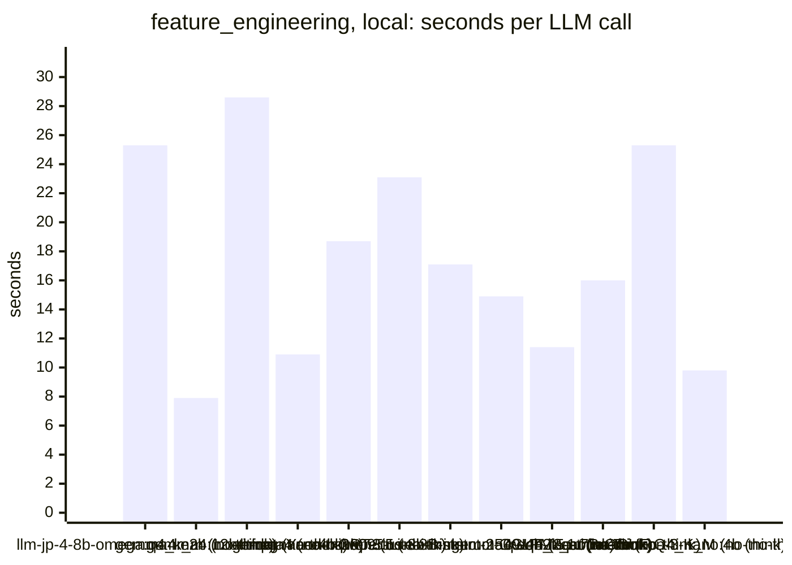
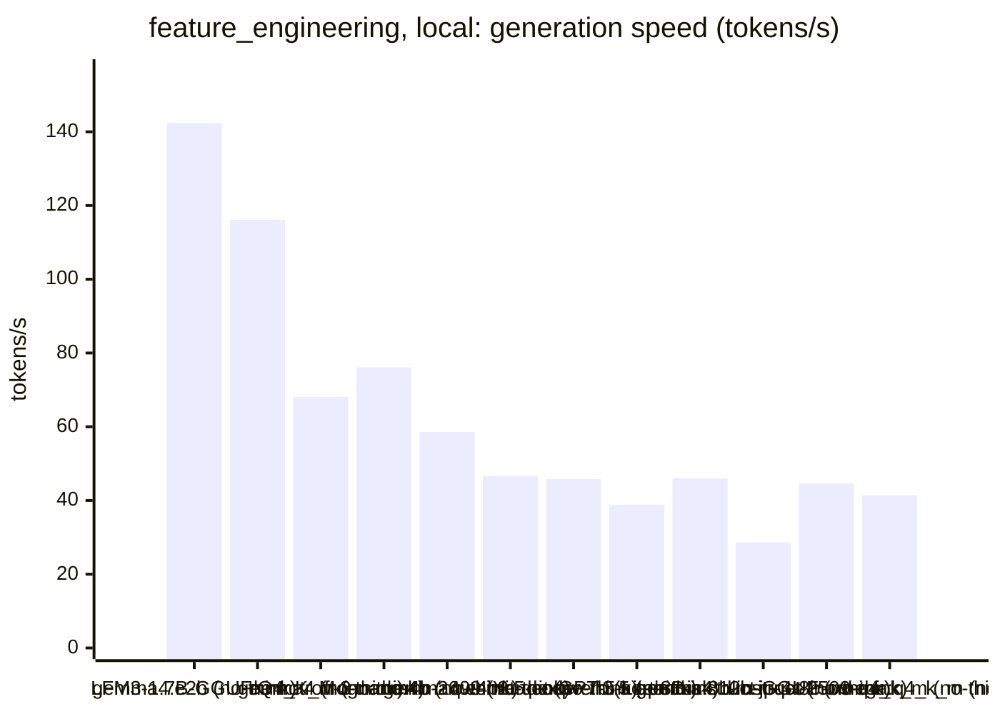
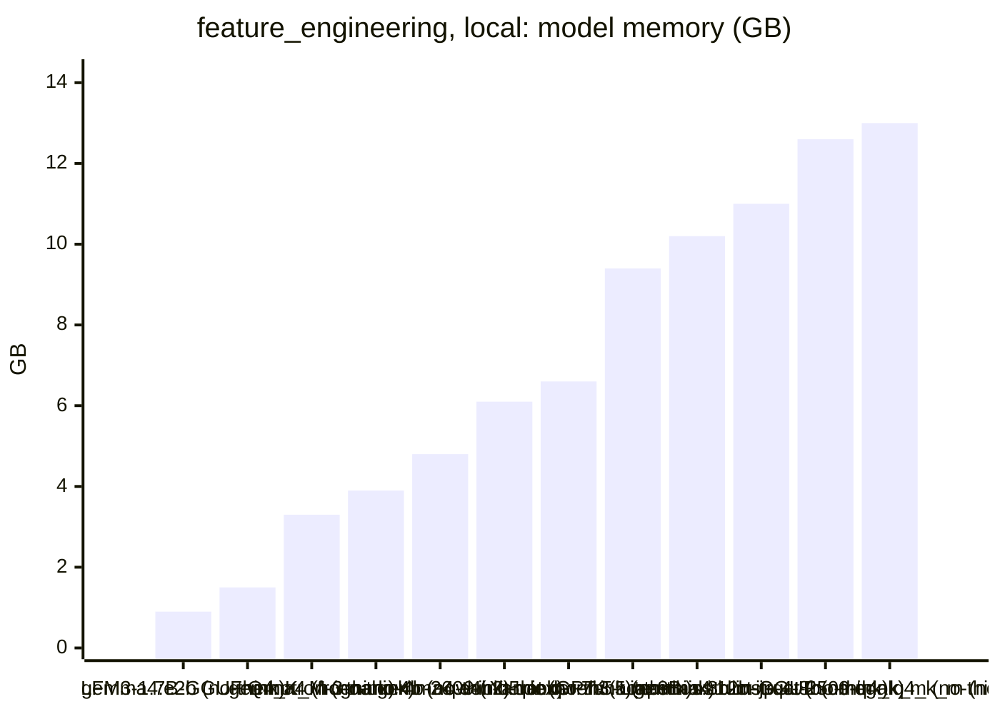
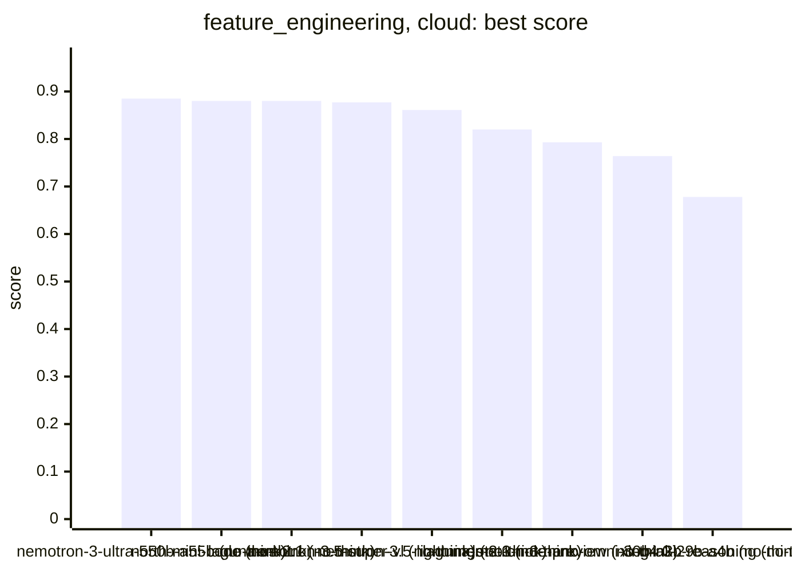
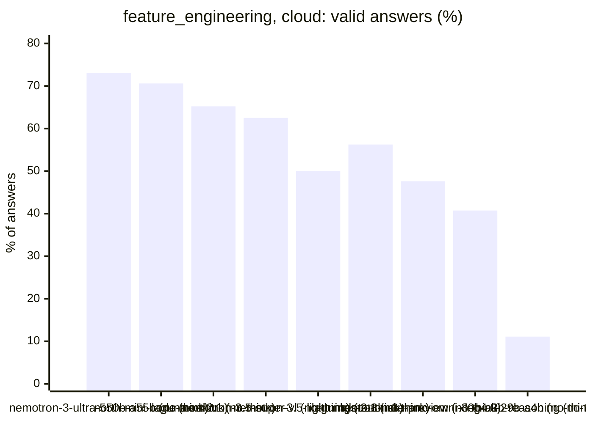
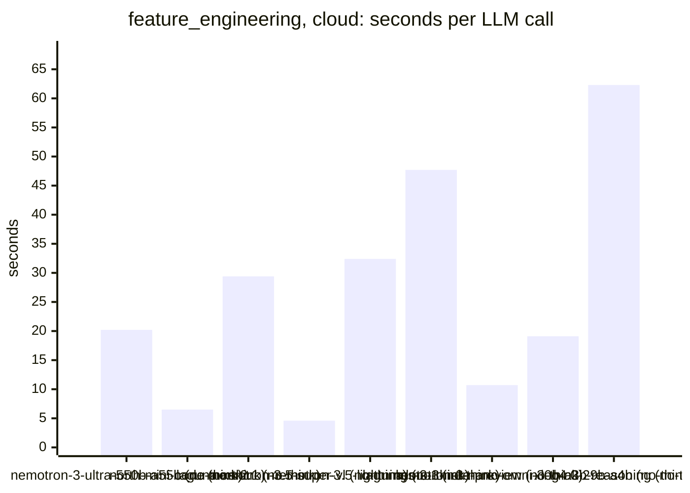
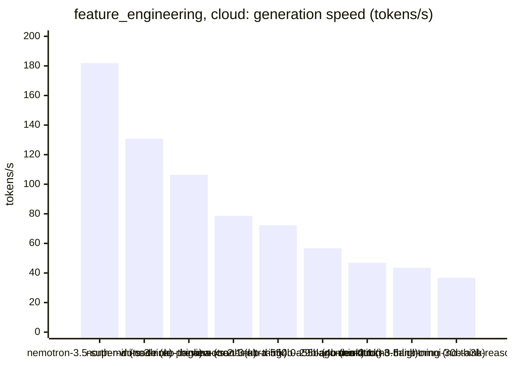

<!-- Copyright (c) 2026 by C. Klukas -->
<!-- SPDX-License-Identifier: GPL-3.0-only -->
<!-- Generated by `omega report` from bench/results/*.json. Do not edit by hand. -->

# feature_engineering

23 models, each run at most 60 minutes, ended earlier after 15 answers in a row without progress; one run per model. The [overall ranking](../benchmarks.md#overall-ranking) compares the models over all examples.

Machine: Intel(R) Core(TM) i7-8700K CPU @ 3.70GHz (MS-7A98), 12 cores, 64 GB, 2x NVIDIA GeForce GTX 1080 Ti, 11264 MiB.

## Local models

Ollama on this machine.

| Model | Params | Initial | Best | Gain | LLM calls | s/call | Valid | New bests | Min to best | Minutes | Stopped by |
|---|---|--:|--:|--:|--:|--:|--:|--:|--:|--:|---|
| llm-jp-4-8b-omega:q4_k_m (no-think) | 8.6B | 0.623 | **0.879** | ×1.41 | 17 | 25 | 29% | 1 | 0.7 | 7.5 | no progress |
| gemma4:e2b (no-think) | 4.6B | 0.623 | **0.835** | ×1.34 | 62 | 8 | 79% | 11 | 6.4 | 8.9 | no progress |
| gemma4:12b-it-qat (no-think) | 11.9B | 0.623 | **0.83** | ×1.33 | 16 | 29 | 81% | 1 | 0.9 | 8.0 | no progress |
| gemma4:latest (no-think) | 7.5B | 0.623 | **0.813** | ×1.30 | 47 | 11 | 72% | 7 | 5.6 | 9.4 | no progress |
| richardyoung/frognano-4b-2609:latest (no-think) | 4.3B | 0.623 | **0.808** | ×1.30 | 36 | 19 | 78% | 4 | 6.1 | 11.8 | no progress |
| qwen3.5:latest (no-think) | 9.0B | 0.623 | **0.801** | ×1.29 | 41 | 23 | 80% | 5 | 10.7 | 16.8 | no progress |
| yandex/YandexGPT-5-Lite-8B-instruct-GGUF:latest (no-think) | 8.0B | 0.623 | **0.795** | ×1.28 | 31 | 17 | 77% | 6 | 9.1 | 9.4 | no progress |
| MichelRosselli/apertus:8b-instruct-2509-q4_k_m (no-think) | 8.1B | 0.623 | **0.792** | ×1.27 | 32 | 15 | 34% | 3 | 3.9 | 8.6 | no progress |
| gemma4:e4b-it-qat (no-think) | 7.5B | 0.623 | **0.79** | ×1.27 | 33 | 11 | 79% | 3 | 2.9 | 6.8 | no progress |
| qwen2.5-coder:7b (no-think) | 7.6B | 0.623 | **0.75** | ×1.20 | 27 | 16 | 81% | 5 | 3.1 | 7.7 | no progress |
| hf.co/LiquidAI/LFM3-1.7B-GGUF:Q4_K_M (no-think) | 1.73B | 0.623 | **0.703** | ×1.13 | 37 | 25 | 38% | 4 | 15.8 | 16.1 | no progress |
| nemotron-3-nano:4b (no-think) | 4.0B | 0.623 | **0.623** | ×1.00 | 16 | 10 | 0% | 0 | - | 2.9 | no progress |

### Inference speed and memory

RAM is what Ollama reports for the loaded model (weights, context cache and buffers; on Apple silicon this is shared memory). Load is the time to bring the model into memory. Prompt and generation speeds are tokens per second over all calls of the run.

| Model | Params | RAM GB | Load s | Prompt tok/s | Gen tok/s | Median s/call | p90 s/call | Tokens/answer | Stopped |
|---|---|--:|--:|--:|--:|--:|--:|--:|--:|
| gemma4:e2b (no-think) | 4.6B | 0.9 | 17 | 2207 | 142.4 | 8 | 10 | 482 | 0 |
| hf.co/LiquidAI/LFM3-1.7B-GGUF:Q4_K_M (no-think) | 1.73B | 1.5 | 0 | 3976 | 116.1 | 16 | 50 | 1361 | 14 |
| gemma4:latest (no-think) | 7.5B | 3.3 | 23 | 1361 | 68.1 | 10 | 15 | 381 | 0 |
| nemotron-3-nano:4b (no-think) | 4.0B | 3.9 | 9 | 1811 | 76.1 | 7 | 15 | 245 | 1 |
| richardyoung/frognano-4b-2609:latest (no-think) | 4.3B | 4.8 | 12 | 1656 | 58.6 | 17 | 27 | 787 | 2 |
| gemma4:e4b-it-qat (no-think) | 7.5B | 6.1 | 22 | 1543 | 46.6 | 9 | 18 | 299 | 0 |
| qwen2.5-coder:7b (no-think) | 7.6B | 6.6 | 14 | 1382 | 45.8 | 15 | 20 | 497 | 0 |
| qwen3.5:latest (no-think) | 9.0B | 9.4 | 20 | 1050 | 38.8 | 20 | 34 | 642 | 0 |
| yandex/YandexGPT-5-Lite-8B-instruct-GGUF:latest (no-think) | 8.0B | 10.2 | 14 | 1627 | 46.0 | 17 | 21 | 560 | 0 |
| gemma4:12b-it-qat (no-think) | 11.9B | 11.0 | 21 | 624 | 28.6 | 30 | 38 | 569 | 0 |
| MichelRosselli/apertus:8b-instruct-2509-q4_k_m (no-think) | 8.1B | 12.6 | 15 | 1376 | 44.6 | 15 | 20 | 445 | 0 |
| llm-jp-4-8b-omega:q4_k_m (no-think) | 8.6B | 13.0 | 16 | 1350 | 41.4 | 21 | 40 | 812 | 0 |

### Best score over time

| Model | 15 min | 30 min | 45 min | 60 min |
|---|--:|--:|--:|--:|
| llm-jp-4-8b-omega:q4_k_m (no-think) | 0.879 | 0.879 | 0.879 | 0.879 |
| gemma4:e2b (no-think) | 0.835 | 0.835 | 0.835 | 0.835 |
| gemma4:12b-it-qat (no-think) | 0.83 | 0.83 | 0.83 | 0.83 |
| gemma4:latest (no-think) | 0.813 | 0.813 | 0.813 | 0.813 |
| richardyoung/frognano-4b-2609:latest (no-think) | 0.808 | 0.808 | 0.808 | 0.808 |
| qwen3.5:latest (no-think) | 0.801 | 0.801 | 0.801 | 0.801 |
| yandex/YandexGPT-5-Lite-8B-instruct-GGUF:latest (no-think) | 0.795 | 0.795 | 0.795 | 0.795 |
| MichelRosselli/apertus:8b-instruct-2509-q4_k_m (no-think) | 0.792 | 0.792 | 0.792 | 0.792 |
| gemma4:e4b-it-qat (no-think) | 0.79 | 0.79 | 0.79 | 0.79 |
| qwen2.5-coder:7b (no-think) | 0.75 | 0.75 | 0.75 | 0.75 |
| hf.co/LiquidAI/LFM3-1.7B-GGUF:Q4_K_M (no-think) | 0.701 | 0.703 | 0.703 | 0.703 |
| nemotron-3-nano:4b (no-think) | 0.623 | 0.623 | 0.623 | 0.623 |

### Outcome of the LLM answers

| Model | duplicate | edit error | invalid | llm error | ok |
|---|--:|--:|--:|--:|--:|
| llm-jp-4-8b-omega:q4_k_m (no-think) | 0 | 4 | 8 | 0 | 5 |
| gemma4:e2b (no-think) | 7 | 2 | 4 | 0 | 49 |
| gemma4:12b-it-qat (no-think) | 0 | 0 | 3 | 0 | 13 |
| gemma4:latest (no-think) | 2 | 4 | 7 | 0 | 34 |
| richardyoung/frognano-4b-2609:latest (no-think) | 0 | 5 | 1 | 2 | 28 |
| qwen3.5:latest (no-think) | 0 | 0 | 8 | 0 | 33 |
| yandex/YandexGPT-5-Lite-8B-instruct-GGUF:latest (no-think) | 2 | 1 | 4 | 0 | 24 |
| MichelRosselli/apertus:8b-instruct-2509-q4_k_m (no-think) | 3 | 12 | 6 | 0 | 11 |
| gemma4:e4b-it-qat (no-think) | 1 | 4 | 2 | 0 | 26 |
| qwen2.5-coder:7b (no-think) | 1 | 0 | 4 | 0 | 22 |
| hf.co/LiquidAI/LFM3-1.7B-GGUF:Q4_K_M (no-think) | 0 | 4 | 5 | 14 | 14 |
| nemotron-3-nano:4b (no-think) | 0 | 12 | 3 | 1 | 0 |

### Best idea per model

- **llm-jp-4-8b-omega:q4_k_m (no-think)**: Replace the raw‑input feature set with a richer representation that turns the three skewed/bounded inputs into linear signals:
- **gemma4:e2b (no-think)**: Replace the undefined `log_x3` with the actual log transformation of $x_3$ to capture its skewness, which is a known key feature for lognormal data.
- **gemma4:12b-it-qat (no-think)**: Since the label is a hidden nonlinear function and the classifier is linear, I will add nonlinear transformations like squares, products, and logs to capture interactions and …
- **gemma4:latest (no-think)**: Replace the current collection of interaction terms with squared terms involving the log-transformed feature $\log(x_3)$ and the standard-normal-like inputs ($x_1, x_2, x_6$) to …
- **richardyoung/frognano-4b-2609:latest (no-think)**: tuned THRESHOLD=-1, SCALE=0.7 on top of: Align the soft-threshold parameters to the proven best settings (THRESHOLD=-2.0, SCALE=0.5) identified in the sweep, remove redundant …
- **qwen3.5:latest (no-think)**: Replace raw squared features with centered quadratic terms using explicit mean constants derived from input distributions (0 for normal-like inputs, 4/3 for uniform inputs) to …
- **yandex/YandexGPT-5-Lite-8B-instruct-GGUF:latest (no-think)**: Introduce a threshold parameter for x4 to better capture the nonlinear effects and interaction between the skewed and uniform inputs.
- **MichelRosselli/apertus:8b-instruct-2509-q4_k_m (no-think)**: Add a logarithmic transformation for x3 (skewed, right-tail heavy), as the label may depend on its exponential growth.
- **gemma4:e4b-it-qat (no-think)**: Modify the problematic logarithmic term to ensure the argument is always positive to prevent `ValueError` when $x_3x_4$ or $x_3x_5$ is negative, by using $\max(0, x_3x_4)$ before …
- **qwen2.5-coder:7b (no-think)**: tuned SOFT_THRESHOLD=8.73 on top of: Introduce a soft threshold feature for x3 to capture its non-linear effect more smoothly. This feature will help the linear model better …
- **hf.co/LiquidAI/LFM3-1.7B-GGUF:Q4_K_M (no-think)**: Add a fine-grained logarithmic grid for x3 using `LOG_INTERVAL`, square-root magnitude,
- **nemotron-3-nano:4b (no-think)**: initial program

## Cloud models (OpenRouter)

Free OpenRouter models; times include the network and the provider's queue.

| Model | Params | Initial | Best | Gain | LLM calls | s/call | Valid | New bests | Min to best | Minutes | Stopped by |
|---|---|--:|--:|--:|--:|--:|--:|--:|--:|--:|---|
| nvidia/nemotron-3-ultra-550b-a55b:free (no-think) |  | 0.623 | **0.885** | ×1.42 | 26 | 20 | 73% | 5 | 3.6 | 9.6 | no progress |
| cohere/north-mini-code:free (no-think) |  | 0.623 | **0.88** | ×1.41 | 17 | 6 | 71% | 1 | 0.2 | 1.9 | no progress |
| poolside/laguna-xs-2.1:free (no-think) |  | 0.623 | **0.88** | ×1.41 | 23 | 29 | 65% | 2 | 2.6 | 12.6 | no progress |
| nvidia/nemotron-3.5-super-vl:free (no-think) |  | 0.623 | **0.877** | ×1.41 | 40 | 5 | 62% | 3 | 1.7 | 3.2 | no progress |
| nvidia/nemotron-3.5-lightning:free (no-think) |  | 0.623 | **0.861** | ×1.38 | 50 | 32 | 50% | 4 | 18.8 | 27.3 | no progress |
| poolside/laguna-s-2.1:free (no-think) |  | 0.623 | **0.82** | ×1.32 | 16 | 48 | 56% | 1 | 0.5 | 12.8 | no progress |
| dots-studio/dots-3-note-preview:free (no-think) |  | 0.623 | **0.793** | ×1.27 | 21 | 11 | 48% | 3 | 1.4 | 3.9 | no progress |
| nvidia/nemotron-3-nano-omni-30b-a3b-reasoning:free (no-think) |  | 0.623 | **0.764** | ×1.23 | 27 | 19 | 41% | 2 | 2.1 | 9.6 | no progress |
| xingchen-agi/xing4.0-29b-a4b:free (no-think) |  | 0.623 | **0.678** | ×1.09 | 9 | 62 | 11% | 1 | 1.9 | 9.4 | model errors |
| google/gemma-4-26b-a4b-it:free (no-think) |  | | | | | | | | | | failed: all 6 model requests failed: google/gemma-4-26b-a4b-it:free: |
| google/gemma-4-31b-it:free (no-think) |  | | | | | | | | | | failed: all 6 model requests failed: google/gemma-4-31b-it:free: rat |

### Inference speed and cost

Generation speed is measured from the first to the last streamed token; the time to the first token is counted as prompt time. Cost is what OpenRouter charged for the run.

| Model | Gen tok/s | Median s/call | p90 s/call | Tokens/answer | Stopped | Cost $ |
|---|--:|--:|--:|--:|--:|--:|
| nvidia/nemotron-3.5-super-vl:free (no-think) | 181.9 | 4 | 8 | 708 | 1 | 0.000 |
| cohere/north-mini-code:free (no-think) | 130.8 | 6 | 11 | 791 | 0 | 0.000 |
| dots-studio/dots-3-note-preview:free (no-think) | 106.4 | 10 | 16 | 915 | 1 | 0.000 |
| poolside/laguna-xs-2.1:free (no-think) | 78.6 | 17 | 71 | 500 | 1 | 0.000 |
| nvidia/nemotron-3-ultra-550b-a55b:free (no-think) | 72.3 | 20 | 41 | 1288 | 0 | 0.000 |
| xingchen-agi/xing4.0-29b-a4b:free (no-think) | 56.7 | 74 | 76 | 23 | 0 | 0.000 |
| poolside/laguna-s-2.1:free (no-think) | 46.8 | 34 | 82 | 1022 | 1 | 0.000 |
| nvidia/nemotron-3.5-lightning:free (no-think) | 43.5 | 18 | 72 | 1572 | 9 | 0.000 |
| nvidia/nemotron-3-nano-omni-30b-a3b-reasoning:free (no-think) | 36.8 | 9 | 24 | 684 | 2 | 0.000 |

### Best score over time

| Model | 15 min | 30 min | 45 min | 60 min |
|---|--:|--:|--:|--:|
| nvidia/nemotron-3-ultra-550b-a55b:free (no-think) | 0.885 | 0.885 | 0.885 | 0.885 |
| cohere/north-mini-code:free (no-think) | 0.88 | 0.88 | 0.88 | 0.88 |
| poolside/laguna-xs-2.1:free (no-think) | 0.88 | 0.88 | 0.88 | 0.88 |
| nvidia/nemotron-3.5-super-vl:free (no-think) | 0.877 | 0.877 | 0.877 | 0.877 |
| nvidia/nemotron-3.5-lightning:free (no-think) | 0.857 | 0.861 | 0.861 | 0.861 |
| poolside/laguna-s-2.1:free (no-think) | 0.82 | 0.82 | 0.82 | 0.82 |
| dots-studio/dots-3-note-preview:free (no-think) | 0.793 | 0.793 | 0.793 | 0.793 |
| nvidia/nemotron-3-nano-omni-30b-a3b-reasoning:free (no-think) | 0.764 | 0.764 | 0.764 | 0.764 |
| xingchen-agi/xing4.0-29b-a4b:free (no-think) | 0.678 | 0.678 | 0.678 | 0.678 |

### Outcome of the LLM answers

| Model | duplicate | edit error | invalid | llm error | ok |
|---|--:|--:|--:|--:|--:|
| nvidia/nemotron-3-ultra-550b-a55b:free (no-think) | 1 | 1 | 5 | 0 | 19 |
| cohere/north-mini-code:free (no-think) | 2 | 1 | 2 | 0 | 12 |
| poolside/laguna-xs-2.1:free (no-think) | 0 | 1 | 2 | 5 | 15 |
| nvidia/nemotron-3.5-super-vl:free (no-think) | 2 | 7 | 5 | 1 | 25 |
| nvidia/nemotron-3.5-lightning:free (no-think) | 7 | 7 | 2 | 9 | 25 |
| poolside/laguna-s-2.1:free (no-think) | 0 | 3 | 2 | 2 | 9 |
| dots-studio/dots-3-note-preview:free (no-think) | 1 | 5 | 4 | 1 | 10 |
| nvidia/nemotron-3-nano-omni-30b-a3b-reasoning:free (no-think) | 1 | 10 | 3 | 2 | 11 |
| xingchen-agi/xing4.0-29b-a4b:free (no-think) | 0 | 0 | 0 | 8 | 1 |

### Best idea per model

- **nvidia/nemotron-3-ultra-550b-a55b:free (no-think)**: Add sign features for key pairwise products involving x3 (log-normal) and x6 (normal) to capture quadrant patterns with these variables, and add a radial feature for x1,x6 to …
- **cohere/north-mini-code:free (no-think)**: Replace raw inputs with transformed features that capture nonlinear interactions: include pairwise products, squares, log of x3, sign of products, and simple threshold bins to …
- **poolside/laguna-xs-2.1:free (no-think)**: Remove one feature to stay within the 30-feature limit while keeping the most promising transformations.
- **nvidia/nemotron-3.5-super-vl:free (no-think)**: Add square terms for x4/x5 and their product, plus x3*x6 interaction, since the uniform inputs matter quadratically and interact with x3; cap all values and keep exactly 30 …
- **nvidia/nemotron-3.5-lightning:free (no-think)**: Replace fixed tanh thresholds and heuristic bin edges with learned soft step features using optimized learnable parameters and data-driven interval bins that can capture …
- **poolside/laguna-s-2.1:free (no-think)**: Replace the raw-input baseline with a richer set of nonlinear transforms (log of the skewed input, pairwise products and their signs for XOR/quadrant effects, squares/radii for …
- **dots-studio/dots-3-note-preview:free (no-think)**: Remove the invalid SWEEP/PAIRS/SQUARES lines that caused the syntax error, keeping the intended pairwise products and squares features.
- **nvidia/nemotron-3-nano-omni-30b-a3b-reasoning:free (no-think)**: Add binarized quadrant indicators for all three input pairs (x1*x2, x1*x3, x2*x3) to capture XOR-like patterns while keeping feature count low and computation fast.
- **xingchen-agi/xing4.0-29b-a4b:free (no-think)**: edit: # The log of x3: x3 is positive and right-skewed (lognormal-like). A linear model / # on raw inputs finds almost nothing useful; the l
