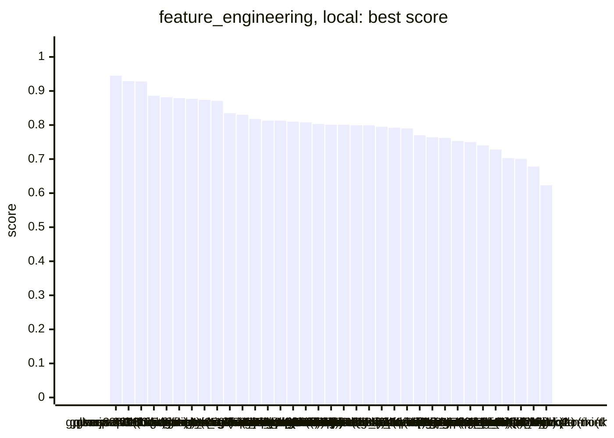
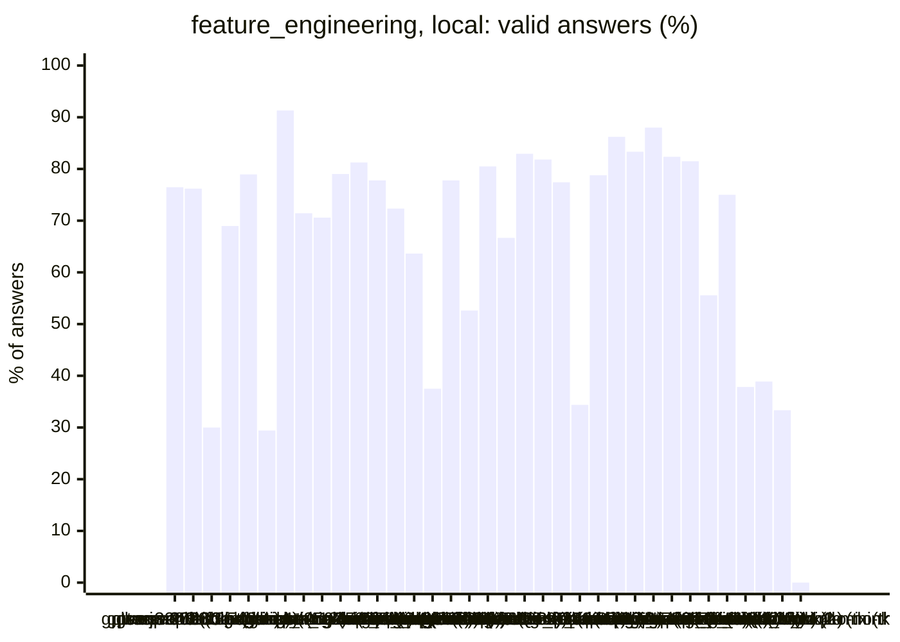
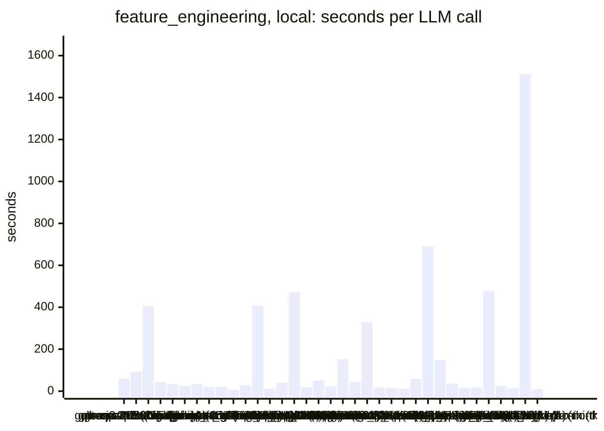
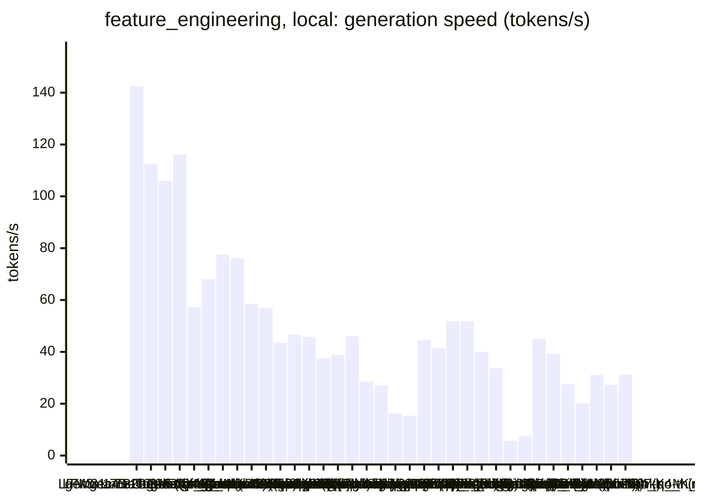
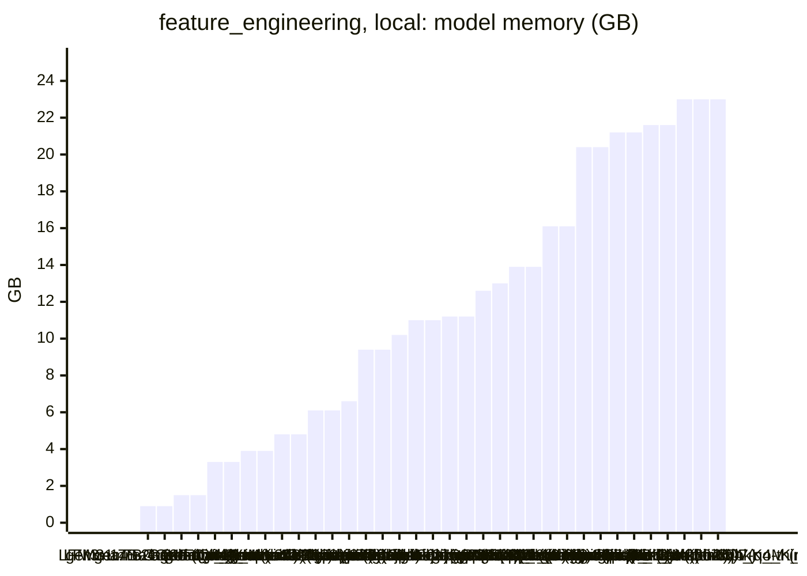
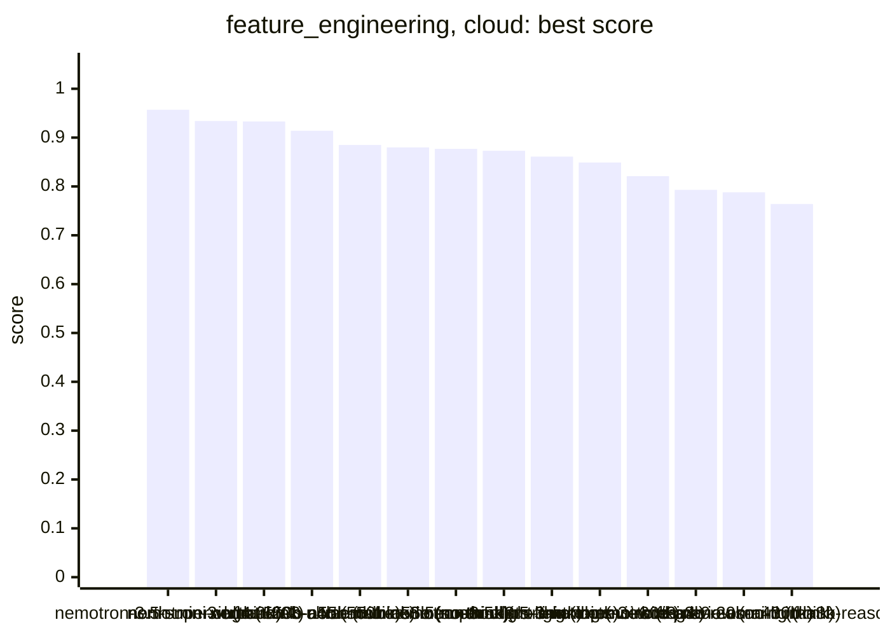
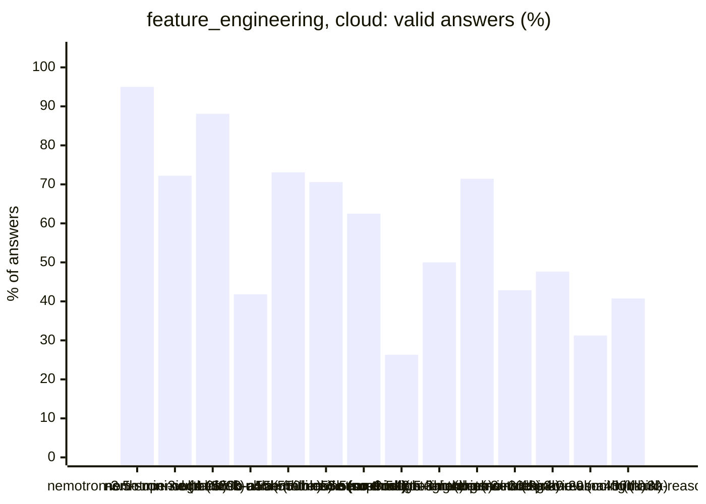
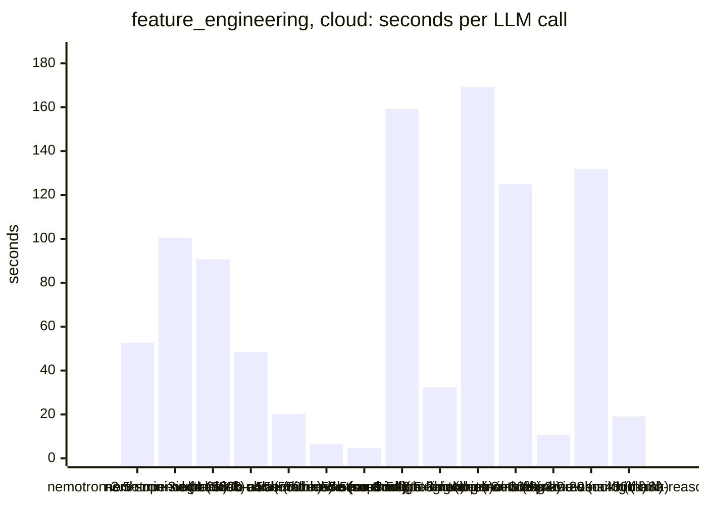
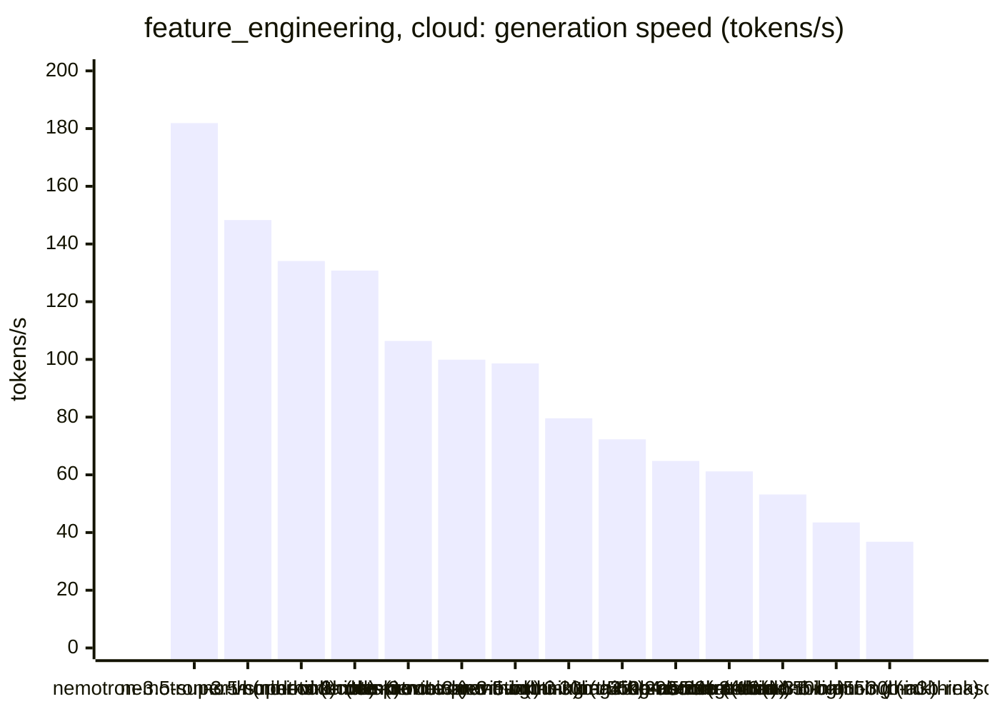

<!-- Copyright (c) 2026 by C. Klukas -->
<!-- SPDX-License-Identifier: GPL-3.0-only -->
<!-- Generated by `omega report` from bench/results/*.json. Do not edit by hand. -->

# feature_engineering

50 models, each run at most 60 minutes, ended earlier after 15 answers in a row without progress; one run per model. The [overall ranking](../benchmarks.md#overall-ranking) compares the models over all examples.

Machine: Intel(R) Core(TM) i7-8700K CPU @ 3.70GHz (MS-7A98), 12 cores, 64 GB, 2x NVIDIA GeForce GTX 1080 Ti, 11264 MiB.

## Local models

Ollama on this machine.

| Model | Params | Initial | Best | Gain | LLM calls | s/call | Valid | New bests | Min to best | Minutes | Stopped by |
|---|---|--:|--:|--:|--:|--:|--:|--:|--:|--:|---|
| gpt-oss:20b (think) | 20.9B | 0.623 | **0.945** | ×1.52 | 17 | 59 | 76% | 3 | 3.6 | 18.3 | no progress |
| gpt-oss:20b (no-think) | 20.9B | 0.623 | **0.929** | ×1.49 | 21 | 93 | 76% | 4 | 15.6 | 33.4 | no progress |
| frob/sarvam:30b (no-think) | 32.2B | 0.623 | **0.928** | ×1.49 | 10 | 407 | 30% | 3 | 30.4 | 68.1 | time limit |
| qwen3.5:latest (think) | 9.0B | 0.623 | **0.886** | ×1.42 | 29 | 44 | 69% | 3 | 7.7 | 24.5 | no progress |
| gemma4:26b-a4b-it-qat (no-think) | 25.2B | 0.623 | **0.882** | ×1.42 | 19 | 34 | 79% | 2 | 2.8 | 11.1 | no progress |
| llm-jp-4-8b-omega:q4_k_m (no-think) | 8.6B | 0.623 | **0.879** | ×1.41 | 17 | 25 | 29% | 1 | 0.7 | 7.5 | no progress |
| gemma4:latest (think) | 7.5B | 0.623 | **0.877** | ×1.41 | 46 | 33 | 91% | 9 | 16.3 | 27.1 | no progress |
| qwen3:30b-a3b-instruct-2507-q4_K_M (no-think) | 30.5B | 0.623 | **0.874** | ×1.40 | 21 | 19 | 71% | 2 | 3.7 | 7.5 | no progress |
| qwen3:30b-a3b-instruct-2507-q4_K_M (think) | 30.5B | 0.623 | **0.871** | ×1.40 | 17 | 21 | 71% | 2 | 1.6 | 7.7 | no progress |
| gemma4:e2b (no-think) | 4.6B | 0.623 | **0.835** | ×1.34 | 62 | 8 | 79% | 11 | 6.4 | 8.9 | no progress |
| gemma4:12b-it-qat (no-think) | 11.9B | 0.623 | **0.83** | ×1.33 | 16 | 29 | 81% | 1 | 0.9 | 8.0 | no progress |
| gemma4:12b-it-qat (think) | 11.9B | 0.623 | **0.818** | ×1.31 | 9 | 408 | 78% | 2 | 43.6 | 62.1 | time limit |
| gemma4:latest (no-think) | 7.5B | 0.623 | **0.813** | ×1.30 | 47 | 11 | 72% | 7 | 5.6 | 9.4 | no progress |
| glm-4.7-flash:latest (no-think) | 29.9B | 0.623 | **0.813** | ×1.30 | 22 | 40 | 64% | 4 | 7.8 | 15.7 | no progress |
| frob/sarvam:30b (think) | 32.2B | 0.623 | **0.81** | ×1.30 | 8 | 472 | 38% | 2 | 40.3 | 64.5 | time limit |
| richardyoung/frognano-4b-2609:latest (no-think) | 4.3B | 0.623 | **0.808** | ×1.30 | 36 | 19 | 78% | 4 | 6.1 | 11.8 | no progress |
| richardyoung/frognano-4b-2609:latest (think) | 4.3B | 0.623 | **0.803** | ×1.29 | 19 | 50 | 53% | 2 | 2.2 | 16.4 | no progress |
| qwen3.5:latest (no-think) | 9.0B | 0.623 | **0.801** | ×1.29 | 41 | 23 | 80% | 5 | 10.7 | 16.8 | no progress |
| hf.co/LiquidAI/LFM3-1.7B-GGUF:Q4_K_M (think) | 1.73B | 0.623 | **0.801** | ×1.29 | 24 | 153 | 67% | 5 | 26.4 | 63.3 | time limit |
| gemma4:e4b-it-qat (think) | 7.5B | 0.623 | **0.799** | ×1.28 | 41 | 43 | 83% | 5 | 15.7 | 30.9 | no progress |
| gemma4:26b-a4b-it-qat (think) | 25.2B | 0.623 | **0.799** | ×1.28 | 11 | 330 | 82% | 4 | 55.3 | 61.9 | time limit |
| yandex/YandexGPT-5-Lite-8B-instruct-GGUF:latest (no-think) | 8.0B | 0.623 | **0.795** | ×1.28 | 31 | 17 | 77% | 6 | 9.1 | 9.4 | no progress |
| MichelRosselli/apertus:8b-instruct-2509-q4_k_m (no-think) | 8.1B | 0.623 | **0.792** | ×1.27 | 32 | 15 | 34% | 3 | 3.9 | 8.6 | no progress |
| gemma4:e4b-it-qat (no-think) | 7.5B | 0.623 | **0.79** | ×1.27 | 33 | 11 | 79% | 3 | 2.9 | 6.8 | no progress |
| underdog-saluki-27b:iq2-mix (no-think) | 26.9B | 0.623 | **0.77** | ×1.24 | 29 | 58 | 86% | 6 | 15.1 | 29.6 | no progress |
| qwen3.6:27b-coding-mtp-q4_K_M (think) | 27.3B | 0.623 | **0.764** | ×1.23 | 6 | 689 | 83% | 4 | 45.7 | 70.3 | time limit |
| qwen3.6:27b-coding-mtp-q4_K_M (no-think) | 27.3B | 0.623 | **0.762** | ×1.22 | 25 | 149 | 88% | 6 | 41.5 | 65.0 | time limit |
| qwen3-coder:30b (no-think) | 30.5B | 0.623 | **0.753** | ×1.21 | 17 | 36 | 82% | 1 | 1.5 | 10.7 | no progress |
| qwen2.5-coder:7b (no-think) | 7.6B | 0.623 | **0.75** | ×1.20 | 27 | 16 | 81% | 5 | 3.1 | 7.7 | no progress |
| nemotron-3-nano:4b (think) | 4.0B | 0.623 | **0.74** | ×1.19 | 27 | 17 | 56% | 2 | 2.8 | 8.5 | no progress |
| glm-4.7-flash:latest (think) | 29.9B | 0.623 | **0.728** | ×1.17 | 8 | 479 | 75% | 1 | 4.6 | 65.3 | time limit |
| hf.co/LiquidAI/LFM3-1.7B-GGUF:Q4_K_M (no-think) | 1.73B | 0.623 | **0.703** | ×1.13 | 37 | 25 | 38% | 4 | 15.8 | 16.1 | no progress |
| gemma4:e2b (think) | 4.6B | 0.623 | **0.701** | ×1.13 | 18 | 13 | 39% | 1 | 0.8 | 4.7 | no progress |
| underdog-saluki-27b:iq2-mix (think) | 26.9B | 0.623 | **0.678** | ×1.09 | 3 | 1511 | 33% | 1 | 48.8 | 76.3 | time limit |
| nemotron-3-nano:4b (no-think) | 4.0B | 0.623 | **0.623** | ×1.00 | 16 | 10 | 0% | 0 | - | 2.9 | no progress |

### Inference speed and memory

RAM is what Ollama reports for the loaded model (weights, context cache and buffers; on Apple silicon this is shared memory). Load is the time to bring the model into memory. Prompt and generation speeds are tokens per second over all calls of the run.

| Model | Params | RAM GB | Load s | Prompt tok/s | Gen tok/s | Median s/call | p90 s/call | Tokens/answer | Stopped |
|---|---|--:|--:|--:|--:|--:|--:|--:|--:|
| gemma4:e2b (no-think) | 4.6B | 0.9 | 17 | 2207 | 142.4 | 8 | 10 | 482 | 0 |
| gemma4:e2b (think) | 4.6B | 0.9 | 0 | 2553 | 112.6 | 13 | 18 | 1158 | 0 |
| hf.co/LiquidAI/LFM3-1.7B-GGUF:Q4_K_M (think) | 1.73B | 1.5 | 0 | 4123 | 106.0 | 157 | 188 | 15860 | 0 |
| hf.co/LiquidAI/LFM3-1.7B-GGUF:Q4_K_M (no-think) | 1.73B | 1.5 | 0 | 3976 | 116.1 | 16 | 50 | 1361 | 14 |
| gemma4:latest (think) | 7.5B | 3.3 | 0 | 1293 | 57.2 | 34 | 43 | 1613 | 0 |
| gemma4:latest (no-think) | 7.5B | 3.3 | 23 | 1361 | 68.1 | 10 | 15 | 381 | 0 |
| nemotron-3-nano:4b (think) | 4.0B | 3.9 | 0 | 1866 | 77.5 | 16 | 25 | 1012 | 0 |
| nemotron-3-nano:4b (no-think) | 4.0B | 3.9 | 9 | 1811 | 76.1 | 7 | 15 | 245 | 1 |
| richardyoung/frognano-4b-2609:latest (no-think) | 4.3B | 4.8 | 12 | 1656 | 58.6 | 17 | 27 | 787 | 2 |
| richardyoung/frognano-4b-2609:latest (think) | 4.3B | 4.8 | 0 | 1722 | 57.0 | 38 | 87 | 2495 | 2 |
| gemma4:e4b-it-qat (think) | 7.5B | 6.1 | 0 | 1524 | 43.5 | 41 | 62 | 1657 | 0 |
| gemma4:e4b-it-qat (no-think) | 7.5B | 6.1 | 22 | 1543 | 46.6 | 9 | 18 | 299 | 0 |
| qwen2.5-coder:7b (no-think) | 7.6B | 6.6 | 14 | 1382 | 45.8 | 15 | 20 | 497 | 0 |
| qwen3.5:latest (think) | 9.0B | 9.4 | 0 | 1036 | 37.6 | 39 | 68 | 1417 | 0 |
| qwen3.5:latest (no-think) | 9.0B | 9.4 | 20 | 1050 | 38.8 | 20 | 34 | 642 | 0 |
| yandex/YandexGPT-5-Lite-8B-instruct-GGUF:latest (no-think) | 8.0B | 10.2 | 14 | 1627 | 46.0 | 17 | 21 | 560 | 0 |
| gemma4:12b-it-qat (no-think) | 11.9B | 11.0 | 21 | 624 | 28.6 | 30 | 38 | 569 | 0 |
| gemma4:12b-it-qat (think) | 11.9B | 11.0 | 0 | 613 | 27.1 | 292 | 948 | 10868 | 0 |
| underdog-saluki-27b:iq2-mix (no-think) | 26.9B | 11.2 | 22 | 396 | 16.2 | 57 | 74 | 736 | 0 |
| underdog-saluki-27b:iq2-mix (think) | 26.9B | 11.2 | 0 | 382 | 15.4 | 1611 | 1622 | 23091 | 0 |
| MichelRosselli/apertus:8b-instruct-2509-q4_k_m (no-think) | 8.1B | 12.6 | 15 | 1376 | 44.6 | 15 | 20 | 445 | 0 |
| llm-jp-4-8b-omega:q4_k_m (no-think) | 8.6B | 13.0 | 16 | 1350 | 41.4 | 21 | 40 | 812 | 0 |
| gpt-oss:20b (think) | 20.9B | 13.9 | 0 | 1769 | 51.8 | 53 | 102 | 2857 | 0 |
| gpt-oss:20b (no-think) | 20.9B | 13.9 | 37 | 1781 | 51.8 | 68 | 126 | 4532 | 0 |
| gemma4:26b-a4b-it-qat (no-think) | 25.2B | 16.1 | 51 | 846 | 40.0 | 30 | 72 | 1002 | 0 |
| gemma4:26b-a4b-it-qat (think) | 25.2B | 16.1 | 0 | 802 | 33.7 | 310 | 463 | 10895 | 0 |
| qwen3.6:27b-coding-mtp-q4_K_M (think) | 27.3B | 20.4 | 0 | 189 | 5.7 | 851 | 909 | 3808 | 0 |
| qwen3.6:27b-coding-mtp-q4_K_M (no-think) | 27.3B | 20.4 | 53 | 187 | 7.4 | 135 | 221 | 925 | 1 |
| frob/sarvam:30b (no-think) | 32.2B | 21.2 | 59 | 1288 | 45.0 | 550 | 567 | 18071 | 1 |
| frob/sarvam:30b (think) | 32.2B | 21.2 | 0 | 1373 | 39.2 | 636 | 640 | 18325 | 0 |
| glm-4.7-flash:latest (no-think) | 29.9B | 21.6 | 56 | 384 | 27.5 | 41 | 54 | 722 | 0 |
| glm-4.7-flash:latest (think) | 29.9B | 21.6 | 0 | 488 | 20.1 | 422 | 1371 | 9490 | 0 |
| qwen3:30b-a3b-instruct-2507-q4_K_M (no-think) | 30.5B | 23.0 | 55 | 655 | 31.1 | 15 | 23 | 304 | 0 |
| qwen3:30b-a3b-instruct-2507-q4_K_M (think) | 30.5B | 23.0 | 0 | 646 | 27.3 | 19 | 30 | 369 | 0 |
| qwen3-coder:30b (no-think) | 30.5B | 23.0 | 53 | 641 | 31.2 | 35 | 51 | 826 | 0 |

### Best score over time

| Model | 15 min | 30 min | 45 min | 60 min |
|---|--:|--:|--:|--:|
| gpt-oss:20b (think) | 0.945 | 0.945 | 0.945 | 0.945 |
| gpt-oss:20b (no-think) | 0.924 | 0.929 | 0.929 | 0.929 |
| frob/sarvam:30b (no-think) | 0.749 | 0.811 | 0.928 | 0.928 |
| qwen3.5:latest (think) | 0.886 | 0.886 | 0.886 | 0.886 |
| gemma4:26b-a4b-it-qat (no-think) | 0.882 | 0.882 | 0.882 | 0.882 |
| llm-jp-4-8b-omega:q4_k_m (no-think) | 0.879 | 0.879 | 0.879 | 0.879 |
| gemma4:latest (think) | 0.874 | 0.877 | 0.877 | 0.877 |
| qwen3:30b-a3b-instruct-2507-q4_K_M (no-think) | 0.874 | 0.874 | 0.874 | 0.874 |
| qwen3:30b-a3b-instruct-2507-q4_K_M (think) | 0.871 | 0.871 | 0.871 | 0.871 |
| gemma4:e2b (no-think) | 0.835 | 0.835 | 0.835 | 0.835 |
| gemma4:12b-it-qat (no-think) | 0.83 | 0.83 | 0.83 | 0.83 |
| gemma4:12b-it-qat (think) | 0.788 | 0.788 | 0.818 | 0.818 |
| gemma4:latest (no-think) | 0.813 | 0.813 | 0.813 | 0.813 |
| glm-4.7-flash:latest (no-think) | 0.813 | 0.813 | 0.813 | 0.813 |
| frob/sarvam:30b (think) | 0.741 | 0.741 | 0.81 | 0.81 |
| richardyoung/frognano-4b-2609:latest (no-think) | 0.808 | 0.808 | 0.808 | 0.808 |
| richardyoung/frognano-4b-2609:latest (think) | 0.803 | 0.803 | 0.803 | 0.803 |
| qwen3.5:latest (no-think) | 0.801 | 0.801 | 0.801 | 0.801 |
| hf.co/LiquidAI/LFM3-1.7B-GGUF:Q4_K_M (think) | 0.799 | 0.801 | 0.801 | 0.801 |
| gemma4:e4b-it-qat (think) | 0.798 | 0.799 | 0.799 | 0.799 |
| gemma4:26b-a4b-it-qat (think) | 0.791 | 0.796 | 0.796 | 0.799 |
| yandex/YandexGPT-5-Lite-8B-instruct-GGUF:latest (no-think) | 0.795 | 0.795 | 0.795 | 0.795 |
| MichelRosselli/apertus:8b-instruct-2509-q4_k_m (no-think) | 0.792 | 0.792 | 0.792 | 0.792 |
| gemma4:e4b-it-qat (no-think) | 0.79 | 0.79 | 0.79 | 0.79 |
| underdog-saluki-27b:iq2-mix (no-think) | 0.766 | 0.77 | 0.77 | 0.77 |
| qwen3.6:27b-coding-mtp-q4_K_M (think) | 0.735 | 0.735 | 0.745 | 0.764 |
| qwen3.6:27b-coding-mtp-q4_K_M (no-think) | 0.757 | 0.757 | 0.762 | 0.762 |
| qwen3-coder:30b (no-think) | 0.753 | 0.753 | 0.753 | 0.753 |
| qwen2.5-coder:7b (no-think) | 0.75 | 0.75 | 0.75 | 0.75 |
| nemotron-3-nano:4b (think) | 0.74 | 0.74 | 0.74 | 0.74 |
| glm-4.7-flash:latest (think) | 0.728 | 0.728 | 0.728 | 0.728 |
| hf.co/LiquidAI/LFM3-1.7B-GGUF:Q4_K_M (no-think) | 0.701 | 0.703 | 0.703 | 0.703 |
| gemma4:e2b (think) | 0.701 | 0.701 | 0.701 | 0.701 |
| underdog-saluki-27b:iq2-mix (think) | 0.623 | 0.623 | 0.623 | 0.678 |
| nemotron-3-nano:4b (no-think) | 0.623 | 0.623 | 0.623 | 0.623 |

### Outcome of the LLM answers

| Model | duplicate | edit error | invalid | llm error | ok |
|---|--:|--:|--:|--:|--:|
| gpt-oss:20b (think) | 2 | 0 | 2 | 0 | 13 |
| gpt-oss:20b (no-think) | 1 | 1 | 3 | 0 | 16 |
| frob/sarvam:30b (no-think) | 0 | 6 | 0 | 1 | 3 |
| qwen3.5:latest (think) | 1 | 1 | 7 | 0 | 20 |
| gemma4:26b-a4b-it-qat (no-think) | 0 | 3 | 1 | 0 | 15 |
| llm-jp-4-8b-omega:q4_k_m (no-think) | 0 | 4 | 8 | 0 | 5 |
| gemma4:latest (think) | 2 | 0 | 2 | 0 | 42 |
| qwen3:30b-a3b-instruct-2507-q4_K_M (no-think) | 1 | 1 | 4 | 0 | 15 |
| qwen3:30b-a3b-instruct-2507-q4_K_M (think) | 0 | 1 | 4 | 0 | 12 |
| gemma4:e2b (no-think) | 7 | 2 | 4 | 0 | 49 |
| gemma4:12b-it-qat (no-think) | 0 | 0 | 3 | 0 | 13 |
| gemma4:12b-it-qat (think) | 0 | 2 | 0 | 0 | 7 |
| gemma4:latest (no-think) | 2 | 4 | 7 | 0 | 34 |
| glm-4.7-flash:latest (no-think) | 0 | 3 | 5 | 0 | 14 |
| frob/sarvam:30b (think) | 0 | 5 | 0 | 0 | 3 |
| richardyoung/frognano-4b-2609:latest (no-think) | 0 | 5 | 1 | 2 | 28 |
| richardyoung/frognano-4b-2609:latest (think) | 0 | 5 | 2 | 2 | 10 |
| qwen3.5:latest (no-think) | 0 | 0 | 8 | 0 | 33 |
| hf.co/LiquidAI/LFM3-1.7B-GGUF:Q4_K_M (think) | 0 | 7 | 1 | 0 | 16 |
| gemma4:e4b-it-qat (think) | 6 | 0 | 1 | 0 | 34 |
| gemma4:26b-a4b-it-qat (think) | 1 | 1 | 0 | 0 | 9 |
| yandex/YandexGPT-5-Lite-8B-instruct-GGUF:latest (no-think) | 2 | 1 | 4 | 0 | 24 |
| MichelRosselli/apertus:8b-instruct-2509-q4_k_m (no-think) | 3 | 12 | 6 | 0 | 11 |
| gemma4:e4b-it-qat (no-think) | 1 | 4 | 2 | 0 | 26 |
| underdog-saluki-27b:iq2-mix (no-think) | 0 | 3 | 1 | 0 | 25 |
| qwen3.6:27b-coding-mtp-q4_K_M (think) | 0 | 1 | 0 | 0 | 5 |
| qwen3.6:27b-coding-mtp-q4_K_M (no-think) | 0 | 0 | 2 | 1 | 22 |
| qwen3-coder:30b (no-think) | 3 | 0 | 0 | 0 | 14 |
| qwen2.5-coder:7b (no-think) | 1 | 0 | 4 | 0 | 22 |
| nemotron-3-nano:4b (think) | 0 | 11 | 1 | 0 | 15 |
| glm-4.7-flash:latest (think) | 0 | 2 | 0 | 0 | 6 |
| hf.co/LiquidAI/LFM3-1.7B-GGUF:Q4_K_M (no-think) | 0 | 4 | 5 | 14 | 14 |
| gemma4:e2b (think) | 9 | 2 | 0 | 0 | 7 |
| underdog-saluki-27b:iq2-mix (think) | 0 | 2 | 0 | 0 | 1 |
| nemotron-3-nano:4b (no-think) | 0 | 12 | 3 | 1 | 0 |

### Best idea per model

- **gpt-oss:20b (think)**: Add higher‑order cross‑product and radial features to capture more complex interactions that the ridge‑regularized linear model can exploit.
- **gpt-oss:20b (no-think)**: Replace raw‑input features with a 30‑feature set that includes all pairwise products, log and threshold transforms of the skewed input, simple indicators, and two radius terms, to …
- **frob/sarvam:30b (no-think)**: Transform each input with absolute values, squares, pairwise products, binary sign of products, and ratios with a denominator offset, then add a log and high‑threshold indicator …
- **qwen3.5:latest (think)**: Add pairwise interaction products, hard threshold indicator bins at multiple cutoffs, and quadrant/sign features to better express nonlinear decision boundaries for the linear …
- **gemma4:26b-a4b-it-qat (no-think)**: The feedback shows significant weights for $f_6$ (log(x3)), $f_{13}$ (x3*x4?), and $f_{10}$ (x4^2). The current feature set is using generic interactions and squares; I will …
- **llm-jp-4-8b-omega:q4_k_m (no-think)**: Replace the raw‑input feature set with a richer representation that turns the three skewed/bounded inputs into linear signals:
- **gemma4:latest (think)**: Introduce a new interaction feature combining the radial distance of $x_1$ and $x_2$ weighted by $\log(x_3)$ to capture combined geometric and skewed variable effects.
- **qwen3:30b-a3b-instruct-2507-q4_K_M (no-think)**: Define log_offset as a small constant (e.g., 0.1) to safely normalize log(x3) without introducing undefined name errors, improving skew correction and feature separability.
- **qwen3:30b-a3b-instruct-2507-q4_K_M (think)**: Replace raw pairwise products with sign-based quadrant indicators to capture nonlinearity in decision boundaries without amplifying noise from small input values.
- **gemma4:e2b (no-think)**: Replace the undefined `log_x3` with the actual log transformation of $x_3$ to capture its skewness, which is a known key feature for lognormal data.
- **gemma4:12b-it-qat (no-think)**: Since the label is a hidden nonlinear function and the classifier is linear, I will add nonlinear transformations like squares, products, and logs to capture interactions and …
- **gemma4:12b-it-qat (think)**: Replace the current 6-feature vector with a 29-feature basis consisting of a log-transformation for the skewed input, a set of 24 "soft-threshold" features (using `tanh` with four …
- **gemma4:latest (no-think)**: Replace the current collection of interaction terms with squared terms involving the log-transformed feature $\log(x_3)$ and the standard-normal-like inputs ($x_1, x_2, x_6$) to …
- **glm-4.7-flash:latest (no-think)**: tuned THRESHOLD_C=1, RADII_CUTOFF=0, THRESHOLD_SIGNED=1 on top of: Replace the raw inputs and pairwise products with a set of higher-order polynomial features and radial basis …
- **frob/sarvam:30b (think)**: Add pairwise products of x4 and x5, and x1 and x2 to capture quadrant interactions, which may linearize the hidden rule and improve accuracy.
- **richardyoung/frognano-4b-2609:latest (no-think)**: tuned THRESHOLD=-1, SCALE=0.7 on top of: Align the soft-threshold parameters to the proven best settings (THRESHOLD=-2.0, SCALE=0.5) identified in the sweep, remove redundant …
- **richardyoung/frognano-4b-2609:latest (think)**: Add missing x4/x5 raw features, x3_sq, x4_sq, x5_sq, and x1_x3/x2_x3/x4_x5 interactions to capture full signal from all inputs without overfitting
- **qwen3.5:latest (no-think)**: Replace raw squared features with centered quadratic terms using explicit mean constants derived from input distributions (0 for normal-like inputs, 4/3 for uniform inputs) to …
- **hf.co/LiquidAI/LFM3-1.7B-GGUF:Q4_K_M (think)**: Add extra interaction features `x3*x4`, `x3*x5` and a scaled guard term `LOG_EPS * x3` so the linear model captures coupling of the right‑skewed positive input with uniform …
- **gemma4:e4b-it-qat (think)**: Define the threshold T=0.0 within the features function to resolve the NameError and allow the hard indicator feature for x4 to be computed.
- **gemma4:26b-a4b-it-qat (think)**: Replace the two 3-way interaction terms with $x_1 x_2 \log(x_3)$ and $x_1 x_2 x_3$ to better capture potential interactions between the most significant features.
- **yandex/YandexGPT-5-Lite-8B-instruct-GGUF:latest (no-think)**: Introduce a threshold parameter for x4 to better capture the nonlinear effects and interaction between the skewed and uniform inputs.
- **MichelRosselli/apertus:8b-instruct-2509-q4_k_m (no-think)**: Add a logarithmic transformation for x3 (skewed, right-tail heavy), as the label may depend on its exponential growth.
- **gemma4:e4b-it-qat (no-think)**: Modify the problematic logarithmic term to ensure the argument is always positive to prevent `ValueError` when $x_3x_4$ or $x_3x_5$ is negative, by using $\max(0, x_3x_4)$ before …
- **underdog-saluki-27b:iq2-mix (no-think)**: tuned SOFT_S=0.35, T1=-0.6, T2=-0.3, T3=1.2 on top of: Add explicit threshold/indicator features for x1, x2, x6 at a few cutoffs (soft thresholds) so the linear model can fit …
- **qwen3.6:27b-coding-mtp-q4_K_M (think)**: tuned K_SLOPE=10, T_L3=-0.5 on top of: Drop uniform noise inputs x4/x5, add individual squared terms for radial flexibility, and introduce smooth threshold features via tanh to …
- **qwen3.6:27b-coding-mtp-q4_K_M (no-think)**: tuned STEEPNESS=7 on top of: The current program has a train/test accuracy gap (0.726 vs 0.754) and includes squared terms with low weights, suggesting potential overfitting or …
- **qwen3-coder:30b (no-think)**: Replace raw inputs with log-transformed skewed features and pairwise products to capture interaction effects, which should improve separation for the linear classifier.
- **qwen2.5-coder:7b (no-think)**: tuned SOFT_THRESHOLD=8.73 on top of: Introduce a soft threshold feature for x3 to capture its non-linear effect more smoothly. This feature will help the linear model better …
- **nemotron-3-nano:4b (think)**: Add a radius feature sqrt(x4² + x5²) to capture the combined magnitude of the uniform inputs, potentially improving separability without adding redundant features.
- **glm-4.7-flash:latest (think)**: Replace raw inputs with non-linear transformations (log of skewed input, pairwise products, and squares) to capture the hidden non-linear rule using a linear classifier.
- **hf.co/LiquidAI/LFM3-1.7B-GGUF:Q4_K_M (no-think)**: Add a fine-grained logarithmic grid for x3 using `LOG_INTERVAL`, square-root magnitude,
- **gemma4:e2b (think)**: Add the logarithm of $x_3$ to capture the lognormal-like distribution of that input, which is a direct feature engineering step suggested by the input description.
- **underdog-saluki-27b:iq2-mix (think)**: Add a log transform of the skewed positive x3 (keeping raw x3) so the linear model can capture monotone/threshold effects in x3 that raw x3 represents poorly.
- **nemotron-3-nano:4b (no-think)**: initial program

## Cloud models (OpenRouter)

Free OpenRouter models; times include the network and the provider's queue.

| Model | Params | Initial | Best | Gain | LLM calls | s/call | Valid | New bests | Min to best | Minutes | Stopped by |
|---|---|--:|--:|--:|--:|--:|--:|--:|--:|--:|---|
| nvidia/nemotron-3.5-super-vl:free (think) |  | 0.623 | **0.957** | ×1.54 | 20 | 53 | 95% | 6 | 8.4 | 18.0 | no progress |
| cohere/north-mini-code:free (think) |  | 0.623 | **0.934** | ×1.50 | 36 | 100 | 72% | 5 | 37.5 | 60.6 | time limit |
| nvidia/nemotron-3-ultra-550b-a55b:free (think) |  | 0.623 | **0.933** | ×1.50 | 42 | 91 | 88% | 9 | 50.2 | 64.2 | time limit |
| xingchen-agi/xing4.0-29b-a4b:free (no-think) |  | 0.623 | **0.914** | ×1.47 | 55 | 48 | 42% | 6 | 34.6 | 45.0 | no progress |
| nvidia/nemotron-3-ultra-550b-a55b:free (no-think) |  | 0.623 | **0.885** | ×1.42 | 26 | 20 | 73% | 5 | 3.6 | 9.6 | no progress |
| cohere/north-mini-code:free (no-think) |  | 0.623 | **0.88** | ×1.41 | 17 | 6 | 71% | 1 | 0.2 | 1.9 | no progress |
| nvidia/nemotron-3.5-super-vl:free (no-think) |  | 0.623 | **0.877** | ×1.41 | 40 | 5 | 62% | 3 | 1.7 | 3.2 | no progress |
| nvidia/nemotron-3.5-lightning:free (think) |  | 0.623 | **0.873** | ×1.40 | 19 | 159 | 26% | 2 | 5.6 | 51.1 | no progress |
| nvidia/nemotron-3.5-lightning:free (no-think) |  | 0.623 | **0.861** | ×1.38 | 50 | 32 | 50% | 4 | 18.8 | 27.3 | no progress |
| dots-studio/dots-3-note-preview:free (think) |  | 0.623 | **0.849** | ×1.36 | 21 | 169 | 71% | 9 | 52.3 | 60.1 | time limit |
| nvidia/nemotron-3-nano-omni-30b-a3b-reasoning:free (think) |  | 0.623 | **0.821** | ×1.32 | 21 | 125 | 43% | 3 | 9.9 | 43.9 | no progress |
| dots-studio/dots-3-note-preview:free (no-think) |  | 0.623 | **0.793** | ×1.27 | 21 | 11 | 48% | 3 | 1.4 | 3.9 | no progress |
| xingchen-agi/xing4.0-29b-a4b:free (think) |  | 0.623 | **0.788** | ×1.26 | 16 | 132 | 31% | 1 | 1.6 | 35.2 | no progress |
| nvidia/nemotron-3-nano-omni-30b-a3b-reasoning:free (no-think) |  | 0.623 | **0.764** | ×1.23 | 27 | 19 | 41% | 2 | 2.1 | 9.6 | no progress |
| recursive/flint-v1.0:free (think) |  | | | | | | | | | | failed: all 6 model requests failed: recursive/flint-v1.0:free: rate |

### Inference speed and cost

Generation speed is measured from the first to the last streamed token; the time to the first token is counted as prompt time. Cost is what OpenRouter charged for the run.

| Model | Gen tok/s | Median s/call | p90 s/call | Tokens/answer | Stopped | Cost $ |
|---|--:|--:|--:|--:|--:|--:|
| nvidia/nemotron-3.5-super-vl:free (no-think) | 181.9 | 4 | 8 | 708 | 1 | 0.000 |
| nvidia/nemotron-3.5-super-vl:free (think) | 148.3 | 45 | 128 | 7694 | 0 | 0.000 |
| cohere/north-mini-code:free (think) | 134.1 | 88 | 202 | 13364 | 0 | 0.000 |
| cohere/north-mini-code:free (no-think) | 130.8 | 6 | 11 | 791 | 0 | 0.000 |
| dots-studio/dots-3-note-preview:free (no-think) | 106.4 | 10 | 16 | 915 | 1 | 0.000 |
| dots-studio/dots-3-note-preview:free (think) | 99.9 | 166 | 246 | 16704 | 0 | 0.000 |
| nvidia/nemotron-3.5-lightning:free (think) | 98.6 | 140 | 330 | 15523 | 1 | 0.000 |
| nvidia/nemotron-3-nano-omni-30b-a3b-reasoning:free (think) | 79.6 | 112 | 228 | 9871 | 0 | 0.000 |
| nvidia/nemotron-3-ultra-550b-a55b:free (no-think) | 72.3 | 20 | 41 | 1288 | 0 | 0.000 |
| xingchen-agi/xing4.0-29b-a4b:free (think) | 64.8 | 75 | 408 | 2314 | 2 | 0.000 |
| xingchen-agi/xing4.0-29b-a4b:free (no-think) | 61.2 | 43 | 76 | 579 | 4 | 0.000 |
| nvidia/nemotron-3-ultra-550b-a55b:free (think) | 53.2 | 68 | 197 | 4639 | 0 | 0.000 |
| nvidia/nemotron-3.5-lightning:free (no-think) | 43.5 | 18 | 72 | 1572 | 9 | 0.000 |
| nvidia/nemotron-3-nano-omni-30b-a3b-reasoning:free (no-think) | 36.8 | 9 | 24 | 684 | 2 | 0.000 |

### Best score over time

| Model | 15 min | 30 min | 45 min | 60 min |
|---|--:|--:|--:|--:|
| nvidia/nemotron-3.5-super-vl:free (think) | 0.957 | 0.957 | 0.957 | 0.957 |
| cohere/north-mini-code:free (think) | 0.879 | 0.879 | 0.934 | 0.934 |
| nvidia/nemotron-3-ultra-550b-a55b:free (think) | 0.923 | 0.93 | 0.932 | 0.933 |
| xingchen-agi/xing4.0-29b-a4b:free (no-think) | 0.761 | 0.88 | 0.914 | 0.914 |
| nvidia/nemotron-3-ultra-550b-a55b:free (no-think) | 0.885 | 0.885 | 0.885 | 0.885 |
| cohere/north-mini-code:free (no-think) | 0.88 | 0.88 | 0.88 | 0.88 |
| nvidia/nemotron-3.5-super-vl:free (no-think) | 0.877 | 0.877 | 0.877 | 0.877 |
| nvidia/nemotron-3.5-lightning:free (think) | 0.873 | 0.873 | 0.873 | 0.873 |
| nvidia/nemotron-3.5-lightning:free (no-think) | 0.857 | 0.861 | 0.861 | 0.861 |
| dots-studio/dots-3-note-preview:free (think) | 0.828 | 0.83 | 0.839 | 0.849 |
| nvidia/nemotron-3-nano-omni-30b-a3b-reasoning:free (think) | 0.821 | 0.821 | 0.821 | 0.821 |
| dots-studio/dots-3-note-preview:free (no-think) | 0.793 | 0.793 | 0.793 | 0.793 |
| xingchen-agi/xing4.0-29b-a4b:free (think) | 0.788 | 0.788 | 0.788 | 0.788 |
| nvidia/nemotron-3-nano-omni-30b-a3b-reasoning:free (no-think) | 0.764 | 0.764 | 0.764 | 0.764 |

### Outcome of the LLM answers

| Model | duplicate | edit error | invalid | llm error | ok |
|---|--:|--:|--:|--:|--:|
| nvidia/nemotron-3.5-super-vl:free (think) | 1 | 0 | 0 | 0 | 19 |
| cohere/north-mini-code:free (think) | 1 | 9 | 0 | 0 | 26 |
| nvidia/nemotron-3-ultra-550b-a55b:free (think) | 1 | 2 | 2 | 0 | 37 |
| xingchen-agi/xing4.0-29b-a4b:free (no-think) | 1 | 5 | 3 | 23 | 23 |
| nvidia/nemotron-3-ultra-550b-a55b:free (no-think) | 1 | 1 | 5 | 0 | 19 |
| cohere/north-mini-code:free (no-think) | 2 | 1 | 2 | 0 | 12 |
| nvidia/nemotron-3.5-super-vl:free (no-think) | 2 | 7 | 5 | 1 | 25 |
| nvidia/nemotron-3.5-lightning:free (think) | 0 | 12 | 1 | 1 | 5 |
| nvidia/nemotron-3.5-lightning:free (no-think) | 7 | 7 | 2 | 9 | 25 |
| dots-studio/dots-3-note-preview:free (think) | 1 | 5 | 0 | 0 | 15 |
| nvidia/nemotron-3-nano-omni-30b-a3b-reasoning:free (think) | 0 | 10 | 2 | 0 | 9 |
| dots-studio/dots-3-note-preview:free (no-think) | 1 | 5 | 4 | 1 | 10 |
| xingchen-agi/xing4.0-29b-a4b:free (think) | 0 | 0 | 0 | 11 | 5 |
| nvidia/nemotron-3-nano-omni-30b-a3b-reasoning:free (no-think) | 1 | 10 | 3 | 2 | 11 |

### Best idea per model

- **nvidia/nemotron-3.5-super-vl:free (think)**: tuned X4_C=-0.8299, X4_S=0.3071, X5_C=-1.25, X5_S=0.5829 on top of: Add two axis-aligned soft-threshold features on x4 and x5 so the linear model can fit rectangular regions in …
- **cohere/north-mini-code:free (think)**: Add interaction features that combine binary thresholds with sign features and each other to capture AND-like patterns missing from the current feature set.
- **xingchen-agi/xing4.0-29b-a4b:free (no-think)**: Add a complementary circular feature for x4/x5 (a signed component feature) and keep the radius-bin indicators but trim to 3 thresholds, because the current program has 21 …
- **nvidia/nemotron-3-ultra-550b-a55b:free (no-think)**: Add sign features for key pairwise products involving x3 (log-normal) and x6 (normal) to capture quadrant patterns with these variables, and add a radial feature for x1,x6 to …
- **cohere/north-mini-code:free (no-think)**: Replace raw inputs with transformed features that capture nonlinear interactions: include pairwise products, squares, log of x3, sign of products, and simple threshold bins to …
- **nvidia/nemotron-3.5-super-vl:free (no-think)**: Add square terms for x4/x5 and their product, plus x3*x6 interaction, since the uniform inputs matter quadratically and interact with x3; cap all values and keep exactly 30 …
- **nvidia/nemotron-3.5-lightning:free (think)**: Add sign interaction features (sign(x_i * x_j)) and radius features (x_i^2 + x_j^2) to capture quadrant and circular patterns, complementing the existing log-transform and making …
- **nvidia/nemotron-3.5-lightning:free (no-think)**: Replace fixed tanh thresholds and heuristic bin edges with learned soft step features using optimized learnable parameters and data-driven interval bins that can capture …
- **dots-studio/dots-3-note-preview:free (think)**: tuned T1=2.031, T3=0.9235, S=0.3384 on top of: Add sign-of-x1*x2 interactions with x3 transforms and a soft threshold on x3, replacing the hard indicators and soft thresholds on …
- **nvidia/nemotron-3-nano-omni-30b-a3b-reasoning:free (think)**: We replace the raw inputs with 30 carefully engineered features (indicators, logs, norms, and ReLU‑like terms) that linearize the hidden nonlinear rule, increasing separability …
- **dots-studio/dots-3-note-preview:free (no-think)**: Remove the invalid SWEEP/PAIRS/SQUARES lines that caused the syntax error, keeping the intended pairwise products and squares features.
- **xingchen-agi/xing4.0-29b-a4b:free (think)**: Add all pairwise products, squares, and log of x3 to capture nonlinear interactions, quadratic terms, and log scaling, allowing the linear classifier to better approximate the …
- **nvidia/nemotron-3-nano-omni-30b-a3b-reasoning:free (no-think)**: Add binarized quadrant indicators for all three input pairs (x1*x2, x1*x3, x2*x3) to capture XOR-like patterns while keeping feature count low and computation fast.
