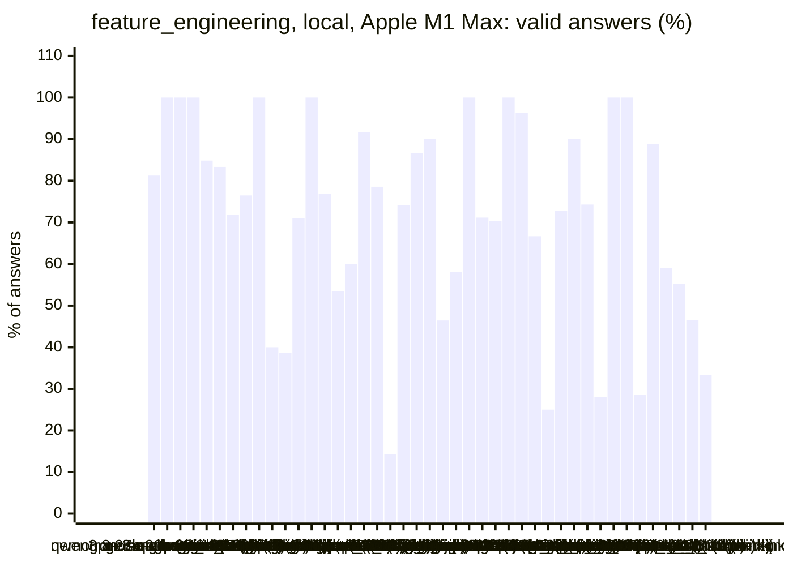
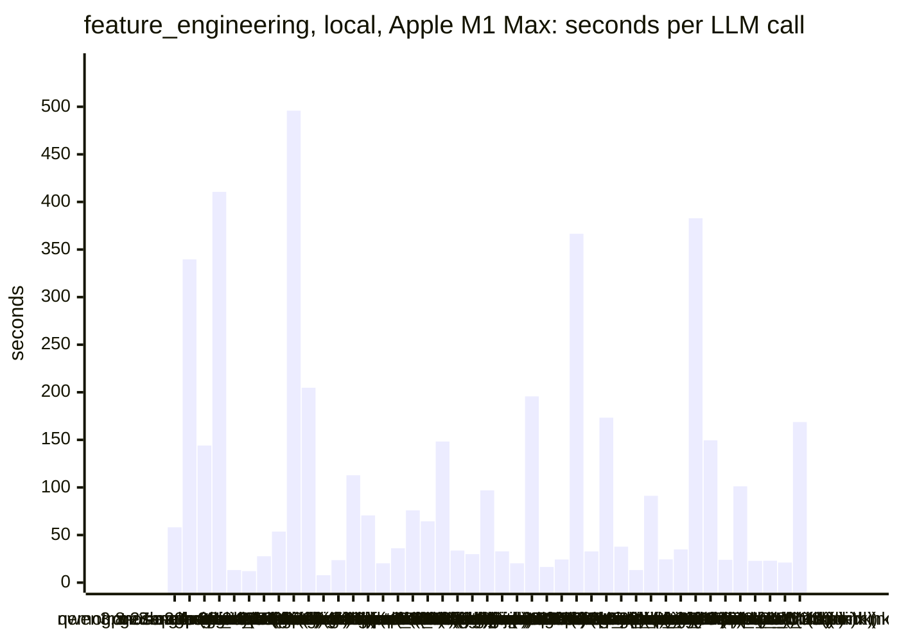
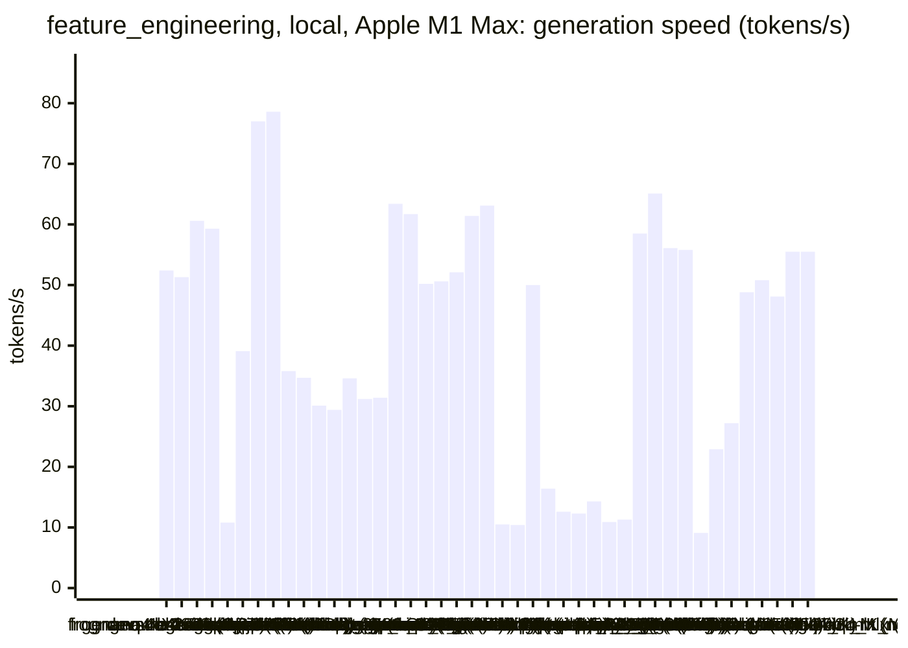
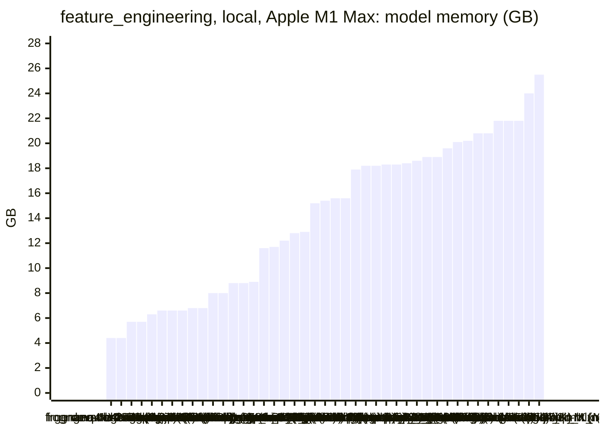
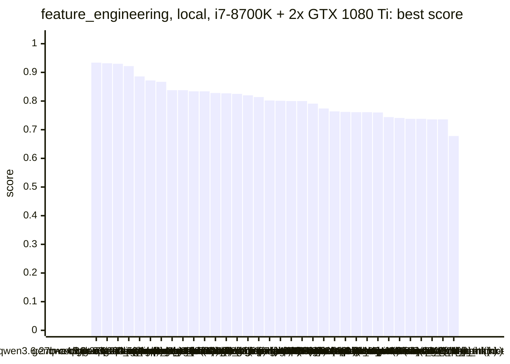
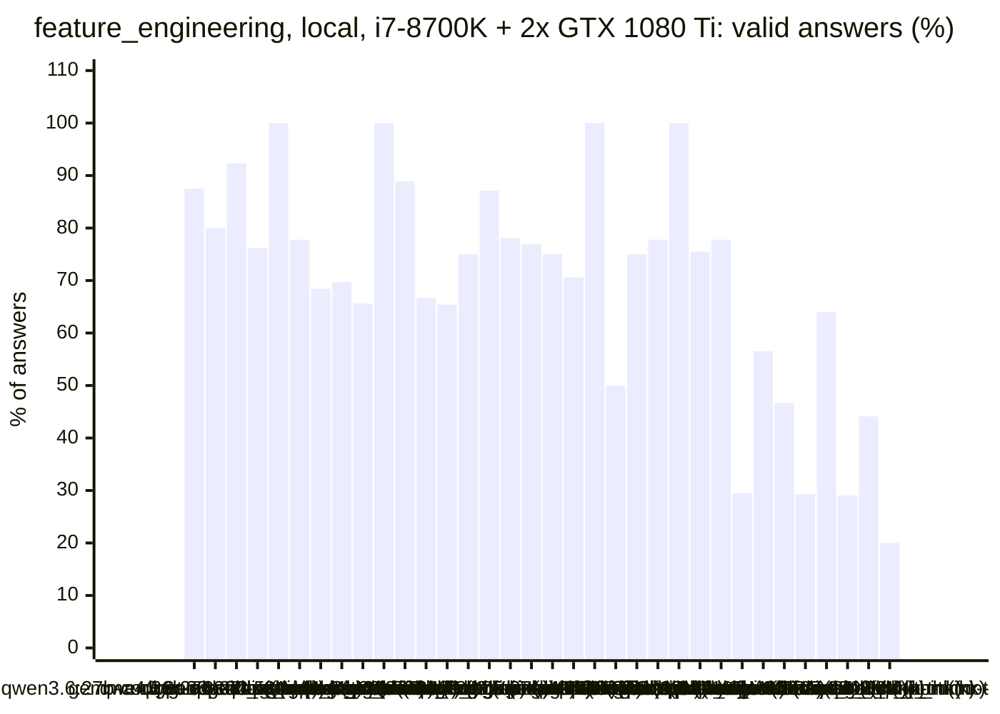
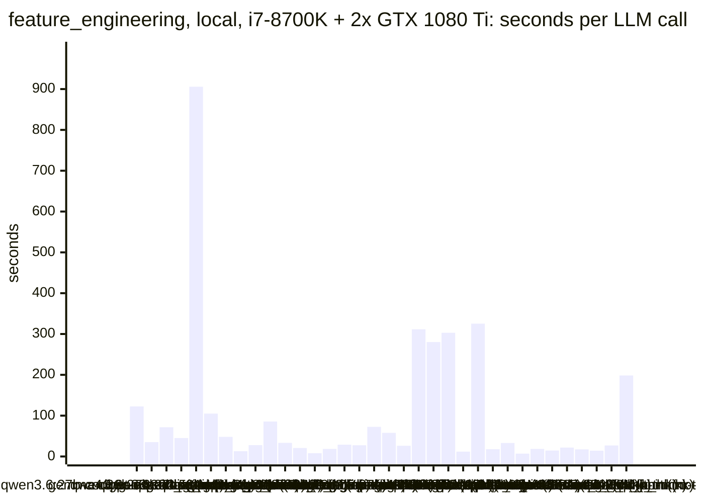
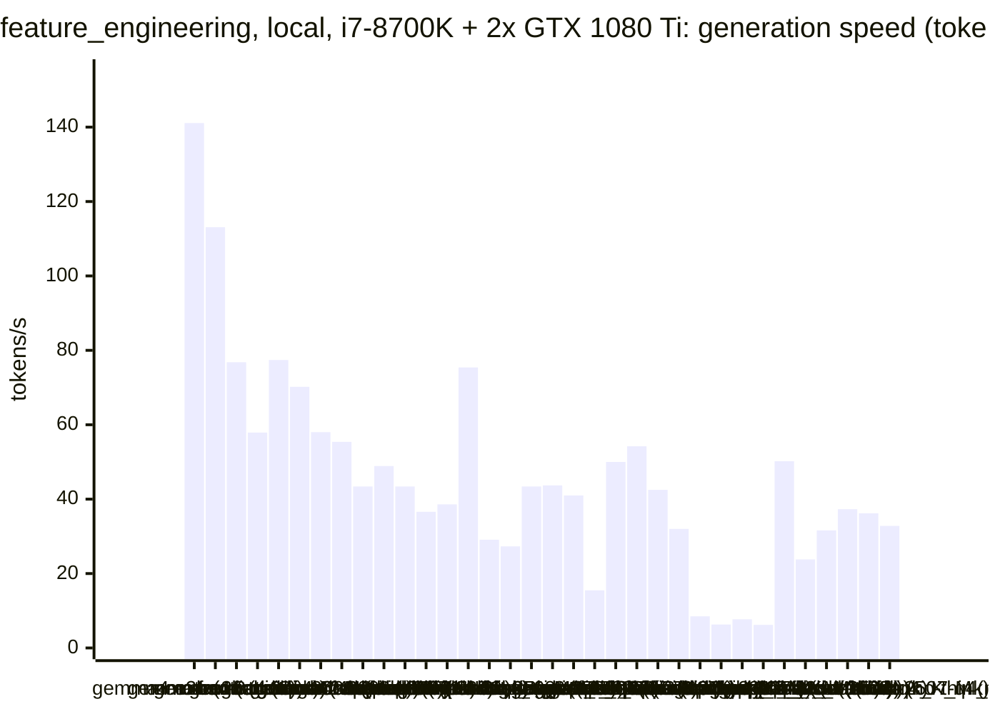
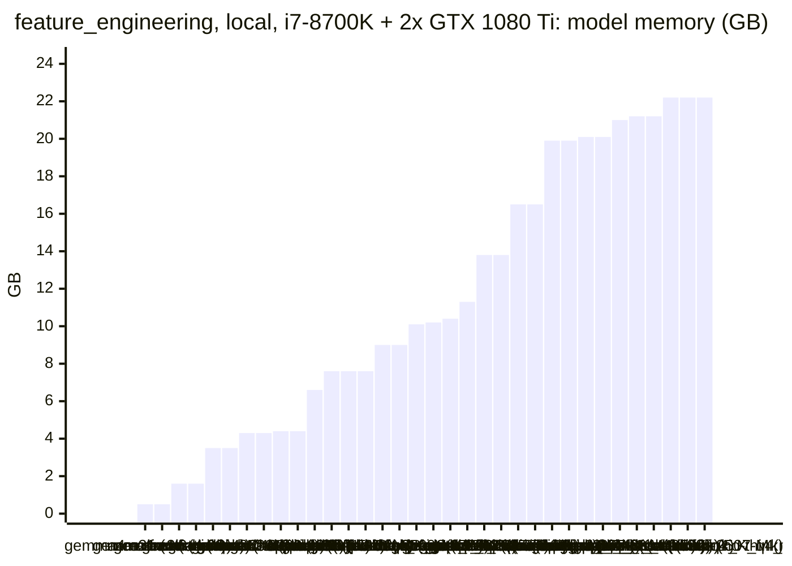

<!-- Copyright (c) 2026 by C. Klukas -->
<!-- SPDX-License-Identifier: GPL-3.0-only -->
<!-- Generated by `omega report` from bench/results/*.json. Do not edit by hand. -->

# feature_engineering

46 models, 15 minutes each, one run per model. The [overall ranking](../benchmarks.md#overall-ranking) compares the models over all examples.

Machines: **Apple M1 Max**: Apple M1 Max (Mac13,1), 10 cores, 32 GB, 44 runs; **i7-8700K + 2x GTX 1080 Ti**: Intel(R) Core(TM) i7-8700K CPU @ 3.70GHz (MS-7A98), 12 cores, 64 GB, 2x NVIDIA GeForce GTX 1080 Ti, 11264 MiB, 35 runs.

## Local models on Apple M1 Max

Ollama on this machine.

| Model | Params | Initial | Best | Gain | LLM calls | s/call | Valid | New bests | Min to best |
|---|---|--:|--:|--:|--:|--:|--:|--:|--:|
| gpt-oss:20b (think) | 20.9B | 0.623 | **0.94** | ×1.51 | 16 | 58 | 81% | 3 | 11.8 |
| qwen3.8:27b-mtp-q4_K_M (think) | 27.3B | 0.623 | **0.931** | ×1.49 | 4 | 340 | 100% | 3 | 22.6 |
| nemotron-3-nano:30b-a3b-mlx (think) |  | 0.623 | **0.93** | ×1.49 | 7 | 144 | 100% | 3 | 10.4 |
| muse-glimmer:30b (think) | 27.9B | 0.623 | **0.926** | ×1.49 | 3 | 411 | 100% | 2 | 20.6 |
| gemma4:e4b-it-qat (no-think) | 7.5B | 0.623 | **0.891** | ×1.43 | 66 | 13 | 85% | 10 | 12.4 |
| gemma4:latest (no-think) |  | 0.623 | **0.889** | ×1.43 | 72 | 12 | 83% | 11 | 12.1 |
| qwen3-coder:30b (no-think) | 30.5B | 0.623 | **0.88** | ×1.41 | 32 | 28 | 72% | 4 | 7.6 |
| richardyoung/frognano-4b-2609:latest (think) | 4.3B | 0.623 | **0.877** | ×1.41 | 17 | 54 | 76% | 3 | 6.2 |
| glm-4.7-flash:latest (think) | 29.9B | 0.623 | **0.873** | ×1.40 | 3 | 496 | 100% | 2 | 24.8 |
| nemotron-3.5-lightning:30b-mlx (think) |  | 0.623 | **0.873** | ×1.40 | 5 | 205 | 40% | 2 | 9.8 |
| nemotron-3-nano:4b (no-think) |  | 0.623 | **0.87** | ×1.40 | 106 | 8 | 39% | 3 | 8.8 |
| gemma4:26b-a4b-it-qat (no-think) | 25.2B | 0.623 | **0.859** | ×1.38 | 38 | 24 | 71% | 4 | 8.9 |
| qwen3.6:27b-coding-mtp-q4_K_M (no-think) | 27.3B | 0.623 | **0.859** | ×1.38 | 8 | 113 | 100% | 1 | 5.5 |
| gpt-oss:20b (no-think) | 20.9B | 0.623 | **0.858** | ×1.38 | 13 | 71 | 77% | 4 | 8.1 |
| qwen2.5-coder:7b (no-think) | 7.6B | 0.623 | **0.837** | ×1.34 | 43 | 20 | 53% | 4 | 14.6 |
| glm-4.7-flash:latest (no-think) | 29.9B | 0.623 | **0.836** | ×1.34 | 25 | 36 | 60% | 2 | 1.9 |
| devstral-small-2:24b (no-think) | 24.0B | 0.623 | **0.835** | ×1.34 | 12 | 76 | 92% | 2 | 13.7 |
| qwen3.5:latest (think) | 9.7B | 0.623 | **0.825** | ×1.32 | 14 | 64 | 79% | 3 | 9.7 |
| frob/sarvam:30b (no-think) | 32.2B | 0.623 | **0.824** | ×1.32 | 7 | 148 | 14% | 1 | 2.9 |
| qwen3.5:latest (no-think) | 9.7B | 0.623 | **0.82** | ×1.32 | 27 | 34 | 74% | 4 | 9.0 |
| gemma4:12b-it-qat (no-think) | 11.9B | 0.623 | **0.813** | ×1.30 | 30 | 30 | 87% | 2 | 13.3 |
| ingu627/exaone4.0:32b (no-think) | 32.0B | 0.623 | **0.813** | ×1.30 | 10 | 97 | 90% | 3 | 6.2 |
| nemotron-3.5-lightning:30b-mlx (no-think) |  | 0.623 | **0.813** | ×1.30 | 28 | 33 | 46% | 2 | 15.7 |
| yandex/YandexGPT-5-Lite-8B-instruct-GGUF:latest (no-think) | 8.0B | 0.623 | **0.812** | ×1.30 | 43 | 20 | 58% | 2 | 1.2 |
| muse-glimmer:30b (no-think) | 27.9B | 0.623 | **0.809** | ×1.30 | 5 | 196 | 100% | 2 | 8.3 |
| qwen3:30b-a3b-instruct-2507-q4_K_M (no-think) | 30.5B | 0.623 | **0.805** | ×1.29 | 52 | 16 | 71% | 6 | 15.0 |
| richardyoung/frognano-4b-2609:latest (no-think) | 4.3B | 0.623 | **0.8** | ×1.28 | 37 | 24 | 70% | 1 | 0.4 |
| gemma4:12b-it-qat (think) | 11.9B | 0.623 | **0.799** | ×1.28 | 3 | 366 | 100% | 3 | 18.3 |
| gemma4:e4b-it-qat (think) | 7.5B | 0.623 | **0.793** | ×1.27 | 27 | 33 | 96% | 6 | 7.0 |
| gemma4:26b-a4b-it-qat (think) | 25.2B | 0.623 | **0.793** | ×1.27 | 6 | 173 | 67% | 2 | 17.3 |
| llm-jp-4-8b-omega:q4_k_m (no-think) | 8.6B | 0.623 | **0.784** | ×1.26 | 24 | 38 | 25% | 4 | 12.8 |
| gemma4:e2b (no-think) | 5.1B | 0.623 | **0.774** | ×1.24 | 66 | 13 | 73% | 8 | 14.2 |
| qwen3.8:27b-mtp-q4_K_M (no-think) | 27.3B | 0.623 | **0.765** | ×1.23 | 10 | 91 | 90% | 3 | 13.7 |
| qwen3:30b-a3b-instruct-2507-q4_K_M (think) | 30.5B | 0.623 | **0.764** | ×1.23 | 35 | 24 | 74% | 2 | 10.5 |
| gemma4:latest (think) |  | 0.623 | **0.761** | ×1.22 | 25 | 35 | 28% | 4 | 10.4 |
| qwen3.6:27b-coding-mtp-q4_K_M (think) | 27.3B | 0.623 | **0.76** | ×1.22 | 3 | 383 | 100% | 2 | 13.4 |
| qwen3.5:27b (think) | 27.8B | 0.623 | **0.756** | ×1.21 | 7 | 150 | 100% | 3 | 17.5 |
| MichelRosselli/apertus:8b-instruct-2509-q4_k_m (no-think) | 8.1B | 0.623 | **0.738** | ×1.18 | 28 | 24 | 29% | 3 | 15.1 |
| qwen3.5:27b (no-think) | 27.8B | 0.623 | **0.732** | ×1.17 | 9 | 101 | 89% | 4 | 15.2 |
| gemma4:e2b (think) | 5.1B | 0.623 | **0.732** | ×1.17 | 39 | 23 | 59% | 2 | 1.2 |
| nemotron-3-nano:4b (think) |  | 0.623 | **0.73** | ×1.17 | 38 | 23 | 55% | 4 | 13.0 |
| nemotron-3-nano:30b-a3b-mlx (no-think) |  | 0.623 | **0.72** | ×1.16 | 43 | 21 | 47% | 4 | 15.1 |
| frob/sarvam:30b (think) | 32.2B | 0.623 | **0.706** | ×1.13 | 6 | 169 | 33% | 1 | 12.5 |
| underdog-saluki-27b:iq2-mix (think) | 26.9B | | | | | | | | failed: all 1 model requests failed: underdog-saluki-27b:iq2-mix: an |

### Inference speed and memory

RAM is what Ollama reports for the loaded model (weights, context cache and buffers; on Apple silicon this is shared memory). Load is the time to bring the model into memory. Prompt and generation speeds are tokens per second over all calls of the run.

| Model | Params | RAM GB | Load s | Prompt tok/s | Gen tok/s | Median s/call | p90 s/call | Tokens/answer | Stopped |
|---|---|--:|--:|--:|--:|--:|--:|--:|--:|
| richardyoung/frognano-4b-2609:latest (think) | 4.3B | 4.4 | 11 | 805 | 52.4 | 47 | 106 | 2573 | 0 |
| richardyoung/frognano-4b-2609:latest (no-think) | 4.3B | 4.4 | 11 | 737 | 51.3 | 21 | 36 | 788 | 6 |
| gemma4:e4b-it-qat (no-think) | 7.5B | 5.7 | 94 | 669 | 60.6 | 12 | 16 | 323 | 0 |
| gemma4:e4b-it-qat (think) | 7.5B | 5.7 | 93 | 734 | 59.3 | 30 | 50 | 1483 | 0 |
| devstral-small-2:24b (no-think) | 24.0B | 6.3 | 50 | 121 | 10.8 | 77 | 114 | 530 | 0 |
| qwen2.5-coder:7b (no-think) | 7.6B | 6.6 | 69 | 509 | 39.1 | 20 | 28 | 478 | 0 |
| gemma4:e2b (no-think) | 5.1B | 6.6 | 34 | 990 | 77.0 | 13 | 24 | 629 | 0 |
| gemma4:e2b (think) | 5.1B | 6.6 | 35 | 1057 | 78.6 | 22 | 30 | 1483 | 0 |
| qwen3.5:latest (think) | 9.7B | 6.8 | 34 | 448 | 35.8 | 41 | 89 | 1268 | 1 |
| qwen3.5:latest (no-think) | 9.7B | 6.8 | 70 | 409 | 34.7 | 30 | 44 | 761 | 0 |
| gemma4:12b-it-qat (no-think) | 11.9B | 8.0 | 66 | 265 | 30.1 | 28 | 41 | 441 | 0 |
| gemma4:12b-it-qat (think) | 11.9B | 8.0 | 89 | 289 | 29.4 | 394 | 476 | 9673 | 0 |
| yandex/YandexGPT-5-Lite-8B-instruct-GGUF:latest (no-think) | 8.0B | 8.8 | 15 | 468 | 34.6 | 21 | 25 | 471 | 0 |
| llm-jp-4-8b-omega:q4_k_m (no-think) | 8.6B | 8.8 | 16 | 416 | 31.2 | 40 | 56 | 840 | 1 |
| MichelRosselli/apertus:8b-instruct-2509-q4_k_m (no-think) | 8.1B | 8.9 | 16 | 421 | 31.4 | 23 | 36 | 495 | 0 |
| nemotron-3-nano:4b (think) |  | 11.6 | 8 | 755 | 63.4 | 23 | 33 | 1204 | 0 |
| nemotron-3-nano:4b (no-think) |  | 11.7 | 8 | 755 | 61.7 | 8 | 11 | 179 | 0 |
| gemma4:latest (think) |  | 12.2 | 110 | 1075 | 50.2 | 27 | 50 | 1399 | 0 |
| gpt-oss:20b (think) | 20.9B | 12.8 | 108 | 518 | 50.6 | 55 | 98 | 2252 | 0 |
| gpt-oss:20b (no-think) | 20.9B | 12.9 | 55 | 738 | 52.1 | 58 | 118 | 3238 | 0 |
| gemma4:26b-a4b-it-qat (think) | 25.2B | 15.2 | 241 | 590 | 61.4 | 160 | 333 | 6875 | 1 |
| gemma4:26b-a4b-it-qat (no-think) | 25.2B | 15.4 | 200 | 624 | 63.1 | 18 | 31 | 640 | 0 |
| muse-glimmer:30b (think) | 27.9B | 15.6 | 57 | 120 | 10.5 | 317 | 608 | 3963 | 0 |
| muse-glimmer:30b (no-think) | 27.9B | 15.6 | 60 | 100 | 10.4 | 195 | 296 | 1685 | 0 |
| gemma4:latest (no-think) |  | 17.9 | 106 | 1082 | 50.0 | 10 | 18 | 333 | 0 |
| qwen3.6:27b-coding-mtp-q4_K_M (no-think) | 27.3B | 18.2 | 246 | 104 | 16.4 | 91 | 328 | 862 | 0 |
| qwen3.6:27b-coding-mtp-q4_K_M (think) | 27.3B | 18.2 | 9 | 107 | 12.6 | 380 | 422 | 4542 | 0 |
| qwen3.8:27b-mtp-q4_K_M (think) | 27.3B | 18.3 | 182 | 107 | 12.3 | 391 | 578 | 3369 | 0 |
| qwen3.8:27b-mtp-q4_K_M (no-think) | 27.3B | 18.3 | 235 | 103 | 14.3 | 72 | 313 | 601 | 0 |
| qwen3.5:27b (think) | 27.8B | 18.4 | 84 | 103 | 10.9 | 133 | 201 | 1221 | 0 |
| qwen3.5:27b (no-think) | 27.8B | 18.6 | 131 | 106 | 11.3 | 98 | 198 | 695 | 0 |
| frob/sarvam:30b (no-think) | 32.2B | 18.9 | 70 | 1079 | 58.5 | 144 | 174 | 7960 | 0 |
| frob/sarvam:30b (think) | 32.2B | 18.9 | 0 | 1672 | 65.1 | 205 | 250 | 7482 | 3 |
| nemotron-3-nano:30b-a3b-mlx (think) |  | 19.6 | 90 | 395 | 56.1 | 140 | 201 | 6992 | 0 |
| nemotron-3.5-lightning:30b-mlx (think) |  | 20.1 | 0 | 1009 | 55.8 | 203 | 326 | 7124 | 3 |
| ingu627/exaone4.0:32b (no-think) | 32.0B | 20.2 | 49 | 68 | 9.1 | 106 | 138 | 475 | 0 |
| glm-4.7-flash:latest (think) | 29.9B | 20.8 | 49 | 592 | 22.9 | 551 | 687 | 10907 | 0 |
| glm-4.7-flash:latest (no-think) | 29.9B | 20.8 | 49 | 418 | 27.2 | 34 | 65 | 716 | 0 |
| qwen3-coder:30b (no-think) | 30.5B | 21.8 | 134 | 632 | 48.8 | 27 | 36 | 792 | 0 |
| qwen3:30b-a3b-instruct-2507-q4_K_M (no-think) | 30.5B | 21.8 | 153 | 712 | 50.8 | 13 | 19 | 368 | 0 |
| qwen3:30b-a3b-instruct-2507-q4_K_M (think) | 30.5B | 21.8 | 210 | 618 | 48.1 | 18 | 32 | 465 | 0 |
| nemotron-3.5-lightning:30b-mlx (no-think) |  | 24.0 | 0 | 587 | 55.5 | 28 | 43 | 1132 | 7 |
| nemotron-3-nano:30b-a3b-mlx (no-think) |  | 25.5 | 0 | 675 | 55.5 | 18 | 26 | 710 | 4 |

### Best score over time

| Model | 3.75 min | 7.5 min | 11.25 min | 15 min |
|---|--:|--:|--:|--:|
| gpt-oss:20b (think) | 0.833 | 0.864 | 0.864 | 0.94 |
| qwen3.8:27b-mtp-q4_K_M (think) | 0.623 | 0.788 | 0.788 | 0.882 |
| nemotron-3-nano:30b-a3b-mlx (think) | 0.887 | 0.929 | 0.93 | 0.93 |
| muse-glimmer:30b (think) | 0.623 | 0.885 | 0.885 | 0.885 |
| gemma4:e4b-it-qat (no-think) | 0.76 | 0.873 | 0.89 | 0.891 |
| gemma4:latest (no-think) | 0.763 | 0.808 | 0.883 | 0.889 |
| qwen3-coder:30b (no-think) | 0.864 | 0.864 | 0.88 | 0.88 |
| richardyoung/frognano-4b-2609:latest (think) | 0.876 | 0.877 | 0.877 | 0.877 |
| glm-4.7-flash:latest (think) | 0.623 | 0.623 | 0.768 | 0.768 |
| nemotron-3.5-lightning:30b-mlx (think) | 0.623 | 0.623 | 0.873 | 0.873 |
| nemotron-3-nano:4b (no-think) | 0.734 | 0.734 | 0.87 | 0.87 |
| gemma4:26b-a4b-it-qat (no-think) | 0.788 | 0.839 | 0.859 | 0.859 |
| qwen3.6:27b-coding-mtp-q4_K_M (no-think) | 0.623 | 0.859 | 0.859 | 0.859 |
| gpt-oss:20b (no-think) | 0.829 | 0.837 | 0.858 | 0.858 |
| qwen2.5-coder:7b (no-think) | 0.793 | 0.793 | 0.793 | 0.837 |
| glm-4.7-flash:latest (no-think) | 0.836 | 0.836 | 0.836 | 0.836 |
| devstral-small-2:24b (no-think) | 0.793 | 0.793 | 0.793 | 0.835 |
| qwen3.5:latest (think) | 0.717 | 0.717 | 0.825 | 0.825 |
| frob/sarvam:30b (no-think) | 0.824 | 0.824 | 0.824 | 0.824 |
| qwen3.5:latest (no-think) | 0.767 | 0.817 | 0.82 | 0.82 |
| gemma4:12b-it-qat (no-think) | 0.812 | 0.812 | 0.812 | 0.813 |
| ingu627/exaone4.0:32b (no-think) | 0.713 | 0.813 | 0.813 | 0.813 |
| nemotron-3.5-lightning:30b-mlx (no-think) | 0.623 | 0.806 | 0.806 | 0.806 |
| yandex/YandexGPT-5-Lite-8B-instruct-GGUF:latest (no-think) | 0.812 | 0.812 | 0.812 | 0.812 |
| muse-glimmer:30b (no-think) | 0.73 | 0.73 | 0.809 | 0.809 |
| qwen3:30b-a3b-instruct-2507-q4_K_M (no-think) | 0.725 | 0.768 | 0.803 | 0.803 |
| richardyoung/frognano-4b-2609:latest (no-think) | 0.8 | 0.8 | 0.8 | 0.8 |
| gemma4:12b-it-qat (think) | 0.623 | 0.789 | 0.79 | 0.79 |
| gemma4:e4b-it-qat (think) | 0.732 | 0.793 | 0.793 | 0.793 |
| gemma4:26b-a4b-it-qat (think) | 0.623 | 0.788 | 0.788 | 0.788 |
| llm-jp-4-8b-omega:q4_k_m (no-think) | 0.752 | 0.752 | 0.752 | 0.784 |
| gemma4:e2b (no-think) | 0.734 | 0.765 | 0.772 | 0.774 |
| qwen3.8:27b-mtp-q4_K_M (no-think) | 0.623 | 0.755 | 0.759 | 0.765 |
| qwen3:30b-a3b-instruct-2507-q4_K_M (think) | 0.623 | 0.76 | 0.764 | 0.764 |
| gemma4:latest (think) | 0.623 | 0.678 | 0.761 | 0.761 |
| qwen3.6:27b-coding-mtp-q4_K_M (think) | 0.623 | 0.757 | 0.757 | 0.76 |
| qwen3.5:27b (think) | 0.731 | 0.733 | 0.733 | 0.733 |
| MichelRosselli/apertus:8b-instruct-2509-q4_k_m (no-think) | 0.736 | 0.737 | 0.737 | 0.737 |
| qwen3.5:27b (no-think) | 0.712 | 0.725 | 0.728 | 0.728 |
| gemma4:e2b (think) | 0.732 | 0.732 | 0.732 | 0.732 |
| nemotron-3-nano:4b (think) | 0.701 | 0.701 | 0.729 | 0.73 |
| nemotron-3-nano:30b-a3b-mlx (no-think) | 0.623 | 0.682 | 0.704 | 0.705 |
| frob/sarvam:30b (think) | 0.623 | 0.623 | 0.623 | 0.706 |

### Outcome of the LLM answers

| Model | duplicate | edit error | invalid | llm error | ok |
|---|--:|--:|--:|--:|--:|
| gpt-oss:20b (think) | 3 | 0 | 0 | 0 | 13 |
| qwen3.8:27b-mtp-q4_K_M (think) | 0 | 0 | 0 | 0 | 4 |
| nemotron-3-nano:30b-a3b-mlx (think) | 0 | 0 | 0 | 0 | 7 |
| muse-glimmer:30b (think) | 0 | 0 | 0 | 0 | 3 |
| gemma4:e4b-it-qat (no-think) | 5 | 2 | 3 | 0 | 56 |
| gemma4:latest (no-think) | 5 | 2 | 5 | 0 | 60 |
| qwen3-coder:30b (no-think) | 8 | 0 | 1 | 0 | 23 |
| richardyoung/frognano-4b-2609:latest (think) | 0 | 2 | 2 | 0 | 13 |
| glm-4.7-flash:latest (think) | 0 | 0 | 0 | 0 | 3 |
| nemotron-3.5-lightning:30b-mlx (think) | 0 | 0 | 0 | 3 | 2 |
| nemotron-3-nano:4b (no-think) | 15 | 31 | 19 | 0 | 41 |
| gemma4:26b-a4b-it-qat (no-think) | 2 | 5 | 4 | 0 | 27 |
| qwen3.6:27b-coding-mtp-q4_K_M (no-think) | 0 | 0 | 0 | 0 | 8 |
| gpt-oss:20b (no-think) | 1 | 1 | 1 | 0 | 10 |
| qwen2.5-coder:7b (no-think) | 5 | 1 | 14 | 0 | 23 |
| glm-4.7-flash:latest (no-think) | 2 | 2 | 6 | 0 | 15 |
| devstral-small-2:24b (no-think) | 0 | 0 | 1 | 0 | 11 |
| qwen3.5:latest (think) | 0 | 0 | 2 | 1 | 11 |
| frob/sarvam:30b (no-think) | 0 | 6 | 0 | 0 | 1 |
| qwen3.5:latest (no-think) | 1 | 2 | 4 | 0 | 20 |
| gemma4:12b-it-qat (no-think) | 0 | 0 | 4 | 0 | 26 |
| ingu627/exaone4.0:32b (no-think) | 0 | 0 | 1 | 0 | 9 |
| nemotron-3.5-lightning:30b-mlx (no-think) | 1 | 6 | 1 | 7 | 13 |
| yandex/YandexGPT-5-Lite-8B-instruct-GGUF:latest (no-think) | 5 | 1 | 12 | 0 | 25 |
| muse-glimmer:30b (no-think) | 0 | 0 | 0 | 0 | 5 |
| qwen3:30b-a3b-instruct-2507-q4_K_M (no-think) | 4 | 1 | 10 | 0 | 37 |
| richardyoung/frognano-4b-2609:latest (no-think) | 0 | 4 | 1 | 6 | 26 |
| gemma4:12b-it-qat (think) | 0 | 0 | 0 | 0 | 3 |
| gemma4:e4b-it-qat (think) | 1 | 0 | 0 | 0 | 26 |
| gemma4:26b-a4b-it-qat (think) | 0 | 1 | 0 | 1 | 4 |
| llm-jp-4-8b-omega:q4_k_m (no-think) | 0 | 8 | 9 | 1 | 6 |
| gemma4:e2b (no-think) | 8 | 7 | 3 | 0 | 48 |
| qwen3.8:27b-mtp-q4_K_M (no-think) | 0 | 0 | 1 | 0 | 9 |
| qwen3:30b-a3b-instruct-2507-q4_K_M (think) | 1 | 2 | 6 | 0 | 26 |
| gemma4:latest (think) | 0 | 3 | 15 | 0 | 7 |
| qwen3.6:27b-coding-mtp-q4_K_M (think) | 0 | 0 | 0 | 0 | 3 |
| qwen3.5:27b (think) | 0 | 0 | 0 | 0 | 7 |
| MichelRosselli/apertus:8b-instruct-2509-q4_k_m (no-think) | 2 | 11 | 7 | 0 | 8 |
| qwen3.5:27b (no-think) | 0 | 1 | 0 | 0 | 8 |
| gemma4:e2b (think) | 16 | 0 | 0 | 0 | 23 |
| nemotron-3-nano:4b (think) | 2 | 13 | 2 | 0 | 21 |
| nemotron-3-nano:30b-a3b-mlx (no-think) | 0 | 15 | 4 | 4 | 20 |
| frob/sarvam:30b (think) | 0 | 0 | 1 | 3 | 2 |

### Best idea per model

- **gpt-oss:20b (think)**: Add sign(x1*x2), x6>0 indicator, cross terms x4*x6 and x5*x6, and sqrt(radius) to give the linear model more expressive power for interactions involving the normal‑like features.
- **qwen3.8:27b-mtp-q4_K_M (think)**: Replace the unbounded polynomial basis with a bounded multi-scale tanh activation set plus hard threshold indicators and sign/quadrant features, which directly captures …
- **nemotron-3-nano:30b-a3b-mlx (think)**: Replace sign‑based interactions with polar‑coordinate (angle/radius) and thresholded log features to expose hidden linear structure more directly.
- **muse-glimmer:30b (think)**: add sign and radius features for the x1/x2/x6 normal variables and a simple threshold bin for the skewed x3 to give the linear model extra quadrant and circular cues plus a step …
- **gemma4:e4b-it-qat (no-think)**: Introduce sign features for the interaction between $\log(1+x_3)$ and the strong features $x_1$ and $x_2$ to capture quadrant information related to the linearized skewed variable.
- **gemma4:latest (no-think)**: Replace the simple absolute difference features with signed difference features to allow the linear model to learn directional dependence, which might be more discriminative than …
- **qwen3-coder:30b (no-think)**: Replace pairwise products with radial distance features (euclidean norms) to better capture circular or spherical decision boundaries, which are common in hidden nonlinear …
- **richardyoung/frognano-4b-2609:latest (think)**: Replace raw pairwise products with sign/copysign features for better quadrant detection (proven by leaderboard), add threshold/bin features for uniform x4,x5, and keep squared/log …
- **glm-4.7-flash:latest (think)**: Improve feature engineering by removing raw noisy inputs (x3, x6), adding a log-transform for the skewed variable x3, introducing sign features for interactions (x1*x2), and …
- **nemotron-3.5-lightning:30b-mlx (think)**: Add log-transform, pairwise interaction products, radial features, and sign features to capture nonlinear patterns (skewed distributions, XOR/quadrant structures, circular …
- **nemotron-3-nano:4b (no-think)**: replace undefined math.sign with built-in math.copysign or implement sign logic manually to avoid error while preserving quadrant interaction
- **gemma4:26b-a4b-it-qat (no-think)**: tuned X3_T1=1.124, X3_S1=0.1, X6_T1=-0.2104, X6_S1=0.1884 on top of: Refine the feature set by replacing redundant indicators with a soft sigmoid-based threshold for $x_3$ and …
- **qwen3.6:27b-coding-mtp-q4_K_M (no-think)**: Introduce log(x3) to handle the skewed input, pairwise products of the normal-like inputs (x1, x2, x6) to capture XOR-like interactions, and soft threshold features for the …
- **gpt-oss:20b (no-think)**: tuned THRESH_X3=1, THRESH_RADIUS=2.5 on top of: Add radius‐based features and sweep x3 and radius thresholds to better capture nonlinear patterns in the uniform inputs.
- **qwen2.5-coder:7b (no-think)**: Define `min_log` and `max_log` to avoid the `NameError` and ensure the binning logic works correctly.
- **glm-4.7-flash:latest (no-think)**: Add more informative threshold features for the skewed input x3 and the bounded inputs x4/x5 to capture non-linear clipping effects missed by raw polynomials, and increase …
- **devstral-small-2:24b (no-think)**: Add logarithmic and threshold features for x3 to better capture its skewed distribution and nonlinear step effect, since the largest weight is on a square of x3 and the uniform …
- **qwen3.5:latest (think)**: Fix the domain error by using abs() before log(x6), since x6 is normal-like (can be negative) but we want a bounded monotonic transformation of its magnitude
- **frob/sarvam:30b (no-think)**: Apply a logarithmic transformation to the skewed feature x3, add pairwise interaction terms, a radial feature, and simple threshold indicators to linearize the hidden nonlinear …
- **qwen3.5:latest (no-think)**: Replace the noisy raw product `x4 * x5` (which varies by magnitude) with its sign-aware indicator `sign(x4 * x5)` to align with high-performing architectures that treat …
- **gemma4:12b-it-qat (no-think)**: tuned K=0.5 on top of: Add a soft-thresholding feature for x6 because it has the largest standardized weight (f6=+0.772) and a sigmoid-like transformation can capture step-like …
- **ingu627/exaone4.0:32b (no-think)**: Add interaction features between all standard-normal-like inputs (x1, x2, x6) and a squared version of the skewed input (x3^2) to capture more complex nonlinear relationships, and …
- **nemotron-3.5-lightning:30b-mlx (no-think)**: tuned RADIUS_T=1.5, RADIUS_S=0.3 on top of: Introduce adaptive radius bins (one-hot over 4 intervals) and log-bin features for x3 to capture circular and skewed-region patterns …
- **yandex/YandexGPT-5-Lite-8B-instruct-GGUF:latest (no-think)**: Introduce a threshold feature for each input to capture potential step-like effects of the inputs.
- **muse-glimmer:30b (no-think)**: add absolute-value and interaction features for the uniform inputs x4,x5 to give the linear model a way to represent quadrant/step effects that are invisible to raw values.
- **qwen3:30b-a3b-instruct-2507-q4_K_M (no-think)**: Add signed quadratic terms for x4 and x5 to capture symmetric curvature in the decision boundary, as their uniform distribution around zero suggests potential radial or circular …
- **richardyoung/frognano-4b-2609:latest (no-think)**: Replace raw inputs with pairwise products (x_i * x_j) as primary features and a logarithm of x3 to capture the lognormal distribution, reducing noise and aligning features with …
- **gemma4:12b-it-qat (think)**: Replace the less useful `x6**2` feature with `x3**0.5` to better capture the non-linear behavior of the right-skewed input `x3`.
- **gemma4:e4b-it-qat (think)**: Replace the linear features $x_4$ and $x_5$ with their squared counterparts ($x_4^2, x_5^2$) to allow the linear model to capture non-linear relationships related to the magnitude …
- **gemma4:26b-a4b-it-qat (think)**: I will refine the highly-performing 0.788 feature set by adding absolute value transformations for the uniform variables $x_4$ and $x_5$ to capture potential non-linearities in …
- **llm-jp-4-8b-omega:q4_k_m (no-think)**: Reduce unnecessary feature proliferation by limiting `MAX_FEATS` just enough for the most informative signals (remove a few low‑impact products) and tighten the log‑transform to …
- **gemma4:e2b (no-think)**: Incorporate binning for the uniform features $x_4$ and $x_5$ to capture the piecewise linear structure suggested by the leaderboard, as this was a strong direction.
- **qwen3.8:27b-mtp-q4_K_M (no-think)**: The weak weight on x6 (f5) and the fact that the strongest features are the x1*x2 product and its sign suggest the hidden rule is primarily the x1*x2 quadrant/XOR with log(x3) as …
- **qwen3:30b-a3b-instruct-2507-q4_K_M (think)**: tuned THRESHOLD_P12=0.01391, THRESHOLD_P13=0.001472, THRESHOLD_P23=0.6577 on top of: Replace the hard-coded threshold for `s12`, `s13`, `s23` (set to 0.0) with sweepable smooth …
- **gemma4:latest (think)**: Introduce cross-interactions between the skewed input $x_3$ and bounded input $x_4$, and add the squared feature $x_4^2$ to capture non-linear effects from the bounded variable.
- **qwen3.6:27b-coding-mtp-q4_K_M (think)**: tuned LOG_THRESH=0.7459 on top of: Introduce a log-transform of the skewed input, pairwise products and their signs for the Gaussian-like inputs, a radius term, and a threshold …
- **qwen3.5:27b (think)**: Add radius features (sqrt of sum of squares) and sign features to capture distance-based and quadrant-based nonlinear patterns that products alone cannot express.
- **MichelRosselli/apertus:8b-instruct-2509-q4_k_m (no-think)**: Probe the product of x3 and x6 to better capture their nonlinear quadrant effect and log(x6) to better fit its skewed input.
- **qwen3.5:27b (no-think)**: The feedback shows x2 is the dominant feature, and the hidden rule is likely nonlinear; adding the pairwise product x1*x2 captures XOR-like or quadrant interactions involving the …
- **gemma4:e2b (think)**: Add the log transformation of $x_3$ to capture the non-linear relationship in the skewed variable, which is suggested by the hints.
- **nemotron-3-nano:4b (think)**: add quadratic interaction between x4 and x5 to expose additional linear structure that may improve separability.
- **nemotron-3-nano:30b-a3b-mlx (no-think)**: tuned GM_CLIP=2, LOG_CLIP=1 on top of: Replace pairwise geometric‑mean interactions with a bounded geometric‑mean of all pairwise products of the skewed variable with the uniform …
- **frob/sarvam:30b (think)**: Add a log-transformed feature for the positive-skewed input x3 to linearize its relationship with the label.

## Local models on i7-8700K + 2x GTX 1080 Ti

Ollama on this machine.

| Model | Params | Initial | Best | Gain | LLM calls | s/call | Valid | New bests | Min to best |
|---|---|--:|--:|--:|--:|--:|--:|--:|--:|
| qwen3.6:27b-coding-mtp-q4_K_M (no-think) | 27.3B | 0.623 | **0.934** | ×1.50 | 8 | 123 | 88% | 3 | 8.9 |
| gemma4:26b-a4b-it-qat (no-think) | 25.2B | 0.623 | **0.932** | ×1.50 | 25 | 35 | 80% | 4 | 14.4 |
| gpt-oss:20b (think) | 20.9B | 0.623 | **0.93** | ×1.49 | 13 | 72 | 92% | 1 | 1.8 |
| qwen3.5:latest (think) | 9.0B | 0.623 | **0.922** | ×1.48 | 21 | 45 | 76% | 6 | 15.8 |
| qwen3.6:27b-coding-mtp-q4_K_M (think) | 27.3B | 0.623 | **0.886** | ×1.42 | 1 | 906 | 100% | 1 | 15.1 |
| qwen3.8:27b-mtp-q4_K_M (no-think) | 27.3B | 0.623 | **0.872** | ×1.40 | 9 | 105 | 78% | 2 | 7.2 |
| gemma4:e4b-it-qat (think) | 7.5B | 0.623 | **0.867** | ×1.39 | 19 | 48 | 68% | 3 | 10.0 |
| gemma4:latest (no-think) | 7.5B | 0.623 | **0.838** | ×1.35 | 66 | 13 | 70% | 8 | 13.3 |
| qwen3:30b-a3b-instruct-2507-q4_K_M (no-think) | 30.5B | 0.623 | **0.838** | ×1.35 | 32 | 28 | 66% | 5 | 15.7 |
| gpt-oss:20b (no-think) | 20.9B | 0.623 | **0.834** | ×1.34 | 11 | 86 | 100% | 5 | 15.9 |
| qwen3-coder:30b (no-think) | 30.5B | 0.623 | **0.834** | ×1.34 | 27 | 33 | 89% | 2 | 3.9 |
| richardyoung/frognano-4b-2609:latest (no-think) | 4.3B | 0.623 | **0.828** | ×1.33 | 42 | 21 | 67% | 4 | 14.9 |
| gemma4:e2b (no-think) | 4.6B | 0.623 | **0.827** | ×1.33 | 107 | 8 | 65% | 9 | 8.8 |
| qwen2.5-coder:7b (no-think) | 7.6B | 0.623 | **0.825** | ×1.32 | 48 | 18 | 75% | 8 | 12.1 |
| gemma4:12b-it-qat (no-think) | 11.9B | 0.623 | **0.82** | ×1.32 | 31 | 29 | 87% | 4 | 3.2 |
| qwen3.5:latest (no-think) | 9.0B | 0.623 | **0.814** | ×1.31 | 32 | 28 | 78% | 4 | 8.5 |
| underdog-saluki-27b:iq2-mix (no-think) | 26.9B | 0.623 | **0.802** | ×1.29 | 13 | 73 | 77% | 4 | 15.8 |
| richardyoung/frognano-4b-2609:latest (think) | 4.3B | 0.623 | **0.801** | ×1.29 | 16 | 58 | 75% | 2 | 3.2 |
| gemma4:latest (think) | 7.5B | 0.623 | **0.8** | ×1.28 | 34 | 26 | 71% | 5 | 15.4 |
| gemma4:12b-it-qat (think) | 11.9B | 0.623 | **0.8** | ×1.28 | 4 | 312 | 100% | 2 | 20.8 |
| gemma4:26b-a4b-it-qat (think) | 25.2B | 0.623 | **0.791** | ×1.27 | 4 | 280 | 50% | 2 | 14.4 |
| glm-4.7-flash:latest (think) | 29.9B | 0.623 | **0.774** | ×1.24 | 4 | 303 | 75% | 2 | 4.9 |
| gemma4:e4b-it-qat (no-think) | 7.5B | 0.623 | **0.764** | ×1.23 | 72 | 12 | 78% | 12 | 11.5 |
| qwen3.8:27b-mtp-q4_K_M (think) | 27.3B | 0.623 | **0.762** | ×1.22 | 3 | 325 | 100% | 2 | 16.3 |
| yandex/YandexGPT-5-Lite-8B-instruct-GGUF:latest (no-think) | 8.0B | 0.623 | **0.761** | ×1.22 | 49 | 18 | 76% | 7 | 10.3 |
| glm-4.7-flash:latest (no-think) | 29.9B | 0.623 | **0.761** | ×1.22 | 27 | 33 | 78% | 4 | 14.7 |
| nemotron-3-nano:4b (no-think) | 4.0B | 0.623 | **0.76** | ×1.22 | 122 | 7 | 30% | 4 | 7.9 |
| qwen3:30b-a3b-instruct-2507-q4_K_M (think) | 30.5B | 0.623 | **0.744** | ×1.19 | 46 | 18 | 57% | 1 | 1.5 |
| Bored/GigaChat3.1-10B-A1.8B-q4_K_M:latest (no-think) | 10.7B | 0.623 | **0.741** | ×1.19 | 60 | 15 | 47% | 3 | 6.0 |
| nemotron-3-nano:4b (think) | 4.0B | 0.623 | **0.738** | ×1.18 | 41 | 22 | 29% | 5 | 15.3 |
| gemma4:e2b (think) | 4.6B | 0.623 | **0.738** | ×1.18 | 50 | 17 | 64% | 4 | 15.2 |
| MichelRosselli/apertus:8b-instruct-2509-q4_k_m (no-think) | 8.1B | 0.623 | **0.736** | ×1.18 | 62 | 14 | 29% | 2 | 7.5 |
| llm-jp-4-8b-omega:q4_k_m (no-think) | 8.6B | 0.623 | **0.736** | ×1.18 | 34 | 27 | 44% | 2 | 12.7 |
| frob/sarvam:30b (no-think) | 32.2B | 0.623 | **0.678** | ×1.09 | 5 | 198 | 20% | 1 | 17.0 |
| frob/sarvam:30b (think) | 32.2B | | | | | | | | failed: all 4 model requests failed: frob/sarvam:30b: answer stopped |

### Inference speed and memory

RAM is what Ollama reports for the loaded model (weights, context cache and buffers; on Apple silicon this is shared memory). Load is the time to bring the model into memory. Prompt and generation speeds are tokens per second over all calls of the run.

| Model | Params | RAM GB | Load s | Prompt tok/s | Gen tok/s | Median s/call | p90 s/call | Tokens/answer | Stopped |
|---|---|--:|--:|--:|--:|--:|--:|--:|--:|
| gemma4:e2b (no-think) | 4.6B | 0.5 | 54 | 2065 | 141.1 | 7 | 11 | 414 | 0 |
| gemma4:e2b (think) | 4.6B | 0.5 | 18 | 2215 | 113.1 | 17 | 24 | 1517 | 0 |
| gemma4:latest (no-think) | 7.5B | 1.6 | 79 | 1266 | 76.8 | 11 | 17 | 409 | 0 |
| gemma4:latest (think) | 7.5B | 1.6 | 24 | 1428 | 57.9 | 24 | 39 | 1233 | 0 |
| nemotron-3-nano:4b (no-think) | 4.0B | 3.5 | 23 | 2022 | 77.4 | 7 | 8 | 198 | 1 |
| nemotron-3-nano:4b (think) | 4.0B | 3.5 | 10 | 1976 | 70.2 | 20 | 32 | 1246 | 0 |
| richardyoung/frognano-4b-2609:latest (no-think) | 4.3B | 4.3 | 29 | 1538 | 58.0 | 19 | 31 | 722 | 6 |
| richardyoung/frognano-4b-2609:latest (think) | 4.3B | 4.3 | 12 | 1807 | 55.4 | 56 | 94 | 2688 | 2 |
| gemma4:e4b-it-qat (think) | 7.5B | 4.4 | 22 | 1787 | 43.4 | 47 | 83 | 1871 | 0 |
| gemma4:e4b-it-qat (no-think) | 7.5B | 4.4 | 90 | 1850 | 48.9 | 9 | 17 | 306 | 0 |
| qwen2.5-coder:7b (no-think) | 7.6B | 6.6 | 67 | 1272 | 43.4 | 18 | 25 | 497 | 0 |
| qwen3.5:latest (think) | 9.0B | 7.6 | 21 | 1236 | 36.6 | 43 | 64 | 1435 | 0 |
| qwen3.5:latest (no-think) | 9.0B | 7.6 | 83 | 1279 | 38.6 | 25 | 49 | 764 | 0 |
| Bored/GigaChat3.1-10B-A1.8B-q4_K_M:latest (no-think) | 10.7B | 7.6 | 47 | 675 | 75.4 | 14 | 20 | 331 | 0 |
| gemma4:12b-it-qat (no-think) | 11.9B | 9.0 | 82 | 715 | 29.1 | 29 | 35 | 550 | 0 |
| gemma4:12b-it-qat (think) | 11.9B | 9.0 | 22 | 644 | 27.3 | 348 | 388 | 8190 | 0 |
| MichelRosselli/apertus:8b-instruct-2509-q4_k_m (no-think) | 8.1B | 10.1 | 37 | 1617 | 43.4 | 12 | 21 | 394 | 1 |
| yandex/YandexGPT-5-Lite-8B-instruct-GGUF:latest (no-think) | 8.0B | 10.2 | 36 | 1508 | 43.7 | 16 | 24 | 554 | 0 |
| llm-jp-4-8b-omega:q4_k_m (no-think) | 8.6B | 10.4 | 39 | 1610 | 41.0 | 26 | 33 | 850 | 0 |
| underdog-saluki-27b:iq2-mix (no-think) | 26.9B | 11.3 | 6 | 356 | 15.5 | 49 | 130 | 950 | 0 |
| gpt-oss:20b (think) | 20.9B | 13.8 | 37 | 1735 | 50.0 | 62 | 136 | 3246 | 0 |
| gpt-oss:20b (no-think) | 20.9B | 13.8 | 131 | 1601 | 54.2 | 69 | 144 | 3799 | 0 |
| gemma4:26b-a4b-it-qat (no-think) | 25.2B | 16.5 | 266 | 1079 | 42.5 | 24 | 44 | 801 | 0 |
| gemma4:26b-a4b-it-qat (think) | 25.2B | 16.5 | 56 | 1071 | 32.0 | 257 | 361 | 8390 | 0 |
| qwen3.6:27b-coding-mtp-q4_K_M (no-think) | 27.3B | 19.9 | 151 | 185 | 8.5 | 121 | 226 | 741 | 0 |
| qwen3.6:27b-coding-mtp-q4_K_M (think) | 27.3B | 19.9 | 56 | 158 | 6.3 | 906 | 906 | 5258 | 0 |
| qwen3.8:27b-mtp-q4_K_M (no-think) | 27.3B | 20.1 | 155 | 176 | 7.7 | 74 | 320 | 551 | 0 |
| qwen3.8:27b-mtp-q4_K_M (think) | 27.3B | 20.1 | 55 | 201 | 6.2 | 286 | 495 | 1837 | 0 |
| frob/sarvam:30b (no-think) | 32.2B | 21.0 | 199 | 1801 | 50.2 | 154 | 403 | 7735 | 0 |
| glm-4.7-flash:latest (think) | 29.9B | 21.2 | 58 | 480 | 23.8 | 322 | 410 | 6682 | 0 |
| glm-4.7-flash:latest (no-think) | 29.9B | 21.2 | 137 | 432 | 31.6 | 25 | 54 | 568 | 0 |
| qwen3:30b-a3b-instruct-2507-q4_K_M (no-think) | 30.5B | 22.2 | 142 | 722 | 37.3 | 22 | 36 | 588 | 0 |
| qwen3-coder:30b (no-think) | 30.5B | 22.2 | 139 | 689 | 36.2 | 30 | 42 | 735 | 0 |
| qwen3:30b-a3b-instruct-2507-q4_K_M (think) | 30.5B | 22.2 | 54 | 722 | 32.8 | 18 | 26 | 323 | 0 |

### Best score over time

| Model | 3.75 min | 7.5 min | 11.25 min | 15 min |
|---|--:|--:|--:|--:|
| qwen3.6:27b-coding-mtp-q4_K_M (no-think) | 0.623 | 0.732 | 0.934 | 0.934 |
| gemma4:26b-a4b-it-qat (no-think) | 0.623 | 0.926 | 0.926 | 0.932 |
| gpt-oss:20b (think) | 0.93 | 0.93 | 0.93 | 0.93 |
| qwen3.5:latest (think) | 0.732 | 0.863 | 0.863 | 0.879 |
| qwen3.6:27b-coding-mtp-q4_K_M (think) | 0.623 | 0.623 | 0.623 | 0.623 |
| qwen3.8:27b-mtp-q4_K_M (no-think) | 0.623 | 0.872 | 0.872 | 0.872 |
| gemma4:e4b-it-qat (think) | 0.765 | 0.765 | 0.867 | 0.867 |
| gemma4:latest (no-think) | 0.748 | 0.837 | 0.837 | 0.838 |
| qwen3:30b-a3b-instruct-2507-q4_K_M (no-think) | 0.825 | 0.835 | 0.835 | 0.837 |
| gpt-oss:20b (no-think) | 0.726 | 0.831 | 0.831 | 0.831 |
| qwen3-coder:30b (no-think) | 0.714 | 0.834 | 0.834 | 0.834 |
| richardyoung/frognano-4b-2609:latest (no-think) | 0.795 | 0.819 | 0.822 | 0.828 |
| gemma4:e2b (no-think) | 0.765 | 0.793 | 0.827 | 0.827 |
| qwen2.5-coder:7b (no-think) | 0.793 | 0.799 | 0.823 | 0.825 |
| gemma4:12b-it-qat (no-think) | 0.82 | 0.82 | 0.82 | 0.82 |
| qwen3.5:latest (no-think) | 0.753 | 0.788 | 0.814 | 0.814 |
| underdog-saluki-27b:iq2-mix (no-think) | 0.704 | 0.755 | 0.793 | 0.793 |
| richardyoung/frognano-4b-2609:latest (think) | 0.801 | 0.801 | 0.801 | 0.801 |
| gemma4:latest (think) | 0.701 | 0.732 | 0.732 | 0.796 |
| gemma4:12b-it-qat (think) | 0.623 | 0.788 | 0.788 | 0.788 |
| gemma4:26b-a4b-it-qat (think) | 0.623 | 0.788 | 0.788 | 0.791 |
| glm-4.7-flash:latest (think) | 0.623 | 0.774 | 0.774 | 0.774 |
| gemma4:e4b-it-qat (no-think) | 0.731 | 0.759 | 0.763 | 0.764 |
| qwen3.8:27b-mtp-q4_K_M (think) | 0.623 | 0.758 | 0.758 | 0.758 |
| yandex/YandexGPT-5-Lite-8B-instruct-GGUF:latest (no-think) | 0.737 | 0.76 | 0.761 | 0.761 |
| glm-4.7-flash:latest (no-think) | 0.72 | 0.758 | 0.758 | 0.761 |
| nemotron-3-nano:4b (no-think) | 0.704 | 0.729 | 0.76 | 0.76 |
| qwen3:30b-a3b-instruct-2507-q4_K_M (think) | 0.744 | 0.744 | 0.744 | 0.744 |
| Bored/GigaChat3.1-10B-A1.8B-q4_K_M:latest (no-think) | 0.736 | 0.741 | 0.741 | 0.741 |
| nemotron-3-nano:4b (think) | 0.728 | 0.729 | 0.729 | 0.734 |
| gemma4:e2b (think) | 0.705 | 0.731 | 0.731 | 0.731 |
| MichelRosselli/apertus:8b-instruct-2509-q4_k_m (no-think) | 0.701 | 0.736 | 0.736 | 0.736 |
| llm-jp-4-8b-omega:q4_k_m (no-think) | 0.703 | 0.703 | 0.703 | 0.736 |
| frob/sarvam:30b (no-think) | 0.623 | 0.623 | 0.623 | 0.623 |

### Outcome of the LLM answers

| Model | duplicate | edit error | invalid | llm error | ok |
|---|--:|--:|--:|--:|--:|
| qwen3.6:27b-coding-mtp-q4_K_M (no-think) | 1 | 0 | 0 | 0 | 7 |
| gemma4:26b-a4b-it-qat (no-think) | 0 | 3 | 2 | 0 | 20 |
| gpt-oss:20b (think) | 0 | 0 | 1 | 0 | 12 |
| qwen3.5:latest (think) | 0 | 1 | 4 | 0 | 16 |
| qwen3.6:27b-coding-mtp-q4_K_M (think) | 0 | 0 | 0 | 0 | 1 |
| qwen3.8:27b-mtp-q4_K_M (no-think) | 0 | 1 | 1 | 0 | 7 |
| gemma4:e4b-it-qat (think) | 4 | 1 | 1 | 0 | 13 |
| gemma4:latest (no-think) | 8 | 6 | 6 | 0 | 46 |
| qwen3:30b-a3b-instruct-2507-q4_K_M (no-think) | 5 | 3 | 3 | 0 | 21 |
| gpt-oss:20b (no-think) | 0 | 0 | 0 | 0 | 11 |
| qwen3-coder:30b (no-think) | 2 | 0 | 1 | 0 | 24 |
| richardyoung/frognano-4b-2609:latest (no-think) | 0 | 6 | 2 | 6 | 28 |
| gemma4:e2b (no-think) | 2 | 25 | 10 | 0 | 70 |
| qwen2.5-coder:7b (no-think) | 1 | 2 | 9 | 0 | 36 |
| gemma4:12b-it-qat (no-think) | 1 | 0 | 3 | 0 | 27 |
| qwen3.5:latest (no-think) | 1 | 1 | 5 | 0 | 25 |
| underdog-saluki-27b:iq2-mix (no-think) | 0 | 1 | 2 | 0 | 10 |
| richardyoung/frognano-4b-2609:latest (think) | 0 | 2 | 0 | 2 | 12 |
| gemma4:latest (think) | 3 | 0 | 7 | 0 | 24 |
| gemma4:12b-it-qat (think) | 0 | 0 | 0 | 0 | 4 |
| gemma4:26b-a4b-it-qat (think) | 0 | 2 | 0 | 0 | 2 |
| glm-4.7-flash:latest (think) | 0 | 1 | 0 | 0 | 3 |
| gemma4:e4b-it-qat (no-think) | 8 | 1 | 7 | 0 | 56 |
| qwen3.8:27b-mtp-q4_K_M (think) | 0 | 0 | 0 | 0 | 3 |
| yandex/YandexGPT-5-Lite-8B-instruct-GGUF:latest (no-think) | 2 | 2 | 8 | 0 | 37 |
| glm-4.7-flash:latest (no-think) | 0 | 1 | 5 | 0 | 21 |
| nemotron-3-nano:4b (no-think) | 1 | 62 | 22 | 1 | 36 |
| qwen3:30b-a3b-instruct-2507-q4_K_M (think) | 2 | 4 | 14 | 0 | 26 |
| Bored/GigaChat3.1-10B-A1.8B-q4_K_M:latest (no-think) | 0 | 21 | 11 | 0 | 28 |
| nemotron-3-nano:4b (think) | 0 | 23 | 6 | 0 | 12 |
| gemma4:e2b (think) | 14 | 2 | 2 | 0 | 32 |
| MichelRosselli/apertus:8b-instruct-2509-q4_k_m (no-think) | 6 | 23 | 14 | 1 | 18 |
| llm-jp-4-8b-omega:q4_k_m (no-think) | 0 | 12 | 7 | 0 | 15 |
| frob/sarvam:30b (no-think) | 0 | 4 | 0 | 0 | 1 |

### Best idea per model

- **qwen3.6:27b-coding-mtp-q4_K_M (no-think)**: Replace the current features with a set designed to capture quadrant interactions (signs of products) and radial distances, which are common nonlinear decision boundaries, while …
- **gemma4:26b-a4b-it-qat (no-think)**: Use rigid step-function bins for $x_3$ (log-space) instead of smooth sigmoids to better handle the potentially non-monotonicity/discontinuity of the target, while also adding …
- **gpt-oss:20b (think)**: Add engineered nonlinear features (products, squares, log/sqrt of the skewed variable, sign indicators, binary thresholds, and a radial feature) to give the linear model a richer …
- **qwen3.5:latest (think)**: Replace risky division features with safer copysign quadrant indicators and add x3 threshold bins for better piecewise-linear coverage of the skewed variable; keep x4/x5 threshold …
- **qwen3.6:27b-coding-mtp-q4_K_M (think)**: Replace raw inputs with 29 engineered features including pairwise products, squares, log(x3), sign products, and tanh transforms to capture quadratic, interactive, skewed, and …
- **qwen3.8:27b-mtp-q4_K_M (no-think)**: The label is a hidden nonlinear function; add pairwise products and quadrant signs of the normal-like inputs plus a log transform of the skewed x3, so the linear model can express …
- **gemma4:e4b-it-qat (think)**: Replace the product interaction $x_4 * x_5$ with the sum of absolute values $|x_4| + |x_5|$ to capture the overall magnitude of the uniform variables, providing a potentially more …
- **gemma4:latest (no-think)**: tuned THRESHOLD_T=7.14e-05 on top of: Replace the fixed threshold `THRESHOLD_T` with a swept parameter to find the optimal cutoff for the binary features derived from $\log(x_3)$ …
- **qwen3:30b-a3b-instruct-2507-q4_K_M (no-think)**: Replace the hard tanh threshold on x4*x5 with a soft threshold on the product of log(x3) and x4*x5 to better capture nonlinear interactions involving the skewed input and quadrant …
- **gpt-oss:20b (no-think)**: Add adjustable threshold indicator for x3, optional inverse of x3, and radial distance as features, exposing them as sweepable constants to improve separability.
- **qwen3-coder:30b (no-think)**: Replace raw inputs with log-transformed skewed features and pairwise products to capture nonlinear interactions while maintaining linear separability, but limit the total number …
- **richardyoung/frognano-4b-2609:latest (no-think)**: Replace the explicit pairwise product list with a compact nested loop to generate all combinations dynamically, reducing code size and potential indexing errors while keeping the …
- **gemma4:e2b (no-think)**: Implement binning for the skewed feature $x_3$ instead of a simple log transformation and use indicator features for specific uniform input ranges to capture complex non-linear …
- **qwen2.5-coder:7b (no-think)**: Replace `if x > 0 else -math.inf` with a soft threshold using `tanh` to avoid creating invalid features.
- **gemma4:12b-it-qat (no-think)**: Add more interaction terms and specific polynomial features for the bounded inputs x4 and x5, as they often form the basis of nonlinear boundaries in these tasks.
- **qwen3.5:latest (no-think)**: Expand the feature set from sparse interactions to include all pairwise products (including squares) of standard-normal inputs ($x_1, x_2, x_6$) and thresholded terms for $x_3$ …
- **underdog-saluki-27b:iq2-mix (no-think)**: The current features include x1*x1 and x2*x2, which are redundant (the linear model already sees x1 and x2), and x4*x4 which may be less informative; I'll replace the three …
- **richardyoung/frognano-4b-2609:latest (think)**: Remove near-zero weight features (x1^2, x1*x6, x2*x6, x3^2) that show minimal signal in weights, reduce from 18 to 12 features for better generalization with only 1000 training …
- **gemma4:latest (think)**: tuned S4=0.8217, S5=0.8258 on top of: Introduce named constants to scale the uniform inputs $x_4$ and $x_5$ before applying sine and cosine functions, allowing the search to find …
- **gemma4:12b-it-qat (think)**: Replace the 15 pairwise products with 17 features including specific interactions, radial distances, absolute values, and hyperbolic tangents to better capture nonlinearities like …
- **gemma4:26b-a4b-it-qat (think)**: Add higher-order interaction terms (x1*x2*x6 and x1*x2*x4*x5) to capture potential three-way and four-way dependencies that the current pairwise interactions might miss.
- **glm-4.7-flash:latest (think)**: tuned THRESH_X3=1, THRESH_X4=1 on top of: Add interaction terms ($x_1 \cdot x_2$) and geometric transforms ($x_1^2 + x_2^2$, $\log(x_3)$) to capture nonlinear separations missed …
- **gemma4:e4b-it-qat (no-think)**: Enhance the threshold features by incorporating the magnitude of the log-transformed skewed input $\log(x_3)$ instead of using simple absolute thresholds on the raw inputs, as …
- **qwen3.8:27b-mtp-q4_K_M (think)**: Add the critical interaction feature `sign(x1*x2) * log(x3)` which captures the likely rule that the effect of x3's magnitude depends on the quadrant of (x1,x2), and remove the …
- **yandex/YandexGPT-5-Lite-8B-instruct-GGUF:latest (no-think)**: Introduce a threshold feature for x5 to improve model sensitivity, similar to x4.
- **glm-4.7-flash:latest (no-think)**: Add binary indicator features for x3 thresholds to capture step-like decision boundaries, as the evaluator weights show significant contributions from specific interactions and a …
- **nemotron-3-nano:4b (no-think)**: Replace redundant angle differences with a single quadrant indicator to reduce feature noise and improve linear separability
- **qwen3:30b-a3b-instruct-2507-q4_K_M (think)**: Transform the right-skewed x3 using log to reduce its skew and improve linearity, while adding quadratic terms for x4 and x5 to capture potential circular or parabolic patterns in …
- **Bored/GigaChat3.1-10B-A1.8B-q4_K_M:latest (no-think)**: Use pairwise product features (x1*x2, x2*x3, x3*x6) and a learnable threshold to detect a quadrant pattern that aligns with the hidden nonlinear label, plus a soft indicator for …
- **nemotron-3-nano:4b (think)**: tuned OFFSET=0.3, THRESHOLD=2 on top of: Remove the duplicate `logx3` feature to avoid redundancy and only use the log‑transformed value as a single input, which should let the …
- **gemma4:e2b (think)**: Replace the linear inputs $x_1, x_2, x_6$ with the more informative non-linear features derived from the lessons learned to better capture the underlying decision boundary.
- **MichelRosselli/apertus:8b-instruct-2509-q4_k_m (no-think)**: Add a Lognormal feature for the right-skewed x3 to model its nonlinear relationship with the label, and a pairwise product of x1 and x2 to capture quadrant patterns and XOR-like …
- **llm-jp-4-8b-omega:q4_k_m (no-think)**: Replace the single `log_x3` feature with a small set of *binned* log‑scaled versions of `x3` (e.g. three equally spaced breakpoints) to better capture the heavy right tail while …
- **frob/sarvam:30b (no-think)**: Add a log-transformed version of the positive-skewed input x3 to capture its non-linear structure, which the linear classifier can use to improve accuracy.
