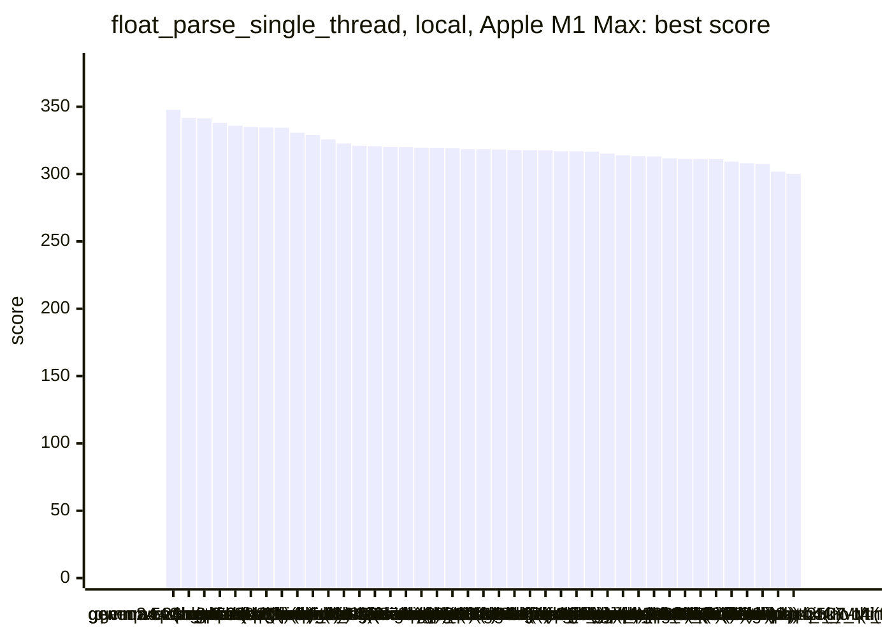
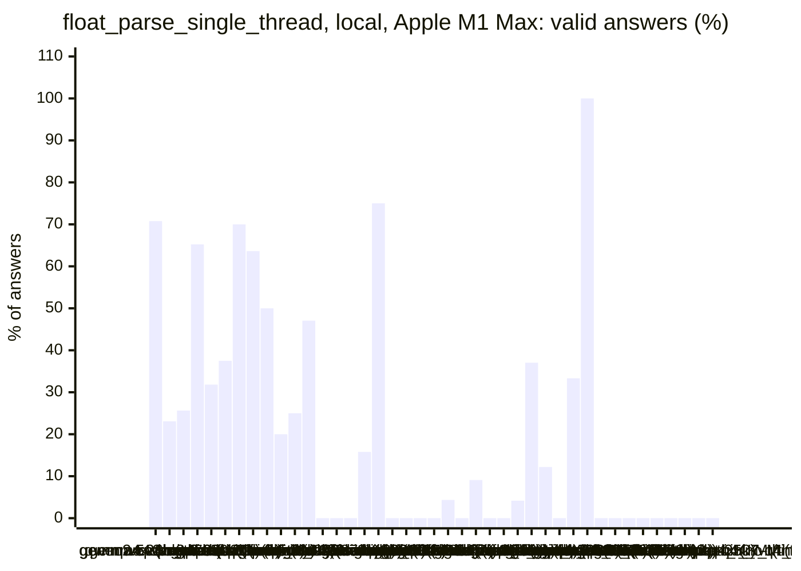
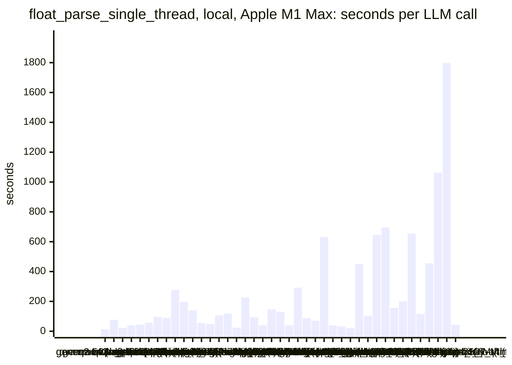
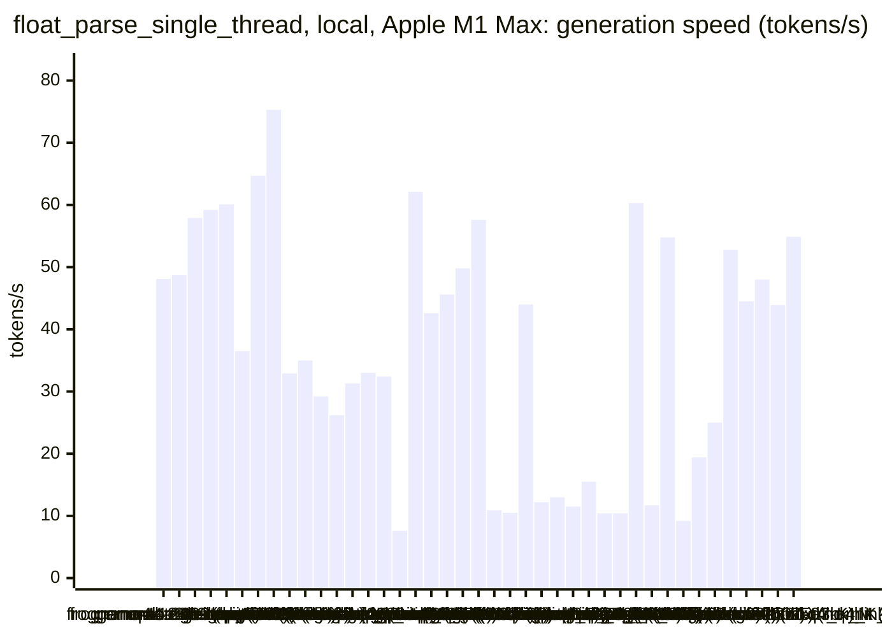
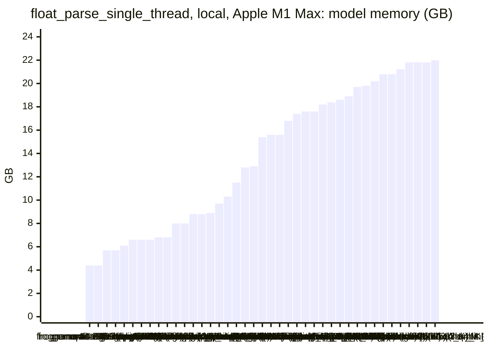
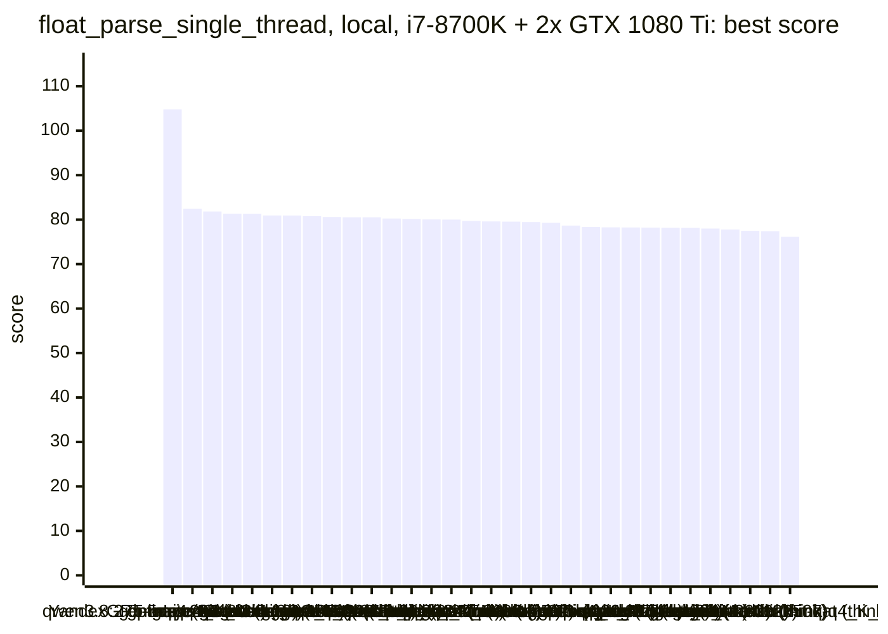
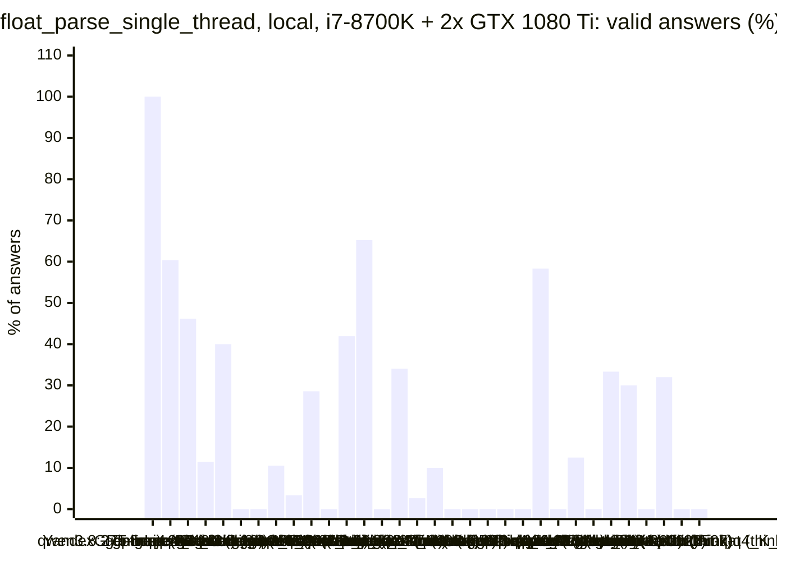
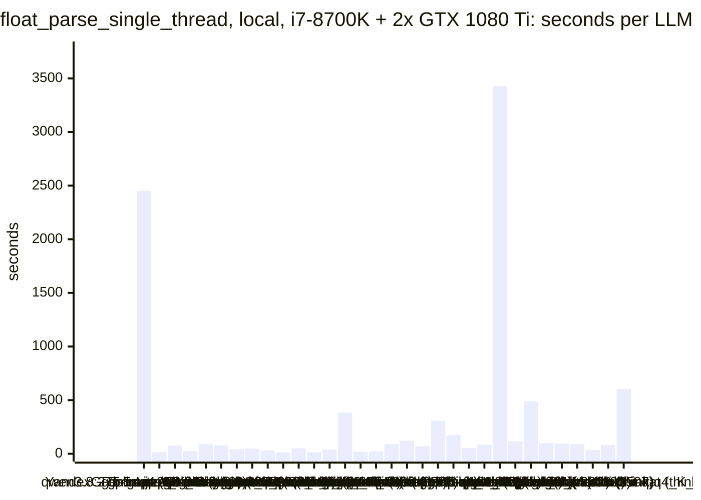
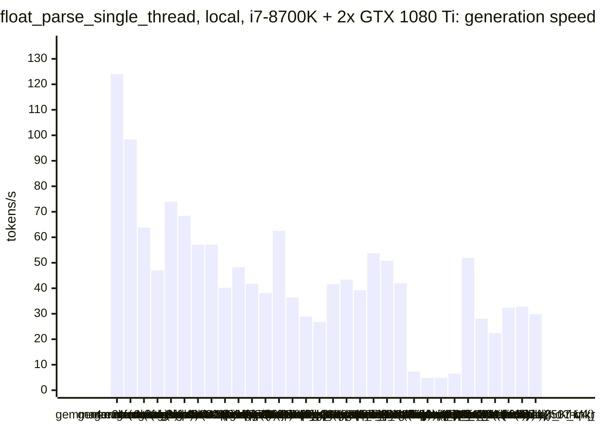
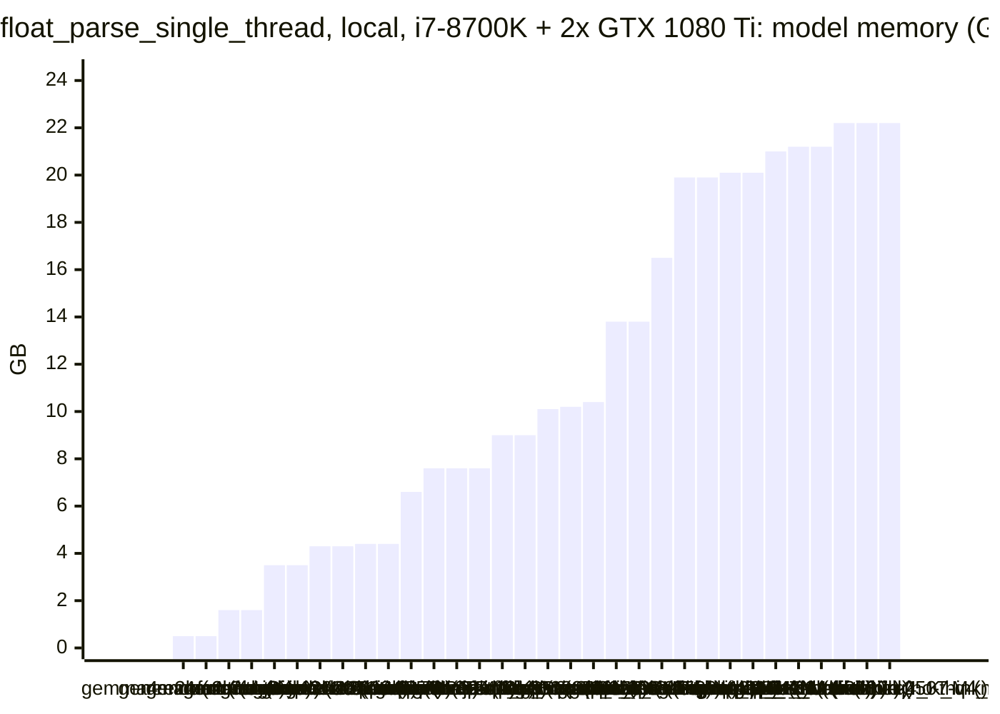

<!-- Copyright (c) 2026 by C. Klukas -->
<!-- SPDX-License-Identifier: GPL-3.0-only -->
<!-- Generated by `omega report` from bench/results/*.json. Do not edit by hand. -->

# float_parse_single_thread

45 models, 15 minutes each, one run per model. The [overall ranking](../benchmarks.md#overall-ranking) compares the models over all examples.

Machines: **Apple M1 Max**: Apple M1 Max (Mac13,1), 10 cores, 32 GB, 44 runs; **i7-8700K + 2x GTX 1080 Ti**: Intel(R) Core(TM) i7-8700K CPU @ 3.70GHz (MS-7A98), 12 cores, 64 GB, 2x NVIDIA GeForce GTX 1080 Ti, 11264 MiB, 34 runs.

## Local models on Apple M1 Max

Ollama on this machine.

| Model | Params | Initial | Best | Gain | LLM calls | s/call | Valid | New bests | Min to best |
|---|---|--:|--:|--:|--:|--:|--:|--:|--:|
| gemma4:latest (no-think) |  | 316.3600 | **347.6860** | ×1.10 | 65 | 13 | 71% | 6 | 15.1 |
| gemma4:e4b-it-qat (think) | 7.5B | 306.1580 | **341.7630** | ×1.12 | 13 | 76 | 23% | 2 | 10.3 |
| qwen2.5-coder:7b (no-think) | 7.6B | 315.6030 | **341.3640** | ×1.08 | 39 | 23 | 26% | 3 | 13.6 |
| gemma4:26b-a4b-it-qat (no-think) | 25.2B | 317.7260 | **338.0720** | ×1.06 | 23 | 40 | 65% | 4 | 12.2 |
| qwen3-coder:30b (no-think) | 30.5B | 322.4690 | **335.8920** | ×1.04 | 22 | 45 | 32% | 1 | 6.5 |
| gemma4:latest (think) |  | 314.4390 | **334.9880** | ×1.07 | 16 | 57 | 38% | 3 | 10.6 |
| gpt-oss:20b (think) | 20.9B | 312.7560 | **334.6440** | ×1.07 | 10 | 96 | 70% | 2 | 5.3 |
| gpt-oss:20b (no-think) | 20.9B | 320.5860 | **334.3880** | ×1.04 | 11 | 89 | 64% | 1 | 3.7 |
| qwen3.8:27b-mtp-q4_K_M (no-think) | 27.3B | 314.5260 | **330.6950** | ×1.05 | 4 | 277 | 50% | 1 | 8.7 |
| qwen3.5:latest (think) | 9.7B | 314.7740 | **328.9980** | ×1.05 | 5 | 198 | 20% | 1 | 14.3 |
| nemotron-3-nano:30b-a3b-mlx (think) |  | 319.5930 | **325.8480** | ×1.02 | 8 | 140 | 25% | 1 | 15.1 |
| gemma4:e2b (think) | 5.1B | 315.4670 | **322.6780** | ×1.02 | 17 | 55 | 47% | 1 | 6.2 |
| qwen3:30b-a3b-instruct-2507-q4_K_M (no-think) | 30.5B | 320.9740 | **320.9740** | ×1.00 | 19 | 49 | 0% | 0 | - |
| qwen3.5:latest (no-think) | 9.7B | 320.7090 | **320.7090** | ×1.00 | 9 | 106 | 0% | 0 | - |
| nemotron-3.5-lightning:30b-mlx (think) |  | | | | | | | | failed: all 4 model requests failed: nemotron-3.5-lightning:30b-mlx: |
| nemotron-3-nano:4b (think) |  | 320.1020 | **320.1020** | ×1.00 | 8 | 117 | 0% | 0 | - |
| gemma4:e2b (no-think) | 5.1B | 319.9610 | **319.9610** | ×1.00 | 38 | 24 | 16% | 0 | - |
| muse-glimmer:30b (no-think) | 27.9B | 319.5570 | **319.5570** | ×1.00 | 4 | 226 | 75% | 0 | - |
| nemotron-3.5-lightning:30b-mlx (no-think) |  | 319.5110 | **319.5110** | ×1.00 | 11 | 93 | 0% | 0 | - |
| nemotron-3-nano:30b-a3b-mlx (no-think) |  | 319.3310 | **319.3310** | ×1.00 | 23 | 40 | 0% | 0 | - |
| frob/sarvam:30b (no-think) | 32.2B | 318.5390 | **318.5390** | ×1.00 | 7 | 146 | 0% | 0 | - |
| devstral-small-2:24b (no-think) | 24.0B | 318.4750 | **318.4750** | ×1.00 | 7 | 130 | 0% | 0 | - |
| nemotron-3-nano:4b (no-think) |  | 318.2460 | **318.2460** | ×1.00 | 23 | 39 | 4% | 0 | - |
| qwen3.5:27b (no-think) | 27.8B | 317.8080 | **317.8080** | ×1.00 | 4 | 292 | 0% | 0 | - |
| gemma4:12b-it-qat (no-think) | 11.9B | 317.6940 | **317.6940** | ×1.00 | 11 | 88 | 9% | 0 | - |
| llm-jp-4-8b-omega:q4_k_m (no-think) | 8.6B | 317.5730 | **317.5730** | ×1.00 | 14 | 71 | 0% | 0 | - |
| glm-4.7-flash:latest (think) | 29.9B | 316.9600 | **316.9600** | ×1.00 | 2 | 631 | 0% | 0 | - |
| MichelRosselli/apertus:8b-instruct-2509-q4_k_m (no-think) | 8.1B | 316.8500 | **316.8500** | ×1.00 | 24 | 38 | 4% | 0 | - |
| yandex/YandexGPT-5-Lite-8B-instruct-GGUF:latest (no-think) | 8.0B | 309.4890 | **316.6740** | ×1.02 | 27 | 33 | 37% | 5 | 11.2 |
| gemma4:e4b-it-qat (no-think) | 7.5B | 314.8930 | **315.1790** | ×1.00 | 41 | 22 | 12% | 1 | 8.8 |
| qwen3.6:27b-coding-mtp-q4_K_M (no-think) | 27.3B | 313.9800 | **313.9800** | ×1.00 | 2 | 450 | 0% | 0 | - |
| richardyoung/frognano-4b-2609:latest (think) | 4.3B | 313.2800 | **313.2800** | ×1.00 | 9 | 104 | 33% | 0 | - |
| frob/sarvam:30b (think) | 32.2B | | | | | | | | failed: all 4 model requests failed: frob/sarvam:30b: answer stopped |
| muse-glimmer:30b (think) | 27.9B | 313.1350 | **313.1350** | ×1.00 | 2 | 646 | 100% | 0 | - |
| gemma4:12b-it-qat (think) | 11.9B | 311.7360 | **311.7360** | ×1.00 | 2 | 695 | 0% | 0 | - |
| glm-4.7-flash:latest (no-think) | 29.9B | 311.2300 | **311.2300** | ×1.00 | 6 | 157 | 0% | 0 | - |
| ingu627/exaone4.0:32b (no-think) | 32.0B | 311.1860 | **311.1860** | ×1.00 | 5 | 202 | 0% | 0 | - |
| qwen3.5:27b (think) | 27.8B | 311.0700 | **311.0700** | ×1.00 | 2 | 654 | 0% | 0 | - |
| richardyoung/frognano-4b-2609:latest (no-think) | 4.3B | 309.2800 | **309.2800** | ×1.00 | 8 | 116 | 0% | 0 | - |
| underdog-saluki-27b:iq2-mix (no-think) | 26.9B | 308.0020 | **308.0020** | ×1.00 | 2 | 455 | 0% | 0 | - |
| qwen3.6:27b-coding-mtp-q4_K_M (think) | 27.3B | 307.5350 | **307.5350** | ×1.00 | 1 | 1063 | 0% | 0 | - |
| gemma4:26b-a4b-it-qat (think) | 25.2B | | | | | | | | failed: all 2 model requests failed: gemma4:26b-a4b-it-qat: answer s |
| qwen3.8:27b-mtp-q4_K_M (think) | 27.3B | 301.9280 | **301.9280** | ×1.00 | 1 | 1798 | 0% | 0 | - |
| qwen3:30b-a3b-instruct-2507-q4_K_M (think) | 30.5B | 300.1980 | **300.1980** | ×1.00 | 22 | 42 | 0% | 0 | - |

### Inference speed and memory

RAM is what Ollama reports for the loaded model (weights, context cache and buffers; on Apple silicon this is shared memory). Load is the time to bring the model into memory. Prompt and generation speeds are tokens per second over all calls of the run.

| Model | Params | RAM GB | Load s | Prompt tok/s | Gen tok/s | Median s/call | p90 s/call | Tokens/answer | Stopped |
|---|---|--:|--:|--:|--:|--:|--:|--:|--:|
| richardyoung/frognano-4b-2609:latest (think) | 4.3B | 4.4 | 11 | 727 | 48.1 | 73 | 241 | 2845 | 2 |
| richardyoung/frognano-4b-2609:latest (no-think) | 4.3B | 4.4 | 11 | 681 | 48.7 | 108 | 196 | 5793 | 3 |
| gemma4:e4b-it-qat (think) | 7.5B | 5.7 | 71 | 575 | 57.9 | 75 | 108 | 3378 | 1 |
| gemma4:e4b-it-qat (no-think) | 7.5B | 5.7 | 77 | 580 | 59.2 | 19 | 34 | 492 | 1 |
| nemotron-3-nano:4b (think) |  | 6.1 | 8 | 803 | 60.1 | 57 | 292 | 6584 | 0 |
| qwen2.5-coder:7b (no-think) | 7.6B | 6.6 | 59 | 950 | 36.5 | 22 | 31 | 543 | 0 |
| gemma4:e2b (think) | 5.1B | 6.6 | 138 | 799 | 64.7 | 46 | 61 | 2552 | 0 |
| gemma4:e2b (no-think) | 5.1B | 6.6 | 60 | 797 | 75.3 | 21 | 31 | 1036 | 1 |
| qwen3.5:latest (think) | 9.7B | 6.8 | 58 | 399 | 32.9 | 137 | 388 | 4013 | 1 |
| qwen3.5:latest (no-think) | 9.7B | 6.8 | 0 | 408 | 35.0 | 102 | 239 | 3360 | 4 |
| gemma4:12b-it-qat (no-think) | 11.9B | 8.0 | 95 | 233 | 29.2 | 46 | 150 | 1541 | 3 |
| gemma4:12b-it-qat (think) | 11.9B | 8.0 | 158 | 194 | 26.2 | 810 | 810 | 16384 | 1 |
| llm-jp-4-8b-omega:q4_k_m (no-think) | 8.6B | 8.8 | 16 | 872 | 31.3 | 85 | 95 | 1937 | 0 |
| yandex/YandexGPT-5-Lite-8B-instruct-GGUF:latest (no-think) | 8.0B | 8.8 | 15 | 750 | 33.0 | 32 | 48 | 783 | 0 |
| MichelRosselli/apertus:8b-instruct-2509-q4_k_m (no-think) | 8.1B | 8.9 | 15 | 862 | 32.4 | 35 | 71 | 997 | 5 |
| underdog-saluki-27b:iq2-mix (no-think) | 26.9B | 9.7 | 25 | 93 | 7.6 | 503 | 503 | 2488 | 1 |
| nemotron-3-nano:4b (no-think) |  | 10.3 | 0 | 1344 | 62.1 | 28 | 99 | 1317 | 7 |
| gemma4:latest (think) |  | 11.5 | 120 | 1394 | 42.6 | 39 | 96 | 1905 | 0 |
| gpt-oss:20b (think) | 20.9B | 12.8 | 161 | 511 | 45.6 | 90 | 255 | 3181 | 0 |
| gpt-oss:20b (no-think) | 20.9B | 12.9 | 55 | 1360 | 49.8 | 103 | 172 | 4015 | 0 |
| gemma4:26b-a4b-it-qat (no-think) | 25.2B | 15.4 | 226 | 498 | 57.6 | 26 | 72 | 684 | 3 |
| muse-glimmer:30b (no-think) | 27.9B | 15.6 | 52 | 118 | 10.9 | 243 | 327 | 1893 | 0 |
| muse-glimmer:30b (think) | 27.9B | 15.6 | 56 | 173 | 10.5 | 852 | 852 | 6248 | 0 |
| gemma4:latest (no-think) |  | 16.8 | 163 | 1883 | 44.0 | 10 | 16 | 301 | 0 |
| qwen3.6:27b-coding-mtp-q4_K_M (think) | 27.3B | 17.4 | 254 | 91 | 12.2 | 1063 | 1063 | 9204 | 0 |
| qwen3.8:27b-mtp-q4_K_M (no-think) | 27.3B | 17.6 | 304 | 115 | 13.0 | 382 | 516 | 1939 | 0 |
| qwen3.8:27b-mtp-q4_K_M (think) | 27.3B | 17.6 | 324 | 94 | 11.5 | 1798 | 1798 | 16384 | 0 |
| qwen3.6:27b-coding-mtp-q4_K_M (no-think) | 27.3B | 18.2 | 188 | 174 | 15.5 | 668 | 668 | 5073 | 0 |
| qwen3.5:27b (think) | 27.8B | 18.4 | 127 | 167 | 10.4 | 802 | 802 | 5850 | 0 |
| qwen3.5:27b (no-think) | 27.8B | 18.6 | 135 | 121 | 10.4 | 309 | 526 | 2245 | 0 |
| frob/sarvam:30b (no-think) | 32.2B | 18.9 | 55 | 2074 | 60.3 | 138 | 198 | 8192 | 0 |
| devstral-small-2:24b (no-think) | 24.0B | 19.7 | 0 | 472 | 11.7 | 112 | 224 | 1001 | 3 |
| nemotron-3-nano:30b-a3b-mlx (think) |  | 19.8 | 98 | 646 | 54.8 | 202 | 290 | 5915 | 1 |
| ingu627/exaone4.0:32b (no-think) | 32.0B | 20.2 | 49 | 81 | 9.2 | 218 | 278 | 1132 | 0 |
| glm-4.7-flash:latest (think) | 29.9B | 20.8 | 48 | 559 | 19.4 | 826 | 826 | 11640 | 0 |
| glm-4.7-flash:latest (no-think) | 29.9B | 20.8 | 0 | 1099 | 25.0 | 183 | 354 | 2207 | 2 |
| nemotron-3.5-lightning:30b-mlx (no-think) |  | 21.2 | 0 | 2121 | 52.8 | 64 | 159 | 6271 | 8 |
| qwen3-coder:30b (no-think) | 30.5B | 21.8 | 132 | 1027 | 44.5 | 39 | 63 | 1436 | 2 |
| qwen3:30b-a3b-instruct-2507-q4_K_M (no-think) | 30.5B | 21.8 | 203 | 1215 | 48.0 | 38 | 78 | 1453 | 2 |
| qwen3:30b-a3b-instruct-2507-q4_K_M (think) | 30.5B | 21.8 | 190 | 1149 | 43.9 | 38 | 70 | 1190 | 1 |
| nemotron-3-nano:30b-a3b-mlx (no-think) |  | 22.0 | 99 | 932 | 54.9 | 32 | 70 | 1191 | 7 |

### Best score over time

| Model | 3.75 min | 7.5 min | 11.25 min | 15 min |
|---|--:|--:|--:|--:|
| gemma4:latest (no-think) | 316.3600 | 342.6620 | 342.6620 | 342.6620 |
| gemma4:e4b-it-qat (think) | 331.3050 | 331.3050 | 341.7630 | 341.7630 |
| qwen2.5-coder:7b (no-think) | 315.6030 | 339.0930 | 340.7250 | 341.3640 |
| gemma4:26b-a4b-it-qat (no-think) | 317.7260 | 317.7260 | 331.1120 | 338.0720 |
| qwen3-coder:30b (no-think) | 322.4690 | 335.8920 | 335.8920 | 335.8920 |
| gemma4:latest (think) | 314.4390 | 319.4860 | 334.9880 | 334.9880 |
| gpt-oss:20b (think) | 312.7560 | 334.6440 | 334.6440 | 334.6440 |
| gpt-oss:20b (no-think) | 334.3880 | 334.3880 | 334.3880 | 334.3880 |
| qwen3.8:27b-mtp-q4_K_M (no-think) | 314.5260 | 314.5260 | 330.6950 | 330.6950 |
| qwen3.5:latest (think) | 314.7740 | 314.7740 | 314.7740 | 328.9980 |
| nemotron-3-nano:30b-a3b-mlx (think) | 319.5930 | 319.5930 | 319.5930 | 319.5930 |
| gemma4:e2b (think) | 315.4670 | 322.6780 | 322.6780 | 322.6780 |
| qwen3:30b-a3b-instruct-2507-q4_K_M (no-think) | 320.9740 | 320.9740 | 320.9740 | 320.9740 |
| qwen3.5:latest (no-think) | 320.7090 | 320.7090 | 320.7090 | 320.7090 |
| nemotron-3-nano:4b (think) | 320.1020 | 320.1020 | 320.1020 | 320.1020 |
| gemma4:e2b (no-think) | 319.9610 | 319.9610 | 319.9610 | 319.9610 |
| muse-glimmer:30b (no-think) | 319.5570 | 319.5570 | 319.5570 | 319.5570 |
| nemotron-3.5-lightning:30b-mlx (no-think) | 319.5110 | 319.5110 | 319.5110 | 319.5110 |
| nemotron-3-nano:30b-a3b-mlx (no-think) | 319.3310 | 319.3310 | 319.3310 | 319.3310 |
| frob/sarvam:30b (no-think) | 318.5390 | 318.5390 | 318.5390 | 318.5390 |
| devstral-small-2:24b (no-think) | 318.4750 | 318.4750 | 318.4750 | 318.4750 |
| nemotron-3-nano:4b (no-think) | 318.2460 | 318.2460 | 318.2460 | 318.2460 |
| qwen3.5:27b (no-think) | 317.8080 | 317.8080 | 317.8080 | 317.8080 |
| gemma4:12b-it-qat (no-think) | 317.6940 | 317.6940 | 317.6940 | 317.6940 |
| llm-jp-4-8b-omega:q4_k_m (no-think) | 317.5730 | 317.5730 | 317.5730 | 317.5730 |
| glm-4.7-flash:latest (think) | 316.9600 | 316.9600 | 316.9600 | 316.9600 |
| MichelRosselli/apertus:8b-instruct-2509-q4_k_m (no-think) | 316.8500 | 316.8500 | 316.8500 | 316.8500 |
| yandex/YandexGPT-5-Lite-8B-instruct-GGUF:latest (no-think) | 310.9440 | 316.4480 | 316.6740 | 316.6740 |
| gemma4:e4b-it-qat (no-think) | 314.8930 | 314.8930 | 315.1790 | 315.1790 |
| qwen3.6:27b-coding-mtp-q4_K_M (no-think) | 313.9800 | 313.9800 | 313.9800 | 313.9800 |
| richardyoung/frognano-4b-2609:latest (think) | 313.2800 | 313.2800 | 313.2800 | 313.2800 |
| muse-glimmer:30b (think) | 313.1350 | 313.1350 | 313.1350 | 313.1350 |
| gemma4:12b-it-qat (think) | 311.7360 | 311.7360 | 311.7360 | 311.7360 |
| glm-4.7-flash:latest (no-think) | 311.2300 | 311.2300 | 311.2300 | 311.2300 |
| ingu627/exaone4.0:32b (no-think) | 311.1860 | 311.1860 | 311.1860 | 311.1860 |
| qwen3.5:27b (think) | 311.0700 | 311.0700 | 311.0700 | 311.0700 |
| richardyoung/frognano-4b-2609:latest (no-think) | 309.2800 | 309.2800 | 309.2800 | 309.2800 |
| underdog-saluki-27b:iq2-mix (no-think) | 308.0020 | 308.0020 | 308.0020 | 308.0020 |
| qwen3.6:27b-coding-mtp-q4_K_M (think) | 307.5350 | 307.5350 | 307.5350 | 307.5350 |
| qwen3.8:27b-mtp-q4_K_M (think) | 301.9280 | 301.9280 | 301.9280 | 301.9280 |
| qwen3:30b-a3b-instruct-2507-q4_K_M (think) | 300.1980 | 300.1980 | 300.1980 | 300.1980 |

### Outcome of the LLM answers

| Model | compile error | duplicate | edit error | invalid | llm error | ok | timeout |
|---|--:|--:|--:|--:|--:|--:|--:|
| gemma4:latest (no-think) | 14 | 2 | 1 | 2 | 0 | 46 | 0 |
| gemma4:e4b-it-qat (think) | 3 | 3 | 0 | 3 | 1 | 3 | 0 |
| qwen2.5-coder:7b (no-think) | 7 | 8 | 0 | 13 | 0 | 10 | 1 |
| gemma4:26b-a4b-it-qat (no-think) | 0 | 0 | 0 | 5 | 3 | 15 | 0 |
| qwen3-coder:30b (no-think) | 3 | 4 | 0 | 6 | 2 | 7 | 0 |
| gemma4:latest (think) | 4 | 6 | 0 | 0 | 0 | 6 | 0 |
| gpt-oss:20b (think) | 0 | 0 | 1 | 2 | 0 | 7 | 0 |
| gpt-oss:20b (no-think) | 0 | 1 | 2 | 1 | 0 | 7 | 0 |
| qwen3.8:27b-mtp-q4_K_M (no-think) | 0 | 0 | 0 | 2 | 0 | 2 | 0 |
| qwen3.5:latest (think) | 1 | 0 | 1 | 1 | 1 | 1 | 0 |
| nemotron-3-nano:30b-a3b-mlx (think) | 1 | 0 | 3 | 1 | 1 | 2 | 0 |
| gemma4:e2b (think) | 6 | 0 | 2 | 0 | 0 | 8 | 1 |
| qwen3:30b-a3b-instruct-2507-q4_K_M (no-think) | 7 | 1 | 2 | 7 | 2 | 0 | 0 |
| qwen3.5:latest (no-think) | 4 | 0 | 1 | 0 | 4 | 0 | 0 |
| nemotron-3-nano:4b (think) | 5 | 0 | 3 | 0 | 0 | 0 | 0 |
| gemma4:e2b (no-think) | 18 | 0 | 9 | 4 | 1 | 6 | 0 |
| muse-glimmer:30b (no-think) | 0 | 0 | 0 | 1 | 0 | 3 | 0 |
| nemotron-3.5-lightning:30b-mlx (no-think) | 1 | 0 | 2 | 0 | 8 | 0 | 0 |
| nemotron-3-nano:30b-a3b-mlx (no-think) | 7 | 0 | 7 | 2 | 7 | 0 | 0 |
| frob/sarvam:30b (no-think) | 0 | 0 | 7 | 0 | 0 | 0 | 0 |
| devstral-small-2:24b (no-think) | 1 | 0 | 0 | 3 | 3 | 0 | 0 |
| nemotron-3-nano:4b (no-think) | 6 | 0 | 9 | 0 | 7 | 1 | 0 |
| qwen3.5:27b (no-think) | 1 | 0 | 0 | 3 | 0 | 0 | 0 |
| gemma4:12b-it-qat (no-think) | 1 | 0 | 1 | 5 | 3 | 1 | 0 |
| llm-jp-4-8b-omega:q4_k_m (no-think) | 12 | 0 | 2 | 0 | 0 | 0 | 0 |
| glm-4.7-flash:latest (think) | 1 | 0 | 0 | 1 | 0 | 0 | 0 |
| MichelRosselli/apertus:8b-instruct-2509-q4_k_m (no-think) | 9 | 2 | 4 | 3 | 5 | 1 | 0 |
| yandex/YandexGPT-5-Lite-8B-instruct-GGUF:latest (no-think) | 11 | 1 | 5 | 0 | 0 | 10 | 0 |
| gemma4:e4b-it-qat (no-think) | 24 | 2 | 1 | 8 | 1 | 5 | 0 |
| qwen3.6:27b-coding-mtp-q4_K_M (no-think) | 0 | 0 | 0 | 2 | 0 | 0 | 0 |
| richardyoung/frognano-4b-2609:latest (think) | 3 | 0 | 1 | 0 | 2 | 3 | 0 |
| muse-glimmer:30b (think) | 0 | 0 | 0 | 0 | 0 | 2 | 0 |
| gemma4:12b-it-qat (think) | 0 | 0 | 1 | 0 | 1 | 0 | 0 |
| glm-4.7-flash:latest (no-think) | 3 | 1 | 0 | 0 | 2 | 0 | 0 |
| ingu627/exaone4.0:32b (no-think) | 3 | 0 | 1 | 1 | 0 | 0 | 0 |
| qwen3.5:27b (think) | 1 | 0 | 0 | 1 | 0 | 0 | 0 |
| richardyoung/frognano-4b-2609:latest (no-think) | 2 | 0 | 3 | 0 | 3 | 0 | 0 |
| underdog-saluki-27b:iq2-mix (no-think) | 1 | 0 | 0 | 0 | 1 | 0 | 0 |
| qwen3.6:27b-coding-mtp-q4_K_M (think) | 0 | 0 | 0 | 1 | 0 | 0 | 0 |
| qwen3.8:27b-mtp-q4_K_M (think) | 0 | 0 | 1 | 0 | 0 | 0 | 0 |
| qwen3:30b-a3b-instruct-2507-q4_K_M (think) | 7 | 1 | 6 | 7 | 1 | 0 | 0 |

### Best idea per model

- **gemma4:latest (no-think)**: Replace the `while (p < end)` loop condition with a comparison against the guaranteed buffer length for potential branch prediction benefits, as the termination condition is …
- **gemma4:e4b-it-qat (think)**: Simplify the pointer advancement logic by assuming the guaranteed single '\n' separator follows every number, removing the unnecessary `while` loop iteration.
- **qwen2.5-coder:7b (no-think)**: Use NEON intrinsics to process 8 digits at a time in parallel, avoiding branches and improving performance.
- **gemma4:26b-a4b-it-qat (no-think)**: The current `parse_doubles` is essentially just a wrapper around `std::strtod` with a redundant check for `\n`. Since the input format is strictly one number followed by one `\n` …
- **qwen3-coder:30b (no-think)**: Replace the simple strtod loop with a SIMD-optimized parser that processes 8 characters at a time using NEON intrinsics, significantly reducing branch mispredictions and memory …
- **gemma4:latest (think)**: Remove the conditional branch for advancing the pointer after parsing, relying on the guaranteed input format that every number is followed by exactly one newline, which should …
- **gpt-oss:20b (think)**: Remove the per-iteration loop that skips the single newline after each number; just advance the pointer by one character after strtod, reducing branch overhead and improving …
- **gpt-oss:20b (no-think)**: Replace the inner newline‑skipping loop with a single pointer increment (p = next + 1) to reduce branching and loop overhead, giving a measurable speed gain while preserving …
- **qwen3.8:27b-mtp-q4_K_M (no-think)**: Replace the per-number strtod call with a custom parser that uses Clinger's fast path (exact multiply/divide by small powers of ten) for the common short-integer and short-decimal …
- **qwen3.5:latest (think)**: Replace the naive std::strtod wrapper with a manual decimal parser that accumulates up to ~19 significant digits into a uint64_t mantissa, tracks decimal exponent, uses Clinger's …
- **nemotron-3-nano:30b-a3b-mlx (think)**: Remove the redundant newline-skipping loop, advancing directly after each number to eliminate branch overhead and speed up parsing while preserving correctness.
- **gemma4:e2b (think)**: Implement a fast path by utilizing NEON to rapidly scan the buffer for newline characters and then process the resulting substrings, minimizing the overhead of repeated pointer …
- **qwen3:30b-a3b-instruct-2507-q4_K_M (no-think)**: initial program
- **qwen3.5:latest (no-think)**: initial program
- **nemotron-3-nano:4b (think)**: initial program
- **gemma4:e2b (no-think)**: initial program
- **muse-glimmer:30b (no-think)**: initial program
- **nemotron-3.5-lightning:30b-mlx (no-think)**: initial program
- **nemotron-3-nano:30b-a3b-mlx (no-think)**: initial program
- **frob/sarvam:30b (no-think)**: initial program
- **devstral-small-2:24b (no-think)**: initial program
- **nemotron-3-nano:4b (no-think)**: initial program
- **qwen3.5:27b (no-think)**: initial program
- **gemma4:12b-it-qat (no-think)**: initial program
- **llm-jp-4-8b-omega:q4_k_m (no-think)**: initial program
- **glm-4.7-flash:latest (think)**: initial program
- **MichelRosselli/apertus:8b-instruct-2509-q4_k_m (no-think)**: initial program
- **yandex/YandexGPT-5-Lite-8B-instruct-GGUF:latest (no-think)**: Use SWAR (Software Arithmetic and Logic) operations to process multiple digits at a time, leveraging the full capacity of NEON, for faster and more efficient parsing.
- **gemma4:e4b-it-qat (no-think)**: Replace the repeated calls to std::strtod with a state machine that parses the number manually, accumulating digits and tracking the exponent, and only calls std::strtod as a …
- **qwen3.6:27b-coding-mtp-q4_K_M (no-think)**: initial program
- **richardyoung/frognano-4b-2609:latest (think)**: initial program
- **muse-glimmer:30b (think)**: initial program
- **gemma4:12b-it-qat (think)**: initial program
- **glm-4.7-flash:latest (no-think)**: initial program
- **ingu627/exaone4.0:32b (no-think)**: initial program
- **qwen3.5:27b (think)**: initial program
- **richardyoung/frognano-4b-2609:latest (no-think)**: initial program
- **underdog-saluki-27b:iq2-mix (no-think)**: initial program
- **qwen3.6:27b-coding-mtp-q4_K_M (think)**: initial program
- **qwen3.8:27b-mtp-q4_K_M (think)**: initial program
- **qwen3:30b-a3b-instruct-2507-q4_K_M (think)**: initial program

## Local models on i7-8700K + 2x GTX 1080 Ti

Ollama on this machine.

| Model | Params | Initial | Best | Gain | LLM calls | s/call | Valid | New bests | Min to best |
|---|---|--:|--:|--:|--:|--:|--:|--:|--:|
| qwen3.8:27b-mtp-q4_K_M (think) | 27.3B | 76.9631 | **104.7890** | ×1.36 | 1 | 2450 | 100% | 1 | 41.2 |
| gemma4:latest (no-think) | 7.5B | 79.5227 | **82.4286** | ×1.04 | 58 | 15 | 60% | 2 | 15.4 |
| gpt-oss:20b (no-think) | 20.9B | 79.7063 | **81.8314** | ×1.03 | 13 | 76 | 46% | 1 | 11.2 |
| yandex/YandexGPT-5-Lite-8B-instruct-GGUF:latest (no-think) | 8.0B | 81.3520 | **81.3520** | ×1.00 | 35 | 26 | 11% | 0 | - |
| gemma4:e4b-it-qat (think) | 7.5B | 78.6458 | **81.3235** | ×1.03 | 10 | 92 | 40% | 2 | 15.8 |
| qwen3.5:latest (no-think) | 9.0B | 80.9414 | **80.9414** | ×1.00 | 12 | 79 | 0% | 0 | - |
| llm-jp-4-8b-omega:q4_k_m (no-think) | 8.6B | 80.9311 | **80.9311** | ×1.00 | 22 | 43 | 0% | 0 | - |
| gemma4:12b-it-qat (no-think) | 11.9B | 80.7970 | **80.7970** | ×1.00 | 19 | 48 | 11% | 0 | - |
| MichelRosselli/apertus:8b-instruct-2509-q4_k_m (no-think) | 8.1B | 80.6038 | **80.6038** | ×1.00 | 30 | 31 | 3% | 0 | - |
| gemma4:e2b (no-think) | 4.6B | 80.5202 | **80.5202** | ×1.00 | 63 | 14 | 29% | 0 | - |
| Bored/GigaChat3.1-10B-A1.8B-q4_K_M:latest (no-think) | 10.7B | 80.5155 | **80.5155** | ×1.00 | 18 | 51 | 0% | 0 | - |
| gemma4:e4b-it-qat (no-think) | 7.5B | 80.2479 | **80.2479** | ×1.00 | 62 | 14 | 42% | 0 | - |
| gemma4:26b-a4b-it-qat (no-think) | 25.2B | 80.1738 | **80.1738** | ×1.00 | 23 | 40 | 65% | 0 | - |
| qwen3.8:27b-mtp-q4_K_M (no-think) | 27.3B | 80.0382 | **80.0382** | ×1.00 | 3 | 383 | 0% | 0 | - |
| qwen2.5-coder:7b (no-think) | 7.6B | 79.9488 | **80.0080** | ×1.00 | 47 | 18 | 34% | 1 | 15.5 |
| nemotron-3-nano:4b (no-think) | 4.0B | 79.7102 | **79.7102** | ×1.00 | 38 | 23 | 3% | 0 | - |
| richardyoung/frognano-4b-2609:latest (no-think) | 4.3B | 79.6011 | **79.6011** | ×1.00 | 10 | 89 | 10% | 0 | - |
| glm-4.7-flash:latest (no-think) | 29.9B | 79.5507 | **79.5507** | ×1.00 | 8 | 121 | 0% | 0 | - |
| qwen3:30b-a3b-instruct-2507-q4_K_M (no-think) | 30.5B | 79.4599 | **79.4599** | ×1.00 | 13 | 71 | 0% | 0 | - |
| qwen3.6:27b-coding-mtp-q4_K_M (no-think) | 27.3B | 79.2909 | **79.2909** | ×1.00 | 3 | 308 | 0% | 0 | - |
| frob/sarvam:30b (no-think) | 32.2B | 78.6713 | **78.6713** | ×1.00 | 6 | 172 | 0% | 0 | - |
| nemotron-3-nano:4b (think) | 4.0B | 78.3571 | **78.3571** | ×1.00 | 17 | 54 | 0% | 0 | - |
| gpt-oss:20b (think) | 20.9B | 77.6165 | **78.2659** | ×1.01 | 12 | 83 | 58% | 1 | 11.5 |
| qwen3.6:27b-coding-mtp-q4_K_M (think) | 27.3B | 78.2419 | **78.2419** | ×1.00 | 1 | 3428 | 0% | 0 | - |
| qwen3.5:latest (think) | 9.0B | 78.2248 | **78.2248** | ×1.00 | 8 | 116 | 12% | 0 | - |
| glm-4.7-flash:latest (think) | 29.9B | 78.1575 | **78.1575** | ×1.00 | 3 | 490 | 0% | 0 | - |
| qwen3-coder:30b (no-think) | 30.5B | 78.1408 | **78.1408** | ×1.00 | 9 | 100 | 33% | 0 | - |
| frob/sarvam:30b (think) | 32.2B | | | | | | | | failed: all 3 model requests failed: frob/sarvam:30b: answer stopped |
| gemma4:latest (think) | 7.5B | 77.5139 | **78.0046** | ×1.01 | 10 | 94 | 30% | 1 | 16.1 |
| richardyoung/frognano-4b-2609:latest (think) | 4.3B | 77.7836 | **77.7836** | ×1.00 | 11 | 92 | 0% | 0 | - |
| gemma4:e2b (think) | 4.6B | 77.4814 | **77.4814** | ×1.00 | 25 | 36 | 32% | 0 | - |
| gemma4:26b-a4b-it-qat (think) | 25.2B | | | | | | | | failed: all 3 model requests failed: gemma4:26b-a4b-it-qat: answer s |
| qwen3:30b-a3b-instruct-2507-q4_K_M (think) | 30.5B | 77.3874 | **77.3874** | ×1.00 | 13 | 82 | 0% | 0 | - |
| gemma4:12b-it-qat (think) | 11.9B | 76.1276 | **76.1276** | ×1.00 | 2 | 604 | 0% | 0 | - |

### Inference speed and memory

RAM is what Ollama reports for the loaded model (weights, context cache and buffers; on Apple silicon this is shared memory). Load is the time to bring the model into memory. Prompt and generation speeds are tokens per second over all calls of the run.

| Model | Params | RAM GB | Load s | Prompt tok/s | Gen tok/s | Median s/call | p90 s/call | Tokens/answer | Stopped |
|---|---|--:|--:|--:|--:|--:|--:|--:|--:|
| gemma4:e2b (no-think) | 4.6B | 0.5 | 54 | 1848 | 124.0 | 12 | 18 | 859 | 1 |
| gemma4:e2b (think) | 4.6B | 0.5 | 20 | 1926 | 98.4 | 36 | 50 | 2888 | 1 |
| gemma4:latest (no-think) | 7.5B | 1.6 | 84 | 1348 | 63.8 | 11 | 23 | 387 | 0 |
| gemma4:latest (think) | 7.5B | 1.6 | 24 | 1200 | 47.0 | 96 | 151 | 3957 | 0 |
| nemotron-3-nano:4b (no-think) | 4.0B | 3.5 | 25 | 1950 | 73.9 | 19 | 33 | 1179 | 3 |
| nemotron-3-nano:4b (think) | 4.0B | 3.5 | 0 | 1606 | 68.4 | 50 | 93 | 2857 | 1 |
| richardyoung/frognano-4b-2609:latest (no-think) | 4.3B | 4.3 | 30 | 2142 | 57.1 | 81 | 172 | 4525 | 3 |
| richardyoung/frognano-4b-2609:latest (think) | 4.3B | 4.3 | 12 | 1771 | 57.1 | 72 | 140 | 4096 | 3 |
| gemma4:e4b-it-qat (think) | 7.5B | 4.4 | 21 | 1995 | 40.2 | 103 | 150 | 3427 | 0 |
| gemma4:e4b-it-qat (no-think) | 7.5B | 4.4 | 94 | 1941 | 48.3 | 11 | 18 | 326 | 0 |
| qwen2.5-coder:7b (no-think) | 7.6B | 6.6 | 68 | 2306 | 41.8 | 15 | 29 | 448 | 1 |
| qwen3.5:latest (no-think) | 9.0B | 7.6 | 84 | 1450 | 38.1 | 79 | 118 | 2108 | 3 |
| Bored/GigaChat3.1-10B-A1.8B-q4_K_M:latest (no-think) | 10.7B | 7.6 | 47 | 720 | 62.5 | 48 | 85 | 2161 | 2 |
| qwen3.5:latest (think) | 9.0B | 7.6 | 0 | 1434 | 36.4 | 74 | 386 | 2601 | 1 |
| gemma4:12b-it-qat (no-think) | 11.9B | 9.0 | 0 | 1275 | 28.9 | 27 | 137 | 527 | 5 |
| gemma4:12b-it-qat (think) | 11.9B | 9.0 | 0 | 696 | 26.8 | 633 | 633 | 15134 | 1 |
| MichelRosselli/apertus:8b-instruct-2509-q4_k_m (no-think) | 8.1B | 10.1 | 0 | 3079 | 41.6 | 24 | 71 | 915 | 5 |
| yandex/YandexGPT-5-Lite-8B-instruct-GGUF:latest (no-think) | 8.0B | 10.2 | 37 | 2693 | 43.4 | 26 | 31 | 877 | 0 |
| llm-jp-4-8b-omega:q4_k_m (no-think) | 8.6B | 10.4 | 39 | 2765 | 39.3 | 39 | 69 | 1425 | 0 |
| gpt-oss:20b (no-think) | 20.9B | 13.8 | 131 | 3286 | 53.7 | 53 | 159 | 3318 | 0 |
| gpt-oss:20b (think) | 20.9B | 13.8 | 39 | 2909 | 50.8 | 77 | 160 | 3851 | 0 |
| gemma4:26b-a4b-it-qat (no-think) | 25.2B | 16.5 | 0 | 938 | 41.9 | 24 | 43 | 611 | 2 |
| qwen3.6:27b-coding-mtp-q4_K_M (no-think) | 27.3B | 19.9 | 59 | 251 | 7.3 | 325 | 332 | 1932 | 0 |
| qwen3.6:27b-coding-mtp-q4_K_M (think) | 27.3B | 19.9 | 55 | 176 | 4.8 | 3428 | 3428 | 16191 | 0 |
| qwen3.8:27b-mtp-q4_K_M (think) | 27.3B | 20.1 | 55 | 168 | 4.9 | 2450 | 2450 | 11505 | 0 |
| qwen3.8:27b-mtp-q4_K_M (no-think) | 27.3B | 20.1 | 152 | 241 | 6.5 | 347 | 580 | 2007 | 0 |
| frob/sarvam:30b (no-think) | 32.2B | 21.0 | 58 | 2849 | 51.9 | 163 | 219 | 8192 | 0 |
| glm-4.7-flash:latest (no-think) | 29.9B | 21.2 | 137 | 603 | 28.1 | 114 | 224 | 2340 | 3 |
| glm-4.7-flash:latest (think) | 29.9B | 21.2 | 59 | 617 | 22.4 | 514 | 609 | 10303 | 0 |
| qwen3:30b-a3b-instruct-2507-q4_K_M (no-think) | 30.5B | 22.2 | 53 | 1370 | 32.4 | 51 | 115 | 1883 | 1 |
| qwen3-coder:30b (no-think) | 30.5B | 22.2 | 1 | 1685 | 32.8 | 43 | 521 | 1391 | 1 |
| qwen3:30b-a3b-instruct-2507-q4_K_M (think) | 30.5B | 22.2 | 0 | 1359 | 29.9 | 61 | 214 | 1458 | 2 |

### Best score over time

| Model | 3.75 min | 7.5 min | 11.25 min | 15 min |
|---|--:|--:|--:|--:|
| qwen3.8:27b-mtp-q4_K_M (think) | 76.9631 | 76.9631 | 76.9631 | 76.9631 |
| gemma4:latest (no-think) | 79.5227 | 81.1332 | 81.1332 | 81.1332 |
| gpt-oss:20b (no-think) | 79.7063 | 79.7063 | 81.8314 | 81.8314 |
| yandex/YandexGPT-5-Lite-8B-instruct-GGUF:latest (no-think) | 81.3520 | 81.3520 | 81.3520 | 81.3520 |
| gemma4:e4b-it-qat (think) | 78.6458 | 78.6458 | 78.8988 | 78.8988 |
| qwen3.5:latest (no-think) | 80.9414 | 80.9414 | 80.9414 | 80.9414 |
| llm-jp-4-8b-omega:q4_k_m (no-think) | 80.9311 | 80.9311 | 80.9311 | 80.9311 |
| gemma4:12b-it-qat (no-think) | 80.7970 | 80.7970 | 80.7970 | 80.7970 |
| MichelRosselli/apertus:8b-instruct-2509-q4_k_m (no-think) | 80.6038 | 80.6038 | 80.6038 | 80.6038 |
| gemma4:e2b (no-think) | 80.5202 | 80.5202 | 80.5202 | 80.5202 |
| Bored/GigaChat3.1-10B-A1.8B-q4_K_M:latest (no-think) | 80.5155 | 80.5155 | 80.5155 | 80.5155 |
| gemma4:e4b-it-qat (no-think) | 80.2479 | 80.2479 | 80.2479 | 80.2479 |
| gemma4:26b-a4b-it-qat (no-think) | 80.1738 | 80.1738 | 80.1738 | 80.1738 |
| qwen3.8:27b-mtp-q4_K_M (no-think) | 80.0382 | 80.0382 | 80.0382 | 80.0382 |
| qwen2.5-coder:7b (no-think) | 79.9488 | 79.9488 | 79.9488 | 79.9488 |
| nemotron-3-nano:4b (no-think) | 79.7102 | 79.7102 | 79.7102 | 79.7102 |
| richardyoung/frognano-4b-2609:latest (no-think) | 79.6011 | 79.6011 | 79.6011 | 79.6011 |
| glm-4.7-flash:latest (no-think) | 79.5507 | 79.5507 | 79.5507 | 79.5507 |
| qwen3:30b-a3b-instruct-2507-q4_K_M (no-think) | 79.4599 | 79.4599 | 79.4599 | 79.4599 |
| qwen3.6:27b-coding-mtp-q4_K_M (no-think) | 79.2909 | 79.2909 | 79.2909 | 79.2909 |
| frob/sarvam:30b (no-think) | 78.6713 | 78.6713 | 78.6713 | 78.6713 |
| nemotron-3-nano:4b (think) | 78.3571 | 78.3571 | 78.3571 | 78.3571 |
| gpt-oss:20b (think) | 77.6165 | 77.6165 | 77.6165 | 78.2659 |
| qwen3.6:27b-coding-mtp-q4_K_M (think) | 78.2419 | 78.2419 | 78.2419 | 78.2419 |
| qwen3.5:latest (think) | 78.2248 | 78.2248 | 78.2248 | 78.2248 |
| glm-4.7-flash:latest (think) | 78.1575 | 78.1575 | 78.1575 | 78.1575 |
| qwen3-coder:30b (no-think) | 78.1408 | 78.1408 | 78.1408 | 78.1408 |
| gemma4:latest (think) | 77.5139 | 77.5139 | 77.5139 | 77.5139 |
| richardyoung/frognano-4b-2609:latest (think) | 77.7836 | 77.7836 | 77.7836 | 77.7836 |
| gemma4:e2b (think) | 77.4814 | 77.4814 | 77.4814 | 77.4814 |
| qwen3:30b-a3b-instruct-2507-q4_K_M (think) | 77.3874 | 77.3874 | 77.3874 | 77.3874 |
| gemma4:12b-it-qat (think) | 76.1276 | 76.1276 | 76.1276 | 76.1276 |

### Outcome of the LLM answers

| Model | compile error | duplicate | edit error | invalid | llm error | ok | timeout |
|---|--:|--:|--:|--:|--:|--:|--:|
| qwen3.8:27b-mtp-q4_K_M (think) | 0 | 0 | 0 | 0 | 0 | 1 | 0 |
| gemma4:latest (no-think) | 8 | 7 | 3 | 5 | 0 | 35 | 0 |
| gpt-oss:20b (no-think) | 2 | 2 | 3 | 0 | 0 | 6 | 0 |
| yandex/YandexGPT-5-Lite-8B-instruct-GGUF:latest (no-think) | 15 | 3 | 9 | 4 | 0 | 4 | 0 |
| gemma4:e4b-it-qat (think) | 3 | 1 | 0 | 1 | 0 | 4 | 1 |
| qwen3.5:latest (no-think) | 8 | 0 | 1 | 0 | 3 | 0 | 0 |
| llm-jp-4-8b-omega:q4_k_m (no-think) | 12 | 0 | 9 | 1 | 0 | 0 | 0 |
| gemma4:12b-it-qat (no-think) | 1 | 0 | 0 | 11 | 5 | 2 | 0 |
| MichelRosselli/apertus:8b-instruct-2509-q4_k_m (no-think) | 10 | 7 | 5 | 2 | 5 | 1 | 0 |
| gemma4:e2b (no-think) | 21 | 1 | 9 | 11 | 2 | 18 | 1 |
| Bored/GigaChat3.1-10B-A1.8B-q4_K_M:latest (no-think) | 7 | 0 | 9 | 0 | 2 | 0 | 0 |
| gemma4:e4b-it-qat (no-think) | 20 | 12 | 0 | 4 | 0 | 26 | 0 |
| gemma4:26b-a4b-it-qat (no-think) | 0 | 0 | 0 | 6 | 2 | 15 | 0 |
| qwen3.8:27b-mtp-q4_K_M (no-think) | 1 | 0 | 0 | 2 | 0 | 0 | 0 |
| qwen2.5-coder:7b (no-think) | 15 | 4 | 2 | 9 | 1 | 16 | 0 |
| nemotron-3-nano:4b (no-think) | 9 | 0 | 24 | 0 | 4 | 1 | 0 |
| richardyoung/frognano-4b-2609:latest (no-think) | 3 | 0 | 3 | 0 | 3 | 1 | 0 |
| glm-4.7-flash:latest (no-think) | 4 | 0 | 0 | 1 | 3 | 0 | 0 |
| qwen3:30b-a3b-instruct-2507-q4_K_M (no-think) | 4 | 0 | 3 | 5 | 1 | 0 | 0 |
| qwen3.6:27b-coding-mtp-q4_K_M (no-think) | 0 | 0 | 0 | 3 | 0 | 0 | 0 |
| frob/sarvam:30b (no-think) | 0 | 0 | 6 | 0 | 0 | 0 | 0 |
| nemotron-3-nano:4b (think) | 4 | 0 | 12 | 0 | 1 | 0 | 0 |
| gpt-oss:20b (think) | 0 | 0 | 3 | 2 | 0 | 7 | 0 |
| qwen3.6:27b-coding-mtp-q4_K_M (think) | 0 | 0 | 0 | 1 | 0 | 0 | 0 |
| qwen3.5:latest (think) | 3 | 0 | 1 | 2 | 1 | 1 | 0 |
| glm-4.7-flash:latest (think) | 3 | 0 | 0 | 0 | 0 | 0 | 0 |
| qwen3-coder:30b (no-think) | 2 | 0 | 0 | 3 | 1 | 3 | 0 |
| gemma4:latest (think) | 3 | 0 | 0 | 4 | 0 | 3 | 0 |
| richardyoung/frognano-4b-2609:latest (think) | 6 | 0 | 2 | 0 | 3 | 0 | 0 |
| gemma4:e2b (think) | 12 | 0 | 1 | 3 | 1 | 8 | 0 |
| qwen3:30b-a3b-instruct-2507-q4_K_M (think) | 4 | 1 | 4 | 2 | 2 | 0 | 0 |
| gemma4:12b-it-qat (think) | 0 | 0 | 0 | 1 | 1 | 0 | 0 |

### Best idea per model

- **qwen3.8:27b-mtp-q4_K_M (think)**: Replace the blind strtod call with a manual digit parser + Clinger's exact multiply/divide fast path (covers ~75% of benchmark numbers), falling back to strtod only for >19-digit …
- **gemma4:latest (no-think)**: Improve loop efficiency by directly advancing past the newline character if `std::strtod` lands exactly before it, which is faster than the conditional check.
- **gpt-oss:20b (no-think)**: edit: // fast integer path: only digits (and optional leading '-'), no '.' or exponent / const char* q = p;
- **yandex/YandexGPT-5-Lite-8B-instruct-GGUF:latest (no-think)**: initial program
- **gemma4:e4b-it-qat (think)**: Replace the loop used to skip the guaranteed single trailing newline character with a direct pointer increment, reducing loop overhead and improving instruction throughput.
- **qwen3.5:latest (no-think)**: initial program
- **llm-jp-4-8b-omega:q4_k_m (no-think)**: initial program
- **gemma4:12b-it-qat (no-think)**: initial program
- **MichelRosselli/apertus:8b-instruct-2509-q4_k_m (no-think)**: initial program
- **gemma4:e2b (no-think)**: initial program
- **Bored/GigaChat3.1-10B-A1.8B-q4_K_M:latest (no-think)**: initial program
- **gemma4:e4b-it-qat (no-think)**: initial program
- **gemma4:26b-a4b-it-qat (no-think)**: initial program
- **qwen3.8:27b-mtp-q4_K_M (no-think)**: initial program
- **qwen2.5-coder:7b (no-think)**: tuned BATCH_SIZE=64 on top of: Introduce a simple batch processing mechanism to reduce the overhead of repeatedly calling `std::strtod`.
- **nemotron-3-nano:4b (no-think)**: initial program
- **richardyoung/frognano-4b-2609:latest (no-think)**: initial program
- **glm-4.7-flash:latest (no-think)**: initial program
- **qwen3:30b-a3b-instruct-2507-q4_K_M (no-think)**: initial program
- **qwen3.6:27b-coding-mtp-q4_K_M (no-think)**: initial program
- **frob/sarvam:30b (no-think)**: initial program
- **nemotron-3-nano:4b (think)**: initial program
- **gpt-oss:20b (think)**: Add a fast integer‑only parsing path that converts contiguous digit sequences without decimal point or exponent directly to double, falling back to std::strtod only for …
- **qwen3.6:27b-coding-mtp-q4_K_M (think)**: initial program
- **qwen3.5:latest (think)**: initial program
- **glm-4.7-flash:latest (think)**: initial program
- **qwen3-coder:30b (no-think)**: initial program
- **gemma4:latest (think)**: Replace the loop used to skip the newline character with a direct check and increment, leveraging the guarantee that every number is followed by exactly one '\n', reducing loop …
- **richardyoung/frognano-4b-2609:latest (think)**: initial program
- **gemma4:e2b (think)**: initial program
- **qwen3:30b-a3b-instruct-2507-q4_K_M (think)**: initial program
- **gemma4:12b-it-qat (think)**: initial program
