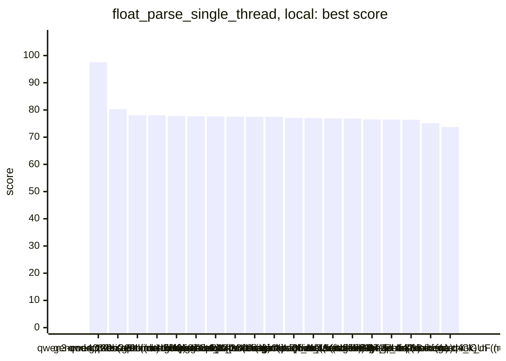
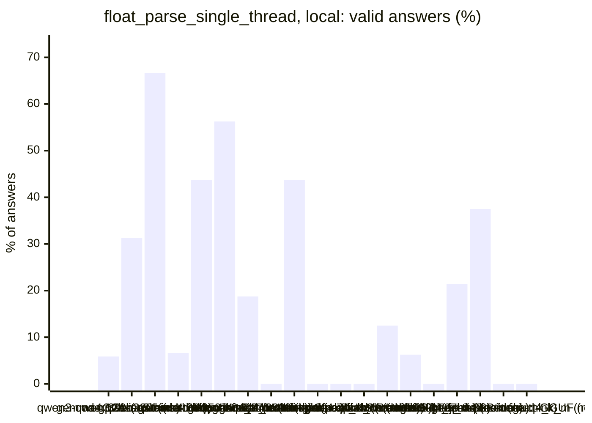
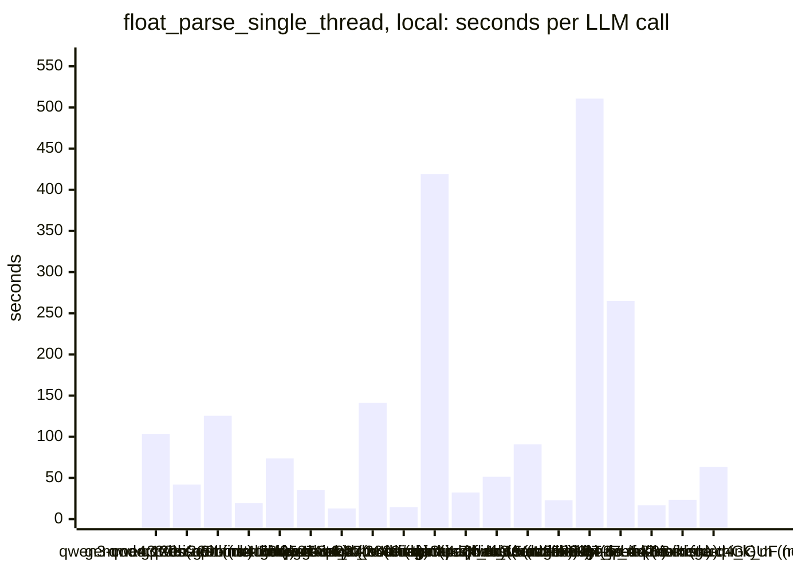
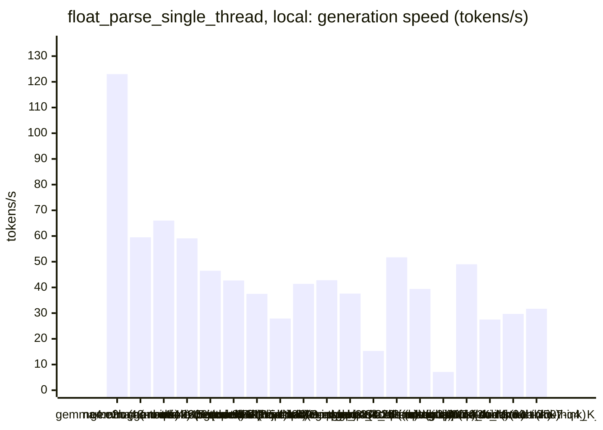
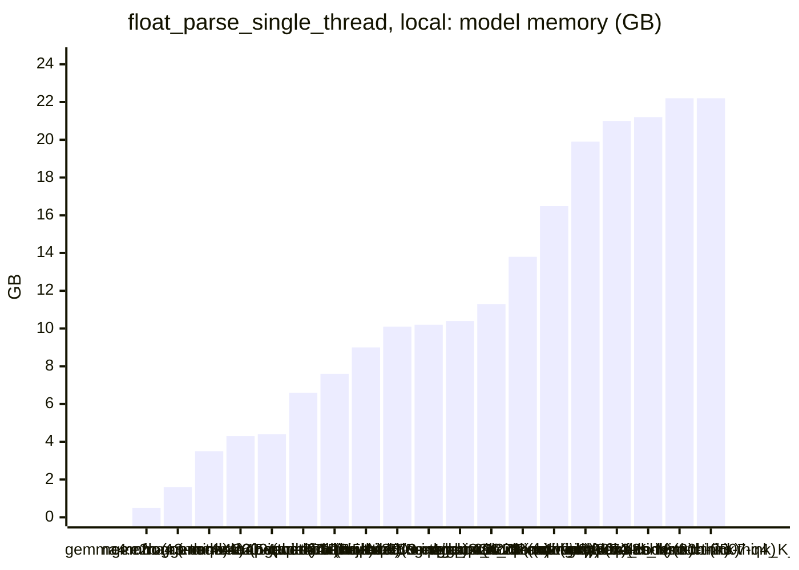
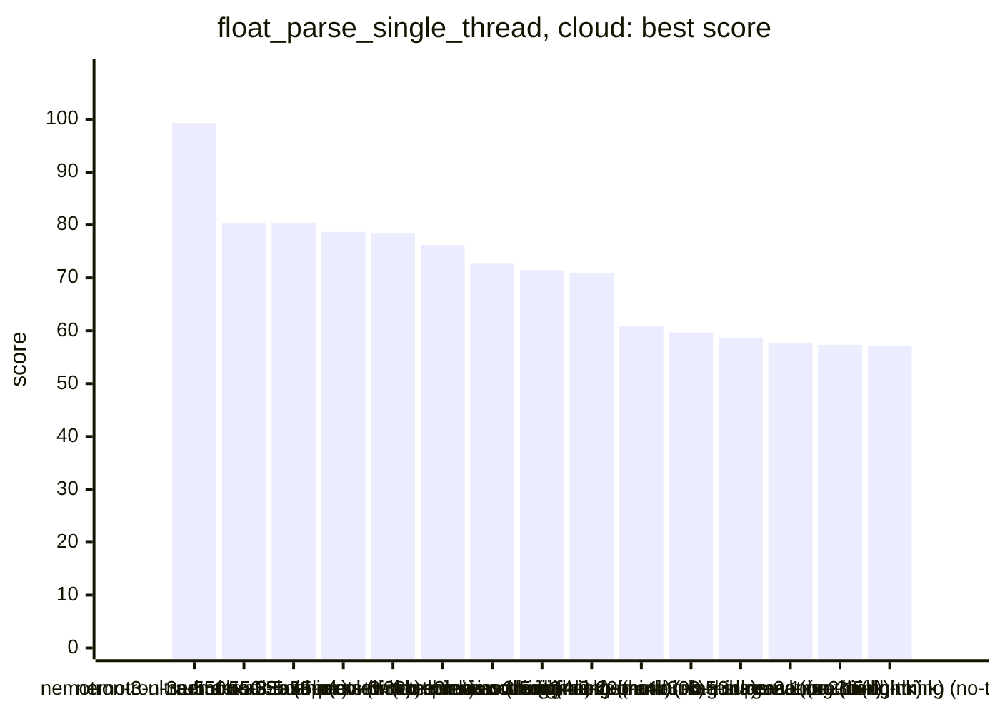
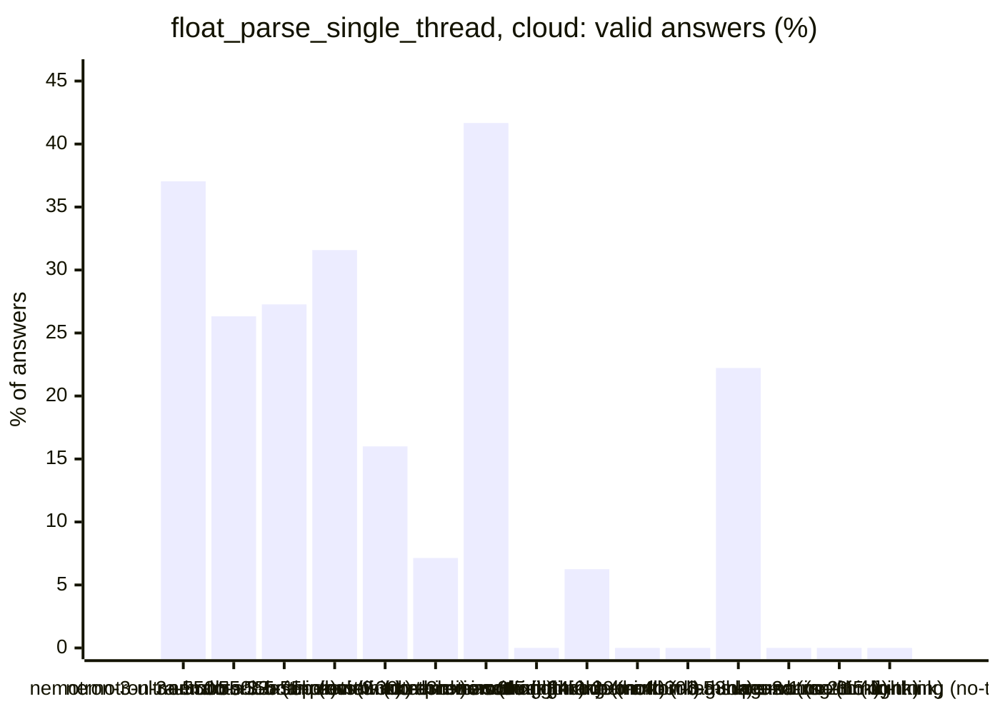
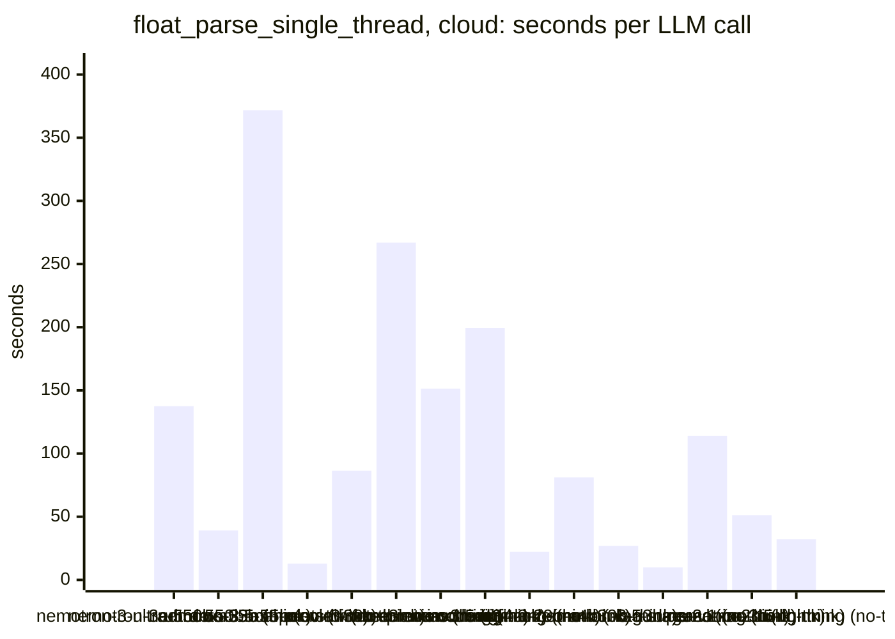
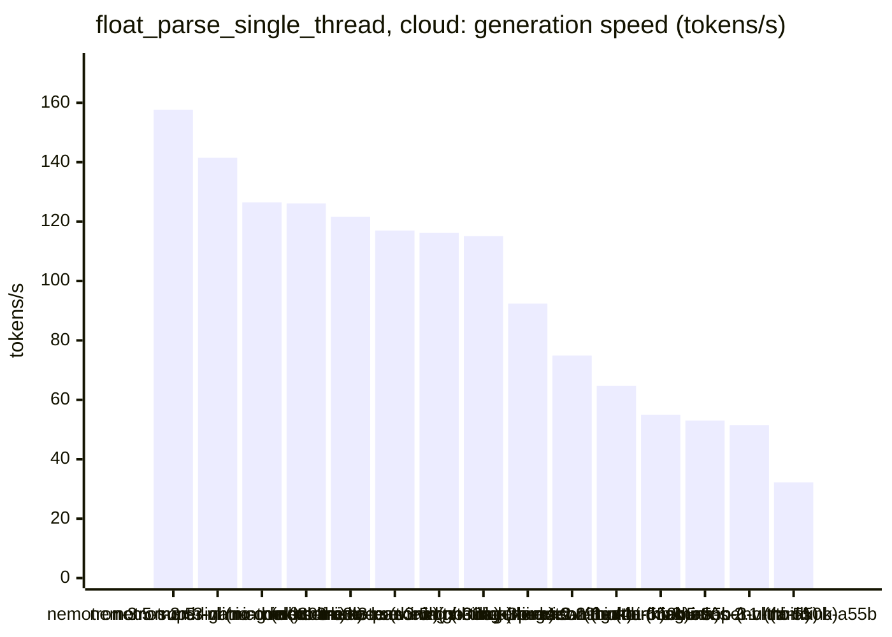

<!-- Copyright (c) 2026 by C. Klukas -->
<!-- SPDX-License-Identifier: GPL-3.0-only -->
<!-- Generated by `omega report` from bench/results/*.json. Do not edit by hand. -->

# float_parse_single_thread

41 models, each run at most 60 minutes, ended earlier after 15 answers in a row without progress; one run per model. The [overall ranking](../benchmarks.md#overall-ranking) compares the models over all examples.

Machine: Intel(R) Core(TM) i7-8700K CPU @ 3.70GHz (MS-7A98), 12 cores, 64 GB, 2x NVIDIA GeForce GTX 1080 Ti, 11264 MiB.

## Local models

Ollama on this machine.

| Model | Params | Initial | Best | Gain | LLM calls | s/call | Valid | New bests | Min to best | Minutes | Stopped by |
|---|---|--:|--:|--:|--:|--:|--:|--:|--:|--:|---|
| qwen3-coder:30b (no-think) | 30.5B | 77.4261 | **97.5461** | ×1.26 | 17 | 103 | 6% | 1 | 28.8 | 29.9 | no progress |
| gemma4:12b-it-qat (no-think) | 11.9B | 77.0797 | **80.3017** | ×1.04 | 16 | 42 | 31% | 1 | 11.5 | 12.2 | no progress |
| gpt-oss:20b (no-think) | 20.9B | 77.3358 | **78.0689** | ×1.01 | 30 | 126 | 67% | 4 | 53.5 | 64.2 | time limit |
| qwen2.5-coder:7b (no-think) | 7.6B | 78.0424 | **78.0424** | ×1.00 | 15 | 20 | 7% | 0 | - | 5.6 | no progress |
| qwen3:30b-a3b-instruct-2507-q4_K_M (no-think) | 30.5B | 77.6176 | **77.7921** | ×1.00 | 16 | 74 | 44% | 1 | 19.9 | 20.5 | no progress |
| gemma4:26b-a4b-it-qat (no-think) | 25.2B | 77.6757 | **77.6757** | ×1.00 | 16 | 35 | 56% | 0 | - | 10.1 | no progress |
| gemma4:e2b (no-think) | 4.6B | 77.5992 | **77.5992** | ×1.00 | 16 | 13 | 19% | 0 | - | 4.1 | no progress |
| richardyoung/frognano-4b-2609:latest (no-think) | 4.3B | 77.5720 | **77.5720** | ×1.00 | 16 | 141 | 0% | 0 | - | 38.4 | no progress |
| gemma4:e4b-it-qat (no-think) | 7.5B | 77.5295 | **77.5295** | ×1.00 | 16 | 14 | 44% | 0 | - | 4.5 | no progress |
| qwen3.6:27b-coding-mtp-q4_K_M (no-think) | 27.3B | 77.4957 | **77.4957** | ×1.00 | 9 | 419 | 0% | 0 | - | 63.6 | time limit |
| nemotron-3-nano:4b (no-think) | 4.0B | 77.0882 | **77.0882** | ×1.00 | 16 | 32 | 0% | 0 | - | 9.2 | no progress |
| glm-4.7-flash:latest (no-think) | 29.9B | 77.0260 | **77.0260** | ×1.00 | 16 | 51 | 0% | 0 | - | 14.3 | no progress |
| qwen3.5:latest (no-think) | 9.0B | 76.9201 | **76.9201** | ×1.00 | 16 | 91 | 12% | 0 | - | 24.9 | no progress |
| MichelRosselli/apertus:8b-instruct-2509-q4_k_m (no-think) | 8.1B | 76.8295 | **76.8295** | ×1.00 | 16 | 23 | 6% | 0 | - | 6.8 | no progress |
| frob/sarvam:30b (no-think) | 32.2B | 76.4972 | **76.4972** | ×1.00 | 8 | 511 | 0% | 0 | - | 68.8 | time limit |
| underdog-saluki-27b:iq2-mix (no-think) | 26.9B | 76.1975 | **76.4596** | ×1.00 | 14 | 265 | 21% | 1 | 8.9 | 62.5 | time limit |
| gemma4:latest (no-think) | 7.5B | 76.4038 | **76.4038** | ×1.00 | 16 | 17 | 38% | 0 | - | 5.2 | no progress |
| yandex/YandexGPT-5-Lite-8B-instruct-GGUF:latest (no-think) | 8.0B | 75.0971 | **75.0971** | ×1.00 | 16 | 23 | 0% | 0 | - | 6.9 | no progress |
| llm-jp-4-8b-omega:q4_k_m (no-think) | 8.6B | 73.7356 | **73.7356** | ×1.00 | 16 | 63 | 0% | 0 | - | 17.6 | no progress |
| hf.co/LiquidAI/LFM3-1.7B-GGUF:Q4_K_M (no-think) | 1.73B | | | | | | | | | | failed: all 16 model requests failed: hf.co/LiquidAI/LFM3-1.7B-GGUF: |

### Inference speed and memory

RAM is what Ollama reports for the loaded model (weights, context cache and buffers; on Apple silicon this is shared memory). Load is the time to bring the model into memory. Prompt and generation speeds are tokens per second over all calls of the run.

| Model | Params | RAM GB | Load s | Prompt tok/s | Gen tok/s | Median s/call | p90 s/call | Tokens/answer | Stopped |
|---|---|--:|--:|--:|--:|--:|--:|--:|--:|
| gemma4:e2b (no-think) | 4.6B | 0.5 | 17 | 2055 | 123.0 | 12 | 17 | 845 | 0 |
| gemma4:latest (no-think) | 7.5B | 1.6 | 23 | 1192 | 59.5 | 15 | 28 | 498 | 0 |
| nemotron-3-nano:4b (no-think) | 4.0B | 3.5 | 9 | 1669 | 66.0 | 18 | 111 | 1367 | 2 |
| richardyoung/frognano-4b-2609:latest (no-think) | 4.3B | 4.3 | 12 | 1543 | 59.1 | 123 | 400 | 6779 | 5 |
| gemma4:e4b-it-qat (no-think) | 7.5B | 4.4 | 20 | 1865 | 46.5 | 13 | 19 | 372 | 0 |
| qwen2.5-coder:7b (no-think) | 7.6B | 6.6 | 14 | 3183 | 42.7 | 20 | 32 | 633 | 0 |
| qwen3.5:latest (no-think) | 9.0B | 7.6 | 20 | 1333 | 37.5 | 68 | 212 | 3091 | 0 |
| gemma4:12b-it-qat (no-think) | 11.9B | 9.0 | 21 | 759 | 27.9 | 37 | 63 | 633 | 2 |
| MichelRosselli/apertus:8b-instruct-2509-q4_k_m (no-think) | 8.1B | 10.1 | 15 | 3037 | 41.4 | 24 | 39 | 653 | 2 |
| yandex/YandexGPT-5-Lite-8B-instruct-GGUF:latest (no-think) | 8.0B | 10.2 | 14 | 3087 | 42.8 | 23 | 38 | 794 | 0 |
| llm-jp-4-8b-omega:q4_k_m (no-think) | 8.6B | 10.4 | 17 | 2729 | 37.6 | 68 | 87 | 1858 | 1 |
| underdog-saluki-27b:iq2-mix (no-think) | 26.9B | 11.3 | 23 | 398 | 15.3 | 128 | 904 | 3305 | 1 |
| gpt-oss:20b (no-think) | 20.9B | 13.8 | 37 | 2987 | 51.7 | 67 | 488 | 6213 | 0 |
| gemma4:26b-a4b-it-qat (no-think) | 25.2B | 16.5 | 0 | 975 | 39.4 | 27 | 87 | 799 | 3 |
| qwen3.6:27b-coding-mtp-q4_K_M (no-think) | 27.3B | 19.9 | 53 | 205 | 7.1 | 342 | 710 | 2725 | 0 |
| frob/sarvam:30b (no-think) | 32.2B | 21.0 | 59 | 3045 | 49.0 | 506 | 566 | 24576 | 1 |
| glm-4.7-flash:latest (no-think) | 29.9B | 21.2 | 57 | 720 | 27.5 | 48 | 88 | 974 | 2 |
| qwen3-coder:30b (no-think) | 30.5B | 22.2 | 52 | 1373 | 29.7 | 50 | 138 | 2851 | 1 |
| qwen3:30b-a3b-instruct-2507-q4_K_M (no-think) | 30.5B | 22.2 | 52 | 1042 | 31.7 | 71 | 128 | 1835 | 1 |

### Best score over time

| Model | 15 min | 30 min | 45 min | 60 min |
|---|--:|--:|--:|--:|
| qwen3-coder:30b (no-think) | 77.4261 | 97.5461 | 97.5461 | 97.5461 |
| gemma4:12b-it-qat (no-think) | 80.3017 | 80.3017 | 80.3017 | 80.3017 |
| gpt-oss:20b (no-think) | 77.4153 | 77.4153 | 77.6093 | 78.0689 |
| qwen2.5-coder:7b (no-think) | 78.0424 | 78.0424 | 78.0424 | 78.0424 |
| qwen3:30b-a3b-instruct-2507-q4_K_M (no-think) | 77.6176 | 77.7921 | 77.7921 | 77.7921 |
| gemma4:26b-a4b-it-qat (no-think) | 77.6757 | 77.6757 | 77.6757 | 77.6757 |
| gemma4:e2b (no-think) | 77.5992 | 77.5992 | 77.5992 | 77.5992 |
| richardyoung/frognano-4b-2609:latest (no-think) | 77.5720 | 77.5720 | 77.5720 | 77.5720 |
| gemma4:e4b-it-qat (no-think) | 77.5295 | 77.5295 | 77.5295 | 77.5295 |
| qwen3.6:27b-coding-mtp-q4_K_M (no-think) | 77.4957 | 77.4957 | 77.4957 | 77.4957 |
| nemotron-3-nano:4b (no-think) | 77.0882 | 77.0882 | 77.0882 | 77.0882 |
| glm-4.7-flash:latest (no-think) | 77.0260 | 77.0260 | 77.0260 | 77.0260 |
| qwen3.5:latest (no-think) | 76.9201 | 76.9201 | 76.9201 | 76.9201 |
| MichelRosselli/apertus:8b-instruct-2509-q4_k_m (no-think) | 76.8295 | 76.8295 | 76.8295 | 76.8295 |
| frob/sarvam:30b (no-think) | 76.4972 | 76.4972 | 76.4972 | 76.4972 |
| underdog-saluki-27b:iq2-mix (no-think) | 76.4596 | 76.4596 | 76.4596 | 76.4596 |
| gemma4:latest (no-think) | 76.4038 | 76.4038 | 76.4038 | 76.4038 |
| yandex/YandexGPT-5-Lite-8B-instruct-GGUF:latest (no-think) | 75.0971 | 75.0971 | 75.0971 | 75.0971 |
| llm-jp-4-8b-omega:q4_k_m (no-think) | 73.7356 | 73.7356 | 73.7356 | 73.7356 |

### Outcome of the LLM answers

| Model | compile error | duplicate | edit error | invalid | llm error | ok |
|---|--:|--:|--:|--:|--:|--:|
| qwen3-coder:30b (no-think) | 3 | 0 | 2 | 10 | 1 | 1 |
| gemma4:12b-it-qat (no-think) | 3 | 0 | 1 | 5 | 2 | 5 |
| gpt-oss:20b (no-think) | 3 | 0 | 6 | 1 | 0 | 20 |
| qwen2.5-coder:7b (no-think) | 1 | 3 | 0 | 10 | 0 | 1 |
| qwen3:30b-a3b-instruct-2507-q4_K_M (no-think) | 5 | 0 | 2 | 1 | 1 | 7 |
| gemma4:26b-a4b-it-qat (no-think) | 0 | 0 | 1 | 3 | 3 | 9 |
| gemma4:e2b (no-think) | 9 | 1 | 1 | 2 | 0 | 3 |
| richardyoung/frognano-4b-2609:latest (no-think) | 10 | 0 | 1 | 0 | 5 | 0 |
| gemma4:e4b-it-qat (no-think) | 8 | 0 | 1 | 0 | 0 | 7 |
| qwen3.6:27b-coding-mtp-q4_K_M (no-think) | 3 | 0 | 1 | 5 | 0 | 0 |
| nemotron-3-nano:4b (no-think) | 4 | 0 | 9 | 0 | 3 | 0 |
| glm-4.7-flash:latest (no-think) | 7 | 1 | 1 | 5 | 2 | 0 |
| qwen3.5:latest (no-think) | 9 | 0 | 1 | 4 | 0 | 2 |
| MichelRosselli/apertus:8b-instruct-2509-q4_k_m (no-think) | 4 | 0 | 7 | 1 | 3 | 1 |
| frob/sarvam:30b (no-think) | 0 | 0 | 7 | 0 | 1 | 0 |
| underdog-saluki-27b:iq2-mix (no-think) | 4 | 1 | 2 | 3 | 1 | 3 |
| gemma4:latest (no-think) | 9 | 0 | 0 | 1 | 0 | 6 |
| yandex/YandexGPT-5-Lite-8B-instruct-GGUF:latest (no-think) | 12 | 1 | 1 | 2 | 0 | 0 |
| llm-jp-4-8b-omega:q4_k_m (no-think) | 9 | 0 | 5 | 1 | 1 | 0 |

### Best idea per model

- **qwen3-coder:30b (no-think)**: Replace the simple strtod loop with a fast path that handles integers and short decimals using direct computation, falling back to strtod only for the rare cases that cannot be …
- **gemma4:12b-it-qat (no-think)**: Implement a fast path for integers by manually parsing digits into a 64-bit integer and applying a power-of-ten multiplier, falling back to `std::strtod` for all other formats to …
- **gpt-oss:20b (no-think)**: Add a fast integer‑only parsing path for numbers with ≤15 digits and no decimal point or exponent, and skip the per‑newline loop by advancing past the newline directly after …
- **qwen2.5-coder:7b (no-think)**: initial program
- **qwen3:30b-a3b-instruct-2507-q4_K_M (no-think)**: tuned FAST_PATH_MAX_DIGITS=19.32, FAST_PATH_MAX_EXP=24.78 on top of: Replace the fallback to std::strtod with a fast path for integers and short decimals using NEON intrinsics to …
- **gemma4:26b-a4b-it-qat (no-think)**: initial program
- **gemma4:e2b (no-think)**: initial program
- **richardyoung/frognano-4b-2609:latest (no-think)**: initial program
- **gemma4:e4b-it-qat (no-think)**: initial program
- **qwen3.6:27b-coding-mtp-q4_K_M (no-think)**: initial program
- **nemotron-3-nano:4b (no-think)**: initial program
- **glm-4.7-flash:latest (no-think)**: initial program
- **qwen3.5:latest (no-think)**: initial program
- **MichelRosselli/apertus:8b-instruct-2509-q4_k_m (no-think)**: initial program
- **frob/sarvam:30b (no-think)**: initial program
- **underdog-saluki-27b:iq2-mix (no-think)**: The current program calls std::strtod per line and scans for newlines; the obvious tuning lever is to replace the newline skip with a direct branch-free newline scan and add a …
- **gemma4:latest (no-think)**: initial program
- **yandex/YandexGPT-5-Lite-8B-instruct-GGUF:latest (no-think)**: initial program
- **llm-jp-4-8b-omega:q4_k_m (no-think)**: initial program

## Cloud models (OpenRouter)

Free OpenRouter models; times include the network and the provider's queue.

| Model | Params | Initial | Best | Gain | LLM calls | s/call | Valid | New bests | Min to best | Minutes | Stopped by |
|---|---|--:|--:|--:|--:|--:|--:|--:|--:|--:|---|
| nvidia/nemotron-3-ultra-550b-a55b:free (think) |  | 77.1492 | **99.3127** | ×1.29 | 27 | 138 | 37% | 4 | 63.6 | 64.0 | time limit |
| nvidia/nemotron-3-ultra-550b-a55b:free (no-think) |  | 59.4591 | **80.4135** | ×1.35 | 19 | 39 | 26% | 1 | 3.0 | 13.0 | no progress |
| nvidia/nemotron-3.5-super-vl:free (think) |  | 59.8857 | **80.3475** | ×1.34 | 11 | 372 | 27% | 3 | 28.9 | 68.7 | time limit |
| dots-studio/dots-3-note-preview:free (no-think) |  | 60.1754 | **78.6935** | ×1.31 | 19 | 13 | 32% | 1 | 0.8 | 4.8 | no progress |
| nvidia/nemotron-3-nano-omni-30b-a3b-reasoning:free (think) |  | 73.7106 | **78.3662** | ×1.06 | 25 | 86 | 16% | 3 | 13.6 | 36.7 | no progress |
| dots-studio/dots-3-note-preview:free (think) |  | 76.2193 | **76.2193** | ×1.00 | 14 | 267 | 7% | 0 | - | 62.9 | time limit |
| cohere/north-mini-code:free (think) |  | 58.4305 | **72.6835** | ×1.24 | 24 | 151 | 42% | 1 | 29.9 | 61.4 | no progress |
| nvidia/nemotron-3.5-lightning:free (think) |  | 71.4462 | **71.4462** | ×1.00 | 16 | 200 | 0% | 0 | - | 53.6 | no progress |
| cohere/north-mini-code:free (no-think) |  | 70.9674 | **70.9674** | ×1.00 | 16 | 22 | 6% | 0 | - | 7.1 | no progress |
| xingchen-agi/xing4.0-29b-a4b:free (no-think) |  | 60.8299 | **60.8299** | ×1.00 | 10 | 81 | 0% | 0 | - | 14.1 | model errors |
| xingchen-agi/xing4.0-29b-a4b:free (think) |  | | | | | | | | | | failed: all 15 model requests failed: xingchen-agi/xing4.0-29b-a4b:f |
| nvidia/nemotron-3-nano-omni-30b-a3b-reasoning:free (no-think) |  | 59.6528 | **59.6528** | ×1.00 | 16 | 27 | 0% | 0 | - | 7.9 | no progress |
| google/gemma-4-31b-it:free (no-think) |  | | | | | | | | | | failed: all 6 model requests failed: google/gemma-4-31b-it:free: rat |
| nvidia/nemotron-3.5-super-vl:free (no-think) |  | 57.3312 | **58.7018** | ×1.02 | 18 | 10 | 22% | 1 | 3.1 | 3.7 | no progress |
| poolside/laguna-s-2.1:free (no-think) |  | 57.7235 | **57.7235** | ×1.00 | 16 | 114 | 0% | 0 | - | 31.1 | no progress |
| google/gemma-4-26b-a4b-it:free (no-think) |  | | | | | | | | | | failed: all 6 model requests failed: google/gemma-4-26b-a4b-it:free: |
| poolside/laguna-xs-2.1:free (no-think) |  | 57.3424 | **57.3424** | ×1.00 | 16 | 51 | 0% | 0 | - | 14.3 | no progress |
| nvidia/nemotron-3.5-lightning:free (no-think) |  | 57.1109 | **57.1109** | ×1.00 | 16 | 32 | 0% | 0 | - | 9.2 | no progress |
| recursive/flint-v1.0:free (think) |  | | | | | | | | | | failed: all 5 model requests failed: recursive/flint-v1.0:free: requ |
| google/gemma-4-31b-it:free (think) |  | | | | | | | | | | failed: all 5 model requests failed: google/gemma-4-31b-it:free: rat |
| google/gemma-4-26b-a4b-it:free (think) |  | | | | | | | | | | failed: all 6 model requests failed: google/gemma-4-26b-a4b-it:free: |

### Inference speed and cost

Generation speed is measured from the first to the last streamed token; the time to the first token is counted as prompt time. Cost is what OpenRouter charged for the run.

| Model | Gen tok/s | Median s/call | p90 s/call | Tokens/answer | Stopped | Cost $ |
|---|--:|--:|--:|--:|--:|--:|
| nvidia/nemotron-3.5-super-vl:free (no-think) | 157.6 | 9 | 21 | 1310 | 1 | 0.000 |
| nvidia/nemotron-3.5-lightning:free (no-think) | 141.5 | 20 | 63 | 2397 | 12 | 0.000 |
| cohere/north-mini-code:free (no-think) | 126.5 | 12 | 59 | 1500 | 2 | 0.000 |
| nvidia/nemotron-3-nano-omni-30b-a3b-reasoning:free (think) | 126.1 | 78 | 148 | 10811 | 0 | 0.000 |
| cohere/north-mini-code:free (think) | 121.6 | 150 | 273 | 16876 | 0 | 0.000 |
| dots-studio/dots-3-note-preview:free (no-think) | 117.0 | 14 | 18 | 1365 | 0 | 0.000 |
| nvidia/nemotron-3.5-lightning:free (think) | 116.2 | 200 | 264 | 23113 | 0 | 0.000 |
| nvidia/nemotron-3-nano-omni-30b-a3b-reasoning:free (no-think) | 115.1 | 12 | 28 | 1053 | 5 | 0.000 |
| dots-studio/dots-3-note-preview:free (think) | 92.4 | 276 | 280 | 24502 | 0 | 0.000 |
| poolside/laguna-xs-2.1:free (no-think) | 74.9 | 71 | 84 | 922 | 2 | 0.000 |
| xingchen-agi/xing4.0-29b-a4b:free (no-think) | 64.7 | 76 | 171 | 111 | 2 | 0.000 |
| nvidia/nemotron-3-ultra-550b-a55b:free (no-think) | 55.0 | 27 | 86 | 1947 | 0 | 0.000 |
| nvidia/nemotron-3.5-super-vl:free (think) | 53.0 | 204 | 768 | 18757 | 0 | 0.000 |
| poolside/laguna-s-2.1:free (no-think) | 51.5 | 124 | 177 | 2336 | 9 | 0.000 |
| nvidia/nemotron-3-ultra-550b-a55b:free (think) | 32.2 | 92 | 385 | 4389 | 0 | 0.000 |

### Best score over time

| Model | 15 min | 30 min | 45 min | 60 min |
|---|--:|--:|--:|--:|
| nvidia/nemotron-3-ultra-550b-a55b:free (think) | 96.3649 | 97.2093 | 99.1283 | 99.1283 |
| nvidia/nemotron-3-ultra-550b-a55b:free (no-think) | 80.4135 | 80.4135 | 80.4135 | 80.4135 |
| nvidia/nemotron-3.5-super-vl:free (think) | 59.8857 | 80.3475 | 80.3475 | 80.3475 |
| dots-studio/dots-3-note-preview:free (no-think) | 78.6935 | 78.6935 | 78.6935 | 78.6935 |
| nvidia/nemotron-3-nano-omni-30b-a3b-reasoning:free (think) | 78.3662 | 78.3662 | 78.3662 | 78.3662 |
| dots-studio/dots-3-note-preview:free (think) | 76.2193 | 76.2193 | 76.2193 | 76.2193 |
| cohere/north-mini-code:free (think) | 58.4305 | 72.6835 | 72.6835 | 72.6835 |
| nvidia/nemotron-3.5-lightning:free (think) | 71.4462 | 71.4462 | 71.4462 | 71.4462 |
| cohere/north-mini-code:free (no-think) | 70.9674 | 70.9674 | 70.9674 | 70.9674 |
| xingchen-agi/xing4.0-29b-a4b:free (no-think) | 60.8299 | 60.8299 | 60.8299 | 60.8299 |
| nvidia/nemotron-3-nano-omni-30b-a3b-reasoning:free (no-think) | 59.6528 | 59.6528 | 59.6528 | 59.6528 |
| nvidia/nemotron-3.5-super-vl:free (no-think) | 58.7018 | 58.7018 | 58.7018 | 58.7018 |
| poolside/laguna-s-2.1:free (no-think) | 57.7235 | 57.7235 | 57.7235 | 57.7235 |
| poolside/laguna-xs-2.1:free (no-think) | 57.3424 | 57.3424 | 57.3424 | 57.3424 |
| nvidia/nemotron-3.5-lightning:free (no-think) | 57.1109 | 57.1109 | 57.1109 | 57.1109 |

### Outcome of the LLM answers

| Model | compile error | duplicate | edit error | invalid | llm error | ok | timeout |
|---|--:|--:|--:|--:|--:|--:|--:|
| nvidia/nemotron-3-ultra-550b-a55b:free (think) | 3 | 1 | 1 | 12 | 0 | 10 | 0 |
| nvidia/nemotron-3-ultra-550b-a55b:free (no-think) | 3 | 3 | 0 | 8 | 0 | 5 | 0 |
| nvidia/nemotron-3.5-super-vl:free (think) | 0 | 0 | 6 | 1 | 1 | 3 | 0 |
| dots-studio/dots-3-note-preview:free (no-think) | 1 | 3 | 3 | 6 | 0 | 6 | 0 |
| nvidia/nemotron-3-nano-omni-30b-a3b-reasoning:free (think) | 2 | 0 | 15 | 4 | 0 | 4 | 0 |
| dots-studio/dots-3-note-preview:free (think) | 0 | 0 | 13 | 0 | 0 | 1 | 0 |
| cohere/north-mini-code:free (think) | 0 | 0 | 12 | 1 | 1 | 10 | 0 |
| nvidia/nemotron-3.5-lightning:free (think) | 0 | 0 | 15 | 0 | 0 | 0 | 1 |
| cohere/north-mini-code:free (no-think) | 7 | 0 | 2 | 4 | 2 | 1 | 0 |
| xingchen-agi/xing4.0-29b-a4b:free (no-think) | 0 | 1 | 0 | 0 | 9 | 0 | 0 |
| nvidia/nemotron-3-nano-omni-30b-a3b-reasoning:free (no-think) | 1 | 0 | 6 | 4 | 5 | 0 | 0 |
| nvidia/nemotron-3.5-super-vl:free (no-think) | 2 | 0 | 4 | 7 | 1 | 4 | 0 |
| poolside/laguna-s-2.1:free (no-think) | 2 | 0 | 2 | 3 | 9 | 0 | 0 |
| poolside/laguna-xs-2.1:free (no-think) | 4 | 1 | 0 | 3 | 8 | 0 | 0 |
| nvidia/nemotron-3.5-lightning:free (no-think) | 3 | 0 | 1 | 0 | 12 | 0 | 0 |

### Best idea per model

- **nvidia/nemotron-3-ultra-550b-a55b:free (think)**: Add chunked digit parsing (2 or 4 digits at a time) for the integer part in the fast path to reduce loop overhead, with a tunable chunk size parameter for sweeping.
- **nvidia/nemotron-3-ultra-550b-a55b:free (no-think)**: Add a fast path for integers and simple decimals with <=19 significant digits using Clinger's fast path (exact multiply/divide by powers of 10) to avoid calling strtod for the …
- **nvidia/nemotron-3.5-super-vl:free (think)**: Fix the sign bug: the strtod fallback already parses the leading '-', so flipping the sign again produced positive results for negative numbers; apply negation only in the fast …
- **dots-studio/dots-3-note-preview:free (no-think)**: Implement a fast path for plain integers (no sign, no dot, no exponent) using SWAR digit parsing and Clinger's exact integer-to-double conversion, falling back to strtod for all …
- **nvidia/nemotron-3-nano-omni-30b-a3b-reasoning:free (think)**: tuned MAX_DIGITS=16.71 on top of: Increase the integer‑only fast path to safely handle up to 19 digits with overflow checking, cutting strtod calls and boosting parsing speed.
- **dots-studio/dots-3-note-preview:free (think)**: initial program
- **cohere/north-mini-code:free (think)**: Replace std::strtod with the faster std::from_chars parsing when C++17 charconv is available, parsing each line up to its terminating newline directly. This avoids locale overhead …
- **nvidia/nemotron-3.5-lightning:free (think)**: initial program
- **cohere/north-mini-code:free (no-think)**: initial program
- **xingchen-agi/xing4.0-29b-a4b:free (no-think)**: initial program
- **nvidia/nemotron-3-nano-omni-30b-a3b-reasoning:free (no-think)**: initial program
- **nvidia/nemotron-3.5-super-vl:free (no-think)**: Add an exact fast path for plain integers (no '.', no exponent): accumulate up to 19 significant digits into a uint64_t, convert exactly to double (exact for < 2^63, correctly …
- **poolside/laguna-s-2.1:free (no-think)**: initial program
- **poolside/laguna-xs-2.1:free (no-think)**: initial program
- **nvidia/nemotron-3.5-lightning:free (no-think)**: initial program
