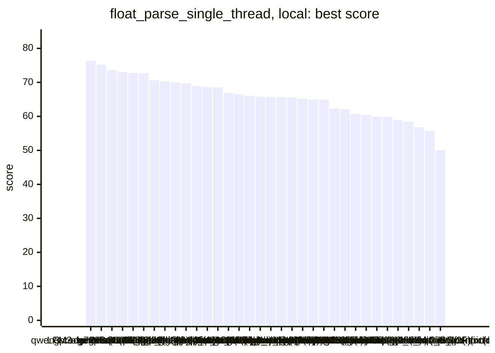
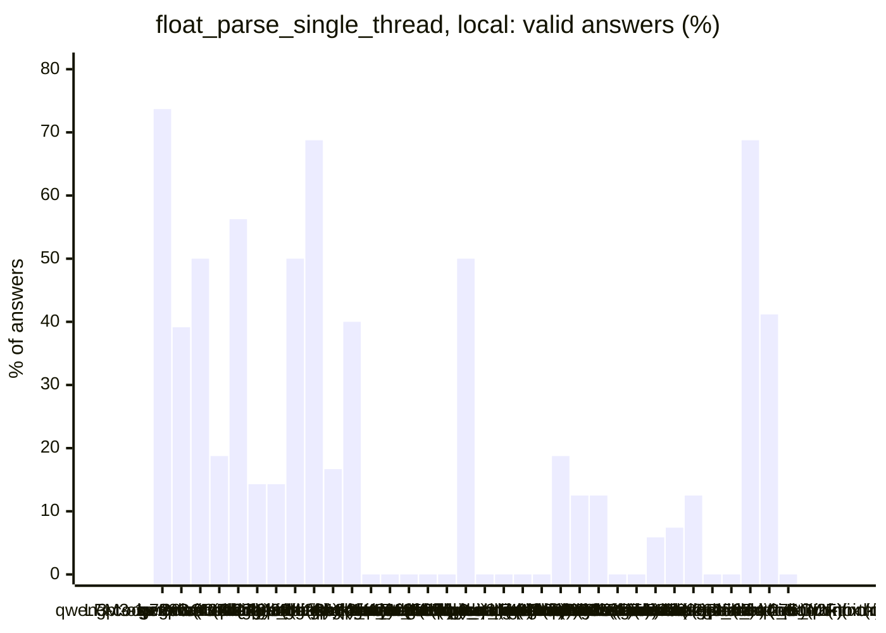
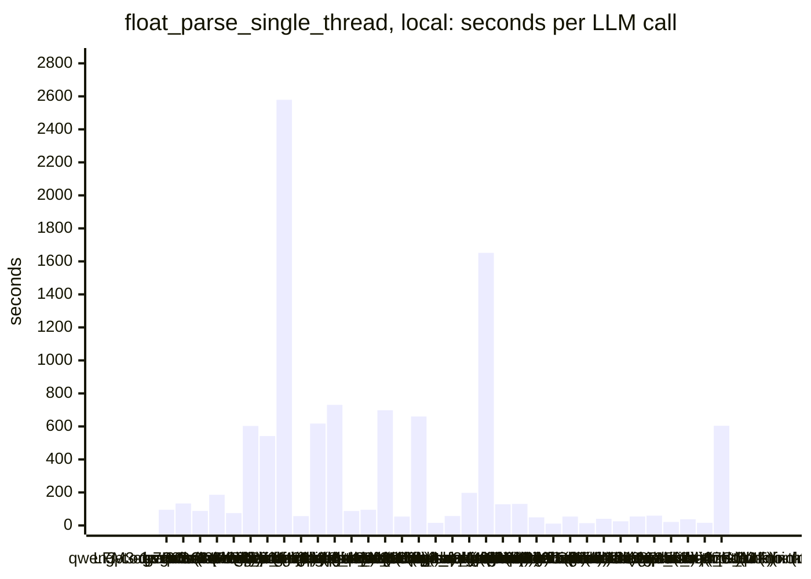
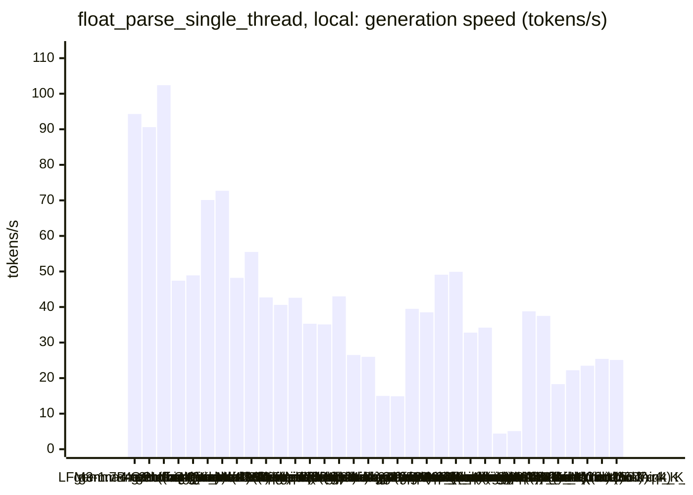
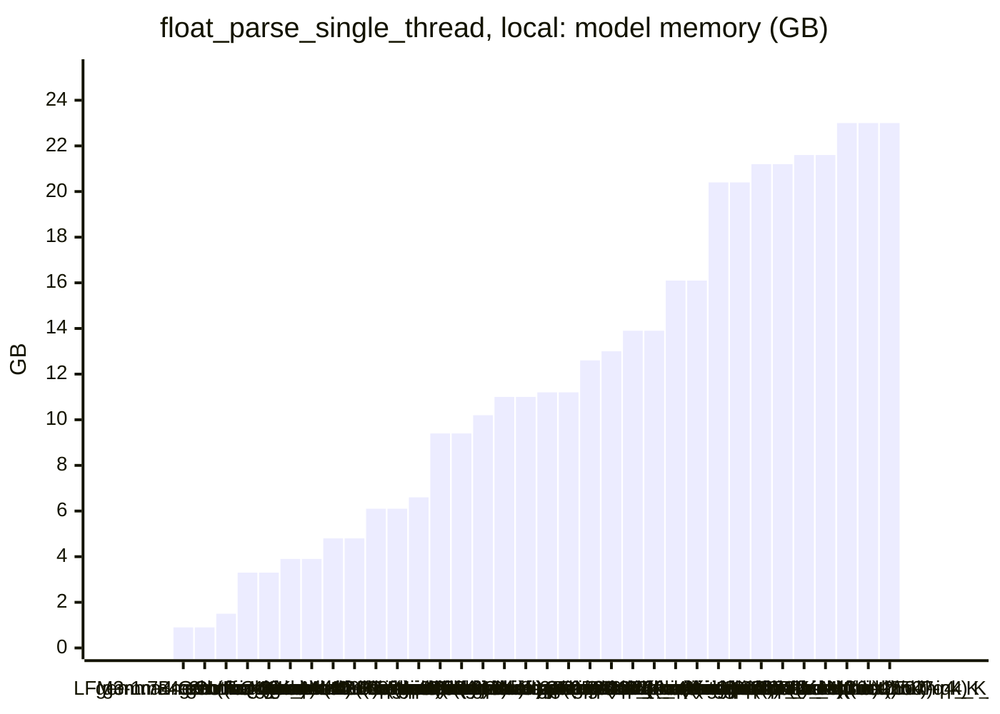
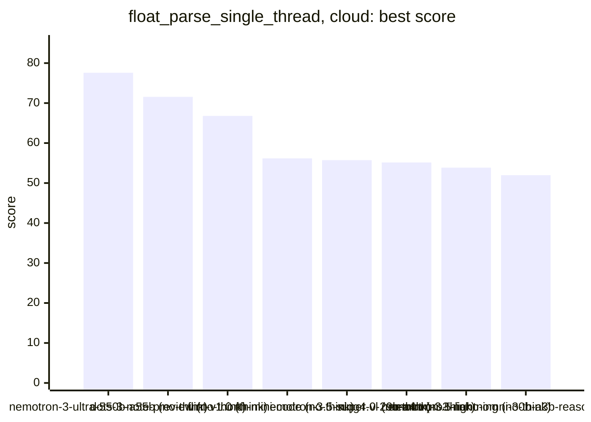
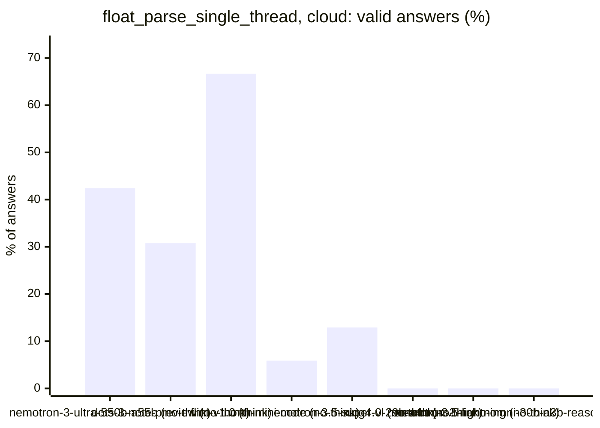
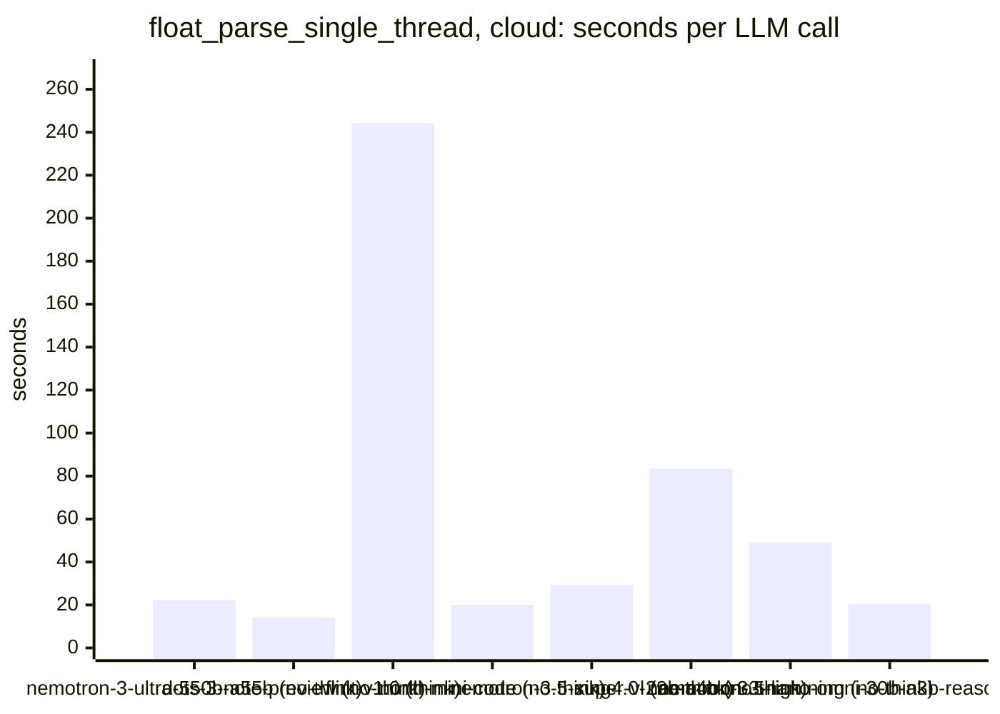
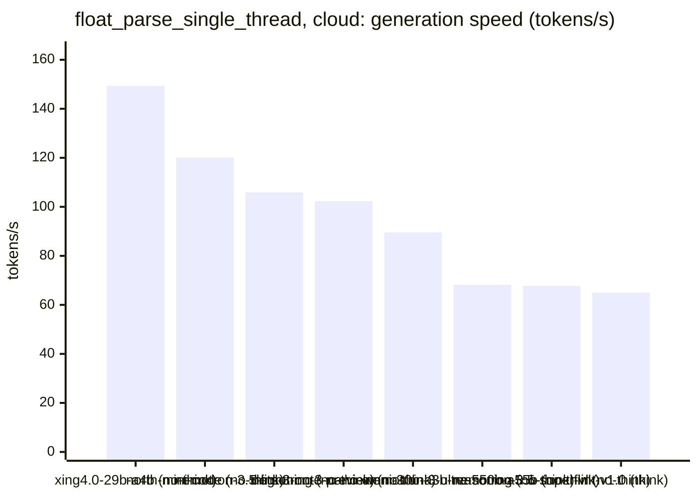

<!-- Copyright (c) 2026 by C. Klukas -->
<!-- SPDX-License-Identifier: GPL-3.0-only -->
<!-- Generated by `omega report` from bench/results/*.json. Do not edit by hand. -->

# float_parse_single_thread

50 models, each run at most 60 minutes, ended earlier after 15 answers in a row without progress; one run per model. The [overall ranking](../benchmarks.md#overall-ranking) compares the models over all examples.

Machine: Intel(R) Core(TM) i7-8700K CPU @ 3.70GHz (MS-7A98), 12 cores, 64 GB, 2x NVIDIA GeForce GTX 1080 Ti, 11264 MiB.

## Local models

Ollama on this machine.

| Model | Params | Initial | Best | Gain | LLM calls | s/call | Valid | New bests | Min to best | Minutes | Stopped by |
|---|---|--:|--:|--:|--:|--:|--:|--:|--:|--:|---|
| qwen3-coder:30b (no-think) | 30.5B | 67.8875 | **76.3399** | ×1.12 | 38 | 95 | 74% | 5 | 50.0 | 62.5 | time limit |
| gpt-oss:20b (no-think) | 20.9B | 61.3757 | **75.2210** | ×1.23 | 23 | 133 | 39% | 1 | 12.0 | 53.2 | no progress |
| gemma4:latest (think) | 7.5B | 73.6088 | **73.6088** | ×1.00 | 16 | 88 | 50% | 0 | - | 25.0 | no progress |
| hf.co/LiquidAI/LFM3-1.7B-GGUF:Q4_K_M (think) | 1.73B | 73.0324 | **73.0324** | ×1.00 | 16 | 186 | 19% | 0 | - | 50.8 | no progress |
| gemma4:e4b-it-qat (think) | 7.5B | 72.8022 | **72.8022** | ×1.00 | 16 | 75 | 56% | 0 | - | 21.3 | no progress |
| frob/sarvam:30b (think) | 32.2B | 72.7228 | **72.7228** | ×1.00 | 7 | 603 | 14% | 0 | - | 72.4 | time limit |
| gemma4:26b-a4b-it-qat (think) | 25.2B | 70.6776 | **70.6776** | ×1.00 | 7 | 542 | 14% | 0 | - | 65.3 | time limit |
| qwen3.6:27b-coding-mtp-q4_K_M (think) | 27.3B | 70.2712 | **70.2712** | ×1.00 | 2 | 2579 | 50% | 0 | - | 88.3 | time limit |
| gpt-oss:20b (think) | 20.9B | 69.1703 | **70.0098** | ×1.01 | 16 | 57 | 69% | 1 | 15.6 | 17.1 | no progress |
| qwen3.6:27b-coding-mtp-q4_K_M (no-think) | 27.3B | 56.0714 | **69.7649** | ×1.24 | 6 | 617 | 17% | 1 | 39.3 | 63.8 | time limit |
| gemma4:12b-it-qat (think) | 11.9B | 68.9567 | **68.9567** | ×1.00 | 5 | 731 | 40% | 0 | - | 63.0 | time limit |
| richardyoung/frognano-4b-2609:latest (think) | 4.3B | 68.6061 | **68.6061** | ×1.00 | 16 | 88 | 0% | 0 | - | 24.6 | no progress |
| qwen3:30b-a3b-instruct-2507-q4_K_M (think) | 30.5B | 68.4966 | **68.4966** | ×1.00 | 16 | 95 | 0% | 0 | - | 27.4 | no progress |
| hf.co/LiquidAI/LFM3-1.7B-GGUF:Q4_K_M (no-think) | 1.73B | | | | | | | | | | failed: all 16 model requests failed: hf.co/LiquidAI/LFM3-1.7B-GGUF: |
| glm-4.7-flash:latest (think) | 29.9B | 66.8787 | **66.8787** | ×1.00 | 6 | 698 | 0% | 0 | - | 71.9 | time limit |
| llm-jp-4-8b-omega:q4_k_m (no-think) | 8.6B | 66.4300 | **66.4300** | ×1.00 | 16 | 54 | 0% | 0 | - | 15.5 | no progress |
| frob/sarvam:30b (no-think) | 32.2B | 66.0620 | **66.0620** | ×1.00 | 6 | 660 | 0% | 0 | - | 68.0 | time limit |
| gemma4:e4b-it-qat (no-think) | 7.5B | 65.7656 | **65.7656** | ×1.00 | 16 | 16 | 50% | 0 | - | 5.4 | no progress |
| nemotron-3-nano:4b (think) | 4.0B | 65.7118 | **65.7118** | ×1.00 | 16 | 57 | 0% | 0 | - | 16.4 | no progress |
| qwen3.5:latest (think) | 9.0B | 65.5734 | **65.5734** | ×1.00 | 16 | 197 | 0% | 0 | - | 54.1 | no progress |
| underdog-saluki-27b:iq2-mix (think) | 26.9B | 65.5567 | **65.5567** | ×1.00 | 3 | 1652 | 0% | 0 | - | 84.0 | time limit |
| richardyoung/frognano-4b-2609:latest (no-think) | 4.3B | 65.2254 | **65.2254** | ×1.00 | 15 | 128 | 0% | 0 | - | 33.3 | no progress |
| qwen3.5:latest (no-think) | 9.0B | 64.9445 | **64.9445** | ×1.00 | 16 | 130 | 19% | 0 | - | 36.3 | no progress |
| gemma4:e2b (think) | 4.6B | 64.9351 | **64.9351** | ×1.00 | 16 | 49 | 12% | 0 | - | 14.5 | no progress |
| gemma4:e2b (no-think) | 4.6B | 62.2964 | **62.2964** | ×1.00 | 16 | 11 | 12% | 0 | - | 4.2 | no progress |
| glm-4.7-flash:latest (no-think) | 29.9B | 62.0608 | **62.0608** | ×1.00 | 16 | 54 | 0% | 0 | - | 16.4 | no progress |
| nemotron-3-nano:4b (no-think) | 4.0B | 60.7376 | **60.7376** | ×1.00 | 16 | 14 | 0% | 0 | - | 4.7 | no progress |
| qwen2.5-coder:7b (no-think) | 7.6B | 60.4549 | **60.5379** | ×1.00 | 17 | 40 | 6% | 1 | 11.8 | 13.0 | no progress |
| MichelRosselli/apertus:8b-instruct-2509-q4_k_m (no-think) | 8.1B | 58.8654 | **59.8966** | ×1.02 | 27 | 25 | 7% | 1 | 3.8 | 12.7 | no progress |
| gemma4:12b-it-qat (no-think) | 11.9B | 59.8440 | **59.8440** | ×1.00 | 16 | 54 | 12% | 0 | - | 16.0 | no progress |
| qwen3:30b-a3b-instruct-2507-q4_K_M (no-think) | 30.5B | 58.9552 | **58.9552** | ×1.00 | 16 | 59 | 0% | 0 | - | 18.0 | no progress |
| yandex/YandexGPT-5-Lite-8B-instruct-GGUF:latest (no-think) | 8.0B | 58.4558 | **58.4558** | ×1.00 | 16 | 21 | 0% | 0 | - | 6.8 | no progress |
| gemma4:26b-a4b-it-qat (no-think) | 25.2B | 55.0496 | **56.7909** | ×1.03 | 16 | 38 | 69% | 1 | 10.6 | 12.6 | no progress |
| gemma4:latest (no-think) | 7.5B | 55.7216 | **55.7216** | ×1.00 | 17 | 16 | 41% | 0 | - | 6.1 | no progress |
| underdog-saluki-27b:iq2-mix (no-think) | 26.9B | 50.0479 | **50.0479** | ×1.00 | 7 | 604 | 0% | 0 | - | 72.0 | time limit |

### Inference speed and memory

RAM is what Ollama reports for the loaded model (weights, context cache and buffers; on Apple silicon this is shared memory). Load is the time to bring the model into memory. Prompt and generation speeds are tokens per second over all calls of the run.

| Model | Params | RAM GB | Load s | Prompt tok/s | Gen tok/s | Median s/call | p90 s/call | Tokens/answer | Stopped |
|---|---|--:|--:|--:|--:|--:|--:|--:|--:|
| gemma4:e2b (think) | 4.6B | 0.9 | 0 | 4282 | 94.3 | 41 | 64 | 4360 | 1 |
| gemma4:e2b (no-think) | 4.6B | 0.9 | 0 | 4648 | 90.6 | 11 | 20 | 710 | 0 |
| hf.co/LiquidAI/LFM3-1.7B-GGUF:Q4_K_M (think) | 1.73B | 1.5 | 0 | 7946 | 102.4 | 184 | 244 | 18746 | 0 |
| gemma4:latest (think) | 7.5B | 3.3 | 0 | 2382 | 47.4 | 91 | 128 | 3950 | 0 |
| gemma4:latest (no-think) | 7.5B | 3.3 | 0 | 2899 | 48.9 | 12 | 32 | 593 | 0 |
| nemotron-3-nano:4b (think) | 4.0B | 3.9 | 0 | 3611 | 70.1 | 54 | 88 | 3517 | 0 |
| nemotron-3-nano:4b (no-think) | 4.0B | 3.9 | 0 | 3775 | 72.7 | 10 | 24 | 715 | 1 |
| richardyoung/frognano-4b-2609:latest (think) | 4.3B | 4.8 | 0 | 3208 | 48.2 | 72 | 114 | 4222 | 3 |
| richardyoung/frognano-4b-2609:latest (no-think) | 4.3B | 4.8 | 0 | 2511 | 55.5 | 97 | 440 | 6912 | 6 |
| gemma4:e4b-it-qat (think) | 7.5B | 6.1 | 0 | 2844 | 42.7 | 80 | 119 | 3010 | 0 |
| gemma4:e4b-it-qat (no-think) | 7.5B | 6.1 | 0 | 3422 | 40.6 | 13 | 26 | 481 | 0 |
| qwen2.5-coder:7b (no-think) | 7.6B | 6.6 | 0 | 3081 | 42.6 | 20 | 57 | 694 | 1 |
| qwen3.5:latest (think) | 9.0B | 9.4 | 0 | 1925 | 35.3 | 103 | 603 | 5438 | 3 |
| qwen3.5:latest (no-think) | 9.0B | 9.4 | 0 | 2009 | 35.1 | 82 | 242 | 2598 | 3 |
| yandex/YandexGPT-5-Lite-8B-instruct-GGUF:latest (no-think) | 8.0B | 10.2 | 0 | 3140 | 43.0 | 22 | 31 | 738 | 0 |
| gemma4:12b-it-qat (think) | 11.9B | 11.0 | 0 | 941 | 26.5 | 729 | 937 | 19117 | 0 |
| gemma4:12b-it-qat (no-think) | 11.9B | 11.0 | 0 | 1088 | 26.0 | 45 | 104 | 879 | 4 |
| underdog-saluki-27b:iq2-mix (think) | 26.9B | 11.2 | 0 | 542 | 15.0 | 1645 | 1679 | 24576 | 0 |
| underdog-saluki-27b:iq2-mix (no-think) | 26.9B | 11.2 | 0 | 476 | 14.9 | 343 | 1687 | 7921 | 2 |
| MichelRosselli/apertus:8b-instruct-2509-q4_k_m (no-think) | 8.1B | 12.6 | 0 | 2213 | 39.5 | 24 | 42 | 772 | 2 |
| llm-jp-4-8b-omega:q4_k_m (no-think) | 8.6B | 13.0 | 0 | 2216 | 38.5 | 48 | 90 | 1639 | 1 |
| gpt-oss:20b (no-think) | 20.9B | 13.9 | 0 | 3051 | 49.1 | 95 | 309 | 6334 | 0 |
| gpt-oss:20b (think) | 20.9B | 13.9 | 0 | 3203 | 49.9 | 42 | 160 | 2641 | 0 |
| gemma4:26b-a4b-it-qat (think) | 25.2B | 16.1 | 0 | 891 | 32.8 | 405 | 777 | 17458 | 0 |
| gemma4:26b-a4b-it-qat (no-think) | 25.2B | 16.1 | 0 | 813 | 34.2 | 30 | 58 | 685 | 1 |
| qwen3.6:27b-coding-mtp-q4_K_M (think) | 27.3B | 20.4 | 0 | 308 | 4.4 | 2994 | 2994 | 11179 | 0 |
| qwen3.6:27b-coding-mtp-q4_K_M (no-think) | 27.3B | 20.4 | 0 | 218 | 5.1 | 613 | 1079 | 2549 | 1 |
| frob/sarvam:30b (think) | 32.2B | 21.2 | 0 | 2508 | 38.8 | 631 | 659 | 23217 | 0 |
| frob/sarvam:30b (no-think) | 32.2B | 21.2 | 0 | 2486 | 37.5 | 665 | 671 | 24576 | 0 |
| glm-4.7-flash:latest (think) | 29.9B | 21.6 | 0 | 642 | 18.3 | 584 | 1466 | 13722 | 1 |
| glm-4.7-flash:latest (no-think) | 29.9B | 21.6 | 0 | 714 | 22.2 | 53 | 79 | 988 | 0 |
| qwen3-coder:30b (no-think) | 30.5B | 23.0 | 0 | 678 | 23.5 | 77 | 156 | 1945 | 3 |
| qwen3:30b-a3b-instruct-2507-q4_K_M (think) | 30.5B | 23.0 | 0 | 1332 | 25.4 | 80 | 127 | 1483 | 2 |
| qwen3:30b-a3b-instruct-2507-q4_K_M (no-think) | 30.5B | 23.0 | 0 | 1239 | 25.1 | 64 | 92 | 1317 | 1 |

### Best score over time

| Model | 15 min | 30 min | 45 min | 60 min |
|---|--:|--:|--:|--:|
| qwen3-coder:30b (no-think) | 68.9725 | 68.9725 | 72.2342 | 76.3399 |
| gpt-oss:20b (no-think) | 75.2210 | 75.2210 | 75.2210 | 75.2210 |
| gemma4:latest (think) | 73.6088 | 73.6088 | 73.6088 | 73.6088 |
| hf.co/LiquidAI/LFM3-1.7B-GGUF:Q4_K_M (think) | 73.0324 | 73.0324 | 73.0324 | 73.0324 |
| gemma4:e4b-it-qat (think) | 72.8022 | 72.8022 | 72.8022 | 72.8022 |
| frob/sarvam:30b (think) | 72.7228 | 72.7228 | 72.7228 | 72.7228 |
| gemma4:26b-a4b-it-qat (think) | 70.6776 | 70.6776 | 70.6776 | 70.6776 |
| qwen3.6:27b-coding-mtp-q4_K_M (think) | 70.2712 | 70.2712 | 70.2712 | 70.2712 |
| gpt-oss:20b (think) | 69.1703 | 70.0098 | 70.0098 | 70.0098 |
| qwen3.6:27b-coding-mtp-q4_K_M (no-think) | 56.0714 | 56.0714 | 69.7649 | 69.7649 |
| gemma4:12b-it-qat (think) | 68.9567 | 68.9567 | 68.9567 | 68.9567 |
| richardyoung/frognano-4b-2609:latest (think) | 68.6061 | 68.6061 | 68.6061 | 68.6061 |
| qwen3:30b-a3b-instruct-2507-q4_K_M (think) | 68.4966 | 68.4966 | 68.4966 | 68.4966 |
| glm-4.7-flash:latest (think) | 66.8787 | 66.8787 | 66.8787 | 66.8787 |
| llm-jp-4-8b-omega:q4_k_m (no-think) | 66.4300 | 66.4300 | 66.4300 | 66.4300 |
| frob/sarvam:30b (no-think) | 66.0620 | 66.0620 | 66.0620 | 66.0620 |
| gemma4:e4b-it-qat (no-think) | 65.7656 | 65.7656 | 65.7656 | 65.7656 |
| nemotron-3-nano:4b (think) | 65.7118 | 65.7118 | 65.7118 | 65.7118 |
| qwen3.5:latest (think) | 65.5734 | 65.5734 | 65.5734 | 65.5734 |
| underdog-saluki-27b:iq2-mix (think) | 65.5567 | 65.5567 | 65.5567 | 65.5567 |
| richardyoung/frognano-4b-2609:latest (no-think) | 65.2254 | 65.2254 | 65.2254 | 65.2254 |
| qwen3.5:latest (no-think) | 64.9445 | 64.9445 | 64.9445 | 64.9445 |
| gemma4:e2b (think) | 64.9351 | 64.9351 | 64.9351 | 64.9351 |
| gemma4:e2b (no-think) | 62.2964 | 62.2964 | 62.2964 | 62.2964 |
| glm-4.7-flash:latest (no-think) | 62.0608 | 62.0608 | 62.0608 | 62.0608 |
| nemotron-3-nano:4b (no-think) | 60.7376 | 60.7376 | 60.7376 | 60.7376 |
| qwen2.5-coder:7b (no-think) | 60.5379 | 60.5379 | 60.5379 | 60.5379 |
| MichelRosselli/apertus:8b-instruct-2509-q4_k_m (no-think) | 59.8966 | 59.8966 | 59.8966 | 59.8966 |
| gemma4:12b-it-qat (no-think) | 59.8440 | 59.8440 | 59.8440 | 59.8440 |
| qwen3:30b-a3b-instruct-2507-q4_K_M (no-think) | 58.9552 | 58.9552 | 58.9552 | 58.9552 |
| yandex/YandexGPT-5-Lite-8B-instruct-GGUF:latest (no-think) | 58.4558 | 58.4558 | 58.4558 | 58.4558 |
| gemma4:26b-a4b-it-qat (no-think) | 56.7909 | 56.7909 | 56.7909 | 56.7909 |
| gemma4:latest (no-think) | 55.7216 | 55.7216 | 55.7216 | 55.7216 |
| underdog-saluki-27b:iq2-mix (no-think) | 50.0479 | 50.0479 | 50.0479 | 50.0479 |

### Outcome of the LLM answers

| Model | compile error | duplicate | edit error | invalid | llm error | ok | timeout |
|---|--:|--:|--:|--:|--:|--:|--:|
| qwen3-coder:30b (no-think) | 0 | 1 | 0 | 6 | 3 | 28 | 0 |
| gpt-oss:20b (no-think) | 5 | 3 | 5 | 1 | 0 | 9 | 0 |
| gemma4:latest (think) | 1 | 0 | 0 | 7 | 0 | 8 | 0 |
| hf.co/LiquidAI/LFM3-1.7B-GGUF:Q4_K_M (think) | 3 | 1 | 8 | 1 | 0 | 3 | 0 |
| gemma4:e4b-it-qat (think) | 1 | 1 | 1 | 4 | 0 | 9 | 0 |
| frob/sarvam:30b (think) | 0 | 0 | 6 | 0 | 0 | 1 | 0 |
| gemma4:26b-a4b-it-qat (think) | 3 | 0 | 3 | 0 | 0 | 1 | 0 |
| qwen3.6:27b-coding-mtp-q4_K_M (think) | 1 | 0 | 0 | 0 | 0 | 1 | 0 |
| gpt-oss:20b (think) | 4 | 0 | 1 | 0 | 0 | 11 | 0 |
| qwen3.6:27b-coding-mtp-q4_K_M (no-think) | 1 | 0 | 0 | 3 | 1 | 1 | 0 |
| gemma4:12b-it-qat (think) | 1 | 0 | 1 | 1 | 0 | 2 | 0 |
| richardyoung/frognano-4b-2609:latest (think) | 6 | 0 | 3 | 4 | 3 | 0 | 0 |
| qwen3:30b-a3b-instruct-2507-q4_K_M (think) | 3 | 1 | 1 | 9 | 2 | 0 | 0 |
| glm-4.7-flash:latest (think) | 3 | 0 | 2 | 0 | 1 | 0 | 0 |
| llm-jp-4-8b-omega:q4_k_m (no-think) | 10 | 0 | 5 | 0 | 1 | 0 | 0 |
| frob/sarvam:30b (no-think) | 0 | 0 | 6 | 0 | 0 | 0 | 0 |
| gemma4:e4b-it-qat (no-think) | 7 | 0 | 0 | 1 | 0 | 8 | 0 |
| nemotron-3-nano:4b (think) | 3 | 0 | 12 | 0 | 1 | 0 | 0 |
| qwen3.5:latest (think) | 4 | 0 | 3 | 6 | 3 | 0 | 0 |
| underdog-saluki-27b:iq2-mix (think) | 0 | 0 | 3 | 0 | 0 | 0 | 0 |
| richardyoung/frognano-4b-2609:latest (no-think) | 5 | 0 | 4 | 0 | 6 | 0 | 0 |
| qwen3.5:latest (no-think) | 5 | 0 | 0 | 5 | 3 | 3 | 0 |
| gemma4:e2b (think) | 6 | 0 | 1 | 5 | 1 | 2 | 1 |
| gemma4:e2b (no-think) | 12 | 0 | 2 | 0 | 0 | 2 | 0 |
| glm-4.7-flash:latest (no-think) | 7 | 1 | 2 | 6 | 0 | 0 | 0 |
| nemotron-3-nano:4b (no-think) | 4 | 0 | 10 | 0 | 2 | 0 | 0 |
| qwen2.5-coder:7b (no-think) | 8 | 3 | 0 | 3 | 1 | 1 | 1 |
| MichelRosselli/apertus:8b-instruct-2509-q4_k_m (no-think) | 11 | 1 | 11 | 0 | 2 | 2 | 0 |
| gemma4:12b-it-qat (no-think) | 0 | 0 | 0 | 10 | 4 | 2 | 0 |
| qwen3:30b-a3b-instruct-2507-q4_K_M (no-think) | 7 | 0 | 3 | 5 | 1 | 0 | 0 |
| yandex/YandexGPT-5-Lite-8B-instruct-GGUF:latest (no-think) | 10 | 0 | 5 | 1 | 0 | 0 | 0 |
| gemma4:26b-a4b-it-qat (no-think) | 0 | 0 | 0 | 4 | 1 | 11 | 0 |
| gemma4:latest (no-think) | 9 | 0 | 1 | 0 | 0 | 7 | 0 |
| underdog-saluki-27b:iq2-mix (no-think) | 1 | 0 | 3 | 1 | 2 | 0 | 0 |

### Best idea per model

- **qwen3-coder:30b (no-think)**: Replace the overly conservative fast path conditions with tighter bounds that correctly handle Clinger's fast path while maintaining exact rounding behavior, enabling more numbers …
- **gpt-oss:20b (no-think)**: Replace the slow `std::strtod` loop with the fast, standard‑conforming `std::from_chars` parser for double, falling back to `std::strtod` only on rare failures, and skip newlines …
- **gemma4:latest (think)**: initial program
- **hf.co/LiquidAI/LFM3-1.7B-GGUF:Q4_K_M (think)**: initial program
- **gemma4:e4b-it-qat (think)**: initial program
- **frob/sarvam:30b (think)**: initial program
- **gemma4:26b-a4b-it-qat (think)**: initial program
- **qwen3.6:27b-coding-mtp-q4_K_M (think)**: initial program
- **gpt-oss:20b (think)**: Add a fast integer‑only parsing path that converts the number directly to double when the line contains no decimal point or exponent, reducing the number of calls to the slow …
- **qwen3.6:27b-coding-mtp-q4_K_M (no-think)**: Implement a custom fast-path parser using SWAR digit accumulation and Clinger's algorithm for exact conversion of short mantissas, falling back to `std::strtod` for complex cases …
- **gemma4:12b-it-qat (think)**: initial program
- **richardyoung/frognano-4b-2609:latest (think)**: initial program
- **qwen3:30b-a3b-instruct-2507-q4_K_M (think)**: initial program
- **glm-4.7-flash:latest (think)**: initial program
- **llm-jp-4-8b-omega:q4_k_m (no-think)**: initial program
- **frob/sarvam:30b (no-think)**: initial program
- **gemma4:e4b-it-qat (no-think)**: initial program
- **nemotron-3-nano:4b (think)**: initial program
- **qwen3.5:latest (think)**: initial program
- **underdog-saluki-27b:iq2-mix (think)**: initial program
- **richardyoung/frognano-4b-2609:latest (no-think)**: initial program
- **qwen3.5:latest (no-think)**: initial program
- **gemma4:e2b (think)**: initial program
- **gemma4:e2b (no-think)**: initial program
- **glm-4.7-flash:latest (no-think)**: initial program
- **nemotron-3-nano:4b (no-think)**: initial program
- **qwen2.5-coder:7b (no-think)**: tuned MAX_DIGITS_PER_SWAR=4.693 on top of: Introduce a constant for the maximum number of digits to process in parallel using SWAR tricks, and expose it for optimization.
- **MichelRosselli/apertus:8b-instruct-2509-q4_k_m (no-think)**: Use NEON vectorization to process multiple numbers simultaneously, taking advantage of the uniform newline terminators to avoid branching. This allows leveraging the uniform …
- **gemma4:12b-it-qat (no-think)**: initial program
- **qwen3:30b-a3b-instruct-2507-q4_K_M (no-think)**: initial program
- **yandex/YandexGPT-5-Lite-8B-instruct-GGUF:latest (no-think)**: initial program
- **gemma4:26b-a4b-it-qat (no-think)**: Optimize the loop by skipping the expensive `strtod` call for common cases where the number is a simple integer or a short decimal that can be parsed with `uint64_t` and …
- **gemma4:latest (no-think)**: initial program
- **underdog-saluki-27b:iq2-mix (no-think)**: initial program

## Cloud models (OpenRouter)

Free OpenRouter models; times include the network and the provider's queue.

| Model | Params | Initial | Best | Gain | LLM calls | s/call | Valid | New bests | Min to best | Minutes | Stopped by |
|---|---|--:|--:|--:|--:|--:|--:|--:|--:|--:|---|
| nvidia/nemotron-3-ultra-550b-a55b:free (no-think) |  | 53.8025 | **77.5919** | ×1.44 | 33 | 22 | 42% | 3 | 4.8 | 13.5 | no progress |
| dots-studio/dots-3-note-preview:free (no-think) |  | 56.3142 | **71.5623** | ×1.27 | 65 | 14 | 31% | 7 | 16.4 | 17.0 | no progress |
| nvidia/nemotron-3-nano-omni-30b-a3b-reasoning:free (think) |  | | | | | | | | | | failed: all 6 model requests failed: nvidia/nemotron-3-nano-omni-30b |
| recursive/flint-v1.0:free (think) |  | 49.4140 | **66.7858** | ×1.35 | 15 | 244 | 67% | 2 | 18.3 | 62.1 | time limit |
| cohere/north-mini-code:free (think) |  | | | | | | | | | | failed: all 6 model requests failed: cohere/north-mini-code:free: ra |
| nvidia/nemotron-3-ultra-550b-a55b:free (think) |  | | | | | | | | | | failed: all 6 model requests failed: nvidia/nemotron-3-ultra-550b-a5 |
| nvidia/nemotron-3.5-super-vl:free (think) |  | | | | | | | | | | failed: all 5 model requests failed: nvidia/nemotron-3.5-super-vl:fr |
| dots-studio/dots-3-note-preview:free (think) |  | | | | | | | | | | failed: all 6 model requests failed: dots-studio/dots-3-note-preview |
| nvidia/nemotron-3.5-lightning:free (think) |  | | | | | | | | | | failed: all 6 model requests failed: nvidia/nemotron-3.5-lightning:f |
| xingchen-agi/xing4.0-29b-a4b:free (think) |  | | | | | | | | | | failed: all 16 model requests failed: xingchen-agi/xing4.0-29b-a4b:f |
| cohere/north-mini-code:free (no-think) |  | 52.6268 | **56.1693** | ×1.07 | 17 | 20 | 6% | 1 | 5.8 | 6.4 | no progress |
| nvidia/nemotron-3.5-super-vl:free (no-think) |  | 54.4929 | **55.7267** | ×1.02 | 31 | 29 | 13% | 1 | 8.4 | 16.1 | no progress |
| xingchen-agi/xing4.0-29b-a4b:free (no-think) |  | 55.1384 | **55.1384** | ×1.00 | 16 | 83 | 0% | 0 | - | 23.1 | no progress |
| nvidia/nemotron-3.5-lightning:free (no-think) |  | 53.8589 | **53.8589** | ×1.00 | 16 | 49 | 0% | 0 | - | 13.8 | no progress |
| nvidia/nemotron-3-nano-omni-30b-a3b-reasoning:free (no-think) |  | 51.9664 | **51.9664** | ×1.00 | 16 | 21 | 0% | 0 | - | 6.4 | no progress |

### Inference speed and cost

Generation speed is measured from the first to the last streamed token; the time to the first token is counted as prompt time. Cost is what OpenRouter charged for the run.

| Model | Gen tok/s | Median s/call | p90 s/call | Tokens/answer | Stopped | Cost $ |
|---|--:|--:|--:|--:|--:|--:|
| xingchen-agi/xing4.0-29b-a4b:free (no-think) | 149.4 | 76 | 182 | 2116 | 3 | 0.000 |
| cohere/north-mini-code:free (no-think) | 120.1 | 17 | 29 | 1767 | 3 | 0.000 |
| nvidia/nemotron-3.5-lightning:free (no-think) | 105.9 | 36 | 69 | 3414 | 9 | 0.000 |
| dots-studio/dots-3-note-preview:free (no-think) | 102.3 | 11 | 24 | 1060 | 2 | 0.000 |
| nvidia/nemotron-3-nano-omni-30b-a3b-reasoning:free (no-think) | 89.6 | 14 | 60 | 1292 | 2 | 0.000 |
| nvidia/nemotron-3-ultra-550b-a55b:free (no-think) | 68.2 | 16 | 51 | 1421 | 0 | 0.000 |
| nvidia/nemotron-3.5-super-vl:free (no-think) | 67.8 | 24 | 56 | 1073 | 6 | 0.000 |
| recursive/flint-v1.0:free (think) | 65.0 | 210 | 477 | 15795 | 0 | 0.000 |

### Best score over time

| Model | 15 min | 30 min | 45 min | 60 min |
|---|--:|--:|--:|--:|
| nvidia/nemotron-3-ultra-550b-a55b:free (no-think) | 77.5919 | 77.5919 | 77.5919 | 77.5919 |
| dots-studio/dots-3-note-preview:free (no-think) | 69.3072 | 71.5623 | 71.5623 | 71.5623 |
| recursive/flint-v1.0:free (think) | 53.8360 | 66.7858 | 66.7858 | 66.7858 |
| cohere/north-mini-code:free (no-think) | 56.1693 | 56.1693 | 56.1693 | 56.1693 |
| nvidia/nemotron-3.5-super-vl:free (no-think) | 55.7267 | 55.7267 | 55.7267 | 55.7267 |
| xingchen-agi/xing4.0-29b-a4b:free (no-think) | 55.1384 | 55.1384 | 55.1384 | 55.1384 |
| nvidia/nemotron-3.5-lightning:free (no-think) | 53.8589 | 53.8589 | 53.8589 | 53.8589 |
| nvidia/nemotron-3-nano-omni-30b-a3b-reasoning:free (no-think) | 51.9664 | 51.9664 | 51.9664 | 51.9664 |

### Outcome of the LLM answers

| Model | compile error | duplicate | edit error | invalid | llm error | ok |
|---|--:|--:|--:|--:|--:|--:|
| nvidia/nemotron-3-ultra-550b-a55b:free (no-think) | 2 | 7 | 0 | 10 | 0 | 14 |
| dots-studio/dots-3-note-preview:free (no-think) | 6 | 4 | 10 | 21 | 4 | 20 |
| recursive/flint-v1.0:free (think) | 0 | 2 | 3 | 0 | 0 | 10 |
| cohere/north-mini-code:free (no-think) | 6 | 0 | 2 | 5 | 3 | 1 |
| nvidia/nemotron-3.5-super-vl:free (no-think) | 3 | 6 | 6 | 6 | 6 | 4 |
| xingchen-agi/xing4.0-29b-a4b:free (no-think) | 0 | 2 | 2 | 0 | 12 | 0 |
| nvidia/nemotron-3.5-lightning:free (no-think) | 4 | 0 | 3 | 0 | 9 | 0 |
| nvidia/nemotron-3-nano-omni-30b-a3b-reasoning:free (no-think) | 3 | 0 | 10 | 1 | 2 | 0 |

### Best idea per model

- **nvidia/nemotron-3-ultra-550b-a55b:free (no-think)**: Add a fast path for scientific notation with small exponents using Clinger's algorithm, and increase the mantissa digit limit to 19 to handle more cases without fallback.
- **dots-studio/dots-3-note-preview:free (no-think)**: Extend the fast path to handle scientific notation by parsing the exponent, combining it with the decimal exponent, and using exact multiplication/division by powers of ten …
- **recursive/flint-v1.0:free (think)**: Add an exact fast path for plain decimal integers within the exactly representable range, falling back to std::strtod otherwise.
- **cohere/north-mini-code:free (no-think)**: Expose the inner loop’s initial mantissa‑zero‑handling threshold and the maximum digit‑processing block size as constants to allow the optimizer to tune performance.
- **nvidia/nemotron-3.5-super-vl:free (no-think)**: Add a fast path for short unsigned integers without decimal point or exponent: accumulate up to 19 digits into uint64_t and cast exactly to double, falling back to std::strtod …
- **xingchen-agi/xing4.0-29b-a4b:free (no-think)**: initial program
- **nvidia/nemotron-3.5-lightning:free (no-think)**: initial program
- **nvidia/nemotron-3-nano-omni-30b-a3b-reasoning:free (no-think)**: initial program
