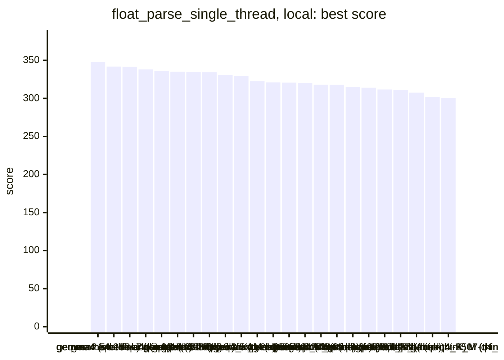
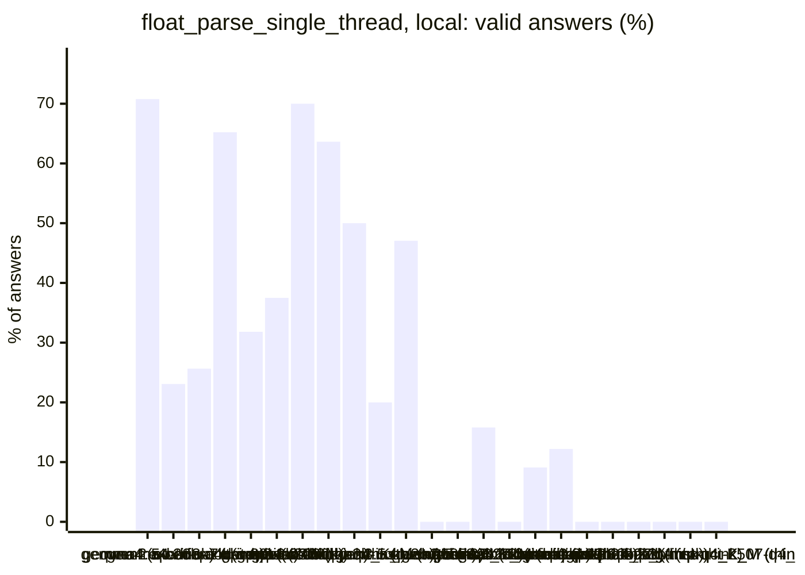
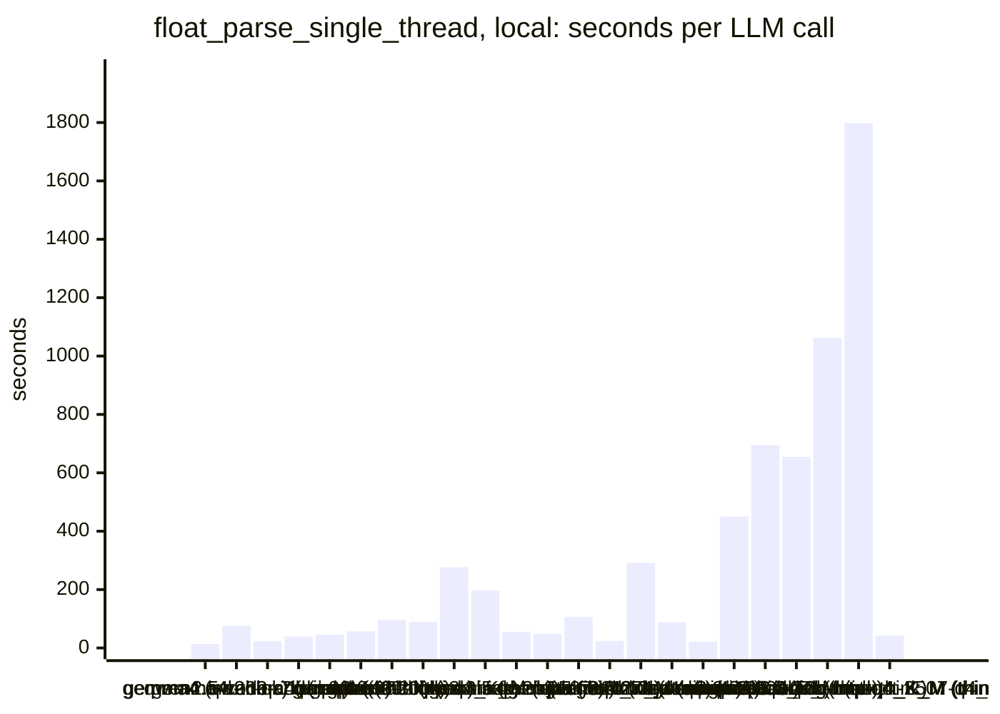
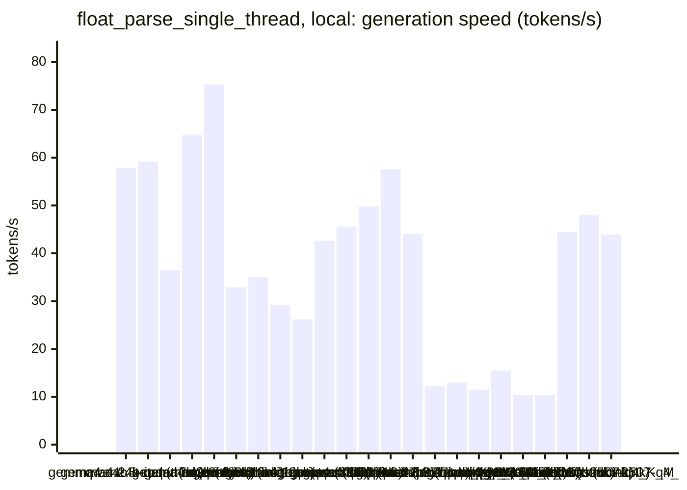
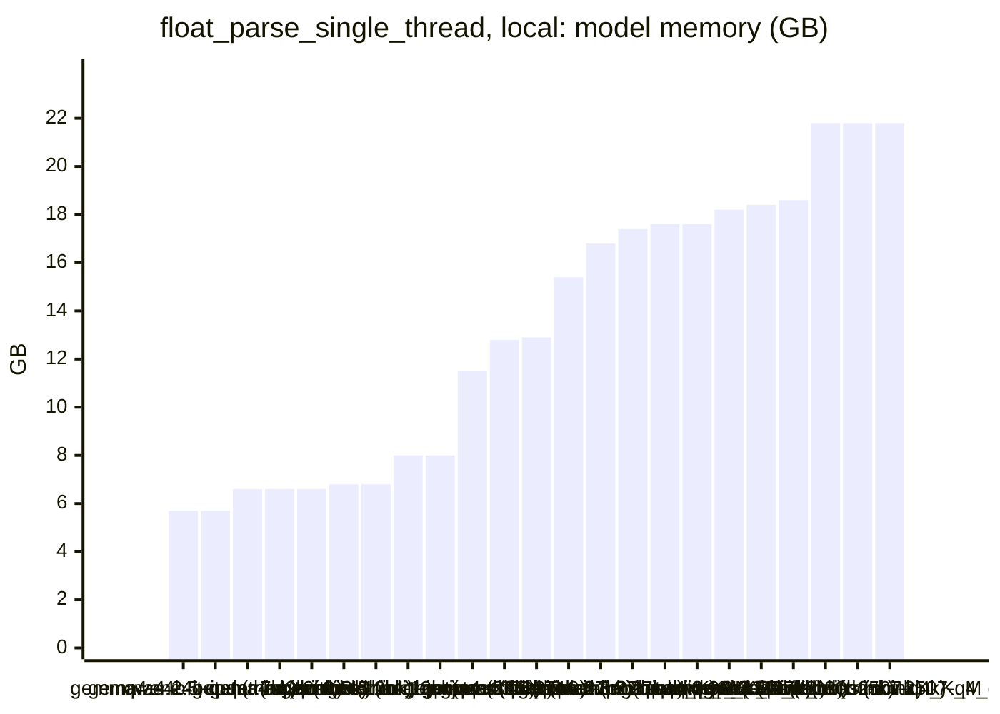

<!-- Copyright (c) 2026 by C. Klukas -->
<!-- SPDX-License-Identifier: GPL-3.0-only -->
<!-- Generated by `omega report` from bench/results/*.json. Do not edit by hand. -->

# float_parse_single_thread

24 models, 15 minutes each, latest run per model. The [overall ranking](../benchmarks.md#overall-ranking) compares the models over all examples.

Machine: Apple M1 Max (Mac13,1), 10 cores, 32 GB.

## Local models

Ollama on this machine.

| Model | Params | Initial | Best | Gain | LLM calls | s/call | Valid | New bests | Min to best |
|---|---|--:|--:|--:|--:|--:|--:|--:|--:|
| gemma4:latest (no-think) |  | 316.3600 | **347.6860** | ×1.10 | 65 | 13 | 71% | 6 | 15.1 |
| gemma4:e4b-it-qat (think) | 7.5B | 306.1580 | **341.7630** | ×1.12 | 13 | 76 | 23% | 2 | 10.3 |
| qwen2.5-coder:7b (no-think) | 7.6B | 315.6030 | **341.3640** | ×1.08 | 39 | 23 | 26% | 3 | 13.6 |
| gemma4:26b-a4b-it-qat (no-think) | 25.2B | 317.7260 | **338.0720** | ×1.06 | 23 | 40 | 65% | 4 | 12.2 |
| qwen3-coder:30b (no-think) | 30.5B | 322.4690 | **335.8920** | ×1.04 | 22 | 45 | 32% | 1 | 6.5 |
| gemma4:latest (think) |  | 314.4390 | **334.9880** | ×1.07 | 16 | 57 | 38% | 3 | 10.6 |
| gpt-oss:20b (think) | 20.9B | 312.7560 | **334.6440** | ×1.07 | 10 | 96 | 70% | 2 | 5.3 |
| gpt-oss:20b (no-think) | 20.9B | 320.5860 | **334.3880** | ×1.04 | 11 | 89 | 64% | 1 | 3.7 |
| qwen3.8:27b-mtp-q4_K_M (no-think) | 27.3B | 314.5260 | **330.6950** | ×1.05 | 4 | 277 | 50% | 1 | 8.7 |
| qwen3.5:latest (think) | 9.7B | 314.7740 | **328.9980** | ×1.05 | 5 | 198 | 20% | 1 | 14.3 |
| gemma4:e2b (think) | 5.1B | 315.4670 | **322.6780** | ×1.02 | 17 | 55 | 47% | 1 | 6.2 |
| qwen3:30b-a3b-instruct-2507-q4_K_M (no-think) | 30.5B | 320.9740 | **320.9740** | ×1.00 | 19 | 49 | 0% | 0 | - |
| qwen3.5:latest (no-think) | 9.7B | 320.7090 | **320.7090** | ×1.00 | 9 | 106 | 0% | 0 | - |
| gemma4:e2b (no-think) | 5.1B | 319.9610 | **319.9610** | ×1.00 | 38 | 24 | 16% | 0 | - |
| qwen3.5:27b (no-think) | 27.8B | 317.8080 | **317.8080** | ×1.00 | 4 | 292 | 0% | 0 | - |
| gemma4:12b-it-qat (no-think) | 11.9B | 317.6940 | **317.6940** | ×1.00 | 11 | 88 | 9% | 0 | - |
| gemma4:e4b-it-qat (no-think) | 7.5B | 314.8930 | **315.1790** | ×1.00 | 41 | 22 | 12% | 1 | 8.8 |
| qwen3.6:27b-coding-mtp-q4_K_M (no-think) | 27.3B | 313.9800 | **313.9800** | ×1.00 | 2 | 450 | 0% | 0 | - |
| gemma4:12b-it-qat (think) | 11.9B | 311.7360 | **311.7360** | ×1.00 | 2 | 695 | 0% | 0 | - |
| qwen3.5:27b (think) | 27.8B | 311.0700 | **311.0700** | ×1.00 | 2 | 654 | 0% | 0 | - |
| qwen3.6:27b-coding-mtp-q4_K_M (think) | 27.3B | 307.5350 | **307.5350** | ×1.00 | 1 | 1063 | 0% | 0 | - |
| gemma4:26b-a4b-it-qat (think) | 25.2B | | | | | | | | failed: all 2 model requests failed: gemma4:26b-a4b-it-qat: answer s |
| qwen3.8:27b-mtp-q4_K_M (think) | 27.3B | 301.9280 | **301.9280** | ×1.00 | 1 | 1798 | 0% | 0 | - |
| qwen3:30b-a3b-instruct-2507-q4_K_M (think) | 30.5B | 300.1980 | **300.1980** | ×1.00 | 22 | 42 | 0% | 0 | - |

### Inference speed and memory

RAM is what Ollama reports for the loaded model (weights, context cache and buffers; on Apple silicon this is shared memory). Load is the time to bring the model into memory. Prompt and generation speeds are tokens per second over all calls of the run.

| Model | Params | RAM GB | Load s | Prompt tok/s | Gen tok/s | Median s/call | p90 s/call | Tokens/answer | Stopped |
|---|---|--:|--:|--:|--:|--:|--:|--:|--:|
| gemma4:e4b-it-qat (think) | 7.5B | 5.7 | 71 | 575 | 57.9 | 75 | 108 | 3378 | 1 |
| gemma4:e4b-it-qat (no-think) | 7.5B | 5.7 | 77 | 580 | 59.2 | 19 | 34 | 492 | 1 |
| qwen2.5-coder:7b (no-think) | 7.6B | 6.6 | 59 | 950 | 36.5 | 22 | 31 | 543 | 0 |
| gemma4:e2b (think) | 5.1B | 6.6 | 138 | 799 | 64.7 | 46 | 61 | 2552 | 0 |
| gemma4:e2b (no-think) | 5.1B | 6.6 | 60 | 797 | 75.3 | 21 | 31 | 1036 | 1 |
| qwen3.5:latest (think) | 9.7B | 6.8 | 58 | 399 | 32.9 | 137 | 388 | 4013 | 1 |
| qwen3.5:latest (no-think) | 9.7B | 6.8 | 0 | 408 | 35.0 | 102 | 239 | 3360 | 4 |
| gemma4:12b-it-qat (no-think) | 11.9B | 8.0 | 95 | 233 | 29.2 | 46 | 150 | 1541 | 3 |
| gemma4:12b-it-qat (think) | 11.9B | 8.0 | 158 | 194 | 26.2 | 810 | 810 | 16384 | 1 |
| gemma4:latest (think) |  | 11.5 | 120 | 1394 | 42.6 | 39 | 96 | 1905 | 0 |
| gpt-oss:20b (think) | 20.9B | 12.8 | 161 | 511 | 45.6 | 90 | 255 | 3181 | 0 |
| gpt-oss:20b (no-think) | 20.9B | 12.9 | 55 | 1360 | 49.8 | 103 | 172 | 4015 | 0 |
| gemma4:26b-a4b-it-qat (no-think) | 25.2B | 15.4 | 226 | 498 | 57.6 | 26 | 72 | 684 | 3 |
| gemma4:latest (no-think) |  | 16.8 | 163 | 1883 | 44.0 | 10 | 16 | 301 | 0 |
| qwen3.6:27b-coding-mtp-q4_K_M (think) | 27.3B | 17.4 | 254 | 91 | 12.2 | 1063 | 1063 | 9204 | 0 |
| qwen3.8:27b-mtp-q4_K_M (no-think) | 27.3B | 17.6 | 304 | 115 | 13.0 | 382 | 516 | 1939 | 0 |
| qwen3.8:27b-mtp-q4_K_M (think) | 27.3B | 17.6 | 324 | 94 | 11.5 | 1798 | 1798 | 16384 | 0 |
| qwen3.6:27b-coding-mtp-q4_K_M (no-think) | 27.3B | 18.2 | 188 | 174 | 15.5 | 668 | 668 | 5073 | 0 |
| qwen3.5:27b (think) | 27.8B | 18.4 | 127 | 167 | 10.4 | 802 | 802 | 5850 | 0 |
| qwen3.5:27b (no-think) | 27.8B | 18.6 | 135 | 121 | 10.4 | 309 | 526 | 2245 | 0 |
| qwen3-coder:30b (no-think) | 30.5B | 21.8 | 132 | 1027 | 44.5 | 39 | 63 | 1436 | 2 |
| qwen3:30b-a3b-instruct-2507-q4_K_M (no-think) | 30.5B | 21.8 | 203 | 1215 | 48.0 | 38 | 78 | 1453 | 2 |
| qwen3:30b-a3b-instruct-2507-q4_K_M (think) | 30.5B | 21.8 | 190 | 1149 | 43.9 | 38 | 70 | 1190 | 1 |

### Best score over time

| Model | 3.75 min | 7.5 min | 11.25 min | 15 min |
|---|--:|--:|--:|--:|
| gemma4:latest (no-think) | 316.3600 | 342.6620 | 342.6620 | 342.6620 |
| gemma4:e4b-it-qat (think) | 331.3050 | 331.3050 | 341.7630 | 341.7630 |
| qwen2.5-coder:7b (no-think) | 315.6030 | 339.0930 | 340.7250 | 341.3640 |
| gemma4:26b-a4b-it-qat (no-think) | 317.7260 | 317.7260 | 331.1120 | 338.0720 |
| qwen3-coder:30b (no-think) | 322.4690 | 335.8920 | 335.8920 | 335.8920 |
| gemma4:latest (think) | 314.4390 | 319.4860 | 334.9880 | 334.9880 |
| gpt-oss:20b (think) | 312.7560 | 334.6440 | 334.6440 | 334.6440 |
| gpt-oss:20b (no-think) | 334.3880 | 334.3880 | 334.3880 | 334.3880 |
| qwen3.8:27b-mtp-q4_K_M (no-think) | 314.5260 | 314.5260 | 330.6950 | 330.6950 |
| qwen3.5:latest (think) | 314.7740 | 314.7740 | 314.7740 | 328.9980 |
| gemma4:e2b (think) | 315.4670 | 322.6780 | 322.6780 | 322.6780 |
| qwen3:30b-a3b-instruct-2507-q4_K_M (no-think) | 320.9740 | 320.9740 | 320.9740 | 320.9740 |
| qwen3.5:latest (no-think) | 320.7090 | 320.7090 | 320.7090 | 320.7090 |
| gemma4:e2b (no-think) | 319.9610 | 319.9610 | 319.9610 | 319.9610 |
| qwen3.5:27b (no-think) | 317.8080 | 317.8080 | 317.8080 | 317.8080 |
| gemma4:12b-it-qat (no-think) | 317.6940 | 317.6940 | 317.6940 | 317.6940 |
| gemma4:e4b-it-qat (no-think) | 314.8930 | 314.8930 | 315.1790 | 315.1790 |
| qwen3.6:27b-coding-mtp-q4_K_M (no-think) | 313.9800 | 313.9800 | 313.9800 | 313.9800 |
| gemma4:12b-it-qat (think) | 311.7360 | 311.7360 | 311.7360 | 311.7360 |
| qwen3.5:27b (think) | 311.0700 | 311.0700 | 311.0700 | 311.0700 |
| qwen3.6:27b-coding-mtp-q4_K_M (think) | 307.5350 | 307.5350 | 307.5350 | 307.5350 |
| qwen3.8:27b-mtp-q4_K_M (think) | 301.9280 | 301.9280 | 301.9280 | 301.9280 |
| qwen3:30b-a3b-instruct-2507-q4_K_M (think) | 300.1980 | 300.1980 | 300.1980 | 300.1980 |

### Outcome of the LLM answers

| Model | compile error | duplicate | edit error | invalid | llm error | ok | timeout |
|---|--:|--:|--:|--:|--:|--:|--:|
| gemma4:latest (no-think) | 14 | 2 | 1 | 2 | 0 | 46 | 0 |
| gemma4:e4b-it-qat (think) | 3 | 3 | 0 | 3 | 1 | 3 | 0 |
| qwen2.5-coder:7b (no-think) | 7 | 8 | 0 | 13 | 0 | 10 | 1 |
| gemma4:26b-a4b-it-qat (no-think) | 0 | 0 | 0 | 5 | 3 | 15 | 0 |
| qwen3-coder:30b (no-think) | 3 | 4 | 0 | 6 | 2 | 7 | 0 |
| gemma4:latest (think) | 4 | 6 | 0 | 0 | 0 | 6 | 0 |
| gpt-oss:20b (think) | 0 | 0 | 1 | 2 | 0 | 7 | 0 |
| gpt-oss:20b (no-think) | 0 | 1 | 2 | 1 | 0 | 7 | 0 |
| qwen3.8:27b-mtp-q4_K_M (no-think) | 0 | 0 | 0 | 2 | 0 | 2 | 0 |
| qwen3.5:latest (think) | 1 | 0 | 1 | 1 | 1 | 1 | 0 |
| gemma4:e2b (think) | 6 | 0 | 2 | 0 | 0 | 8 | 1 |
| qwen3:30b-a3b-instruct-2507-q4_K_M (no-think) | 7 | 1 | 2 | 7 | 2 | 0 | 0 |
| qwen3.5:latest (no-think) | 4 | 0 | 1 | 0 | 4 | 0 | 0 |
| gemma4:e2b (no-think) | 18 | 0 | 9 | 4 | 1 | 6 | 0 |
| qwen3.5:27b (no-think) | 1 | 0 | 0 | 3 | 0 | 0 | 0 |
| gemma4:12b-it-qat (no-think) | 1 | 0 | 1 | 5 | 3 | 1 | 0 |
| gemma4:e4b-it-qat (no-think) | 24 | 2 | 1 | 8 | 1 | 5 | 0 |
| qwen3.6:27b-coding-mtp-q4_K_M (no-think) | 0 | 0 | 0 | 2 | 0 | 0 | 0 |
| gemma4:12b-it-qat (think) | 0 | 0 | 1 | 0 | 1 | 0 | 0 |
| qwen3.5:27b (think) | 1 | 0 | 0 | 1 | 0 | 0 | 0 |
| qwen3.6:27b-coding-mtp-q4_K_M (think) | 0 | 0 | 0 | 1 | 0 | 0 | 0 |
| qwen3.8:27b-mtp-q4_K_M (think) | 0 | 0 | 1 | 0 | 0 | 0 | 0 |
| qwen3:30b-a3b-instruct-2507-q4_K_M (think) | 7 | 1 | 6 | 7 | 1 | 0 | 0 |

### Best idea per model

- **gemma4:latest (no-think)**: Replace the `while (p < end)` loop condition with a comparison against the guaranteed buffer length for potential branch prediction benefits, as the termination condition is …
- **gemma4:e4b-it-qat (think)**: Simplify the pointer advancement logic by assuming the guaranteed single '\n' separator follows every number, removing the unnecessary `while` loop iteration.
- **qwen2.5-coder:7b (no-think)**: Use NEON intrinsics to process 8 digits at a time in parallel, avoiding branches and improving performance.
- **gemma4:26b-a4b-it-qat (no-think)**: The current `parse_doubles` is essentially just a wrapper around `std::strtod` with a redundant check for `\n`. Since the input format is strictly one number followed by one `\n` …
- **qwen3-coder:30b (no-think)**: Replace the simple strtod loop with a SIMD-optimized parser that processes 8 characters at a time using NEON intrinsics, significantly reducing branch mispredictions and memory …
- **gemma4:latest (think)**: Remove the conditional branch for advancing the pointer after parsing, relying on the guaranteed input format that every number is followed by exactly one newline, which should …
- **gpt-oss:20b (think)**: Remove the per-iteration loop that skips the single newline after each number; just advance the pointer by one character after strtod, reducing branch overhead and improving …
- **gpt-oss:20b (no-think)**: Replace the inner newline‑skipping loop with a single pointer increment (p = next + 1) to reduce branching and loop overhead, giving a measurable speed gain while preserving …
- **qwen3.8:27b-mtp-q4_K_M (no-think)**: Replace the per-number strtod call with a custom parser that uses Clinger's fast path (exact multiply/divide by small powers of ten) for the common short-integer and short-decimal …
- **qwen3.5:latest (think)**: Replace the naive std::strtod wrapper with a manual decimal parser that accumulates up to ~19 significant digits into a uint64_t mantissa, tracks decimal exponent, uses Clinger's …
- **gemma4:e2b (think)**: Implement a fast path by utilizing NEON to rapidly scan the buffer for newline characters and then process the resulting substrings, minimizing the overhead of repeated pointer …
- **qwen3:30b-a3b-instruct-2507-q4_K_M (no-think)**: initial program
- **qwen3.5:latest (no-think)**: initial program
- **gemma4:e2b (no-think)**: initial program
- **qwen3.5:27b (no-think)**: initial program
- **gemma4:12b-it-qat (no-think)**: initial program
- **gemma4:e4b-it-qat (no-think)**: Replace the repeated calls to std::strtod with a state machine that parses the number manually, accumulating digits and tracking the exponent, and only calls std::strtod as a …
- **qwen3.6:27b-coding-mtp-q4_K_M (no-think)**: initial program
- **gemma4:12b-it-qat (think)**: initial program
- **qwen3.5:27b (think)**: initial program
- **qwen3.6:27b-coding-mtp-q4_K_M (think)**: initial program
- **qwen3.8:27b-mtp-q4_K_M (think)**: initial program
- **qwen3:30b-a3b-instruct-2507-q4_K_M (think)**: initial program
