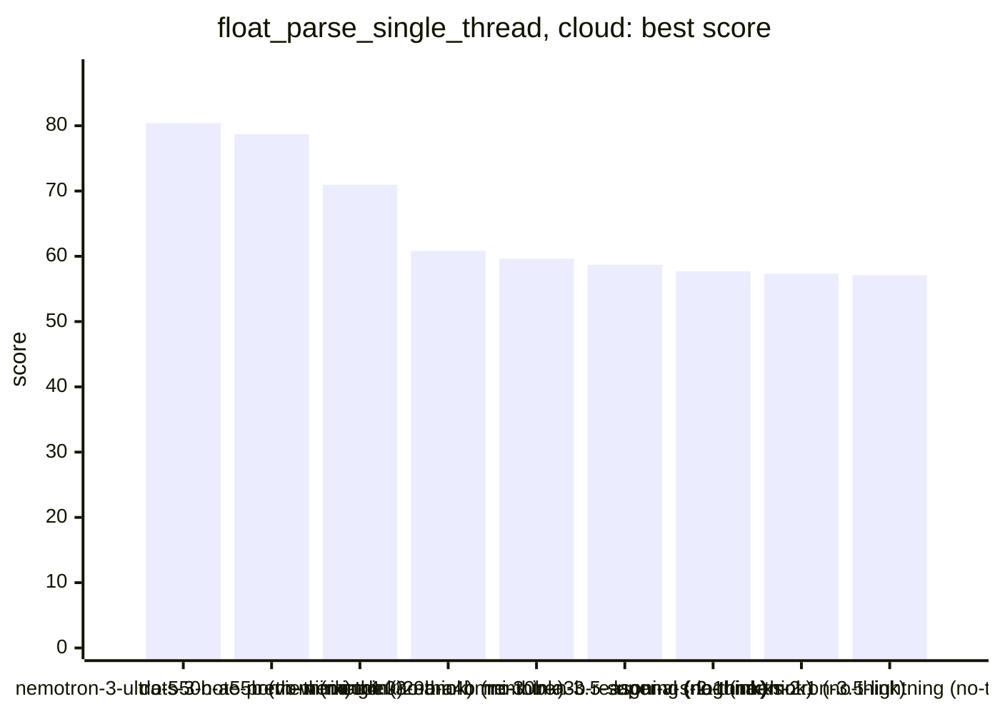
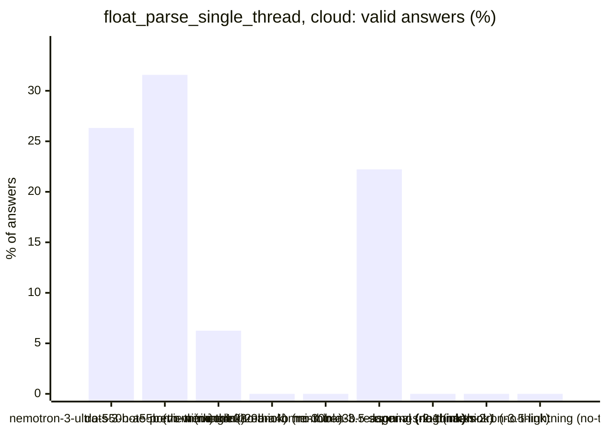
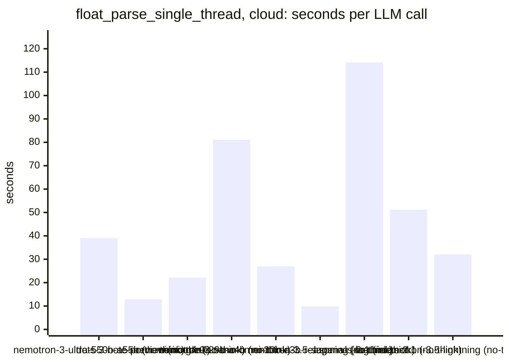
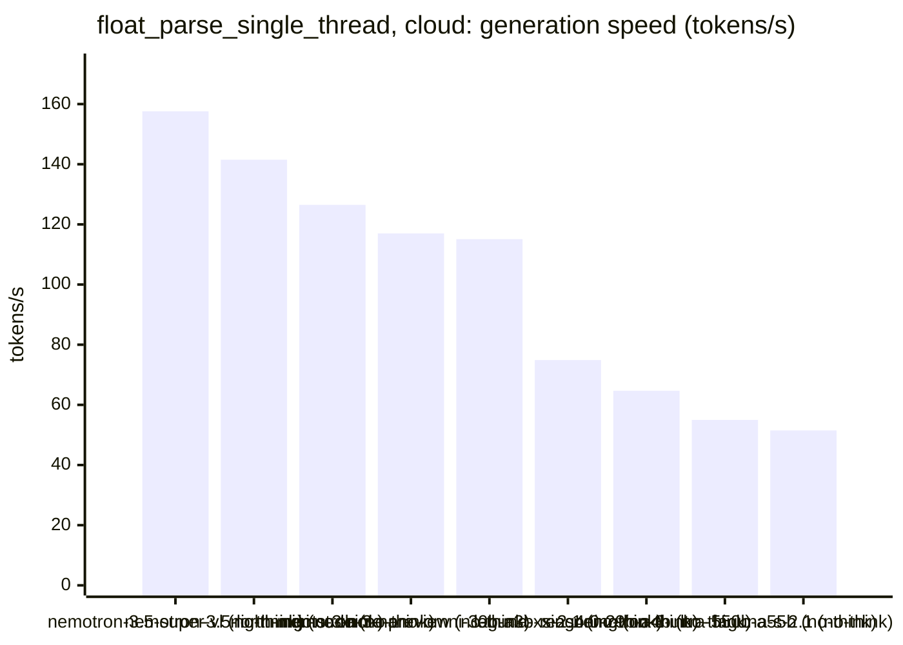

<!-- Copyright (c) 2026 by C. Klukas -->
<!-- SPDX-License-Identifier: GPL-3.0-only -->
<!-- Generated by `omega report` from bench/results/*.json. Do not edit by hand. -->

# float_parse_single_thread

11 models, each run at most 60 minutes, ended earlier after 15 answers in a row without progress; one run per model. The [overall ranking](../benchmarks.md#overall-ranking) compares the models over all examples.

Machine: Intel(R) Core(TM) i7-8700K CPU @ 3.70GHz (MS-7A98), 12 cores, 64 GB, 2x NVIDIA GeForce GTX 1080 Ti, 11264 MiB.

## Cloud models (OpenRouter)

Free OpenRouter models; times include the network and the provider's queue.

| Model | Params | Initial | Best | Gain | LLM calls | s/call | Valid | New bests | Min to best | Minutes | Stopped by |
|---|---|--:|--:|--:|--:|--:|--:|--:|--:|--:|---|
| nvidia/nemotron-3-ultra-550b-a55b:free (no-think) |  | 59.4591 | **80.4135** | ×1.35 | 19 | 39 | 26% | 1 | 3.0 | 13.0 | no progress |
| dots-studio/dots-3-note-preview:free (no-think) |  | 60.1754 | **78.6935** | ×1.31 | 19 | 13 | 32% | 1 | 0.8 | 4.8 | no progress |
| cohere/north-mini-code:free (no-think) |  | 70.9674 | **70.9674** | ×1.00 | 16 | 22 | 6% | 0 | - | 7.1 | no progress |
| xingchen-agi/xing4.0-29b-a4b:free (no-think) |  | 60.8299 | **60.8299** | ×1.00 | 10 | 81 | 0% | 0 | - | 14.1 | model errors |
| nvidia/nemotron-3-nano-omni-30b-a3b-reasoning:free (no-think) |  | 59.6528 | **59.6528** | ×1.00 | 16 | 27 | 0% | 0 | - | 7.9 | no progress |
| google/gemma-4-31b-it:free (no-think) |  | | | | | | | | | | failed: all 6 model requests failed: google/gemma-4-31b-it:free: rat |
| nvidia/nemotron-3.5-super-vl:free (no-think) |  | 57.3312 | **58.7018** | ×1.02 | 18 | 10 | 22% | 1 | 3.1 | 3.7 | no progress |
| poolside/laguna-s-2.1:free (no-think) |  | 57.7235 | **57.7235** | ×1.00 | 16 | 114 | 0% | 0 | - | 31.1 | no progress |
| google/gemma-4-26b-a4b-it:free (no-think) |  | | | | | | | | | | failed: all 6 model requests failed: google/gemma-4-26b-a4b-it:free: |
| poolside/laguna-xs-2.1:free (no-think) |  | 57.3424 | **57.3424** | ×1.00 | 16 | 51 | 0% | 0 | - | 14.3 | no progress |
| nvidia/nemotron-3.5-lightning:free (no-think) |  | 57.1109 | **57.1109** | ×1.00 | 16 | 32 | 0% | 0 | - | 9.2 | no progress |

### Inference speed and cost

Generation speed is measured from the first to the last streamed token; the time to the first token is counted as prompt time. Cost is what OpenRouter charged for the run.

| Model | Gen tok/s | Median s/call | p90 s/call | Tokens/answer | Stopped | Cost $ |
|---|--:|--:|--:|--:|--:|--:|
| nvidia/nemotron-3.5-super-vl:free (no-think) | 157.6 | 9 | 21 | 1310 | 1 | 0.000 |
| nvidia/nemotron-3.5-lightning:free (no-think) | 141.5 | 20 | 63 | 2397 | 12 | 0.000 |
| cohere/north-mini-code:free (no-think) | 126.5 | 12 | 59 | 1500 | 2 | 0.000 |
| dots-studio/dots-3-note-preview:free (no-think) | 117.0 | 14 | 18 | 1365 | 0 | 0.000 |
| nvidia/nemotron-3-nano-omni-30b-a3b-reasoning:free (no-think) | 115.1 | 12 | 28 | 1053 | 5 | 0.000 |
| poolside/laguna-xs-2.1:free (no-think) | 74.9 | 71 | 84 | 922 | 2 | 0.000 |
| xingchen-agi/xing4.0-29b-a4b:free (no-think) | 64.7 | 76 | 171 | 111 | 2 | 0.000 |
| nvidia/nemotron-3-ultra-550b-a55b:free (no-think) | 55.0 | 27 | 86 | 1947 | 0 | 0.000 |
| poolside/laguna-s-2.1:free (no-think) | 51.5 | 124 | 177 | 2336 | 9 | 0.000 |

### Best score over time

| Model | 15 min | 30 min | 45 min | 60 min |
|---|--:|--:|--:|--:|
| nvidia/nemotron-3-ultra-550b-a55b:free (no-think) | 80.4135 | 80.4135 | 80.4135 | 80.4135 |
| dots-studio/dots-3-note-preview:free (no-think) | 78.6935 | 78.6935 | 78.6935 | 78.6935 |
| cohere/north-mini-code:free (no-think) | 70.9674 | 70.9674 | 70.9674 | 70.9674 |
| xingchen-agi/xing4.0-29b-a4b:free (no-think) | 60.8299 | 60.8299 | 60.8299 | 60.8299 |
| nvidia/nemotron-3-nano-omni-30b-a3b-reasoning:free (no-think) | 59.6528 | 59.6528 | 59.6528 | 59.6528 |
| nvidia/nemotron-3.5-super-vl:free (no-think) | 58.7018 | 58.7018 | 58.7018 | 58.7018 |
| poolside/laguna-s-2.1:free (no-think) | 57.7235 | 57.7235 | 57.7235 | 57.7235 |
| poolside/laguna-xs-2.1:free (no-think) | 57.3424 | 57.3424 | 57.3424 | 57.3424 |
| nvidia/nemotron-3.5-lightning:free (no-think) | 57.1109 | 57.1109 | 57.1109 | 57.1109 |

### Outcome of the LLM answers

| Model | compile error | duplicate | edit error | invalid | llm error | ok |
|---|--:|--:|--:|--:|--:|--:|
| nvidia/nemotron-3-ultra-550b-a55b:free (no-think) | 3 | 3 | 0 | 8 | 0 | 5 |
| dots-studio/dots-3-note-preview:free (no-think) | 1 | 3 | 3 | 6 | 0 | 6 |
| cohere/north-mini-code:free (no-think) | 7 | 0 | 2 | 4 | 2 | 1 |
| xingchen-agi/xing4.0-29b-a4b:free (no-think) | 0 | 1 | 0 | 0 | 9 | 0 |
| nvidia/nemotron-3-nano-omni-30b-a3b-reasoning:free (no-think) | 1 | 0 | 6 | 4 | 5 | 0 |
| nvidia/nemotron-3.5-super-vl:free (no-think) | 2 | 0 | 4 | 7 | 1 | 4 |
| poolside/laguna-s-2.1:free (no-think) | 2 | 0 | 2 | 3 | 9 | 0 |
| poolside/laguna-xs-2.1:free (no-think) | 4 | 1 | 0 | 3 | 8 | 0 |
| nvidia/nemotron-3.5-lightning:free (no-think) | 3 | 0 | 1 | 0 | 12 | 0 |

### Best idea per model

- **nvidia/nemotron-3-ultra-550b-a55b:free (no-think)**: Add a fast path for integers and simple decimals with <=19 significant digits using Clinger's fast path (exact multiply/divide by powers of 10) to avoid calling strtod for the …
- **dots-studio/dots-3-note-preview:free (no-think)**: Implement a fast path for plain integers (no sign, no dot, no exponent) using SWAR digit parsing and Clinger's exact integer-to-double conversion, falling back to strtod for all …
- **cohere/north-mini-code:free (no-think)**: initial program
- **xingchen-agi/xing4.0-29b-a4b:free (no-think)**: initial program
- **nvidia/nemotron-3-nano-omni-30b-a3b-reasoning:free (no-think)**: initial program
- **nvidia/nemotron-3.5-super-vl:free (no-think)**: Add an exact fast path for plain integers (no '.', no exponent): accumulate up to 19 significant digits into a uint64_t, convert exactly to double (exact for < 2^63, correctly …
- **poolside/laguna-s-2.1:free (no-think)**: initial program
- **poolside/laguna-xs-2.1:free (no-think)**: initial program
- **nvidia/nemotron-3.5-lightning:free (no-think)**: initial program
