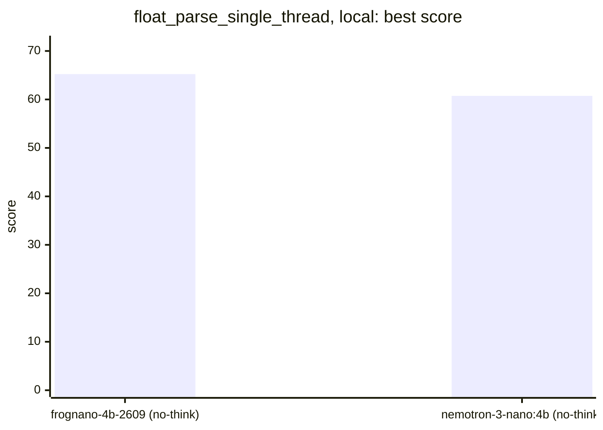
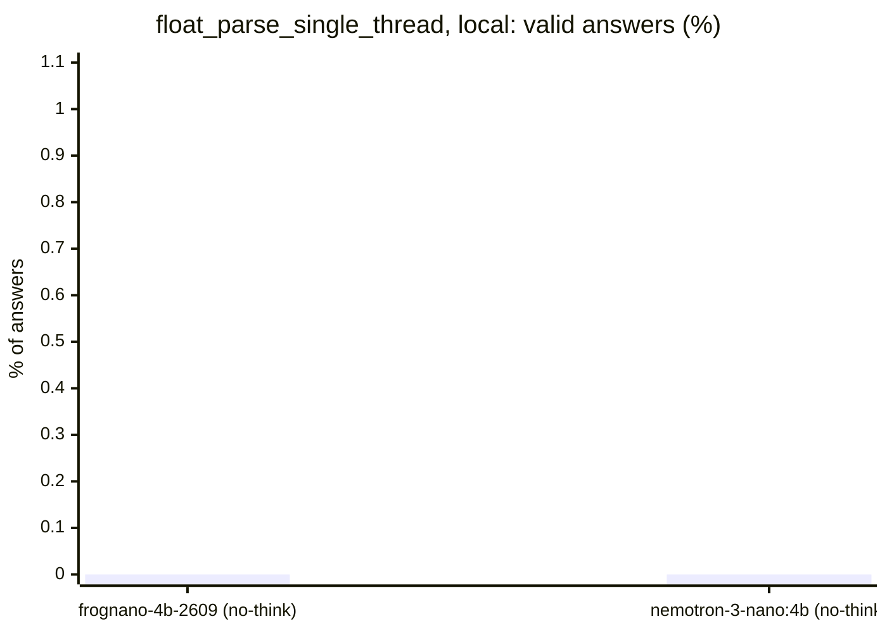
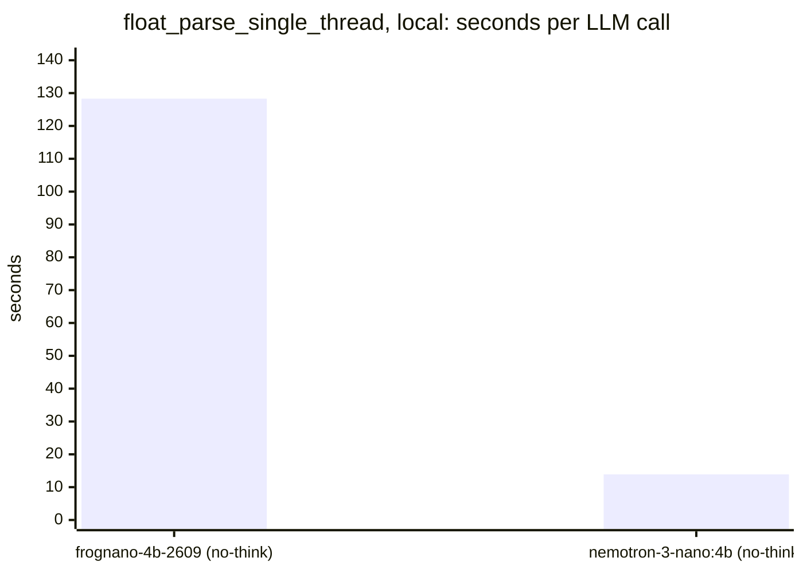
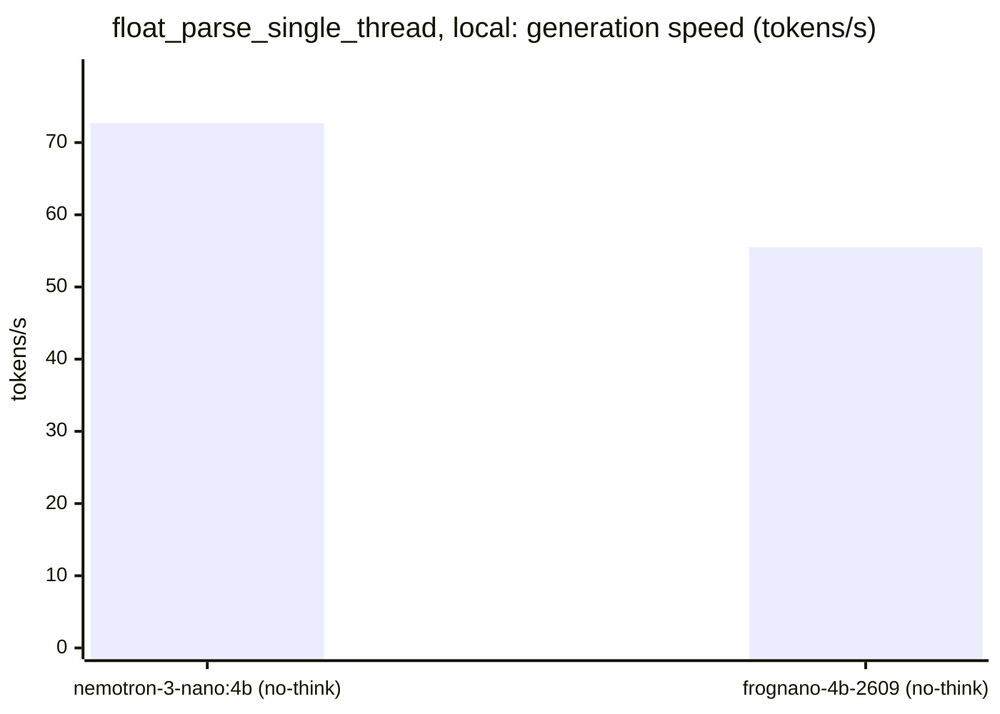
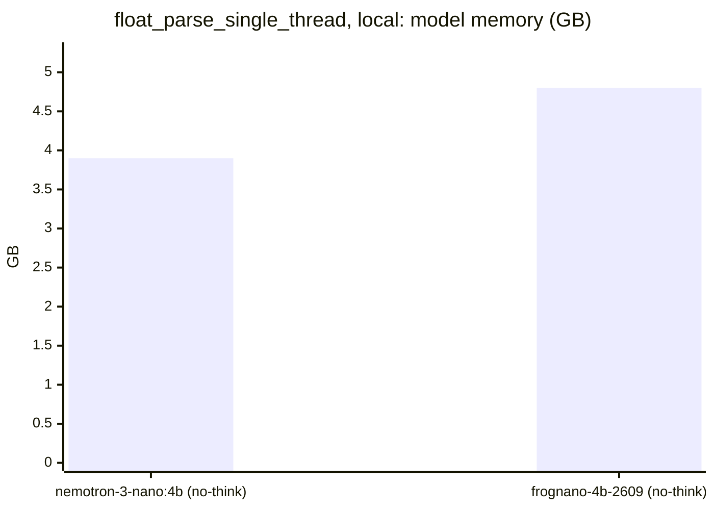

<!-- Copyright (c) 2026 by C. Klukas -->
<!-- SPDX-License-Identifier: GPL-3.0-only -->
<!-- Generated by `omega report` from bench/results/*.json. Do not edit by hand. -->

# float_parse_single_thread

3 models, each run at most 60 minutes, ended earlier after 15 answers in a row without progress; one run per model. The [overall ranking](../benchmarks.md#overall-ranking) compares the models over all examples.

Machine: Intel(R) Core(TM) i7-8700K CPU @ 3.70GHz (MS-7A98), 12 cores, 64 GB, 2x NVIDIA GeForce GTX 1080 Ti, 11264 MiB.

## Local models

Ollama on this machine.

| Model | Params | Initial | Best | Gain | LLM calls | s/call | Valid | New bests | Min to best | Minutes | Stopped by |
|---|---|--:|--:|--:|--:|--:|--:|--:|--:|--:|---|
| hf.co/LiquidAI/LFM3-1.7B-GGUF:Q4_K_M (no-think) | 1.73B | | | | | | | | | | failed: all 16 model requests failed: hf.co/LiquidAI/LFM3-1.7B-GGUF: |
| richardyoung/frognano-4b-2609:latest (no-think) | 4.3B | 65.2254 | **65.2254** | ×1.00 | 15 | 128 | 0% | 0 | - | 33.3 | no progress |
| nemotron-3-nano:4b (no-think) | 4.0B | 60.7376 | **60.7376** | ×1.00 | 16 | 14 | 0% | 0 | - | 4.7 | no progress |

### Inference speed and memory

RAM is what Ollama reports for the loaded model (weights, context cache and buffers; on Apple silicon this is shared memory). Load is the time to bring the model into memory. Prompt and generation speeds are tokens per second over all calls of the run.

| Model | Params | RAM GB | Load s | Prompt tok/s | Gen tok/s | Median s/call | p90 s/call | Tokens/answer | Stopped |
|---|---|--:|--:|--:|--:|--:|--:|--:|--:|
| nemotron-3-nano:4b (no-think) | 4.0B | 3.9 | 0 | 3775 | 72.7 | 10 | 24 | 715 | 1 |
| richardyoung/frognano-4b-2609:latest (no-think) | 4.3B | 4.8 | 0 | 2511 | 55.5 | 97 | 440 | 6912 | 6 |

### Best score over time

| Model | 15 min | 30 min | 45 min | 60 min |
|---|--:|--:|--:|--:|
| richardyoung/frognano-4b-2609:latest (no-think) | 65.2254 | 65.2254 | 65.2254 | 65.2254 |
| nemotron-3-nano:4b (no-think) | 60.7376 | 60.7376 | 60.7376 | 60.7376 |

### Outcome of the LLM answers

| Model | compile error | edit error | llm error |
|---|--:|--:|--:|
| richardyoung/frognano-4b-2609:latest (no-think) | 5 | 4 | 6 |
| nemotron-3-nano:4b (no-think) | 4 | 10 | 2 |

### Best idea per model

- **richardyoung/frognano-4b-2609:latest (no-think)**: initial program
- **nemotron-3-nano:4b (no-think)**: initial program
