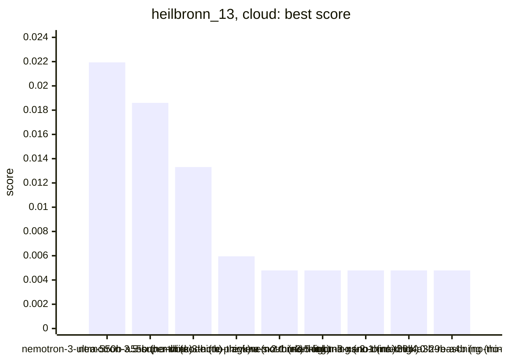
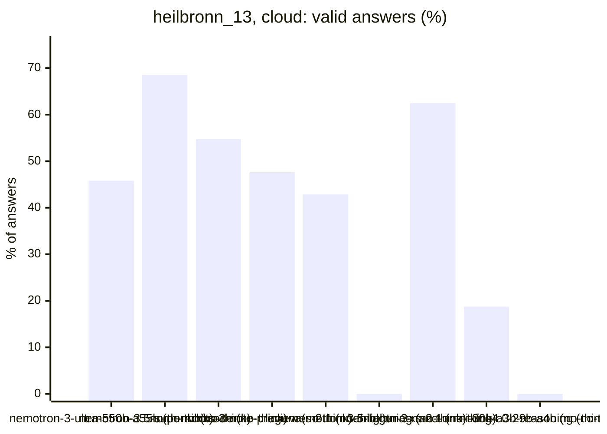
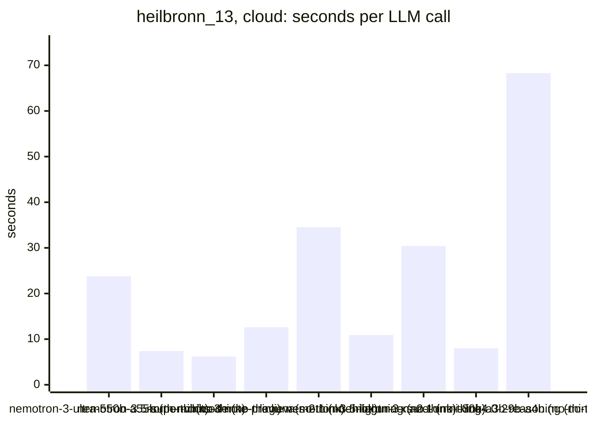
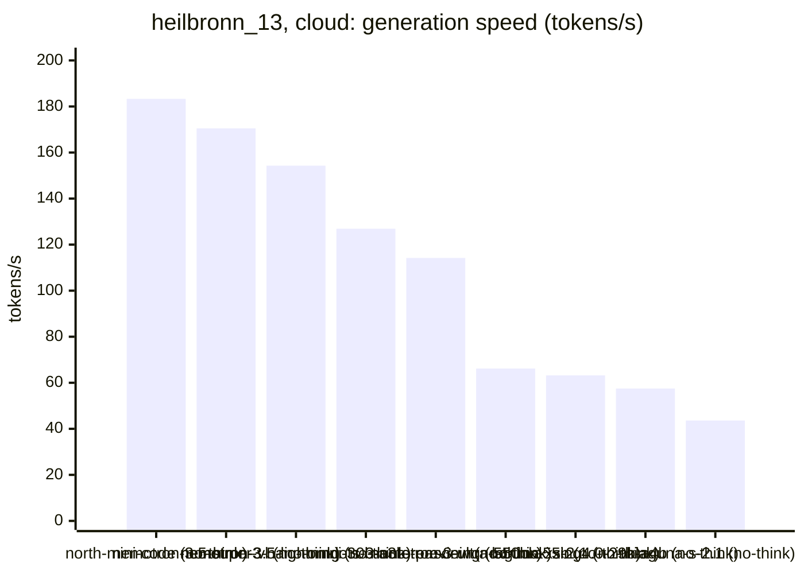

<!-- Copyright (c) 2026 by C. Klukas -->
<!-- SPDX-License-Identifier: GPL-3.0-only -->
<!-- Generated by `omega report` from bench/results/*.json. Do not edit by hand. -->

# heilbronn_13

11 models, each run at most 60 minutes, ended earlier after 15 answers in a row without progress; one run per model. The [overall ranking](../benchmarks.md#overall-ranking) compares the models over all examples.

Machine: Intel(R) Core(TM) i7-8700K CPU @ 3.70GHz (MS-7A98), 12 cores, 64 GB, 2x NVIDIA GeForce GTX 1080 Ti, 11264 MiB.

## Cloud models (OpenRouter)

Free OpenRouter models; times include the network and the provider's queue.

| Model | Params | Initial | Best | Gain | LLM calls | s/call | Valid | New bests | Min to best | Minutes | Stopped by |
|---|---|--:|--:|--:|--:|--:|--:|--:|--:|--:|---|
| nvidia/nemotron-3-ultra-550b-a55b:free (no-think) |  | 0.00479 | **0.02194** | ×4.58 | 24 | 24 | 46% | 1 | 2.8 | 9.7 | no progress |
| nvidia/nemotron-3.5-super-vl:free (no-think) |  | 0.00479 | **0.0186** | ×3.88 | 35 | 7 | 69% | 4 | 6.5 | 6.5 | no progress |
| cohere/north-mini-code:free (no-think) |  | 0.00479 | **0.01331** | ×2.78 | 42 | 6 | 55% | 3 | 3.0 | 6.3 | no progress |
| dots-studio/dots-3-note-preview:free (no-think) |  | 0.00479 | **0.00595** | ×1.24 | 21 | 13 | 48% | 1 | 1.6 | 4.5 | no progress |
| poolside/laguna-s-2.1:free (no-think) |  | 0.00479 | **0.00479** | ×1.00 | 14 | 34 | 43% | 0 | - | 8.1 | no progress |
| nvidia/nemotron-3.5-lightning:free (no-think) |  | 0.00479 | **0.00479** | ×1.00 | 16 | 11 | 0% | 0 | - | 2.9 | no progress |
| poolside/laguna-xs-2.1:free (no-think) |  | 0.00479 | **0.00479** | ×1.00 | 16 | 30 | 62% | 0 | - | 8.2 | no progress |
| nvidia/nemotron-3-nano-omni-30b-a3b-reasoning:free (no-think) |  | 0.00479 | **0.00479** | ×1.00 | 16 | 8 | 19% | 0 | - | 2.2 | no progress |
| xingchen-agi/xing4.0-29b-a4b:free (no-think) |  | 0.00479 | **0.00479** | ×1.00 | 9 | 68 | 0% | 0 | - | 10.3 | model errors |
| google/gemma-4-26b-a4b-it:free (no-think) |  | | | | | | | | | | failed: all 6 model requests failed: google/gemma-4-26b-a4b-it:free: |
| google/gemma-4-31b-it:free (no-think) |  | | | | | | | | | | failed: all 6 model requests failed: google/gemma-4-31b-it:free: rat |

### Inference speed and cost

Generation speed is measured from the first to the last streamed token; the time to the first token is counted as prompt time. Cost is what OpenRouter charged for the run.

| Model | Gen tok/s | Median s/call | p90 s/call | Tokens/answer | Stopped | Cost $ |
|---|--:|--:|--:|--:|--:|--:|
| cohere/north-mini-code:free (no-think) | 183.3 | 5 | 12 | 1046 | 0 | 0.000 |
| nvidia/nemotron-3.5-super-vl:free (no-think) | 170.5 | 6 | 14 | 1100 | 2 | 0.000 |
| nvidia/nemotron-3.5-lightning:free (no-think) | 154.3 | 11 | 18 | 1815 | 5 | 0.000 |
| nvidia/nemotron-3-nano-omni-30b-a3b-reasoning:free (no-think) | 126.9 | 5 | 11 | 639 | 1 | 0.000 |
| dots-studio/dots-3-note-preview:free (no-think) | 114.2 | 13 | 16 | 1248 | 0 | 0.000 |
| nvidia/nemotron-3-ultra-550b-a55b:free (no-think) | 66.2 | 19 | 38 | 1406 | 0 | 0.000 |
| poolside/laguna-xs-2.1:free (no-think) | 63.2 | 24 | 71 | 969 | 0 | 0.000 |
| xingchen-agi/xing4.0-29b-a4b:free (no-think) | 57.5 | 75 | 83 | 792 | 0 | 0.000 |
| poolside/laguna-s-2.1:free (no-think) | 43.6 | 31 | 71 | 1097 | 0 | 0.000 |

### Best score over time

| Model | 15 min | 30 min | 45 min | 60 min |
|---|--:|--:|--:|--:|
| nvidia/nemotron-3-ultra-550b-a55b:free (no-think) | 0.02194 | 0.02194 | 0.02194 | 0.02194 |
| nvidia/nemotron-3.5-super-vl:free (no-think) | 0.0186 | 0.0186 | 0.0186 | 0.0186 |
| cohere/north-mini-code:free (no-think) | 0.01331 | 0.01331 | 0.01331 | 0.01331 |
| dots-studio/dots-3-note-preview:free (no-think) | 0.00595 | 0.00595 | 0.00595 | 0.00595 |
| poolside/laguna-s-2.1:free (no-think) | 0.00479 | 0.00479 | 0.00479 | 0.00479 |
| nvidia/nemotron-3.5-lightning:free (no-think) | 0.00479 | 0.00479 | 0.00479 | 0.00479 |
| poolside/laguna-xs-2.1:free (no-think) | 0.00479 | 0.00479 | 0.00479 | 0.00479 |
| nvidia/nemotron-3-nano-omni-30b-a3b-reasoning:free (no-think) | 0.00479 | 0.00479 | 0.00479 | 0.00479 |
| xingchen-agi/xing4.0-29b-a4b:free (no-think) | 0.00479 | 0.00479 | 0.00479 | 0.00479 |

### Outcome of the LLM answers

| Model | duplicate | edit error | invalid | llm error | ok |
|---|--:|--:|--:|--:|--:|
| nvidia/nemotron-3-ultra-550b-a55b:free (no-think) | 1 | 4 | 8 | 0 | 11 |
| nvidia/nemotron-3.5-super-vl:free (no-think) | 3 | 4 | 2 | 2 | 24 |
| cohere/north-mini-code:free (no-think) | 8 | 2 | 9 | 0 | 23 |
| dots-studio/dots-3-note-preview:free (no-think) | 2 | 6 | 3 | 0 | 10 |
| poolside/laguna-s-2.1:free (no-think) | 0 | 2 | 6 | 0 | 6 |
| nvidia/nemotron-3.5-lightning:free (no-think) | 0 | 7 | 4 | 5 | 0 |
| poolside/laguna-xs-2.1:free (no-think) | 0 | 4 | 0 | 2 | 10 |
| nvidia/nemotron-3-nano-omni-30b-a3b-reasoning:free (no-think) | 0 | 10 | 2 | 1 | 3 |
| xingchen-agi/xing4.0-29b-a4b:free (no-think) | 0 | 0 | 3 | 6 | 0 |

### Best idea per model

- **nvidia/nemotron-3-ultra-550b-a55b:free (no-think)**: Use a more sophisticated optimization approach with gradient-free coordinate descent on the soft-min objective, starting from a known good Heilbronn-like configuration and using …
- **nvidia/nemotron-3.5-super-vl:free (no-think)**: tuned N_RESTARTS=80, ITERS_PER_RESTART=1600, STEP_INIT=0.25, STEP_DECAY=0.998 on top of: Add a final boundary sweep polish that snaps each point to the nearest of the four …
- **cohere/north-mini-code:free (no-think)**: tuned RADIUS=0.5 on top of: Replace the fixed radius with a swept parameter to optimize the initial regular‑polygon radius for the best minimum triangle area.
- **dots-studio/dots-3-note-preview:free (no-think)**: Fix the OverflowError by clamping the exponent argument in _softmin and improve the acceptance criterion to use a stable softmin comparison without recomputing the best softmin …
- **poolside/laguna-s-2.1:free (no-think)**: initial program
- **nvidia/nemotron-3.5-lightning:free (no-think)**: initial program
- **poolside/laguna-xs-2.1:free (no-think)**: initial program
- **nvidia/nemotron-3-nano-omni-30b-a3b-reasoning:free (no-think)**: initial program
- **xingchen-agi/xing4.0-29b-a4b:free (no-think)**: initial program
