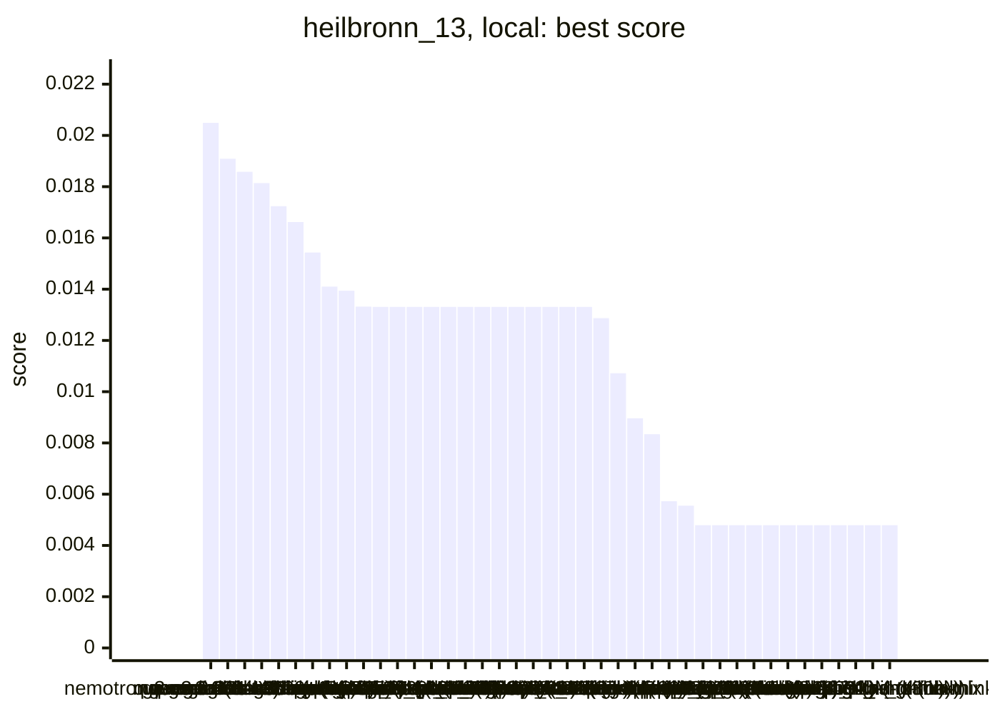
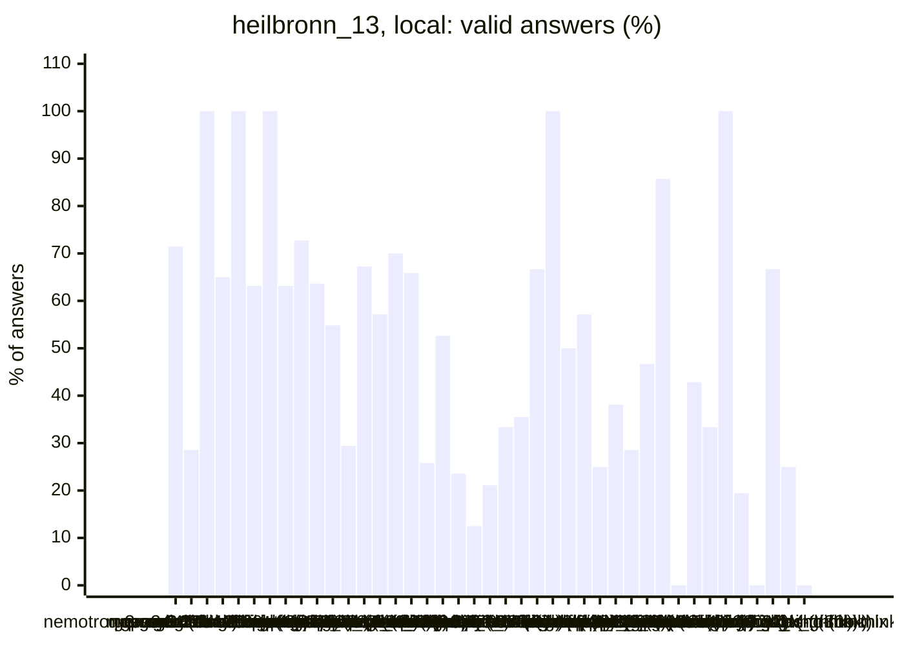
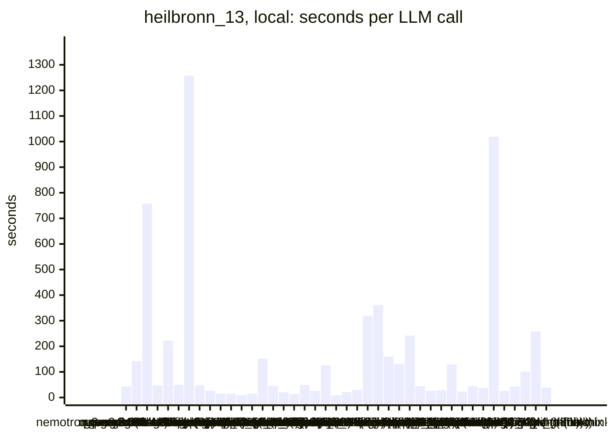
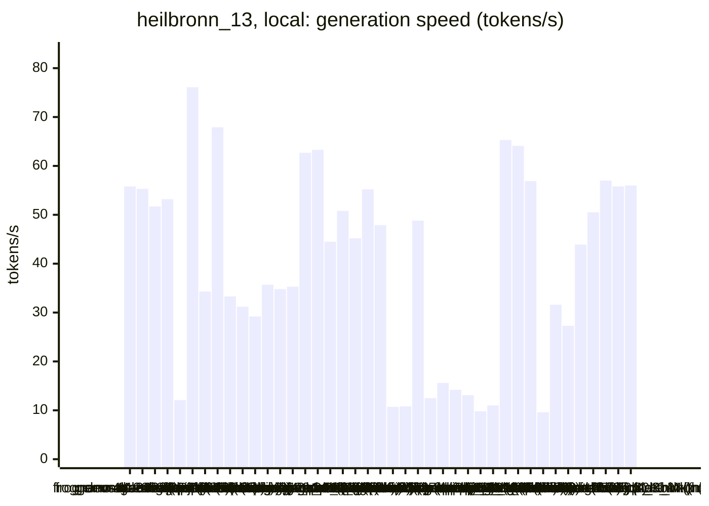
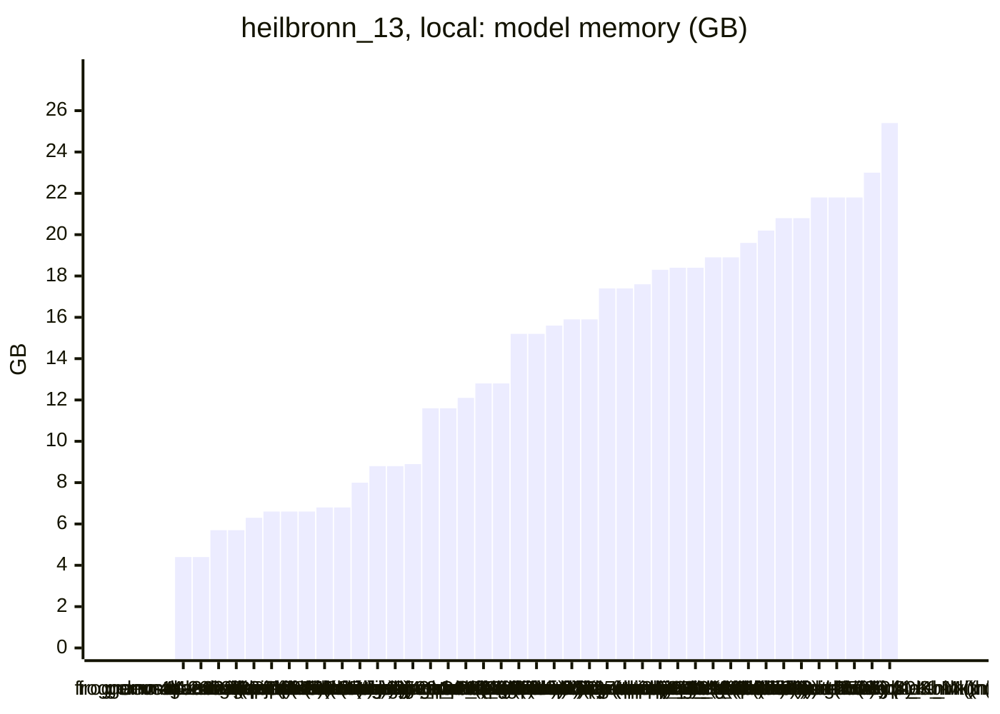

<!-- Copyright (c) 2026 by C. Klukas -->
<!-- SPDX-License-Identifier: GPL-3.0-only -->
<!-- Generated by `omega report` from bench/results/*.json. Do not edit by hand. -->

# heilbronn_13

43 models, 15 minutes each, latest run per model. The [overall ranking](../benchmarks.md#overall-ranking) compares the models over all examples.

Machine: Apple M1 Max (Mac13,1), 10 cores, 32 GB.

## Local models

Ollama on this machine.

| Model | Params | Initial | Best | Gain | LLM calls | s/call | Valid | New bests | Min to best |
|---|---|--:|--:|--:|--:|--:|--:|--:|--:|
| gemma4:latest (think) |  | 0.00479 | **0.02049** | ×4.28 | 21 | 43 | 71% | 2 | 5.9 |
| nemotron-3-nano:30b-a3b-mlx (think) |  | 0.00479 | **0.01909** | ×3.98 | 7 | 142 | 29% | 2 | 16.6 |
| muse-glimmer:30b (think) | 27.9B | 0.00479 | **0.01858** | ×3.88 | 2 | 758 | 100% | 3 | 25.3 |
| gemma4:e4b-it-qat (think) | 7.5B | 0.00479 | **0.01814** | ×3.79 | 20 | 47 | 65% | 3 | 14.1 |
| muse-glimmer:30b (no-think) | 27.9B | 0.00479 | **0.01724** | ×3.60 | 5 | 222 | 100% | 2 | 10.1 |
| gemma4:12b-it-qat (no-think) | 11.9B | 0.00479 | **0.01662** | ×3.47 | 19 | 49 | 63% | 4 | 17.4 |
| qwen3.6:27b-coding-mtp-q4_K_M (think) | 27.3B | 0.00479 | **0.01543** | ×3.22 | 1 | 1258 | 100% | 1 | 21.0 |
| gemma4:26b-a4b-it-qat (no-think) | 25.2B | 0.00479 | **0.0141** | ×2.94 | 19 | 48 | 63% | 6 | 12.7 |
| qwen3:30b-a3b-instruct-2507-q4_K_M (think) | 30.5B | 0.00479 | **0.01394** | ×2.91 | 33 | 27 | 73% | 3 | 11.3 |
| qwen3:30b-a3b-instruct-2507-q4_K_M (no-think) | 30.5B | 0.00479 | **0.01332** | ×2.78 | 55 | 15 | 64% | 9 | 12.3 |
| gemma4:e4b-it-qat (no-think) | 7.5B | 0.00479 | **0.01331** | ×2.78 | 62 | 14 | 55% | 4 | 4.5 |
| gemma4:e2b (no-think) | 5.1B | 0.00479 | **0.01331** | ×2.78 | 102 | 9 | 29% | 2 | 2.8 |
| gemma4:latest (no-think) |  | 0.00479 | **0.01331** | ×2.78 | 58 | 15 | 67% | 1 | 4.7 |
| gpt-oss:20b (no-think) | 20.9B | 0.00479 | **0.01331** | ×2.78 | 7 | 152 | 57% | 1 | 11.7 |
| gpt-oss:20b (think) | 20.9B | 0.00479 | **0.01331** | ×2.78 | 20 | 46 | 70% | 2 | 7.3 |
| yandex/YandexGPT-5-Lite-8B-instruct-GGUF:latest (no-think) | 8.0B | 0.00479 | **0.01331** | ×2.78 | 41 | 21 | 66% | 3 | 4.3 |
| MichelRosselli/apertus:8b-instruct-2509-q4_k_m (no-think) | 8.1B | 0.00479 | **0.01331** | ×2.78 | 62 | 14 | 26% | 1 | 2.8 |
| devstral-small-2:24b (no-think) | 24.0B | 0.00479 | **0.01331** | ×2.78 | 19 | 49 | 53% | 2 | 5.8 |
| glm-4.7-flash:latest (no-think) | 29.9B | 0.00479 | **0.01331** | ×2.78 | 34 | 26 | 24% | 2 | 0.9 |
| frob/sarvam:30b (no-think) | 32.2B | 0.00479 | **0.01331** | ×2.78 | 8 | 125 | 12% | 1 | 8.9 |
| nemotron-3-nano:4b (no-think) |  | 0.00479 | **0.01331** | ×2.78 | 90 | 10 | 21% | 1 | 1.4 |
| nemotron-3-nano:30b-a3b-mlx (no-think) |  | 0.00479 | **0.01331** | ×2.78 | 42 | 21 | 33% | 1 | 4.1 |
| nemotron-3-nano:4b (think) |  | 0.00479 | **0.01331** | ×2.78 | 31 | 30 | 35% | 1 | 2.4 |
| qwen3.5:27b (think) | 27.8B | 0.00479 | **0.01287** | ×2.69 | 3 | 320 | 67% | 2 | 7.3 |
| gemma4:26b-a4b-it-qat (think) | 25.2B | 0.00479 | **0.01072** | ×2.24 | 3 | 361 | 100% | 3 | 18.1 |
| qwen3.6:27b-coding-mtp-q4_K_M (no-think) | 27.3B | 0.00479 | **0.00896** | ×1.87 | 6 | 160 | 50% | 1 | 11.6 |
| qwen3.8:27b-mtp-q4_K_M (no-think) | 27.3B | 0.00479 | **0.00834** | ×1.74 | 7 | 131 | 57% | 2 | 9.8 |
| frob/sarvam:30b (think) | 32.2B | 0.00479 | **0.00573** | ×1.20 | 4 | 242 | 25% | 1 | 16.2 |
| richardyoung/frognano-4b-2609:latest (think) | 4.3B | 0.00479 | **0.00555** | ×1.16 | 21 | 44 | 38% | 2 | 7.8 |
| qwen2.5-coder:7b (no-think) | 7.6B | 0.00479 | **0.00479** | ×1.00 | 35 | 26 | 29% | 0 | - |
| qwen3.5:latest (no-think) | 9.7B | 0.00479 | **0.00479** | ×1.00 | 30 | 29 | 47% | 0 | - |
| qwen3.5:27b (no-think) | 27.8B | 0.00479 | **0.00479** | ×1.00 | 7 | 129 | 86% | 0 | - |
| qwen3-coder:30b (no-think) | 30.5B | 0.00479 | **0.00479** | ×1.00 | 38 | 24 | 0% | 0 | - |
| qwen3.5:latest (think) | 9.7B | 0.00479 | **0.00479** | ×1.00 | 21 | 44 | 43% | 0 | - |
| gemma4:12b-it-qat (think) | 11.9B | | | | | | | | failed: all 2 model requests failed: gemma4:12b-it-qat: answer stopp |
| gemma4:e2b (think) | 5.1B | 0.00479 | **0.00479** | ×1.00 | 24 | 38 | 33% | 0 | - |
| qwen3.8:27b-mtp-q4_K_M (think) | 27.3B | 0.00479 | **0.00479** | ×1.00 | 1 | 1019 | 100% | 0 | - |
| richardyoung/frognano-4b-2609:latest (no-think) | 4.3B | 0.00479 | **0.00479** | ×1.00 | 36 | 25 | 19% | 0 | - |
| llm-jp-4-8b-omega:q4_k_m (no-think) | 8.6B | 0.00479 | **0.00479** | ×1.00 | 21 | 43 | 0% | 0 | - |
| ingu627/exaone4.0:32b (no-think) | 32.0B | 0.00479 | **0.00479** | ×1.00 | 9 | 101 | 67% | 0 | - |
| glm-4.7-flash:latest (think) | 29.9B | 0.00479 | **0.00479** | ×1.00 | 4 | 258 | 25% | 0 | - |
| nemotron-3.5-lightning:30b-mlx (no-think) |  | 0.00479 | **0.00479** | ×1.00 | 24 | 38 | 0% | 0 | - |
| nemotron-3.5-lightning:30b-mlx (think) |  | | | | | | | | failed: all 4 model requests failed: nemotron-3.5-lightning:30b-mlx: |

### Inference speed and memory

RAM is what Ollama reports for the loaded model (weights, context cache and buffers; on Apple silicon this is shared memory). Load is the time to bring the model into memory. Prompt and generation speeds are tokens per second over all calls of the run.

| Model | Params | RAM GB | Load s | Prompt tok/s | Gen tok/s | Median s/call | p90 s/call | Tokens/answer | Stopped |
|---|---|--:|--:|--:|--:|--:|--:|--:|--:|
| richardyoung/frognano-4b-2609:latest (think) | 4.3B | 4.4 | 11 | 795 | 55.8 | 39 | 56 | 2223 | 1 |
| richardyoung/frognano-4b-2609:latest (no-think) | 4.3B | 4.4 | 13 | 800 | 55.3 | 25 | 50 | 1047 | 3 |
| gemma4:e4b-it-qat (think) | 7.5B | 5.7 | 64 | 648 | 51.7 | 40 | 102 | 2022 | 0 |
| gemma4:e4b-it-qat (no-think) | 7.5B | 5.7 | 59 | 596 | 53.2 | 12 | 23 | 372 | 0 |
| devstral-small-2:24b (no-think) | 24.0B | 6.3 | 48 | 144 | 12.1 | 46 | 72 | 337 | 0 |
| gemma4:e2b (no-think) | 5.1B | 6.6 | 161 | 976 | 76.1 | 6 | 13 | 235 | 0 |
| qwen2.5-coder:7b (no-think) | 7.6B | 6.6 | 133 | 475 | 34.3 | 23 | 37 | 582 | 0 |
| gemma4:e2b (think) | 5.1B | 6.6 | 54 | 1061 | 67.9 | 36 | 47 | 2249 | 0 |
| qwen3.5:latest (no-think) | 9.7B | 6.8 | 28 | 436 | 33.3 | 26 | 48 | 747 | 0 |
| qwen3.5:latest (think) | 9.7B | 6.8 | 91 | 441 | 31.2 | 44 | 61 | 1085 | 0 |
| gemma4:12b-it-qat (no-think) | 11.9B | 8.0 | 65 | 240 | 29.2 | 48 | 78 | 913 | 0 |
| yandex/YandexGPT-5-Lite-8B-instruct-GGUF:latest (no-think) | 8.0B | 8.8 | 30 | 454 | 35.7 | 20 | 26 | 426 | 0 |
| llm-jp-4-8b-omega:q4_k_m (no-think) | 8.6B | 8.8 | 16 | 573 | 34.8 | 42 | 71 | 1245 | 1 |
| MichelRosselli/apertus:8b-instruct-2509-q4_k_m (no-think) | 8.1B | 8.9 | 15 | 450 | 35.3 | 13 | 22 | 198 | 3 |
| nemotron-3-nano:4b (no-think) |  | 11.6 | 10 | 785 | 62.7 | 10 | 15 | 286 | 0 |
| nemotron-3-nano:4b (think) |  | 11.6 | 8 | 729 | 63.3 | 30 | 46 | 1664 | 0 |
| gemma4:latest (think) |  | 12.1 | 109 | 872 | 44.5 | 41 | 50 | 1508 | 0 |
| gpt-oss:20b (no-think) | 20.9B | 12.8 | 29 | 604 | 50.8 | 82 | 645 | 4082 | 0 |
| gpt-oss:20b (think) | 20.9B | 12.8 | 132 | 457 | 45.2 | 26 | 152 | 1538 | 0 |
| gemma4:26b-a4b-it-qat (no-think) | 25.2B | 15.2 | 200 | 487 | 55.2 | 37 | 82 | 1510 | 0 |
| gemma4:26b-a4b-it-qat (think) | 25.2B | 15.2 | 286 | 591 | 47.9 | 276 | 559 | 12529 | 0 |
| muse-glimmer:30b (think) | 27.9B | 15.6 | 57 | 143 | 10.7 | 841 | 841 | 7718 | 0 |
| muse-glimmer:30b (no-think) | 27.9B | 15.9 | 57 | 107 | 10.8 | 193 | 310 | 2071 | 0 |
| gemma4:latest (no-think) |  | 15.9 | 135 | 1076 | 48.8 | 12 | 23 | 456 | 1 |
| qwen3.6:27b-coding-mtp-q4_K_M (think) | 27.3B | 17.4 | 324 | 83 | 12.5 | 1258 | 1258 | 7640 | 0 |
| qwen3.6:27b-coding-mtp-q4_K_M (no-think) | 27.3B | 17.4 | 244 | 102 | 15.6 | 131 | 374 | 1468 | 0 |
| qwen3.8:27b-mtp-q4_K_M (no-think) | 27.3B | 17.6 | 310 | 99 | 14.2 | 119 | 394 | 903 | 0 |
| qwen3.8:27b-mtp-q4_K_M (think) | 27.3B | 18.3 | 306 | 90 | 13.1 | 1019 | 1019 | 9114 | 0 |
| qwen3.5:27b (think) | 27.8B | 18.4 | 164 | 98 | 9.8 | 316 | 436 | 2366 | 0 |
| qwen3.5:27b (no-think) | 27.8B | 18.4 | 218 | 104 | 11.0 | 94 | 338 | 872 | 0 |
| frob/sarvam:30b (no-think) | 32.2B | 18.9 | 55 | 1254 | 65.3 | 126 | 182 | 7635 | 0 |
| frob/sarvam:30b (think) | 32.2B | 18.9 | 0 | 1462 | 64.1 | 182 | 439 | 10520 | 3 |
| nemotron-3-nano:30b-a3b-mlx (think) |  | 19.6 | 102 | 241 | 56.9 | 117 | 241 | 5762 | 3 |
| ingu627/exaone4.0:32b (no-think) | 32.0B | 20.2 | 48 | 74 | 9.6 | 95 | 197 | 663 | 0 |
| glm-4.7-flash:latest (no-think) | 29.9B | 20.8 | 48 | 529 | 31.6 | 24 | 46 | 617 | 0 |
| glm-4.7-flash:latest (think) | 29.9B | 20.8 | 51 | 686 | 27.3 | 276 | 301 | 6632 | 0 |
| qwen3:30b-a3b-instruct-2507-q4_K_M (think) | 30.5B | 21.8 | 139 | 602 | 43.9 | 20 | 44 | 688 | 1 |
| qwen3:30b-a3b-instruct-2507-q4_K_M (no-think) | 30.5B | 21.8 | 180 | 692 | 50.5 | 12 | 19 | 237 | 0 |
| qwen3-coder:30b (no-think) | 30.5B | 21.8 | 4 | 930 | 57.0 | 12 | 24 | 589 | 0 |
| nemotron-3.5-lightning:30b-mlx (no-think) |  | 23.0 | 0 | 695 | 55.8 | 30 | 55 | 1369 | 8 |
| nemotron-3-nano:30b-a3b-mlx (no-think) |  | 25.4 | 143 | 599 | 56.0 | 14 | 30 | 685 | 0 |

### Best score over time

| Model | 3.75 min | 7.5 min | 11.25 min | 15 min |
|---|--:|--:|--:|--:|
| gemma4:latest (think) | 0.01331 | 0.02049 | 0.02049 | 0.02049 |
| nemotron-3-nano:30b-a3b-mlx (think) | 0.00479 | 0.01126 | 0.01126 | 0.01126 |
| muse-glimmer:30b (think) | 0.00479 | 0.00479 | 0.00479 | 0.01797 |
| gemma4:e4b-it-qat (think) | 0.01437 | 0.01516 | 0.01516 | 0.01814 |
| muse-glimmer:30b (no-think) | 0.00479 | 0.01078 | 0.01724 | 0.01724 |
| gemma4:12b-it-qat (no-think) | 0.00635 | 0.01636 | 0.01636 | 0.01636 |
| qwen3.6:27b-coding-mtp-q4_K_M (think) | 0.00479 | 0.00479 | 0.00479 | 0.00479 |
| gemma4:26b-a4b-it-qat (no-think) | 0.00479 | 0.01298 | 0.01409 | 0.0141 |
| qwen3:30b-a3b-instruct-2507-q4_K_M (think) | 0.00479 | 0.00479 | 0.00686 | 0.01394 |
| qwen3:30b-a3b-instruct-2507-q4_K_M (no-think) | 0.01331 | 0.01331 | 0.01332 | 0.01332 |
| gemma4:e4b-it-qat (no-think) | 0.01176 | 0.01331 | 0.01331 | 0.01331 |
| gemma4:e2b (no-think) | 0.01331 | 0.01331 | 0.01331 | 0.01331 |
| gemma4:latest (no-think) | 0.00479 | 0.01331 | 0.01331 | 0.01331 |
| gpt-oss:20b (no-think) | 0.00479 | 0.00479 | 0.00479 | 0.01331 |
| gpt-oss:20b (think) | 0.00479 | 0.01331 | 0.01331 | 0.01331 |
| yandex/YandexGPT-5-Lite-8B-instruct-GGUF:latest (no-think) | 0.01264 | 0.01331 | 0.01331 | 0.01331 |
| MichelRosselli/apertus:8b-instruct-2509-q4_k_m (no-think) | 0.01331 | 0.01331 | 0.01331 | 0.01331 |
| devstral-small-2:24b (no-think) | 0.00479 | 0.01331 | 0.01331 | 0.01331 |
| glm-4.7-flash:latest (no-think) | 0.01331 | 0.01331 | 0.01331 | 0.01331 |
| frob/sarvam:30b (no-think) | 0.00479 | 0.00479 | 0.01331 | 0.01331 |
| nemotron-3-nano:4b (no-think) | 0.01331 | 0.01331 | 0.01331 | 0.01331 |
| nemotron-3-nano:30b-a3b-mlx (no-think) | 0.00479 | 0.01331 | 0.01331 | 0.01331 |
| nemotron-3-nano:4b (think) | 0.01331 | 0.01331 | 0.01331 | 0.01331 |
| qwen3.5:27b (think) | 0.00479 | 0.01287 | 0.01287 | 0.01287 |
| gemma4:26b-a4b-it-qat (think) | 0.00479 | 0.00479 | 0.00491 | 0.00852 |
| qwen3.6:27b-coding-mtp-q4_K_M (no-think) | 0.00479 | 0.00479 | 0.00479 | 0.00896 |
| qwen3.8:27b-mtp-q4_K_M (no-think) | 0.00479 | 0.00479 | 0.00834 | 0.00834 |
| frob/sarvam:30b (think) | 0.00479 | 0.00479 | 0.00479 | 0.00479 |
| richardyoung/frognano-4b-2609:latest (think) | 0.00479 | 0.00499 | 0.00555 | 0.00555 |
| qwen2.5-coder:7b (no-think) | 0.00479 | 0.00479 | 0.00479 | 0.00479 |
| qwen3.5:latest (no-think) | 0.00479 | 0.00479 | 0.00479 | 0.00479 |
| qwen3.5:27b (no-think) | 0.00479 | 0.00479 | 0.00479 | 0.00479 |
| qwen3-coder:30b (no-think) | 0.00479 | 0.00479 | 0.00479 | 0.00479 |
| qwen3.5:latest (think) | 0.00479 | 0.00479 | 0.00479 | 0.00479 |
| gemma4:e2b (think) | 0.00479 | 0.00479 | 0.00479 | 0.00479 |
| qwen3.8:27b-mtp-q4_K_M (think) | 0.00479 | 0.00479 | 0.00479 | 0.00479 |
| richardyoung/frognano-4b-2609:latest (no-think) | 0.00479 | 0.00479 | 0.00479 | 0.00479 |
| llm-jp-4-8b-omega:q4_k_m (no-think) | 0.00479 | 0.00479 | 0.00479 | 0.00479 |
| ingu627/exaone4.0:32b (no-think) | 0.00479 | 0.00479 | 0.00479 | 0.00479 |
| glm-4.7-flash:latest (think) | 0.00479 | 0.00479 | 0.00479 | 0.00479 |
| nemotron-3.5-lightning:30b-mlx (no-think) | 0.00479 | 0.00479 | 0.00479 | 0.00479 |

### Outcome of the LLM answers

| Model | duplicate | edit error | invalid | llm error | ok | timeout |
|---|--:|--:|--:|--:|--:|--:|
| gemma4:latest (think) | 3 | 2 | 1 | 0 | 15 | 0 |
| nemotron-3-nano:30b-a3b-mlx (think) | 0 | 1 | 1 | 3 | 2 | 0 |
| muse-glimmer:30b (think) | 0 | 0 | 0 | 0 | 2 | 0 |
| gemma4:e4b-it-qat (think) | 0 | 1 | 6 | 0 | 13 | 0 |
| muse-glimmer:30b (no-think) | 0 | 0 | 0 | 0 | 5 | 0 |
| gemma4:12b-it-qat (no-think) | 0 | 2 | 5 | 0 | 12 | 0 |
| qwen3.6:27b-coding-mtp-q4_K_M (think) | 0 | 0 | 0 | 0 | 1 | 0 |
| gemma4:26b-a4b-it-qat (no-think) | 0 | 6 | 1 | 0 | 12 | 0 |
| qwen3:30b-a3b-instruct-2507-q4_K_M (think) | 1 | 1 | 5 | 1 | 24 | 1 |
| qwen3:30b-a3b-instruct-2507-q4_K_M (no-think) | 12 | 1 | 7 | 0 | 35 | 0 |
| gemma4:e4b-it-qat (no-think) | 13 | 5 | 9 | 0 | 34 | 1 |
| gemma4:e2b (no-think) | 29 | 23 | 20 | 0 | 30 | 0 |
| gemma4:latest (no-think) | 1 | 4 | 13 | 1 | 39 | 0 |
| gpt-oss:20b (no-think) | 0 | 2 | 1 | 0 | 4 | 0 |
| gpt-oss:20b (think) | 2 | 0 | 4 | 0 | 14 | 0 |
| yandex/YandexGPT-5-Lite-8B-instruct-GGUF:latest (no-think) | 6 | 0 | 8 | 0 | 27 | 0 |
| MichelRosselli/apertus:8b-instruct-2509-q4_k_m (no-think) | 14 | 6 | 23 | 3 | 16 | 0 |
| devstral-small-2:24b (no-think) | 6 | 0 | 3 | 0 | 10 | 0 |
| glm-4.7-flash:latest (no-think) | 5 | 4 | 17 | 0 | 8 | 0 |
| frob/sarvam:30b (no-think) | 1 | 6 | 0 | 0 | 1 | 0 |
| nemotron-3-nano:4b (no-think) | 11 | 41 | 19 | 0 | 19 | 0 |
| nemotron-3-nano:30b-a3b-mlx (no-think) | 0 | 18 | 10 | 0 | 14 | 0 |
| nemotron-3-nano:4b (think) | 5 | 10 | 5 | 0 | 11 | 0 |
| qwen3.5:27b (think) | 0 | 0 | 1 | 0 | 2 | 0 |
| gemma4:26b-a4b-it-qat (think) | 0 | 0 | 0 | 0 | 3 | 0 |
| qwen3.6:27b-coding-mtp-q4_K_M (no-think) | 2 | 0 | 1 | 0 | 3 | 0 |
| qwen3.8:27b-mtp-q4_K_M (no-think) | 0 | 1 | 2 | 0 | 4 | 0 |
| frob/sarvam:30b (think) | 0 | 0 | 0 | 3 | 1 | 0 |
| richardyoung/frognano-4b-2609:latest (think) | 0 | 4 | 8 | 1 | 8 | 0 |
| qwen2.5-coder:7b (no-think) | 7 | 3 | 15 | 0 | 10 | 0 |
| qwen3.5:latest (no-think) | 0 | 4 | 12 | 0 | 14 | 0 |
| qwen3.5:27b (no-think) | 0 | 0 | 1 | 0 | 6 | 0 |
| qwen3-coder:30b (no-think) | 1 | 17 | 20 | 0 | 0 | 0 |
| qwen3.5:latest (think) | 0 | 3 | 9 | 0 | 9 | 0 |
| gemma4:e2b (think) | 1 | 11 | 4 | 0 | 8 | 0 |
| qwen3.8:27b-mtp-q4_K_M (think) | 0 | 0 | 0 | 0 | 1 | 0 |
| richardyoung/frognano-4b-2609:latest (no-think) | 0 | 11 | 15 | 3 | 7 | 0 |
| llm-jp-4-8b-omega:q4_k_m (no-think) | 0 | 9 | 11 | 1 | 0 | 0 |
| ingu627/exaone4.0:32b (no-think) | 0 | 0 | 3 | 0 | 6 | 0 |
| glm-4.7-flash:latest (think) | 0 | 0 | 3 | 0 | 1 | 0 |
| nemotron-3.5-lightning:30b-mlx (no-think) | 0 | 7 | 9 | 8 | 0 | 0 |

### Best idea per model

- **gemma4:latest (think)**: Replace the heuristic acceptance criteria with a proper Simulated Annealing cooling schedule to allow for broader exploration while gradually converging towards local maxima.
- **nemotron-3-nano:30b-a3b-mlx (think)**: Increase iteration count, initial step size, and slower decay, and accept equal-area moves to allow finer exploration and improve minimum triangle area.
- **muse-glimmer:30b (think)**: Replace the central regular polygon with a simulated-annealing local search that starts from the four corners plus random edge points and moves the interior points to maximise the …
- **gemma4:e4b-it-qat (think)**: Replace the fixed geometric initialization with a robust local search optimization routine initialized randomly, which is known to yield significantly higher scores by allowing …
- **muse-glimmer:30b (no-think)**: replace the wasteful small central polygon with a boundary-heavy seed (corners, edge points and centre) and improve it with a short deterministic hill-climbing simulated annealing …
- **gemma4:12b-it-qat (no-think)**: tuned START_TEMP=0.8, COOLING_RATE=0.995 on top of: Replace the fixed iteration count with a time-bound loop and introduce a variable for the starting temperature and cooling rate …
- **qwen3.6:27b-coding-mtp-q4_K_M (think)**: Replace the static circular layout with a randomized local search that iteratively perturbs point coordinates to maximize the minimum triangle area across multiple restarts …
- **gemma4:26b-a4b-it-qat (no-think)**: Increase the number of restarts and simulated annealing iterations to better explore the search space, as the leaderboard shows higher scores with more restarts.
- **qwen3:30b-a3b-instruct-2507-q4_K_M (think)**: Fix the overflow error in the acceptance probability by clamping the exponent to prevent overflow, which occurs when the soft-min difference is too large due to numerical …
- **qwen3:30b-a3b-instruct-2507-q4_K_M (no-think)**: tuned angle_offset=0.06039 on top of: Increase the angular offset slightly to further break symmetry and reduce the likelihood of degenerate triangles, potentially improving the …
- **gemma4:e4b-it-qat (no-think)**: tuned R=0.5 on top of: Parameterize the radius of the regular polygon placement to allow the evolutionary search to find a better fit for the unit square.
- **gemma4:e2b (no-think)**: tuned radius=0.5 on top of: Increase the initial radius to place points further apart, aiming for a larger minimum triangle area.
- **gemma4:latest (no-think)**: tuned radius=0.5, center_offset_x=0.5, center_offset_y=0.5 on top of: Introduce parameters for the radius and center offset of the regular polygon to enable systematic search for …
- **gpt-oss:20b (no-think)**: Increase the circle radius to 0.5 so points occupy the full unit square, which enlarges the smallest triangle area.
- **gpt-oss:20b (think)**: Increase the circle radius to 0.5 so points lie on the square boundary, maximizing the minimal triangle area.
- **yandex/YandexGPT-5-Lite-8B-instruct-GGUF:latest (no-think)**: tuned radius=0.5, distribution=regular on top of: Modify the placement of points to utilize the entire unit square more effectively by varying the radius and distribution to …
- **MichelRosselli/apertus:8b-instruct-2509-q4_k_m (no-think)**: Increase the radius slightly to distribute points more densely on the boundary and corners, balancing central placement with boundary coverage to maximize the minimum triangle …
- **devstral-small-2:24b (no-think)**: tuned radius=0.5 on top of: Increase the radius of the regular polygon to better utilize the unit square and thus raise the minimum triangle area.
- **glm-4.7-flash:latest (no-think)**: tuned radius=0.5 on top of: Expand the radius to fully utilize the square, increasing the minimum triangle area.
- **frob/sarvam:30b (no-think)**: Increase the initial radius of the point configuration (using a constant) to spread points farther from the center, which should increase the minimum triangle area, and expose the …
- **nemotron-3-nano:4b (no-think)**: Replace the fixed radius with a parameter that can be tuned to better fill the square and increase the minimum triangle area.
- **nemotron-3-nano:30b-a3b-mlx (no-think)**: tuned RADIUS=0.5, N=13 on top of: expose the radius and polygon approximation count as sweepable constants to explore wider configurations that may increase the minimum triangle …
- **nemotron-3-nano:4b (think)**: increase the radius of the circle to 0.5, using the full square, which spreads points and raises the minimum triangle area.
- **qwen3.5:27b (think)**: tuned SEED=42, INITIAL_STEP_SIZE=0.2, STEPS_PER_RESTART=300, NUM_RESTARTS=7 on top of: Replace the wasteful regular polygon construction with simulated annealing that starts from …
- **gemma4:26b-a4b-it-qat (think)**: Improve the optimization by using a targeted simulated annealing approach that specifically moves vertices of the triangle with the current minimum area, and use a more …
- **qwen3.6:27b-coding-mtp-q4_K_M (no-think)**: Replace the initial circular layout with a multi-restart simulated annealing optimization that uses a soft-min objective function to maximize the minimum triangle area, leveraging …
- **qwen3.8:27b-mtp-q4_K_M (no-think)**: tuned _ITERS=52960, _TEMP0=0.03954, _COOL=0.9999 on top of: Add a seeded simulated-annealing local search over the 13 points that maximizes the smallest triangle area by nudging …
- **frob/sarvam:30b (think)**: Use simulated annealing with a smooth surrogate to optimize a configuration of 13 points inside the unit square, starting from a symmetric regular polygon and using random …
- **richardyoung/frognano-4b-2609:latest (think)**: tuned INIT_RADIUS=0.15, ANNEALING_START_BETA=0.5, ANNEALING_COOLING=1.02, NUM_RESTARTS=50 on top of: Fix the annealing schedule (increase beta to cool down), reset best metrics …
- **qwen2.5-coder:7b (no-think)**: initial program
- **qwen3.5:latest (no-think)**: initial program
- **qwen3.5:27b (no-think)**: initial program
- **qwen3-coder:30b (no-think)**: initial program
- **qwen3.5:latest (think)**: initial program
- **gemma4:e2b (think)**: initial program
- **qwen3.8:27b-mtp-q4_K_M (think)**: initial program
- **richardyoung/frognano-4b-2609:latest (no-think)**: initial program
- **llm-jp-4-8b-omega:q4_k_m (no-think)**: initial program
- **ingu627/exaone4.0:32b (no-think)**: initial program
- **glm-4.7-flash:latest (think)**: initial program
- **nemotron-3.5-lightning:30b-mlx (no-think)**: initial program
