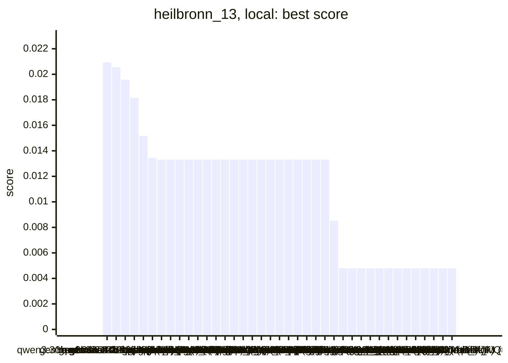
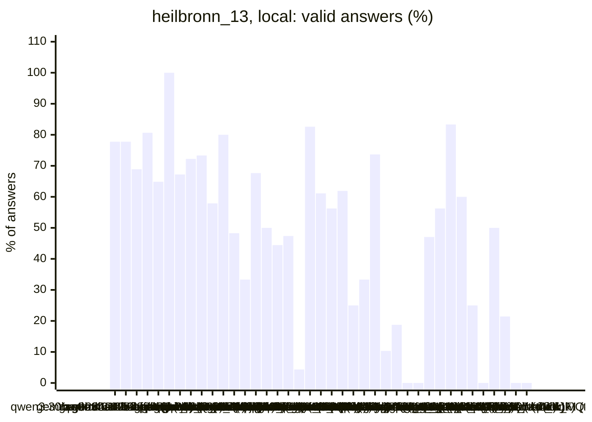
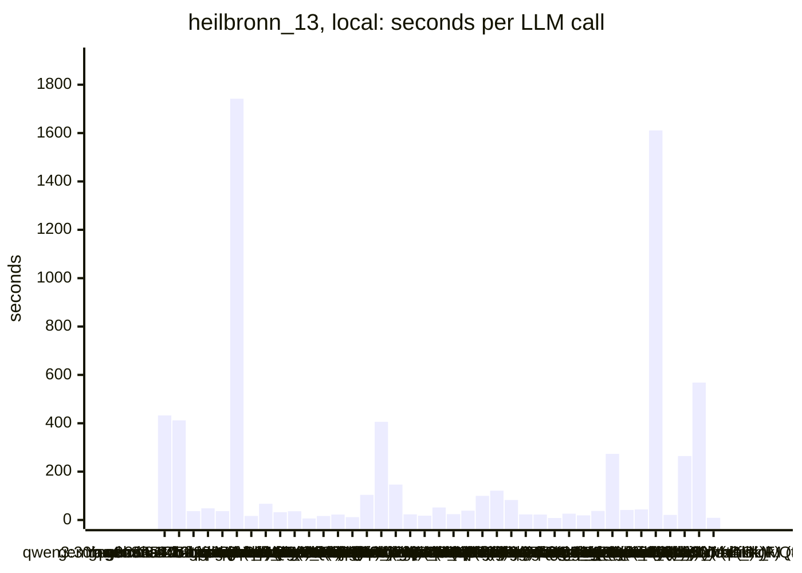
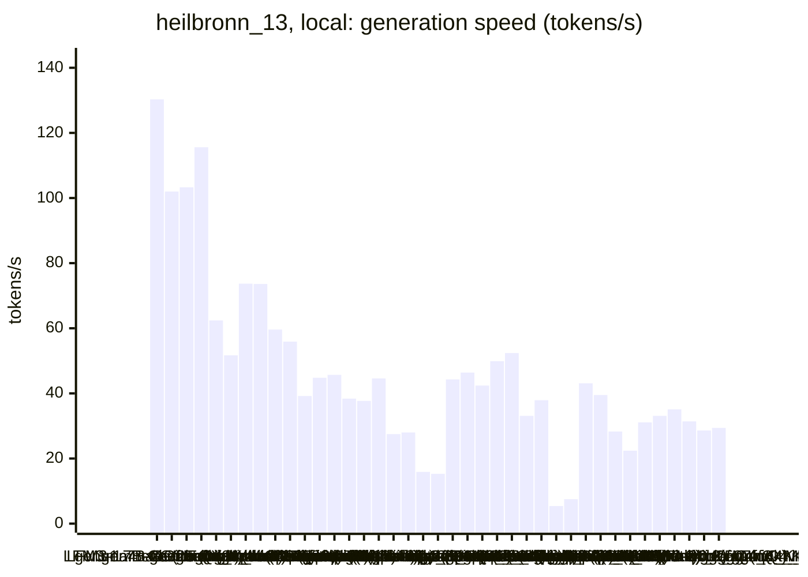
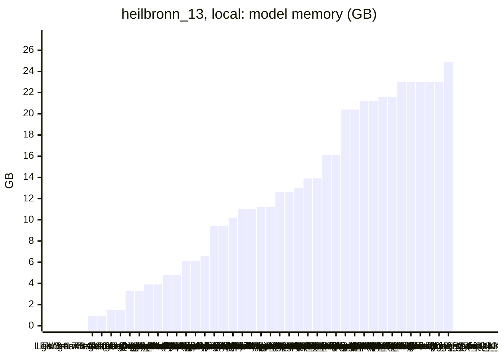
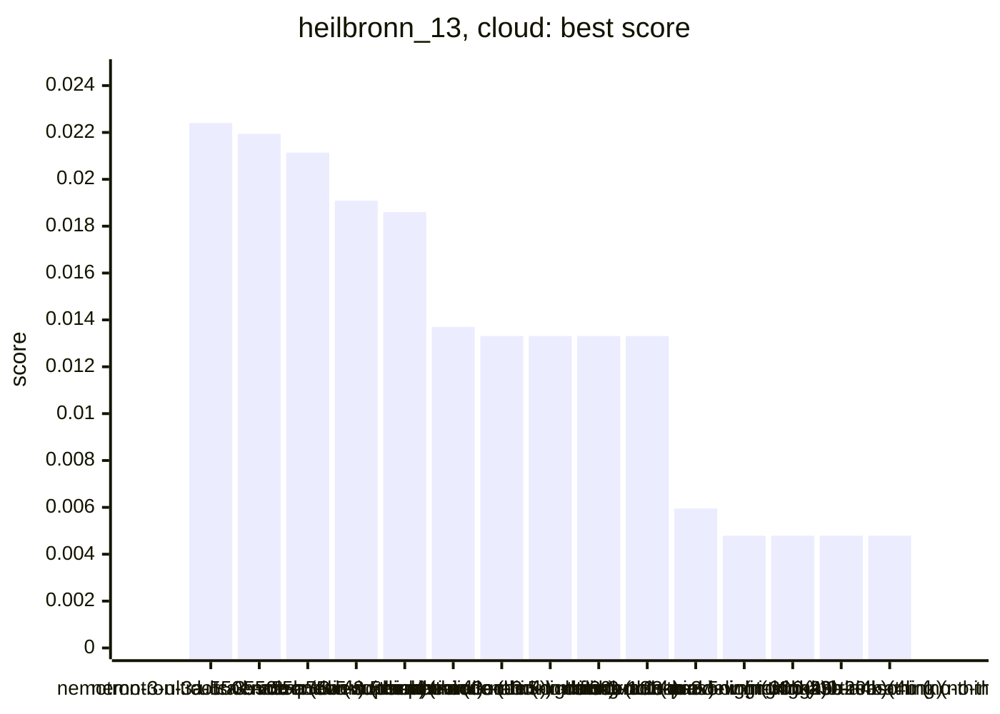
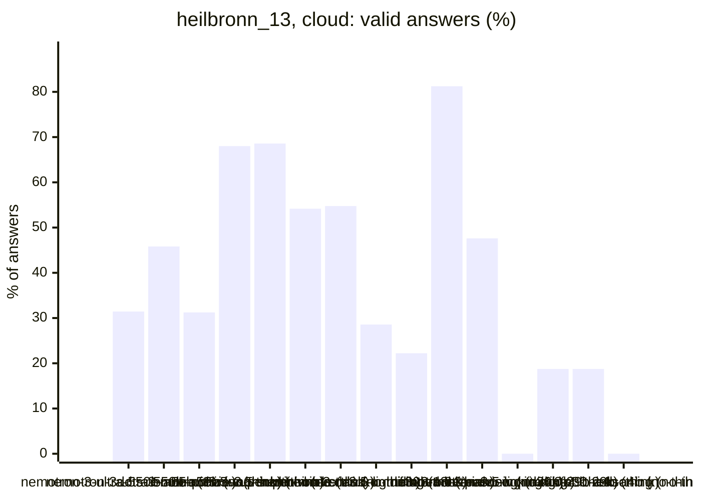
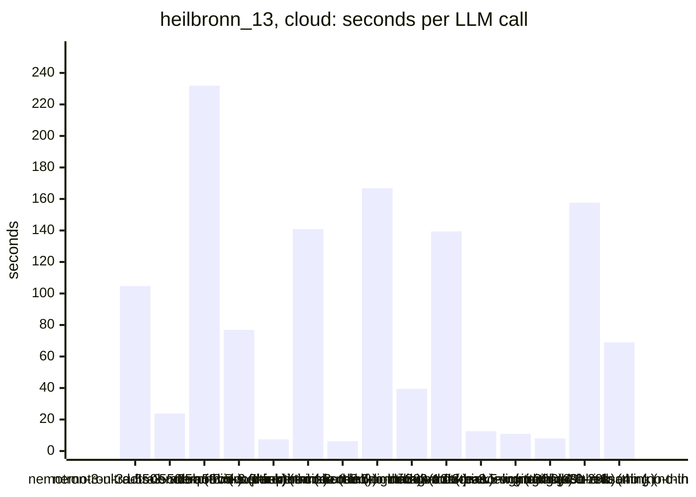
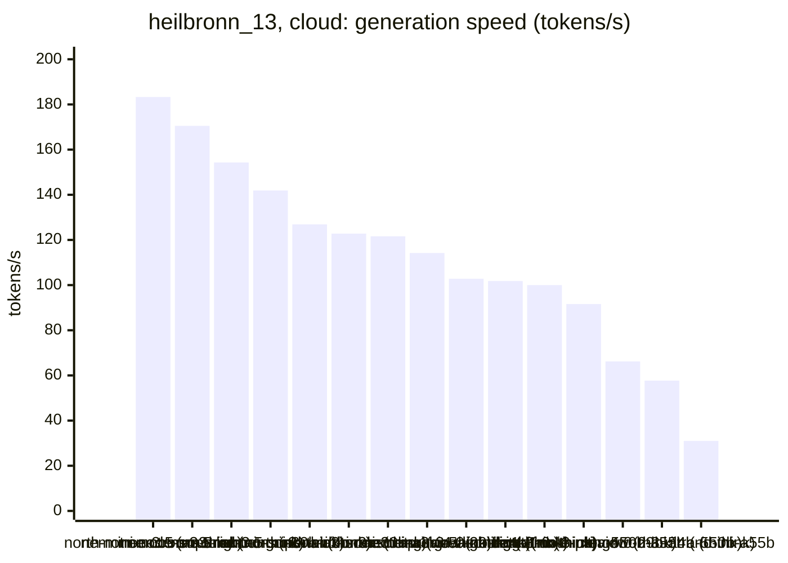

<!-- Copyright (c) 2026 by C. Klukas -->
<!-- SPDX-License-Identifier: GPL-3.0-only -->
<!-- Generated by `omega report` from bench/results/*.json. Do not edit by hand. -->

# heilbronn_13

54 models, each run at most 60 minutes, ended earlier after 15 answers in a row without progress; one run per model. The [overall ranking](../benchmarks.md#overall-ranking) compares the models over all examples.

Machine: Intel(R) Core(TM) i7-8700K CPU @ 3.70GHz (MS-7A98), 12 cores, 64 GB, 2x NVIDIA GeForce GTX 1080 Ti, 11264 MiB.

## Local models

Ollama on this machine.

| Model | Params | Initial | Best | Gain | LLM calls | s/call | Valid | New bests | Min to best | Minutes | Stopped by |
|---|---|--:|--:|--:|--:|--:|--:|--:|--:|--:|---|
| gemma4:26b-a4b-it-qat (think) | 25.2B | 0.00479 | **0.02092** | ×4.37 | 9 | 432 | 78% | 1 | 14.2 | 66.2 | time limit |
| gemma4:12b-it-qat (think) | 11.9B | 0.00479 | **0.02055** | ×4.29 | 9 | 412 | 78% | 4 | 49.5 | 62.7 | time limit |
| qwen3:30b-a3b-instruct-2507-q4_K_M (no-think) | 30.5B | 0.00479 | **0.01957** | ×4.09 | 45 | 37 | 69% | 6 | 18.7 | 28.9 | no progress |
| gemma4:12b-it-qat (no-think) | 11.9B | 0.00479 | **0.01815** | ×3.79 | 31 | 48 | 81% | 6 | 14.8 | 25.6 | no progress |
| gemma4:26b-a4b-it-qat (no-think) | 25.2B | 0.00479 | **0.01517** | ×3.17 | 37 | 37 | 65% | 6 | 15.0 | 23.5 | no progress |
| qwen3.6:27b-coding-mtp-q4_K_M (think) | 27.3B | 0.00479 | **0.01345** | ×2.81 | 3 | 1742 | 100% | 1 | 27.9 | 88.6 | time limit |
| yandex/YandexGPT-5-Lite-8B-instruct-GGUF:latest (no-think) | 8.0B | 0.00479 | **0.01331** | ×2.78 | 61 | 17 | 67% | 6 | 13.8 | 18.2 | no progress |
| gpt-oss:20b (no-think) | 20.9B | 0.00479 | **0.01331** | ×2.78 | 18 | 67 | 72% | 2 | 16.6 | 20.4 | no progress |
| glm-4.7-flash:latest (no-think) | 29.9B | 0.00479 | **0.01331** | ×2.78 | 15 | 32 | 73% | 3 | 2.0 | 9.0 | no progress |
| richardyoung/frognano-4b-2609:latest (no-think) | 4.3B | 0.00479 | **0.01331** | ×2.78 | 19 | 36 | 58% | 1 | 3.5 | 12.0 | no progress |
| gemma4:e2b (no-think) | 4.6B | 0.00479 | **0.01331** | ×2.78 | 20 | 6 | 80% | 2 | 0.8 | 2.5 | no progress |
| qwen2.5-coder:7b (no-think) | 7.6B | 0.00479 | **0.01331** | ×2.78 | 29 | 16 | 48% | 2 | 3.9 | 8.4 | no progress |
| MichelRosselli/apertus:8b-instruct-2509-q4_k_m (no-think) | 8.1B | 0.00479 | **0.01331** | ×2.78 | 30 | 23 | 33% | 3 | 7.9 | 12.1 | no progress |
| gemma4:latest (no-think) | 7.5B | 0.00479 | **0.01331** | ×2.78 | 34 | 12 | 68% | 3 | 3.6 | 7.1 | no progress |
| underdog-saluki-27b:iq2-mix (no-think) | 26.9B | 0.00479 | **0.01331** | ×2.78 | 20 | 104 | 50% | 1 | 10.9 | 35.7 | no progress |
| frob/sarvam:30b (no-think) | 32.2B | 0.00479 | **0.01331** | ×2.78 | 9 | 406 | 44% | 1 | 13.8 | 61.2 | time limit |
| hf.co/LiquidAI/LFM3-1.7B-GGUF:Q4_K_M (think) | 1.73B | 0.00479 | **0.01331** | ×2.78 | 19 | 146 | 47% | 2 | 6.9 | 46.9 | no progress |
| nemotron-3-nano:4b (think) | 4.0B | 0.00479 | **0.01331** | ×2.78 | 23 | 24 | 4% | 1 | 2.4 | 9.8 | no progress |
| gemma4:e2b (think) | 4.6B | 0.00479 | **0.01331** | ×2.78 | 23 | 18 | 83% | 3 | 2.6 | 7.8 | no progress |
| gemma4:e4b-it-qat (think) | 7.5B | 0.00479 | **0.01331** | ×2.78 | 18 | 52 | 61% | 1 | 2.1 | 17.6 | no progress |
| gemma4:latest (think) | 7.5B | 0.00479 | **0.01331** | ×2.78 | 16 | 24 | 56% | 1 | 1.4 | 7.2 | no progress |
| gpt-oss:20b (think) | 20.9B | 0.00479 | **0.01331** | ×2.78 | 21 | 39 | 62% | 1 | 2.4 | 14.9 | no progress |
| hf.co/mmnga-o/Qwen3-Swallow-30B-A3B-RL-v0.2-gguf:Q4_K_M (no-think) | 30.5B | 0.00479 | **0.01331** | ×2.78 | 16 | 100 | 25% | 1 | 2.8 | 27.8 | no progress |
| hf.co/llm-jp/llm-jp-4.1-32b-a3b-thinking-gguf:Q4_K_M (no-think) | 32.1B | 0.00479 | **0.01331** | ×2.78 | 18 | 121 | 33% | 2 | 3.6 | 37.8 | no progress |
| hf.co/mmnga-o/Qwen3-Swallow-30B-A3B-RL-v0.2-gguf:Q4_K_M (think) | 30.5B | 0.00479 | **0.01331** | ×2.78 | 19 | 83 | 74% | 1 | 6.3 | 28.8 | no progress |
| qwen3-coder:30b (no-think) | 30.5B | 0.00479 | **0.00852** | ×1.78 | 29 | 23 | 10% | 1 | 5.9 | 11.8 | no progress |
| hf.co/LiquidAI/LFM3-1.7B-GGUF:Q4_K_M (no-think) | 1.73B | 0.00479 | **0.00479** | ×1.00 | 16 | 23 | 19% | 0 | - | 6.3 | no progress |
| nemotron-3-nano:4b (no-think) | 4.0B | 0.00479 | **0.00479** | ×1.00 | 16 | 8 | 0% | 0 | - | 2.5 | no progress |
| llm-jp-4-8b-omega:q4_k_m (no-think) | 8.6B | 0.00479 | **0.00479** | ×1.00 | 16 | 26 | 0% | 0 | - | 7.2 | no progress |
| gemma4:e4b-it-qat (no-think) | 7.5B | 0.00479 | **0.00479** | ×1.00 | 17 | 19 | 47% | 0 | - | 5.7 | no progress |
| qwen3.5:latest (no-think) | 9.0B | 0.00479 | **0.00479** | ×1.00 | 16 | 38 | 56% | 0 | - | 10.3 | no progress |
| qwen3.6:27b-coding-mtp-q4_K_M (no-think) | 27.3B | 0.00479 | **0.00479** | ×1.00 | 12 | 274 | 83% | 0 | - | 55.0 | no progress |
| richardyoung/frognano-4b-2609:latest (think) | 4.3B | 0.00479 | **0.00479** | ×1.00 | 15 | 42 | 60% | 0 | - | 11.0 | no progress |
| qwen3.5:latest (think) | 9.0B | 0.00479 | **0.00479** | ×1.00 | 16 | 44 | 25% | 0 | - | 12.4 | no progress |
| underdog-saluki-27b:iq2-mix (think) | 26.9B | 0.00479 | **0.00479** | ×1.00 | 3 | 1611 | 0% | 0 | - | 81.3 | time limit |
| qwen3:30b-a3b-instruct-2507-q4_K_M (think) | 30.5B | 0.00479 | **0.00479** | ×1.00 | 16 | 21 | 50% | 0 | - | 7.1 | no progress |
| glm-4.7-flash:latest (think) | 29.9B | 0.00479 | **0.00479** | ×1.00 | 14 | 264 | 21% | 0 | - | 63.4 | time limit |
| frob/sarvam:30b (think) | 32.2B | 0.00479 | **0.00479** | ×1.00 | 7 | 568 | 0% | 0 | - | 68.0 | time limit |
| hf.co/Colby/apertus-v1.5-8b-text-Q4_K_M-GGUF:Q4_K_M (no-think) | 8.05B | 0.00479 | **0.00479** | ×1.00 | 16 | 9 | 0% | 0 | - | 3.0 | no progress |

### Inference speed and memory

RAM is what Ollama reports for the loaded model (weights, context cache and buffers; on Apple silicon this is shared memory). Load is the time to bring the model into memory. Prompt and generation speeds are tokens per second over all calls of the run.

| Model | Params | RAM GB | Load s | Prompt tok/s | Gen tok/s | Median s/call | p90 s/call | Tokens/answer | Stopped |
|---|---|--:|--:|--:|--:|--:|--:|--:|--:|
| gemma4:e2b (no-think) | 4.6B | 0.9 | 17 | 2567 | 130.3 | 5 | 7 | 306 | 0 |
| gemma4:e2b (think) | 4.6B | 0.9 | 0 | 2460 | 102.0 | 17 | 27 | 1499 | 0 |
| hf.co/LiquidAI/LFM3-1.7B-GGUF:Q4_K_M (think) | 1.73B | 1.5 | 0 | 4402 | 103.3 | 153 | 216 | 14866 | 0 |
| hf.co/LiquidAI/LFM3-1.7B-GGUF:Q4_K_M (no-think) | 1.73B | 1.5 | 5 | 4190 | 115.6 | 20 | 48 | 687 | 8 |
| gemma4:latest (no-think) | 7.5B | 3.3 | 24 | 1363 | 62.4 | 10 | 18 | 405 | 0 |
| gemma4:latest (think) | 7.5B | 3.3 | 0 | 1394 | 51.7 | 21 | 48 | 1054 | 0 |
| nemotron-3-nano:4b (think) | 4.0B | 3.9 | 0 | 1778 | 73.7 | 23 | 36 | 1476 | 0 |
| nemotron-3-nano:4b (no-think) | 4.0B | 3.9 | 10 | 1623 | 73.6 | 7 | 13 | 319 | 0 |
| richardyoung/frognano-4b-2609:latest (no-think) | 4.3B | 4.8 | 12 | 1523 | 59.6 | 27 | 79 | 1843 | 1 |
| richardyoung/frognano-4b-2609:latest (think) | 4.3B | 4.8 | 0 | 1658 | 55.9 | 39 | 62 | 2105 | 0 |
| gemma4:e4b-it-qat (think) | 7.5B | 6.1 | 0 | 1694 | 39.2 | 50 | 96 | 1891 | 0 |
| gemma4:e4b-it-qat (no-think) | 7.5B | 6.1 | 20 | 1696 | 44.8 | 17 | 36 | 650 | 0 |
| qwen2.5-coder:7b (no-think) | 7.6B | 6.6 | 14 | 1448 | 45.7 | 15 | 27 | 546 | 0 |
| qwen3.5:latest (no-think) | 9.0B | 9.4 | 20 | 981 | 38.4 | 20 | 106 | 1225 | 0 |
| qwen3.5:latest (think) | 9.0B | 9.4 | 0 | 931 | 37.7 | 49 | 60 | 1480 | 0 |
| yandex/YandexGPT-5-Lite-8B-instruct-GGUF:latest (no-think) | 8.0B | 10.2 | 15 | 1585 | 44.6 | 16 | 24 | 490 | 1 |
| gemma4:12b-it-qat (think) | 11.9B | 11.0 | 0 | 556 | 27.5 | 384 | 636 | 10046 | 0 |
| gemma4:12b-it-qat (no-think) | 11.9B | 11.0 | 22 | 581 | 28.0 | 45 | 65 | 1044 | 0 |
| underdog-saluki-27b:iq2-mix (no-think) | 26.9B | 11.2 | 23 | 377 | 15.9 | 87 | 179 | 1151 | 1 |
| underdog-saluki-27b:iq2-mix (think) | 26.9B | 11.2 | 0 | 364 | 15.3 | 1601 | 1632 | 24576 | 0 |
| MichelRosselli/apertus:8b-instruct-2509-q4_k_m (no-think) | 8.1B | 12.6 | 15 | 1370 | 44.3 | 14 | 26 | 367 | 1 |
| hf.co/Colby/apertus-v1.5-8b-text-Q4_K_M-GGUF:Q4_K_M (no-think) | 8.05B | 12.6 | 0 | 1727 | 46.4 | 9 | 13 | 274 | 0 |
| llm-jp-4-8b-omega:q4_k_m (no-think) | 8.6B | 13.0 | 16 | 1531 | 42.4 | 29 | 42 | 910 | 0 |
| gpt-oss:20b (no-think) | 20.9B | 13.9 | 37 | 1616 | 49.9 | 46 | 149 | 3067 | 0 |
| gpt-oss:20b (think) | 20.9B | 13.9 | 0 | 1777 | 52.4 | 31 | 82 | 1834 | 0 |
| gemma4:26b-a4b-it-qat (think) | 25.2B | 16.1 | 0 | 783 | 33.1 | 427 | 523 | 14108 | 0 |
| gemma4:26b-a4b-it-qat (no-think) | 25.2B | 16.1 | 51 | 753 | 37.9 | 34 | 52 | 995 | 1 |
| qwen3.6:27b-coding-mtp-q4_K_M (think) | 27.3B | 20.4 | 0 | 210 | 5.4 | 1756 | 1808 | 9278 | 0 |
| qwen3.6:27b-coding-mtp-q4_K_M (no-think) | 27.3B | 20.4 | 52 | 188 | 7.5 | 287 | 385 | 1705 | 1 |
| frob/sarvam:30b (no-think) | 32.2B | 21.2 | 58 | 1304 | 43.1 | 350 | 631 | 17386 | 1 |
| frob/sarvam:30b (think) | 32.2B | 21.2 | 0 | 1485 | 39.5 | 627 | 631 | 22689 | 1 |
| glm-4.7-flash:latest (no-think) | 29.9B | 21.6 | 66 | 490 | 28.3 | 26 | 57 | 569 | 0 |
| glm-4.7-flash:latest (think) | 29.9B | 21.6 | 0 | 513 | 22.4 | 269 | 362 | 5800 | 0 |
| qwen3:30b-a3b-instruct-2507-q4_K_M (no-think) | 30.5B | 23.0 | 53 | 598 | 31.1 | 29 | 67 | 778 | 0 |
| hf.co/mmnga-o/Qwen3-Swallow-30B-A3B-RL-v0.2-gguf:Q4_K_M (no-think) | 30.5B | 23.0 | 0 | 702 | 33.1 | 84 | 204 | 2552 | 4 |
| hf.co/mmnga-o/Qwen3-Swallow-30B-A3B-RL-v0.2-gguf:Q4_K_M (think) | 30.5B | 23.0 | 0 | 649 | 35.1 | 66 | 177 | 2681 | 0 |
| qwen3-coder:30b (no-think) | 30.5B | 23.0 | 52 | 745 | 31.4 | 22 | 36 | 514 | 0 |
| qwen3:30b-a3b-instruct-2507-q4_K_M (think) | 30.5B | 23.0 | 0 | 752 | 28.6 | 18 | 46 | 466 | 0 |
| hf.co/llm-jp/llm-jp-4.1-32b-a3b-thinking-gguf:Q4_K_M (no-think) | 32.1B | 24.9 | 0 | 546 | 29.4 | 75 | 130 | 1807 | 0 |

### Best score over time

| Model | 15 min | 30 min | 45 min | 60 min |
|---|--:|--:|--:|--:|
| gemma4:26b-a4b-it-qat (think) | 0.02092 | 0.02092 | 0.02092 | 0.02092 |
| gemma4:12b-it-qat (think) | 0.01447 | 0.01487 | 0.01574 | 0.02055 |
| qwen3:30b-a3b-instruct-2507-q4_K_M (no-think) | 0.01918 | 0.01957 | 0.01957 | 0.01957 |
| gemma4:12b-it-qat (no-think) | 0.01815 | 0.01815 | 0.01815 | 0.01815 |
| gemma4:26b-a4b-it-qat (no-think) | 0.01517 | 0.01517 | 0.01517 | 0.01517 |
| qwen3.6:27b-coding-mtp-q4_K_M (think) | 0.00479 | 0.01345 | 0.01345 | 0.01345 |
| yandex/YandexGPT-5-Lite-8B-instruct-GGUF:latest (no-think) | 0.01331 | 0.01331 | 0.01331 | 0.01331 |
| gpt-oss:20b (no-think) | 0.01331 | 0.01331 | 0.01331 | 0.01331 |
| glm-4.7-flash:latest (no-think) | 0.01331 | 0.01331 | 0.01331 | 0.01331 |
| richardyoung/frognano-4b-2609:latest (no-think) | 0.01331 | 0.01331 | 0.01331 | 0.01331 |
| gemma4:e2b (no-think) | 0.01331 | 0.01331 | 0.01331 | 0.01331 |
| qwen2.5-coder:7b (no-think) | 0.01331 | 0.01331 | 0.01331 | 0.01331 |
| MichelRosselli/apertus:8b-instruct-2509-q4_k_m (no-think) | 0.01331 | 0.01331 | 0.01331 | 0.01331 |
| gemma4:latest (no-think) | 0.01331 | 0.01331 | 0.01331 | 0.01331 |
| underdog-saluki-27b:iq2-mix (no-think) | 0.01331 | 0.01331 | 0.01331 | 0.01331 |
| frob/sarvam:30b (no-think) | 0.01331 | 0.01331 | 0.01331 | 0.01331 |
| hf.co/LiquidAI/LFM3-1.7B-GGUF:Q4_K_M (think) | 0.01331 | 0.01331 | 0.01331 | 0.01331 |
| nemotron-3-nano:4b (think) | 0.01331 | 0.01331 | 0.01331 | 0.01331 |
| gemma4:e2b (think) | 0.01331 | 0.01331 | 0.01331 | 0.01331 |
| gemma4:e4b-it-qat (think) | 0.01331 | 0.01331 | 0.01331 | 0.01331 |
| gemma4:latest (think) | 0.01331 | 0.01331 | 0.01331 | 0.01331 |
| gpt-oss:20b (think) | 0.01331 | 0.01331 | 0.01331 | 0.01331 |
| hf.co/mmnga-o/Qwen3-Swallow-30B-A3B-RL-v0.2-gguf:Q4_K_M (no-think) | 0.01331 | 0.01331 | 0.01331 | 0.01331 |
| hf.co/llm-jp/llm-jp-4.1-32b-a3b-thinking-gguf:Q4_K_M (no-think) | 0.01331 | 0.01331 | 0.01331 | 0.01331 |
| hf.co/mmnga-o/Qwen3-Swallow-30B-A3B-RL-v0.2-gguf:Q4_K_M (think) | 0.01331 | 0.01331 | 0.01331 | 0.01331 |
| qwen3-coder:30b (no-think) | 0.00852 | 0.00852 | 0.00852 | 0.00852 |
| hf.co/LiquidAI/LFM3-1.7B-GGUF:Q4_K_M (no-think) | 0.00479 | 0.00479 | 0.00479 | 0.00479 |
| nemotron-3-nano:4b (no-think) | 0.00479 | 0.00479 | 0.00479 | 0.00479 |
| llm-jp-4-8b-omega:q4_k_m (no-think) | 0.00479 | 0.00479 | 0.00479 | 0.00479 |
| gemma4:e4b-it-qat (no-think) | 0.00479 | 0.00479 | 0.00479 | 0.00479 |
| qwen3.5:latest (no-think) | 0.00479 | 0.00479 | 0.00479 | 0.00479 |
| qwen3.6:27b-coding-mtp-q4_K_M (no-think) | 0.00479 | 0.00479 | 0.00479 | 0.00479 |
| richardyoung/frognano-4b-2609:latest (think) | 0.00479 | 0.00479 | 0.00479 | 0.00479 |
| qwen3.5:latest (think) | 0.00479 | 0.00479 | 0.00479 | 0.00479 |
| underdog-saluki-27b:iq2-mix (think) | 0.00479 | 0.00479 | 0.00479 | 0.00479 |
| qwen3:30b-a3b-instruct-2507-q4_K_M (think) | 0.00479 | 0.00479 | 0.00479 | 0.00479 |
| glm-4.7-flash:latest (think) | 0.00479 | 0.00479 | 0.00479 | 0.00479 |
| frob/sarvam:30b (think) | 0.00479 | 0.00479 | 0.00479 | 0.00479 |
| hf.co/Colby/apertus-v1.5-8b-text-Q4_K_M-GGUF:Q4_K_M (no-think) | 0.00479 | 0.00479 | 0.00479 | 0.00479 |

### Outcome of the LLM answers

| Model | duplicate | edit error | invalid | llm error | ok | timeout |
|---|--:|--:|--:|--:|--:|--:|
| gemma4:26b-a4b-it-qat (think) | 0 | 1 | 1 | 0 | 7 | 0 |
| gemma4:12b-it-qat (think) | 0 | 1 | 0 | 1 | 7 | 0 |
| qwen3:30b-a3b-instruct-2507-q4_K_M (no-think) | 1 | 4 | 9 | 0 | 31 | 0 |
| gemma4:12b-it-qat (no-think) | 1 | 0 | 5 | 0 | 25 | 0 |
| gemma4:26b-a4b-it-qat (no-think) | 0 | 6 | 6 | 1 | 24 | 0 |
| qwen3.6:27b-coding-mtp-q4_K_M (think) | 0 | 0 | 0 | 0 | 3 | 0 |
| yandex/YandexGPT-5-Lite-8B-instruct-GGUF:latest (no-think) | 12 | 0 | 7 | 1 | 41 | 0 |
| gpt-oss:20b (no-think) | 3 | 0 | 2 | 0 | 13 | 0 |
| glm-4.7-flash:latest (no-think) | 0 | 0 | 4 | 0 | 11 | 0 |
| richardyoung/frognano-4b-2609:latest (no-think) | 0 | 3 | 4 | 1 | 11 | 0 |
| gemma4:e2b (no-think) | 0 | 2 | 2 | 0 | 16 | 0 |
| qwen2.5-coder:7b (no-think) | 6 | 1 | 8 | 0 | 14 | 0 |
| MichelRosselli/apertus:8b-instruct-2509-q4_k_m (no-think) | 1 | 10 | 8 | 1 | 10 | 0 |
| gemma4:latest (no-think) | 2 | 1 | 8 | 0 | 23 | 0 |
| underdog-saluki-27b:iq2-mix (no-think) | 1 | 1 | 7 | 1 | 10 | 0 |
| frob/sarvam:30b (no-think) | 0 | 4 | 0 | 1 | 4 | 0 |
| hf.co/LiquidAI/LFM3-1.7B-GGUF:Q4_K_M (think) | 4 | 6 | 0 | 0 | 9 | 0 |
| nemotron-3-nano:4b (think) | 0 | 17 | 5 | 0 | 1 | 0 |
| gemma4:e2b (think) | 2 | 1 | 1 | 0 | 19 | 0 |
| gemma4:e4b-it-qat (think) | 2 | 1 | 2 | 0 | 11 | 2 |
| gemma4:latest (think) | 4 | 0 | 2 | 0 | 9 | 1 |
| gpt-oss:20b (think) | 5 | 3 | 0 | 0 | 13 | 0 |
| hf.co/mmnga-o/Qwen3-Swallow-30B-A3B-RL-v0.2-gguf:Q4_K_M (no-think) | 2 | 3 | 3 | 4 | 4 | 0 |
| hf.co/llm-jp/llm-jp-4.1-32b-a3b-thinking-gguf:Q4_K_M (no-think) | 0 | 8 | 3 | 1 | 6 | 0 |
| hf.co/mmnga-o/Qwen3-Swallow-30B-A3B-RL-v0.2-gguf:Q4_K_M (think) | 1 | 2 | 2 | 0 | 14 | 0 |
| qwen3-coder:30b (no-think) | 3 | 10 | 13 | 0 | 3 | 0 |
| hf.co/LiquidAI/LFM3-1.7B-GGUF:Q4_K_M (no-think) | 0 | 3 | 2 | 8 | 3 | 0 |
| nemotron-3-nano:4b (no-think) | 0 | 11 | 5 | 0 | 0 | 0 |
| llm-jp-4-8b-omega:q4_k_m (no-think) | 0 | 8 | 8 | 0 | 0 | 0 |
| gemma4:e4b-it-qat (no-think) | 2 | 2 | 4 | 0 | 8 | 1 |
| qwen3.5:latest (no-think) | 0 | 2 | 5 | 0 | 9 | 0 |
| qwen3.6:27b-coding-mtp-q4_K_M (no-think) | 1 | 0 | 0 | 1 | 10 | 0 |
| richardyoung/frognano-4b-2609:latest (think) | 0 | 1 | 5 | 0 | 9 | 0 |
| qwen3.5:latest (think) | 0 | 5 | 7 | 0 | 4 | 0 |
| underdog-saluki-27b:iq2-mix (think) | 0 | 3 | 0 | 0 | 0 | 0 |
| qwen3:30b-a3b-instruct-2507-q4_K_M (think) | 2 | 1 | 5 | 0 | 8 | 0 |
| glm-4.7-flash:latest (think) | 0 | 2 | 9 | 0 | 3 | 0 |
| frob/sarvam:30b (think) | 0 | 5 | 1 | 1 | 0 | 0 |
| hf.co/Colby/apertus-v1.5-8b-text-Q4_K_M-GGUF:Q4_K_M (no-think) | 0 | 12 | 4 | 0 | 0 | 0 |

### Best idea per model

- **gemma4:26b-a4b-it-qat (think)**: Implement a hill-climbing algorithm with restarts that focuses on moving vertices of the smallest-area triangles to maximize the minimum triangle area.
- **gemma4:12b-it-qat (think)**: Implement a hill-climbing optimization with multiple restarts, targeting the smallest triangle's vertices to maximize the minimum area.
- **qwen3:30b-a3b-instruct-2507-q4_K_M (no-think)**: tuned BETA_FINAL=1000, STEP_SIZE_INIT=0.1023, RESTARTS=20, BETA_GROWTH=1.08 on top of: Replace the symmetric grid layout with a randomized, point-symmetric configuration …
- **gemma4:12b-it-qat (no-think)**: tuned step=0.2, decay=1 on top of: Replace the poor circular initialization with a local search (hill-climbing) algorithm that optimizes for the minimum triangle area using a …
- **gemma4:26b-a4b-it-qat (no-think)**: tuned iterations=16828, cooling=0.999, temp=0.1 on top of: Implement a targeted simulated annealing strategy that moves only the points involved in the triangle with the current …
- **qwen3.6:27b-coding-mtp-q4_K_M (think)**: Replace the static circular layout with a multi-restart local search optimizer that adaptively perturbs point coordinates to maximize the minimum triangle area, clamping all …
- **yandex/YandexGPT-5-Lite-8B-instruct-GGUF:latest (no-think)**: tuned RADIUS=0.3242, BOUNDARY_RADIUS=0.1897 on top of: Tune the radius and boundary_radius parameters to improve the distribution of points and maximize the smallest triangle area.
- **gpt-oss:20b (no-think)**: Run several independent hill‑climbing restarts with random angular offsets, keeping the best configuration found; this expands the search space and increases the chance of …
- **glm-4.7-flash:latest (no-think)**: tuned PHI=0.5 on top of: Replace the degenerate regular polygon initialization with a symmetric, corner-optimized layout using the golden ratio to place points near the corners …
- **richardyoung/frognano-4b-2609:latest (no-think)**: Replace the circular ring initialization with a point-symmetric layout that densely packs points on the boundary and corners to utilize the full unit square, which is known to …
- **gemma4:e2b (no-think)**: tuned radius=0.5 on top of: Modify the initial configuration to be more spread out, perhaps by increasing the radius or changing the initial angular placement, to utilize the …
- **qwen2.5-coder:7b (no-think)**: tuned RADIUS=0.5 on top of: Increase the radius of the initial circle to better utilize the available space and avoid collinear triples.
- **MichelRosselli/apertus:8b-instruct-2509-q4_k_m (no-think)**: Increase the radius of the circle to ensure points are further apart, reducing the chance of small triangle areas. This also helps avoid collinear triples.
- **gemma4:latest (no-think)**: tuned RADIUS=0.5 on top of: Introduce constants for the initial radius and the number of iterations to allow for systematic tuning of the initial configuration and search depth.
- **underdog-saluki-27b:iq2-mix (no-think)**: tuned RADIUS=0.5 on top of: Expose the circle-radius parameter as a named constant `RADIUS` and sweep it to find the value that maximizes the minimum triangle area for the …
- **frob/sarvam:30b (no-think)**: Increase the radius to 0.5 to place points on the boundary, which should increase the minimal triangle area.
- **hf.co/LiquidAI/LFM3-1.7B-GGUF:Q4_K_M (think)**: Increase the circle radius from 0.45 to 0.5 so that points reach or touch the square boundaries and enlarge the smallest triangle area while keeping all points inside [0,1]².
- **nemotron-3-nano:4b (think)**: place the 13 points on a circle of radius 0.5 centered in the square, which spreads them far apart and yields much larger minimal triangle areas compared to the tight inner circle.
- **gemma4:e2b (think)**: Sweep the radius parameter $R$ over a relevant range to find the configuration that maximizes the minimum triangle area, utilizing the empirical feedback provided.
- **gemma4:e4b-it-qat (think)**: Increase the radius of the circumcircle to better utilize the space within the unit square, moving points closer to the edges and corners as suggested by the heuristic that good …
- **gemma4:latest (think)**: Increase the radius of the inscribed circle to 0.5 to push the initial points closer to the boundary of the unit square, thereby utilizing the available space better as suggested …
- **gpt-oss:20b (think)**: Increase the circle radius to 0.5 so the points are spread over the entire unit square, which enlarges the smallest triangle area.
- **hf.co/mmnga-o/Qwen3-Swallow-30B-A3B-RL-v0.2-gguf:Q4_K_M (no-think)**: Increase the radius of the circle that the points lie on from 0.3 to 0.5, using the full extent of the square while still keeping all points strictly inside [0,1]×[0,1]. This …
- **hf.co/llm-jp/llm-jp-4.1-32b-a3b-thinking-gguf:Q4_K_M (no-think)**: tuned RADIUS=0.5 on top of: Expose the initial circle radius as a named constant and sweep it over a range covering both small interior circles and larger ones that reach the …
- **hf.co/mmnga-o/Qwen3-Swallow-30B-A3B-RL-v0.2-gguf:Q4_K_M (think)**: tuned RADIUS=0.5 on top of: Expose the circle radius (and the centre) as constants so the optimizer can sweep a larger radius, spreading the points across the unit square and …
- **qwen3-coder:30b (no-think)**: tuned INITIAL_RADIUS=0.4 on top of: Replace the regular polygon initialization with a more evenly distributed point set that fills the unit square better and avoids near-collinear …
- **hf.co/LiquidAI/LFM3-1.7B-GGUF:Q4_K_M (no-think)**: initial program
- **nemotron-3-nano:4b (no-think)**: initial program
- **llm-jp-4-8b-omega:q4_k_m (no-think)**: initial program
- **gemma4:e4b-it-qat (no-think)**: initial program
- **qwen3.5:latest (no-think)**: initial program
- **qwen3.6:27b-coding-mtp-q4_K_M (no-think)**: initial program
- **richardyoung/frognano-4b-2609:latest (think)**: initial program
- **qwen3.5:latest (think)**: initial program
- **underdog-saluki-27b:iq2-mix (think)**: initial program
- **qwen3:30b-a3b-instruct-2507-q4_K_M (think)**: initial program
- **glm-4.7-flash:latest (think)**: initial program
- **frob/sarvam:30b (think)**: initial program
- **hf.co/Colby/apertus-v1.5-8b-text-Q4_K_M-GGUF:Q4_K_M (no-think)**: initial program

## Cloud models (OpenRouter)

Free OpenRouter models; times include the network and the provider's queue.

| Model | Params | Initial | Best | Gain | LLM calls | s/call | Valid | New bests | Min to best | Minutes | Stopped by |
|---|---|--:|--:|--:|--:|--:|--:|--:|--:|--:|---|
| nvidia/nemotron-3-ultra-550b-a55b:free (think) |  | 0.00479 | **0.0224** | ×4.68 | 35 | 105 | 31% | 6 | 38.5 | 65.1 | time limit |
| nvidia/nemotron-3-ultra-550b-a55b:free (no-think) |  | 0.00479 | **0.02194** | ×4.58 | 24 | 24 | 46% | 1 | 2.8 | 9.7 | no progress |
| dots-studio/dots-3-note-preview:free (think) |  | 0.00479 | **0.02114** | ×4.41 | 16 | 232 | 31% | 2 | 23.1 | 63.0 | time limit |
| nvidia/nemotron-3.5-super-vl:free (think) |  | 0.00479 | **0.01909** | ×3.99 | 25 | 77 | 68% | 4 | 37.8 | 69.0 | time limit |
| nvidia/nemotron-3.5-super-vl:free (no-think) |  | 0.00479 | **0.0186** | ×3.88 | 35 | 7 | 69% | 4 | 6.5 | 6.5 | no progress |
| cohere/north-mini-code:free (think) |  | 0.00479 | **0.0137** | ×2.86 | 24 | 141 | 54% | 2 | 20.9 | 57.6 | no progress |
| cohere/north-mini-code:free (no-think) |  | 0.00479 | **0.01331** | ×2.78 | 42 | 6 | 55% | 3 | 3.0 | 6.3 | no progress |
| nvidia/nemotron-3.5-lightning:free (think) |  | 0.00479 | **0.01331** | ×2.78 | 21 | 167 | 29% | 1 | 18.8 | 59.4 | no progress |
| nvidia/nemotron-3-nano-omni-30b-a3b-reasoning:free (think) |  | 0.00479 | **0.01331** | ×2.78 | 18 | 40 | 22% | 1 | 1.6 | 11.9 | no progress |
| recursive/flint-v1.0:free (think) |  | 0.00479 | **0.01331** | ×2.78 | 16 | 139 | 81% | 2 | 3.3 | 37.2 | no progress |
| dots-studio/dots-3-note-preview:free (no-think) |  | 0.00479 | **0.00595** | ×1.24 | 21 | 13 | 48% | 1 | 1.6 | 4.5 | no progress |
| nvidia/nemotron-3.5-lightning:free (no-think) |  | 0.00479 | **0.00479** | ×1.00 | 16 | 11 | 0% | 0 | - | 2.9 | no progress |
| nvidia/nemotron-3-nano-omni-30b-a3b-reasoning:free (no-think) |  | 0.00479 | **0.00479** | ×1.00 | 16 | 8 | 19% | 0 | - | 2.2 | no progress |
| xingchen-agi/xing4.0-29b-a4b:free (think) |  | 0.00479 | **0.00479** | ×1.00 | 16 | 158 | 19% | 0 | - | 42.1 | no progress |
| xingchen-agi/xing4.0-29b-a4b:free (no-think) |  | 0.00479 | **0.00479** | ×1.00 | 16 | 69 | 0% | 0 | - | 18.4 | no progress |

### Inference speed and cost

Generation speed is measured from the first to the last streamed token; the time to the first token is counted as prompt time. Cost is what OpenRouter charged for the run.

| Model | Gen tok/s | Median s/call | p90 s/call | Tokens/answer | Stopped | Cost $ |
|---|--:|--:|--:|--:|--:|--:|
| cohere/north-mini-code:free (no-think) | 183.3 | 5 | 12 | 1046 | 0 | 0.000 |
| nvidia/nemotron-3.5-super-vl:free (no-think) | 170.5 | 6 | 14 | 1100 | 2 | 0.000 |
| nvidia/nemotron-3.5-lightning:free (no-think) | 154.3 | 11 | 18 | 1815 | 5 | 0.000 |
| nvidia/nemotron-3.5-super-vl:free (think) | 141.9 | 59 | 172 | 10755 | 0 | 0.000 |
| nvidia/nemotron-3-nano-omni-30b-a3b-reasoning:free (no-think) | 126.9 | 5 | 11 | 639 | 1 | 0.000 |
| cohere/north-mini-code:free (think) | 122.8 | 154 | 220 | 16169 | 0 | 0.000 |
| nvidia/nemotron-3-nano-omni-30b-a3b-reasoning:free (think) | 121.6 | 33 | 81 | 4629 | 0 | 0.000 |
| dots-studio/dots-3-note-preview:free (no-think) | 114.2 | 13 | 16 | 1248 | 0 | 0.000 |
| nvidia/nemotron-3.5-lightning:free (think) | 102.8 | 174 | 260 | 17062 | 0 | 0.000 |
| xingchen-agi/xing4.0-29b-a4b:free (no-think) | 101.8 | 75 | 94 | 724 | 1 | 0.000 |
| recursive/flint-v1.0:free (think) | 100.0 | 129 | 296 | 13796 | 0 | 0.000 |
| dots-studio/dots-3-note-preview:free (think) | 91.6 | 263 | 281 | 20932 | 0 | 0.000 |
| nvidia/nemotron-3-ultra-550b-a55b:free (no-think) | 66.2 | 19 | 38 | 1406 | 0 | 0.000 |
| xingchen-agi/xing4.0-29b-a4b:free (think) | 57.7 | 79 | 420 | 3424 | 2 | 0.000 |
| nvidia/nemotron-3-ultra-550b-a55b:free (think) | 31.0 | 96 | 197 | 3085 | 0 | 0.000 |

### Best score over time

| Model | 15 min | 30 min | 45 min | 60 min |
|---|--:|--:|--:|--:|
| nvidia/nemotron-3-ultra-550b-a55b:free (think) | 0.00756 | 0.0128 | 0.0224 | 0.0224 |
| nvidia/nemotron-3-ultra-550b-a55b:free (no-think) | 0.02194 | 0.02194 | 0.02194 | 0.02194 |
| dots-studio/dots-3-note-preview:free (think) | 0.00479 | 0.02114 | 0.02114 | 0.02114 |
| nvidia/nemotron-3.5-super-vl:free (think) | 0.01812 | 0.01883 | 0.01909 | 0.01909 |
| nvidia/nemotron-3.5-super-vl:free (no-think) | 0.0186 | 0.0186 | 0.0186 | 0.0186 |
| cohere/north-mini-code:free (think) | 0.01365 | 0.0137 | 0.0137 | 0.0137 |
| cohere/north-mini-code:free (no-think) | 0.01331 | 0.01331 | 0.01331 | 0.01331 |
| nvidia/nemotron-3.5-lightning:free (think) | 0.00479 | 0.01331 | 0.01331 | 0.01331 |
| nvidia/nemotron-3-nano-omni-30b-a3b-reasoning:free (think) | 0.01331 | 0.01331 | 0.01331 | 0.01331 |
| recursive/flint-v1.0:free (think) | 0.01331 | 0.01331 | 0.01331 | 0.01331 |
| dots-studio/dots-3-note-preview:free (no-think) | 0.00595 | 0.00595 | 0.00595 | 0.00595 |
| nvidia/nemotron-3.5-lightning:free (no-think) | 0.00479 | 0.00479 | 0.00479 | 0.00479 |
| nvidia/nemotron-3-nano-omni-30b-a3b-reasoning:free (no-think) | 0.00479 | 0.00479 | 0.00479 | 0.00479 |
| xingchen-agi/xing4.0-29b-a4b:free (think) | 0.00479 | 0.00479 | 0.00479 | 0.00479 |
| xingchen-agi/xing4.0-29b-a4b:free (no-think) | 0.00479 | 0.00479 | 0.00479 | 0.00479 |

### Outcome of the LLM answers

| Model | duplicate | edit error | invalid | llm error | ok | timeout |
|---|--:|--:|--:|--:|--:|--:|
| nvidia/nemotron-3-ultra-550b-a55b:free (think) | 1 | 3 | 5 | 3 | 11 | 12 |
| nvidia/nemotron-3-ultra-550b-a55b:free (no-think) | 1 | 4 | 8 | 0 | 11 | 0 |
| dots-studio/dots-3-note-preview:free (think) | 0 | 9 | 1 | 0 | 5 | 1 |
| nvidia/nemotron-3.5-super-vl:free (think) | 2 | 2 | 1 | 0 | 17 | 3 |
| nvidia/nemotron-3.5-super-vl:free (no-think) | 3 | 4 | 2 | 2 | 24 | 0 |
| cohere/north-mini-code:free (think) | 1 | 9 | 0 | 1 | 13 | 0 |
| cohere/north-mini-code:free (no-think) | 8 | 2 | 9 | 0 | 23 | 0 |
| nvidia/nemotron-3.5-lightning:free (think) | 2 | 12 | 1 | 0 | 6 | 0 |
| nvidia/nemotron-3-nano-omni-30b-a3b-reasoning:free (think) | 7 | 5 | 2 | 0 | 4 | 0 |
| recursive/flint-v1.0:free (think) | 1 | 2 | 0 | 0 | 13 | 0 |
| dots-studio/dots-3-note-preview:free (no-think) | 2 | 6 | 3 | 0 | 10 | 0 |
| nvidia/nemotron-3.5-lightning:free (no-think) | 0 | 7 | 4 | 5 | 0 | 0 |
| nvidia/nemotron-3-nano-omni-30b-a3b-reasoning:free (no-think) | 0 | 10 | 2 | 1 | 3 | 0 |
| xingchen-agi/xing4.0-29b-a4b:free (think) | 0 | 1 | 1 | 11 | 3 | 0 |
| xingchen-agi/xing4.0-29b-a4b:free (no-think) | 0 | 1 | 6 | 9 | 0 | 0 |

### Best idea per model

- **nvidia/nemotron-3-ultra-550b-a55b:free (think)**: tuned POP_SIZE=12, MAX_GENERATIONS=800, DE_F=0.6, BETA_END=5000 on top of: Replace simulated annealing with Differential Evolution (population-based evolutionary optimization) …
- **nvidia/nemotron-3-ultra-550b-a55b:free (no-think)**: Use a more sophisticated optimization approach with gradient-free coordinate descent on the soft-min objective, starting from a known good Heilbronn-like configuration and using …
- **dots-studio/dots-3-note-preview:free (think)**: tuned STEP_SCALE=0.2, INITIAL_TEMP=0.001, COOLING_RATE=0.99 on top of: Implement a time-limited simulated annealing search that focuses perturbations on points belonging to the …
- **nvidia/nemotron-3.5-super-vl:free (no-think)**: tuned N_RESTARTS=80, ITERS_PER_RESTART=1600, STEP_INIT=0.25, STEP_DECAY=0.998 on top of: Add a final boundary sweep polish that snaps each point to the nearest of the four …
- **cohere/north-mini-code:free (think)**: Replace the static regular polygon with a simulated annealing search (using the inspiration program's algorithm) to iteratively improve the configuration, raising the minimum …
- **cohere/north-mini-code:free (no-think)**: tuned RADIUS=0.5 on top of: Replace the fixed radius with a swept parameter to optimize the initial regular‑polygon radius for the best minimum triangle area.
- **nvidia/nemotron-3.5-lightning:free (think)**: Increase the radius from 0.3 to 0.5 to spread points across more of the unit square, utilizing the boundary and increasing the minimum triangle area by making points farther apart.
- **nvidia/nemotron-3-nano-omni-30b-a3b-reasoning:free (think)**: Increase the radius of the points from 0.3 to 0.5 to place them closer to the square edges, enlarging triangle areas and raising the minimal area.
- **recursive/flint-v1.0:free (think)**: Increase the regular polygon radius to 0.5 so the points use the full unit square and the minimum triangle area scales up.
- **dots-studio/dots-3-note-preview:free (no-think)**: Fix the OverflowError by clamping the exponent argument in _softmin and improve the acceptance criterion to use a stable softmin comparison without recomputing the best softmin …
- **nvidia/nemotron-3.5-lightning:free (no-think)**: initial program
- **nvidia/nemotron-3-nano-omni-30b-a3b-reasoning:free (no-think)**: initial program
- **xingchen-agi/xing4.0-29b-a4b:free (think)**: initial program
- **xingchen-agi/xing4.0-29b-a4b:free (no-think)**: initial program
