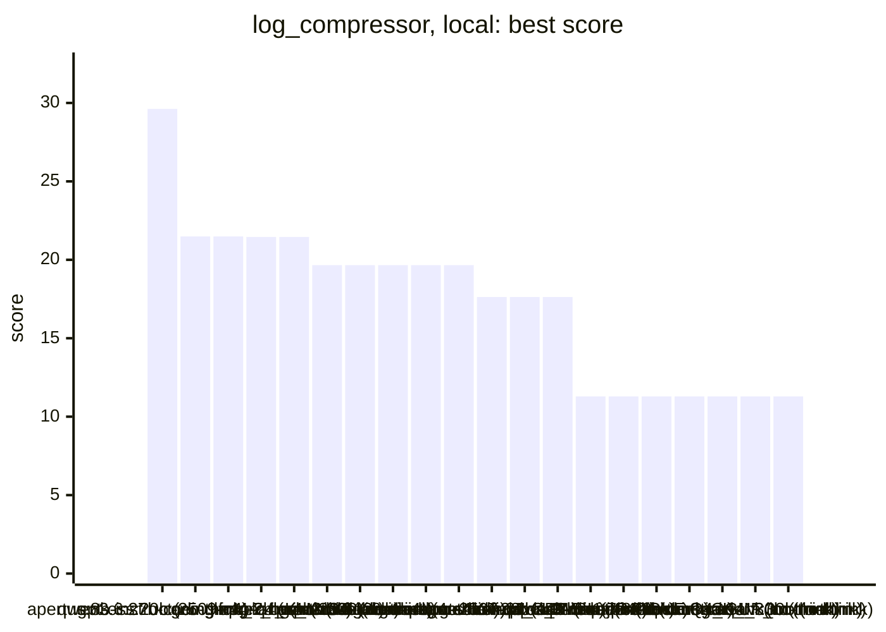
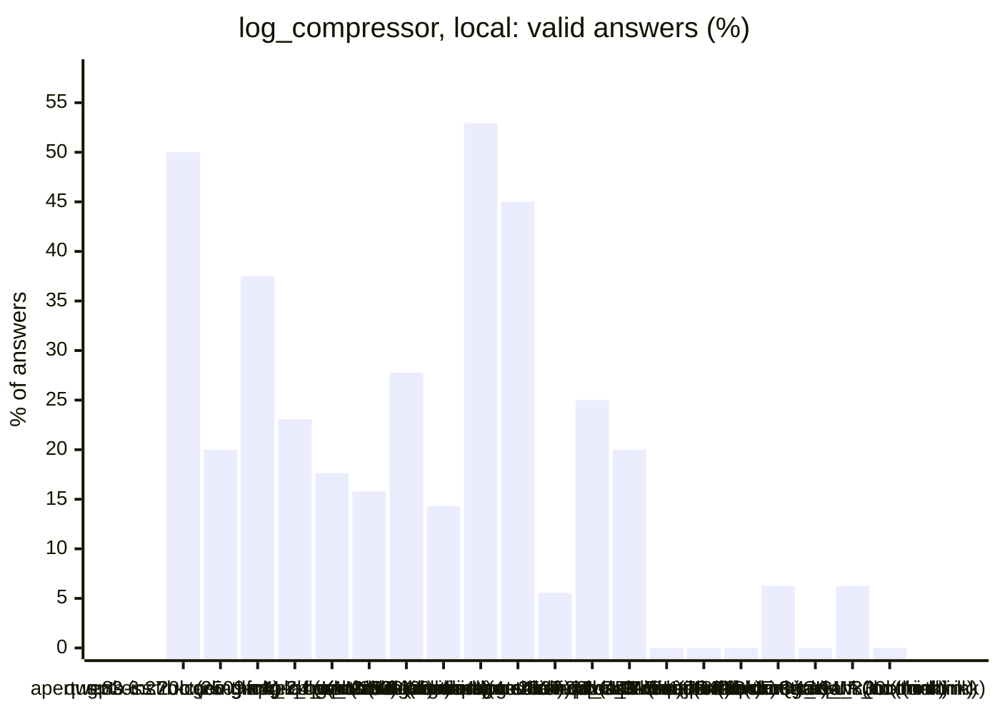
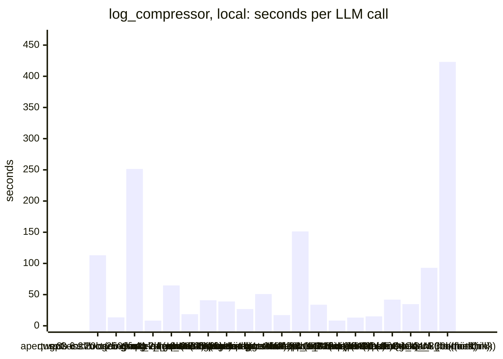
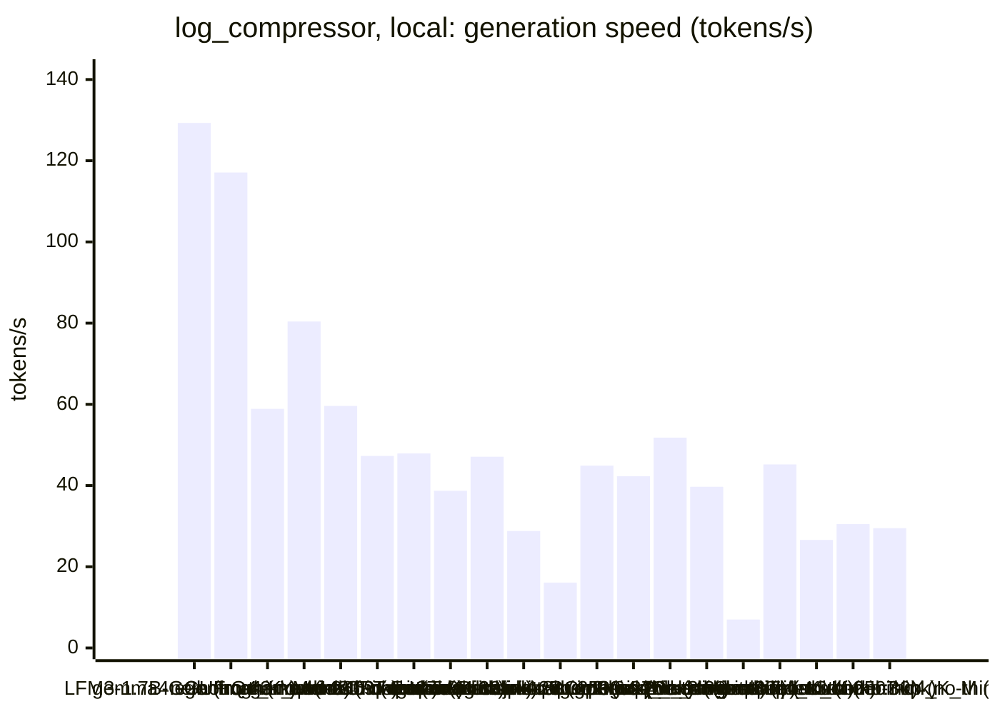
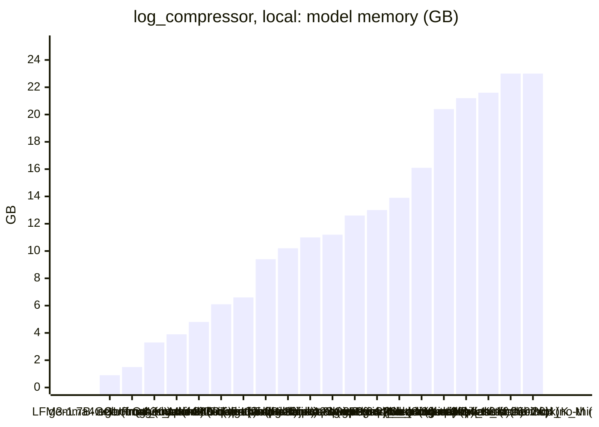
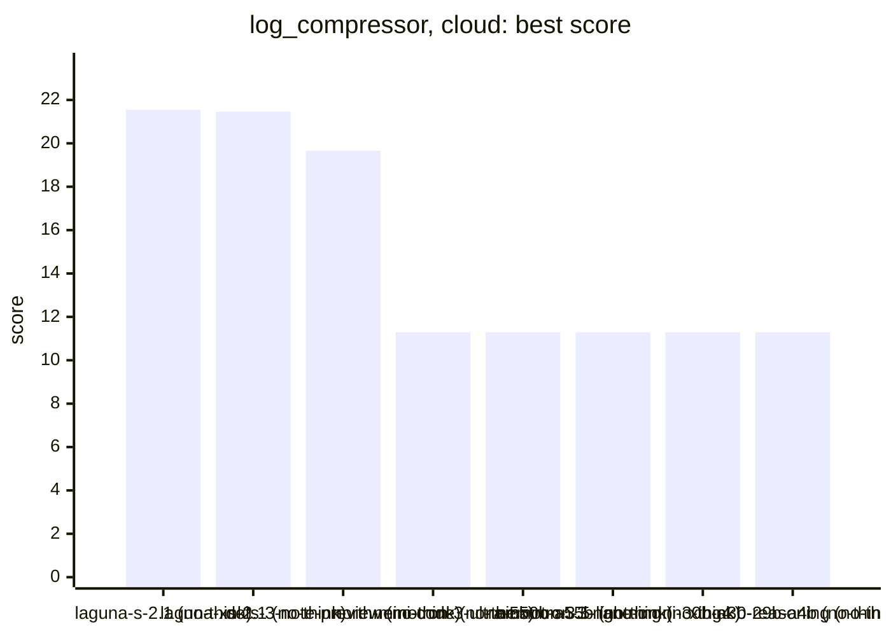
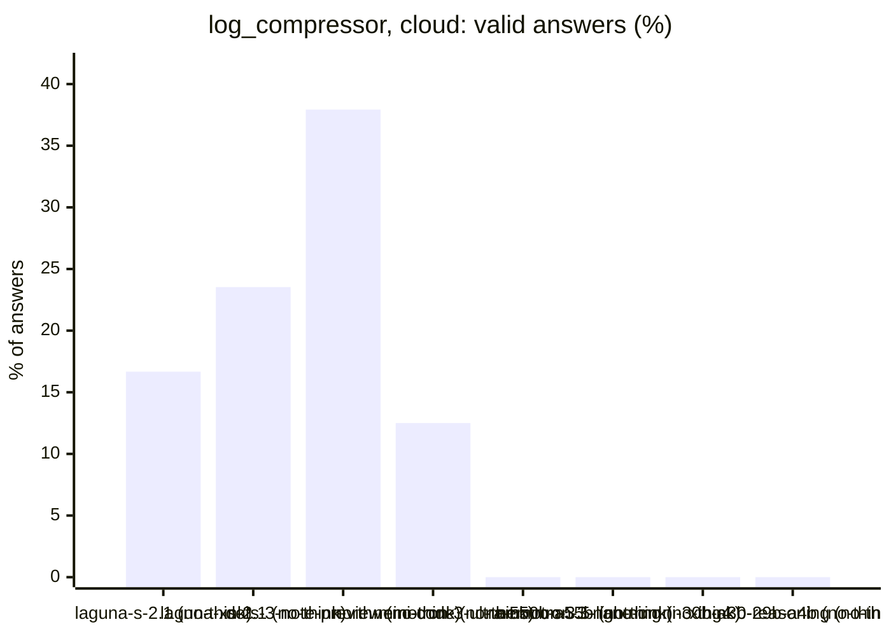
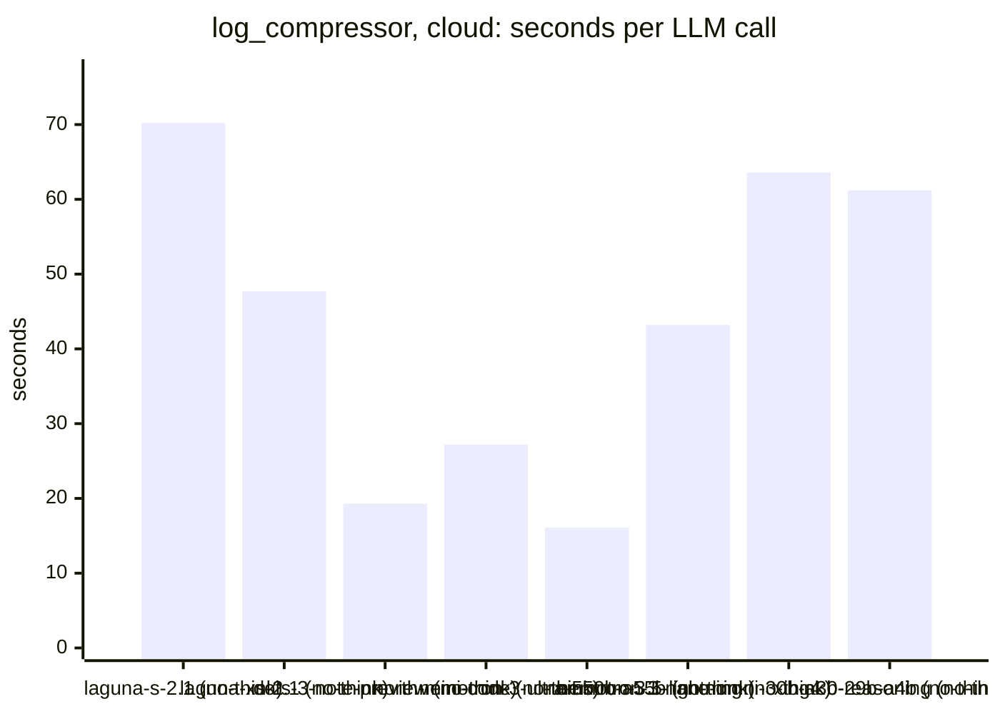
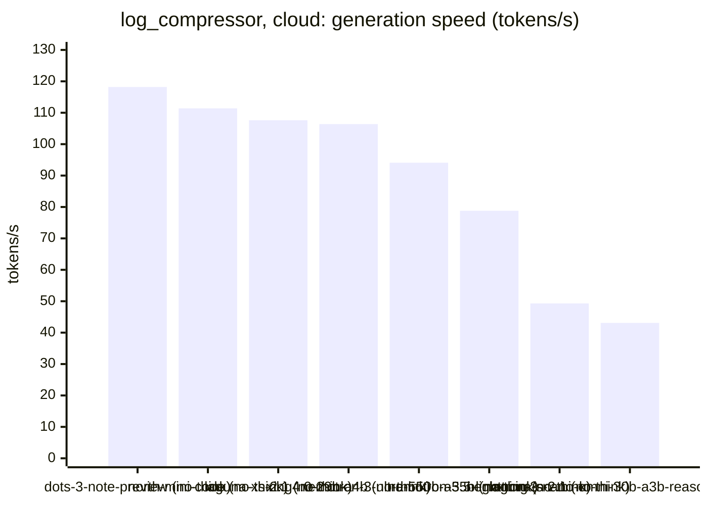

<!-- Copyright (c) 2026 by C. Klukas -->
<!-- SPDX-License-Identifier: GPL-3.0-only -->
<!-- Generated by `omega report` from bench/results/*.json. Do not edit by hand. -->

# log_compressor

31 models, each run at most 60 minutes, ended earlier after 15 answers in a row without progress; one run per model. The [overall ranking](../benchmarks.md#overall-ranking) compares the models over all examples.

Machine: Intel(R) Core(TM) i7-8700K CPU @ 3.70GHz (MS-7A98), 12 cores, 64 GB, 2x NVIDIA GeForce GTX 1080 Ti, 11264 MiB.

## Local models

Ollama on this machine.

| Model | Params | Initial | Best | Gain | LLM calls | s/call | Valid | New bests | Min to best | Minutes | Stopped by |
|---|---|--:|--:|--:|--:|--:|--:|--:|--:|--:|---|
| gpt-oss:20b (no-think) | 20.9B | 11.2861 | **29.6153** | ×2.62 | 26 | 113 | 50% | 3 | 18.3 | 49.8 | no progress |
| MichelRosselli/apertus:8b-instruct-2509-q4_k_m (no-think) | 8.1B | 11.2861 | **21.4903** | ×1.90 | 20 | 14 | 20% | 1 | 1.1 | 4.9 | no progress |
| qwen3.6:27b-coding-mtp-q4_K_M (no-think) | 27.3B | 11.2861 | **21.4903** | ×1.90 | 16 | 251 | 38% | 3 | 23.4 | 67.4 | time limit |
| gemma4:e2b (no-think) | 4.6B | 11.2861 | **21.4570** | ×1.90 | 26 | 8 | 23% | 2 | 1.4 | 4.0 | no progress |
| glm-4.7-flash:latest (no-think) | 29.9B | 11.2861 | **21.4560** | ×1.90 | 34 | 65 | 18% | 2 | 19.2 | 37.4 | no progress |
| richardyoung/frognano-4b-2609:latest (no-think) | 4.3B | 11.2861 | **19.6626** | ×1.74 | 19 | 19 | 16% | 1 | 2.1 | 6.1 | no progress |
| qwen3.5:latest (no-think) | 9.0B | 11.2861 | **19.6626** | ×1.74 | 18 | 41 | 28% | 2 | 1.1 | 12.6 | no progress |
| gemma4:12b-it-qat (no-think) | 11.9B | 11.2861 | **19.6626** | ×1.74 | 28 | 39 | 14% | 1 | 6.6 | 18.8 | no progress |
| gemma4:latest (no-think) | 7.5B | 11.2861 | **19.6617** | ×1.74 | 17 | 27 | 53% | 1 | 1.1 | 7.9 | no progress |
| qwen3:30b-a3b-instruct-2507-q4_K_M (no-think) | 30.5B | 11.2861 | **19.6617** | ×1.74 | 20 | 51 | 45% | 1 | 4.5 | 17.7 | no progress |
| gemma4:e4b-it-qat (no-think) | 7.5B | 11.2861 | **17.6320** | ×1.56 | 18 | 17 | 6% | 1 | 1.4 | 5.5 | no progress |
| underdog-saluki-27b:iq2-mix (no-think) | 26.9B | 11.2861 | **17.6320** | ×1.56 | 20 | 151 | 25% | 1 | 8.7 | 51.7 | no progress |
| gemma4:26b-a4b-it-qat (no-think) | 25.2B | 11.2861 | **17.6313** | ×1.56 | 30 | 34 | 20% | 1 | 11.0 | 17.5 | no progress |
| nemotron-3-nano:4b (no-think) | 4.0B | 11.2861 | **11.2861** | ×1.00 | 16 | 8 | 0% | 0 | - | 2.5 | no progress |
| qwen2.5-coder:7b (no-think) | 7.6B | 11.2861 | **11.2861** | ×1.00 | 16 | 13 | 0% | 0 | - | 3.8 | no progress |
| yandex/YandexGPT-5-Lite-8B-instruct-GGUF:latest (no-think) | 8.0B | 11.2861 | **11.2861** | ×1.00 | 16 | 15 | 0% | 0 | - | 4.3 | no progress |
| hf.co/LiquidAI/LFM3-1.7B-GGUF:Q4_K_M (no-think) | 1.73B | 11.2861 | **11.2861** | ×1.00 | 16 | 42 | 6% | 0 | - | 11.4 | no progress |
| llm-jp-4-8b-omega:q4_k_m (no-think) | 8.6B | 11.2861 | **11.2861** | ×1.00 | 16 | 35 | 0% | 0 | - | 9.5 | no progress |
| qwen3-coder:30b (no-think) | 30.5B | 11.2861 | **11.2861** | ×1.00 | 16 | 93 | 6% | 0 | - | 25.1 | no progress |
| frob/sarvam:30b (no-think) | 32.2B | 11.2861 | **11.2861** | ×1.00 | 9 | 423 | 0% | 0 | - | 63.8 | time limit |

### Inference speed and memory

RAM is what Ollama reports for the loaded model (weights, context cache and buffers; on Apple silicon this is shared memory). Load is the time to bring the model into memory. Prompt and generation speeds are tokens per second over all calls of the run.

| Model | Params | RAM GB | Load s | Prompt tok/s | Gen tok/s | Median s/call | p90 s/call | Tokens/answer | Stopped |
|---|---|--:|--:|--:|--:|--:|--:|--:|--:|
| gemma4:e2b (no-think) | 4.6B | 0.9 | 17 | 2705 | 129.3 | 6 | 19 | 585 | 0 |
| hf.co/LiquidAI/LFM3-1.7B-GGUF:Q4_K_M (no-think) | 1.73B | 1.5 | 0 | 4165 | 117.1 | 56 | 65 | 1960 | 9 |
| gemma4:latest (no-think) | 7.5B | 3.3 | 24 | 1153 | 58.9 | 22 | 54 | 1108 | 1 |
| nemotron-3-nano:4b (no-think) | 4.0B | 3.9 | 9 | 1889 | 80.4 | 8 | 14 | 344 | 0 |
| richardyoung/frognano-4b-2609:latest (no-think) | 4.3B | 4.8 | 0 | 2020 | 59.6 | 14 | 45 | 654 | 2 |
| gemma4:e4b-it-qat (no-think) | 7.5B | 6.1 | 19 | 1805 | 47.3 | 15 | 33 | 551 | 1 |
| qwen2.5-coder:7b (no-think) | 7.6B | 6.6 | 14 | 2040 | 47.9 | 13 | 23 | 443 | 0 |
| qwen3.5:latest (no-think) | 9.0B | 9.4 | 20 | 1108 | 38.7 | 28 | 156 | 1351 | 0 |
| yandex/YandexGPT-5-Lite-8B-instruct-GGUF:latest (no-think) | 8.0B | 10.2 | 14 | 1797 | 47.1 | 14 | 20 | 507 | 0 |
| gemma4:12b-it-qat (no-think) | 11.9B | 11.0 | 22 | 656 | 28.8 | 25 | 73 | 564 | 3 |
| underdog-saluki-27b:iq2-mix (no-think) | 26.9B | 11.2 | 22 | 401 | 16.1 | 66 | 376 | 2215 | 0 |
| MichelRosselli/apertus:8b-instruct-2509-q4_k_m (no-think) | 8.1B | 12.6 | 16 | 1430 | 44.9 | 12 | 22 | 390 | 0 |
| llm-jp-4-8b-omega:q4_k_m (no-think) | 8.6B | 13.0 | 16 | 1582 | 42.3 | 35 | 70 | 1232 | 1 |
| gpt-oss:20b (no-think) | 20.9B | 13.9 | 37 | 1870 | 51.8 | 99 | 206 | 5519 | 0 |
| gemma4:26b-a4b-it-qat (no-think) | 25.2B | 16.1 | 56 | 818 | 39.7 | 18 | 94 | 660 | 2 |
| qwen3.6:27b-coding-mtp-q4_K_M (no-think) | 27.3B | 20.4 | 52 | 187 | 7.0 | 86 | 689 | 1608 | 0 |
| frob/sarvam:30b (no-think) | 32.2B | 21.2 | 58 | 1665 | 45.2 | 551 | 606 | 19610 | 1 |
| glm-4.7-flash:latest (no-think) | 29.9B | 21.6 | 56 | 386 | 26.6 | 63 | 117 | 1395 | 1 |
| qwen3:30b-a3b-instruct-2507-q4_K_M (no-think) | 30.5B | 23.0 | 0 | 680 | 30.5 | 28 | 186 | 936 | 2 |
| qwen3-coder:30b (no-think) | 30.5B | 23.0 | 52 | 678 | 29.5 | 103 | 153 | 2455 | 0 |

### Best score over time

| Model | 15 min | 30 min | 45 min | 60 min |
|---|--:|--:|--:|--:|
| gpt-oss:20b (no-think) | 26.7411 | 29.6153 | 29.6153 | 29.6153 |
| MichelRosselli/apertus:8b-instruct-2509-q4_k_m (no-think) | 21.4903 | 21.4903 | 21.4903 | 21.4903 |
| qwen3.6:27b-coding-mtp-q4_K_M (no-think) | 11.2861 | 21.4903 | 21.4903 | 21.4903 |
| gemma4:e2b (no-think) | 21.4570 | 21.4570 | 21.4570 | 21.4570 |
| glm-4.7-flash:latest (no-think) | 17.6320 | 21.4560 | 21.4560 | 21.4560 |
| richardyoung/frognano-4b-2609:latest (no-think) | 19.6626 | 19.6626 | 19.6626 | 19.6626 |
| qwen3.5:latest (no-think) | 19.6626 | 19.6626 | 19.6626 | 19.6626 |
| gemma4:12b-it-qat (no-think) | 19.6626 | 19.6626 | 19.6626 | 19.6626 |
| gemma4:latest (no-think) | 19.6617 | 19.6617 | 19.6617 | 19.6617 |
| qwen3:30b-a3b-instruct-2507-q4_K_M (no-think) | 19.6617 | 19.6617 | 19.6617 | 19.6617 |
| gemma4:e4b-it-qat (no-think) | 17.6320 | 17.6320 | 17.6320 | 17.6320 |
| underdog-saluki-27b:iq2-mix (no-think) | 17.6320 | 17.6320 | 17.6320 | 17.6320 |
| gemma4:26b-a4b-it-qat (no-think) | 17.6313 | 17.6313 | 17.6313 | 17.6313 |
| nemotron-3-nano:4b (no-think) | 11.2861 | 11.2861 | 11.2861 | 11.2861 |
| qwen2.5-coder:7b (no-think) | 11.2861 | 11.2861 | 11.2861 | 11.2861 |
| yandex/YandexGPT-5-Lite-8B-instruct-GGUF:latest (no-think) | 11.2861 | 11.2861 | 11.2861 | 11.2861 |
| hf.co/LiquidAI/LFM3-1.7B-GGUF:Q4_K_M (no-think) | 11.2861 | 11.2861 | 11.2861 | 11.2861 |
| llm-jp-4-8b-omega:q4_k_m (no-think) | 11.2861 | 11.2861 | 11.2861 | 11.2861 |
| qwen3-coder:30b (no-think) | 11.2861 | 11.2861 | 11.2861 | 11.2861 |
| frob/sarvam:30b (no-think) | 11.2861 | 11.2861 | 11.2861 | 11.2861 |

### Outcome of the LLM answers

| Model | duplicate | edit error | invalid | llm error | ok | timeout |
|---|--:|--:|--:|--:|--:|--:|
| gpt-oss:20b (no-think) | 2 | 6 | 5 | 0 | 13 | 0 |
| MichelRosselli/apertus:8b-instruct-2509-q4_k_m (no-think) | 2 | 8 | 6 | 0 | 4 | 0 |
| qwen3.6:27b-coding-mtp-q4_K_M (no-think) | 0 | 3 | 7 | 0 | 6 | 0 |
| gemma4:e2b (no-think) | 4 | 6 | 10 | 0 | 6 | 0 |
| glm-4.7-flash:latest (no-think) | 1 | 10 | 16 | 1 | 6 | 0 |
| richardyoung/frognano-4b-2609:latest (no-think) | 0 | 4 | 10 | 2 | 3 | 0 |
| qwen3.5:latest (no-think) | 0 | 4 | 9 | 0 | 5 | 0 |
| gemma4:12b-it-qat (no-think) | 8 | 4 | 9 | 3 | 4 | 0 |
| gemma4:latest (no-think) | 0 | 2 | 5 | 1 | 9 | 0 |
| qwen3:30b-a3b-instruct-2507-q4_K_M (no-think) | 3 | 3 | 3 | 2 | 9 | 0 |
| gemma4:e4b-it-qat (no-think) | 2 | 1 | 13 | 1 | 1 | 0 |
| underdog-saluki-27b:iq2-mix (no-think) | 2 | 7 | 5 | 0 | 5 | 1 |
| gemma4:26b-a4b-it-qat (no-think) | 2 | 4 | 16 | 2 | 6 | 0 |
| nemotron-3-nano:4b (no-think) | 0 | 12 | 4 | 0 | 0 | 0 |
| qwen2.5-coder:7b (no-think) | 5 | 1 | 10 | 0 | 0 | 0 |
| yandex/YandexGPT-5-Lite-8B-instruct-GGUF:latest (no-think) | 2 | 1 | 13 | 0 | 0 | 0 |
| hf.co/LiquidAI/LFM3-1.7B-GGUF:Q4_K_M (no-think) | 0 | 4 | 2 | 9 | 1 | 0 |
| llm-jp-4-8b-omega:q4_k_m (no-think) | 0 | 6 | 9 | 1 | 0 | 0 |
| qwen3-coder:30b (no-think) | 0 | 6 | 9 | 0 | 1 | 0 |
| frob/sarvam:30b (no-think) | 0 | 7 | 1 | 1 | 0 | 0 |

### Best idea per model

- **gpt-oss:20b (no-think)**: Use dictionary encoding for the highly repetitive IP, referer, and user‑agent fields, compress each dictionary and index list with raw‑format LZMA, and store a bitmask to describe …
- **MichelRosselli/apertus:8b-instruct-2509-q4_k_m (no-think)**: Replace zlib with lzma to take advantage of its higher compression ratio and more advanced techniques like delta encoding for timestamps and flags.
- **qwen3.6:27b-coding-mtp-q4_K_M (no-think)**: Fix the lzma compression call by removing the conflicting preset argument when using a custom filter chain, allowing the program to run and leverage LZMA2's strong compression.
- **gemma4:e2b (no-think)**: Switch to standard lzma compression without specifying filters to resolve the `ValueError` and rely on lzma's default behavior, which is safer for general byte input, while …
- **glm-4.7-flash:latest (no-think)**: Fix the TypeError by removing the invalid `PRESET` argument from the `lzma.compress()` call, as `lzma.compress()` uses the global `filters` list instead, and ensure the fallback …
- **richardyoung/frognano-4b-2609:latest (no-think)**: Switch from generic zlib level 1 to lzma with preset 9 (extreme) directly, which matches the reference ratio of 21.490 and avoids the overhead of parsing log lines, ensuring all …
- **qwen3.5:latest (no-think)**: Switch from `zlib` to `lzma` with high compression settings (preset 9) since it achieves significantly better compression ratios on text-like access logs while maintaining …
- **gemma4:12b-it-qat (no-think)**: Switch from zlib to lzma with preset 6 to achieve a significantly higher compression ratio for text-heavy logs while staying within the time limit.
- **gemma4:latest (no-think)**: Implement a field-aware compression scheme for the log lines, using LZMA compression on columnar data after parsing, and fallback to raw zlib compression otherwise.
- **qwen3:30b-a3b-instruct-2507-q4_K_M (no-think)**: Replace the simple zlib compression with lzma at a high preset setting for significantly better compression on structured log data, while maintaining round-trip safety via a flag …
- **gemma4:e4b-it-qat (no-think)**: Replace zlib compression with lzma compression using the maximum preset for better compression ratio on structured data like logs.
- **underdog-saluki-27b:iq2-mix (no-think)**: Compress the log with raw LZMA2 (FORMAT_RAW) at a tunable preset level, saving the fixed LZMA container header and improving the ratio, with a fallback for non-text inputs.
- **gemma4:26b-a4b-it-qat (no-think)**: Use a structured approach by parsing the log into columns (IP, timestamp, etc.) and compressing them individually to exploit the highly repetitive nature of log fields, while …
- **nemotron-3-nano:4b (no-think)**: initial program
- **qwen2.5-coder:7b (no-think)**: initial program
- **yandex/YandexGPT-5-Lite-8B-instruct-GGUF:latest (no-think)**: initial program
- **hf.co/LiquidAI/LFM3-1.7B-GGUF:Q4_K_M (no-think)**: initial program
- **llm-jp-4-8b-omega:q4_k_m (no-think)**: initial program
- **qwen3-coder:30b (no-think)**: initial program
- **frob/sarvam:30b (no-think)**: initial program

## Cloud models (OpenRouter)

Free OpenRouter models; times include the network and the provider's queue.

| Model | Params | Initial | Best | Gain | LLM calls | s/call | Valid | New bests | Min to best | Minutes | Stopped by |
|---|---|--:|--:|--:|--:|--:|--:|--:|--:|--:|---|
| poolside/laguna-s-2.1:free (no-think) |  | 11.2861 | **21.5508** | ×1.91 | 18 | 70 | 17% | 1 | 2.2 | 21.1 | no progress |
| poolside/laguna-xs-2.1:free (no-think) |  | 11.2861 | **21.4570** | ×1.90 | 17 | 48 | 24% | 1 | 0.1 | 13.5 | no progress |
| dots-studio/dots-3-note-preview:free (no-think) |  | 11.2861 | **19.6617** | ×1.74 | 29 | 19 | 38% | 1 | 4.6 | 9.6 | no progress |
| cohere/north-mini-code:free (no-think) |  | 11.2861 | **11.2861** | ×1.00 | 16 | 27 | 12% | 0 | - | 7.3 | no progress |
| nvidia/nemotron-3.5-super-vl:free (no-think) |  | | | | | | | | | | failed: all 5 model requests failed: nvidia/nemotron-3.5-super-vl:fr |
| nvidia/nemotron-3-ultra-550b-a55b:free (no-think) |  | 11.2861 | **11.2861** | ×1.00 | 16 | 16 | 0% | 0 | - | 4.3 | no progress |
| nvidia/nemotron-3.5-lightning:free (no-think) |  | 11.2861 | **11.2861** | ×1.00 | 16 | 43 | 0% | 0 | - | 11.6 | no progress |
| nvidia/nemotron-3-nano-omni-30b-a3b-reasoning:free (no-think) |  | 11.2861 | **11.2861** | ×1.00 | 16 | 64 | 0% | 0 | - | 17.0 | no progress |
| xingchen-agi/xing4.0-29b-a4b:free (no-think) |  | 11.2861 | **11.2861** | ×1.00 | 8 | 61 | 0% | 0 | - | 8.2 | model errors |
| google/gemma-4-26b-a4b-it:free (no-think) |  | | | | | | | | | | failed: all 6 model requests failed: google/gemma-4-26b-a4b-it:free: |
| google/gemma-4-31b-it:free (no-think) |  | | | | | | | | | | failed: all 6 model requests failed: google/gemma-4-31b-it:free: rat |

### Inference speed and cost

Generation speed is measured from the first to the last streamed token; the time to the first token is counted as prompt time. Cost is what OpenRouter charged for the run.

| Model | Gen tok/s | Median s/call | p90 s/call | Tokens/answer | Stopped | Cost $ |
|---|--:|--:|--:|--:|--:|--:|
| dots-studio/dots-3-note-preview:free (no-think) | 118.2 | 21 | 34 | 2158 | 2 | 0.000 |
| cohere/north-mini-code:free (no-think) | 111.4 | 21 | 50 | 2161 | 2 | 0.000 |
| poolside/laguna-xs-2.1:free (no-think) | 107.6 | 58 | 82 | 1442 | 0 | 0.000 |
| xingchen-agi/xing4.0-29b-a4b:free (no-think) | 106.4 | 74 | 126 | 17 | 1 | 0.000 |
| nvidia/nemotron-3-ultra-550b-a55b:free (no-think) | 94.1 | 9 | 58 | 1376 | 0 | 0.000 |
| nvidia/nemotron-3.5-lightning:free (no-think) | 78.8 | 47 | 76 | 4762 | 14 | 0.000 |
| poolside/laguna-s-2.1:free (no-think) | 49.3 | 75 | 161 | 2273 | 4 | 0.000 |
| nvidia/nemotron-3-nano-omni-30b-a3b-reasoning:free (no-think) | 43.1 | 25 | 285 | 1018 | 4 | 0.000 |

### Best score over time

| Model | 15 min | 30 min | 45 min | 60 min |
|---|--:|--:|--:|--:|
| poolside/laguna-s-2.1:free (no-think) | 21.5508 | 21.5508 | 21.5508 | 21.5508 |
| poolside/laguna-xs-2.1:free (no-think) | 21.4570 | 21.4570 | 21.4570 | 21.4570 |
| dots-studio/dots-3-note-preview:free (no-think) | 19.6617 | 19.6617 | 19.6617 | 19.6617 |
| cohere/north-mini-code:free (no-think) | 11.2861 | 11.2861 | 11.2861 | 11.2861 |
| nvidia/nemotron-3-ultra-550b-a55b:free (no-think) | 11.2861 | 11.2861 | 11.2861 | 11.2861 |
| nvidia/nemotron-3.5-lightning:free (no-think) | 11.2861 | 11.2861 | 11.2861 | 11.2861 |
| nvidia/nemotron-3-nano-omni-30b-a3b-reasoning:free (no-think) | 11.2861 | 11.2861 | 11.2861 | 11.2861 |
| xingchen-agi/xing4.0-29b-a4b:free (no-think) | 11.2861 | 11.2861 | 11.2861 | 11.2861 |

### Outcome of the LLM answers

| Model | duplicate | edit error | invalid | llm error | ok |
|---|--:|--:|--:|--:|--:|
| poolside/laguna-s-2.1:free (no-think) | 1 | 2 | 8 | 4 | 3 |
| poolside/laguna-xs-2.1:free (no-think) | 0 | 3 | 4 | 6 | 4 |
| dots-studio/dots-3-note-preview:free (no-think) | 0 | 8 | 8 | 2 | 11 |
| cohere/north-mini-code:free (no-think) | 1 | 1 | 10 | 2 | 2 |
| nvidia/nemotron-3-ultra-550b-a55b:free (no-think) | 3 | 2 | 11 | 0 | 0 |
| nvidia/nemotron-3.5-lightning:free (no-think) | 0 | 0 | 2 | 14 | 0 |
| nvidia/nemotron-3-nano-omni-30b-a3b-reasoning:free (no-think) | 0 | 8 | 4 | 4 | 0 |
| xingchen-agi/xing4.0-29b-a4b:free (no-think) | 0 | 0 | 1 | 7 | 0 |

### Best idea per model

- **poolside/laguna-s-2.1:free (no-think)**: Replace the plain zlib level 1 compressor with a field-aware column-based compressor that parses each access-log line into fields, stores them as separate columns compressed …
- **poolside/laguna-xs-2.1:free (no-think)**: Use lzma compression with extreme preset for better compression ratio on the main log.
- **dots-studio/dots-3-note-preview:free (no-think)**: Implement a field-aware parser that splits Apache combined log lines into columns (IP, timestamp, path, status, size, referer, user-agent), encodes timestamps as deltas, uses …
- **cohere/north-mini-code:free (no-think)**: initial program
- **nvidia/nemotron-3-ultra-550b-a55b:free (no-think)**: initial program
- **nvidia/nemotron-3.5-lightning:free (no-think)**: initial program
- **nvidia/nemotron-3-nano-omni-30b-a3b-reasoning:free (no-think)**: initial program
- **xingchen-agi/xing4.0-29b-a4b:free (no-think)**: initial program
