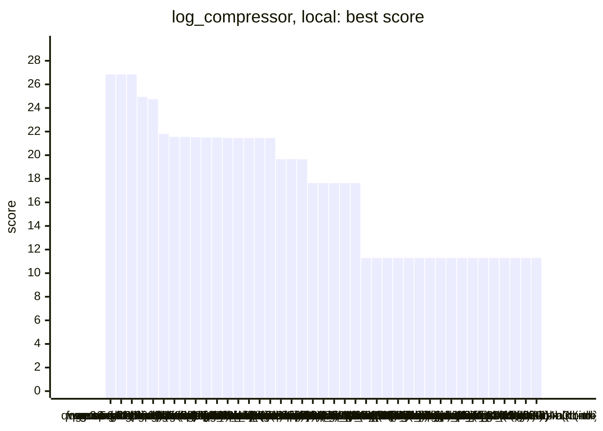
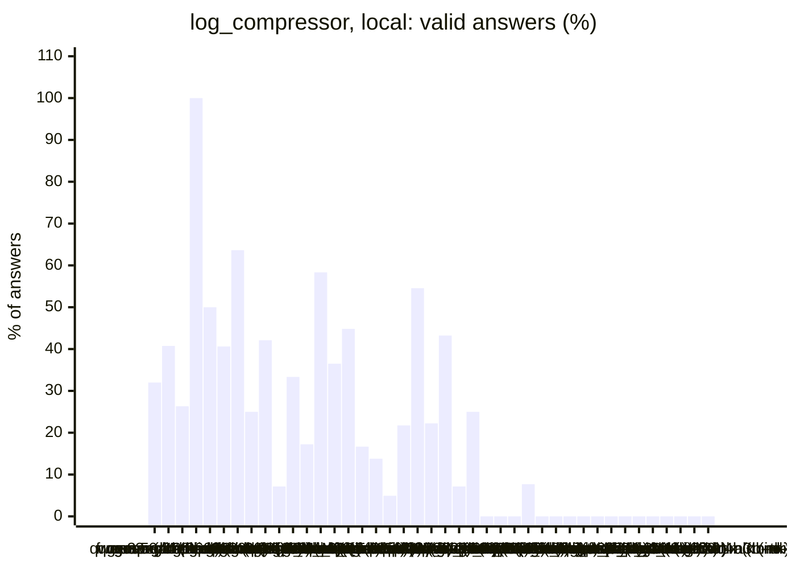
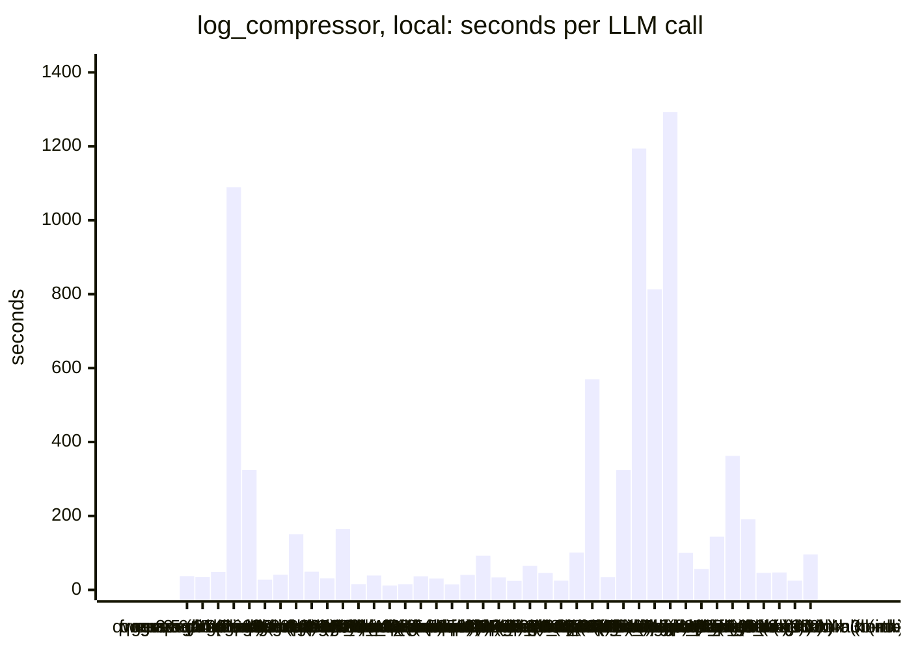
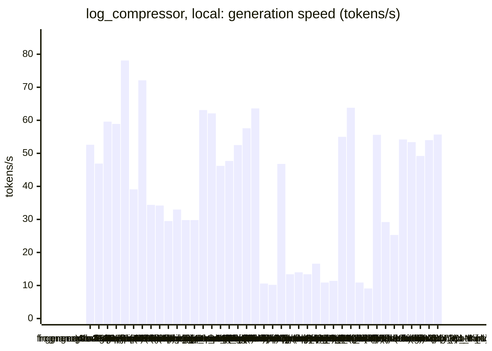
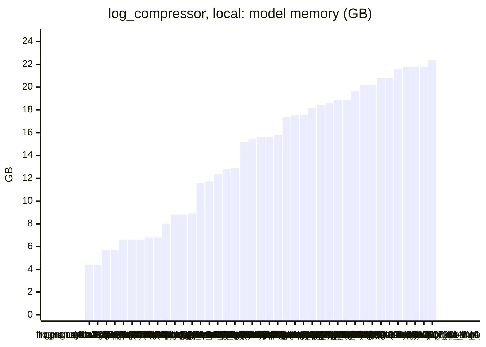

<!-- Copyright (c) 2026 by C. Klukas -->
<!-- SPDX-License-Identifier: GPL-3.0-only -->
<!-- Generated by `omega report` from bench/results/*.json. Do not edit by hand. -->

# log_compressor

43 models, 15 minutes each, one run per model. The [overall ranking](../benchmarks.md#overall-ranking) compares the models over all examples.

Machine: Apple M1 Max (Mac13,1), 10 cores, 32 GB.

## Local models

Ollama on this machine.

| Model | Params | Initial | Best | Gain | LLM calls | s/call | Valid | New bests | Min to best |
|---|---|--:|--:|--:|--:|--:|--:|--:|--:|
| qwen3.5:latest (no-think) | 9.7B | 11.2861 | **26.8544** | ×2.38 | 25 | 37 | 32% | 2 | 7.6 |
| gemma4:latest (think) |  | 11.2861 | **26.8544** | ×2.38 | 27 | 34 | 41% | 3 | 10.7 |
| richardyoung/frognano-4b-2609:latest (think) | 4.3B | 11.2861 | **26.8544** | ×2.38 | 19 | 49 | 26% | 3 | 6.2 |
| muse-glimmer:30b (think) | 27.9B | 11.2861 | **24.9412** | ×2.21 | 1 | 1089 | 100% | 1 | 18.2 |
| muse-glimmer:30b (no-think) | 27.9B | 11.2861 | **24.7493** | ×2.19 | 4 | 325 | 50% | 1 | 5.8 |
| gemma4:26b-a4b-it-qat (no-think) | 25.2B | 11.2861 | **21.7984** | ×1.93 | 32 | 28 | 41% | 3 | 8.9 |
| gpt-oss:20b (think) | 20.9B | 11.2861 | **21.5518** | ×1.91 | 22 | 41 | 64% | 5 | 14.5 |
| qwen3.6:27b-coding-mtp-q4_K_M (no-think) | 27.3B | 11.2861 | **21.5508** | ×1.91 | 8 | 150 | 25% | 1 | 11.4 |
| gpt-oss:20b (no-think) | 20.9B | 11.2861 | **21.5163** | ×1.91 | 19 | 49 | 42% | 3 | 13.3 |
| MichelRosselli/apertus:8b-instruct-2509-q4_k_m (no-think) | 8.1B | 11.2861 | **21.4903** | ×1.90 | 28 | 31 | 7% | 1 | 2.5 |
| ingu627/exaone4.0:32b (no-think) | 32.0B | 11.2861 | **21.4903** | ×1.90 | 6 | 164 | 33% | 1 | 6.6 |
| gemma4:e4b-it-qat (no-think) | 7.5B | 11.2861 | **21.4570** | ×1.90 | 58 | 15 | 17% | 2 | 4.0 |
| gemma4:12b-it-qat (no-think) | 11.9B | 11.2861 | **21.4570** | ×1.90 | 24 | 39 | 58% | 3 | 11.3 |
| gemma4:e2b (no-think) | 5.1B | 11.2861 | **21.4570** | ×1.90 | 74 | 12 | 36% | 2 | 1.8 |
| gemma4:latest (no-think) |  | 11.2861 | **21.4570** | ×1.90 | 58 | 15 | 45% | 2 | 4.3 |
| gemma4:e4b-it-qat (think) | 7.5B | 11.2861 | **21.4570** | ×1.90 | 24 | 37 | 17% | 1 | 6.9 |
| qwen3:30b-a3b-instruct-2507-q4_K_M (no-think) | 30.5B | 11.2861 | **19.6626** | ×1.74 | 29 | 31 | 14% | 1 | 8.4 |
| nemotron-3-nano:4b (no-think) |  | 11.2861 | **19.6626** | ×1.74 | 61 | 15 | 5% | 2 | 10.3 |
| qwen3:30b-a3b-instruct-2507-q4_K_M (think) | 30.5B | 11.2861 | **19.6617** | ×1.74 | 23 | 41 | 22% | 1 | 8.8 |
| qwen3.5:latest (think) | 9.7B | 11.2861 | **17.6320** | ×1.56 | 11 | 93 | 55% | 1 | 2.2 |
| richardyoung/frognano-4b-2609:latest (no-think) | 4.3B | 11.2861 | **17.6320** | ×1.56 | 27 | 34 | 22% | 1 | 14.6 |
| yandex/YandexGPT-5-Lite-8B-instruct-GGUF:latest (no-think) | 8.0B | 11.2861 | **17.6320** | ×1.56 | 37 | 24 | 43% | 1 | 1.2 |
| devstral-small-2:24b (no-think) | 24.0B | 11.2861 | **17.6320** | ×1.56 | 14 | 65 | 7% | 1 | 6.5 |
| qwen3-coder:30b (no-think) | 30.5B | 11.2861 | **17.6292** | ×1.56 | 20 | 46 | 25% | 1 | 11.3 |
| qwen2.5-coder:7b (no-think) | 7.6B | 11.2861 | **11.2861** | ×1.00 | 36 | 25 | 0% | 0 | - |
| qwen3.5:27b (no-think) | 27.8B | 11.2861 | **11.2861** | ×1.00 | 9 | 101 | 0% | 0 | - |
| qwen3.8:27b-mtp-q4_K_M (no-think) | 27.3B | 11.2861 | **11.2861** | ×1.00 | 2 | 570 | 0% | 0 | - |
| gemma4:12b-it-qat (think) | 11.9B | | | | | | | | failed: all 2 model requests failed: gemma4:12b-it-qat: answer stopp |
| gemma4:e2b (think) | 5.1B | 11.2861 | **11.2861** | ×1.00 | 26 | 34 | 8% | 0 | - |
| gemma4:26b-a4b-it-qat (think) | 25.2B | 11.2861 | **11.2861** | ×1.00 | 3 | 324 | 0% | 0 | - |
| qwen3.5:27b (think) | 27.8B | 11.2861 | **11.2861** | ×1.00 | 1 | 1194 | 0% | 0 | - |
| qwen3.8:27b-mtp-q4_K_M (think) | 27.3B | 11.2861 | **11.2861** | ×1.00 | 2 | 813 | 0% | 0 | - |
| qwen3.6:27b-coding-mtp-q4_K_M (think) | 27.3B | 11.2861 | **11.2861** | ×1.00 | 1 | 1293 | 0% | 0 | - |
| llm-jp-4-8b-omega:q4_k_m (no-think) | 8.6B | 11.2861 | **11.2861** | ×1.00 | 9 | 100 | 0% | 0 | - |
| glm-4.7-flash:latest (no-think) | 29.9B | 11.2861 | **11.2861** | ×1.00 | 16 | 57 | 0% | 0 | - |
| frob/sarvam:30b (no-think) | 32.2B | 11.2861 | **11.2861** | ×1.00 | 7 | 144 | 0% | 0 | - |
| glm-4.7-flash:latest (think) | 29.9B | 11.2861 | **11.2861** | ×1.00 | 3 | 363 | 0% | 0 | - |
| frob/sarvam:30b (think) | 32.2B | 11.2861 | **11.2861** | ×1.00 | 5 | 191 | 0% | 0 | - |
| nemotron-3-nano:30b-a3b-mlx (no-think) |  | 11.2861 | **11.2861** | ×1.00 | 20 | 46 | 0% | 0 | - |
| nemotron-3.5-lightning:30b-mlx (no-think) |  | 11.2861 | **11.2861** | ×1.00 | 20 | 47 | 0% | 0 | - |
| nemotron-3-nano:4b (think) |  | 11.2861 | **11.2861** | ×1.00 | 36 | 25 | 0% | 0 | - |
| nemotron-3-nano:30b-a3b-mlx (think) |  | 11.2861 | **11.2861** | ×1.00 | 11 | 96 | 0% | 0 | - |
| nemotron-3.5-lightning:30b-mlx (think) |  | | | | | | | | failed: all 5 model requests failed: nemotron-3.5-lightning:30b-mlx: |

### Inference speed and memory

RAM is what Ollama reports for the loaded model (weights, context cache and buffers; on Apple silicon this is shared memory). Load is the time to bring the model into memory. Prompt and generation speeds are tokens per second over all calls of the run.

| Model | Params | RAM GB | Load s | Prompt tok/s | Gen tok/s | Median s/call | p90 s/call | Tokens/answer | Stopped |
|---|---|--:|--:|--:|--:|--:|--:|--:|--:|
| richardyoung/frognano-4b-2609:latest (think) | 4.3B | 4.4 | 0 | 952 | 52.6 | 42 | 104 | 2359 | 4 |
| richardyoung/frognano-4b-2609:latest (no-think) | 4.3B | 4.4 | 12 | 926 | 46.9 | 22 | 60 | 890 | 7 |
| gemma4:e4b-it-qat (no-think) | 7.5B | 5.7 | 55 | 666 | 59.6 | 13 | 35 | 551 | 0 |
| gemma4:e4b-it-qat (think) | 7.5B | 5.7 | 56 | 748 | 58.9 | 32 | 67 | 1735 | 1 |
| gemma4:e2b (no-think) | 5.1B | 6.6 | 34 | 955 | 78.1 | 9 | 28 | 583 | 1 |
| qwen2.5-coder:7b (no-think) | 7.6B | 6.6 | 130 | 640 | 39.1 | 13 | 61 | 602 | 1 |
| gemma4:e2b (think) | 5.1B | 6.6 | 36 | 1099 | 72.1 | 34 | 53 | 2169 | 0 |
| qwen3.5:latest (no-think) | 9.7B | 6.8 | 0 | 484 | 34.4 | 27 | 78 | 843 | 2 |
| qwen3.5:latest (think) | 9.7B | 6.8 | 48 | 426 | 34.2 | 104 | 131 | 2672 | 0 |
| gemma4:12b-it-qat (no-think) | 11.9B | 8.0 | 65 | 274 | 29.5 | 28 | 92 | 597 | 1 |
| yandex/YandexGPT-5-Lite-8B-instruct-GGUF:latest (no-think) | 8.0B | 8.8 | 15 | 502 | 33.0 | 22 | 42 | 587 | 0 |
| llm-jp-4-8b-omega:q4_k_m (no-think) | 8.6B | 8.8 | 0 | 591 | 29.8 | 104 | 142 | 2353 | 4 |
| MichelRosselli/apertus:8b-instruct-2509-q4_k_m (no-think) | 8.1B | 8.9 | 0 | 498 | 29.8 | 26 | 61 | 639 | 3 |
| nemotron-3-nano:4b (no-think) |  | 11.6 | 8 | 824 | 63.1 | 11 | 32 | 685 | 4 |
| nemotron-3-nano:4b (think) |  | 11.7 | 8 | 857 | 62.1 | 19 | 41 | 1339 | 0 |
| gemma4:latest (think) |  | 12.4 | 126 | 1002 | 46.2 | 26 | 69 | 1236 | 0 |
| gpt-oss:20b (think) | 20.9B | 12.8 | 134 | 539 | 47.7 | 35 | 59 | 1439 | 0 |
| gpt-oss:20b (no-think) | 20.9B | 12.9 | 145 | 838 | 52.5 | 30 | 88 | 2009 | 0 |
| gemma4:26b-a4b-it-qat (think) | 25.2B | 15.2 | 1 | 872 | 57.6 | 277 | 528 | 12602 | 1 |
| gemma4:26b-a4b-it-qat (no-think) | 25.2B | 15.4 | 0 | 595 | 63.6 | 19 | 28 | 633 | 1 |
| muse-glimmer:30b (think) | 27.9B | 15.6 | 75 | 91 | 10.6 | 1089 | 1089 | 10559 | 0 |
| muse-glimmer:30b (no-think) | 27.9B | 15.6 | 64 | 103 | 10.2 | 349 | 683 | 2901 | 0 |
| gemma4:latest (no-think) |  | 15.8 | 121 | 1150 | 46.8 | 8 | 33 | 454 | 0 |
| qwen3.6:27b-coding-mtp-q4_K_M (think) | 27.3B | 17.4 | 299 | 94 | 13.4 | 1293 | 1293 | 13062 | 0 |
| qwen3.8:27b-mtp-q4_K_M (no-think) | 27.3B | 17.6 | 296 | 152 | 14.0 | 892 | 892 | 3294 | 0 |
| qwen3.8:27b-mtp-q4_K_M (think) | 27.3B | 17.6 | 315 | 145 | 13.4 | 889 | 889 | 6484 | 0 |
| qwen3.6:27b-coding-mtp-q4_K_M (no-think) | 27.3B | 18.2 | 304 | 110 | 16.6 | 92 | 360 | 694 | 2 |
| qwen3.5:27b (think) | 27.8B | 18.4 | 202 | 96 | 10.9 | 1194 | 1194 | 10549 | 0 |
| qwen3.5:27b (no-think) | 27.8B | 18.6 | 248 | 128 | 11.4 | 56 | 313 | 365 | 1 |
| frob/sarvam:30b (no-think) | 32.2B | 18.9 | 61 | 1316 | 55.0 | 136 | 211 | 7718 | 2 |
| frob/sarvam:30b (think) | 32.2B | 18.9 | 0 | 1365 | 63.8 | 209 | 248 | 6551 | 4 |
| devstral-small-2:24b (no-think) | 24.0B | 19.7 | 41 | 152 | 10.9 | 64 | 113 | 490 | 0 |
| ingu627/exaone4.0:32b (no-think) | 32.0B | 20.2 | 52 | 76 | 9.1 | 204 | 319 | 1119 | 0 |
| nemotron-3-nano:30b-a3b-mlx (think) |  | 20.2 | 87 | 418 | 55.6 | 60 | 191 | 4033 | 1 |
| glm-4.7-flash:latest (no-think) | 29.9B | 20.8 | 58 | 590 | 29.2 | 62 | 88 | 1248 | 2 |
| glm-4.7-flash:latest (think) | 29.9B | 20.8 | 51 | 691 | 25.3 | 314 | 488 | 8668 | 0 |
| nemotron-3-nano:30b-a3b-mlx (no-think) |  | 21.6 | 0 | 846 | 54.2 | 41 | 74 | 1589 | 8 |
| qwen3:30b-a3b-instruct-2507-q4_K_M (no-think) | 30.5B | 21.8 | 0 | 826 | 53.4 | 11 | 53 | 482 | 2 |
| qwen3:30b-a3b-instruct-2507-q4_K_M (think) | 30.5B | 21.8 | 31 | 730 | 49.2 | 16 | 72 | 398 | 5 |
| qwen3-coder:30b (no-think) | 30.5B | 21.8 | 0 | 744 | 54.0 | 39 | 54 | 1470 | 5 |
| nemotron-3.5-lightning:30b-mlx (no-think) |  | 22.4 | 0 | 1005 | 55.7 | 55 | 61 | 398 | 19 |

### Best score over time

| Model | 3.75 min | 7.5 min | 11.25 min | 15 min |
|---|--:|--:|--:|--:|
| qwen3.5:latest (no-think) | 11.2861 | 17.6320 | 26.8544 | 26.8544 |
| gemma4:latest (think) | 17.6320 | 19.6626 | 26.8544 | 26.8544 |
| richardyoung/frognano-4b-2609:latest (think) | 19.6626 | 26.8544 | 26.8544 | 26.8544 |
| muse-glimmer:30b (think) | 11.2861 | 11.2861 | 11.2861 | 11.2861 |
| muse-glimmer:30b (no-think) | 11.2861 | 24.7493 | 24.7493 | 24.7493 |
| gemma4:26b-a4b-it-qat (no-think) | 11.2861 | 21.4892 | 21.7984 | 21.7984 |
| gpt-oss:20b (think) | 17.6320 | 21.4986 | 21.4986 | 21.5518 |
| qwen3.6:27b-coding-mtp-q4_K_M (no-think) | 11.2861 | 11.2861 | 11.2861 | 21.5508 |
| gpt-oss:20b (no-think) | 11.2861 | 21.4570 | 21.4570 | 21.5163 |
| MichelRosselli/apertus:8b-instruct-2509-q4_k_m (no-think) | 21.4903 | 21.4903 | 21.4903 | 21.4903 |
| ingu627/exaone4.0:32b (no-think) | 11.2861 | 21.4903 | 21.4903 | 21.4903 |
| gemma4:e4b-it-qat (no-think) | 17.6320 | 21.4570 | 21.4570 | 21.4570 |
| gemma4:12b-it-qat (no-think) | 17.6320 | 19.6626 | 19.6626 | 21.4570 |
| gemma4:e2b (no-think) | 21.4570 | 21.4570 | 21.4570 | 21.4570 |
| gemma4:latest (no-think) | 19.6617 | 21.4570 | 21.4570 | 21.4570 |
| gemma4:e4b-it-qat (think) | 11.2861 | 21.4570 | 21.4570 | 21.4570 |
| qwen3:30b-a3b-instruct-2507-q4_K_M (no-think) | 11.2861 | 11.2861 | 19.6626 | 19.6626 |
| nemotron-3-nano:4b (no-think) | 11.2861 | 17.6320 | 19.6626 | 19.6626 |
| qwen3:30b-a3b-instruct-2507-q4_K_M (think) | 11.2861 | 11.2861 | 19.6617 | 19.6617 |
| qwen3.5:latest (think) | 17.6320 | 17.6320 | 17.6320 | 17.6320 |
| richardyoung/frognano-4b-2609:latest (no-think) | 11.2861 | 11.2861 | 11.2861 | 17.6320 |
| yandex/YandexGPT-5-Lite-8B-instruct-GGUF:latest (no-think) | 17.6320 | 17.6320 | 17.6320 | 17.6320 |
| devstral-small-2:24b (no-think) | 11.2861 | 17.6320 | 17.6320 | 17.6320 |
| qwen3-coder:30b (no-think) | 11.2861 | 11.2861 | 11.2861 | 17.6292 |
| qwen2.5-coder:7b (no-think) | 11.2861 | 11.2861 | 11.2861 | 11.2861 |
| qwen3.5:27b (no-think) | 11.2861 | 11.2861 | 11.2861 | 11.2861 |
| qwen3.8:27b-mtp-q4_K_M (no-think) | 11.2861 | 11.2861 | 11.2861 | 11.2861 |
| gemma4:e2b (think) | 11.2861 | 11.2861 | 11.2861 | 11.2861 |
| gemma4:26b-a4b-it-qat (think) | 11.2861 | 11.2861 | 11.2861 | 11.2861 |
| qwen3.5:27b (think) | 11.2861 | 11.2861 | 11.2861 | 11.2861 |
| qwen3.8:27b-mtp-q4_K_M (think) | 11.2861 | 11.2861 | 11.2861 | 11.2861 |
| qwen3.6:27b-coding-mtp-q4_K_M (think) | 11.2861 | 11.2861 | 11.2861 | 11.2861 |
| llm-jp-4-8b-omega:q4_k_m (no-think) | 11.2861 | 11.2861 | 11.2861 | 11.2861 |
| glm-4.7-flash:latest (no-think) | 11.2861 | 11.2861 | 11.2861 | 11.2861 |
| frob/sarvam:30b (no-think) | 11.2861 | 11.2861 | 11.2861 | 11.2861 |
| glm-4.7-flash:latest (think) | 11.2861 | 11.2861 | 11.2861 | 11.2861 |
| frob/sarvam:30b (think) | 11.2861 | 11.2861 | 11.2861 | 11.2861 |
| nemotron-3-nano:30b-a3b-mlx (no-think) | 11.2861 | 11.2861 | 11.2861 | 11.2861 |
| nemotron-3.5-lightning:30b-mlx (no-think) | 11.2861 | 11.2861 | 11.2861 | 11.2861 |
| nemotron-3-nano:4b (think) | 11.2861 | 11.2861 | 11.2861 | 11.2861 |
| nemotron-3-nano:30b-a3b-mlx (think) | 11.2861 | 11.2861 | 11.2861 | 11.2861 |

### Outcome of the LLM answers

| Model | duplicate | edit error | invalid | llm error | ok |
|---|--:|--:|--:|--:|--:|
| qwen3.5:latest (no-think) | 1 | 6 | 8 | 2 | 8 |
| gemma4:latest (think) | 3 | 4 | 9 | 0 | 11 |
| richardyoung/frognano-4b-2609:latest (think) | 0 | 4 | 6 | 4 | 5 |
| muse-glimmer:30b (think) | 0 | 0 | 0 | 0 | 1 |
| muse-glimmer:30b (no-think) | 0 | 1 | 1 | 0 | 2 |
| gemma4:26b-a4b-it-qat (no-think) | 1 | 7 | 10 | 1 | 13 |
| gpt-oss:20b (think) | 0 | 3 | 5 | 0 | 14 |
| qwen3.6:27b-coding-mtp-q4_K_M (no-think) | 0 | 1 | 3 | 2 | 2 |
| gpt-oss:20b (no-think) | 1 | 5 | 5 | 0 | 8 |
| MichelRosselli/apertus:8b-instruct-2509-q4_k_m (no-think) | 3 | 11 | 9 | 3 | 2 |
| ingu627/exaone4.0:32b (no-think) | 1 | 1 | 2 | 0 | 2 |
| gemma4:e4b-it-qat (no-think) | 21 | 9 | 18 | 0 | 10 |
| gemma4:12b-it-qat (no-think) | 3 | 1 | 5 | 1 | 14 |
| gemma4:e2b (no-think) | 16 | 11 | 19 | 1 | 27 |
| gemma4:latest (no-think) | 3 | 9 | 20 | 0 | 26 |
| gemma4:e4b-it-qat (think) | 1 | 6 | 12 | 1 | 4 |
| qwen3:30b-a3b-instruct-2507-q4_K_M (no-think) | 6 | 8 | 9 | 2 | 4 |
| nemotron-3-nano:4b (no-think) | 1 | 28 | 25 | 4 | 3 |
| qwen3:30b-a3b-instruct-2507-q4_K_M (think) | 1 | 5 | 7 | 5 | 5 |
| qwen3.5:latest (think) | 0 | 4 | 1 | 0 | 6 |
| richardyoung/frognano-4b-2609:latest (no-think) | 0 | 4 | 10 | 7 | 6 |
| yandex/YandexGPT-5-Lite-8B-instruct-GGUF:latest (no-think) | 8 | 2 | 11 | 0 | 16 |
| devstral-small-2:24b (no-think) | 0 | 6 | 7 | 0 | 1 |
| qwen3-coder:30b (no-think) | 0 | 5 | 5 | 5 | 5 |
| qwen2.5-coder:7b (no-think) | 14 | 0 | 21 | 1 | 0 |
| qwen3.5:27b (no-think) | 0 | 3 | 5 | 1 | 0 |
| qwen3.8:27b-mtp-q4_K_M (no-think) | 0 | 1 | 1 | 0 | 0 |
| gemma4:e2b (think) | 1 | 8 | 15 | 0 | 2 |
| gemma4:26b-a4b-it-qat (think) | 0 | 0 | 2 | 1 | 0 |
| qwen3.5:27b (think) | 0 | 0 | 1 | 0 | 0 |
| qwen3.8:27b-mtp-q4_K_M (think) | 0 | 1 | 1 | 0 | 0 |
| qwen3.6:27b-coding-mtp-q4_K_M (think) | 0 | 0 | 1 | 0 | 0 |
| llm-jp-4-8b-omega:q4_k_m (no-think) | 0 | 1 | 4 | 4 | 0 |
| glm-4.7-flash:latest (no-think) | 0 | 5 | 9 | 2 | 0 |
| frob/sarvam:30b (no-think) | 0 | 5 | 0 | 2 | 0 |
| glm-4.7-flash:latest (think) | 0 | 0 | 3 | 0 | 0 |
| frob/sarvam:30b (think) | 0 | 0 | 1 | 4 | 0 |
| nemotron-3-nano:30b-a3b-mlx (no-think) | 0 | 5 | 7 | 8 | 0 |
| nemotron-3.5-lightning:30b-mlx (no-think) | 0 | 1 | 0 | 19 | 0 |
| nemotron-3-nano:4b (think) | 0 | 19 | 17 | 0 | 0 |
| nemotron-3-nano:30b-a3b-mlx (think) | 0 | 3 | 7 | 1 | 0 |

### Best idea per model

- **qwen3.5:latest (no-think)**: Switch from generic `zlib.compress` (level 1) to a hybrid approach that first attempts high-compression `lzma` (raw format) with fallback to `bz2` or `zlib`, while adding explicit …
- **gemma4:latest (think)**: Switch the compression algorithm from LZMA to BZ2, as BZ2 demonstrated a significantly higher compression ratio in the reference metrics, while still maintaining a high …
- **richardyoung/frognano-4b-2609:latest (think)**: Fix the bz2 parameter name from 'level' to 'compresslevel' (bz2 uses compresslevel not level) and ensure empty bytes work correctly
- **muse-glimmer:30b (think)**: Parse Apache combined log lines into separate columns, compress each column independently with lzma and reconstruct via a flag-byte with generic lzma fallback for non-log data …
- **muse-glimmer:30b (no-think)**: Replace plain zlib with a field-aware columnar layout that groups each log field together and compresses the columns with lzma, falling back to generic lzma for non-log data.
- **gemma4:26b-a4b-it-qat (no-think)**: tuned LC=2, LP=0, PB=0 on top of: Switch to raw LZMA2 with tuned filters (lc=3, lp=0, pb=0) to eliminate the LZMA container overhead and improve structured data compression.
- **gpt-oss:20b (think)**: Switch to raw LZMA with an extreme preset to drop the 16‑byte header and improve the compression ratio, while keeping a single‑format fallback for all data.
- **qwen3.6:27b-coding-mtp-q4_K_M (no-think)**: Switch from plain zlib level 1 to raw LZMA2 with high compression settings (preset 9 + PRESET_EXTREME) to significantly improve the compression ratio for the main log, while …
- **gpt-oss:20b (no-think)**: Use a valid LZMA preset (lzma.PRESET_EXTREME) for raw LZMA compression so the compressor works on empty input and other data.
- **MichelRosselli/apertus:8b-instruct-2509-q4_k_m (no-think)**: Use LZMA with extreme compression settings to achieve higher compression ratio.
- **ingu627/exaone4.0:32b (no-think)**: Switch from zlib level 1 to lzma with extreme settings for better compression ratio while maintaining reasonable speed.
- **gemma4:e4b-it-qat (no-think)**: Replace zlib compression with lzma compression at the maximum preset to leverage superior compression algorithms, as indicated by the reference scores.
- **gemma4:12b-it-qat (no-think)**: Use lzma.PRESET_EXTREME for maximum compression ratio as it is the highest quality preset for the lzma module.
- **gemma4:e2b (no-think)**: Switch the compression algorithm from zlib to lzma with the extreme preset to exploit the structural redundancy in the log data, which the hints strongly suggest yields better …
- **gemma4:latest (no-think)**: Change the decompression method in `decompress` to match the compression format (lzma.FORMAT_XZ) to fix the header error.
- **gemma4:e4b-it-qat (think)**: Replace the basic ZLIB compression with LZMA compression using the extreme preset to leverage LZMA's superior compression ratio for repetitive log data and unstructured bytes …
- **qwen3:30b-a3b-instruct-2507-q4_K_M (no-think)**: Replace plain zlib with lzma compression at preset 9 to significantly improve compression ratio on structured log data, leveraging better entropy coding and dictionary size for …
- **nemotron-3-nano:4b (no-think)**: Replace plain zlib with field-aware column compression using lzma with preset 9 for better ratio
- **qwen3:30b-a3b-instruct-2507-q4_K_M (think)**: Fix the lzma decompression of empty data by ensuring the fallback path correctly handles empty payloads, as the current code raises LZMAError when decompressing an empty payload …
- **qwen3.5:latest (think)**: Parse log lines into structured fields and compress each column separately with lzma, using deltas for timestamps and indexes for repeated values like IPs/UA/referrers
- **richardyoung/frognano-4b-2609:latest (no-think)**: Replace zlib with raw LZMA2 using FORMAT_RAW and preset 9 for better compression, add explicit empty input handling, and wrap in try-except to safely fallback to zlib if raw LZMA …
- **yandex/YandexGPT-5-Lite-8B-instruct-GGUF:latest (no-think)**: Use a more optimized compression level for zlib to improve the compression ratio.
- **devstral-small-2:24b (no-think)**: tuned ZLIB_LEVEL=9 on top of: Expose the zlib compression level as a named constant to let the engine find the optimal balance between speed and compression ratio.
- **qwen3-coder:30b (no-think)**: Replace the naive zlib compressor with a field-aware log compressor that parses lines, separates fields into columns, and compresses each column using specialized techniques for …
- **qwen2.5-coder:7b (no-think)**: initial program
- **qwen3.5:27b (no-think)**: initial program
- **qwen3.8:27b-mtp-q4_K_M (no-think)**: initial program
- **gemma4:e2b (think)**: initial program
- **gemma4:26b-a4b-it-qat (think)**: initial program
- **qwen3.5:27b (think)**: initial program
- **qwen3.8:27b-mtp-q4_K_M (think)**: initial program
- **qwen3.6:27b-coding-mtp-q4_K_M (think)**: initial program
- **llm-jp-4-8b-omega:q4_k_m (no-think)**: initial program
- **glm-4.7-flash:latest (no-think)**: initial program
- **frob/sarvam:30b (no-think)**: initial program
- **glm-4.7-flash:latest (think)**: initial program
- **frob/sarvam:30b (think)**: initial program
- **nemotron-3-nano:30b-a3b-mlx (no-think)**: initial program
- **nemotron-3.5-lightning:30b-mlx (no-think)**: initial program
- **nemotron-3-nano:4b (think)**: initial program
- **nemotron-3-nano:30b-a3b-mlx (think)**: initial program
