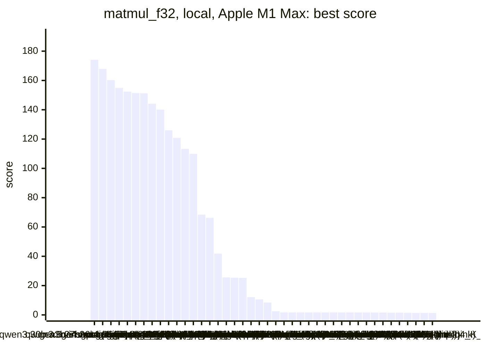
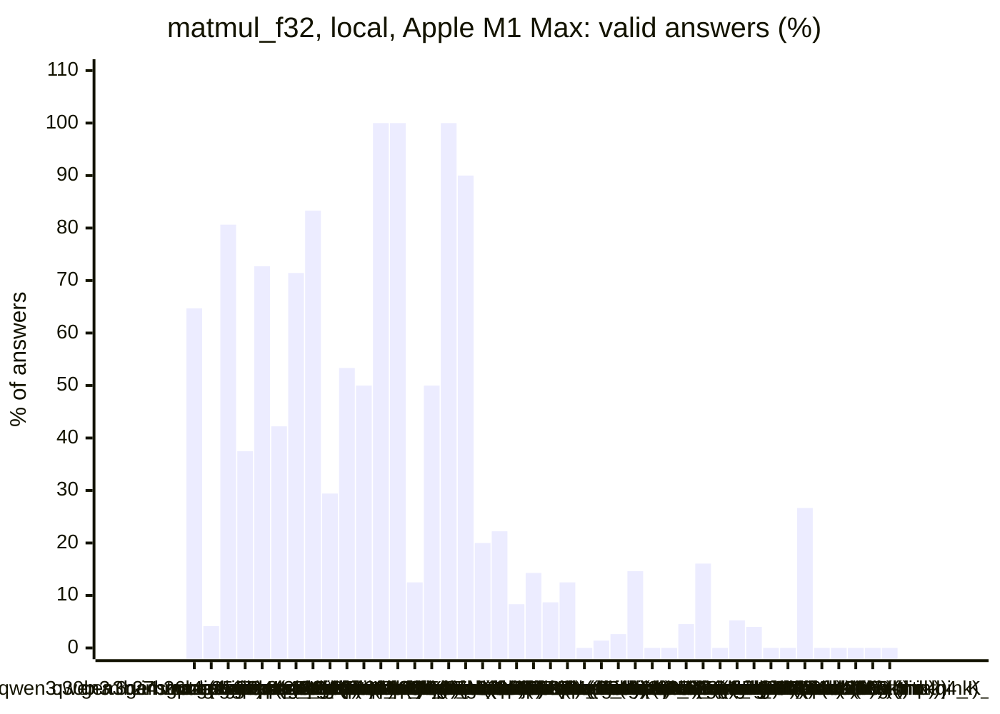
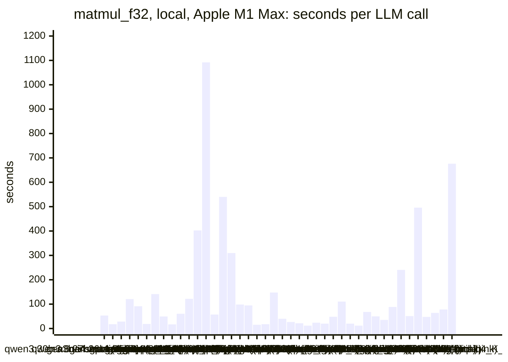
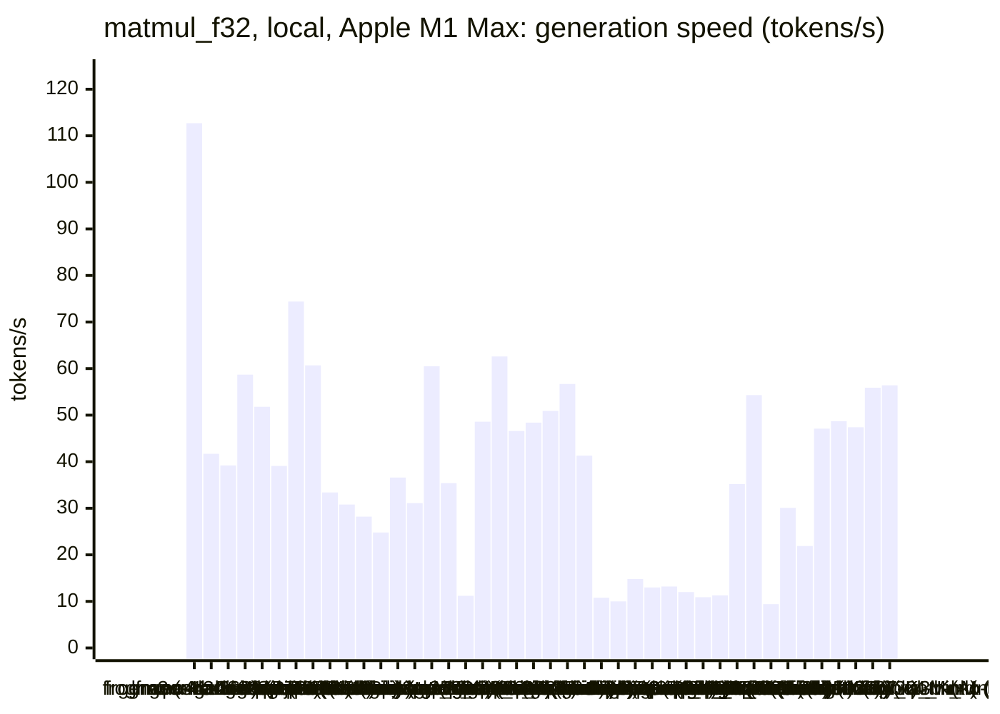
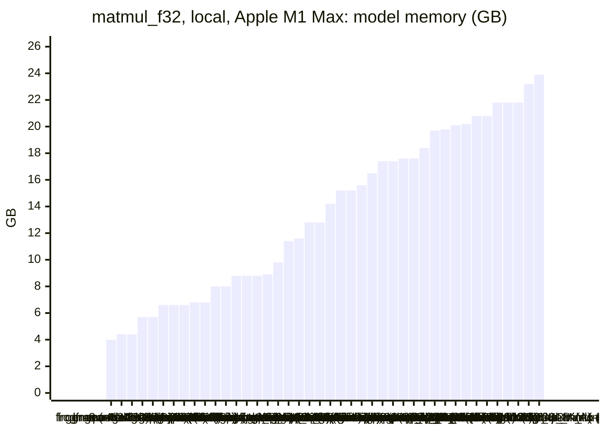
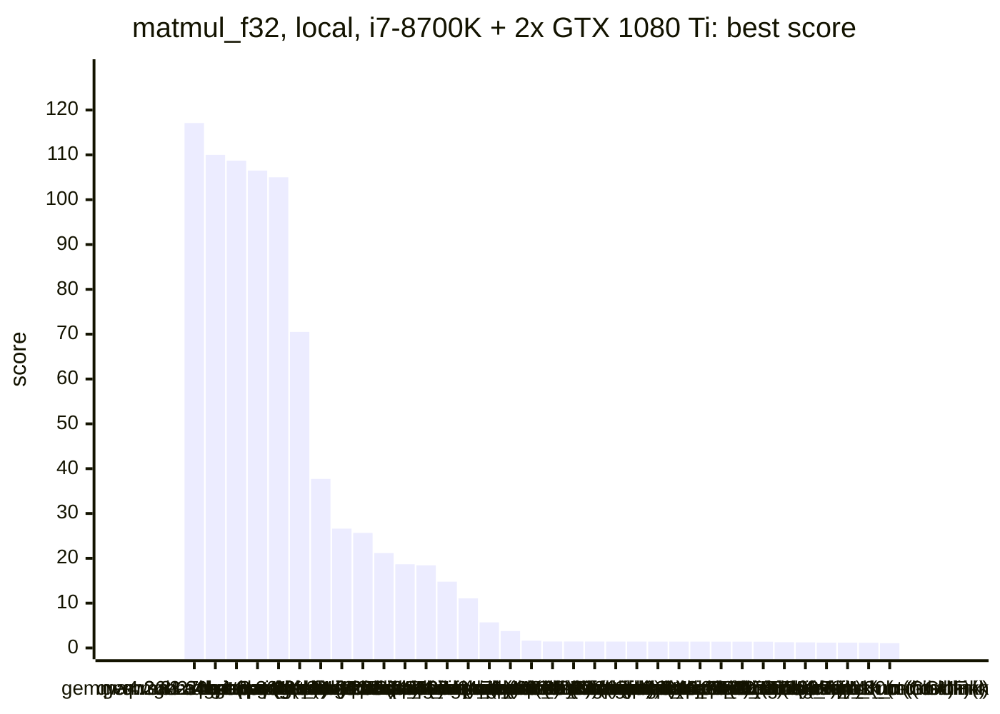
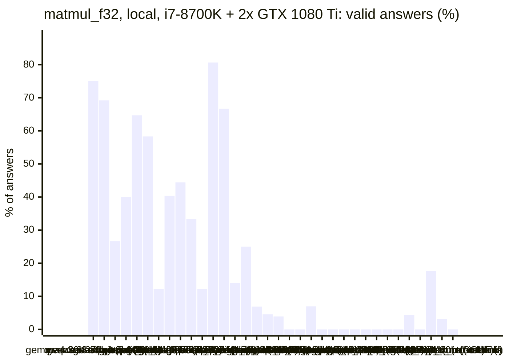
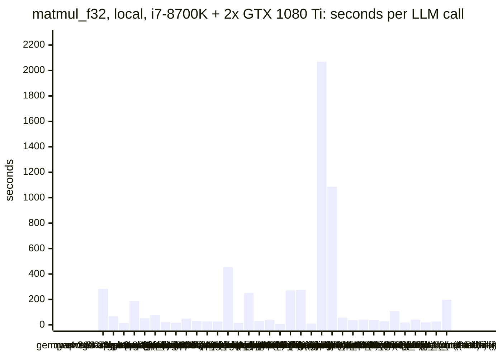
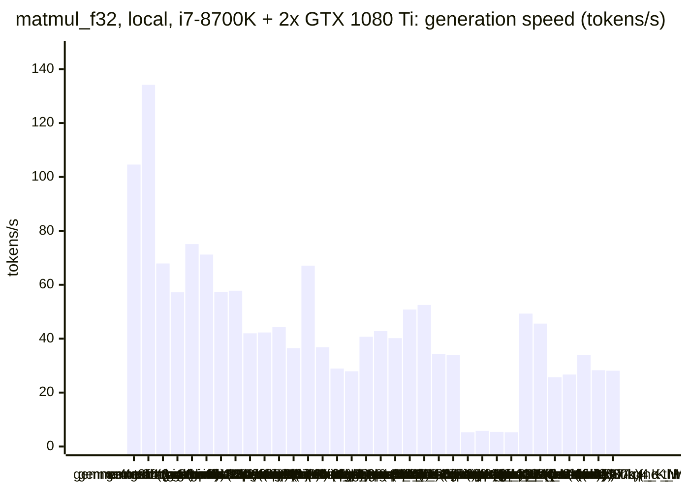
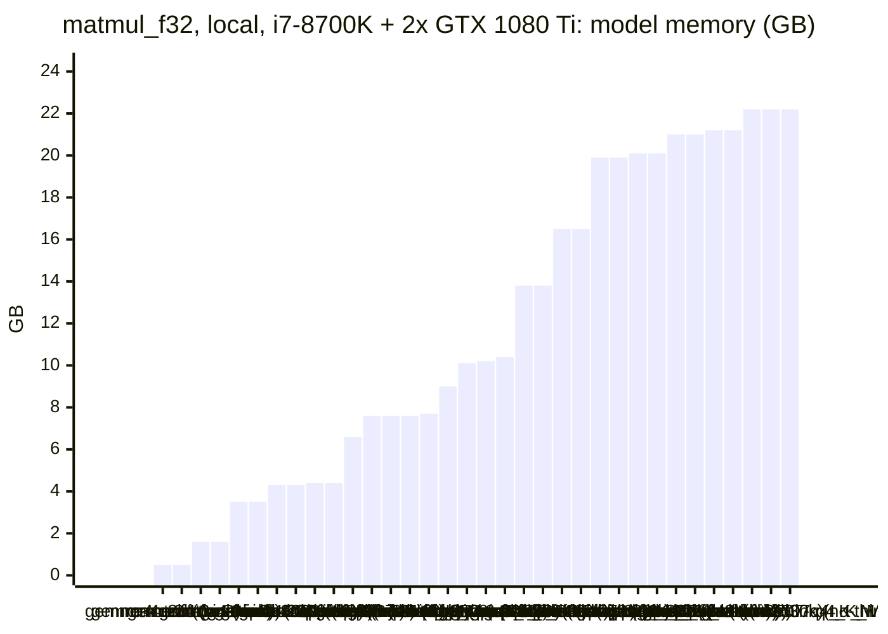

<!-- Copyright (c) 2026 by C. Klukas -->
<!-- SPDX-License-Identifier: GPL-3.0-only -->
<!-- Generated by `omega report` from bench/results/*.json. Do not edit by hand. -->

# matmul_f32

48 models, 15 minutes each, one run per model. The [overall ranking](../benchmarks.md#overall-ranking) compares the models over all examples.

Machines: **Apple M1 Max**: Apple M1 Max (Mac13,1), 10 cores, 32 GB, 47 runs; **i7-8700K + 2x GTX 1080 Ti**: Intel(R) Core(TM) i7-8700K CPU @ 3.70GHz (MS-7A98), 12 cores, 64 GB, 2x NVIDIA GeForce GTX 1080 Ti, 11264 MiB, 34 runs.

## Local models on Apple M1 Max

Ollama on this machine.

| Model | Params | Initial | Best | Gain | LLM calls | s/call | Valid | New bests | Min to best |
|---|---|--:|--:|--:|--:|--:|--:|--:|--:|
| gemma4:latest (think) |  | 1.59883 | **174.1030** | ×108.89 | 17 | 53 | 65% | 8 | 15.8 |
| qwen3:30b-a3b-instruct-2507-q4_K_M (no-think) | 30.5B | 1.63177 | **167.9280** | ×102.91 | 48 | 18 | 4% | 2 | 15.2 |
| gemma4:26b-a4b-it-qat (no-think) | 25.2B | 1.59064 | **160.2310** | ×100.73 | 31 | 28 | 81% | 4 | 7.5 |
| qwen3.6:27b-coding-mtp-q4_K_M (no-think) | 27.3B | 1.65835 | **154.8540** | ×93.38 | 8 | 121 | 38% | 2 | 16.3 |
| gpt-oss:20b (no-think) | 20.9B | 1.65652 | **152.3910** | ×91.99 | 11 | 91 | 73% | 4 | 17.4 |
| gemma4:latest (no-think) |  | 1.58471 | **151.3840** | ×95.53 | 45 | 19 | 42% | 5 | 15.6 |
| muse-glimmer:30b (no-think) | 27.9B | 1.6501 | **151.2800** | ×91.68 | 7 | 141 | 71% | 2 | 16.7 |
| gpt-oss:20b (think) | 20.9B | 1.63546 | **144.0540** | ×88.08 | 18 | 49 | 83% | 5 | 15.3 |
| gemma4:e4b-it-qat (no-think) | 7.5B | 1.63783 | **140.1020** | ×85.54 | 51 | 17 | 29% | 6 | 15.5 |
| gemma4:e4b-it-qat (think) | 7.5B | 1.51942 | **126.0000** | ×82.93 | 15 | 60 | 53% | 4 | 15.5 |
| qwen3.8:27b-mtp-q4_K_M (no-think) | 27.3B | 1.65734 | **120.7810** | ×72.88 | 8 | 122 | 50% | 1 | 16.4 |
| muse-glimmer:30b (think) | 27.9B | 1.12997 | **113.2980** | ×100.27 | 3 | 402 | 100% | 1 | 20.2 |
| qwen3.8:27b-mtp-q4_K_M (think) | 27.3B | 1.54195 | **109.8530** | ×71.24 | 1 | 1092 | 100% | 1 | 18.3 |
| gemma4:12b-it-qat (no-think) | 11.9B | 1.64615 | **68.4243** | ×41.57 | 16 | 58 | 12% | 1 | 15.4 |
| gemma4:12b-it-qat (think) | 11.9B | 1.19814 | **66.2698** | ×55.31 | 2 | 540 | 50% | 1 | 18.3 |
| gemma4:26b-a4b-it-qat (think) | 25.2B | 1.5217 | **41.8195** | ×27.48 | 3 | 310 | 100% | 1 | 15.7 |
| qwen3.5:27b (no-think) | 27.8B | 1.65667 | **25.6098** | ×15.46 | 10 | 98 | 90% | 3 | 16.8 |
| nemotron-3-nano:30b-a3b-mlx (think) |  | 1.63544 | **25.4002** | ×15.53 | 10 | 95 | 20% | 1 | 15.9 |
| qwen3:30b-a3b-instruct-2507-q4_K_M (think) | 30.5B | 1.61641 | **25.2873** | ×15.64 | 54 | 15 | 22% | 2 | 15.3 |
| qwen2.5-coder:7b (no-think) | 7.6B | 1.67317 | **12.1382** | ×7.25 | 48 | 18 | 8% | 2 | 15.4 |
| underdog-saluki-27b:iq2-mix (no-think) | 26.9B | 1.70059 | **10.6256** | ×6.25 | 7 | 148 | 14% | 1 | 17.3 |
| qwen3-coder:30b (no-think) | 30.5B | 1.66293 | **8.45239** | ×5.08 | 23 | 40 | 9% | 2 | 16.7 |
| glm-4.7-flash:latest (no-think) | 29.9B | 1.69493 | **2.49095** | ×1.47 | 32 | 27 | 12% | 2 | 10.5 |
| lfm3:latest (no-think) |  | 1.7089 | **1.7089** | ×1.00 | 41 | 22 | 0% | 0 | - |
| nemotron-3-nano:4b (no-think) |  | 1.68739 | **1.70706** | ×1.01 | 72 | 12 | 1% | 2 | 16.4 |
| underdog-saluki-27b:iq2-mix (think) | 26.9B | | | | | | | | failed: all 1 model requests failed: underdog-saluki-27b:iq2-mix: an |
| nemotron-3-nano:30b-a3b-mlx (no-think) |  | 1.70481 | **1.70481** | ×1.00 | 38 | 24 | 3% | 0 | - |
| lfm3:latest (think) |  | | | | | | | | failed: all 9 model requests failed: lfm3:latest: answer stopped: re |
| yandex/YandexGPT-5-Lite-8B-instruct-GGUF:latest (no-think) | 8.0B | 1.69102 | **1.70226** | ×1.01 | 41 | 20 | 15% | 1 | 16.4 |
| llm-jp-4-8b-omega:q4_k_m (no-think) | 8.6B | 1.69985 | **1.69985** | ×1.00 | 19 | 48 | 0% | 0 | - |
| ingu627/exaone4.0:32b (no-think) | 32.0B | 1.69695 | **1.69695** | ×1.00 | 9 | 110 | 0% | 0 | - |
| MichelRosselli/apertus:8b-instruct-2509-q4_k_m (no-think) | 8.1B | 1.69487 | **1.69487** | ×1.00 | 44 | 20 | 5% | 0 | - |
| gemma4:e2b (no-think) | 5.1B | 1.61153 | **1.68469** | ×1.05 | 56 | 12 | 16% | 3 | 15.8 |
| qwen3.5:latest (no-think) | 9.7B | 1.6743 | **1.6743** | ×1.00 | 14 | 68 | 0% | 0 | - |
| frob/sarvam:30b (think) | 32.2B | | | | | | | | failed: all 3 model requests failed: frob/sarvam:30b: answer stopped |
| nemotron-3-nano:4b (think) |  | 1.4878 | **1.66861** | ×1.12 | 19 | 50 | 5% | 1 | 16.0 |
| nemotron-3.5-lightning:30b-mlx (think) |  | | | | | | | | failed: all 4 model requests failed: nemotron-3.5-lightning:30b-mlx: |
| nemotron-3.5-lightning:30b-mlx (no-think) |  | 1.66222 | **1.66222** | ×1.00 | 25 | 35 | 4% | 0 | - |
| devstral-small-2:24b (no-think) | 24.0B | 1.65728 | **1.65728** | ×1.00 | 11 | 88 | 0% | 0 | - |
| frob/sarvam:30b (no-think) | 32.2B | 1.59209 | **1.59209** | ×1.00 | 4 | 240 | 0% | 0 | - |
| gemma4:e2b (think) | 5.1B | 0.97164 | **1.53353** | ×1.58 | 15 | 51 | 27% | 4 | 10.1 |
| glm-4.7-flash:latest (think) | 29.9B | 1.51016 | **1.51016** | ×1.00 | 3 | 496 | 0% | 0 | - |
| richardyoung/frognano-4b-2609:latest (think) | 4.3B | 1.45546 | **1.45546** | ×1.00 | 19 | 48 | 0% | 0 | - |
| richardyoung/frognano-4b-2609:latest (no-think) | 4.3B | 1.36704 | **1.36704** | ×1.00 | 15 | 64 | 0% | 0 | - |
| qwen3.5:latest (think) | 9.7B | 1.33259 | **1.33259** | ×1.00 | 12 | 78 | 0% | 0 | - |
| qwen3.6:27b-coding-mtp-q4_K_M (think) | 27.3B | 1.32423 | **1.32423** | ×1.00 | 2 | 676 | 0% | 0 | - |
| qwen3.5:27b (think) | 27.8B | | | | | | | | failed: all 1 model requests failed: qwen3.5:27b: answer stopped: re |

### Inference speed and memory

RAM is what Ollama reports for the loaded model (weights, context cache and buffers; on Apple silicon this is shared memory). Load is the time to bring the model into memory. Prompt and generation speeds are tokens per second over all calls of the run.

| Model | Params | RAM GB | Load s | Prompt tok/s | Gen tok/s | Median s/call | p90 s/call | Tokens/answer | Stopped |
|---|---|--:|--:|--:|--:|--:|--:|--:|--:|
| lfm3:latest (no-think) |  | 4.0 | 0 | 4222 | 112.7 | 25 | 28 | 613 | 33 |
| richardyoung/frognano-4b-2609:latest (think) | 4.3B | 4.4 | 12 | 1078 | 41.7 | 45 | 65 | 1827 | 1 |
| richardyoung/frognano-4b-2609:latest (no-think) | 4.3B | 4.4 | 11 | 1067 | 39.2 | 68 | 87 | 1691 | 9 |
| gemma4:e4b-it-qat (no-think) | 7.5B | 5.7 | 55 | 850 | 58.7 | 13 | 28 | 601 | 2 |
| gemma4:e4b-it-qat (think) | 7.5B | 5.7 | 112 | 1057 | 51.8 | 48 | 120 | 2596 | 0 |
| qwen2.5-coder:7b (no-think) | 7.6B | 6.6 | 48 | 697 | 39.1 | 16 | 24 | 484 | 0 |
| gemma4:e2b (no-think) | 5.1B | 6.6 | 33 | 1186 | 74.4 | 10 | 18 | 509 | 2 |
| gemma4:e2b (think) | 5.1B | 6.6 | 35 | 1409 | 60.7 | 49 | 89 | 2802 | 0 |
| qwen3.5:latest (no-think) | 9.7B | 6.8 | 73 | 551 | 33.4 | 68 | 103 | 1541 | 4 |
| qwen3.5:latest (think) | 9.7B | 6.8 | 89 | 569 | 30.8 | 73 | 118 | 2026 | 0 |
| gemma4:12b-it-qat (no-think) | 11.9B | 8.0 | 66 | 294 | 28.2 | 42 | 129 | 1044 | 2 |
| gemma4:12b-it-qat (think) | 11.9B | 8.0 | 0 | 416 | 24.8 | 730 | 730 | 8481 | 1 |
| yandex/YandexGPT-5-Lite-8B-instruct-GGUF:latest (no-think) | 8.0B | 8.8 | 15 | 735 | 36.6 | 20 | 30 | 566 | 0 |
| llm-jp-4-8b-omega:q4_k_m (no-think) | 8.6B | 8.8 | 16 | 660 | 31.1 | 51 | 74 | 1303 | 0 |
| nemotron-3-nano:4b (think) |  | 8.8 | 8 | 935 | 60.5 | 39 | 86 | 2806 | 0 |
| MichelRosselli/apertus:8b-instruct-2509-q4_k_m (no-think) | 8.1B | 8.9 | 16 | 634 | 35.4 | 19 | 33 | 495 | 1 |
| underdog-saluki-27b:iq2-mix (no-think) | 26.9B | 9.8 | 0 | 236 | 11.2 | 105 | 243 | 1446 | 1 |
| gemma4:latest (think) |  | 11.4 | 109 | 1268 | 48.6 | 51 | 80 | 2149 | 0 |
| nemotron-3-nano:4b (no-think) |  | 11.6 | 8 | 923 | 62.6 | 11 | 16 | 482 | 3 |
| gpt-oss:20b (no-think) | 20.9B | 12.8 | 100 | 664 | 46.6 | 69 | 153 | 3638 | 0 |
| gpt-oss:20b (think) | 20.9B | 12.8 | 101 | 614 | 48.4 | 47 | 79 | 1873 | 0 |
| gemma4:latest (no-think) |  | 14.2 | 95 | 1276 | 50.9 | 14 | 37 | 676 | 0 |
| gemma4:26b-a4b-it-qat (no-think) | 25.2B | 15.2 | 200 | 516 | 56.7 | 21 | 37 | 612 | 4 |
| gemma4:26b-a4b-it-qat (think) | 25.2B | 15.2 | 278 | 1001 | 41.3 | 286 | 553 | 8845 | 0 |
| muse-glimmer:30b (no-think) | 27.9B | 15.6 | 57 | 123 | 10.8 | 119 | 199 | 1244 | 0 |
| muse-glimmer:30b (think) | 27.9B | 16.5 | 54 | 204 | 10.0 | 418 | 460 | 3732 | 0 |
| qwen3.6:27b-coding-mtp-q4_K_M (no-think) | 27.3B | 17.4 | 277 | 175 | 14.8 | 112 | 372 | 1060 | 0 |
| qwen3.6:27b-coding-mtp-q4_K_M (think) | 27.3B | 17.4 | 210 | 147 | 13.0 | 706 | 706 | 7180 | 0 |
| qwen3.8:27b-mtp-q4_K_M (no-think) | 27.3B | 17.6 | 209 | 130 | 13.2 | 102 | 272 | 1015 | 0 |
| qwen3.8:27b-mtp-q4_K_M (think) | 27.3B | 17.6 | 281 | 95 | 12.0 | 1092 | 1092 | 5725 | 0 |
| qwen3.5:27b (no-think) | 27.8B | 18.4 | 183 | 165 | 10.9 | 71 | 325 | 684 | 0 |
| devstral-small-2:24b (no-think) | 24.0B | 19.7 | 43 | 188 | 11.3 | 79 | 177 | 626 | 2 |
| frob/sarvam:30b (no-think) | 32.2B | 19.8 | 50 | 1389 | 35.2 | 275 | 292 | 7927 | 0 |
| nemotron-3-nano:30b-a3b-mlx (think) |  | 20.1 | 99 | 489 | 54.3 | 91 | 208 | 4339 | 0 |
| ingu627/exaone4.0:32b (no-think) | 32.0B | 20.2 | 49 | 75 | 9.4 | 100 | 194 | 636 | 0 |
| glm-4.7-flash:latest (no-think) | 29.9B | 20.8 | 48 | 664 | 30.1 | 25 | 41 | 610 | 1 |
| glm-4.7-flash:latest (think) | 29.9B | 20.8 | 52 | 610 | 21.9 | 500 | 686 | 8128 | 1 |
| qwen3:30b-a3b-instruct-2507-q4_K_M (no-think) | 30.5B | 21.8 | 141 | 900 | 47.1 | 11 | 29 | 422 | 1 |
| qwen3:30b-a3b-instruct-2507-q4_K_M (think) | 30.5B | 21.8 | 137 | 889 | 48.7 | 13 | 26 | 423 | 0 |
| qwen3-coder:30b (no-think) | 30.5B | 21.8 | 22 | 985 | 47.4 | 24 | 38 | 1026 | 4 |
| nemotron-3.5-lightning:30b-mlx (no-think) |  | 23.2 | 0 | 892 | 55.9 | 28 | 60 | 1242 | 15 |
| nemotron-3-nano:30b-a3b-mlx (no-think) |  | 23.9 | 102 | 792 | 56.4 | 17 | 43 | 869 | 5 |

### Best score over time

| Model | 3.75 min | 7.5 min | 11.25 min | 15 min |
|---|--:|--:|--:|--:|
| gemma4:latest (think) | 1.59883 | 1.59883 | 24.7383 | 133.5950 |
| qwen3:30b-a3b-instruct-2507-q4_K_M (no-think) | 1.63177 | 1.63177 | 3.60979 | 3.60979 |
| gemma4:26b-a4b-it-qat (no-think) | 1.59064 | 160.2310 | 160.2310 | 160.2310 |
| qwen3.6:27b-coding-mtp-q4_K_M (no-think) | 1.65835 | 1.65835 | 1.65835 | 1.65835 |
| gpt-oss:20b (no-think) | 1.65652 | 1.65652 | 1.65652 | 22.0148 |
| gemma4:latest (no-think) | 9.66047 | 9.66698 | 9.66698 | 9.89172 |
| muse-glimmer:30b (no-think) | 1.6501 | 1.6501 | 1.6501 | 1.6501 |
| gpt-oss:20b (think) | 1.63546 | 76.5920 | 76.5920 | 76.5920 |
| gemma4:e4b-it-qat (no-think) | 1.63783 | 25.9352 | 25.9352 | 128.8490 |
| gemma4:e4b-it-qat (think) | 1.51942 | 1.51942 | 1.51942 | 23.9803 |
| qwen3.8:27b-mtp-q4_K_M (no-think) | 1.65734 | 1.65734 | 1.65734 | 1.65734 |
| muse-glimmer:30b (think) | 1.12997 | 1.12997 | 1.12997 | 1.12997 |
| qwen3.8:27b-mtp-q4_K_M (think) | 1.54195 | 1.54195 | 1.54195 | 1.54195 |
| gemma4:12b-it-qat (no-think) | 1.64615 | 1.64615 | 1.64615 | 1.64615 |
| gemma4:12b-it-qat (think) | 1.19814 | 1.19814 | 1.19814 | 1.19814 |
| gemma4:26b-a4b-it-qat (think) | 1.5217 | 1.5217 | 1.5217 | 1.5217 |
| qwen3.5:27b (no-think) | 1.65667 | 1.65667 | 25.0144 | 25.0144 |
| nemotron-3-nano:30b-a3b-mlx (think) | 1.63544 | 1.63544 | 1.63544 | 1.63544 |
| qwen3:30b-a3b-instruct-2507-q4_K_M (think) | 1.61641 | 25.1689 | 25.1689 | 25.1689 |
| qwen2.5-coder:7b (no-think) | 1.67317 | 6.65771 | 6.65771 | 6.65771 |
| underdog-saluki-27b:iq2-mix (no-think) | 1.70059 | 1.70059 | 1.70059 | 1.70059 |
| qwen3-coder:30b (no-think) | 1.66293 | 1.66293 | 1.66293 | 1.66293 |
| glm-4.7-flash:latest (no-think) | 1.69493 | 2.24549 | 2.49095 | 2.49095 |
| lfm3:latest (no-think) | 1.7089 | 1.7089 | 1.7089 | 1.7089 |
| nemotron-3-nano:4b (no-think) | 1.68739 | 1.68739 | 1.68739 | 1.68739 |
| nemotron-3-nano:30b-a3b-mlx (no-think) | 1.70481 | 1.70481 | 1.70481 | 1.70481 |
| yandex/YandexGPT-5-Lite-8B-instruct-GGUF:latest (no-think) | 1.69102 | 1.69102 | 1.69102 | 1.69102 |
| llm-jp-4-8b-omega:q4_k_m (no-think) | 1.69985 | 1.69985 | 1.69985 | 1.69985 |
| ingu627/exaone4.0:32b (no-think) | 1.69695 | 1.69695 | 1.69695 | 1.69695 |
| MichelRosselli/apertus:8b-instruct-2509-q4_k_m (no-think) | 1.69487 | 1.69487 | 1.69487 | 1.69487 |
| gemma4:e2b (no-think) | 1.61153 | 1.63627 | 1.63627 | 1.63627 |
| qwen3.5:latest (no-think) | 1.6743 | 1.6743 | 1.6743 | 1.6743 |
| nemotron-3-nano:4b (think) | 1.4878 | 1.4878 | 1.4878 | 1.4878 |
| nemotron-3.5-lightning:30b-mlx (no-think) | 1.66222 | 1.66222 | 1.66222 | 1.66222 |
| devstral-small-2:24b (no-think) | 1.65728 | 1.65728 | 1.65728 | 1.65728 |
| frob/sarvam:30b (no-think) | 1.59209 | 1.59209 | 1.59209 | 1.59209 |
| gemma4:e2b (think) | 0.97164 | 1.46192 | 1.53353 | 1.53353 |
| glm-4.7-flash:latest (think) | 1.51016 | 1.51016 | 1.51016 | 1.51016 |
| richardyoung/frognano-4b-2609:latest (think) | 1.45546 | 1.45546 | 1.45546 | 1.45546 |
| richardyoung/frognano-4b-2609:latest (no-think) | 1.36704 | 1.36704 | 1.36704 | 1.36704 |
| qwen3.5:latest (think) | 1.33259 | 1.33259 | 1.33259 | 1.33259 |
| qwen3.6:27b-coding-mtp-q4_K_M (think) | 1.32423 | 1.32423 | 1.32423 | 1.32423 |

### Outcome of the LLM answers

| Model | compile error | duplicate | edit error | invalid | llm error | ok | timeout |
|---|--:|--:|--:|--:|--:|--:|--:|
| gemma4:latest (think) | 4 | 2 | 0 | 0 | 0 | 11 | 0 |
| qwen3:30b-a3b-instruct-2507-q4_K_M (no-think) | 13 | 18 | 2 | 12 | 1 | 2 | 0 |
| gemma4:26b-a4b-it-qat (no-think) | 0 | 0 | 2 | 0 | 4 | 25 | 0 |
| qwen3.6:27b-coding-mtp-q4_K_M (no-think) | 0 | 0 | 1 | 4 | 0 | 3 | 0 |
| gpt-oss:20b (no-think) | 1 | 0 | 1 | 1 | 0 | 8 | 0 |
| gemma4:latest (no-think) | 13 | 0 | 7 | 6 | 0 | 19 | 0 |
| muse-glimmer:30b (no-think) | 0 | 0 | 0 | 2 | 0 | 5 | 0 |
| gpt-oss:20b (think) | 3 | 0 | 0 | 0 | 0 | 15 | 0 |
| gemma4:e4b-it-qat (no-think) | 24 | 0 | 1 | 9 | 2 | 15 | 0 |
| gemma4:e4b-it-qat (think) | 2 | 0 | 1 | 4 | 0 | 8 | 0 |
| qwen3.8:27b-mtp-q4_K_M (no-think) | 2 | 0 | 0 | 2 | 0 | 4 | 0 |
| muse-glimmer:30b (think) | 0 | 0 | 0 | 0 | 0 | 3 | 0 |
| qwen3.8:27b-mtp-q4_K_M (think) | 0 | 0 | 0 | 0 | 0 | 1 | 0 |
| gemma4:12b-it-qat (no-think) | 5 | 0 | 3 | 4 | 2 | 2 | 0 |
| gemma4:12b-it-qat (think) | 0 | 0 | 0 | 0 | 1 | 1 | 0 |
| gemma4:26b-a4b-it-qat (think) | 0 | 0 | 0 | 0 | 0 | 3 | 0 |
| qwen3.5:27b (no-think) | 0 | 0 | 1 | 0 | 0 | 9 | 0 |
| nemotron-3-nano:30b-a3b-mlx (think) | 6 | 0 | 2 | 0 | 0 | 2 | 0 |
| qwen3:30b-a3b-instruct-2507-q4_K_M (think) | 20 | 5 | 3 | 14 | 0 | 12 | 0 |
| qwen2.5-coder:7b (no-think) | 10 | 7 | 0 | 27 | 0 | 4 | 0 |
| underdog-saluki-27b:iq2-mix (no-think) | 5 | 0 | 0 | 0 | 1 | 1 | 0 |
| qwen3-coder:30b (no-think) | 1 | 1 | 0 | 15 | 4 | 2 | 0 |
| glm-4.7-flash:latest (no-think) | 8 | 2 | 0 | 17 | 1 | 4 | 0 |
| lfm3:latest (no-think) | 0 | 0 | 8 | 0 | 33 | 0 | 0 |
| nemotron-3-nano:4b (no-think) | 35 | 2 | 27 | 4 | 3 | 1 | 0 |
| nemotron-3-nano:30b-a3b-mlx (no-think) | 12 | 0 | 12 | 8 | 5 | 1 | 0 |
| yandex/YandexGPT-5-Lite-8B-instruct-GGUF:latest (no-think) | 14 | 6 | 10 | 5 | 0 | 6 | 0 |
| llm-jp-4-8b-omega:q4_k_m (no-think) | 16 | 0 | 3 | 0 | 0 | 0 | 0 |
| ingu627/exaone4.0:32b (no-think) | 3 | 0 | 1 | 5 | 0 | 0 | 0 |
| MichelRosselli/apertus:8b-instruct-2509-q4_k_m (no-think) | 22 | 6 | 13 | 0 | 1 | 2 | 0 |
| gemma4:e2b (no-think) | 14 | 5 | 16 | 10 | 2 | 9 | 0 |
| qwen3.5:latest (no-think) | 8 | 0 | 2 | 0 | 4 | 0 | 0 |
| nemotron-3-nano:4b (think) | 11 | 0 | 5 | 2 | 0 | 1 | 0 |
| nemotron-3.5-lightning:30b-mlx (no-think) | 4 | 0 | 3 | 2 | 15 | 1 | 0 |
| devstral-small-2:24b (no-think) | 1 | 1 | 0 | 7 | 2 | 0 | 0 |
| frob/sarvam:30b (no-think) | 0 | 0 | 4 | 0 | 0 | 0 | 0 |
| gemma4:e2b (think) | 6 | 0 | 3 | 1 | 0 | 4 | 1 |
| glm-4.7-flash:latest (think) | 0 | 0 | 0 | 2 | 1 | 0 | 0 |
| richardyoung/frognano-4b-2609:latest (think) | 16 | 0 | 1 | 1 | 1 | 0 | 0 |
| richardyoung/frognano-4b-2609:latest (no-think) | 6 | 0 | 0 | 0 | 9 | 0 | 0 |
| qwen3.5:latest (think) | 3 | 0 | 3 | 6 | 0 | 0 | 0 |
| qwen3.6:27b-coding-mtp-q4_K_M (think) | 0 | 0 | 0 | 2 | 0 | 0 | 0 |

### Best idea per model

- **gemma4:latest (think)**: tuned NUM_THREADS=30 on top of: Implement multi-threading over the row dimension (i) combined with the i-k-j loop order to maximize cache locality and leverage multiple cores.
- **qwen3:30b-a3b-instruct-2507-q4_K_M (no-think)**: Fix the incorrect accumulation in the inner loop by initializing C to zero before the k-loop, as the current code assumes C is already zeroed but the harness does not guarantee …
- **gemma4:26b-a4b-it-qat (no-think)**: Use multithreading to distribute rows of the computation across available CPU cores to increase GFLOPS.
- **qwen3.6:27b-coding-mtp-q4_K_M (no-think)**: Switch to an i-k-j loop order with cache blocking to improve data locality and enable better vectorization, which is a foundational optimization for matrix multiplication that …
- **gpt-oss:20b (no-think)**: tuned TILE_K=73 on top of: Replace the naive triple loop with a row‑parallel, i‑k‑j loop that zeros C, uses a k‑blocking tile, and unrolls the inner j loop for better cache …
- **gemma4:latest (no-think)**: Initialize C elements to zero before the main calculation loop to ensure correctness when accumulation starts from arbitrary values.
- **muse-glimmer:30b (no-think)**: zero each output row before accumulating the i-k-j products so the garbage-filled C from the harness does not pollute the result.
- **gpt-oss:20b (think)**: Parallelize over row blocks with up to 10 threads to utilize all CPU cores and reduce total runtime while keeping the existing cache‑friendly i‑k‑j order.
- **gemma4:e4b-it-qat (no-think)**: Implement thread partitioning over the outer loop (i) using `std::thread` to utilize all 10 available cores, building upon the existing $i-k-j$ loop order for cache efficiency.
- **gemma4:e4b-it-qat (think)**: Initialize matrix C to zero at the start of matmul to ensure correct accumulation, as the input C is not guaranteed to be zeroed by the caller.
- **qwen3.8:27b-mtp-q4_K_M (no-think)**: The tiling loop is correct but slow/uninitialized-prone; replace the body with a correct tiled i-k-j implementation and add multithreading over row-blocks to raise GFLOPS.
- **muse-glimmer:30b (think)**: switch to i-k-j loop order for better cache reuse and parallelize the outer i loop across up to 10 cores with std::thread so each core streams A rows, B panels and accumulates a C …
- **qwen3.8:27b-mtp-q4_K_M (think)**: Replace the naive scalar triple-loop with a multithreaded i-k-j loop order using explicit NEON fma intrinsics (4-wide) on the inner j-loop, which streams contiguous rows of B and …
- **gemma4:12b-it-qat (no-think)**: Reorder loops to i-k-j to improve cache locality and use a multi-threaded approach with basic SIMD to significantly increase GFLOPS.
- **gemma4:12b-it-qat (think)**: Implement multithreading and the i-k-j loop order to significantly improve cache locality and utilize all 10 cores.
- **gemma4:26b-a4b-it-qat (think)**: Use i-k-j loop order with ARM NEON SIMD vectorization and multithreading to maximize cache locality and throughput.
- **qwen3.5:27b (no-think)**: Switch the loop order from i-j-k to i-k-j to stream contiguous rows of B and C in the inner loop, which drastically improves cache locality and enables the compiler to …
- **nemotron-3-nano:30b-a3b-mlx (think)**: Change loop order to i‑k‑j and zero C before accumulation to improve cache locality and enable better vectorization.
- **qwen3:30b-a3b-instruct-2507-q4_K_M (think)**: Reorder loops to i-k-j to enable streaming of rows of B and C, which improves cache locality and enables efficient NEON vectorization, while maintaining correctness by zeroing C …
- **qwen2.5-coder:7b (no-think)**: tuned UNROLL_FACTOR=7.793 on top of: Introduce a constant for the unroll factor to allow the engine to optimize it.
- **underdog-saluki-27b:iq2-mix (no-think)**: Replace the naive i-j-k scalar triple loop with a multithreaded i-k-j tiled kernel: each thread owns contiguous rows of C, the inner j-loop accumulates a small block of C columns …
- **qwen3-coder:30b (no-think)**: tuned TILE_SIZE=32, THREAD_THRESHOLD=128 on top of: Introduce a cache-blocking approach with loop reordering i-k-j and NEON vectorization to improve memory access patterns and …
- **glm-4.7-flash:latest (no-think)**: Reorder loops to i-j-k to align with cache line streaming of B and C, and use NEON vector registers to load B columns and accumulate dot products in 4-wide fma pairs, avoiding …
- **lfm3:latest (no-think)**: initial program
- **nemotron-3-nano:4b (no-think)**: tuned TILE=15.01 on top of: Replace row-major triple loops with a single-threaded tiled matrix multiplication using ARM NEON 4×4 FMA and manual tiling to maximize vector …
- **nemotron-3-nano:30b-a3b-mlx (no-think)**: initial program
- **yandex/YandexGPT-5-Lite-8B-instruct-GGUF:latest (no-think)**: tuned BLOCK_SIZE=21 on top of: Apply cache blocking to improve memory access efficiency.
- **llm-jp-4-8b-omega:q4_k_m (no-think)**: initial program
- **ingu627/exaone4.0:32b (no-think)**: initial program
- **MichelRosselli/apertus:8b-instruct-2509-q4_k_m (no-think)**: initial program
- **gemma4:e2b (no-think)**: tuned BLOCK_SIZE=32 on top of: Implement loop interchange ($j-i-k$) combined with cache blocking to improve data locality and leverage NEON vectorization for inner loop …
- **qwen3.5:latest (no-think)**: initial program
- **nemotron-3-nano:4b (think)**: parallelize row computation across up to 10 threads using chunked rows to reduce wall‑clock time.
- **nemotron-3.5-lightning:30b-mlx (no-think)**: initial program
- **devstral-small-2:24b (no-think)**: initial program
- **frob/sarvam:30b (no-think)**: initial program
- **gemma4:e2b (think)**: Implement cache tiling over blocks of size $B=64$ and parallelize the outer loop over $i$ using threads to exploit the 10 cores, significantly reducing the constant factor for …
- **glm-4.7-flash:latest (think)**: initial program
- **richardyoung/frognano-4b-2609:latest (think)**: initial program
- **richardyoung/frognano-4b-2609:latest (no-think)**: initial program
- **qwen3.5:latest (think)**: initial program
- **qwen3.6:27b-coding-mtp-q4_K_M (think)**: initial program

## Local models on i7-8700K + 2x GTX 1080 Ti

Ollama on this machine.

| Model | Params | Initial | Best | Gain | LLM calls | s/call | Valid | New bests | Min to best |
|---|---|--:|--:|--:|--:|--:|--:|--:|--:|
| gemma4:26b-a4b-it-qat (think) | 25.2B | 1.41469 | **117.0590** | ×82.75 | 4 | 283 | 75% | 1 | 19.1 |
| gemma4:e4b-it-qat (think) | 7.5B | 1.40641 | **110.0340** | ×78.24 | 13 | 67 | 69% | 4 | 16.2 |
| gemma4:latest (no-think) | 7.5B | 1.40388 | **108.6600** | ×77.40 | 60 | 14 | 27% | 3 | 12.2 |
| qwen3.8:27b-mtp-q4_K_M (no-think) | 27.3B | 1.10466 | **106.4650** | ×96.38 | 5 | 188 | 40% | 2 | 16.6 |
| gemma4:latest (think) | 7.5B | 1.40505 | **104.9710** | ×74.71 | 17 | 52 | 65% | 4 | 15.3 |
| gpt-oss:20b (no-think) | 20.9B | 1.14051 | **70.4953** | ×61.81 | 12 | 78 | 58% | 4 | 17.7 |
| qwen3:30b-a3b-instruct-2507-q4_K_M (think) | 30.5B | 1.43034 | **37.7133** | ×26.37 | 41 | 21 | 12% | 3 | 16.2 |
| gemma4:e4b-it-qat (no-think) | 7.5B | 1.39875 | **26.6068** | ×19.02 | 47 | 17 | 40% | 4 | 15.3 |
| gpt-oss:20b (think) | 20.9B | 1.41585 | **25.6570** | ×18.12 | 18 | 49 | 44% | 3 | 15.8 |
| gemma4:12b-it-qat (no-think) | 11.9B | 1.4102 | **21.1581** | ×15.00 | 27 | 31 | 33% | 4 | 11.0 |
| qwen3:30b-a3b-instruct-2507-q4_K_M (no-think) | 30.5B | 1.03822 | **18.6807** | ×17.99 | 33 | 27 | 12% | 1 | 10.7 |
| gemma4:26b-a4b-it-qat (no-think) | 25.2B | 1.16773 | **18.4288** | ×15.78 | 31 | 26 | 81% | 4 | 15.3 |
| gemma4:12b-it-qat (think) | 11.9B | 1.40073 | **14.7889** | ×10.56 | 3 | 454 | 67% | 2 | 23.1 |
| qwen2.5-coder:7b (no-think) | 7.6B | 1.22653 | **11.0637** | ×9.02 | 50 | 16 | 14% | 3 | 17.2 |
| qwen3.6:27b-coding-mtp-q4_K_M (no-think) | 27.3B | 1.10903 | **5.71206** | ×5.15 | 4 | 251 | 25% | 1 | 17.3 |
| gemma4:e2b (think) | 4.6B | 1.39969 | **3.78053** | ×2.70 | 29 | 30 | 7% | 1 | 12.1 |
| qwen3-coder:30b (no-think) | 30.5B | 1.06642 | **1.61984** | ×1.52 | 22 | 41 | 5% | 1 | 13.5 |
| gemma4:e2b (no-think) | 4.6B | 1.41678 | **1.44041** | ×1.02 | 102 | 8 | 4% | 2 | 3.4 |
| glm-4.7-flash:latest (think) | 29.9B | 1.43503 | **1.43503** | ×1.00 | 4 | 270 | 0% | 0 | - |
| frob/sarvam:30b (think) | 32.2B | 1.42672 | **1.42672** | ×1.00 | 4 | 275 | 0% | 0 | - |
| nemotron-3-nano:4b (no-think) | 4.0B | 1.41297 | **1.42195** | ×1.01 | 72 | 11 | 7% | 1 | 4.4 |
| qwen3.8:27b-mtp-q4_K_M (think) | 27.3B | 1.41926 | **1.41926** | ×1.00 | 1 | 2069 | 0% | 0 | - |
| qwen3.6:27b-coding-mtp-q4_K_M (think) | 27.3B | 1.41433 | **1.41433** | ×1.00 | 1 | 1086 | 0% | 0 | - |
| qwen3.5:latest (no-think) | 9.0B | 1.41048 | **1.41048** | ×1.00 | 17 | 57 | 0% | 0 | - |
| richardyoung/frognano-4b-2609:latest (think) | 4.3B | 1.40941 | **1.40941** | ×1.00 | 24 | 37 | 0% | 0 | - |
| richardyoung/frognano-4b-2609:latest (no-think) | 4.3B | 1.40714 | **1.40714** | ×1.00 | 23 | 41 | 0% | 0 | - |
| nemotron-3-nano:4b (think) | 4.0B | 1.40425 | **1.40425** | ×1.00 | 24 | 38 | 0% | 0 | - |
| Bored/GigaChat3.1-10B-A1.8B-q4_K_M:latest (no-think) | 10.7B | 1.39792 | **1.39792** | ×1.00 | 32 | 28 | 0% | 0 | - |
| qwen3.5:latest (think) | 9.0B | 1.28638 | **1.28638** | ×1.00 | 11 | 107 | 0% | 0 | - |
| MichelRosselli/apertus:8b-instruct-2509-q4_k_m (no-think) | 8.1B | 1.25454 | **1.25454** | ×1.00 | 45 | 19 | 4% | 0 | - |
| llm-jp-4-8b-omega:q4_k_m (no-think) | 8.6B | 1.18595 | **1.18595** | ×1.00 | 22 | 42 | 0% | 0 | - |
| yandex/YandexGPT-5-Lite-8B-instruct-GGUF:latest (no-think) | 8.0B | 1.17412 | **1.17412** | ×1.00 | 34 | 20 | 18% | 0 | - |
| glm-4.7-flash:latest (no-think) | 29.9B | 1.1378 | **1.14888** | ×1.01 | 31 | 27 | 3% | 1 | 16.6 |
| frob/sarvam:30b (no-think) | 32.2B | 1.07209 | **1.07209** | ×1.00 | 5 | 198 | 0% | 0 | - |

### Inference speed and memory

RAM is what Ollama reports for the loaded model (weights, context cache and buffers; on Apple silicon this is shared memory). Load is the time to bring the model into memory. Prompt and generation speeds are tokens per second over all calls of the run.

| Model | Params | RAM GB | Load s | Prompt tok/s | Gen tok/s | Median s/call | p90 s/call | Tokens/answer | Stopped |
|---|---|--:|--:|--:|--:|--:|--:|--:|--:|
| gemma4:e2b (think) | 4.6B | 0.5 | 18 | 3246 | 104.6 | 30 | 43 | 2770 | 0 |
| gemma4:e2b (no-think) | 4.6B | 0.5 | 18 | 2547 | 134.2 | 7 | 10 | 489 | 0 |
| gemma4:latest (no-think) | 7.5B | 1.6 | 24 | 1685 | 67.9 | 13 | 26 | 637 | 0 |
| gemma4:latest (think) | 7.5B | 1.6 | 25 | 2035 | 57.2 | 50 | 65 | 2679 | 0 |
| nemotron-3-nano:4b (no-think) | 4.0B | 3.5 | 12 | 2000 | 75.1 | 10 | 14 | 421 | 4 |
| nemotron-3-nano:4b (think) | 4.0B | 3.5 | 10 | 1750 | 71.2 | 32 | 71 | 2400 | 1 |
| richardyoung/frognano-4b-2609:latest (think) | 4.3B | 4.3 | 12 | 2643 | 57.3 | 31 | 51 | 1585 | 2 |
| richardyoung/frognano-4b-2609:latest (no-think) | 4.3B | 4.3 | 12 | 2633 | 57.8 | 32 | 61 | 1175 | 10 |
| gemma4:e4b-it-qat (think) | 7.5B | 4.4 | 21 | 2070 | 42.0 | 65 | 112 | 2610 | 0 |
| gemma4:e4b-it-qat (no-think) | 7.5B | 4.4 | 21 | 2149 | 42.3 | 14 | 27 | 523 | 1 |
| qwen2.5-coder:7b (no-think) | 7.6B | 6.6 | 17 | 1780 | 44.3 | 15 | 25 | 514 | 0 |
| qwen3.5:latest (no-think) | 9.0B | 7.6 | 0 | 1642 | 36.5 | 65 | 85 | 1127 | 8 |
| Bored/GigaChat3.1-10B-A1.8B-q4_K_M:latest (no-think) | 10.7B | 7.6 | 18 | 882 | 67.1 | 25 | 42 | 1353 | 0 |
| qwen3.5:latest (think) | 9.0B | 7.6 | 52 | 1650 | 36.8 | 52 | 300 | 1944 | 2 |
| gemma4:12b-it-qat (no-think) | 11.9B | 7.7 | 23 | 554 | 28.9 | 28 | 42 | 618 | 0 |
| gemma4:12b-it-qat (think) | 11.9B | 9.0 | 22 | 803 | 27.9 | 438 | 496 | 12298 | 0 |
| MichelRosselli/apertus:8b-instruct-2509-q4_k_m (no-think) | 8.1B | 10.1 | 17 | 2127 | 40.7 | 15 | 33 | 530 | 1 |
| yandex/YandexGPT-5-Lite-8B-instruct-GGUF:latest (no-think) | 8.0B | 10.2 | 18 | 1921 | 42.8 | 18 | 29 | 619 | 0 |
| llm-jp-4-8b-omega:q4_k_m (no-think) | 8.6B | 10.4 | 16 | 1973 | 40.2 | 42 | 71 | 1411 | 0 |
| gpt-oss:20b (no-think) | 20.9B | 13.8 | 39 | 1970 | 50.8 | 63 | 153 | 3619 | 0 |
| gpt-oss:20b (think) | 20.9B | 13.8 | 38 | 2059 | 52.5 | 41 | 83 | 2299 | 0 |
| gemma4:26b-a4b-it-qat (think) | 25.2B | 16.5 | 56 | 1450 | 34.4 | 282 | 336 | 9108 | 0 |
| gemma4:26b-a4b-it-qat (no-think) | 25.2B | 16.5 | 68 | 1261 | 33.9 | 26 | 30 | 621 | 1 |
| qwen3.6:27b-coding-mtp-q4_K_M (no-think) | 27.3B | 19.9 | 128 | 202 | 5.3 | 209 | 432 | 1094 | 0 |
| qwen3.6:27b-coding-mtp-q4_K_M (think) | 27.3B | 19.9 | 55 | 171 | 5.8 | 1086 | 1086 | 5926 | 0 |
| qwen3.8:27b-mtp-q4_K_M (no-think) | 27.3B | 20.1 | 62 | 484 | 5.4 | 134 | 338 | 907 | 0 |
| qwen3.8:27b-mtp-q4_K_M (think) | 27.3B | 20.1 | 55 | 165 | 5.3 | 2069 | 2069 | 10538 | 0 |
| frob/sarvam:30b (think) | 32.2B | 21.0 | 0 | 2224 | 49.3 | 305 | 368 | 10356 | 2 |
| frob/sarvam:30b (no-think) | 32.2B | 21.0 | 75 | 2175 | 45.6 | 182 | 264 | 8192 | 0 |
| glm-4.7-flash:latest (think) | 29.9B | 21.2 | 58 | 669 | 25.7 | 298 | 300 | 6448 | 0 |
| glm-4.7-flash:latest (no-think) | 29.9B | 21.2 | 68 | 657 | 26.7 | 25 | 32 | 485 | 0 |
| qwen3:30b-a3b-instruct-2507-q4_K_M (think) | 30.5B | 22.2 | 53 | 972 | 34.0 | 18 | 37 | 482 | 0 |
| qwen3:30b-a3b-instruct-2507-q4_K_M (no-think) | 30.5B | 22.2 | 82 | 1025 | 28.3 | 19 | 44 | 552 | 0 |
| qwen3-coder:30b (no-think) | 30.5B | 22.2 | 62 | 974 | 28.1 | 33 | 80 | 947 | 1 |

### Best score over time

| Model | 3.75 min | 7.5 min | 11.25 min | 15 min |
|---|--:|--:|--:|--:|
| gemma4:26b-a4b-it-qat (think) | 1.41469 | 1.41469 | 1.41469 | 1.41469 |
| gemma4:e4b-it-qat (think) | 1.40641 | 1.40641 | 21.4495 | 21.4495 |
| gemma4:latest (no-think) | 27.4354 | 106.0700 | 106.0700 | 108.6600 |
| qwen3.8:27b-mtp-q4_K_M (no-think) | 1.10466 | 1.10466 | 1.10466 | 1.10466 |
| gemma4:latest (think) | 1.40505 | 1.40505 | 27.9289 | 27.9289 |
| gpt-oss:20b (no-think) | 1.14051 | 1.14051 | 1.14051 | 16.3501 |
| qwen3:30b-a3b-instruct-2507-q4_K_M (think) | 1.43034 | 27.3517 | 27.3517 | 27.3517 |
| gemma4:e4b-it-qat (no-think) | 4.85307 | 22.2306 | 22.2306 | 24.4933 |
| gpt-oss:20b (think) | 1.41585 | 1.41585 | 9.07992 | 24.8792 |
| gemma4:12b-it-qat (no-think) | 1.4102 | 6.04532 | 21.1581 | 21.1581 |
| qwen3:30b-a3b-instruct-2507-q4_K_M (no-think) | 1.03822 | 1.03822 | 18.6807 | 18.6807 |
| gemma4:26b-a4b-it-qat (no-think) | 16.6779 | 16.6779 | 16.6779 | 17.1282 |
| gemma4:12b-it-qat (think) | 1.40073 | 1.40073 | 1.40073 | 1.40073 |
| qwen2.5-coder:7b (no-think) | 3.03291 | 10.1937 | 10.1937 | 10.1937 |
| qwen3.6:27b-coding-mtp-q4_K_M (no-think) | 1.10903 | 1.10903 | 1.10903 | 1.10903 |
| gemma4:e2b (think) | 1.39969 | 1.39969 | 1.39969 | 3.78053 |
| qwen3-coder:30b (no-think) | 1.06642 | 1.06642 | 1.06642 | 1.61984 |
| gemma4:e2b (no-think) | 1.44041 | 1.44041 | 1.44041 | 1.44041 |
| glm-4.7-flash:latest (think) | 1.43503 | 1.43503 | 1.43503 | 1.43503 |
| frob/sarvam:30b (think) | 1.42672 | 1.42672 | 1.42672 | 1.42672 |
| nemotron-3-nano:4b (no-think) | 1.41297 | 1.42195 | 1.42195 | 1.42195 |
| qwen3.8:27b-mtp-q4_K_M (think) | 1.41926 | 1.41926 | 1.41926 | 1.41926 |
| qwen3.6:27b-coding-mtp-q4_K_M (think) | 1.41433 | 1.41433 | 1.41433 | 1.41433 |
| qwen3.5:latest (no-think) | 1.41048 | 1.41048 | 1.41048 | 1.41048 |
| richardyoung/frognano-4b-2609:latest (think) | 1.40941 | 1.40941 | 1.40941 | 1.40941 |
| richardyoung/frognano-4b-2609:latest (no-think) | 1.40714 | 1.40714 | 1.40714 | 1.40714 |
| nemotron-3-nano:4b (think) | 1.40425 | 1.40425 | 1.40425 | 1.40425 |
| Bored/GigaChat3.1-10B-A1.8B-q4_K_M:latest (no-think) | 1.39792 | 1.39792 | 1.39792 | 1.39792 |
| qwen3.5:latest (think) | 1.28638 | 1.28638 | 1.28638 | 1.28638 |
| MichelRosselli/apertus:8b-instruct-2509-q4_k_m (no-think) | 1.25454 | 1.25454 | 1.25454 | 1.25454 |
| llm-jp-4-8b-omega:q4_k_m (no-think) | 1.18595 | 1.18595 | 1.18595 | 1.18595 |
| yandex/YandexGPT-5-Lite-8B-instruct-GGUF:latest (no-think) | 1.17412 | 1.17412 | 1.17412 | 1.17412 |
| glm-4.7-flash:latest (no-think) | 1.1378 | 1.1378 | 1.1378 | 1.1378 |
| frob/sarvam:30b (no-think) | 1.07209 | 1.07209 | 1.07209 | 1.07209 |

### Outcome of the LLM answers

| Model | compile error | duplicate | edit error | invalid | llm error | ok | timeout |
|---|--:|--:|--:|--:|--:|--:|--:|
| gemma4:26b-a4b-it-qat (think) | 1 | 0 | 0 | 0 | 0 | 3 | 0 |
| gemma4:e4b-it-qat (think) | 2 | 0 | 0 | 2 | 0 | 9 | 0 |
| gemma4:latest (no-think) | 20 | 10 | 4 | 10 | 0 | 16 | 0 |
| qwen3.8:27b-mtp-q4_K_M (no-think) | 1 | 0 | 1 | 1 | 0 | 2 | 0 |
| gemma4:latest (think) | 6 | 0 | 0 | 0 | 0 | 11 | 0 |
| gpt-oss:20b (no-think) | 3 | 0 | 2 | 0 | 0 | 7 | 0 |
| qwen3:30b-a3b-instruct-2507-q4_K_M (think) | 20 | 5 | 2 | 9 | 0 | 5 | 0 |
| gemma4:e4b-it-qat (no-think) | 13 | 2 | 4 | 8 | 1 | 19 | 0 |
| gpt-oss:20b (think) | 5 | 0 | 4 | 1 | 0 | 8 | 0 |
| gemma4:12b-it-qat (no-think) | 15 | 1 | 0 | 2 | 0 | 9 | 0 |
| qwen3:30b-a3b-instruct-2507-q4_K_M (no-think) | 14 | 6 | 2 | 7 | 0 | 4 | 0 |
| gemma4:26b-a4b-it-qat (no-think) | 1 | 0 | 3 | 1 | 1 | 25 | 0 |
| gemma4:12b-it-qat (think) | 1 | 0 | 0 | 0 | 0 | 2 | 0 |
| qwen2.5-coder:7b (no-think) | 24 | 5 | 0 | 14 | 0 | 7 | 0 |
| qwen3.6:27b-coding-mtp-q4_K_M (no-think) | 1 | 0 | 0 | 2 | 0 | 1 | 0 |
| gemma4:e2b (think) | 19 | 0 | 3 | 5 | 0 | 2 | 0 |
| qwen3-coder:30b (no-think) | 4 | 6 | 0 | 10 | 1 | 1 | 0 |
| gemma4:e2b (no-think) | 49 | 3 | 36 | 10 | 0 | 4 | 0 |
| glm-4.7-flash:latest (think) | 4 | 0 | 0 | 0 | 0 | 0 | 0 |
| frob/sarvam:30b (think) | 1 | 0 | 0 | 1 | 2 | 0 | 0 |
| nemotron-3-nano:4b (no-think) | 18 | 1 | 36 | 8 | 4 | 5 | 0 |
| qwen3.8:27b-mtp-q4_K_M (think) | 1 | 0 | 0 | 0 | 0 | 0 | 0 |
| qwen3.6:27b-coding-mtp-q4_K_M (think) | 1 | 0 | 0 | 0 | 0 | 0 | 0 |
| qwen3.5:latest (no-think) | 5 | 0 | 1 | 3 | 8 | 0 | 0 |
| richardyoung/frognano-4b-2609:latest (think) | 10 | 0 | 7 | 5 | 2 | 0 | 0 |
| richardyoung/frognano-4b-2609:latest (no-think) | 8 | 0 | 2 | 3 | 10 | 0 | 0 |
| nemotron-3-nano:4b (think) | 2 | 0 | 15 | 6 | 1 | 0 | 0 |
| Bored/GigaChat3.1-10B-A1.8B-q4_K_M:latest (no-think) | 14 | 0 | 18 | 0 | 0 | 0 | 0 |
| qwen3.5:latest (think) | 4 | 0 | 2 | 3 | 2 | 0 | 0 |
| MichelRosselli/apertus:8b-instruct-2509-q4_k_m (no-think) | 24 | 3 | 15 | 0 | 1 | 2 | 0 |
| llm-jp-4-8b-omega:q4_k_m (no-think) | 16 | 0 | 5 | 0 | 1 | 0 | 0 |
| yandex/YandexGPT-5-Lite-8B-instruct-GGUF:latest (no-think) | 13 | 5 | 4 | 5 | 0 | 6 | 1 |
| glm-4.7-flash:latest (no-think) | 13 | 1 | 3 | 13 | 0 | 1 | 0 |
| frob/sarvam:30b (no-think) | 0 | 0 | 5 | 0 | 0 | 0 | 0 |

### Best idea per model

- **gemma4:26b-a4b-it-qat (think)**: Implement the $i-k-j$ loop order with NEON vectorization and multithreading to improve cache locality and instruction throughput.
- **gemma4:e4b-it-qat (think)**: Implement parallel matrix multiplication using thread division over rows, and adopt the I-K-J loop order within threads to significantly improve cache locality and leverage …
- **gemma4:latest (no-think)**: Parallelize the outer loop ($i$) using `std::thread` to utilize multiple cores and improve wall-clock time for larger $N$.
- **qwen3.8:27b-mtp-q4_K_M (no-think)**: tuned NUM_THREADS=8 on top of: Replace the scalar triple loop with a multi-threaded, i-k-j loop order (streaming rows of A and B into C row panels) using 4 threads over …
- **gemma4:latest (think)**: Implement multithreading by parallelizing the outer loop over rows (i), utilizing 10 available cores to divide the matrix multiplication workload.
- **gpt-oss:20b (no-think)**: tuned BLOCK_SIZE=256, NUM_THREADS=8 on top of: Add cache blocking and multithreading with a tunable block size and thread count to reduce memory traffic and increase parallelism.
- **qwen3:30b-a3b-instruct-2507-q4_K_M (think)**: Add cache blocking (tiling) with a fixed tile size to improve spatial locality and reduce cache misses, which should significantly boost performance on Apple Silicon's cache …
- **gemma4:e4b-it-qat (no-think)**: Parallelize the outer loop (rows $i$) of the $i-k-j$ multiplication using OpenMP to leverage all available CPU cores, as this is a major performance bottleneck.
- **gpt-oss:20b (think)**: Reorder loops to i‑k‑j, zero C first, and vectorize the inner j‑loop with NEON to accelerate the multiply‑accumulate, preserving correctness for all n.
- **gemma4:12b-it-qat (no-think)**: The current code is failing because it doesn't zero out the matrix C before computation; I will initialize C to zero and then implement an i-k-j loop order.
- **qwen3:30b-a3b-instruct-2507-q4_K_M (no-think)**: The loop reordering i-k-j is correct for performance, but the function must initialize C to zero before accumulating results, as the harness initializes C with garbage and expects …
- **gemma4:26b-a4b-it-qat (no-think)**: Revert to a single-threaded high-performance implementation using the `i-k-j` loop order to avoid the synchronization and thread management overhead that caused the previous …
- **gemma4:12b-it-qat (think)**: Switch to a multithreaded $i-k-j$ loop order with zeroing of $C$ to improve cache locality and exploit all 10 cores.
- **qwen2.5-coder:7b (no-think)**: tuned BLOCK_SIZE=64 on top of: Introduce a block size constant to control cache blocking and parallelization.
- **qwen3.6:27b-coding-mtp-q4_K_M (no-think)**: Switch to an i-k-j loop order with NEON vectorization to exploit temporal locality of A[i] and streaming access to rows of B and C, which is critical for performance on ARM …
- **gemma4:e2b (think)**: Implement a tiled matrix multiplication using the $i-k-j$ loop order structure, employing NEON intrinsics (`vfmaq_f32`) to compute dot products across rows of A and columns of B …
- **qwen3-coder:30b (no-think)**: Fix the bug in the cache-blocking implementation by ensuring that all elements of C are properly initialized before accumulation, since the current code assumes C is …
- **gemma4:e2b (no-think)**: tuned BLOCK_SIZE=64 on top of: Implement cache blocking (tiling) and use NEON intrinsics for inner loop computations to maximize data reuse and vectorization on ARM NEON …
- **glm-4.7-flash:latest (think)**: initial program
- **frob/sarvam:30b (think)**: initial program
- **nemotron-3-nano:4b (no-think)**: Use a row-tiling strategy with NEON fma to vectorize k-dimension loops and improve cache locality, reducing memory traffic
- **qwen3.8:27b-mtp-q4_K_M (think)**: initial program
- **qwen3.6:27b-coding-mtp-q4_K_M (think)**: initial program
- **qwen3.5:latest (no-think)**: initial program
- **richardyoung/frognano-4b-2609:latest (think)**: initial program
- **richardyoung/frognano-4b-2609:latest (no-think)**: initial program
- **nemotron-3-nano:4b (think)**: initial program
- **Bored/GigaChat3.1-10B-A1.8B-q4_K_M:latest (no-think)**: initial program
- **qwen3.5:latest (think)**: initial program
- **MichelRosselli/apertus:8b-instruct-2509-q4_k_m (no-think)**: initial program
- **llm-jp-4-8b-omega:q4_k_m (no-think)**: initial program
- **yandex/YandexGPT-5-Lite-8B-instruct-GGUF:latest (no-think)**: initial program
- **glm-4.7-flash:latest (no-think)**: tuned INNER_UNROLL=2 on top of: Expose the inner loop unrolling factor as a named constant so the optimizer or a sweep can find the best value to balance instruction overhead vs. …
- **frob/sarvam:30b (no-think)**: initial program
