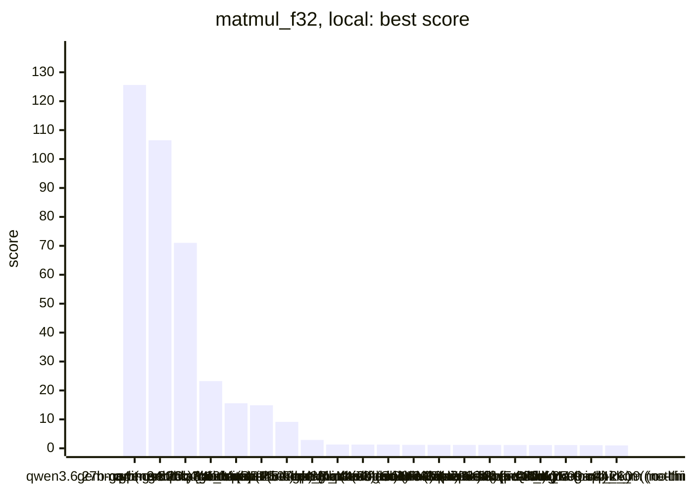
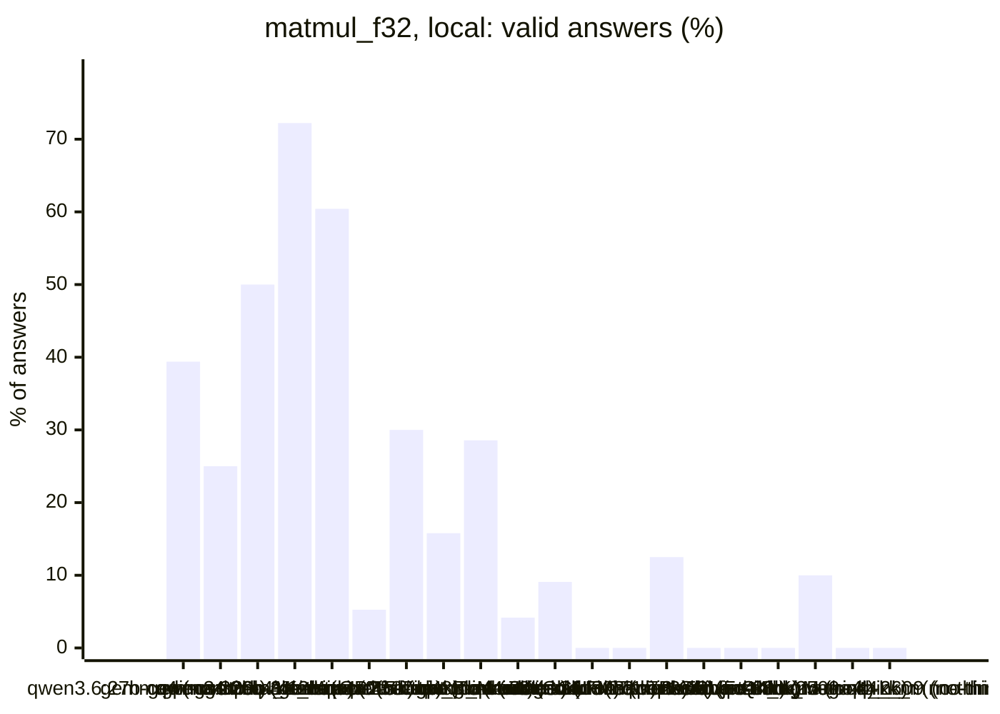
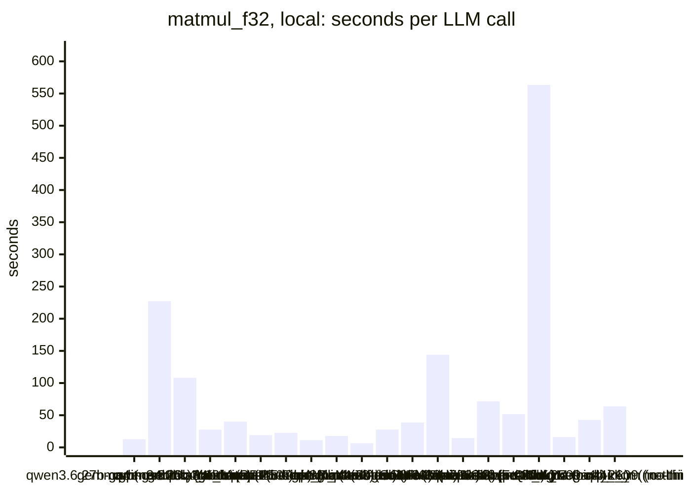
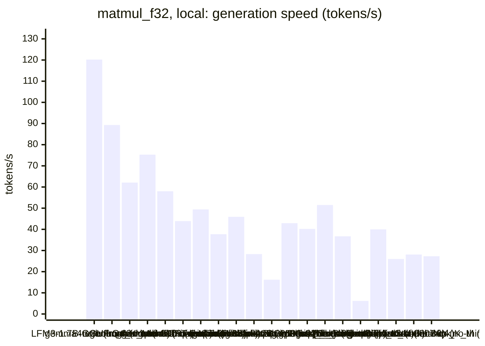
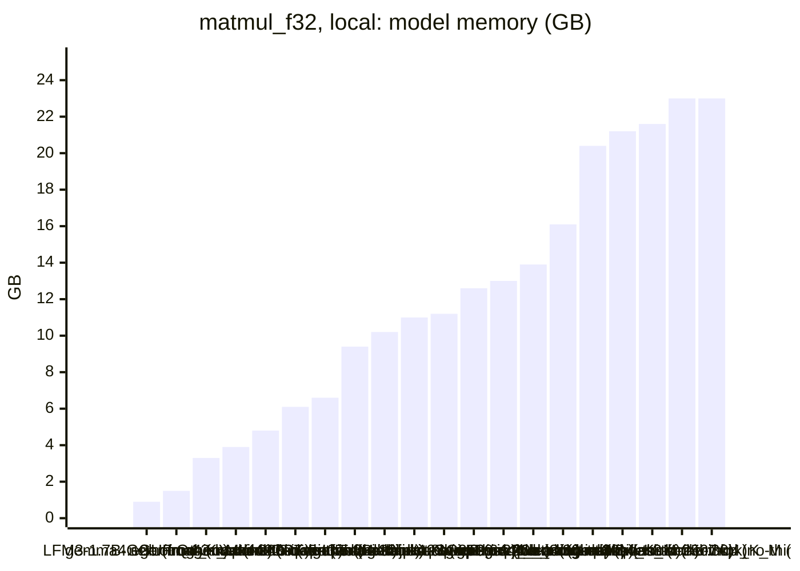
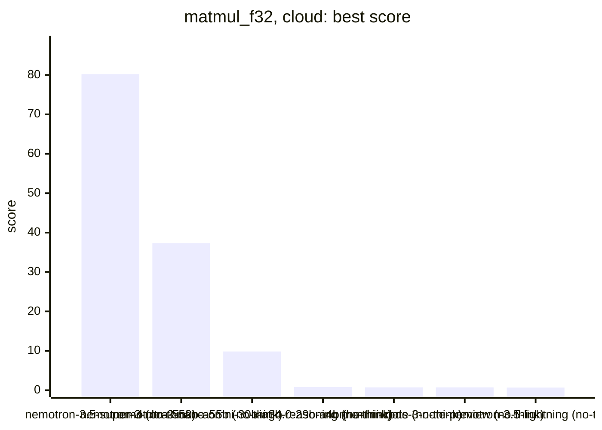
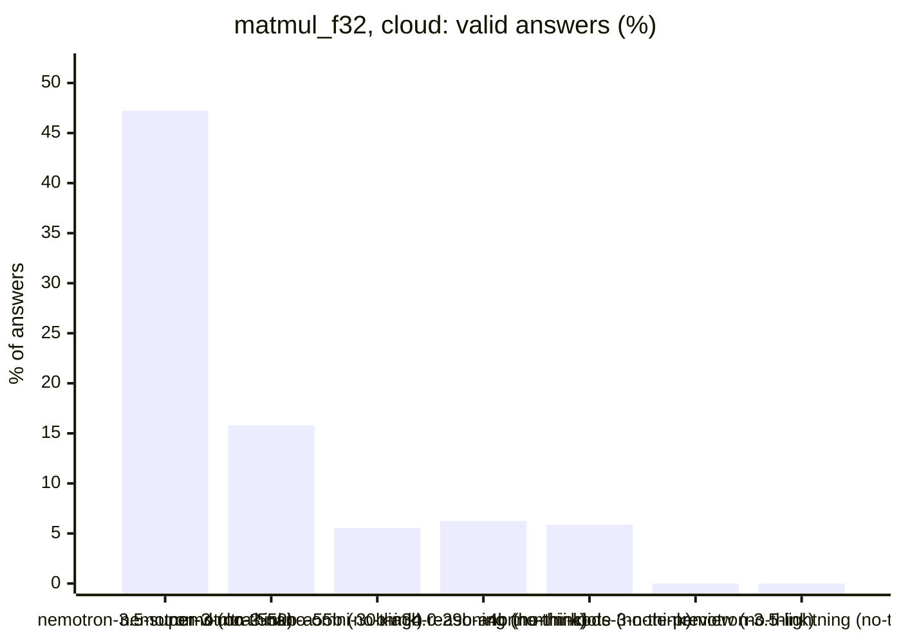
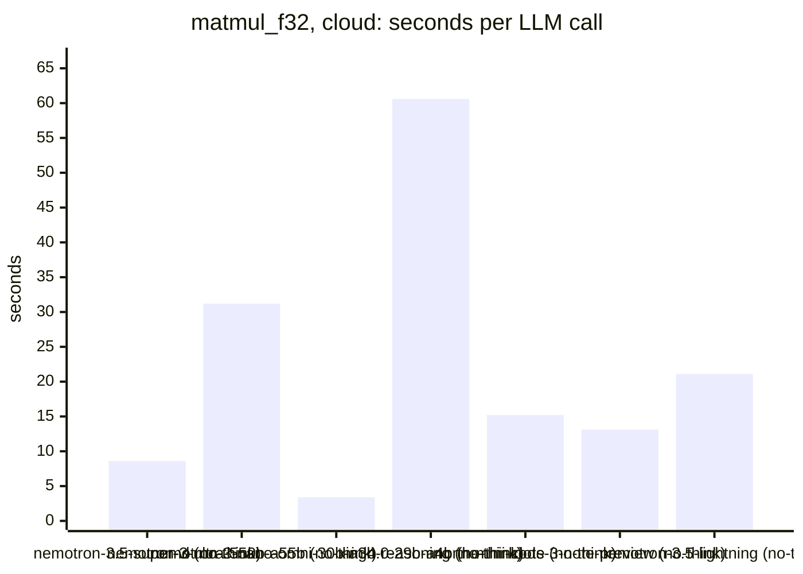
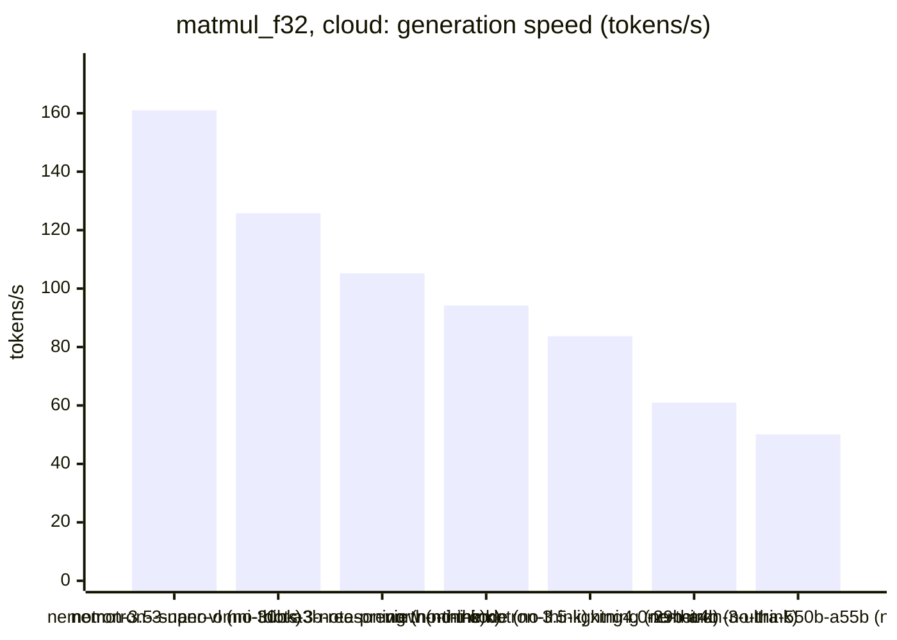

<!-- Copyright (c) 2026 by C. Klukas -->
<!-- SPDX-License-Identifier: GPL-3.0-only -->
<!-- Generated by `omega report` from bench/results/*.json. Do not edit by hand. -->

# matmul_f32

27 models, each run at most 60 minutes, ended earlier after 15 answers in a row without progress; one run per model. The [overall ranking](../benchmarks.md#overall-ranking) compares the models over all examples.

Machine: Intel(R) Core(TM) i7-8700K CPU @ 3.70GHz (MS-7A98), 12 cores, 64 GB, 2x NVIDIA GeForce GTX 1080 Ti, 11264 MiB.

## Local models

Ollama on this machine.

| Model | Params | Initial | Best | Gain | LLM calls | s/call | Valid | New bests | Min to best | Minutes | Stopped by |
|---|---|--:|--:|--:|--:|--:|--:|--:|--:|--:|---|
| gemma4:latest (no-think) | 7.5B | 1.10309 | **125.5650** | ×113.83 | 33 | 13 | 39% | 4 | 8.8 | 10.8 | no progress |
| qwen3.6:27b-coding-mtp-q4_K_M (no-think) | 27.3B | 1.07063 | **106.5050** | ×99.48 | 16 | 227 | 25% | 3 | 61.9 | 63.9 | time limit |
| gpt-oss:20b (no-think) | 20.9B | 1.07799 | **71.0274** | ×65.89 | 24 | 108 | 50% | 2 | 45.9 | 47.8 | no progress |
| gemma4:26b-a4b-it-qat (no-think) | 25.2B | 1.1252 | **23.2264** | ×20.64 | 36 | 28 | 72% | 3 | 9.6 | 20.0 | no progress |
| gemma4:12b-it-qat (no-think) | 11.9B | 1.07954 | **15.5786** | ×14.43 | 48 | 40 | 60% | 6 | 35.6 | 37.0 | no progress |
| qwen3:30b-a3b-instruct-2507-q4_K_M (no-think) | 30.5B | 1.14117 | **14.8830** | ×13.04 | 19 | 19 | 5% | 1 | 6.1 | 8.2 | no progress |
| gemma4:e4b-it-qat (no-think) | 7.5B | 1.05699 | **9.13823** | ×8.65 | 30 | 23 | 30% | 4 | 13.1 | 14.5 | no progress |
| qwen2.5-coder:7b (no-think) | 7.6B | 1.14793 | **2.89343** | ×2.52 | 19 | 11 | 16% | 2 | 4.2 | 6.2 | no progress |
| yandex/YandexGPT-5-Lite-8B-instruct-GGUF:latest (no-think) | 8.0B | 1.18319 | **1.30779** | ×1.11 | 28 | 18 | 29% | 1 | 4.6 | 17.1 | no progress |
| gemma4:e2b (no-think) | 4.6B | 1.13712 | **1.29868** | ×1.14 | 24 | 6 | 4% | 1 | 1.7 | 4.4 | no progress |
| glm-4.7-flash:latest (no-think) | 29.9B | 1.14428 | **1.27475** | ×1.11 | 33 | 28 | 9% | 3 | 17.6 | 19.6 | no progress |
| qwen3-coder:30b (no-think) | 30.5B | 1.19735 | **1.19735** | ×1.00 | 16 | 39 | 0% | 0 | - | 12.4 | no progress |
| underdog-saluki-27b:iq2-mix (no-think) | 26.9B | 1.19455 | **1.19455** | ×1.00 | 16 | 144 | 0% | 0 | - | 39.8 | no progress |
| nemotron-3-nano:4b (no-think) | 4.0B | 1.1709 | **1.1709** | ×1.00 | 16 | 14 | 12% | 0 | - | 5.5 | no progress |
| qwen3.5:latest (no-think) | 9.0B | 1.16869 | **1.16869** | ×1.00 | 16 | 72 | 0% | 0 | - | 20.4 | no progress |
| hf.co/LiquidAI/LFM3-1.7B-GGUF:Q4_K_M (no-think) | 1.73B | 1.14809 | **1.14809** | ×1.00 | 16 | 52 | 0% | 0 | - | 14.9 | no progress |
| frob/sarvam:30b (no-think) | 32.2B | 1.13161 | **1.13161** | ×1.00 | 7 | 563 | 0% | 0 | - | 67.8 | time limit |
| MichelRosselli/apertus:8b-instruct-2509-q4_k_m (no-think) | 8.1B | 1.0983 | **1.13014** | ×1.03 | 30 | 16 | 10% | 1 | 5.2 | 10.4 | no progress |
| llm-jp-4-8b-omega:q4_k_m (no-think) | 8.6B | 1.07033 | **1.07033** | ×1.00 | 16 | 43 | 0% | 0 | - | 12.7 | no progress |
| richardyoung/frognano-4b-2609:latest (no-think) | 4.3B | 0.99504 | **0.99504** | ×1.00 | 16 | 64 | 0% | 0 | - | 18.3 | no progress |

### Inference speed and memory

RAM is what Ollama reports for the loaded model (weights, context cache and buffers; on Apple silicon this is shared memory). Load is the time to bring the model into memory. Prompt and generation speeds are tokens per second over all calls of the run.

| Model | Params | RAM GB | Load s | Prompt tok/s | Gen tok/s | Median s/call | p90 s/call | Tokens/answer | Stopped |
|---|---|--:|--:|--:|--:|--:|--:|--:|--:|
| gemma4:e2b (no-think) | 4.6B | 0.9 | 0 | 4201 | 120.2 | 6 | 8 | 446 | 0 |
| hf.co/LiquidAI/LFM3-1.7B-GGUF:Q4_K_M (no-think) | 1.73B | 1.5 | 0 | 5365 | 89.3 | 70 | 75 | 829 | 13 |
| gemma4:latest (no-think) | 7.5B | 3.3 | 0 | 1656 | 62.1 | 10 | 27 | 530 | 0 |
| nemotron-3-nano:4b (no-think) | 4.0B | 3.9 | 0 | 2205 | 75.3 | 9 | 14 | 816 | 0 |
| richardyoung/frognano-4b-2609:latest (no-think) | 4.3B | 4.8 | 0 | 1926 | 58.0 | 53 | 125 | 1549 | 7 |
| gemma4:e4b-it-qat (no-think) | 7.5B | 6.1 | 0 | 1833 | 43.9 | 18 | 50 | 818 | 0 |
| qwen2.5-coder:7b (no-think) | 7.6B | 6.6 | 0 | 2203 | 49.4 | 11 | 17 | 404 | 0 |
| qwen3.5:latest (no-think) | 9.0B | 9.4 | 0 | 1163 | 37.7 | 55 | 183 | 1497 | 3 |
| yandex/YandexGPT-5-Lite-8B-instruct-GGUF:latest (no-think) | 8.0B | 10.2 | 0 | 1989 | 45.9 | 17 | 27 | 641 | 0 |
| gemma4:12b-it-qat (no-think) | 11.9B | 11.0 | 0 | 643 | 28.3 | 35 | 64 | 748 | 4 |
| underdog-saluki-27b:iq2-mix (no-think) | 26.9B | 11.2 | 0 | 397 | 16.2 | 96 | 437 | 1356 | 3 |
| MichelRosselli/apertus:8b-instruct-2509-q4_k_m (no-think) | 8.1B | 12.6 | 0 | 1694 | 42.9 | 15 | 22 | 510 | 1 |
| llm-jp-4-8b-omega:q4_k_m (no-think) | 8.6B | 13.0 | 0 | 1700 | 40.2 | 43 | 51 | 1448 | 2 |
| gpt-oss:20b (no-think) | 20.9B | 13.9 | 0 | 1946 | 51.5 | 81 | 240 | 5378 | 0 |
| gemma4:26b-a4b-it-qat (no-think) | 25.2B | 16.1 | 0 | 850 | 36.7 | 28 | 38 | 740 | 2 |
| qwen3.6:27b-coding-mtp-q4_K_M (no-think) | 27.3B | 20.4 | 0 | 195 | 6.2 | 234 | 477 | 1301 | 0 |
| frob/sarvam:30b (no-think) | 32.2B | 21.2 | 0 | 1798 | 40.0 | 619 | 627 | 22402 | 0 |
| glm-4.7-flash:latest (no-think) | 29.9B | 21.6 | 0 | 580 | 26.0 | 26 | 40 | 537 | 0 |
| qwen3:30b-a3b-instruct-2507-q4_K_M (no-think) | 30.5B | 23.0 | 0 | 1013 | 28.1 | 14 | 39 | 403 | 0 |
| qwen3-coder:30b (no-think) | 30.5B | 23.0 | 0 | 938 | 27.3 | 44 | 54 | 921 | 0 |

### Best score over time

| Model | 15 min | 30 min | 45 min | 60 min |
|---|--:|--:|--:|--:|
| gemma4:latest (no-think) | 125.5650 | 125.5650 | 125.5650 | 125.5650 |
| qwen3.6:27b-coding-mtp-q4_K_M (no-think) | 1.07063 | 1.07063 | 1.07063 | 1.07063 |
| gpt-oss:20b (no-think) | 67.7222 | 67.7222 | 67.7222 | 71.0274 |
| gemma4:26b-a4b-it-qat (no-think) | 23.2264 | 23.2264 | 23.2264 | 23.2264 |
| gemma4:12b-it-qat (no-think) | 15.3139 | 15.3524 | 15.5786 | 15.5786 |
| qwen3:30b-a3b-instruct-2507-q4_K_M (no-think) | 14.8830 | 14.8830 | 14.8830 | 14.8830 |
| gemma4:e4b-it-qat (no-think) | 9.13823 | 9.13823 | 9.13823 | 9.13823 |
| qwen2.5-coder:7b (no-think) | 2.89343 | 2.89343 | 2.89343 | 2.89343 |
| yandex/YandexGPT-5-Lite-8B-instruct-GGUF:latest (no-think) | 1.30779 | 1.30779 | 1.30779 | 1.30779 |
| gemma4:e2b (no-think) | 1.29868 | 1.29868 | 1.29868 | 1.29868 |
| glm-4.7-flash:latest (no-think) | 1.21471 | 1.27475 | 1.27475 | 1.27475 |
| qwen3-coder:30b (no-think) | 1.19735 | 1.19735 | 1.19735 | 1.19735 |
| underdog-saluki-27b:iq2-mix (no-think) | 1.19455 | 1.19455 | 1.19455 | 1.19455 |
| nemotron-3-nano:4b (no-think) | 1.1709 | 1.1709 | 1.1709 | 1.1709 |
| qwen3.5:latest (no-think) | 1.16869 | 1.16869 | 1.16869 | 1.16869 |
| hf.co/LiquidAI/LFM3-1.7B-GGUF:Q4_K_M (no-think) | 1.14809 | 1.14809 | 1.14809 | 1.14809 |
| frob/sarvam:30b (no-think) | 1.13161 | 1.13161 | 1.13161 | 1.13161 |
| MichelRosselli/apertus:8b-instruct-2509-q4_k_m (no-think) | 1.13014 | 1.13014 | 1.13014 | 1.13014 |
| llm-jp-4-8b-omega:q4_k_m (no-think) | 1.07033 | 1.07033 | 1.07033 | 1.07033 |
| richardyoung/frognano-4b-2609:latest (no-think) | 0.99504 | 0.99504 | 0.99504 | 0.99504 |

### Outcome of the LLM answers

| Model | compile error | duplicate | edit error | invalid | llm error | ok | timeout |
|---|--:|--:|--:|--:|--:|--:|--:|
| gemma4:latest (no-think) | 7 | 3 | 2 | 8 | 0 | 13 | 0 |
| qwen3.6:27b-coding-mtp-q4_K_M (no-think) | 5 | 0 | 0 | 7 | 0 | 4 | 0 |
| gpt-oss:20b (no-think) | 6 | 0 | 6 | 0 | 0 | 12 | 0 |
| gemma4:26b-a4b-it-qat (no-think) | 6 | 0 | 2 | 0 | 2 | 26 | 0 |
| gemma4:12b-it-qat (no-think) | 10 | 1 | 2 | 2 | 4 | 29 | 0 |
| qwen3:30b-a3b-instruct-2507-q4_K_M (no-think) | 6 | 5 | 1 | 6 | 0 | 1 | 0 |
| gemma4:e4b-it-qat (no-think) | 9 | 5 | 4 | 3 | 0 | 9 | 0 |
| qwen2.5-coder:7b (no-think) | 3 | 0 | 1 | 12 | 0 | 3 | 0 |
| yandex/YandexGPT-5-Lite-8B-instruct-GGUF:latest (no-think) | 3 | 3 | 5 | 8 | 0 | 8 | 1 |
| gemma4:e2b (no-think) | 10 | 1 | 3 | 9 | 0 | 1 | 0 |
| glm-4.7-flash:latest (no-think) | 17 | 5 | 3 | 5 | 0 | 3 | 0 |
| qwen3-coder:30b (no-think) | 6 | 5 | 1 | 4 | 0 | 0 | 0 |
| underdog-saluki-27b:iq2-mix (no-think) | 8 | 0 | 1 | 4 | 3 | 0 | 0 |
| nemotron-3-nano:4b (no-think) | 3 | 0 | 10 | 1 | 0 | 2 | 0 |
| qwen3.5:latest (no-think) | 11 | 0 | 1 | 1 | 3 | 0 | 0 |
| hf.co/LiquidAI/LFM3-1.7B-GGUF:Q4_K_M (no-think) | 0 | 0 | 2 | 1 | 13 | 0 | 0 |
| frob/sarvam:30b (no-think) | 0 | 0 | 5 | 2 | 0 | 0 | 0 |
| MichelRosselli/apertus:8b-instruct-2509-q4_k_m (no-think) | 12 | 3 | 10 | 1 | 1 | 3 | 0 |
| llm-jp-4-8b-omega:q4_k_m (no-think) | 13 | 0 | 1 | 0 | 2 | 0 | 0 |
| richardyoung/frognano-4b-2609:latest (no-think) | 4 | 0 | 2 | 3 | 7 | 0 | 0 |

### Best idea per model

- **gemma4:latest (no-think)**: Implement multithreading over the row blocks using a worker function to leverage all 10 cores for parallel execution of the matrix multiplication.
- **qwen3.6:27b-coding-mtp-q4_K_M (no-think)**: tuned BLOCK_M=128, BLOCK_K=32, BLOCK_N=128 on top of: Implement a multithreaded, cache-blocked i-k-j matmul with NEON vectorization. The naive implementation has terrible memory …
- **gpt-oss:20b (no-think)**: Replace row‑by‑row zeroing with a single memset for speed, and vectorize the inner j loop with ARM NEON intrinsics to compute four products at once.
- **gemma4:26b-a4b-it-qat (no-think)**: Implement the i-k-j loop order which enables contiguous memory access for the innermost loop, allowing the compiler to easily auto-vectorize the accumulation.
- **gemma4:12b-it-qat (no-think)**: tuned num_threads=12 on top of: Implement a micro-kernel using NEON SIMD with a register-blocking approach (4x8 tile of C) to maximize FMA utilization and minimize loads from C.
- **qwen3:30b-a3b-instruct-2507-q4_K_M (no-think)**: Fix the incorrect loop order that caused wrong results by ensuring proper accumulation of matrix multiplication terms, and add NEON intrinsics with register blocking to improve …
- **gemma4:e4b-it-qat (no-think)**: Reorder the loops to i-k-j to improve data locality for B and C accesses, which is beneficial for cache performance.
- **qwen2.5-coder:7b (no-think)**: tuned unroll=4 on top of: Loop unrolling and use of NEON intrinsics for better performance on ARM NEON.
- **yandex/YandexGPT-5-Lite-8B-instruct-GGUF:latest (no-think)**: Declare the variable block_size and use it to specify the block size for tiling. This should improve memory access efficiency and potentially increase performance.
- **gemma4:e2b (no-think)**: Implement tiled matrix multiplication with NEON vectorization for the inner product to maximize data reuse and leverage ARM NEON capabilities.
- **glm-4.7-flash:latest (no-think)**: tuned UNROLL=4 on top of: Expose the inner loop unroll factor (3) as a constant to allow the evolutionary engine to tune it for optimal performance on Apple Silicon.
- **qwen3-coder:30b (no-think)**: initial program
- **underdog-saluki-27b:iq2-mix (no-think)**: initial program
- **nemotron-3-nano:4b (no-think)**: initial program
- **qwen3.5:latest (no-think)**: initial program
- **hf.co/LiquidAI/LFM3-1.7B-GGUF:Q4_K_M (no-think)**: initial program
- **frob/sarvam:30b (no-think)**: initial program
- **MichelRosselli/apertus:8b-instruct-2509-q4_k_m (no-think)**: Utilize ARM NEON intrinsics for vectorized inner loop to improve performance on Apple Silicon.
- **llm-jp-4-8b-omega:q4_k_m (no-think)**: initial program
- **richardyoung/frognano-4b-2609:latest (no-think)**: initial program

## Cloud models (OpenRouter)

Free OpenRouter models; times include the network and the provider's queue.

| Model | Params | Initial | Best | Gain | LLM calls | s/call | Valid | New bests | Min to best | Minutes | Stopped by |
|---|---|--:|--:|--:|--:|--:|--:|--:|--:|--:|---|
| nvidia/nemotron-3.5-super-vl:free (no-think) |  | 0.71905 | **80.2183** | ×111.56 | 36 | 9 | 47% | 6 | 10.8 | 12.0 | no progress |
| nvidia/nemotron-3-ultra-550b-a55b:free (no-think) |  | 0.73838 | **37.3228** | ×50.55 | 19 | 31 | 16% | 2 | 10.6 | 11.5 | no progress |
| nvidia/nemotron-3-nano-omni-30b-a3b-reasoning:free (no-think) |  | 0.72885 | **9.82231** | ×13.48 | 18 | 3 | 6% | 1 | 1.2 | 2.2 | no progress |
| xingchen-agi/xing4.0-29b-a4b:free (no-think) |  | 0.82808 | **0.82808** | ×1.00 | 16 | 61 | 6% | 0 | - | 17.2 | no progress |
| cohere/north-mini-code:free (no-think) |  | 0.6868 | **0.70939** | ×1.03 | 17 | 15 | 6% | 1 | 5.1 | 6.1 | no progress |
| dots-studio/dots-3-note-preview:free (no-think) |  | 0.70404 | **0.70404** | ×1.00 | 16 | 13 | 0% | 0 | - | 4.5 | no progress |
| nvidia/nemotron-3.5-lightning:free (no-think) |  | 0.66865 | **0.66865** | ×1.00 | 15 | 21 | 0% | 0 | - | 6.3 | no progress |

### Inference speed and cost

Generation speed is measured from the first to the last streamed token; the time to the first token is counted as prompt time. Cost is what OpenRouter charged for the run.

| Model | Gen tok/s | Median s/call | p90 s/call | Tokens/answer | Stopped | Cost $ |
|---|--:|--:|--:|--:|--:|--:|
| nvidia/nemotron-3.5-super-vl:free (no-think) | 161.0 | 6 | 19 | 1120 | 3 | 0.000 |
| nvidia/nemotron-3-nano-omni-30b-a3b-reasoning:free (no-think) | 125.8 | 3 | 5 | 350 | 0 | 0.000 |
| dots-studio/dots-3-note-preview:free (no-think) | 105.2 | 13 | 24 | 1138 | 0 | 0.000 |
| cohere/north-mini-code:free (no-think) | 94.2 | 17 | 32 | 1263 | 1 | 0.000 |
| nvidia/nemotron-3.5-lightning:free (no-think) | 83.7 | 14 | 42 | 1042 | 7 | 0.000 |
| xingchen-agi/xing4.0-29b-a4b:free (no-think) | 61.0 | 73 | 95 | 462 | 4 | 0.000 |
| nvidia/nemotron-3-ultra-550b-a55b:free (no-think) | 50.1 | 25 | 74 | 1497 | 0 | 0.000 |

### Best score over time

| Model | 15 min | 30 min | 45 min | 60 min |
|---|--:|--:|--:|--:|
| nvidia/nemotron-3.5-super-vl:free (no-think) | 80.2183 | 80.2183 | 80.2183 | 80.2183 |
| nvidia/nemotron-3-ultra-550b-a55b:free (no-think) | 37.3228 | 37.3228 | 37.3228 | 37.3228 |
| nvidia/nemotron-3-nano-omni-30b-a3b-reasoning:free (no-think) | 9.82231 | 9.82231 | 9.82231 | 9.82231 |
| xingchen-agi/xing4.0-29b-a4b:free (no-think) | 0.82808 | 0.82808 | 0.82808 | 0.82808 |
| cohere/north-mini-code:free (no-think) | 0.70939 | 0.70939 | 0.70939 | 0.70939 |
| dots-studio/dots-3-note-preview:free (no-think) | 0.70404 | 0.70404 | 0.70404 | 0.70404 |
| nvidia/nemotron-3.5-lightning:free (no-think) | 0.66865 | 0.66865 | 0.66865 | 0.66865 |

### Outcome of the LLM answers

| Model | compile error | duplicate | edit error | invalid | llm error | ok |
|---|--:|--:|--:|--:|--:|--:|
| nvidia/nemotron-3.5-super-vl:free (no-think) | 4 | 2 | 6 | 4 | 3 | 17 |
| nvidia/nemotron-3-ultra-550b-a55b:free (no-think) | 11 | 0 | 2 | 3 | 0 | 3 |
| nvidia/nemotron-3-nano-omni-30b-a3b-reasoning:free (no-think) | 1 | 0 | 10 | 6 | 0 | 1 |
| xingchen-agi/xing4.0-29b-a4b:free (no-think) | 2 | 0 | 3 | 0 | 10 | 1 |
| cohere/north-mini-code:free (no-think) | 9 | 2 | 3 | 1 | 1 | 1 |
| dots-studio/dots-3-note-preview:free (no-think) | 8 | 0 | 5 | 3 | 0 | 0 |
| nvidia/nemotron-3.5-lightning:free (no-think) | 4 | 0 | 3 | 1 | 7 | 0 |

### Best idea per model

- **nvidia/nemotron-3.5-super-vl:free (no-think)**: Switch from per-row k-blocking to full i-k-j cache blocking with B-panel packing: each thread processes row tiles, and for each k tile it packs the B tile rows into a contiguous …
- **nvidia/nemotron-3-ultra-550b-a55b:free (no-think)**: Fix the compilation errors by removing the unconditional `#include <arm_neon.h>` and wrapping all NEON-specific code inside `#if defined(__ARM_NEON) ... #else ... #endif` blocks …
- **nvidia/nemotron-3-nano-omni-30b-a3b-reasoning:free (no-think)**: Use loop order i-k-j with cache blocking (128x128) and NEON vectorization to improve data locality and enable SIMD, targeting 10-core CPU performance.
- **xingchen-agi/xing4.0-29b-a4b:free (no-think)**: initial program
- **cohere/north-mini-code:free (no-think)**: Expose the inner-loop tile size (register block) as a tunable constant to allow the engine to discover the optimal micro‑kernel tile dimensions for NEON vectorization and cache …
- **dots-studio/dots-3-note-preview:free (no-think)**: initial program
- **nvidia/nemotron-3.5-lightning:free (no-think)**: initial program
