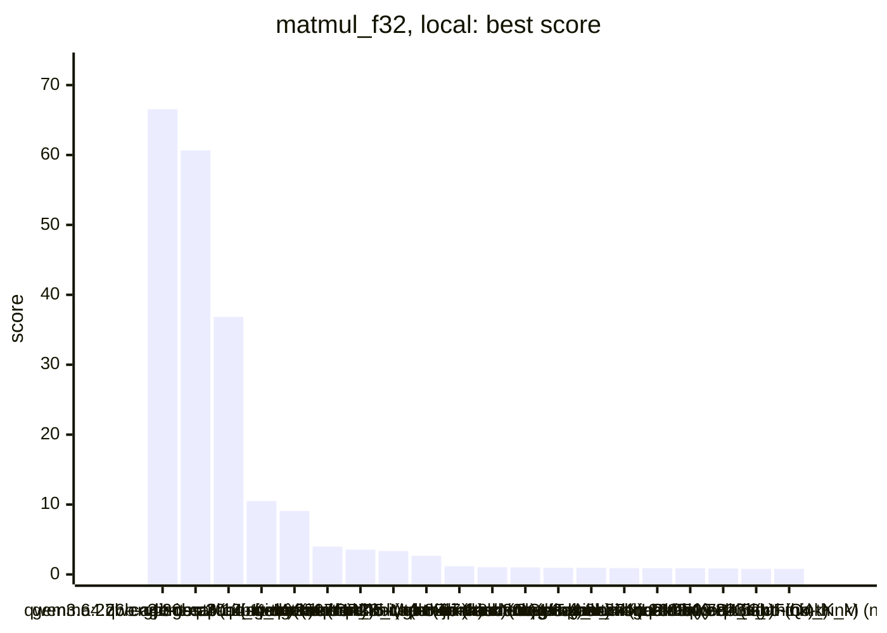
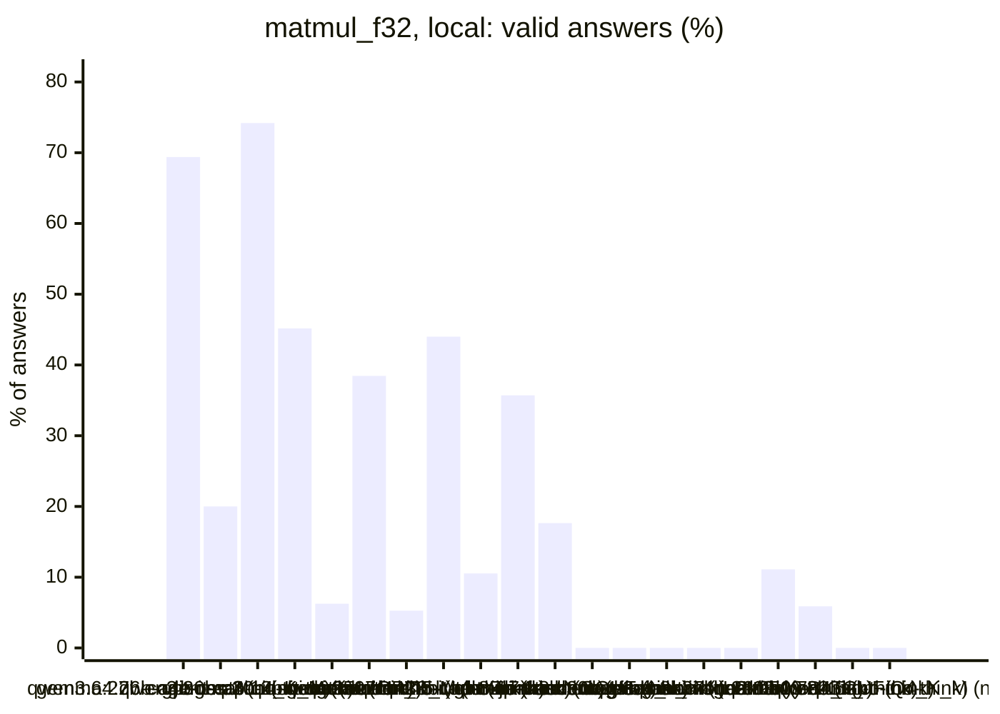
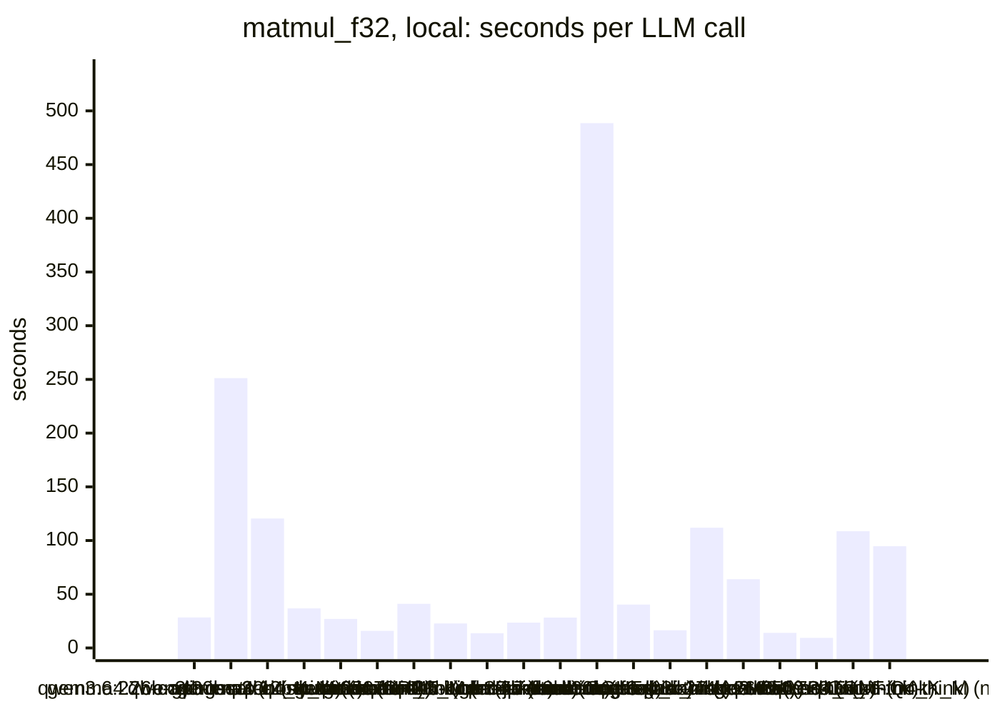
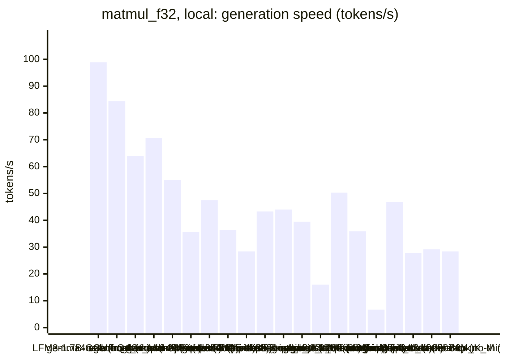
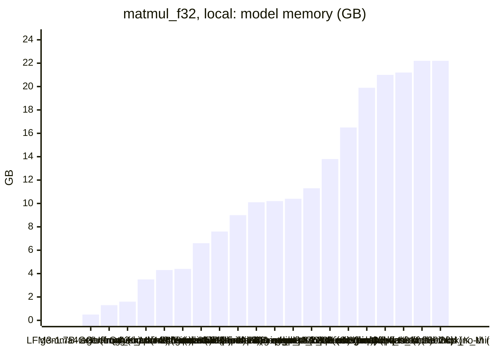
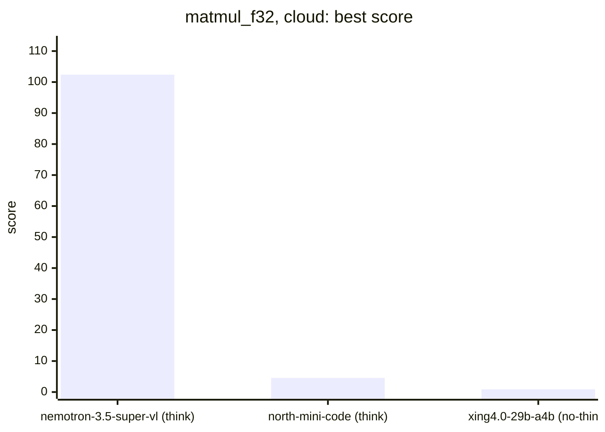
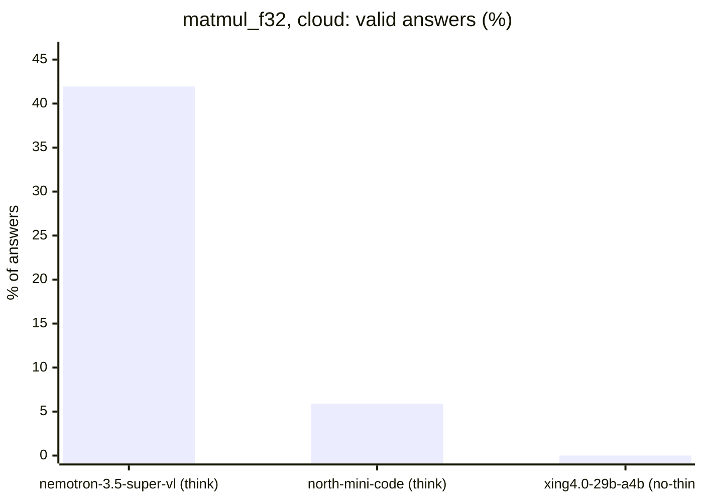
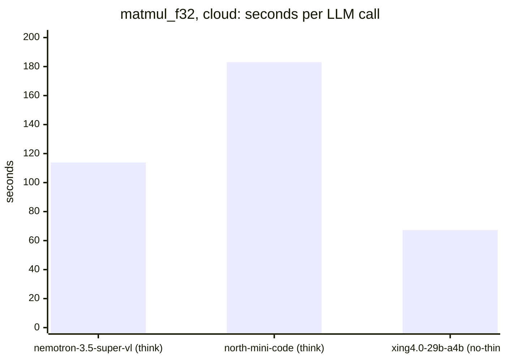
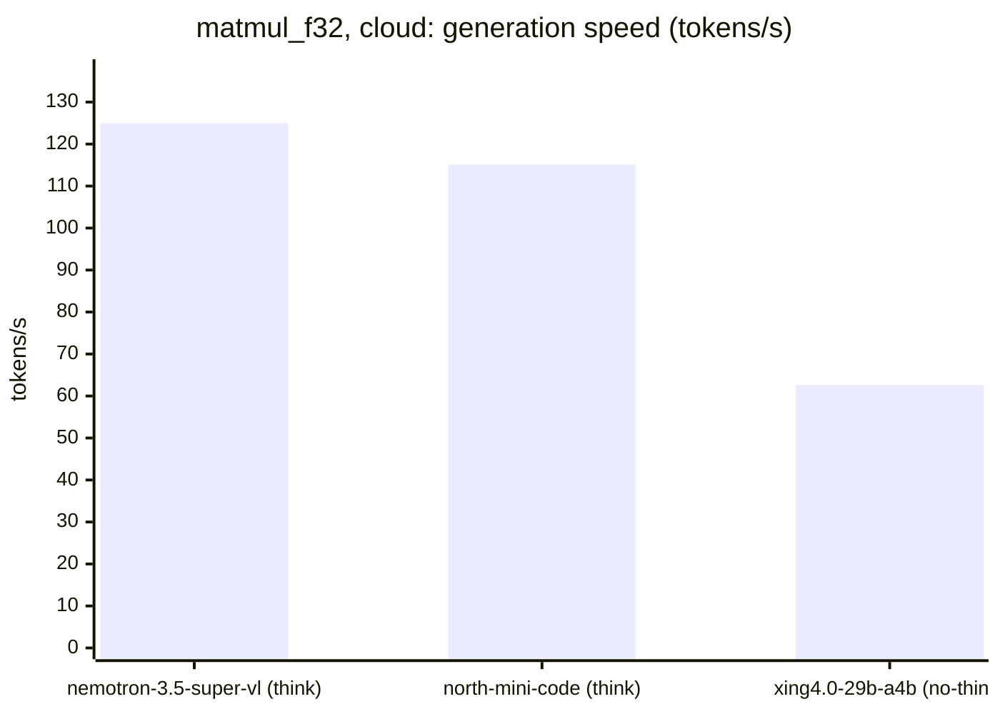

<!-- Copyright (c) 2026 by C. Klukas -->
<!-- SPDX-License-Identifier: GPL-3.0-only -->
<!-- Generated by `omega report` from bench/results/*.json. Do not edit by hand. -->

# matmul_f32

33 models, each run at most 60 minutes, ended earlier after 15 answers in a row without progress; one run per model. The [overall ranking](../benchmarks.md#overall-ranking) compares the models over all examples.

Machine: Intel(R) Core(TM) i7-8700K CPU @ 3.70GHz (MS-7A98), 12 cores, 64 GB, 2x NVIDIA GeForce GTX 1080 Ti, 11264 MiB.

## Local models

Ollama on this machine.

| Model | Params | Initial | Best | Gain | LLM calls | s/call | Valid | New bests | Min to best | Minutes | Stopped by |
|---|---|--:|--:|--:|--:|--:|--:|--:|--:|--:|---|
| gemma4:26b-a4b-it-qat (no-think) | 25.2B | 0.99531 | **66.5591** | ×66.87 | 49 | 28 | 69% | 5 | 25.5 | 26.5 | no progress |
| qwen3.6:27b-coding-mtp-q4_K_M (no-think) | 27.3B | 1.00883 | **60.6579** | ×60.13 | 15 | 251 | 20% | 2 | 63.3 | 64.3 | time limit |
| gpt-oss:20b (no-think) | 20.9B | 0.86696 | **36.8454** | ×42.50 | 31 | 120 | 74% | 3 | 66.5 | 68.2 | time limit |
| gemma4:12b-it-qat (no-think) | 11.9B | 0.99835 | **10.4955** | ×10.51 | 31 | 37 | 45% | 4 | 20.8 | 21.8 | no progress |
| qwen3:30b-a3b-instruct-2507-q4_K_M (no-think) | 30.5B | 0.99817 | **9.08103** | ×9.10 | 16 | 27 | 6% | 1 | 7.3 | 8.3 | no progress |
| gemma4:latest (no-think) | 7.5B | 0.99747 | **3.99021** | ×4.00 | 26 | 16 | 38% | 1 | 4.1 | 9.0 | no progress |
| qwen3-coder:30b (no-think) | 30.5B | 0.8949 | **3.55835** | ×3.98 | 19 | 41 | 5% | 1 | 13.3 | 14.4 | no progress |
| gemma4:e4b-it-qat (no-think) | 7.5B | 0.88875 | **3.3632** | ×3.78 | 25 | 23 | 44% | 4 | 14.4 | 15.6 | no progress |
| qwen2.5-coder:7b (no-think) | 7.6B | 0.88279 | **2.65919** | ×3.01 | 19 | 14 | 11% | 2 | 6.8 | 8.2 | no progress |
| yandex/YandexGPT-5-Lite-8B-instruct-GGUF:latest (no-think) | 8.0B | 0.79364 | **1.17805** | ×1.48 | 56 | 24 | 36% | 7 | 28.5 | 42.8 | no progress |
| glm-4.7-flash:latest (no-think) | 29.9B | 1.01112 | **1.03308** | ×1.02 | 17 | 28 | 18% | 1 | 8.5 | 9.7 | no progress |
| frob/sarvam:30b (no-think) | 32.2B | 1.00103 | **1.00103** | ×1.00 | 8 | 489 | 0% | 0 | - | 66.2 | time limit |
| llm-jp-4-8b-omega:q4_k_m (no-think) | 8.6B | 0.96008 | **0.96008** | ×1.00 | 16 | 40 | 0% | 0 | - | 12.0 | no progress |
| nemotron-3-nano:4b (no-think) | 4.0B | 0.94288 | **0.94288** | ×1.00 | 16 | 16 | 0% | 0 | - | 5.4 | no progress |
| underdog-saluki-27b:iq2-mix (no-think) | 26.9B | 0.90643 | **0.90643** | ×1.00 | 16 | 112 | 0% | 0 | - | 30.9 | no progress |
| richardyoung/frognano-4b-2609:latest (no-think) | 4.3B | 0.89914 | **0.89914** | ×1.00 | 16 | 64 | 0% | 0 | - | 18.1 | no progress |
| MichelRosselli/apertus:8b-instruct-2509-q4_k_m (no-think) | 8.1B | 0.83193 | **0.89458** | ×1.08 | 18 | 14 | 11% | 2 | 6.3 | 7.4 | no progress |
| gemma4:e2b (no-think) | 4.6B | 0.85306 | **0.85306** | ×1.00 | 17 | 9 | 6% | 0 | - | 4.0 | no progress |
| qwen3.5:latest (no-think) | 9.0B | 0.8137 | **0.8137** | ×1.00 | 16 | 109 | 0% | 0 | - | 30.2 | no progress |
| hf.co/LiquidAI/LFM3-1.7B-GGUF:Q4_K_M (no-think) | 1.73B | 0.81259 | **0.81259** | ×1.00 | 16 | 95 | 0% | 0 | - | 26.7 | no progress |

### Inference speed and memory

RAM is what Ollama reports for the loaded model (weights, context cache and buffers; on Apple silicon this is shared memory). Load is the time to bring the model into memory. Prompt and generation speeds are tokens per second over all calls of the run.

| Model | Params | RAM GB | Load s | Prompt tok/s | Gen tok/s | Median s/call | p90 s/call | Tokens/answer | Stopped |
|---|---|--:|--:|--:|--:|--:|--:|--:|--:|
| gemma4:e2b (no-think) | 4.6B | 0.5 | 20 | 3915 | 98.9 | 7 | 15 | 537 | 0 |
| hf.co/LiquidAI/LFM3-1.7B-GGUF:Q4_K_M (no-think) | 1.73B | 1.3 | 0 | 4218 | 84.4 | 104 | 115 | 7765 | 15 |
| gemma4:latest (no-think) | 7.5B | 1.6 | 25 | 1809 | 63.9 | 14 | 24 | 699 | 0 |
| nemotron-3-nano:4b (no-think) | 4.0B | 3.5 | 11 | 1623 | 70.6 | 13 | 25 | 813 | 0 |
| richardyoung/frognano-4b-2609:latest (no-think) | 4.3B | 4.3 | 0 | 3145 | 55.0 | 56 | 128 | 1593 | 9 |
| gemma4:e4b-it-qat (no-think) | 7.5B | 4.4 | 56 | 2074 | 35.7 | 19 | 42 | 574 | 0 |
| qwen2.5-coder:7b (no-think) | 7.6B | 6.6 | 16 | 2567 | 47.5 | 10 | 31 | 466 | 0 |
| qwen3.5:latest (no-think) | 9.0B | 7.6 | 62 | 1663 | 36.4 | 68 | 242 | 2142 | 4 |
| gemma4:12b-it-qat (no-think) | 11.9B | 9.0 | 23 | 786 | 28.4 | 28 | 51 | 668 | 2 |
| MichelRosselli/apertus:8b-instruct-2509-q4_k_m (no-think) | 8.1B | 10.1 | 20 | 2006 | 43.3 | 14 | 18 | 408 | 0 |
| yandex/YandexGPT-5-Lite-8B-instruct-GGUF:latest (no-think) | 8.0B | 10.2 | 18 | 1789 | 44.0 | 22 | 36 | 802 | 0 |
| llm-jp-4-8b-omega:q4_k_m (no-think) | 8.6B | 10.4 | 18 | 2068 | 39.5 | 37 | 71 | 1374 | 0 |
| underdog-saluki-27b:iq2-mix (no-think) | 26.9B | 11.3 | 26 | 434 | 16.0 | 110 | 202 | 1593 | 0 |
| gpt-oss:20b (no-think) | 20.9B | 13.8 | 98 | 1858 | 50.3 | 81 | 182 | 5682 | 0 |
| gemma4:26b-a4b-it-qat (no-think) | 25.2B | 16.5 | 57 | 1015 | 35.9 | 25 | 38 | 656 | 5 |
| qwen3.6:27b-coding-mtp-q4_K_M (no-think) | 27.3B | 19.9 | 58 | 191 | 6.7 | 198 | 522 | 1406 | 1 |
| frob/sarvam:30b (no-think) | 32.2B | 21.0 | 65 | 2182 | 46.8 | 530 | 593 | 22331 | 0 |
| glm-4.7-flash:latest (no-think) | 29.9B | 21.2 | 64 | 688 | 27.9 | 22 | 58 | 529 | 0 |
| qwen3:30b-a3b-instruct-2507-q4_K_M (no-think) | 30.5B | 22.2 | 61 | 1142 | 29.2 | 24 | 60 | 551 | 0 |
| qwen3-coder:30b (no-think) | 30.5B | 22.2 | 74 | 1047 | 28.4 | 35 | 94 | 859 | 2 |

### Best score over time

| Model | 15 min | 30 min | 45 min | 60 min |
|---|--:|--:|--:|--:|
| gemma4:26b-a4b-it-qat (no-think) | 12.9327 | 66.5591 | 66.5591 | 66.5591 |
| qwen3.6:27b-coding-mtp-q4_K_M (no-think) | 1.00883 | 1.00883 | 1.00883 | 1.00883 |
| gpt-oss:20b (no-think) | 15.2394 | 15.2394 | 18.0145 | 18.0145 |
| gemma4:12b-it-qat (no-think) | 10.3084 | 10.4955 | 10.4955 | 10.4955 |
| qwen3:30b-a3b-instruct-2507-q4_K_M (no-think) | 9.08103 | 9.08103 | 9.08103 | 9.08103 |
| gemma4:latest (no-think) | 3.99021 | 3.99021 | 3.99021 | 3.99021 |
| qwen3-coder:30b (no-think) | 3.55835 | 3.55835 | 3.55835 | 3.55835 |
| gemma4:e4b-it-qat (no-think) | 3.3632 | 3.3632 | 3.3632 | 3.3632 |
| qwen2.5-coder:7b (no-think) | 2.65919 | 2.65919 | 2.65919 | 2.65919 |
| yandex/YandexGPT-5-Lite-8B-instruct-GGUF:latest (no-think) | 1.15124 | 1.17805 | 1.17805 | 1.17805 |
| glm-4.7-flash:latest (no-think) | 1.03308 | 1.03308 | 1.03308 | 1.03308 |
| frob/sarvam:30b (no-think) | 1.00103 | 1.00103 | 1.00103 | 1.00103 |
| llm-jp-4-8b-omega:q4_k_m (no-think) | 0.96008 | 0.96008 | 0.96008 | 0.96008 |
| nemotron-3-nano:4b (no-think) | 0.94288 | 0.94288 | 0.94288 | 0.94288 |
| underdog-saluki-27b:iq2-mix (no-think) | 0.90643 | 0.90643 | 0.90643 | 0.90643 |
| richardyoung/frognano-4b-2609:latest (no-think) | 0.89914 | 0.89914 | 0.89914 | 0.89914 |
| MichelRosselli/apertus:8b-instruct-2509-q4_k_m (no-think) | 0.89458 | 0.89458 | 0.89458 | 0.89458 |
| gemma4:e2b (no-think) | 0.85306 | 0.85306 | 0.85306 | 0.85306 |
| qwen3.5:latest (no-think) | 0.8137 | 0.8137 | 0.8137 | 0.8137 |
| hf.co/LiquidAI/LFM3-1.7B-GGUF:Q4_K_M (no-think) | 0.81259 | 0.81259 | 0.81259 | 0.81259 |

### Outcome of the LLM answers

| Model | compile error | duplicate | edit error | invalid | llm error | ok |
|---|--:|--:|--:|--:|--:|--:|
| gemma4:26b-a4b-it-qat (no-think) | 4 | 1 | 5 | 0 | 5 | 34 |
| qwen3.6:27b-coding-mtp-q4_K_M (no-think) | 5 | 0 | 1 | 5 | 1 | 3 |
| gpt-oss:20b (no-think) | 4 | 2 | 1 | 1 | 0 | 23 |
| gemma4:12b-it-qat (no-think) | 11 | 0 | 2 | 2 | 2 | 14 |
| qwen3:30b-a3b-instruct-2507-q4_K_M (no-think) | 7 | 2 | 2 | 4 | 0 | 1 |
| gemma4:latest (no-think) | 9 | 1 | 1 | 5 | 0 | 10 |
| qwen3-coder:30b (no-think) | 3 | 1 | 1 | 11 | 2 | 1 |
| gemma4:e4b-it-qat (no-think) | 6 | 0 | 4 | 4 | 0 | 11 |
| qwen2.5-coder:7b (no-think) | 4 | 1 | 0 | 12 | 0 | 2 |
| yandex/YandexGPT-5-Lite-8B-instruct-GGUF:latest (no-think) | 17 | 8 | 10 | 1 | 0 | 20 |
| glm-4.7-flash:latest (no-think) | 6 | 0 | 2 | 6 | 0 | 3 |
| frob/sarvam:30b (no-think) | 0 | 0 | 7 | 1 | 0 | 0 |
| llm-jp-4-8b-omega:q4_k_m (no-think) | 14 | 0 | 2 | 0 | 0 | 0 |
| nemotron-3-nano:4b (no-think) | 6 | 0 | 10 | 0 | 0 | 0 |
| underdog-saluki-27b:iq2-mix (no-think) | 13 | 0 | 0 | 3 | 0 | 0 |
| richardyoung/frognano-4b-2609:latest (no-think) | 3 | 0 | 1 | 3 | 9 | 0 |
| MichelRosselli/apertus:8b-instruct-2509-q4_k_m (no-think) | 10 | 3 | 2 | 1 | 0 | 2 |
| gemma4:e2b (no-think) | 3 | 5 | 0 | 8 | 0 | 1 |
| qwen3.5:latest (no-think) | 9 | 0 | 1 | 2 | 4 | 0 |
| hf.co/LiquidAI/LFM3-1.7B-GGUF:Q4_K_M (no-think) | 1 | 0 | 0 | 0 | 15 | 0 |

### Best idea per model

- **gemma4:26b-a4b-it-qat (no-think)**: Implement a blocked/tiled approach to maximize cache reuse by dividing the matrix into blocks and using a micro-kernel that processes multiple rows (4 rows) of C simultaneously to …
- **qwen3.6:27b-coding-mtp-q4_K_M (no-think)**: The previous implementation failed because `matmul_neon_block` used absolute indices (`ir`, `jr`) for pointer arithmetic and loop bounds, but was called repeatedly with …
- **gpt-oss:20b (no-think)**: Fix type mismatch in `std::min` and simplify lambda capture to avoid the “capture default” error, enabling correct compilation and efficient threading.
- **gemma4:12b-it-qat (no-think)**: The current program uses a simple `vld1q_f32` and `vst1q_f32` inside the inner loop, which causes redundant memory traffic. Register blocking (keeping `c_row` in registers for a …
- **qwen3:30b-a3b-instruct-2507-q4_K_M (no-think)**: The loop reordering i-k-j is correct for performance, but the original code fails for n=1 due to uninitialized C; initialize C to zero before computation to ensure correctness …
- **gemma4:latest (no-think)**: Implement multithreading using std::thread to parallelize the computation over the outer loop index 'i' to utilize all available cores.
- **qwen3-coder:30b (no-think)**: Implement a cache-friendly tiled matrix multiplication with loop reordering (i-k-j) and NEON vectorization to improve memory access patterns and enable better vectorization by the …
- **gemma4:e4b-it-qat (no-think)**: Redefine `num_threads` and `n_threads` once outside the thread lambda to resolve the redefinition error and maintain thread count logic.
- **qwen2.5-coder:7b (no-think)**: tuned BLOCK_SIZE=8, NUM_THREADS=15 on top of: Use a blocked matrix multiplication algorithm with cache blocking and multithreading, leveraging NEON intrinsics for parallelized FMA …
- **yandex/YandexGPT-5-Lite-8B-instruct-GGUF:latest (no-think)**: Implement a cache blocking strategy to improve memory efficiency and utilize the CPU cache more effectively.
- **glm-4.7-flash:latest (no-think)**: Fix the indexing error in the inner loop where the B matrix access must use the block stride (n) instead of 1, correcting the correctness bug and allowing performance …
- **frob/sarvam:30b (no-think)**: initial program
- **llm-jp-4-8b-omega:q4_k_m (no-think)**: initial program
- **nemotron-3-nano:4b (no-think)**: initial program
- **underdog-saluki-27b:iq2-mix (no-think)**: initial program
- **richardyoung/frognano-4b-2609:latest (no-think)**: initial program
- **MichelRosselli/apertus:8b-instruct-2509-q4_k_m (no-think)**: tuned K_BLOCK=97 on top of: edit: const int K_BLOCK = 8; // SWEEP: 1, 4, 8, 16 (values from 1 to 256) / for (int k = 0; k < n; ++k) {
- **gemma4:e2b (no-think)**: initial program
- **qwen3.5:latest (no-think)**: initial program
- **hf.co/LiquidAI/LFM3-1.7B-GGUF:Q4_K_M (no-think)**: initial program

## Cloud models (OpenRouter)

Free OpenRouter models; times include the network and the provider's queue.

| Model | Params | Initial | Best | Gain | LLM calls | s/call | Valid | New bests | Min to best | Minutes | Stopped by |
|---|---|--:|--:|--:|--:|--:|--:|--:|--:|--:|---|
| nvidia/nemotron-3.5-super-vl:free (think) |  | 0.87418 | **102.4430** | ×117.19 | 31 | 114 | 42% | 4 | 63.5 | 64.7 | time limit |
| cohere/north-mini-code:free (think) |  | 0.6874 | **4.56267** | ×6.64 | 17 | 183 | 6% | 1 | 52.2 | 53.5 | no progress |
| google/gemma-4-26b-a4b-it:free (no-think) |  | | | | | | | | | | failed: all 6 model requests failed: google/gemma-4-26b-a4b-it:free: |
| google/gemma-4-31b-it:free (no-think) |  | | | | | | | | | | failed: all 6 model requests failed: google/gemma-4-31b-it:free: rat |
| xingchen-agi/xing4.0-29b-a4b:free (no-think) |  | 0.88057 | **0.88057** | ×1.00 | 10 | 67 | 0% | 0 | - | 12.0 | model errors |
| nvidia/nemotron-3-ultra-550b-a55b:free (no-think) |  | | | | | | | | | | failed: all 6 model requests failed: nvidia/nemotron-3-ultra-550b-a5 |
| nvidia/nemotron-3.5-super-vl:free (no-think) |  | | | | | | | | | | failed: all 6 model requests failed: nvidia/nemotron-3.5-super-vl:fr |
| nvidia/nemotron-3-nano-omni-30b-a3b-reasoning:free (no-think) |  | | | | | | | | | | failed: all 6 model requests failed: nvidia/nemotron-3-nano-omni-30b |
| dots-studio/dots-3-note-preview:free (no-think) |  | | | | | | | | | | failed: all 6 model requests failed: dots-studio/dots-3-note-preview |
| nvidia/nemotron-3.5-lightning:free (no-think) |  | | | | | | | | | | failed: all 6 model requests failed: nvidia/nemotron-3.5-lightning:f |
| cohere/north-mini-code:free (no-think) |  | | | | | | | | | | failed: all 6 model requests failed: cohere/north-mini-code:free: ra |
| poolside/laguna-s-2.1:free (no-think) |  | | | | | | | | | | failed: RuntimeError: OpenRouter has no model 'poolside/laguna-s-2.1 |
| poolside/laguna-xs-2.1:free (no-think) |  | | | | | | | | | | failed: RuntimeError: OpenRouter has no model 'poolside/laguna-xs-2. |

### Inference speed and cost

Generation speed is measured from the first to the last streamed token; the time to the first token is counted as prompt time. Cost is what OpenRouter charged for the run.

| Model | Gen tok/s | Median s/call | p90 s/call | Tokens/answer | Stopped | Cost $ |
|---|--:|--:|--:|--:|--:|--:|
| nvidia/nemotron-3.5-super-vl:free (think) | 125.0 | 101 | 202 | 14097 | 0 | 0.000 |
| cohere/north-mini-code:free (think) | 115.1 | 173 | 280 | 21591 | 1 | 0.000 |
| xingchen-agi/xing4.0-29b-a4b:free (no-think) | 62.6 | 75 | 76 | 296 | 1 | 0.000 |

### Best score over time

| Model | 15 min | 30 min | 45 min | 60 min |
|---|--:|--:|--:|--:|
| nvidia/nemotron-3.5-super-vl:free (think) | 0.87418 | 66.6500 | 84.4834 | 100.5400 |
| cohere/north-mini-code:free (think) | 0.6874 | 0.6874 | 0.6874 | 4.56267 |
| xingchen-agi/xing4.0-29b-a4b:free (no-think) | 0.88057 | 0.88057 | 0.88057 | 0.88057 |

### Outcome of the LLM answers

| Model | compile error | duplicate | edit error | invalid | llm error | ok |
|---|--:|--:|--:|--:|--:|--:|
| nvidia/nemotron-3.5-super-vl:free (think) | 5 | 1 | 11 | 1 | 0 | 13 |
| cohere/north-mini-code:free (think) | 4 | 0 | 11 | 0 | 1 | 1 |
| xingchen-agi/xing4.0-29b-a4b:free (no-think) | 1 | 0 | 0 | 1 | 8 | 0 |

### Best idea per model

- **nvidia/nemotron-3.5-super-vl:free (think)**: tuned BK=16 on top of: Add k-cache blocking (BK=64) to the parallel i-k-j matmul by reordering loops to k-block → i → k → j, so B rows in a k-block are reused across all i rows in …
- **cohere/north-mini-code:free (think)**: Replace naive triple loop with blocked i-k-j algorithm using NEON vectorization, cache blocking, and multithreading over row blocks, and expose BLOCK and MAX_THREADS as tunable …
- **xingchen-agi/xing4.0-29b-a4b:free (no-think)**: initial program
