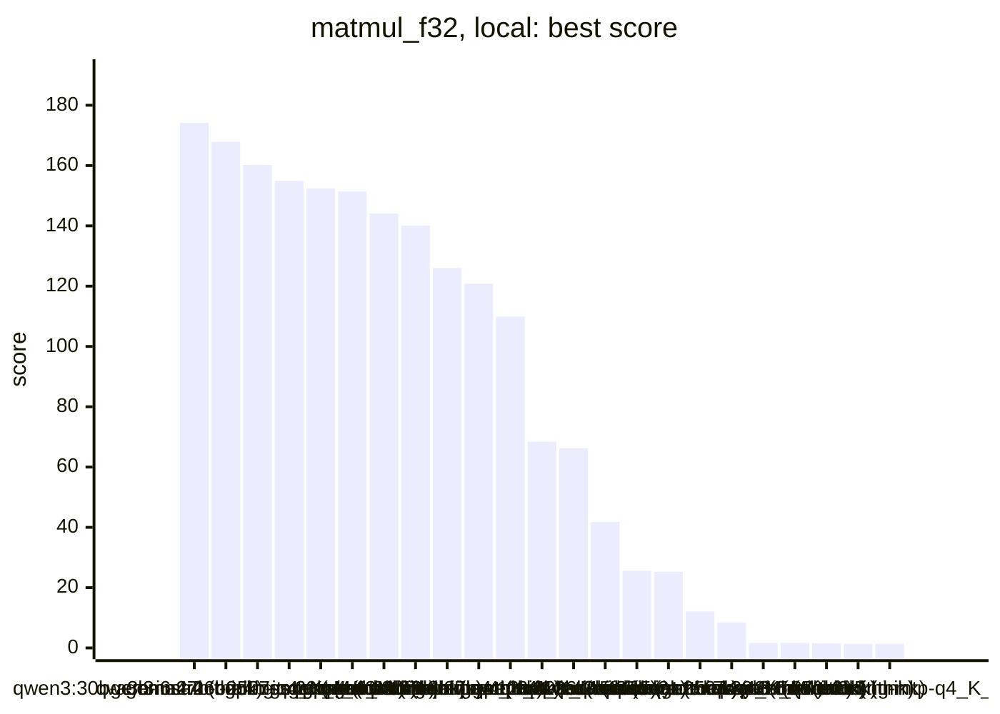
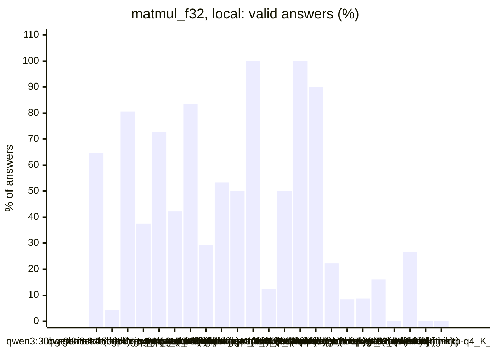
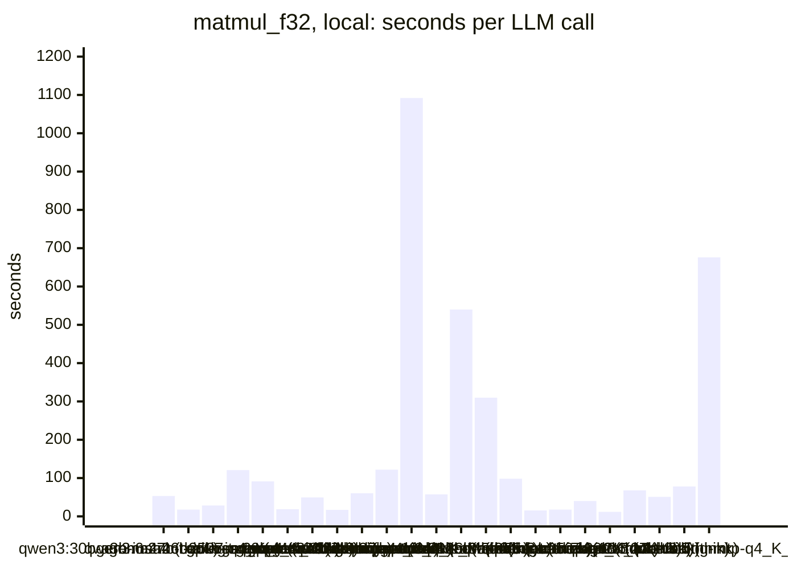
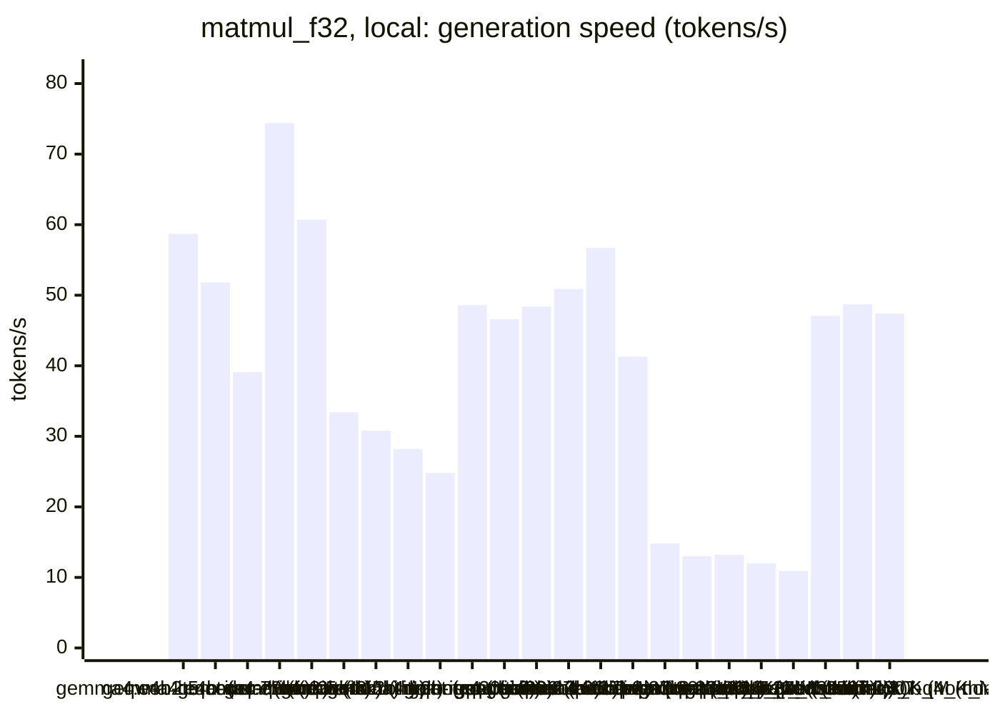
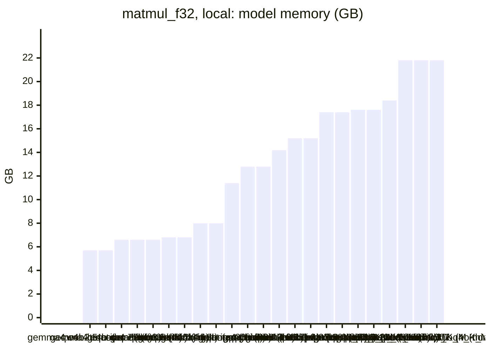

<!-- Copyright (c) 2026 by C. Klukas -->
<!-- SPDX-License-Identifier: GPL-3.0-only -->
<!-- Generated by `omega report` from bench/results/*.json. Do not edit by hand. -->

# matmul_f32

24 models, 15 minutes each, latest run per model. The [overall ranking](../benchmarks.md#overall-ranking) compares the models over all examples.

Machine: Apple M1 Max (Mac13,1), 10 cores, 32 GB.

## Local models

Ollama on this machine.

| Model | Params | Initial | Best | Gain | LLM calls | s/call | Valid | New bests | Min to best |
|---|---|--:|--:|--:|--:|--:|--:|--:|--:|
| gemma4:latest (think) |  | 1.59883 | **174.1030** | ×108.89 | 17 | 53 | 65% | 8 | 15.8 |
| qwen3:30b-a3b-instruct-2507-q4_K_M (no-think) | 30.5B | 1.63177 | **167.9280** | ×102.91 | 48 | 18 | 4% | 2 | 15.2 |
| gemma4:26b-a4b-it-qat (no-think) | 25.2B | 1.59064 | **160.2310** | ×100.73 | 31 | 28 | 81% | 4 | 7.5 |
| qwen3.6:27b-coding-mtp-q4_K_M (no-think) | 27.3B | 1.65835 | **154.8540** | ×93.38 | 8 | 121 | 38% | 2 | 16.3 |
| gpt-oss:20b (no-think) | 20.9B | 1.65652 | **152.3910** | ×91.99 | 11 | 91 | 73% | 4 | 17.4 |
| gemma4:latest (no-think) |  | 1.58471 | **151.3840** | ×95.53 | 45 | 19 | 42% | 5 | 15.6 |
| gpt-oss:20b (think) | 20.9B | 1.63546 | **144.0540** | ×88.08 | 18 | 49 | 83% | 5 | 15.3 |
| gemma4:e4b-it-qat (no-think) | 7.5B | 1.63783 | **140.1020** | ×85.54 | 51 | 17 | 29% | 6 | 15.5 |
| gemma4:e4b-it-qat (think) | 7.5B | 1.51942 | **126.0000** | ×82.93 | 15 | 60 | 53% | 4 | 15.5 |
| qwen3.8:27b-mtp-q4_K_M (no-think) | 27.3B | 1.65734 | **120.7810** | ×72.88 | 8 | 122 | 50% | 1 | 16.4 |
| qwen3.8:27b-mtp-q4_K_M (think) | 27.3B | 1.54195 | **109.8530** | ×71.24 | 1 | 1092 | 100% | 1 | 18.3 |
| gemma4:12b-it-qat (no-think) | 11.9B | 1.64615 | **68.4243** | ×41.57 | 16 | 58 | 12% | 1 | 15.4 |
| gemma4:12b-it-qat (think) | 11.9B | 1.19814 | **66.2698** | ×55.31 | 2 | 540 | 50% | 1 | 18.3 |
| gemma4:26b-a4b-it-qat (think) | 25.2B | 1.5217 | **41.8195** | ×27.48 | 3 | 310 | 100% | 1 | 15.7 |
| qwen3.5:27b (no-think) | 27.8B | 1.65667 | **25.6098** | ×15.46 | 10 | 98 | 90% | 3 | 16.8 |
| qwen3:30b-a3b-instruct-2507-q4_K_M (think) | 30.5B | 1.61641 | **25.2873** | ×15.64 | 54 | 15 | 22% | 2 | 15.3 |
| qwen2.5-coder:7b (no-think) | 7.6B | 1.67317 | **12.1382** | ×7.25 | 48 | 18 | 8% | 2 | 15.4 |
| qwen3-coder:30b (no-think) | 30.5B | 1.66293 | **8.45239** | ×5.08 | 23 | 40 | 9% | 2 | 16.7 |
| gemma4:e2b (no-think) | 5.1B | 1.61153 | **1.68469** | ×1.05 | 56 | 12 | 16% | 3 | 15.8 |
| qwen3.5:latest (no-think) | 9.7B | 1.6743 | **1.6743** | ×1.00 | 14 | 68 | 0% | 0 | - |
| gemma4:e2b (think) | 5.1B | 0.97164 | **1.53353** | ×1.58 | 15 | 51 | 27% | 4 | 10.1 |
| qwen3.5:latest (think) | 9.7B | 1.33259 | **1.33259** | ×1.00 | 12 | 78 | 0% | 0 | - |
| qwen3.6:27b-coding-mtp-q4_K_M (think) | 27.3B | 1.32423 | **1.32423** | ×1.00 | 2 | 676 | 0% | 0 | - |
| qwen3.5:27b (think) | 27.8B | | | | | | | | failed: all 1 model requests failed: qwen3.5:27b: answer stopped: re |

### Inference speed and memory

RAM is what Ollama reports for the loaded model (weights, context cache and buffers; on Apple silicon this is shared memory). Load is the time to bring the model into memory. Prompt and generation speeds are tokens per second over all calls of the run.

| Model | Params | RAM GB | Load s | Prompt tok/s | Gen tok/s | Median s/call | p90 s/call | Tokens/answer | Stopped |
|---|---|--:|--:|--:|--:|--:|--:|--:|--:|
| gemma4:e4b-it-qat (no-think) | 7.5B | 5.7 | 55 | 850 | 58.7 | 13 | 28 | 601 | 2 |
| gemma4:e4b-it-qat (think) | 7.5B | 5.7 | 112 | 1057 | 51.8 | 48 | 120 | 2596 | 0 |
| qwen2.5-coder:7b (no-think) | 7.6B | 6.6 | 48 | 697 | 39.1 | 16 | 24 | 484 | 0 |
| gemma4:e2b (no-think) | 5.1B | 6.6 | 33 | 1186 | 74.4 | 10 | 18 | 509 | 2 |
| gemma4:e2b (think) | 5.1B | 6.6 | 35 | 1409 | 60.7 | 49 | 89 | 2802 | 0 |
| qwen3.5:latest (no-think) | 9.7B | 6.8 | 73 | 551 | 33.4 | 68 | 103 | 1541 | 4 |
| qwen3.5:latest (think) | 9.7B | 6.8 | 89 | 569 | 30.8 | 73 | 118 | 2026 | 0 |
| gemma4:12b-it-qat (no-think) | 11.9B | 8.0 | 66 | 294 | 28.2 | 42 | 129 | 1044 | 2 |
| gemma4:12b-it-qat (think) | 11.9B | 8.0 | 0 | 416 | 24.8 | 730 | 730 | 8481 | 1 |
| gemma4:latest (think) |  | 11.4 | 109 | 1268 | 48.6 | 51 | 80 | 2149 | 0 |
| gpt-oss:20b (no-think) | 20.9B | 12.8 | 100 | 664 | 46.6 | 69 | 153 | 3638 | 0 |
| gpt-oss:20b (think) | 20.9B | 12.8 | 101 | 614 | 48.4 | 47 | 79 | 1873 | 0 |
| gemma4:latest (no-think) |  | 14.2 | 95 | 1276 | 50.9 | 14 | 37 | 676 | 0 |
| gemma4:26b-a4b-it-qat (no-think) | 25.2B | 15.2 | 200 | 516 | 56.7 | 21 | 37 | 612 | 4 |
| gemma4:26b-a4b-it-qat (think) | 25.2B | 15.2 | 278 | 1001 | 41.3 | 286 | 553 | 8845 | 0 |
| qwen3.6:27b-coding-mtp-q4_K_M (no-think) | 27.3B | 17.4 | 277 | 175 | 14.8 | 112 | 372 | 1060 | 0 |
| qwen3.6:27b-coding-mtp-q4_K_M (think) | 27.3B | 17.4 | 210 | 147 | 13.0 | 706 | 706 | 7180 | 0 |
| qwen3.8:27b-mtp-q4_K_M (no-think) | 27.3B | 17.6 | 209 | 130 | 13.2 | 102 | 272 | 1015 | 0 |
| qwen3.8:27b-mtp-q4_K_M (think) | 27.3B | 17.6 | 281 | 95 | 12.0 | 1092 | 1092 | 5725 | 0 |
| qwen3.5:27b (no-think) | 27.8B | 18.4 | 183 | 165 | 10.9 | 71 | 325 | 684 | 0 |
| qwen3:30b-a3b-instruct-2507-q4_K_M (no-think) | 30.5B | 21.8 | 141 | 900 | 47.1 | 11 | 29 | 422 | 1 |
| qwen3:30b-a3b-instruct-2507-q4_K_M (think) | 30.5B | 21.8 | 137 | 889 | 48.7 | 13 | 26 | 423 | 0 |
| qwen3-coder:30b (no-think) | 30.5B | 21.8 | 22 | 985 | 47.4 | 24 | 38 | 1026 | 4 |

### Best score over time

| Model | 3.75 min | 7.5 min | 11.25 min | 15 min |
|---|--:|--:|--:|--:|
| gemma4:latest (think) | 1.59883 | 1.59883 | 24.7383 | 133.5950 |
| qwen3:30b-a3b-instruct-2507-q4_K_M (no-think) | 1.63177 | 1.63177 | 3.60979 | 3.60979 |
| gemma4:26b-a4b-it-qat (no-think) | 1.59064 | 160.2310 | 160.2310 | 160.2310 |
| qwen3.6:27b-coding-mtp-q4_K_M (no-think) | 1.65835 | 1.65835 | 1.65835 | 1.65835 |
| gpt-oss:20b (no-think) | 1.65652 | 1.65652 | 1.65652 | 22.0148 |
| gemma4:latest (no-think) | 9.66047 | 9.66698 | 9.66698 | 9.89172 |
| gpt-oss:20b (think) | 1.63546 | 76.5920 | 76.5920 | 76.5920 |
| gemma4:e4b-it-qat (no-think) | 1.63783 | 25.9352 | 25.9352 | 128.8490 |
| gemma4:e4b-it-qat (think) | 1.51942 | 1.51942 | 1.51942 | 23.9803 |
| qwen3.8:27b-mtp-q4_K_M (no-think) | 1.65734 | 1.65734 | 1.65734 | 1.65734 |
| qwen3.8:27b-mtp-q4_K_M (think) | 1.54195 | 1.54195 | 1.54195 | 1.54195 |
| gemma4:12b-it-qat (no-think) | 1.64615 | 1.64615 | 1.64615 | 1.64615 |
| gemma4:12b-it-qat (think) | 1.19814 | 1.19814 | 1.19814 | 1.19814 |
| gemma4:26b-a4b-it-qat (think) | 1.5217 | 1.5217 | 1.5217 | 1.5217 |
| qwen3.5:27b (no-think) | 1.65667 | 1.65667 | 25.0144 | 25.0144 |
| qwen3:30b-a3b-instruct-2507-q4_K_M (think) | 1.61641 | 25.1689 | 25.1689 | 25.1689 |
| qwen2.5-coder:7b (no-think) | 1.67317 | 6.65771 | 6.65771 | 6.65771 |
| qwen3-coder:30b (no-think) | 1.66293 | 1.66293 | 1.66293 | 1.66293 |
| gemma4:e2b (no-think) | 1.61153 | 1.63627 | 1.63627 | 1.63627 |
| qwen3.5:latest (no-think) | 1.6743 | 1.6743 | 1.6743 | 1.6743 |
| gemma4:e2b (think) | 0.97164 | 1.46192 | 1.53353 | 1.53353 |
| qwen3.5:latest (think) | 1.33259 | 1.33259 | 1.33259 | 1.33259 |
| qwen3.6:27b-coding-mtp-q4_K_M (think) | 1.32423 | 1.32423 | 1.32423 | 1.32423 |

### Outcome of the LLM answers

| Model | compile error | duplicate | edit error | invalid | llm error | ok | timeout |
|---|--:|--:|--:|--:|--:|--:|--:|
| gemma4:latest (think) | 4 | 2 | 0 | 0 | 0 | 11 | 0 |
| qwen3:30b-a3b-instruct-2507-q4_K_M (no-think) | 13 | 18 | 2 | 12 | 1 | 2 | 0 |
| gemma4:26b-a4b-it-qat (no-think) | 0 | 0 | 2 | 0 | 4 | 25 | 0 |
| qwen3.6:27b-coding-mtp-q4_K_M (no-think) | 0 | 0 | 1 | 4 | 0 | 3 | 0 |
| gpt-oss:20b (no-think) | 1 | 0 | 1 | 1 | 0 | 8 | 0 |
| gemma4:latest (no-think) | 13 | 0 | 7 | 6 | 0 | 19 | 0 |
| gpt-oss:20b (think) | 3 | 0 | 0 | 0 | 0 | 15 | 0 |
| gemma4:e4b-it-qat (no-think) | 24 | 0 | 1 | 9 | 2 | 15 | 0 |
| gemma4:e4b-it-qat (think) | 2 | 0 | 1 | 4 | 0 | 8 | 0 |
| qwen3.8:27b-mtp-q4_K_M (no-think) | 2 | 0 | 0 | 2 | 0 | 4 | 0 |
| qwen3.8:27b-mtp-q4_K_M (think) | 0 | 0 | 0 | 0 | 0 | 1 | 0 |
| gemma4:12b-it-qat (no-think) | 5 | 0 | 3 | 4 | 2 | 2 | 0 |
| gemma4:12b-it-qat (think) | 0 | 0 | 0 | 0 | 1 | 1 | 0 |
| gemma4:26b-a4b-it-qat (think) | 0 | 0 | 0 | 0 | 0 | 3 | 0 |
| qwen3.5:27b (no-think) | 0 | 0 | 1 | 0 | 0 | 9 | 0 |
| qwen3:30b-a3b-instruct-2507-q4_K_M (think) | 20 | 5 | 3 | 14 | 0 | 12 | 0 |
| qwen2.5-coder:7b (no-think) | 10 | 7 | 0 | 27 | 0 | 4 | 0 |
| qwen3-coder:30b (no-think) | 1 | 1 | 0 | 15 | 4 | 2 | 0 |
| gemma4:e2b (no-think) | 14 | 5 | 16 | 10 | 2 | 9 | 0 |
| qwen3.5:latest (no-think) | 8 | 0 | 2 | 0 | 4 | 0 | 0 |
| gemma4:e2b (think) | 6 | 0 | 3 | 1 | 0 | 4 | 1 |
| qwen3.5:latest (think) | 3 | 0 | 3 | 6 | 0 | 0 | 0 |
| qwen3.6:27b-coding-mtp-q4_K_M (think) | 0 | 0 | 0 | 2 | 0 | 0 | 0 |

### Best idea per model

- **gemma4:latest (think)**: tuned NUM_THREADS=30 on top of: Implement multi-threading over the row dimension (i) combined with the i-k-j loop order to maximize cache locality and leverage multiple cores.
- **qwen3:30b-a3b-instruct-2507-q4_K_M (no-think)**: Fix the incorrect accumulation in the inner loop by initializing C to zero before the k-loop, as the current code assumes C is already zeroed but the harness does not guarantee …
- **gemma4:26b-a4b-it-qat (no-think)**: Use multithreading to distribute rows of the computation across available CPU cores to increase GFLOPS.
- **qwen3.6:27b-coding-mtp-q4_K_M (no-think)**: Switch to an i-k-j loop order with cache blocking to improve data locality and enable better vectorization, which is a foundational optimization for matrix multiplication that …
- **gpt-oss:20b (no-think)**: tuned TILE_K=73 on top of: Replace the naive triple loop with a row‑parallel, i‑k‑j loop that zeros C, uses a k‑blocking tile, and unrolls the inner j loop for better cache …
- **gemma4:latest (no-think)**: Initialize C elements to zero before the main calculation loop to ensure correctness when accumulation starts from arbitrary values.
- **gpt-oss:20b (think)**: Parallelize over row blocks with up to 10 threads to utilize all CPU cores and reduce total runtime while keeping the existing cache‑friendly i‑k‑j order.
- **gemma4:e4b-it-qat (no-think)**: Implement thread partitioning over the outer loop (i) using `std::thread` to utilize all 10 available cores, building upon the existing $i-k-j$ loop order for cache efficiency.
- **gemma4:e4b-it-qat (think)**: Initialize matrix C to zero at the start of matmul to ensure correct accumulation, as the input C is not guaranteed to be zeroed by the caller.
- **qwen3.8:27b-mtp-q4_K_M (no-think)**: The tiling loop is correct but slow/uninitialized-prone; replace the body with a correct tiled i-k-j implementation and add multithreading over row-blocks to raise GFLOPS.
- **qwen3.8:27b-mtp-q4_K_M (think)**: Replace the naive scalar triple-loop with a multithreaded i-k-j loop order using explicit NEON fma intrinsics (4-wide) on the inner j-loop, which streams contiguous rows of B and …
- **gemma4:12b-it-qat (no-think)**: Reorder loops to i-k-j to improve cache locality and use a multi-threaded approach with basic SIMD to significantly increase GFLOPS.
- **gemma4:12b-it-qat (think)**: Implement multithreading and the i-k-j loop order to significantly improve cache locality and utilize all 10 cores.
- **gemma4:26b-a4b-it-qat (think)**: Use i-k-j loop order with ARM NEON SIMD vectorization and multithreading to maximize cache locality and throughput.
- **qwen3.5:27b (no-think)**: Switch the loop order from i-j-k to i-k-j to stream contiguous rows of B and C in the inner loop, which drastically improves cache locality and enables the compiler to …
- **qwen3:30b-a3b-instruct-2507-q4_K_M (think)**: Reorder loops to i-k-j to enable streaming of rows of B and C, which improves cache locality and enables efficient NEON vectorization, while maintaining correctness by zeroing C …
- **qwen2.5-coder:7b (no-think)**: tuned UNROLL_FACTOR=7.793 on top of: Introduce a constant for the unroll factor to allow the engine to optimize it.
- **qwen3-coder:30b (no-think)**: tuned TILE_SIZE=32, THREAD_THRESHOLD=128 on top of: Introduce a cache-blocking approach with loop reordering i-k-j and NEON vectorization to improve memory access patterns and …
- **gemma4:e2b (no-think)**: tuned BLOCK_SIZE=32 on top of: Implement loop interchange ($j-i-k$) combined with cache blocking to improve data locality and leverage NEON vectorization for inner loop …
- **qwen3.5:latest (no-think)**: initial program
- **gemma4:e2b (think)**: Implement cache tiling over blocks of size $B=64$ and parallelize the outer loop over $i$ using threads to exploit the 10 cores, significantly reducing the constant factor for …
- **qwen3.5:latest (think)**: initial program
- **qwen3.6:27b-coding-mtp-q4_K_M (think)**: initial program
