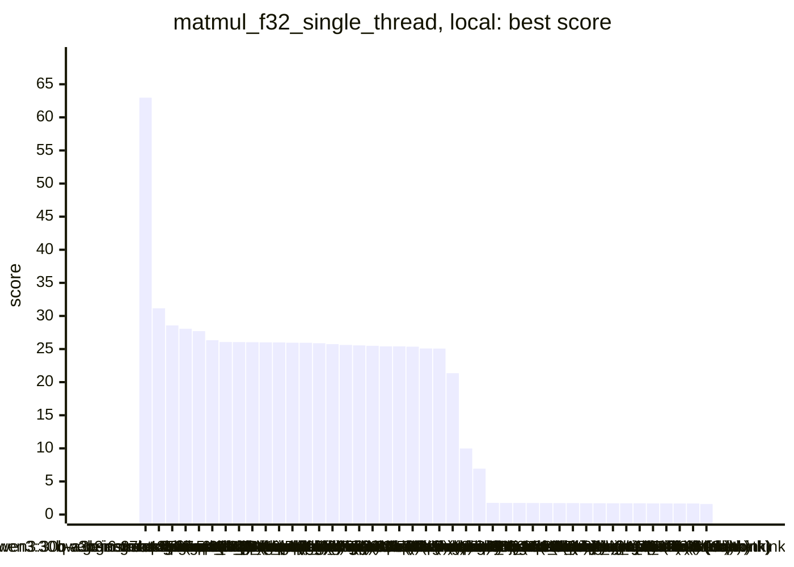
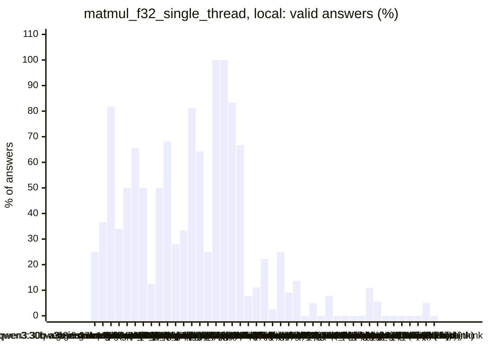
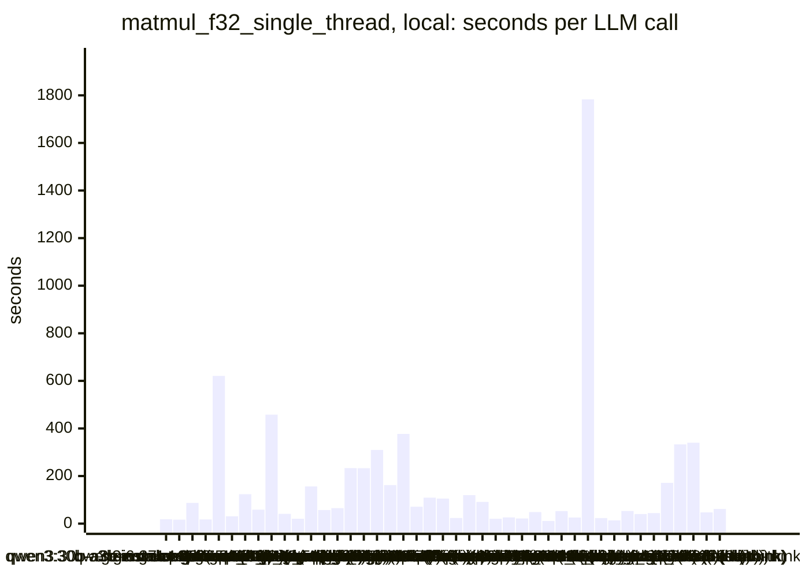
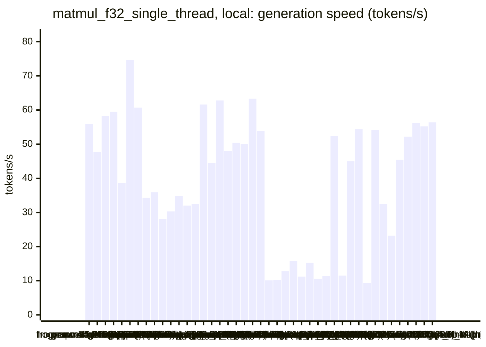
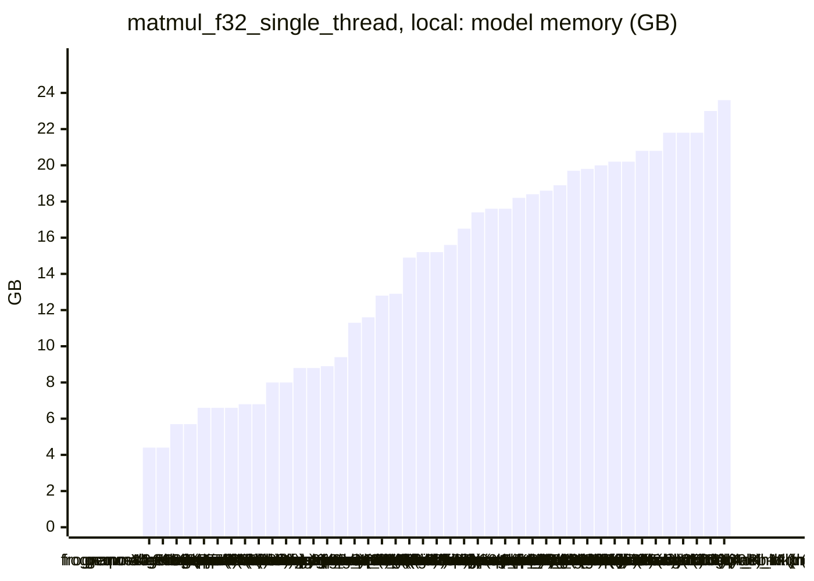
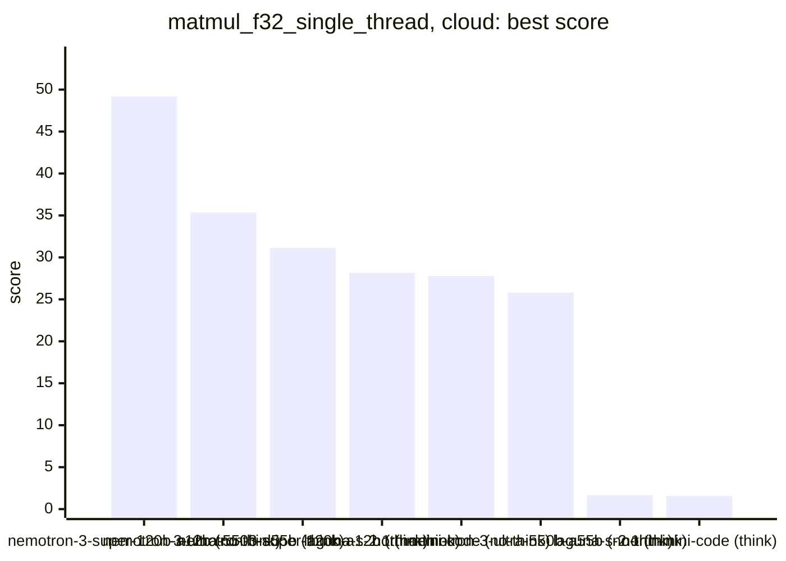
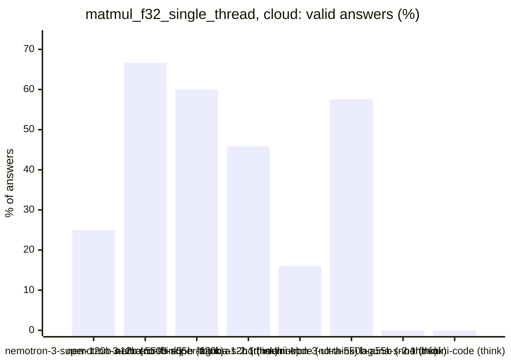
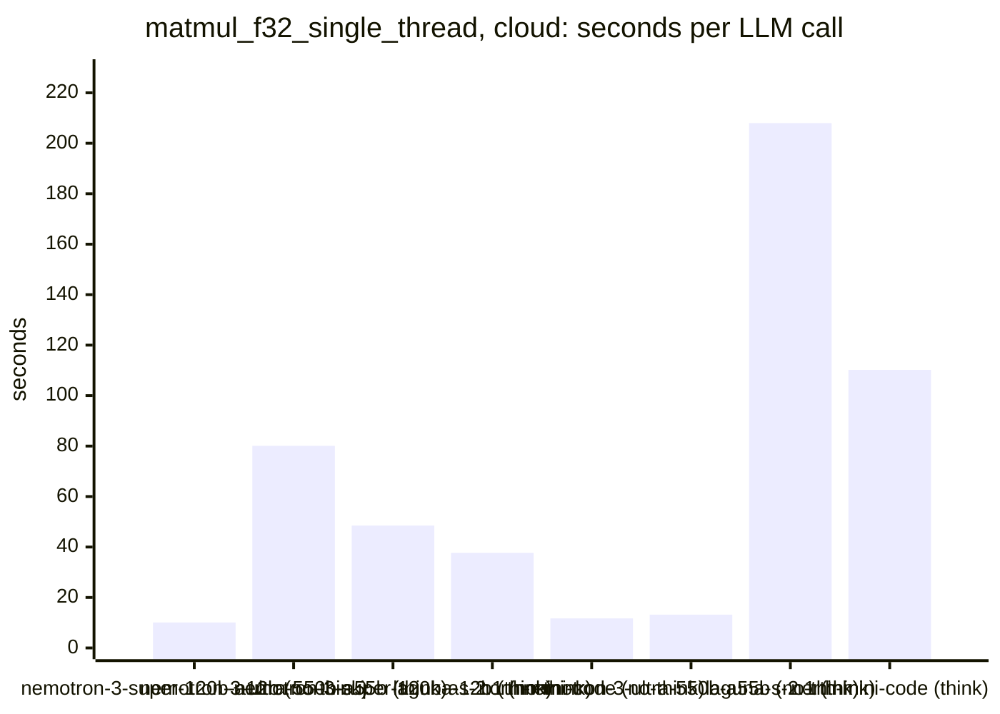
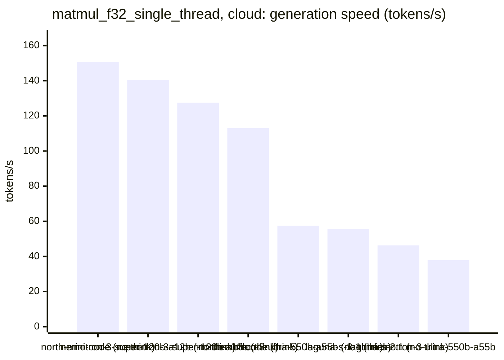

<!-- Copyright (c) 2026 by C. Klukas -->
<!-- SPDX-License-Identifier: GPL-3.0-only -->
<!-- Generated by `omega report` from bench/results/*.json. Do not edit by hand. -->

# matmul_f32_single_thread

51 models, 15 minutes each, latest run per model. The [overall ranking](../benchmarks.md#overall-ranking) compares the models over all examples.

Machine: Apple M1 Max (Mac13,1), 10 cores, 32 GB.

## Local models

Ollama on this machine.

| Model | Params | Initial | Best | Gain | LLM calls | s/call | Valid | New bests | Min to best |
|---|---|--:|--:|--:|--:|--:|--:|--:|--:|
| qwen3:30b-a3b-instruct-2507-q4_K_M (think) | 30.5B | 1.68841 | **62.9670** | ×37.29 | 48 | 18 | 25% | 2 | 4.5 |
| qwen3:30b-a3b-instruct-2507-q4_K_M (no-think) | 30.5B | 1.72147 | **31.1619** | ×18.10 | 52 | 17 | 37% | 5 | 14.7 |
| gemma4:e4b-it-qat (think) | 7.5B | 1.73148 | **28.5732** | ×16.50 | 11 | 87 | 82% | 3 | 12.8 |
| gemma4:latest (no-think) |  | 1.6753 | **28.0668** | ×16.75 | 50 | 18 | 34% | 5 | 11.2 |
| qwen3.6:27b-coding-mtp-q4_K_M (think) | 27.3B | 1.72669 | **27.7123** | ×16.05 | 2 | 621 | 50% | 2 | 20.9 |
| gemma4:26b-a4b-it-qat (no-think) | 25.2B | 1.75456 | **26.3310** | ×15.01 | 29 | 31 | 66% | 2 | 4.7 |
| qwen3.5:27b (no-think) | 27.8B | 1.68832 | **26.0561** | ×15.43 | 8 | 124 | 50% | 2 | 7.4 |
| devstral-small-2:24b (no-think) | 24.0B | 1.71195 | **26.0523** | ×15.22 | 16 | 59 | 12% | 1 | 12.4 |
| gemma4:12b-it-qat (think) | 11.9B | 1.6991 | **26.0321** | ×15.32 | 2 | 458 | 50% | 1 | 15.3 |
| gemma4:12b-it-qat (no-think) | 11.9B | 1.70902 | **26.0112** | ×15.22 | 22 | 41 | 68% | 3 | 5.3 |
| gemma4:e4b-it-qat (no-think) | 7.5B | 1.75146 | **26.0030** | ×14.85 | 43 | 20 | 28% | 4 | 11.3 |
| qwen3.8:27b-mtp-q4_K_M (no-think) | 27.3B | 1.74491 | **25.9650** | ×14.88 | 6 | 156 | 33% | 2 | 15.7 |
| gpt-oss:20b (think) | 20.9B | 1.75184 | **25.9501** | ×14.81 | 16 | 57 | 81% | 3 | 3.1 |
| gemma4:latest (think) |  | 1.76788 | **25.8752** | ×14.64 | 14 | 65 | 64% | 1 | 4.2 |
| nemotron-3.5-lightning:30b-mlx (think) |  | 1.71802 | **25.7480** | ×14.99 | 4 | 233 | 25% | 1 | 15.7 |
| qwen3.5:27b (think) | 27.8B | 1.7191 | **25.6155** | ×14.90 | 4 | 233 | 100% | 1 | 6.2 |
| muse-glimmer:30b (think) | 27.9B | 1.74582 | **25.5519** | ×14.64 | 4 | 310 | 100% | 1 | 7.4 |
| muse-glimmer:30b (no-think) | 27.9B | 1.76412 | **25.4887** | ×14.45 | 6 | 162 | 83% | 2 | 5.4 |
| gemma4:26b-a4b-it-qat (think) | 25.2B | 1.71405 | **25.4129** | ×14.83 | 3 | 377 | 67% | 1 | 14.3 |
| qwen3.5:latest (think) | 9.7B | 1.71602 | **25.4115** | ×14.81 | 13 | 71 | 8% | 1 | 12.1 |
| ingu627/exaone4.0:32b (no-think) | 32.0B | 1.71401 | **25.3574** | ×14.79 | 9 | 109 | 11% | 1 | 11.3 |
| gpt-oss:20b (no-think) | 20.9B | 1.69231 | **25.0933** | ×14.83 | 9 | 105 | 22% | 2 | 3.8 |
| glm-4.7-flash:latest (no-think) | 29.9B | 1.67784 | **25.0656** | ×14.94 | 38 | 24 | 3% | 1 | 14.1 |
| qwen3.6:27b-coding-mtp-q4_K_M (no-think) | 27.3B | 1.75879 | **21.3526** | ×12.14 | 8 | 120 | 25% | 2 | 13.8 |
| nemotron-3-nano:30b-a3b-mlx (think) |  | 1.71642 | **9.98314** | ×5.82 | 11 | 91 | 9% | 1 | 14.1 |
| qwen2.5-coder:7b (no-think) | 7.6B | 1.75104 | **6.93427** | ×3.96 | 44 | 20 | 14% | 5 | 10.6 |
| qwen3-coder:30b (no-think) | 30.5B | 1.76048 | **1.76048** | ×1.00 | 34 | 26 | 0% | 0 | - |
| MichelRosselli/apertus:8b-instruct-2509-q4_k_m (no-think) | 8.1B | 1.74731 | **1.74731** | ×1.00 | 40 | 22 | 5% | 0 | - |
| richardyoung/frognano-4b-2609:latest (think) | 4.3B | 1.74596 | **1.74596** | ×1.00 | 19 | 48 | 0% | 0 | - |
| nemotron-3-nano:4b (no-think) |  | 1.7407 | **1.7407** | ×1.00 | 77 | 11 | 8% | 0 | - |
| gemma4:e2b (think) | 5.1B | 1.73554 | **1.73554** | ×1.00 | 18 | 52 | 0% | 0 | - |
| nemotron-3-nano:30b-a3b-mlx (no-think) |  | 1.72661 | **1.72661** | ×1.00 | 35 | 26 | 0% | 0 | - |
| qwen3.8:27b-mtp-q4_K_M (think) | 27.3B | 1.7263 | **1.7263** | ×1.00 | 1 | 1783 | 0% | 0 | - |
| yandex/YandexGPT-5-Lite-8B-instruct-GGUF:latest (no-think) | 8.0B | 1.71192 | **1.71192** | ×1.00 | 39 | 23 | 0% | 0 | - |
| gemma4:e2b (no-think) | 5.1B | 1.67285 | **1.71127** | ×1.02 | 64 | 14 | 11% | 2 | 12.0 |
| llm-jp-4-8b-omega:q4_k_m (no-think) | 8.6B | 1.7072 | **1.7072** | ×1.00 | 18 | 53 | 6% | 0 | - |
| nemotron-3.5-lightning:30b-mlx (no-think) |  | 1.70521 | **1.70521** | ×1.00 | 24 | 40 | 0% | 0 | - |
| nemotron-3-nano:4b (think) |  | 1.70483 | **1.70483** | ×1.00 | 21 | 44 | 0% | 0 | - |
| frob/sarvam:30b (no-think) | 32.2B | 1.69148 | **1.69148** | ×1.00 | 6 | 171 | 0% | 0 | - |
| frob/sarvam:30b (think) | 32.2B | 1.679 | **1.679** | ×1.00 | 3 | 333 | 0% | 0 | - |
| glm-4.7-flash:latest (think) | 29.9B | 1.67659 | **1.67659** | ×1.00 | 4 | 340 | 0% | 0 | - |
| richardyoung/frognano-4b-2609:latest (no-think) | 4.3B | 1.61049 | **1.6746** | ×1.04 | 20 | 47 | 5% | 2 | 9.5 |
| qwen3.5:latest (no-think) | 9.7B | 1.59806 | **1.59806** | ×1.00 | 15 | 62 | 0% | 0 | - |

### Inference speed and memory

RAM is what Ollama reports for the loaded model (weights, context cache and buffers; on Apple silicon this is shared memory). Load is the time to bring the model into memory. Prompt and generation speeds are tokens per second over all calls of the run.

| Model | Params | RAM GB | Load s | Prompt tok/s | Gen tok/s | Median s/call | p90 s/call | Tokens/answer | Stopped |
|---|---|--:|--:|--:|--:|--:|--:|--:|--:|
| richardyoung/frognano-4b-2609:latest (think) | 4.3B | 4.4 | 11 | 1160 | 55.9 | 35 | 159 | 2465 | 2 |
| richardyoung/frognano-4b-2609:latest (no-think) | 4.3B | 4.4 | 0 | 1139 | 47.7 | 52 | 68 | 1362 | 10 |
| gemma4:e4b-it-qat (think) | 7.5B | 5.7 | 127 | 601 | 58.2 | 72 | 124 | 4059 | 0 |
| gemma4:e4b-it-qat (no-think) | 7.5B | 5.7 | 97 | 653 | 59.5 | 19 | 27 | 686 | 0 |
| qwen2.5-coder:7b (no-think) | 7.6B | 6.6 | 48 | 629 | 38.6 | 19 | 30 | 516 | 0 |
| gemma4:e2b (think) | 5.1B | 6.6 | 35 | 1303 | 74.7 | 51 | 68 | 3570 | 0 |
| gemma4:e2b (no-think) | 5.1B | 6.6 | 34 | 955 | 60.7 | 13 | 21 | 537 | 0 |
| qwen3.5:latest (think) | 9.7B | 6.8 | 0 | 740 | 34.3 | 34 | 58 | 1184 | 1 |
| qwen3.5:latest (no-think) | 9.7B | 6.8 | 0 | 786 | 35.9 | 46 | 97 | 848 | 7 |
| gemma4:12b-it-qat (think) | 11.9B | 8.0 | 90 | 307 | 28.1 | 592 | 592 | 11374 | 0 |
| gemma4:12b-it-qat (no-think) | 11.9B | 8.0 | 133 | 236 | 30.3 | 36 | 50 | 541 | 0 |
| yandex/YandexGPT-5-Lite-8B-instruct-GGUF:latest (no-think) | 8.0B | 8.8 | 15 | 694 | 34.9 | 24 | 30 | 643 | 0 |
| llm-jp-4-8b-omega:q4_k_m (no-think) | 8.6B | 8.8 | 16 | 672 | 32.0 | 45 | 96 | 1456 | 1 |
| MichelRosselli/apertus:8b-instruct-2509-q4_k_m (no-think) | 8.1B | 8.9 | 16 | 612 | 32.5 | 20 | 34 | 426 | 3 |
| nemotron-3-nano:4b (think) |  | 9.4 | 8 | 954 | 61.6 | 44 | 60 | 2509 | 0 |
| gemma4:latest (think) |  | 11.3 | 104 | 1059 | 44.5 | 54 | 109 | 2426 | 0 |
| nemotron-3-nano:4b (no-think) |  | 11.6 | 8 | 918 | 62.8 | 11 | 15 | 421 | 1 |
| gpt-oss:20b (think) | 20.9B | 12.8 | 109 | 533 | 48.0 | 46 | 150 | 2091 | 0 |
| gpt-oss:20b (no-think) | 20.9B | 12.9 | 115 | 735 | 50.4 | 114 | 169 | 4465 | 0 |
| gemma4:latest (no-think) |  | 14.9 | 105 | 1281 | 50.1 | 14 | 27 | 608 | 0 |
| gemma4:26b-a4b-it-qat (no-think) | 25.2B | 15.2 | 254 | 555 | 63.3 | 20 | 42 | 548 | 8 |
| gemma4:26b-a4b-it-qat (think) | 25.2B | 15.2 | 24 | 721 | 53.8 | 280 | 645 | 11913 | 0 |
| muse-glimmer:30b (no-think) | 27.9B | 15.6 | 52 | 107 | 10.1 | 132 | 295 | 1279 | 0 |
| muse-glimmer:30b (think) | 27.9B | 16.5 | 48 | 114 | 10.3 | 346 | 440 | 2823 | 0 |
| qwen3.6:27b-coding-mtp-q4_K_M (think) | 27.3B | 17.4 | 280 | 146 | 12.8 | 890 | 890 | 5914 | 0 |
| qwen3.8:27b-mtp-q4_K_M (no-think) | 27.3B | 17.6 | 313 | 110 | 15.8 | 86 | 369 | 1233 | 0 |
| qwen3.8:27b-mtp-q4_K_M (think) | 27.3B | 17.6 | 294 | 88 | 11.2 | 1783 | 1783 | 16384 | 0 |
| qwen3.6:27b-coding-mtp-q4_K_M (no-think) | 27.3B | 18.2 | 189 | 108 | 15.3 | 128 | 257 | 1101 | 0 |
| qwen3.5:27b (think) | 27.8B | 18.4 | 162 | 110 | 10.6 | 246 | 363 | 1758 | 0 |
| qwen3.5:27b (no-think) | 27.8B | 18.6 | 247 | 101 | 11.4 | 105 | 325 | 728 | 0 |
| frob/sarvam:30b (no-think) | 32.2B | 18.9 | 108 | 1622 | 52.4 | 156 | 319 | 7950 | 0 |
| devstral-small-2:24b (no-think) | 24.0B | 19.7 | 40 | 196 | 11.5 | 47 | 104 | 339 | 2 |
| frob/sarvam:30b (think) | 32.2B | 19.8 | 0 | 2850 | 45.0 | 331 | 350 | 14560 | 1 |
| nemotron-3.5-lightning:30b-mlx (think) |  | 20.0 | 0 | 1146 | 54.4 | 257 | 367 | 3375 | 3 |
| ingu627/exaone4.0:32b (no-think) | 32.0B | 20.2 | 50 | 76 | 9.4 | 109 | 166 | 590 | 0 |
| nemotron-3-nano:30b-a3b-mlx (think) |  | 20.2 | 100 | 472 | 54.1 | 58 | 167 | 4136 | 0 |
| glm-4.7-flash:latest (no-think) | 29.9B | 20.8 | 49 | 719 | 32.5 | 20 | 38 | 521 | 1 |
| glm-4.7-flash:latest (think) | 29.9B | 20.8 | 50 | 670 | 23.2 | 430 | 491 | 7510 | 0 |
| qwen3:30b-a3b-instruct-2507-q4_K_M (think) | 30.5B | 21.8 | 134 | 707 | 45.4 | 14 | 31 | 412 | 0 |
| qwen3:30b-a3b-instruct-2507-q4_K_M (no-think) | 30.5B | 21.8 | 146 | 862 | 52.2 | 13 | 29 | 474 | 0 |
| qwen3-coder:30b (no-think) | 30.5B | 21.8 | 155 | 1118 | 56.2 | 21 | 31 | 1008 | 4 |
| nemotron-3.5-lightning:30b-mlx (no-think) |  | 23.0 | 0 | 929 | 55.2 | 32 | 71 | 1404 | 9 |
| nemotron-3-nano:30b-a3b-mlx (no-think) |  | 23.6 | 0 | 995 | 56.4 | 19 | 40 | 1003 | 4 |

### Best score over time

| Model | 3.75 min | 7.5 min | 11.25 min | 15 min |
|---|--:|--:|--:|--:|
| qwen3:30b-a3b-instruct-2507-q4_K_M (think) | 24.9016 | 62.9670 | 62.9670 | 62.9670 |
| qwen3:30b-a3b-instruct-2507-q4_K_M (no-think) | 25.2001 | 30.8405 | 31.1255 | 31.1619 |
| gemma4:e4b-it-qat (think) | 1.73148 | 25.9717 | 25.9717 | 28.5732 |
| gemma4:latest (no-think) | 25.8310 | 25.9813 | 28.0668 | 28.0668 |
| qwen3.6:27b-coding-mtp-q4_K_M (think) | 1.72669 | 1.72669 | 1.72669 | 1.72669 |
| gemma4:26b-a4b-it-qat (no-think) | 1.75456 | 26.3310 | 26.3310 | 26.3310 |
| qwen3.5:27b (no-think) | 1.68832 | 26.0561 | 26.0561 | 26.0561 |
| devstral-small-2:24b (no-think) | 1.71195 | 1.71195 | 1.71195 | 26.0523 |
| gemma4:12b-it-qat (think) | 1.6991 | 1.6991 | 1.6991 | 1.6991 |
| gemma4:12b-it-qat (no-think) | 25.5383 | 26.0112 | 26.0112 | 26.0112 |
| gemma4:e4b-it-qat (no-think) | 24.1238 | 24.7668 | 25.5368 | 26.0030 |
| qwen3.8:27b-mtp-q4_K_M (no-think) | 1.74491 | 25.5289 | 25.5289 | 25.5289 |
| gpt-oss:20b (think) | 25.9501 | 25.9501 | 25.9501 | 25.9501 |
| gemma4:latest (think) | 1.76788 | 25.8752 | 25.8752 | 25.8752 |
| nemotron-3.5-lightning:30b-mlx (think) | 1.71802 | 1.71802 | 1.71802 | 1.71802 |
| qwen3.5:27b (think) | 1.7191 | 25.6155 | 25.6155 | 25.6155 |
| muse-glimmer:30b (think) | 1.74582 | 25.5519 | 25.5519 | 25.5519 |
| muse-glimmer:30b (no-think) | 1.76412 | 25.4887 | 25.4887 | 25.4887 |
| gemma4:26b-a4b-it-qat (think) | 1.71405 | 1.71405 | 1.71405 | 25.4129 |
| qwen3.5:latest (think) | 1.71602 | 1.71602 | 1.71602 | 25.4115 |
| ingu627/exaone4.0:32b (no-think) | 1.71401 | 1.71401 | 1.71401 | 25.3574 |
| gpt-oss:20b (no-think) | 6.76713 | 25.0933 | 25.0933 | 25.0933 |
| glm-4.7-flash:latest (no-think) | 1.67784 | 1.67784 | 1.67784 | 25.0656 |
| qwen3.6:27b-coding-mtp-q4_K_M (no-think) | 1.75879 | 1.75879 | 1.75879 | 21.3526 |
| nemotron-3-nano:30b-a3b-mlx (think) | 1.71642 | 1.71642 | 1.71642 | 9.98314 |
| qwen2.5-coder:7b (no-think) | 6.86018 | 6.87101 | 6.93427 | 6.93427 |
| qwen3-coder:30b (no-think) | 1.76048 | 1.76048 | 1.76048 | 1.76048 |
| MichelRosselli/apertus:8b-instruct-2509-q4_k_m (no-think) | 1.74731 | 1.74731 | 1.74731 | 1.74731 |
| richardyoung/frognano-4b-2609:latest (think) | 1.74596 | 1.74596 | 1.74596 | 1.74596 |
| nemotron-3-nano:4b (no-think) | 1.7407 | 1.7407 | 1.7407 | 1.7407 |
| gemma4:e2b (think) | 1.73554 | 1.73554 | 1.73554 | 1.73554 |
| nemotron-3-nano:30b-a3b-mlx (no-think) | 1.72661 | 1.72661 | 1.72661 | 1.72661 |
| qwen3.8:27b-mtp-q4_K_M (think) | 1.7263 | 1.7263 | 1.7263 | 1.7263 |
| yandex/YandexGPT-5-Lite-8B-instruct-GGUF:latest (no-think) | 1.71192 | 1.71192 | 1.71192 | 1.71192 |
| gemma4:e2b (no-think) | 1.70339 | 1.70339 | 1.70339 | 1.71127 |
| llm-jp-4-8b-omega:q4_k_m (no-think) | 1.7072 | 1.7072 | 1.7072 | 1.7072 |
| nemotron-3.5-lightning:30b-mlx (no-think) | 1.70521 | 1.70521 | 1.70521 | 1.70521 |
| nemotron-3-nano:4b (think) | 1.70483 | 1.70483 | 1.70483 | 1.70483 |
| frob/sarvam:30b (no-think) | 1.69148 | 1.69148 | 1.69148 | 1.69148 |
| frob/sarvam:30b (think) | 1.679 | 1.679 | 1.679 | 1.679 |
| glm-4.7-flash:latest (think) | 1.67659 | 1.67659 | 1.67659 | 1.67659 |
| richardyoung/frognano-4b-2609:latest (no-think) | 1.61049 | 1.61049 | 1.6746 | 1.6746 |
| qwen3.5:latest (no-think) | 1.59806 | 1.59806 | 1.59806 | 1.59806 |

### Outcome of the LLM answers

| Model | compile error | duplicate | edit error | invalid | llm error | ok | timeout |
|---|--:|--:|--:|--:|--:|--:|--:|
| qwen3:30b-a3b-instruct-2507-q4_K_M (think) | 3 | 11 | 1 | 21 | 0 | 12 | 0 |
| qwen3:30b-a3b-instruct-2507-q4_K_M (no-think) | 4 | 9 | 3 | 17 | 0 | 19 | 0 |
| gemma4:e4b-it-qat (think) | 0 | 0 | 1 | 1 | 0 | 9 | 0 |
| gemma4:latest (no-think) | 10 | 1 | 4 | 18 | 0 | 17 | 0 |
| qwen3.6:27b-coding-mtp-q4_K_M (think) | 0 | 0 | 0 | 1 | 0 | 1 | 0 |
| gemma4:26b-a4b-it-qat (no-think) | 0 | 0 | 2 | 0 | 8 | 19 | 0 |
| qwen3.5:27b (no-think) | 0 | 0 | 3 | 1 | 0 | 4 | 0 |
| devstral-small-2:24b (no-think) | 0 | 2 | 1 | 9 | 2 | 2 | 0 |
| gemma4:12b-it-qat (think) | 1 | 0 | 0 | 0 | 0 | 1 | 0 |
| gemma4:12b-it-qat (no-think) | 4 | 1 | 1 | 1 | 0 | 15 | 0 |
| gemma4:e4b-it-qat (no-think) | 15 | 1 | 3 | 12 | 0 | 12 | 0 |
| qwen3.8:27b-mtp-q4_K_M (no-think) | 4 | 0 | 0 | 0 | 0 | 2 | 0 |
| gpt-oss:20b (think) | 0 | 0 | 2 | 1 | 0 | 13 | 0 |
| gemma4:latest (think) | 4 | 0 | 1 | 0 | 0 | 9 | 0 |
| nemotron-3.5-lightning:30b-mlx (think) | 0 | 0 | 0 | 0 | 3 | 1 | 0 |
| qwen3.5:27b (think) | 0 | 0 | 0 | 0 | 0 | 4 | 0 |
| muse-glimmer:30b (think) | 0 | 0 | 0 | 0 | 0 | 4 | 0 |
| muse-glimmer:30b (no-think) | 0 | 1 | 0 | 0 | 0 | 5 | 0 |
| gemma4:26b-a4b-it-qat (think) | 1 | 0 | 0 | 0 | 0 | 2 | 0 |
| qwen3.5:latest (think) | 6 | 0 | 0 | 5 | 1 | 1 | 0 |
| ingu627/exaone4.0:32b (no-think) | 5 | 0 | 1 | 2 | 0 | 1 | 0 |
| gpt-oss:20b (no-think) | 1 | 0 | 5 | 1 | 0 | 2 | 0 |
| glm-4.7-flash:latest (no-think) | 6 | 2 | 3 | 25 | 1 | 1 | 0 |
| qwen3.6:27b-coding-mtp-q4_K_M (no-think) | 2 | 0 | 0 | 4 | 0 | 2 | 0 |
| nemotron-3-nano:30b-a3b-mlx (think) | 6 | 0 | 2 | 1 | 0 | 1 | 1 |
| qwen2.5-coder:7b (no-think) | 7 | 13 | 0 | 18 | 0 | 6 | 0 |
| qwen3-coder:30b (no-think) | 3 | 3 | 0 | 24 | 4 | 0 | 0 |
| MichelRosselli/apertus:8b-instruct-2509-q4_k_m (no-think) | 15 | 0 | 14 | 6 | 3 | 2 | 0 |
| richardyoung/frognano-4b-2609:latest (think) | 12 | 0 | 3 | 2 | 2 | 0 | 0 |
| nemotron-3-nano:4b (no-think) | 18 | 4 | 46 | 2 | 1 | 6 | 0 |
| gemma4:e2b (think) | 12 | 0 | 4 | 2 | 0 | 0 | 0 |
| nemotron-3-nano:30b-a3b-mlx (no-think) | 10 | 0 | 12 | 9 | 4 | 0 | 0 |
| qwen3.8:27b-mtp-q4_K_M (think) | 0 | 0 | 1 | 0 | 0 | 0 | 0 |
| yandex/YandexGPT-5-Lite-8B-instruct-GGUF:latest (no-think) | 26 | 1 | 7 | 5 | 0 | 0 | 0 |
| gemma4:e2b (no-think) | 36 | 2 | 11 | 8 | 0 | 7 | 0 |
| llm-jp-4-8b-omega:q4_k_m (no-think) | 11 | 0 | 4 | 1 | 1 | 1 | 0 |
| nemotron-3.5-lightning:30b-mlx (no-think) | 5 | 0 | 6 | 4 | 9 | 0 | 0 |
| nemotron-3-nano:4b (think) | 17 | 0 | 3 | 1 | 0 | 0 | 0 |
| frob/sarvam:30b (no-think) | 1 | 0 | 5 | 0 | 0 | 0 | 0 |
| frob/sarvam:30b (think) | 0 | 0 | 1 | 1 | 1 | 0 | 0 |
| glm-4.7-flash:latest (think) | 3 | 0 | 1 | 0 | 0 | 0 | 0 |
| richardyoung/frognano-4b-2609:latest (no-think) | 6 | 0 | 1 | 2 | 10 | 1 | 0 |
| qwen3.5:latest (no-think) | 3 | 0 | 1 | 4 | 7 | 0 | 0 |

### Best idea per model

- **qwen3:30b-a3b-instruct-2507-q4_K_M (think)**: Use i-k-j loop order with 8x16 register blocking and NEON FMA intrinsics to maximize data reuse, enable vectorization, and reduce memory bandwidth, while ensuring correct …
- **qwen3:30b-a3b-instruct-2507-q4_K_M (no-think)**: tuned TILE_SIZE=24.61 on top of: Replace the fixed TILE_SIZE with a swept constant to find the optimal tile size for Apple Silicon's L1 cache and NEON vectorization, as prior …
- **gemma4:e4b-it-qat (think)**: Replace the overlapping vectorized and scalar J loops in the main K iteration with a single combined vectorized/scalar remainder loop structure to ensure every accumulation is …
- **gemma4:latest (no-think)**: tuned BLOCK_SIZE=128 on top of: Introduce a fixed tiling structure to improve data locality and prepare for SIMD/cache blocking.
- **qwen3.6:27b-coding-mtp-q4_K_M (think)**: tuned BLOCK=128 on top of: Switch to cache-blocked i-k-j loop order to improve data locality and enable compiler auto-vectorization of the contiguous inner loop over j, sweeping …
- **gemma4:26b-a4b-it-qat (no-think)**: Change loop order from i-j-k to i-k-j to allow contiguous access to rows of B and C, improving cache locality and enabling vectorization.
- **qwen3.5:27b (no-think)**: Switch the loop order to i-k-j to enable streaming accumulation into rows of C and reuse of scalar A[i][k], which significantly improves memory bandwidth utilization compared to …
- **devstral-small-2:24b (no-think)**: Initialize C to zero before computation to ensure correctness for all n, especially n=1.
- **gemma4:12b-it-qat (think)**: Switch the loop order from i-j-k to i-k-j to improve cache locality and enable better vectorization by the compiler, as the inner loop will now access both B and C contiguously.
- **gemma4:12b-it-qat (no-think)**: Reorder loops to i-k-j to improve spatial locality and enable auto-vectorization of the inner loop.
- **gemma4:e4b-it-qat (no-think)**: Replace the tiling approach with full $i-k-j$ loop ordering combined with explicit NEON vectorization on the inner $j$ loop to maximize SIMD throughput and leverage good cache …
- **qwen3.8:27b-mtp-q4_K_M (no-think)**: The current program is the naive i-j-k scalar loop; switching to the i-k-j order (hoisting A[i][k] and streaming contiguous B rows into C) lets the compiler auto-vectorize the …
- **gpt-oss:20b (think)**: Reorder loops to i‑k‑j and zero C first to allow in‑place accumulation, improving cache locality and eliminating the inner scalar sum.
- **gemma4:latest (think)**: Reorder the loops from i-j-k to i-k-j to improve data locality, allowing contiguous memory access for C (row-major) and B (row $k$), which significantly reduces memory bandwidth …
- **nemotron-3.5-lightning:30b-mlx (think)**: Change loop order from i-j-k to i-k-j so the inner loop streams consecutive elements of B and C, improving cache utilization and enabling auto-vectorization; add C zeroing since …
- **qwen3.5:27b (think)**: Change loop order from i-j-k to i-k-j so the inner loop streams rows of B and C sequentially, enabling auto-vectorization and much better cache behavior.
- **muse-glimmer:30b (think)**: switch to i-k-j loop order with C zeroed first so the inner loop streams a row of B and the current row of C, improving cache reuse and enabling better auto-vectorisation.
- **muse-glimmer:30b (no-think)**: switch to i-k-j loop order and zero C first so the inner j loop streams contiguous C and B rows, improving cache reuse and enabling vectorization.
- **gemma4:26b-a4b-it-qat (think)**: Change the loop order from $i, j, k$ to $i, k, j$ to ensure that the innermost loop performs contiguous memory access on both matrices $B$ and $C$, which is significantly more …
- **qwen3.5:latest (think)**: Zero-initialize C before accumulating in i-k-j order to fix the n=1 bug where garbage initial values corrupt results
- **ingu627/exaone4.0:32b (no-think)**: Fix the wrong result by properly initializing C to zero before accumulation
- **gpt-oss:20b (no-think)**: Reorder loops to i‑k‑j and zero each row of C before accumulating to eliminate column‑strided accesses to B, improving cache locality and overall speed.
- **glm-4.7-flash:latest (no-think)**: Switch to i-k-j order to stream rows of B and C, unroll the inner k-loop by 4, and use standard NEON loads with FMA to maximize throughput on Apple Silicon while maintaining …
- **qwen3.6:27b-coding-mtp-q4_K_M (no-think)**: Zero out matrix C at the start of matmul to match the reference computation's semantics (the harness writes garbage into C expecting it to be overwritten, and accumulation += …
- **nemotron-3-nano:30b-a3b-mlx (think)**: Change to i‑k‑j loop order and use NEON vectorized accumulation over j (register‑blocking) to stream B rows, zero C once, and exploit FMA for higher throughput.
- **qwen2.5-coder:7b (no-think)**: Define a named constant for the unroll factor and expose it for sweeping to find the optimal value.
- **qwen3-coder:30b (no-think)**: initial program
- **MichelRosselli/apertus:8b-instruct-2509-q4_k_m (no-think)**: initial program
- **richardyoung/frognano-4b-2609:latest (think)**: initial program
- **nemotron-3-nano:4b (no-think)**: initial program
- **gemma4:e2b (think)**: initial program
- **nemotron-3-nano:30b-a3b-mlx (no-think)**: initial program
- **qwen3.8:27b-mtp-q4_K_M (think)**: initial program
- **yandex/YandexGPT-5-Lite-8B-instruct-GGUF:latest (no-think)**: initial program
- **gemma4:e2b (no-think)**: The previous attempt failed due to incorrect indexing and loop structure when attempting to apply NEON to the innermost dot product; the fix simplifies the vectorization to …
- **llm-jp-4-8b-omega:q4_k_m (no-think)**: initial program
- **nemotron-3.5-lightning:30b-mlx (no-think)**: initial program
- **nemotron-3-nano:4b (think)**: initial program
- **frob/sarvam:30b (no-think)**: initial program
- **frob/sarvam:30b (think)**: initial program
- **glm-4.7-flash:latest (think)**: initial program
- **richardyoung/frognano-4b-2609:latest (no-think)**: tuned BLOCK=15 on top of: Introduce a fixed micro-kernel block size (8x8x8) and unroll the inner loops to maximize register usage and NEON throughput, replacing the naive scalar …
- **qwen3.5:latest (no-think)**: initial program

## Cloud models (OpenRouter)

Free OpenRouter models; times include the network and the provider's queue.

| Model | Params | Initial | Best | Gain | LLM calls | s/call | Valid | New bests | Min to best |
|---|---|--:|--:|--:|--:|--:|--:|--:|--:|
| nvidia/nemotron-3-super-120b-a12b:free (no-think) |  | 1.69859 | **49.1573** | ×28.94 | 88 | 10 | 25% | 10 | 13.1 |
| nvidia/nemotron-3-ultra-550b-a55b:free (think) |  | 1.52545 | **35.3384** | ×23.17 | 12 | 80 | 67% | 4 | 16.1 |
| nvidia/nemotron-3-super-120b-a12b:free (think) |  | 1.57117 | **31.1191** | ×19.81 | 20 | 48 | 60% | 4 | 7.8 |
| poolside/laguna-s-2.1:free (no-think) |  | 1.67947 | **28.1830** | ×16.78 | 24 | 38 | 46% | 9 | 8.4 |
| cohere/north-mini-code:free (no-think) |  | 1.74962 | **27.7760** | ×15.88 | 75 | 12 | 16% | 4 | 8.5 |
| nvidia/nemotron-3-ultra-550b-a55b:free (no-think) |  | 1.69723 | **25.7986** | ×15.20 | 66 | 13 | 58% | 3 | 11.9 |
| poolside/laguna-s-2.1:free (think) |  | 1.6705 | **1.6705** | ×1.00 | 5 | 208 | 0% | 0 | - |
| cohere/north-mini-code:free (think) |  | 1.54957 | **1.54957** | ×1.00 | 9 | 110 | 0% | 0 | - |

### Inference speed and cost

Generation speed is measured from the first to the last streamed token; the time to the first token is counted as prompt time. Cost is what OpenRouter charged for the run.

| Model | Gen tok/s | Median s/call | p90 s/call | Tokens/answer | Stopped | Cost $ |
|---|--:|--:|--:|--:|--:|--:|
| cohere/north-mini-code:free (no-think) | 150.6 | 10 | 22 | 1715 | 1 | 0.000 |
| nvidia/nemotron-3-super-120b-a12b:free (no-think) | 140.4 | 8 | 23 | 1149 | 13 | 0.000 |
| nvidia/nemotron-3-super-120b-a12b:free (think) | 127.5 | 43 | 101 | 5738 | 1 | 0.000 |
| cohere/north-mini-code:free (think) | 113.0 | 97 | 222 | 4886 | 7 | 0.000 |
| nvidia/nemotron-3-ultra-550b-a55b:free (no-think) | 57.5 | 10 | 28 | 663 | 0 | 0.000 |
| poolside/laguna-s-2.1:free (think) | 55.5 | 267 | 323 | 9830 | 0 | 0.000 |
| poolside/laguna-s-2.1:free (no-think) | 46.3 | 27 | 77 | 925 | 5 | 0.000 |
| nvidia/nemotron-3-ultra-550b-a55b:free (think) | 37.8 | 59 | 165 | 2969 | 0 | 0.000 |

### Best score over time

| Model | 3.75 min | 7.5 min | 11.25 min | 15 min |
|---|--:|--:|--:|--:|
| nvidia/nemotron-3-super-120b-a12b:free (no-think) | 37.5267 | 45.5444 | 47.7429 | 49.1573 |
| nvidia/nemotron-3-ultra-550b-a55b:free (think) | 24.3390 | 33.7080 | 33.7080 | 34.3014 |
| nvidia/nemotron-3-super-120b-a12b:free (think) | 19.9022 | 25.5203 | 31.1191 | 31.1191 |
| poolside/laguna-s-2.1:free (no-think) | 20.5189 | 27.5229 | 28.1830 | 28.1830 |
| cohere/north-mini-code:free (no-think) | 1.74962 | 26.2015 | 27.7760 | 27.7760 |
| nvidia/nemotron-3-ultra-550b-a55b:free (no-think) | 25.5239 | 25.5239 | 25.6831 | 25.7986 |
| poolside/laguna-s-2.1:free (think) | 1.6705 | 1.6705 | 1.6705 | 1.6705 |
| cohere/north-mini-code:free (think) | 1.54957 | 1.54957 | 1.54957 | 1.54957 |

### Outcome of the LLM answers

| Model | compile error | duplicate | edit error | invalid | llm error | ok |
|---|--:|--:|--:|--:|--:|--:|
| nvidia/nemotron-3-super-120b-a12b:free (no-think) | 0 | 33 | 4 | 16 | 13 | 22 |
| nvidia/nemotron-3-ultra-550b-a55b:free (think) | 1 | 2 | 0 | 1 | 0 | 8 |
| nvidia/nemotron-3-super-120b-a12b:free (think) | 4 | 2 | 0 | 1 | 1 | 12 |
| poolside/laguna-s-2.1:free (no-think) | 0 | 4 | 1 | 2 | 6 | 11 |
| cohere/north-mini-code:free (no-think) | 18 | 6 | 11 | 27 | 1 | 12 |
| nvidia/nemotron-3-ultra-550b-a55b:free (no-think) | 6 | 16 | 0 | 6 | 0 | 38 |
| poolside/laguna-s-2.1:free (think) | 0 | 0 | 3 | 0 | 2 | 0 |
| cohere/north-mini-code:free (think) | 0 | 0 | 0 | 2 | 7 | 0 |

### Best idea per model

- **nvidia/nemotron-3-super-120b-a12b:free (no-think)**: tuned BLOCK_SIZE=112, UNROLL=8 on top of: Increase UNROLL factor to 8 and add NEON vectorization of the inner j-loop to process 4 columns per iteration, improving …
- **nvidia/nemotron-3-ultra-550b-a55b:free (think)**: Unroll the inner k-loop in the 4x4 micro-kernel by a factor of 4 to reduce loop overhead and improve instruction-level parallelism, while handling remainder iterations.
- **nvidia/nemotron-3-super-120b-a12b:free (think)**: tuned IM=8, JM=8, BK=64 on top of: Replace the current panel‑update microkernel with a 2D blocked microkernel that computes a small IM×JM tile of C using registers, reloading a …
- **poolside/laguna-s-2.1:free (no-think)**: tuned MM_BC=320, MM_MR=8 on top of: Replace the scalar 4x16 micro-kernel with a true NEON register-blocked kernel using vfmaq_laneq_f32 for A broadcasts and 4x16 accumulators, and …
- **cohere/north-mini-code:free (no-think)**: Increase arithmetic intensity by switching to a wider 16×8 register tile (two NEON registers per C element) to halve memory traffic and better utilize FMA pipelines.
- **nvidia/nemotron-3-ultra-550b-a55b:free (no-think)**: Add `__restrict__` qualifiers and `alignas(64)` hints to pointers, plus `#pragma clang loop vectorize(enable) unroll(full)` on the inner j-loop to help Clang generate tighter NEON …
- **poolside/laguna-s-2.1:free (think)**: initial program
- **cohere/north-mini-code:free (think)**: initial program
