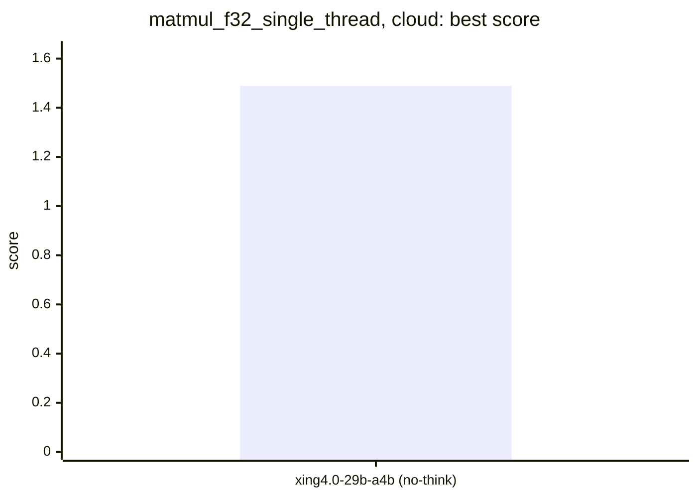
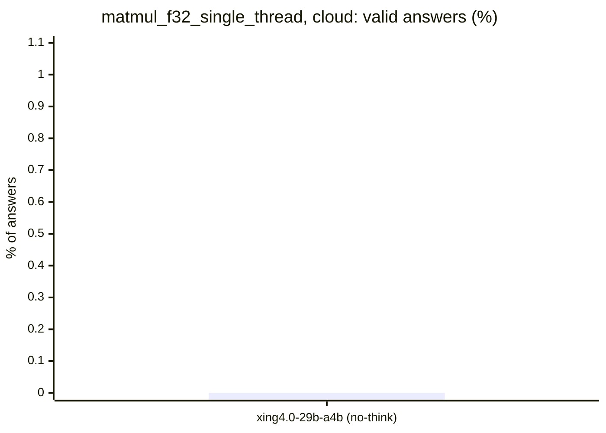
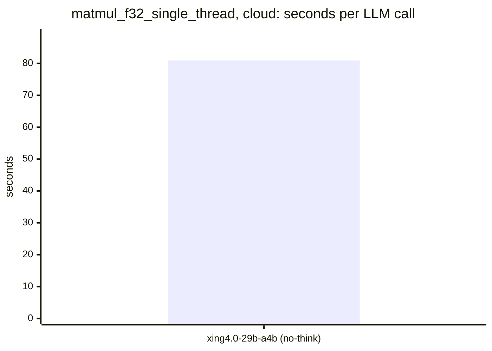
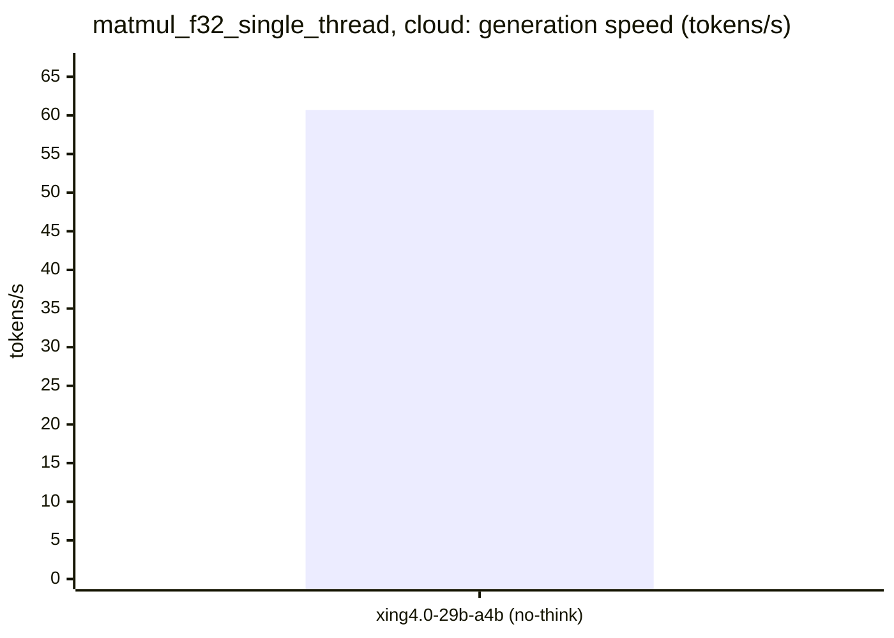

<!-- Copyright (c) 2026 by C. Klukas -->
<!-- SPDX-License-Identifier: GPL-3.0-only -->
<!-- Generated by `omega report` from bench/results/*.json. Do not edit by hand. -->

# matmul_f32_single_thread

11 models, each run at most 60 minutes, ended earlier after 15 answers in a row without progress; one run per model. The [overall ranking](../benchmarks.md#overall-ranking) compares the models over all examples.

Machine: Intel(R) Core(TM) i7-8700K CPU @ 3.70GHz (MS-7A98), 12 cores, 64 GB, 2x NVIDIA GeForce GTX 1080 Ti, 11264 MiB.

## Cloud models (OpenRouter)

Free OpenRouter models; times include the network and the provider's queue.

| Model | Params | Initial | Best | Gain | LLM calls | s/call | Valid | New bests | Min to best | Minutes | Stopped by |
|---|---|--:|--:|--:|--:|--:|--:|--:|--:|--:|---|
| nvidia/nemotron-3.5-lightning:free (no-think) |  | | | | | | | | | | failed: all 6 model requests failed: nvidia/nemotron-3.5-lightning:f |
| xingchen-agi/xing4.0-29b-a4b:free (no-think) |  | 1.48879 | **1.48879** | ×1.00 | 12 | 81 | 0% | 0 | - | 16.6 | model errors |
| google/gemma-4-31b-it:free (no-think) |  | | | | | | | | | | failed: all 6 model requests failed: google/gemma-4-31b-it:free: rat |
| google/gemma-4-26b-a4b-it:free (no-think) |  | | | | | | | | | | failed: all 5 model requests failed: google/gemma-4-26b-a4b-it:free: |
| nvidia/nemotron-3-nano-omni-30b-a3b-reasoning:free (no-think) |  | | | | | | | | | | failed: all 6 model requests failed: nvidia/nemotron-3-nano-omni-30b |
| nvidia/nemotron-3.5-super-vl:free (no-think) |  | | | | | | | | | | failed: all 6 model requests failed: nvidia/nemotron-3.5-super-vl:fr |
| nvidia/nemotron-3-ultra-550b-a55b:free (no-think) |  | | | | | | | | | | failed: all 6 model requests failed: nvidia/nemotron-3-ultra-550b-a5 |
| dots-studio/dots-3-note-preview:free (no-think) |  | | | | | | | | | | failed: all 6 model requests failed: dots-studio/dots-3-note-preview |
| cohere/north-mini-code:free (no-think) |  | | | | | | | | | | failed: all 6 model requests failed: cohere/north-mini-code:free: ra |
| poolside/laguna-s-2.1:free (no-think) |  | | | | | | | | | | failed: RuntimeError: OpenRouter has no model 'poolside/laguna-s-2.1 |
| poolside/laguna-xs-2.1:free (no-think) |  | | | | | | | | | | failed: RuntimeError: OpenRouter has no model 'poolside/laguna-xs-2. |

### Inference speed and cost

Generation speed is measured from the first to the last streamed token; the time to the first token is counted as prompt time. Cost is what OpenRouter charged for the run.

| Model | Gen tok/s | Median s/call | p90 s/call | Tokens/answer | Stopped | Cost $ |
|---|--:|--:|--:|--:|--:|--:|
| xingchen-agi/xing4.0-29b-a4b:free (no-think) | 60.7 | 74 | 83 | 50 | 1 | 0.000 |

### Best score over time

| Model | 15 min | 30 min | 45 min | 60 min |
|---|--:|--:|--:|--:|
| xingchen-agi/xing4.0-29b-a4b:free (no-think) | 1.48879 | 1.48879 | 1.48879 | 1.48879 |

### Outcome of the LLM answers

| Model | invalid | llm error |
|---|--:|--:|
| xingchen-agi/xing4.0-29b-a4b:free (no-think) | 1 | 11 |

### Best idea per model

- **xingchen-agi/xing4.0-29b-a4b:free (no-think)**: initial program
