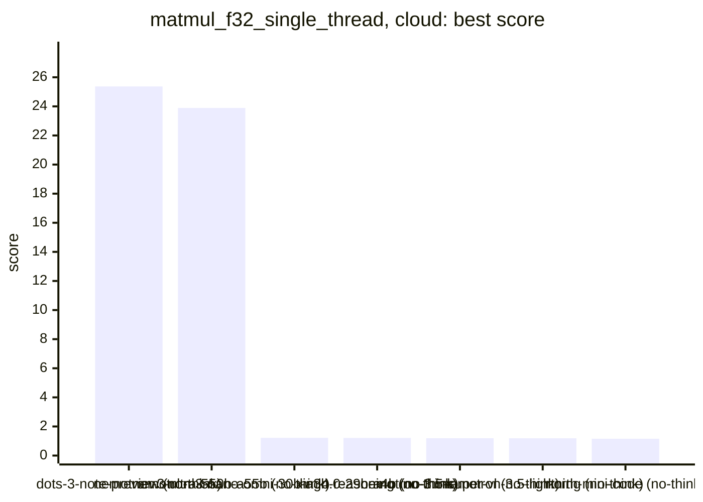
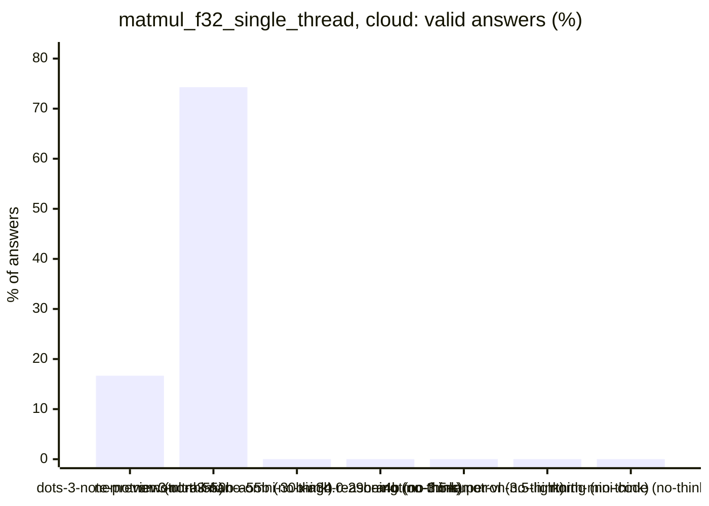
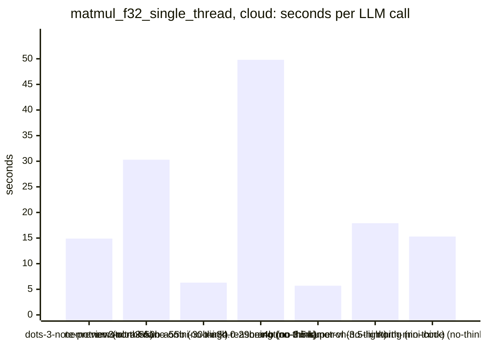
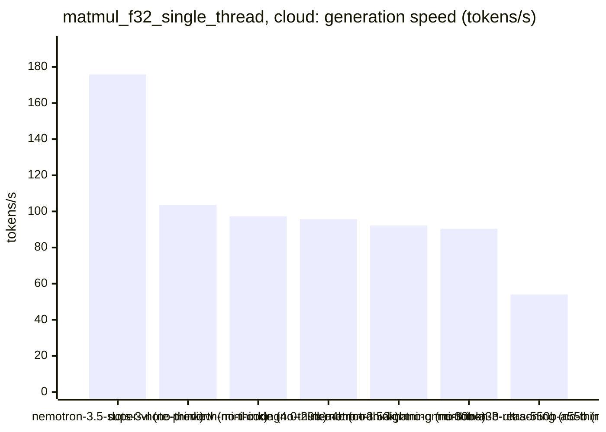

<!-- Copyright (c) 2026 by C. Klukas -->
<!-- SPDX-License-Identifier: GPL-3.0-only -->
<!-- Generated by `omega report` from bench/results/*.json. Do not edit by hand. -->

# matmul_f32_single_thread

7 models, each run at most 60 minutes, ended earlier after 15 answers in a row without progress; one run per model. The [overall ranking](../benchmarks.md#overall-ranking) compares the models over all examples.

Machine: Intel(R) Core(TM) i7-8700K CPU @ 3.70GHz (MS-7A98), 12 cores, 64 GB, 2x NVIDIA GeForce GTX 1080 Ti, 11264 MiB.

## Cloud models (OpenRouter)

Free OpenRouter models; times include the network and the provider's queue.

| Model | Params | Initial | Best | Gain | LLM calls | s/call | Valid | New bests | Min to best | Minutes | Stopped by |
|---|---|--:|--:|--:|--:|--:|--:|--:|--:|--:|---|
| dots-studio/dots-3-note-preview:free (no-think) |  | 1.28678 | **25.3679** | ×19.71 | 18 | 15 | 17% | 1 | 4.5 | 5.4 | no progress |
| nvidia/nemotron-3-ultra-550b-a55b:free (no-think) |  | 1.09136 | **23.8871** | ×21.89 | 35 | 30 | 74% | 5 | 10.0 | 19.9 | no progress |
| nvidia/nemotron-3-nano-omni-30b-a3b-reasoning:free (no-think) |  | 1.21895 | **1.21895** | ×1.00 | 16 | 6 | 0% | 0 | - | 2.2 | no progress |
| xingchen-agi/xing4.0-29b-a4b:free (no-think) |  | 1.2102 | **1.2102** | ×1.00 | 16 | 50 | 0% | 0 | - | 13.8 | no progress |
| nvidia/nemotron-3.5-super-vl:free (no-think) |  | 1.19245 | **1.19245** | ×1.00 | 16 | 6 | 0% | 0 | - | 2.0 | no progress |
| nvidia/nemotron-3.5-lightning:free (no-think) |  | 1.18856 | **1.18856** | ×1.00 | 16 | 18 | 0% | 0 | - | 5.3 | no progress |
| cohere/north-mini-code:free (no-think) |  | 1.15687 | **1.15687** | ×1.00 | 16 | 15 | 0% | 0 | - | 4.6 | no progress |

### Inference speed and cost

Generation speed is measured from the first to the last streamed token; the time to the first token is counted as prompt time. Cost is what OpenRouter charged for the run.

| Model | Gen tok/s | Median s/call | p90 s/call | Tokens/answer | Stopped | Cost $ |
|---|--:|--:|--:|--:|--:|--:|
| nvidia/nemotron-3.5-super-vl:free (no-think) | 175.8 | 5 | 9 | 803 | 1 | 0.000 |
| dots-studio/dots-3-note-preview:free (no-think) | 103.7 | 14 | 31 | 1286 | 2 | 0.000 |
| cohere/north-mini-code:free (no-think) | 97.3 | 18 | 26 | 1438 | 0 | 0.000 |
| xingchen-agi/xing4.0-29b-a4b:free (no-think) | 95.7 | 74 | 80 | 734 | 1 | 0.000 |
| nvidia/nemotron-3.5-lightning:free (no-think) | 92.2 | 18 | 36 | 1235 | 8 | 0.000 |
| nvidia/nemotron-3-nano-omni-30b-a3b-reasoning:free (no-think) | 90.4 | 5 | 8 | 466 | 0 | 0.000 |
| nvidia/nemotron-3-ultra-550b-a55b:free (no-think) | 54.0 | 25 | 52 | 1544 | 0 | 0.000 |

### Best score over time

| Model | 15 min | 30 min | 45 min | 60 min |
|---|--:|--:|--:|--:|
| dots-studio/dots-3-note-preview:free (no-think) | 25.3679 | 25.3679 | 25.3679 | 25.3679 |
| nvidia/nemotron-3-ultra-550b-a55b:free (no-think) | 23.8871 | 23.8871 | 23.8871 | 23.8871 |
| nvidia/nemotron-3-nano-omni-30b-a3b-reasoning:free (no-think) | 1.21895 | 1.21895 | 1.21895 | 1.21895 |
| xingchen-agi/xing4.0-29b-a4b:free (no-think) | 1.2102 | 1.2102 | 1.2102 | 1.2102 |
| nvidia/nemotron-3.5-super-vl:free (no-think) | 1.19245 | 1.19245 | 1.19245 | 1.19245 |
| nvidia/nemotron-3.5-lightning:free (no-think) | 1.18856 | 1.18856 | 1.18856 | 1.18856 |
| cohere/north-mini-code:free (no-think) | 1.15687 | 1.15687 | 1.15687 | 1.15687 |

### Outcome of the LLM answers

| Model | compile error | duplicate | edit error | invalid | llm error | ok |
|---|--:|--:|--:|--:|--:|--:|
| dots-studio/dots-3-note-preview:free (no-think) | 6 | 0 | 3 | 4 | 2 | 3 |
| nvidia/nemotron-3-ultra-550b-a55b:free (no-think) | 4 | 5 | 0 | 0 | 0 | 26 |
| nvidia/nemotron-3-nano-omni-30b-a3b-reasoning:free (no-think) | 2 | 0 | 11 | 3 | 0 | 0 |
| xingchen-agi/xing4.0-29b-a4b:free (no-think) | 7 | 0 | 1 | 2 | 6 | 0 |
| nvidia/nemotron-3.5-super-vl:free (no-think) | 7 | 0 | 3 | 5 | 1 | 0 |
| nvidia/nemotron-3.5-lightning:free (no-think) | 5 | 0 | 3 | 0 | 8 | 0 |
| cohere/north-mini-code:free (no-think) | 6 | 2 | 6 | 2 | 0 | 0 |

### Best idea per model

- **dots-studio/dots-3-note-preview:free (no-think)**: Fix the NEON compilation errors by removing the invalid intrinsics and implementing a clean, high-performance tiled matmul with proper loop order (i-k-j) and cache blocking, using …
- **nvidia/nemotron-3-ultra-550b-a55b:free (no-think)**: tuned TILE_SIZE=144 on top of: Add cache blocking with a tunable tile size to improve data reuse and reduce cache misses, combined with NEON vectorization for the inner loop to …
- **nvidia/nemotron-3-nano-omni-30b-a3b-reasoning:free (no-think)**: initial program
- **xingchen-agi/xing4.0-29b-a4b:free (no-think)**: initial program
- **nvidia/nemotron-3.5-super-vl:free (no-think)**: initial program
- **nvidia/nemotron-3.5-lightning:free (no-think)**: initial program
- **cohere/north-mini-code:free (no-think)**: initial program
