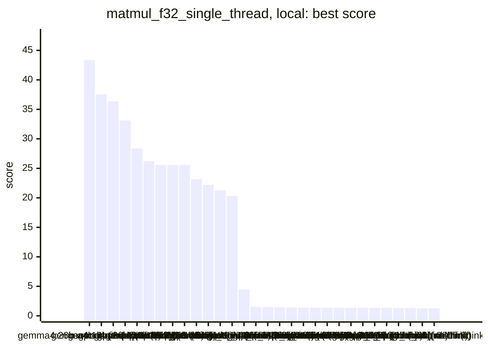
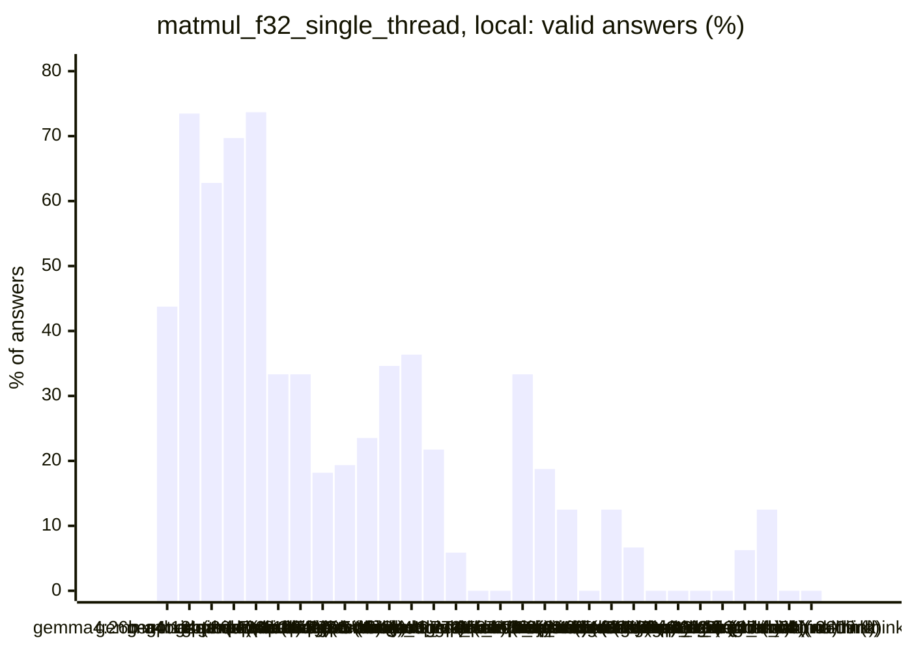
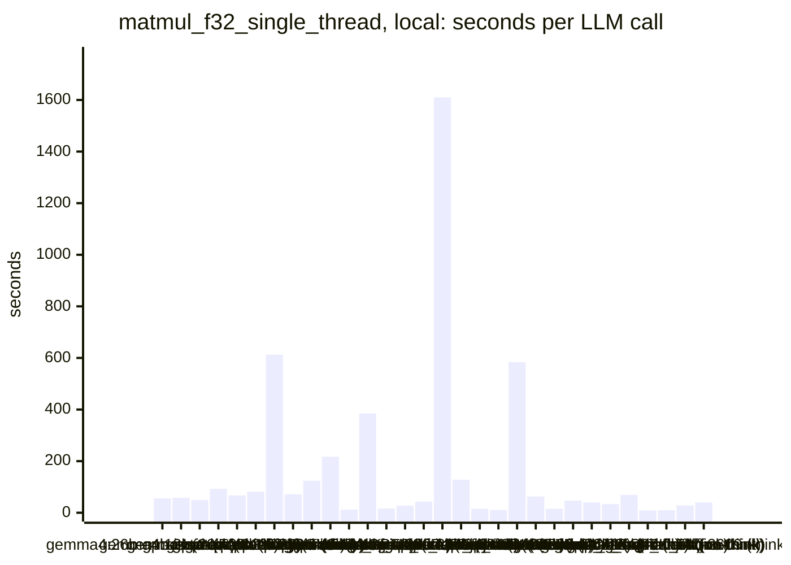
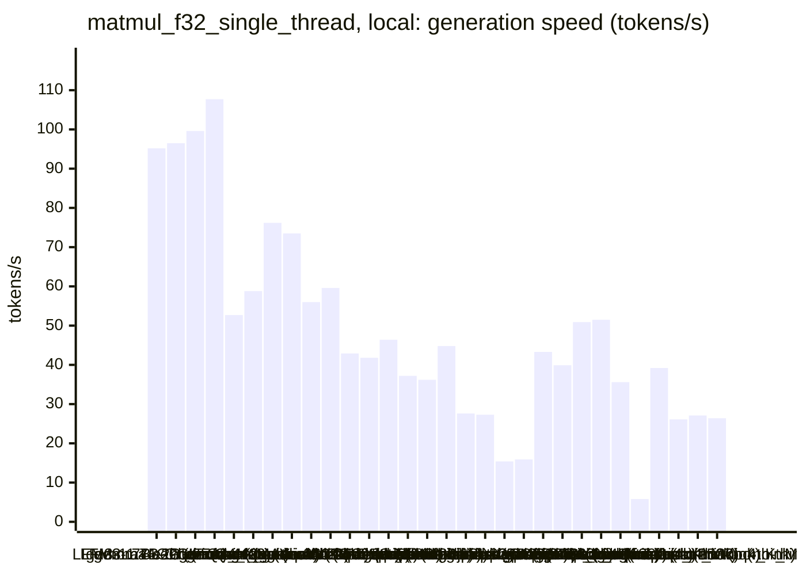
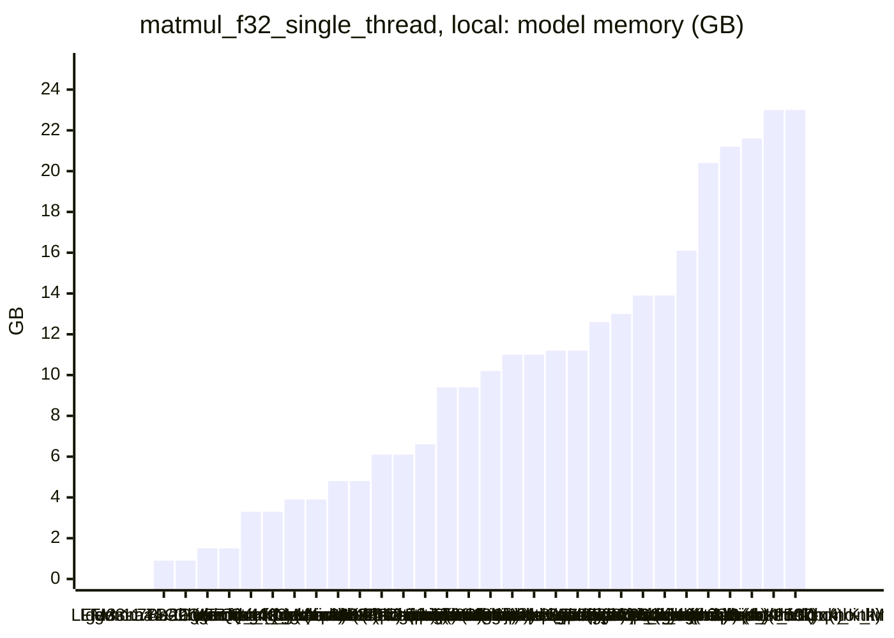
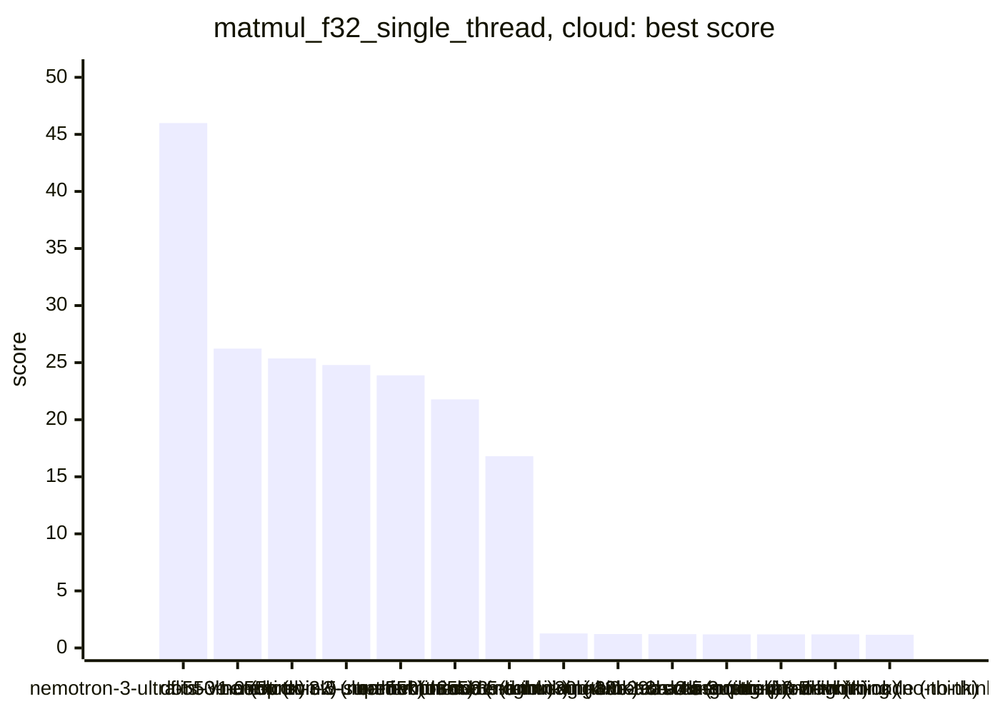
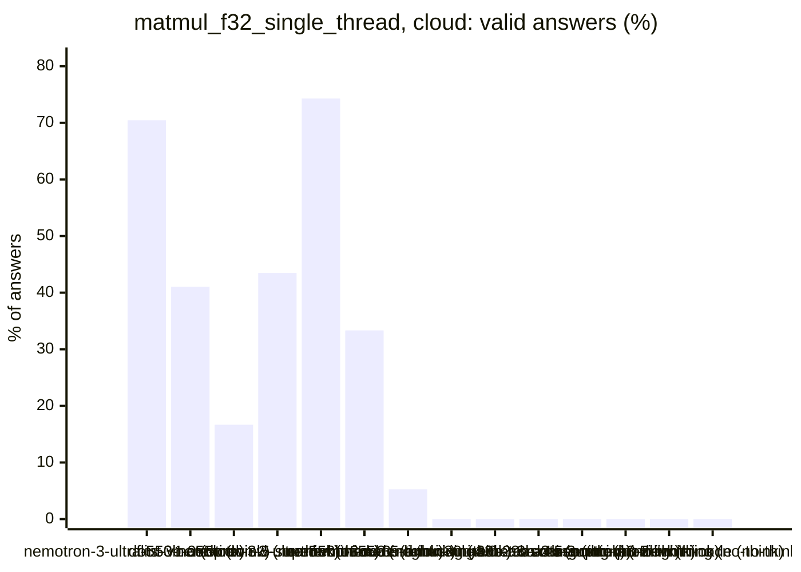
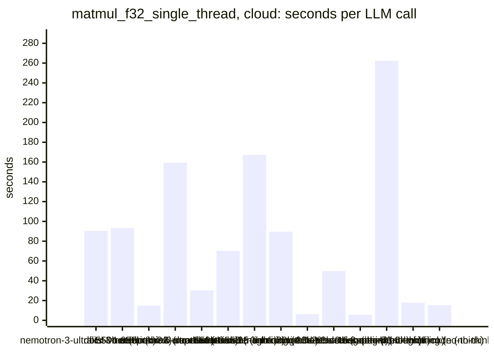
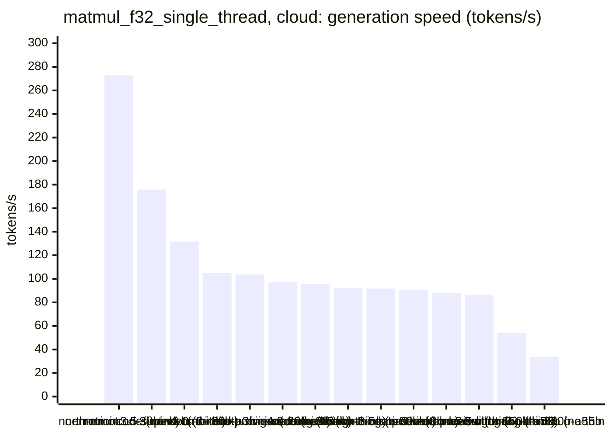

<!-- Copyright (c) 2026 by C. Klukas -->
<!-- SPDX-License-Identifier: GPL-3.0-only -->
<!-- Generated by `omega report` from bench/results/*.json. Do not edit by hand. -->

# matmul_f32_single_thread

45 models, each run at most 60 minutes, ended earlier after 15 answers in a row without progress; one run per model. The [overall ranking](../benchmarks.md#overall-ranking) compares the models over all examples.

Machine: Intel(R) Core(TM) i7-8700K CPU @ 3.70GHz (MS-7A98), 12 cores, 64 GB, 2x NVIDIA GeForce GTX 1080 Ti, 11264 MiB.

## Local models

Ollama on this machine.

| Model | Params | Initial | Best | Gain | LLM calls | s/call | Valid | New bests | Min to best | Minutes | Stopped by |
|---|---|--:|--:|--:|--:|--:|--:|--:|--:|--:|---|
| gemma4:26b-a4b-it-qat (no-think) | 25.2B | 1.41257 | **43.3708** | ×30.70 | 64 | 56 | 44% | 9 | 40.4 | 62.2 | time limit |
| gemma4:latest (think) | 7.5B | 1.28023 | **37.5840** | ×29.36 | 49 | 58 | 73% | 6 | 48.5 | 49.9 | no progress |
| gemma4:12b-it-qat (no-think) | 11.9B | 1.42086 | **36.3552** | ×25.59 | 43 | 49 | 63% | 5 | 21.1 | 37.5 | no progress |
| gpt-oss:20b (no-think) | 20.9B | 1.35223 | **33.1122** | ×24.49 | 33 | 93 | 70% | 6 | 23.4 | 54.1 | no progress |
| gpt-oss:20b (think) | 20.9B | 1.47576 | **28.3762** | ×19.23 | 19 | 67 | 74% | 2 | 3.2 | 23.6 | no progress |
| gemma4:e4b-it-qat (think) | 7.5B | 1.52077 | **26.1981** | ×17.23 | 18 | 82 | 33% | 2 | 2.5 | 25.8 | no progress |
| gemma4:12b-it-qat (think) | 11.9B | 1.48373 | **25.5805** | ×17.24 | 6 | 613 | 33% | 1 | 17.3 | 63.0 | time limit |
| qwen3.5:latest (no-think) | 9.0B | 1.24815 | **25.5709** | ×20.49 | 22 | 72 | 18% | 1 | 10.3 | 27.8 | no progress |
| qwen3.5:latest (think) | 9.0B | 1.42888 | **25.5570** | ×17.89 | 31 | 124 | 19% | 4 | 56.6 | 69.0 | time limit |
| hf.co/LiquidAI/LFM3-1.7B-GGUF:Q4_K_M (think) | 1.73B | 1.36704 | **23.1849** | ×16.96 | 17 | 217 | 24% | 2 | 50.9 | 62.7 | time limit |
| gemma4:latest (no-think) | 7.5B | 1.42118 | **22.2128** | ×15.63 | 26 | 12 | 35% | 2 | 1.5 | 6.6 | no progress |
| qwen3.6:27b-coding-mtp-q4_K_M (no-think) | 27.3B | 1.36841 | **21.2526** | ×15.53 | 11 | 385 | 36% | 3 | 19.8 | 72.4 | time limit |
| gemma4:e4b-it-qat (no-think) | 7.5B | 1.33906 | **20.3136** | ×15.17 | 23 | 17 | 22% | 1 | 2.7 | 7.8 | no progress |
| qwen3:30b-a3b-instruct-2507-q4_K_M (no-think) | 30.5B | 1.38322 | **4.47988** | ×3.24 | 17 | 27 | 6% | 1 | 7.6 | 9.5 | no progress |
| nemotron-3-nano:4b (think) | 4.0B | 1.52592 | **1.52592** | ×1.00 | 16 | 44 | 0% | 0 | - | 12.7 | no progress |
| underdog-saluki-27b:iq2-mix (think) | 26.9B | 1.49558 | **1.49558** | ×1.00 | 3 | 1610 | 0% | 0 | - | 82.1 | time limit |
| underdog-saluki-27b:iq2-mix (no-think) | 26.9B | 1.4541 | **1.4541** | ×1.00 | 15 | 128 | 33% | 0 | - | 33.3 | no progress |
| yandex/YandexGPT-5-Lite-8B-instruct-GGUF:latest (no-think) | 8.0B | 1.41454 | **1.41454** | ×1.00 | 16 | 16 | 19% | 0 | - | 5.4 | no progress |
| nemotron-3-nano:4b (no-think) | 4.0B | 1.39198 | **1.39198** | ×1.00 | 16 | 11 | 12% | 0 | - | 3.8 | no progress |
| frob/sarvam:30b (no-think) | 32.2B | 1.37406 | **1.37406** | ×1.00 | 7 | 584 | 0% | 0 | - | 70.0 | time limit |
| qwen3-coder:30b (no-think) | 30.5B | 1.36668 | **1.36668** | ×1.00 | 16 | 63 | 12% | 0 | - | 18.6 | no progress |
| MichelRosselli/apertus:8b-instruct-2509-q4_k_m (no-think) | 8.1B | 1.36613 | **1.36613** | ×1.00 | 15 | 16 | 7% | 0 | - | 4.9 | no progress |
| llm-jp-4-8b-omega:q4_k_m (no-think) | 8.6B | 1.36103 | **1.36103** | ×1.00 | 16 | 47 | 0% | 0 | - | 13.7 | no progress |
| richardyoung/frognano-4b-2609:latest (no-think) | 4.3B | 1.36101 | **1.36101** | ×1.00 | 16 | 40 | 0% | 0 | - | 11.8 | no progress |
| gemma4:e2b (think) | 4.6B | 1.35687 | **1.35687** | ×1.00 | 16 | 33 | 0% | 0 | - | 10.1 | no progress |
| hf.co/LiquidAI/LFM3-1.7B-GGUF:Q4_K_M (no-think) | 1.73B | 1.35459 | **1.35459** | ×1.00 | 16 | 69 | 0% | 0 | - | 19.3 | no progress |
| gemma4:e2b (no-think) | 4.6B | 1.31572 | **1.31572** | ×1.00 | 16 | 9 | 6% | 0 | - | 3.5 | no progress |
| qwen2.5-coder:7b (no-think) | 7.6B | 1.31214 | **1.31214** | ×1.00 | 16 | 10 | 12% | 0 | - | 3.7 | no progress |
| glm-4.7-flash:latest (no-think) | 29.9B | 1.25269 | **1.25269** | ×1.00 | 16 | 28 | 0% | 0 | - | 9.4 | no progress |
| richardyoung/frognano-4b-2609:latest (think) | 4.3B | 1.25221 | **1.25221** | ×1.00 | 16 | 41 | 0% | 0 | - | 12.3 | no progress |

### Inference speed and memory

RAM is what Ollama reports for the loaded model (weights, context cache and buffers; on Apple silicon this is shared memory). Load is the time to bring the model into memory. Prompt and generation speeds are tokens per second over all calls of the run.

| Model | Params | RAM GB | Load s | Prompt tok/s | Gen tok/s | Median s/call | p90 s/call | Tokens/answer | Stopped |
|---|---|--:|--:|--:|--:|--:|--:|--:|--:|
| gemma4:e2b (think) | 4.6B | 0.9 | 0 | 2998 | 95.2 | 30 | 47 | 2864 | 0 |
| gemma4:e2b (no-think) | 4.6B | 0.9 | 0 | 4345 | 96.5 | 7 | 14 | 618 | 0 |
| hf.co/LiquidAI/LFM3-1.7B-GGUF:Q4_K_M (think) | 1.73B | 1.5 | 0 | 5028 | 99.6 | 241 | 251 | 21360 | 0 |
| hf.co/LiquidAI/LFM3-1.7B-GGUF:Q4_K_M (no-think) | 1.73B | 1.5 | 0 | 6088 | 107.7 | 74 | 77 | 236 | 15 |
| gemma4:latest (think) | 7.5B | 3.3 | 0 | 1424 | 52.7 | 51 | 94 | 2761 | 1 |
| gemma4:latest (no-think) | 7.5B | 3.3 | 0 | 2008 | 58.8 | 10 | 23 | 472 | 0 |
| nemotron-3-nano:4b (think) | 4.0B | 3.9 | 0 | 2502 | 76.2 | 45 | 58 | 3027 | 0 |
| nemotron-3-nano:4b (no-think) | 4.0B | 3.9 | 0 | 2428 | 73.5 | 12 | 15 | 519 | 0 |
| richardyoung/frognano-4b-2609:latest (no-think) | 4.3B | 4.8 | 0 | 2141 | 56.0 | 38 | 66 | 1847 | 5 |
| richardyoung/frognano-4b-2609:latest (think) | 4.3B | 4.8 | 0 | 2197 | 59.6 | 32 | 58 | 2177 | 1 |
| gemma4:e4b-it-qat (think) | 7.5B | 6.1 | 0 | 1927 | 42.9 | 85 | 124 | 3330 | 0 |
| gemma4:e4b-it-qat (no-think) | 7.5B | 6.1 | 0 | 2245 | 41.8 | 11 | 31 | 543 | 0 |
| qwen2.5-coder:7b (no-think) | 7.6B | 6.6 | 0 | 2326 | 46.4 | 9 | 15 | 307 | 0 |
| qwen3.5:latest (no-think) | 9.0B | 9.4 | 0 | 1260 | 37.2 | 51 | 111 | 1757 | 3 |
| qwen3.5:latest (think) | 9.0B | 9.4 | 0 | 1224 | 36.2 | 50 | 387 | 4302 | 0 |
| yandex/YandexGPT-5-Lite-8B-instruct-GGUF:latest (no-think) | 8.0B | 10.2 | 0 | 2212 | 44.8 | 15 | 20 | 543 | 0 |
| gemma4:12b-it-qat (no-think) | 11.9B | 11.0 | 0 | 640 | 27.6 | 45 | 81 | 954 | 3 |
| gemma4:12b-it-qat (think) | 11.9B | 11.0 | 0 | 682 | 27.3 | 693 | 790 | 16506 | 0 |
| underdog-saluki-27b:iq2-mix (think) | 26.9B | 11.2 | 0 | 452 | 15.4 | 1609 | 1614 | 24576 | 0 |
| underdog-saluki-27b:iq2-mix (no-think) | 26.9B | 11.2 | 0 | 405 | 15.9 | 103 | 228 | 1610 | 1 |
| MichelRosselli/apertus:8b-instruct-2509-q4_k_m (no-think) | 8.1B | 12.6 | 0 | 2074 | 43.3 | 14 | 28 | 493 | 1 |
| llm-jp-4-8b-omega:q4_k_m (no-think) | 8.6B | 13.0 | 0 | 1820 | 39.9 | 41 | 85 | 1588 | 1 |
| gpt-oss:20b (no-think) | 20.9B | 13.9 | 0 | 2116 | 50.9 | 77 | 134 | 4511 | 0 |
| gpt-oss:20b (think) | 20.9B | 13.9 | 0 | 2265 | 51.5 | 44 | 76 | 3266 | 0 |
| gemma4:26b-a4b-it-qat (no-think) | 25.2B | 16.1 | 0 | 798 | 35.6 | 56 | 102 | 1245 | 15 |
| qwen3.6:27b-coding-mtp-q4_K_M (no-think) | 27.3B | 20.4 | 0 | 188 | 5.8 | 229 | 597 | 2075 | 0 |
| frob/sarvam:30b (no-think) | 32.2B | 21.2 | 0 | 1941 | 39.2 | 629 | 645 | 22720 | 0 |
| glm-4.7-flash:latest (no-think) | 29.9B | 21.6 | 0 | 683 | 26.1 | 28 | 39 | 577 | 0 |
| qwen3:30b-a3b-instruct-2507-q4_K_M (no-think) | 30.5B | 23.0 | 0 | 996 | 27.1 | 18 | 70 | 598 | 0 |
| qwen3-coder:30b (no-think) | 30.5B | 23.0 | 0 | 912 | 26.4 | 46 | 132 | 1381 | 2 |

### Best score over time

| Model | 15 min | 30 min | 45 min | 60 min |
|---|--:|--:|--:|--:|
| gemma4:26b-a4b-it-qat (no-think) | 21.6815 | 34.6491 | 43.3708 | 43.3708 |
| gemma4:latest (think) | 25.3034 | 25.5170 | 33.9716 | 37.5840 |
| gemma4:12b-it-qat (no-think) | 34.9779 | 36.3552 | 36.3552 | 36.3552 |
| gpt-oss:20b (no-think) | 24.2019 | 33.1122 | 33.1122 | 33.1122 |
| gpt-oss:20b (think) | 28.3762 | 28.3762 | 28.3762 | 28.3762 |
| gemma4:e4b-it-qat (think) | 26.1981 | 26.1981 | 26.1981 | 26.1981 |
| gemma4:12b-it-qat (think) | 1.48373 | 25.5805 | 25.5805 | 25.5805 |
| qwen3.5:latest (no-think) | 25.5709 | 25.5709 | 25.5709 | 25.5709 |
| qwen3.5:latest (think) | 1.42888 | 1.42888 | 23.8580 | 25.5570 |
| hf.co/LiquidAI/LFM3-1.7B-GGUF:Q4_K_M (think) | 1.36704 | 22.4801 | 22.4801 | 23.1849 |
| gemma4:latest (no-think) | 22.2128 | 22.2128 | 22.2128 | 22.2128 |
| qwen3.6:27b-coding-mtp-q4_K_M (no-think) | 19.0871 | 21.2526 | 21.2526 | 21.2526 |
| gemma4:e4b-it-qat (no-think) | 20.3136 | 20.3136 | 20.3136 | 20.3136 |
| qwen3:30b-a3b-instruct-2507-q4_K_M (no-think) | 4.47988 | 4.47988 | 4.47988 | 4.47988 |
| nemotron-3-nano:4b (think) | 1.52592 | 1.52592 | 1.52592 | 1.52592 |
| underdog-saluki-27b:iq2-mix (think) | 1.49558 | 1.49558 | 1.49558 | 1.49558 |
| underdog-saluki-27b:iq2-mix (no-think) | 1.4541 | 1.4541 | 1.4541 | 1.4541 |
| yandex/YandexGPT-5-Lite-8B-instruct-GGUF:latest (no-think) | 1.41454 | 1.41454 | 1.41454 | 1.41454 |
| nemotron-3-nano:4b (no-think) | 1.39198 | 1.39198 | 1.39198 | 1.39198 |
| frob/sarvam:30b (no-think) | 1.37406 | 1.37406 | 1.37406 | 1.37406 |
| qwen3-coder:30b (no-think) | 1.36668 | 1.36668 | 1.36668 | 1.36668 |
| MichelRosselli/apertus:8b-instruct-2509-q4_k_m (no-think) | 1.36613 | 1.36613 | 1.36613 | 1.36613 |
| llm-jp-4-8b-omega:q4_k_m (no-think) | 1.36103 | 1.36103 | 1.36103 | 1.36103 |
| richardyoung/frognano-4b-2609:latest (no-think) | 1.36101 | 1.36101 | 1.36101 | 1.36101 |
| gemma4:e2b (think) | 1.35687 | 1.35687 | 1.35687 | 1.35687 |
| hf.co/LiquidAI/LFM3-1.7B-GGUF:Q4_K_M (no-think) | 1.35459 | 1.35459 | 1.35459 | 1.35459 |
| gemma4:e2b (no-think) | 1.31572 | 1.31572 | 1.31572 | 1.31572 |
| qwen2.5-coder:7b (no-think) | 1.31214 | 1.31214 | 1.31214 | 1.31214 |
| glm-4.7-flash:latest (no-think) | 1.25269 | 1.25269 | 1.25269 | 1.25269 |
| richardyoung/frognano-4b-2609:latest (think) | 1.25221 | 1.25221 | 1.25221 | 1.25221 |

### Outcome of the LLM answers

| Model | compile error | duplicate | edit error | invalid | llm error | ok |
|---|--:|--:|--:|--:|--:|--:|
| gemma4:26b-a4b-it-qat (no-think) | 6 | 7 | 5 | 3 | 15 | 28 |
| gemma4:latest (think) | 11 | 0 | 1 | 0 | 1 | 36 |
| gemma4:12b-it-qat (no-think) | 5 | 0 | 6 | 2 | 3 | 27 |
| gpt-oss:20b (no-think) | 8 | 1 | 1 | 0 | 0 | 23 |
| gpt-oss:20b (think) | 3 | 0 | 1 | 1 | 0 | 14 |
| gemma4:e4b-it-qat (think) | 12 | 0 | 0 | 0 | 0 | 6 |
| gemma4:12b-it-qat (think) | 4 | 0 | 0 | 0 | 0 | 2 |
| qwen3.5:latest (no-think) | 4 | 0 | 4 | 7 | 3 | 4 |
| qwen3.5:latest (think) | 14 | 0 | 5 | 6 | 0 | 6 |
| hf.co/LiquidAI/LFM3-1.7B-GGUF:Q4_K_M (think) | 1 | 1 | 7 | 4 | 0 | 4 |
| gemma4:latest (no-think) | 8 | 4 | 1 | 4 | 0 | 9 |
| qwen3.6:27b-coding-mtp-q4_K_M (no-think) | 5 | 2 | 0 | 0 | 0 | 4 |
| gemma4:e4b-it-qat (no-think) | 8 | 3 | 0 | 7 | 0 | 5 |
| qwen3:30b-a3b-instruct-2507-q4_K_M (no-think) | 6 | 5 | 0 | 5 | 0 | 1 |
| nemotron-3-nano:4b (think) | 3 | 0 | 12 | 1 | 0 | 0 |
| underdog-saluki-27b:iq2-mix (think) | 0 | 0 | 3 | 0 | 0 | 0 |
| underdog-saluki-27b:iq2-mix (no-think) | 8 | 0 | 0 | 1 | 1 | 5 |
| yandex/YandexGPT-5-Lite-8B-instruct-GGUF:latest (no-think) | 0 | 2 | 5 | 6 | 0 | 3 |
| nemotron-3-nano:4b (no-think) | 5 | 0 | 8 | 1 | 0 | 2 |
| frob/sarvam:30b (no-think) | 0 | 0 | 6 | 1 | 0 | 0 |
| qwen3-coder:30b (no-think) | 4 | 2 | 0 | 6 | 2 | 2 |
| MichelRosselli/apertus:8b-instruct-2509-q4_k_m (no-think) | 7 | 2 | 3 | 1 | 1 | 1 |
| llm-jp-4-8b-omega:q4_k_m (no-think) | 11 | 0 | 4 | 0 | 1 | 0 |
| richardyoung/frognano-4b-2609:latest (no-think) | 5 | 0 | 1 | 5 | 5 | 0 |
| gemma4:e2b (think) | 14 | 0 | 1 | 1 | 0 | 0 |
| hf.co/LiquidAI/LFM3-1.7B-GGUF:Q4_K_M (no-think) | 0 | 0 | 1 | 0 | 15 | 0 |
| gemma4:e2b (no-think) | 6 | 0 | 0 | 9 | 0 | 1 |
| qwen2.5-coder:7b (no-think) | 5 | 2 | 0 | 7 | 0 | 2 |
| glm-4.7-flash:latest (no-think) | 10 | 0 | 1 | 5 | 0 | 0 |
| richardyoung/frognano-4b-2609:latest (think) | 8 | 0 | 4 | 3 | 1 | 0 |

### Best idea per model

- **gemma4:26b-a4b-it-qat (no-think)**: Implement a 4-row micro-kernel with register blocking to maximize the reuse of $B$ elements loaded into registers and reduce the ratio of loads/stores of $C$ per $k$-iteration.
- **gemma4:latest (think)**: Define the tile dimensions TI and TK as constants to resolve compilation errors and enable cache blocking optimization.
- **gemma4:12b-it-qat (no-think)**: Use a micro-kernel with 8 columns of register-blocked C and a 4x8 unrolling to improve register reuse and minimize memory traffic.
- **gpt-oss:20b (no-think)**: Block the outer i‑loop to reuse each B row many times, reducing memory traffic and improving cache reuse, while keeping NEON vectorization and correctness for all n.
- **gpt-oss:20b (think)**: tuned BLOCK=128 on top of: Apply cache blocking with a 64‑tile size to improve spatial locality and enable the compiler to auto‑vectorize inner loops.
- **gemma4:e4b-it-qat (think)**: Reordering the loops to i-k-j improves cache locality by ensuring sequential access to row $k$ of matrix B and row $i$ of matrix C, reducing costly memory fetches compared to the …
- **gemma4:12b-it-qat (think)**: Change the loop order from $i-j-k$ to $i-k-j$ and add a zeroing step for $C$, which allows for contiguous memory access in the innermost loop and better compiler vectorization.
- **qwen3.5:latest (no-think)**: Fix the loop bounds to iterate over all rows $i \in [0, n)$ (instead of just one block at 0) and implement a correct `i-k-j` implementation that initializes `C` to zero before …
- **qwen3.5:latest (think)**: Fix NEON intrinsic usage by removing problematic vector types and functions, using scalar accumulation in the innermost loop so the compiler can auto-vectorize correctly on Apple …
- **hf.co/LiquidAI/LFM3-1.7B-GGUF:Q4_K_M (think)**: Add a zero‑initialisation loop for all entries of `C` and reorder the computation to `i‑k‑j`, so each inner column loop streams one row of `B` contiguously; this eliminates stray …
- **gemma4:latest (no-think)**: Initialize C to zero before computation to ensure correctness for the summation, as the harness does not guarantee C is zeroed.
- **qwen3.6:27b-coding-mtp-q4_K_M (no-think)**: Replace the scalar inner loop with an explicit NEON micro-kernel that processes 8 rows of C and 8 columns of B at a time using 8x8 register tiling, which significantly improves …
- **gemma4:e4b-it-qat (no-think)**: Initialize C to zero before accumulation to ensure correctness, as the reference function starts with zero and the current implementation relies on the caller not initializing C …
- **qwen3:30b-a3b-instruct-2507-q4_K_M (no-think)**: Introduce a tile size for register blocking and loop order i-k-j to enable efficient NEON vectorization and reduce memory bandwidth, while making the tile size configurable to …
- **nemotron-3-nano:4b (think)**: initial program
- **underdog-saluki-27b:iq2-mix (think)**: initial program
- **underdog-saluki-27b:iq2-mix (no-think)**: initial program
- **yandex/YandexGPT-5-Lite-8B-instruct-GGUF:latest (no-think)**: initial program
- **nemotron-3-nano:4b (no-think)**: initial program
- **frob/sarvam:30b (no-think)**: initial program
- **qwen3-coder:30b (no-think)**: initial program
- **MichelRosselli/apertus:8b-instruct-2509-q4_k_m (no-think)**: initial program
- **llm-jp-4-8b-omega:q4_k_m (no-think)**: initial program
- **richardyoung/frognano-4b-2609:latest (no-think)**: initial program
- **gemma4:e2b (think)**: initial program
- **hf.co/LiquidAI/LFM3-1.7B-GGUF:Q4_K_M (no-think)**: initial program
- **gemma4:e2b (no-think)**: initial program
- **qwen2.5-coder:7b (no-think)**: initial program
- **glm-4.7-flash:latest (no-think)**: initial program
- **richardyoung/frognano-4b-2609:latest (think)**: initial program

## Cloud models (OpenRouter)

Free OpenRouter models; times include the network and the provider's queue.

| Model | Params | Initial | Best | Gain | LLM calls | s/call | Valid | New bests | Min to best | Minutes | Stopped by |
|---|---|--:|--:|--:|--:|--:|--:|--:|--:|--:|---|
| nvidia/nemotron-3-ultra-550b-a55b:free (think) |  | 0.93369 | **45.9885** | ×49.25 | 44 | 90 | 70% | 11 | 53.0 | 69.7 | time limit |
| recursive/flint-v1.0:free (think) |  | 1.24918 | **26.2322** | ×21.00 | 39 | 93 | 41% | 5 | 39.7 | 62.0 | no progress |
| dots-studio/dots-3-note-preview:free (no-think) |  | 1.28678 | **25.3679** | ×19.71 | 18 | 15 | 17% | 1 | 4.5 | 5.4 | no progress |
| nvidia/nemotron-3.5-super-vl:free (think) |  | 0.93607 | **24.7910** | ×26.48 | 23 | 159 | 43% | 3 | 25.8 | 62.7 | time limit |
| nvidia/nemotron-3-ultra-550b-a55b:free (no-think) |  | 1.09136 | **23.8871** | ×21.89 | 35 | 30 | 74% | 5 | 10.0 | 19.9 | no progress |
| cohere/north-mini-code:free (think) |  | 0.96898 | **21.7794** | ×22.48 | 51 | 70 | 33% | 7 | 53.9 | 61.2 | time limit |
| nvidia/nemotron-3.5-lightning:free (think) |  | 1.22254 | **16.8036** | ×13.74 | 19 | 167 | 5% | 1 | 10.4 | 53.6 | no progress |
| nvidia/nemotron-3-nano-omni-30b-a3b-reasoning:free (think) |  | 1.27118 | **1.27118** | ×1.00 | 16 | 90 | 0% | 0 | - | 24.5 | no progress |
| nvidia/nemotron-3-nano-omni-30b-a3b-reasoning:free (no-think) |  | 1.21895 | **1.21895** | ×1.00 | 16 | 6 | 0% | 0 | - | 2.2 | no progress |
| xingchen-agi/xing4.0-29b-a4b:free (no-think) |  | 1.2102 | **1.2102** | ×1.00 | 16 | 50 | 0% | 0 | - | 13.8 | no progress |
| nvidia/nemotron-3.5-super-vl:free (no-think) |  | 1.19245 | **1.19245** | ×1.00 | 16 | 6 | 0% | 0 | - | 2.0 | no progress |
| dots-studio/dots-3-note-preview:free (think) |  | 1.19046 | **1.19046** | ×1.00 | 14 | 262 | 0% | 0 | - | 61.7 | time limit |
| nvidia/nemotron-3.5-lightning:free (no-think) |  | 1.18856 | **1.18856** | ×1.00 | 16 | 18 | 0% | 0 | - | 5.3 | no progress |
| xingchen-agi/xing4.0-29b-a4b:free (think) |  | | | | | | | | | | failed: all 9 model requests failed: xingchen-agi/xing4.0-29b-a4b:fr |
| cohere/north-mini-code:free (no-think) |  | 1.15687 | **1.15687** | ×1.00 | 16 | 15 | 0% | 0 | - | 4.6 | no progress |

### Inference speed and cost

Generation speed is measured from the first to the last streamed token; the time to the first token is counted as prompt time. Cost is what OpenRouter charged for the run.

| Model | Gen tok/s | Median s/call | p90 s/call | Tokens/answer | Stopped | Cost $ |
|---|--:|--:|--:|--:|--:|--:|
| cohere/north-mini-code:free (think) | 272.8 | 68 | 111 | 18973 | 0 | 0.000 |
| nvidia/nemotron-3.5-super-vl:free (no-think) | 175.8 | 5 | 9 | 803 | 1 | 0.000 |
| recursive/flint-v1.0:free (think) | 131.7 | 81 | 181 | 11653 | 0 | 0.000 |
| nvidia/nemotron-3-nano-omni-30b-a3b-reasoning:free (think) | 105.0 | 54 | 210 | 9339 | 0 | 0.000 |
| dots-studio/dots-3-note-preview:free (no-think) | 103.7 | 14 | 31 | 1286 | 2 | 0.000 |
| cohere/north-mini-code:free (no-think) | 97.3 | 18 | 26 | 1438 | 0 | 0.000 |
| xingchen-agi/xing4.0-29b-a4b:free (no-think) | 95.7 | 74 | 80 | 734 | 1 | 0.000 |
| nvidia/nemotron-3.5-lightning:free (no-think) | 92.2 | 18 | 36 | 1235 | 8 | 0.000 |
| nvidia/nemotron-3.5-super-vl:free (think) | 91.7 | 201 | 287 | 14237 | 0 | 0.000 |
| nvidia/nemotron-3-nano-omni-30b-a3b-reasoning:free (no-think) | 90.4 | 5 | 8 | 466 | 0 | 0.000 |
| dots-studio/dots-3-note-preview:free (think) | 88.2 | 279 | 299 | 24313 | 1 | 0.000 |
| nvidia/nemotron-3.5-lightning:free (think) | 86.5 | 212 | 271 | 14399 | 0 | 0.000 |
| nvidia/nemotron-3-ultra-550b-a55b:free (no-think) | 54.0 | 25 | 52 | 1544 | 0 | 0.000 |
| nvidia/nemotron-3-ultra-550b-a55b:free (think) | 33.8 | 53 | 169 | 2993 | 0 | 0.000 |

### Best score over time

| Model | 15 min | 30 min | 45 min | 60 min |
|---|--:|--:|--:|--:|
| nvidia/nemotron-3-ultra-550b-a55b:free (think) | 17.7606 | 24.2862 | 42.9246 | 45.9885 |
| recursive/flint-v1.0:free (think) | 21.8430 | 24.7712 | 26.2322 | 26.2322 |
| dots-studio/dots-3-note-preview:free (no-think) | 25.3679 | 25.3679 | 25.3679 | 25.3679 |
| nvidia/nemotron-3.5-super-vl:free (think) | 0.93607 | 24.7910 | 24.7910 | 24.7910 |
| nvidia/nemotron-3-ultra-550b-a55b:free (no-think) | 23.8871 | 23.8871 | 23.8871 | 23.8871 |
| cohere/north-mini-code:free (think) | 0.96898 | 16.2557 | 21.4898 | 21.7794 |
| nvidia/nemotron-3.5-lightning:free (think) | 16.8036 | 16.8036 | 16.8036 | 16.8036 |
| nvidia/nemotron-3-nano-omni-30b-a3b-reasoning:free (think) | 1.27118 | 1.27118 | 1.27118 | 1.27118 |
| nvidia/nemotron-3-nano-omni-30b-a3b-reasoning:free (no-think) | 1.21895 | 1.21895 | 1.21895 | 1.21895 |
| xingchen-agi/xing4.0-29b-a4b:free (no-think) | 1.2102 | 1.2102 | 1.2102 | 1.2102 |
| nvidia/nemotron-3.5-super-vl:free (no-think) | 1.19245 | 1.19245 | 1.19245 | 1.19245 |
| dots-studio/dots-3-note-preview:free (think) | 1.19046 | 1.19046 | 1.19046 | 1.19046 |
| nvidia/nemotron-3.5-lightning:free (no-think) | 1.18856 | 1.18856 | 1.18856 | 1.18856 |
| cohere/north-mini-code:free (no-think) | 1.15687 | 1.15687 | 1.15687 | 1.15687 |

### Outcome of the LLM answers

| Model | compile error | duplicate | edit error | invalid | llm error | ok |
|---|--:|--:|--:|--:|--:|--:|
| nvidia/nemotron-3-ultra-550b-a55b:free (think) | 6 | 4 | 1 | 2 | 0 | 31 |
| recursive/flint-v1.0:free (think) | 11 | 6 | 5 | 0 | 1 | 16 |
| dots-studio/dots-3-note-preview:free (no-think) | 6 | 0 | 3 | 4 | 2 | 3 |
| nvidia/nemotron-3.5-super-vl:free (think) | 6 | 0 | 6 | 1 | 0 | 10 |
| nvidia/nemotron-3-ultra-550b-a55b:free (no-think) | 4 | 5 | 0 | 0 | 0 | 26 |
| cohere/north-mini-code:free (think) | 7 | 0 | 26 | 1 | 0 | 17 |
| nvidia/nemotron-3.5-lightning:free (think) | 9 | 3 | 6 | 0 | 0 | 1 |
| nvidia/nemotron-3-nano-omni-30b-a3b-reasoning:free (think) | 3 | 0 | 11 | 2 | 0 | 0 |
| nvidia/nemotron-3-nano-omni-30b-a3b-reasoning:free (no-think) | 2 | 0 | 11 | 3 | 0 | 0 |
| xingchen-agi/xing4.0-29b-a4b:free (no-think) | 7 | 0 | 1 | 2 | 6 | 0 |
| nvidia/nemotron-3.5-super-vl:free (no-think) | 7 | 0 | 3 | 5 | 1 | 0 |
| dots-studio/dots-3-note-preview:free (think) | 1 | 0 | 12 | 0 | 1 | 0 |
| nvidia/nemotron-3.5-lightning:free (no-think) | 5 | 0 | 3 | 0 | 8 | 0 |
| cohere/north-mini-code:free (no-think) | 6 | 2 | 6 | 2 | 0 | 0 |

### Best idea per model

- **nvidia/nemotron-3-ultra-550b-a55b:free (think)**: tuned TI=93, KB=64, UNROLL_K=8 on top of: Increase UNROLL_K to 8 and adjust KB upward to better amortize unroll overhead, then sweep TI, KB, UNROLL_K together to find the optimal …
- **recursive/flint-v1.0:free (think)**: tuned MATMUL_TILE=7 on top of: Add a tunable cache-blocking tile size for the k loop to improve B row reuse and let the sweep find the optimal value.
- **dots-studio/dots-3-note-preview:free (no-think)**: Fix the NEON compilation errors by removing the invalid intrinsics and implementing a clean, high-performance tiled matmul with proper loop order (i-k-j) and cache blocking, using …
- **nvidia/nemotron-3.5-super-vl:free (think)**: Guard the arm_neon.h include and NEON intrinsics with #if defined(__ARM_NEON) and add a scalar fallback so the file compiles on non-ARM hosts while keeping the fast NEON i-k-j …
- **nvidia/nemotron-3-ultra-550b-a55b:free (no-think)**: tuned TILE_SIZE=144 on top of: Add cache blocking with a tunable tile size to improve data reuse and reduce cache misses, combined with NEON vectorization for the inner loop to …
- **cohere/north-mini-code:free (think)**: tuned BLOCK=192 on top of: Implement blocked GEMM with panel packing (cache blocking) to reduce memory traffic and improve cache reuse, enabling compiler auto‑vectorization of …
- **nvidia/nemotron-3.5-lightning:free (think)**: Change loop order from i-j-k to i-k-j for better cache locality by streaming rows of B and C in the inner loop, and zero C first since the inner loop accumulates with +=.
- **nvidia/nemotron-3-nano-omni-30b-a3b-reasoning:free (think)**: initial program
- **nvidia/nemotron-3-nano-omni-30b-a3b-reasoning:free (no-think)**: initial program
- **xingchen-agi/xing4.0-29b-a4b:free (no-think)**: initial program
- **nvidia/nemotron-3.5-super-vl:free (no-think)**: initial program
- **dots-studio/dots-3-note-preview:free (think)**: initial program
- **nvidia/nemotron-3.5-lightning:free (no-think)**: initial program
- **cohere/north-mini-code:free (no-think)**: initial program
