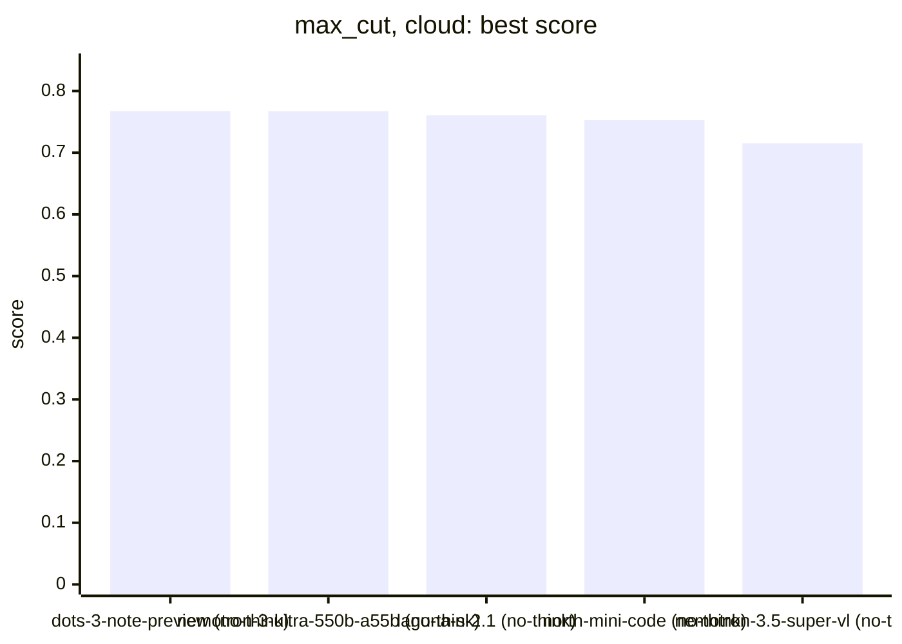
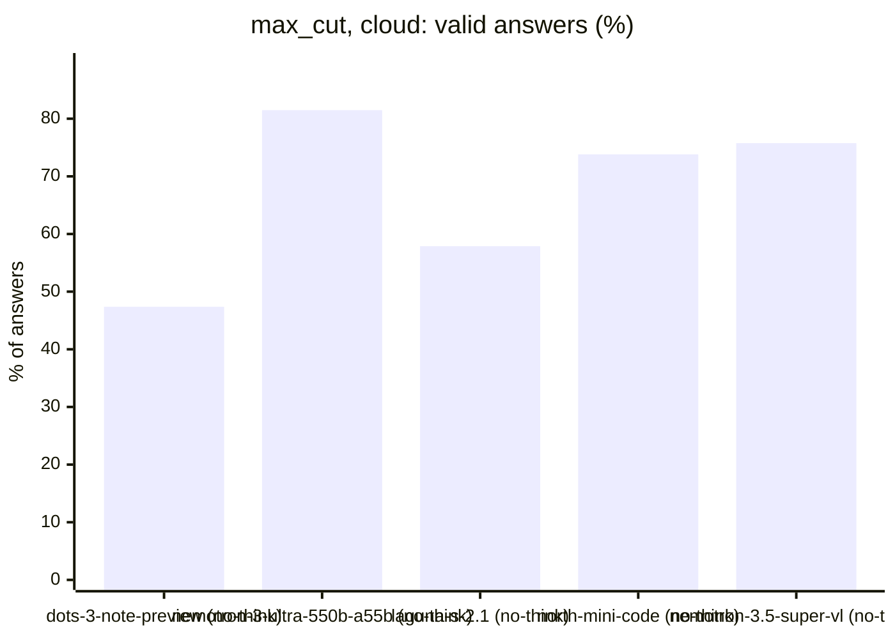
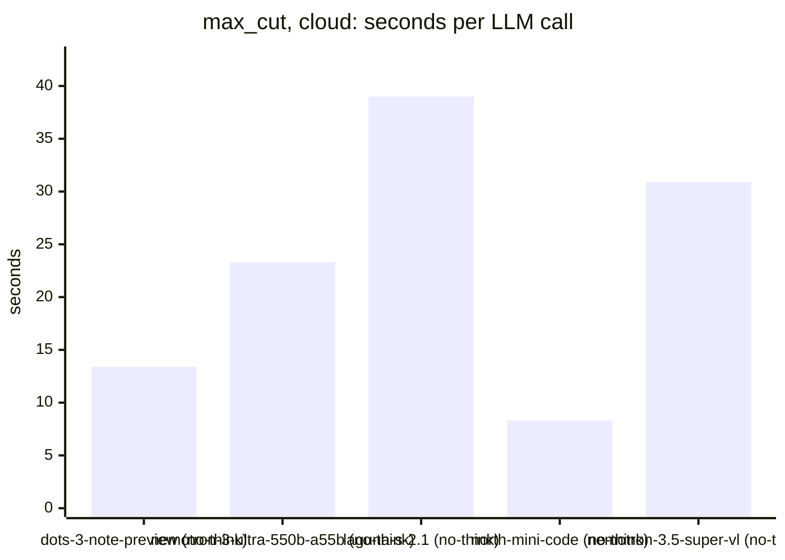
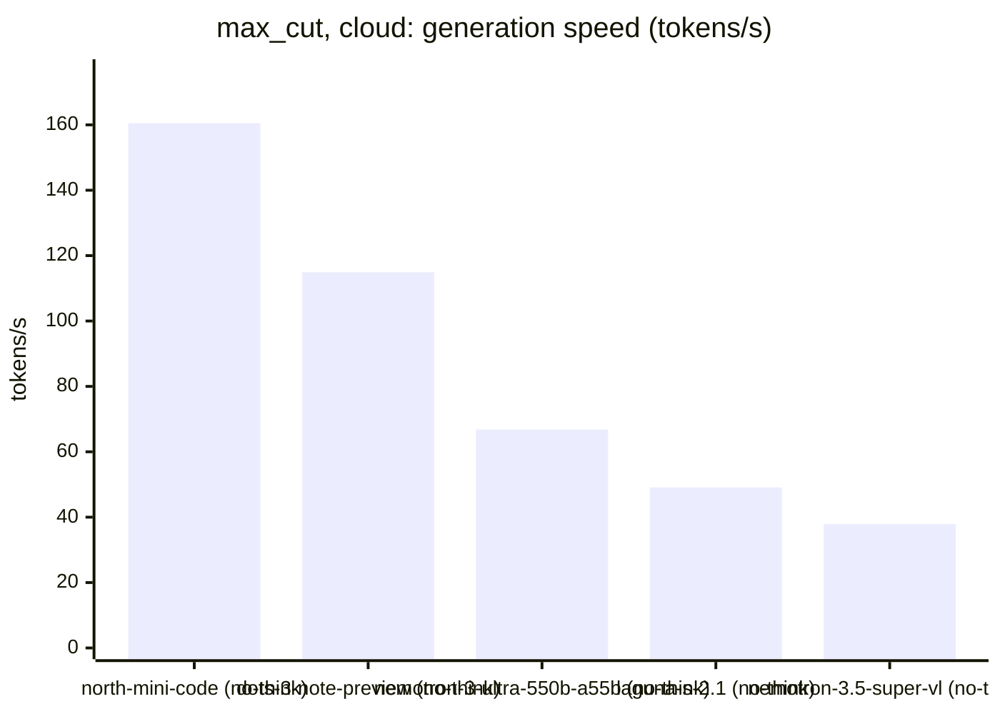

<!-- Copyright (c) 2026 by C. Klukas -->
<!-- SPDX-License-Identifier: GPL-3.0-only -->
<!-- Generated by `omega report` from bench/results/*.json. Do not edit by hand. -->

# max_cut

5 models, each run at most 60 minutes, ended earlier after 15 answers in a row without progress; one run per model. The [overall ranking](../benchmarks.md#overall-ranking) compares the models over all examples.

Machine: Intel(R) Core(TM) i7-8700K CPU @ 3.70GHz (MS-7A98), 12 cores, 64 GB, 2x NVIDIA GeForce GTX 1080 Ti, 11264 MiB.

## Cloud models (OpenRouter)

Free OpenRouter models; times include the network and the provider's queue.

| Model | Params | Initial | Best | Gain | LLM calls | s/call | Valid | New bests | Min to best | Minutes | Stopped by |
|---|---|--:|--:|--:|--:|--:|--:|--:|--:|--:|---|
| dots-studio/dots-3-note-preview:free (no-think) |  | 0.51218 | **0.76761** | ×1.50 | 19 | 13 | 47% | 3 | 3.6 | 4.4 | no progress |
| nvidia/nemotron-3-ultra-550b-a55b:free (no-think) |  | 0.51218 | **0.76741** | ×1.50 | 27 | 23 | 81% | 5 | 8.2 | 10.7 | no progress |
| poolside/laguna-s-2.1:free (no-think) |  | 0.51218 | **0.76054** | ×1.48 | 38 | 39 | 58% | 7 | 15.1 | 25.1 | no progress |
| cohere/north-mini-code:free (no-think) |  | 0.51218 | **0.75332** | ×1.47 | 42 | 8 | 74% | 5 | 6.5 | 8.4 | no progress |
| nvidia/nemotron-3.5-super-vl:free (no-think) |  | 0.51218 | **0.71534** | ×1.40 | 33 | 31 | 76% | 4 | 11.1 | 17.3 | no progress |

### Inference speed and cost

Generation speed is measured from the first to the last streamed token; the time to the first token is counted as prompt time. Cost is what OpenRouter charged for the run.

| Model | Gen tok/s | Median s/call | p90 s/call | Tokens/answer | Stopped | Cost $ |
|---|--:|--:|--:|--:|--:|--:|
| cohere/north-mini-code:free (no-think) | 160.5 | 6 | 15 | 1238 | 0 | 0.000 |
| dots-studio/dots-3-note-preview:free (no-think) | 114.9 | 13 | 20 | 1386 | 1 | 0.000 |
| nvidia/nemotron-3-ultra-550b-a55b:free (no-think) | 66.8 | 18 | 53 | 1328 | 0 | 0.000 |
| poolside/laguna-s-2.1:free (no-think) | 49.1 | 36 | 59 | 1546 | 6 | 0.000 |
| nvidia/nemotron-3.5-super-vl:free (no-think) | 37.9 | 16 | 82 | 1059 | 1 | 0.000 |

### Best score over time

| Model | 15 min | 30 min | 45 min | 60 min |
|---|--:|--:|--:|--:|
| dots-studio/dots-3-note-preview:free (no-think) | 0.76761 | 0.76761 | 0.76761 | 0.76761 |
| nvidia/nemotron-3-ultra-550b-a55b:free (no-think) | 0.76741 | 0.76741 | 0.76741 | 0.76741 |
| poolside/laguna-s-2.1:free (no-think) | 0.7575 | 0.76054 | 0.76054 | 0.76054 |
| cohere/north-mini-code:free (no-think) | 0.75332 | 0.75332 | 0.75332 | 0.75332 |
| nvidia/nemotron-3.5-super-vl:free (no-think) | 0.71534 | 0.71534 | 0.71534 | 0.71534 |

### Outcome of the LLM answers

| Model | duplicate | edit error | invalid | llm error | ok | timeout |
|---|--:|--:|--:|--:|--:|--:|
| dots-studio/dots-3-note-preview:free (no-think) | 0 | 8 | 1 | 1 | 9 | 0 |
| nvidia/nemotron-3-ultra-550b-a55b:free (no-think) | 0 | 0 | 5 | 0 | 22 | 0 |
| poolside/laguna-s-2.1:free (no-think) | 3 | 2 | 5 | 6 | 22 | 0 |
| cohere/north-mini-code:free (no-think) | 2 | 5 | 1 | 0 | 31 | 3 |
| nvidia/nemotron-3.5-super-vl:free (no-think) | 2 | 1 | 3 | 1 | 25 | 1 |

### Best idea per model

- **dots-studio/dots-3-note-preview:free (no-think)**: Add a tabu search phase after the local search to escape local optima, using a dynamic tenure and periodic restarts with perturbation to improve the cut weight.
- **nvidia/nemotron-3-ultra-550b-a55b:free (no-think)**: The tabu search recomputes the full cut weight for aspiration checks in every iteration (O(E) per iteration), which wastes CPU time. Replace this with incremental tracking of …
- **poolside/laguna-s-2.1:free (no-think)**: tuned TIME_LIMIT=1.8, PERTURB_FRAC=0.08, SEED=31 on top of: Reduce the perturbation fraction to 0.10 and lower the time limit to 1.6 to fit more restart cycles while staying …
- **cohere/north-mini-code:free (no-think)**: tuned RESTARTS=29, RESTART_FLIP_PCT=0.05 on top of: Increase restart perturbation size to 10% and add early‑time adaptive restarts to better explore larger graphs within the time …
- **nvidia/nemotron-3.5-super-vl:free (no-think)**: Expose the tabu tenure as a named constant so the engine can find the best value for each graph size instead of guessing n//10.
