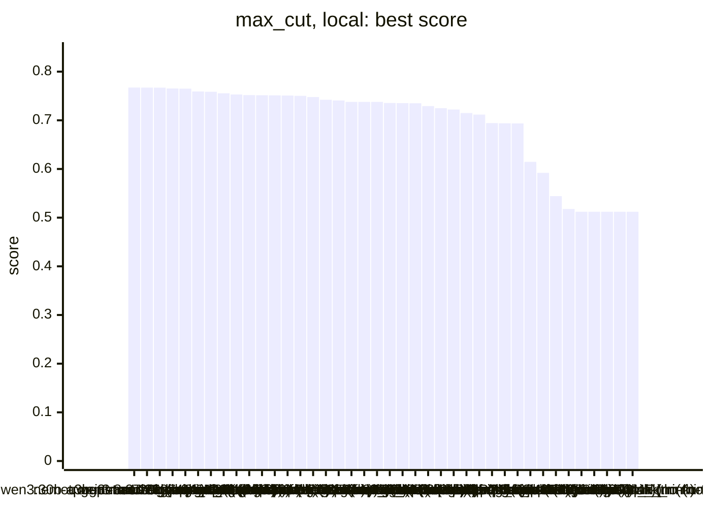
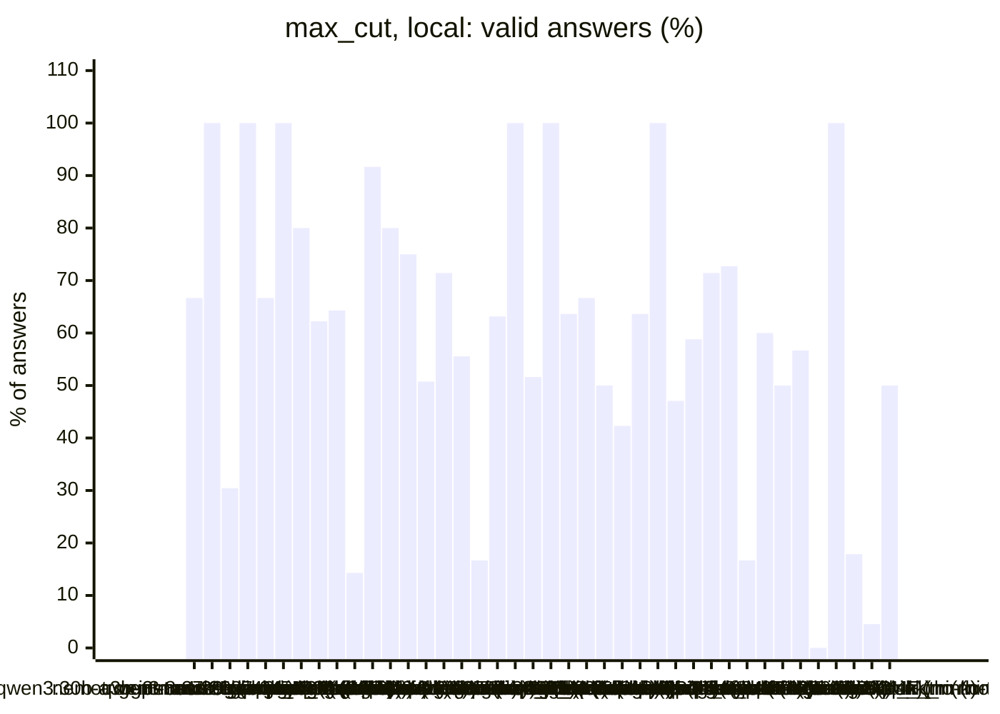
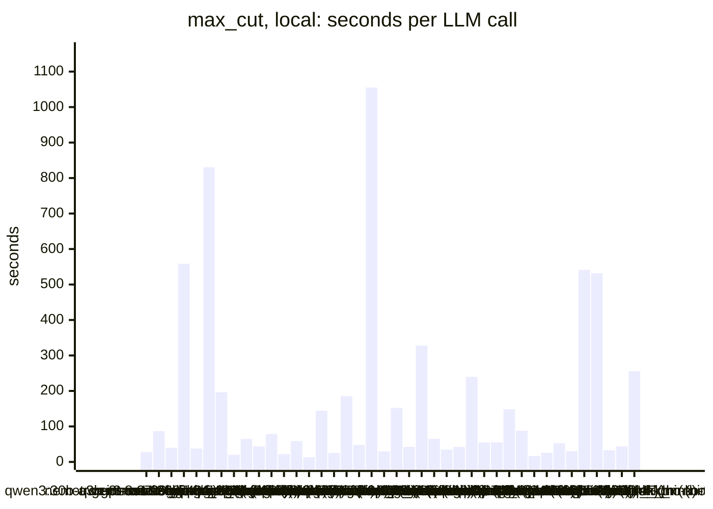
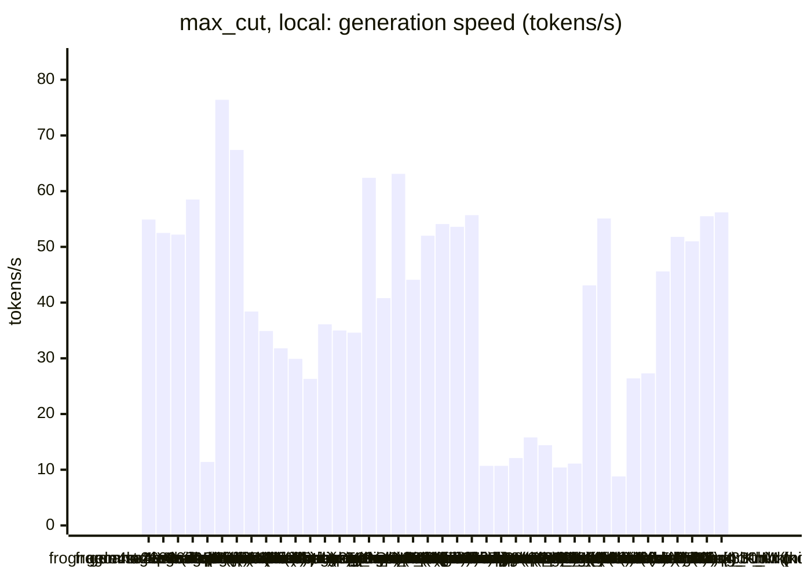
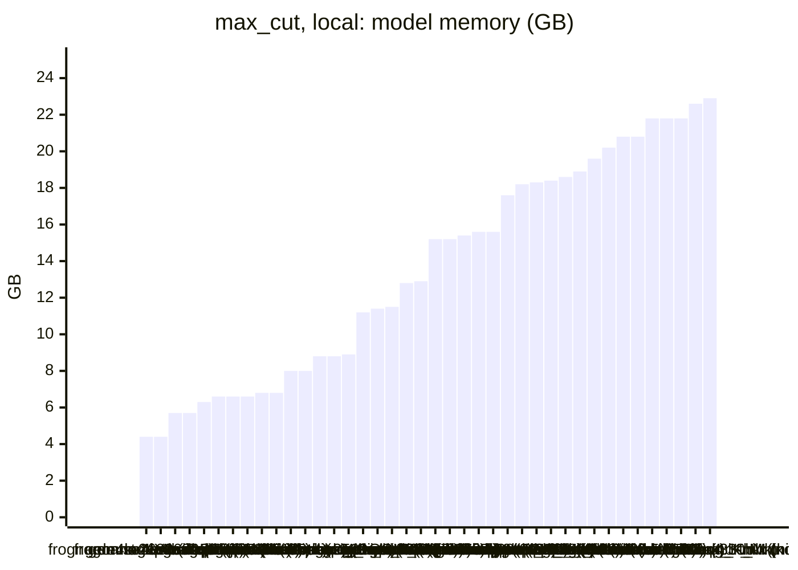

<!-- Copyright (c) 2026 by C. Klukas -->
<!-- SPDX-License-Identifier: GPL-3.0-only -->
<!-- Generated by `omega report` from bench/results/*.json. Do not edit by hand. -->

# max_cut

43 models, 15 minutes each, one run per model. The [overall ranking](../benchmarks.md#overall-ranking) compares the models over all examples.

Machine: Apple M1 Max (Mac13,1), 10 cores, 32 GB.

## Local models

Ollama on this machine.

| Model | Params | Initial | Best | Gain | LLM calls | s/call | Valid | New bests | Min to best |
|---|---|--:|--:|--:|--:|--:|--:|--:|--:|
| qwen3:30b-a3b-instruct-2507-q4_K_M (think) | 30.5B | 0.51218 | **0.7673** | ×1.50 | 33 | 28 | 67% | 5 | 8.0 |
| gpt-oss:20b (think) | 20.9B | 0.51218 | **0.76722** | ×1.50 | 11 | 87 | 100% | 8 | 16.4 |
| nemotron-3-nano:30b-a3b-mlx (no-think) |  | 0.51218 | **0.76715** | ×1.50 | 23 | 40 | 30% | 6 | 14.4 |
| qwen3.8:27b-mtp-q4_K_M (think) | 27.3B | 0.51218 | **0.7654** | ×1.49 | 2 | 559 | 100% | 1 | 13.8 |
| gemma4:26b-a4b-it-qat (no-think) | 25.2B | 0.51218 | **0.76503** | ×1.49 | 24 | 38 | 67% | 3 | 5.4 |
| muse-glimmer:30b (think) | 27.9B | 0.51218 | **0.75919** | ×1.48 | 2 | 831 | 100% | 1 | 14.6 |
| muse-glimmer:30b (no-think) | 27.9B | 0.51218 | **0.75858** | ×1.48 | 5 | 196 | 80% | 4 | 16.5 |
| gemma4:latest (no-think) |  | 0.51218 | **0.7555** | ×1.48 | 45 | 20 | 62% | 8 | 14.1 |
| gemma4:e4b-it-qat (think) | 7.5B | 0.51218 | **0.75304** | ×1.47 | 14 | 65 | 64% | 4 | 15.2 |
| nemotron-3.5-lightning:30b-mlx (no-think) |  | 0.51218 | **0.75179** | ×1.47 | 21 | 44 | 14% | 2 | 13.2 |
| gpt-oss:20b (no-think) | 20.9B | 0.51218 | **0.75151** | ×1.47 | 12 | 79 | 92% | 4 | 14.9 |
| gemma4:e4b-it-qat (no-think) | 7.5B | 0.51218 | **0.75125** | ×1.47 | 40 | 22 | 80% | 7 | 10.5 |
| gemma4:latest (think) |  | 0.51218 | **0.75099** | ×1.47 | 16 | 59 | 75% | 5 | 15.7 |
| gemma4:e2b (no-think) | 5.1B | 0.51218 | **0.75025** | ×1.46 | 67 | 13 | 51% | 4 | 11.9 |
| nemotron-3-nano:30b-a3b-mlx (think) |  | 0.51218 | **0.74783** | ×1.46 | 7 | 144 | 71% | 3 | 16.9 |
| qwen3:30b-a3b-instruct-2507-q4_K_M (no-think) | 30.5B | 0.51218 | **0.74224** | ×1.45 | 36 | 25 | 56% | 4 | 13.7 |
| frob/sarvam:30b (no-think) | 32.2B | 0.51218 | **0.74075** | ×1.45 | 6 | 185 | 17% | 2 | 11.3 |
| qwen3.5:latest (no-think) | 9.7B | 0.51218 | **0.73771** | ×1.44 | 19 | 48 | 63% | 3 | 7.6 |
| qwen3.8:27b-mtp-q4_K_M (no-think) | 27.3B | 0.51218 | **0.73771** | ×1.44 | 1 | 1055 | 100% | 1 | 17.6 |
| richardyoung/frognano-4b-2609:latest (no-think) | 4.3B | 0.51218 | **0.73771** | ×1.44 | 31 | 30 | 52% | 3 | 8.1 |
| ingu627/exaone4.0:32b (no-think) | 32.0B | 0.51218 | **0.73561** | ×1.44 | 7 | 152 | 100% | 2 | 17.8 |
| gemma4:e2b (think) | 5.1B | 0.51218 | **0.73531** | ×1.44 | 22 | 42 | 64% | 2 | 5.3 |
| gemma4:26b-a4b-it-qat (think) | 25.2B | 0.51218 | **0.73495** | ×1.43 | 3 | 328 | 67% | 2 | 12.9 |
| qwen3.5:latest (think) | 9.7B | 0.51218 | **0.72921** | ×1.42 | 14 | 65 | 50% | 2 | 11.5 |
| nemotron-3-nano:4b (think) |  | 0.51218 | **0.72498** | ×1.42 | 26 | 35 | 42% | 4 | 14.8 |
| glm-4.7-flash:latest (no-think) | 29.9B | 0.51218 | **0.72224** | ×1.41 | 22 | 42 | 64% | 1 | 2.9 |
| qwen3.6:27b-coding-mtp-q4_K_M (no-think) | 27.3B | 0.51218 | **0.71488** | ×1.40 | 4 | 240 | 100% | 2 | 9.2 |
| gemma4:12b-it-qat (no-think) | 11.9B | 0.51218 | **0.71177** | ×1.39 | 17 | 55 | 47% | 1 | 3.5 |
| qwen3-coder:30b (no-think) | 30.5B | 0.51218 | **0.69428** | ×1.36 | 17 | 56 | 59% | 2 | 12.3 |
| qwen3.5:27b (no-think) | 27.8B | 0.51218 | **0.69385** | ×1.35 | 7 | 149 | 71% | 1 | 9.2 |
| devstral-small-2:24b (no-think) | 24.0B | 0.51218 | **0.69368** | ×1.35 | 11 | 88 | 73% | 1 | 5.5 |
| nemotron-3-nano:4b (no-think) |  | 0.51218 | **0.61463** | ×1.20 | 54 | 16 | 17% | 1 | 4.3 |
| qwen2.5-coder:7b (no-think) | 7.6B | 0.51218 | **0.59204** | ×1.16 | 35 | 26 | 60% | 4 | 14.1 |
| richardyoung/frognano-4b-2609:latest (think) | 4.3B | 0.51218 | **0.54422** | ×1.06 | 18 | 53 | 50% | 2 | 2.0 |
| yandex/YandexGPT-5-Lite-8B-instruct-GGUF:latest (no-think) | 8.0B | 0.51218 | **0.51766** | ×1.01 | 30 | 30 | 57% | 1 | 6.3 |
| gemma4:12b-it-qat (think) | 11.9B | 0.51218 | **0.51218** | ×1.00 | 2 | 541 | 0% | 0 | - |
| qwen3.5:27b (think) | 27.8B | 0.51218 | **0.51218** | ×1.00 | 2 | 532 | 100% | 0 | - |
| qwen3.6:27b-coding-mtp-q4_K_M (think) | 27.3B | | | | | | | | failed: all 1 model requests failed: qwen3.6:27b-coding-mtp-q4_K_M:  |
| MichelRosselli/apertus:8b-instruct-2509-q4_k_m (no-think) | 8.1B | 0.51218 | **0.51218** | ×1.00 | 28 | 33 | 18% | 0 | - |
| llm-jp-4-8b-omega:q4_k_m (no-think) | 8.6B | 0.51218 | **0.51218** | ×1.00 | 22 | 44 | 5% | 0 | - |
| glm-4.7-flash:latest (think) | 29.9B | 0.51218 | **0.51218** | ×1.00 | 4 | 256 | 50% | 0 | - |
| frob/sarvam:30b (think) | 32.2B | | | | | | | | failed: all 5 model requests failed: frob/sarvam:30b: answer stopped |
| nemotron-3.5-lightning:30b-mlx (think) |  | | | | | | | | failed: all 4 model requests failed: nemotron-3.5-lightning:30b-mlx: |

### Inference speed and memory

RAM is what Ollama reports for the loaded model (weights, context cache and buffers; on Apple silicon this is shared memory). Load is the time to bring the model into memory. Prompt and generation speeds are tokens per second over all calls of the run.

| Model | Params | RAM GB | Load s | Prompt tok/s | Gen tok/s | Median s/call | p90 s/call | Tokens/answer | Stopped |
|---|---|--:|--:|--:|--:|--:|--:|--:|--:|
| richardyoung/frognano-4b-2609:latest (no-think) | 4.3B | 4.4 | 0 | 696 | 54.9 | 28 | 46 | 1057 | 6 |
| richardyoung/frognano-4b-2609:latest (think) | 4.3B | 4.4 | 0 | 772 | 52.5 | 48 | 76 | 2538 | 1 |
| gemma4:e4b-it-qat (think) | 7.5B | 5.7 | 77 | 600 | 52.2 | 65 | 80 | 2798 | 0 |
| gemma4:e4b-it-qat (no-think) | 7.5B | 5.7 | 56 | 578 | 58.5 | 22 | 34 | 705 | 0 |
| devstral-small-2:24b (no-think) | 24.0B | 6.3 | 48 | 127 | 11.4 | 82 | 121 | 686 | 1 |
| gemma4:e2b (no-think) | 5.1B | 6.6 | 78 | 1024 | 76.4 | 11 | 18 | 629 | 0 |
| gemma4:e2b (think) | 5.1B | 6.6 | 39 | 972 | 67.4 | 44 | 53 | 2444 | 1 |
| qwen2.5-coder:7b (no-think) | 7.6B | 6.6 | 52 | 459 | 38.4 | 25 | 33 | 652 | 1 |
| qwen3.5:latest (no-think) | 9.7B | 6.8 | 70 | 387 | 34.9 | 40 | 102 | 1117 | 0 |
| qwen3.5:latest (think) | 9.7B | 6.8 | 0 | 430 | 31.8 | 54 | 132 | 1615 | 1 |
| gemma4:12b-it-qat (no-think) | 11.9B | 8.0 | 116 | 247 | 29.9 | 48 | 76 | 1000 | 0 |
| gemma4:12b-it-qat (think) | 11.9B | 8.0 | 65 | 199 | 26.3 | 586 | 586 | 13493 | 1 |
| yandex/YandexGPT-5-Lite-8B-instruct-GGUF:latest (no-think) | 8.0B | 8.8 | 15 | 450 | 36.1 | 29 | 46 | 846 | 0 |
| llm-jp-4-8b-omega:q4_k_m (no-think) | 8.6B | 8.8 | 0 | 589 | 35.0 | 40 | 70 | 1213 | 4 |
| MichelRosselli/apertus:8b-instruct-2509-q4_k_m (no-think) | 8.1B | 8.9 | 15 | 437 | 34.6 | 28 | 70 | 894 | 2 |
| nemotron-3-nano:4b (think) |  | 11.2 | 8 | 688 | 62.4 | 33 | 57 | 1905 | 0 |
| gemma4:latest (think) |  | 11.4 | 115 | 820 | 40.8 | 45 | 109 | 1951 | 0 |
| nemotron-3-nano:4b (no-think) |  | 11.5 | 8 | 719 | 63.1 | 16 | 25 | 705 | 3 |
| gpt-oss:20b (think) | 20.9B | 12.8 | 128 | 446 | 44.1 | 74 | 129 | 2974 | 0 |
| gpt-oss:20b (no-think) | 20.9B | 12.9 | 56 | 606 | 52.0 | 70 | 138 | 3580 | 0 |
| gemma4:latest (no-think) |  | 15.2 | 121 | 1002 | 54.1 | 16 | 28 | 687 | 0 |
| gemma4:26b-a4b-it-qat (think) | 25.2B | 15.2 | 21 | 647 | 53.6 | 214 | 566 | 11498 | 0 |
| gemma4:26b-a4b-it-qat (no-think) | 25.2B | 15.4 | 204 | 542 | 55.7 | 32 | 43 | 1057 | 0 |
| muse-glimmer:30b (think) | 27.9B | 15.6 | 61 | 144 | 10.7 | 872 | 872 | 8458 | 0 |
| muse-glimmer:30b (no-think) | 27.9B | 15.6 | 59 | 106 | 10.7 | 199 | 227 | 1803 | 0 |
| qwen3.8:27b-mtp-q4_K_M (think) | 27.3B | 17.6 | 304 | 122 | 12.1 | 823 | 823 | 4766 | 0 |
| qwen3.6:27b-coding-mtp-q4_K_M (no-think) | 27.3B | 18.2 | 13 | 105 | 15.8 | 222 | 494 | 1998 | 0 |
| qwen3.8:27b-mtp-q4_K_M (no-think) | 27.3B | 18.3 | 301 | 96 | 14.4 | 1055 | 1055 | 513 | 0 |
| qwen3.5:27b (think) | 27.8B | 18.4 | 191 | 128 | 10.4 | 647 | 647 | 4388 | 0 |
| qwen3.5:27b (no-think) | 27.8B | 18.6 | 233 | 107 | 11.1 | 90 | 397 | 1039 | 0 |
| frob/sarvam:30b (no-think) | 32.2B | 18.9 | 64 | 1277 | 43.1 | 164 | 277 | 7460 | 0 |
| nemotron-3-nano:30b-a3b-mlx (think) |  | 19.6 | 104 | 255 | 55.1 | 138 | 272 | 6565 | 0 |
| ingu627/exaone4.0:32b (no-think) | 32.0B | 20.2 | 50 | 68 | 8.8 | 166 | 191 | 925 | 0 |
| glm-4.7-flash:latest (no-think) | 29.9B | 20.8 | 51 | 433 | 26.4 | 40 | 72 | 860 | 1 |
| glm-4.7-flash:latest (think) | 29.9B | 20.8 | 50 | 702 | 27.3 | 262 | 421 | 6572 | 0 |
| qwen3:30b-a3b-instruct-2507-q4_K_M (think) | 30.5B | 21.8 | 155 | 575 | 45.6 | 23 | 47 | 678 | 0 |
| qwen3:30b-a3b-instruct-2507-q4_K_M (no-think) | 30.5B | 21.8 | 239 | 675 | 51.8 | 17 | 30 | 665 | 2 |
| qwen3-coder:30b (no-think) | 30.5B | 21.8 | 114 | 669 | 51.0 | 28 | 54 | 1267 | 0 |
| nemotron-3-nano:30b-a3b-mlx (no-think) |  | 22.6 | 0 | 587 | 55.5 | 31 | 50 | 1191 | 3 |
| nemotron-3.5-lightning:30b-mlx (no-think) |  | 22.9 | 0 | 591 | 56.2 | 45 | 52 | 1554 | 12 |

### Best score over time

| Model | 3.75 min | 7.5 min | 11.25 min | 15 min |
|---|--:|--:|--:|--:|
| qwen3:30b-a3b-instruct-2507-q4_K_M (think) | 0.51218 | 0.76654 | 0.7673 | 0.7673 |
| gpt-oss:20b (think) | 0.72393 | 0.73862 | 0.75994 | 0.76212 |
| nemotron-3-nano:30b-a3b-mlx (no-think) | 0.51218 | 0.76413 | 0.76675 | 0.76715 |
| qwen3.8:27b-mtp-q4_K_M (think) | 0.51218 | 0.51218 | 0.51218 | 0.7654 |
| gemma4:26b-a4b-it-qat (no-think) | 0.72085 | 0.76503 | 0.76503 | 0.76503 |
| muse-glimmer:30b (think) | 0.51218 | 0.51218 | 0.51218 | 0.75919 |
| muse-glimmer:30b (no-think) | 0.51218 | 0.72784 | 0.72784 | 0.7434 |
| gemma4:latest (no-think) | 0.69385 | 0.754 | 0.754 | 0.7555 |
| gemma4:e4b-it-qat (think) | 0.72422 | 0.74837 | 0.74837 | 0.74837 |
| nemotron-3.5-lightning:30b-mlx (no-think) | 0.51218 | 0.51218 | 0.74439 | 0.75179 |
| gpt-oss:20b (no-think) | 0.74208 | 0.74208 | 0.74832 | 0.75151 |
| gemma4:e4b-it-qat (no-think) | 0.73531 | 0.74192 | 0.75125 | 0.75125 |
| gemma4:latest (think) | 0.73005 | 0.74904 | 0.74904 | 0.74904 |
| gemma4:e2b (no-think) | 0.51218 | 0.73495 | 0.74794 | 0.75025 |
| nemotron-3-nano:30b-a3b-mlx (think) | 0.51218 | 0.72597 | 0.72597 | 0.72597 |
| qwen3:30b-a3b-instruct-2507-q4_K_M (no-think) | 0.51218 | 0.72146 | 0.73531 | 0.74224 |
| frob/sarvam:30b (no-think) | 0.51218 | 0.51218 | 0.51218 | 0.74075 |
| qwen3.5:latest (no-think) | 0.73388 | 0.73388 | 0.73771 | 0.73771 |
| qwen3.8:27b-mtp-q4_K_M (no-think) | 0.51218 | 0.51218 | 0.51218 | 0.51218 |
| richardyoung/frognano-4b-2609:latest (no-think) | 0.72232 | 0.72837 | 0.73771 | 0.73771 |
| ingu627/exaone4.0:32b (no-think) | 0.73495 | 0.73495 | 0.73495 | 0.73495 |
| gemma4:e2b (think) | 0.69385 | 0.73531 | 0.73531 | 0.73531 |
| gemma4:26b-a4b-it-qat (think) | 0.51218 | 0.51218 | 0.73306 | 0.73495 |
| qwen3.5:latest (think) | 0.51218 | 0.72836 | 0.72836 | 0.72921 |
| nemotron-3-nano:4b (think) | 0.51218 | 0.69385 | 0.71895 | 0.72498 |
| glm-4.7-flash:latest (no-think) | 0.72224 | 0.72224 | 0.72224 | 0.72224 |
| qwen3.6:27b-coding-mtp-q4_K_M (no-think) | 0.51218 | 0.51218 | 0.71488 | 0.71488 |
| gemma4:12b-it-qat (no-think) | 0.71177 | 0.71177 | 0.71177 | 0.71177 |
| qwen3-coder:30b (no-think) | 0.51218 | 0.51218 | 0.69385 | 0.69428 |
| qwen3.5:27b (no-think) | 0.51218 | 0.51218 | 0.69385 | 0.69385 |
| devstral-small-2:24b (no-think) | 0.51218 | 0.69368 | 0.69368 | 0.69368 |
| nemotron-3-nano:4b (no-think) | 0.51218 | 0.61463 | 0.61463 | 0.61463 |
| qwen2.5-coder:7b (no-think) | 0.56667 | 0.56667 | 0.56667 | 0.59204 |
| richardyoung/frognano-4b-2609:latest (think) | 0.54422 | 0.54422 | 0.54422 | 0.54422 |
| yandex/YandexGPT-5-Lite-8B-instruct-GGUF:latest (no-think) | 0.51218 | 0.51766 | 0.51766 | 0.51766 |
| gemma4:12b-it-qat (think) | 0.51218 | 0.51218 | 0.51218 | 0.51218 |
| qwen3.5:27b (think) | 0.51218 | 0.51218 | 0.51218 | 0.51218 |
| MichelRosselli/apertus:8b-instruct-2509-q4_k_m (no-think) | 0.51218 | 0.51218 | 0.51218 | 0.51218 |
| llm-jp-4-8b-omega:q4_k_m (no-think) | 0.51218 | 0.51218 | 0.51218 | 0.51218 |
| glm-4.7-flash:latest (think) | 0.51218 | 0.51218 | 0.51218 | 0.51218 |

### Outcome of the LLM answers

| Model | duplicate | edit error | invalid | llm error | ok | timeout |
|---|--:|--:|--:|--:|--:|--:|
| qwen3:30b-a3b-instruct-2507-q4_K_M (think) | 3 | 2 | 6 | 0 | 22 | 0 |
| gpt-oss:20b (think) | 0 | 0 | 0 | 0 | 11 | 0 |
| nemotron-3-nano:30b-a3b-mlx (no-think) | 0 | 12 | 1 | 3 | 7 | 0 |
| qwen3.8:27b-mtp-q4_K_M (think) | 0 | 0 | 0 | 0 | 2 | 0 |
| gemma4:26b-a4b-it-qat (no-think) | 1 | 7 | 0 | 0 | 16 | 0 |
| muse-glimmer:30b (think) | 0 | 0 | 0 | 0 | 2 | 0 |
| muse-glimmer:30b (no-think) | 0 | 0 | 0 | 0 | 4 | 1 |
| gemma4:latest (no-think) | 1 | 7 | 9 | 0 | 28 | 0 |
| gemma4:e4b-it-qat (think) | 0 | 0 | 1 | 0 | 9 | 4 |
| nemotron-3.5-lightning:30b-mlx (no-think) | 0 | 5 | 1 | 12 | 3 | 0 |
| gpt-oss:20b (no-think) | 0 | 1 | 0 | 0 | 11 | 0 |
| gemma4:e4b-it-qat (no-think) | 1 | 1 | 6 | 0 | 32 | 0 |
| gemma4:latest (think) | 0 | 1 | 3 | 0 | 12 | 0 |
| gemma4:e2b (no-think) | 6 | 9 | 16 | 0 | 34 | 2 |
| nemotron-3-nano:30b-a3b-mlx (think) | 1 | 1 | 0 | 0 | 5 | 0 |
| qwen3:30b-a3b-instruct-2507-q4_K_M (no-think) | 11 | 1 | 2 | 2 | 20 | 0 |
| frob/sarvam:30b (no-think) | 0 | 5 | 0 | 0 | 1 | 0 |
| qwen3.5:latest (no-think) | 0 | 2 | 4 | 0 | 12 | 1 |
| qwen3.8:27b-mtp-q4_K_M (no-think) | 0 | 0 | 0 | 0 | 1 | 0 |
| richardyoung/frognano-4b-2609:latest (no-think) | 0 | 5 | 4 | 6 | 16 | 0 |
| ingu627/exaone4.0:32b (no-think) | 0 | 0 | 0 | 0 | 7 | 0 |
| gemma4:e2b (think) | 0 | 6 | 0 | 1 | 14 | 1 |
| gemma4:26b-a4b-it-qat (think) | 0 | 0 | 1 | 0 | 2 | 0 |
| qwen3.5:latest (think) | 0 | 0 | 5 | 1 | 7 | 1 |
| nemotron-3-nano:4b (think) | 1 | 11 | 3 | 0 | 11 | 0 |
| glm-4.7-flash:latest (no-think) | 0 | 0 | 5 | 1 | 14 | 2 |
| qwen3.6:27b-coding-mtp-q4_K_M (no-think) | 0 | 0 | 0 | 0 | 4 | 0 |
| gemma4:12b-it-qat (no-think) | 0 | 4 | 5 | 0 | 8 | 0 |
| qwen3-coder:30b (no-think) | 4 | 1 | 2 | 0 | 10 | 0 |
| qwen3.5:27b (no-think) | 0 | 2 | 0 | 0 | 5 | 0 |
| devstral-small-2:24b (no-think) | 1 | 0 | 0 | 1 | 8 | 1 |
| nemotron-3-nano:4b (no-think) | 3 | 29 | 9 | 3 | 9 | 1 |
| qwen2.5-coder:7b (no-think) | 7 | 0 | 6 | 1 | 21 | 0 |
| richardyoung/frognano-4b-2609:latest (think) | 0 | 4 | 4 | 1 | 9 | 0 |
| yandex/YandexGPT-5-Lite-8B-instruct-GGUF:latest (no-think) | 2 | 2 | 9 | 0 | 17 | 0 |
| gemma4:12b-it-qat (think) | 0 | 0 | 1 | 1 | 0 | 0 |
| qwen3.5:27b (think) | 0 | 0 | 0 | 0 | 2 | 0 |
| MichelRosselli/apertus:8b-instruct-2509-q4_k_m (no-think) | 2 | 11 | 8 | 2 | 5 | 0 |
| llm-jp-4-8b-omega:q4_k_m (no-think) | 0 | 7 | 10 | 4 | 1 | 0 |
| glm-4.7-flash:latest (think) | 0 | 1 | 1 | 0 | 2 | 0 |

### Best idea per model

- **qwen3:30b-a3b-instruct-2507-q4_K_M (think)**: tuned TIME_RATIO=0.9606, RESTART_RATIO=0.6253, MIN_RESTARTS=7, MAX_RESTARTS=29 on top of: Replace the naive gain computation in the local search with incremental updates to avoid …
- **gpt-oss:20b (think)**: tuned TIME_LIMIT=1.9, PERTURB_RATE=0.07, PERTURB_PROB=0.3 on top of: Replace the fixed greedy restarts with a perturbation‑based restart that starts from the current best solution …
- **nemotron-3-nano:30b-a3b-mlx (no-think)**: tuned RESTART_CHANCE=0.02, MAX_ITER=40000, RESTART_ITERS=1000 on top of: Increase restart chance and iterations for more exploration while raising MAX_ITER to stay within time …
- **qwen3.8:27b-mtp-q4_K_M (think)**: Replace the trivial alternating split with a full metaheuristic: greedy construction (place nodes in degree order on the side cutting more to placed nodes), one-flip local search …
- **gemma4:26b-a4b-it-qat (no-think)**: tuned tabu_tenure=35 on top of: Implement a Tabu Search mechanism to escape local optima when no positive gain remains, using the best solution found across iterations as the …
- **muse-glimmer:30b (think)**: Build adjacency lists and run a greedy construction with random node orders followed by an incremental best-gain local search, restarting from different orders until time expires …
- **muse-glimmer:30b (no-think)**: start from a greedy construction that places nodes in random order to maximize immediate cut, then run improving one-flip passes with incremental time checks, and repeat the whole …
- **gemma4:latest (no-think)**: tuned MAX_FLIPS_PER_RESTART=200, NUM_RESTARTS=100 on top of: Introduce a mechanism to limit the number of local search iterations per restart to prevent excessive runtime on …
- **gemma4:e4b-it-qat (think)**: Implement multiple random restarts to explore the solution space more broadly, starting the local search from various random initial assignments and returning the best cut found …
- **nemotron-3.5-lightning:30b-mlx (no-think)**: Replace the trivial index-modulo-2 initialization with a greedy constructive initialization that places nodes one by one on the side maximizing cut to already placed nodes, then …
- **gpt-oss:20b (no-think)**: tuned TIME_LIMIT=1.669, RESTARTS=11, PERTURB_RATE=0.03627 on top of: expose the time limit, number of restarts and perturbation rate as tunable constants so the search can find …
- **gemma4:e4b-it-qat (no-think)**: tuned NUM_RESTARTS=30 on top of: Implement a multi-start local search by running the entire local search process multiple times from different random initial assignments to escape …
- **gemma4:latest (think)**: Replace the undefined `intrange` function call with a fixed number of restarts to resolve the NameError while keeping the existing randomized search framework.
- **gemma4:e2b (no-think)**: Optimize the Simulated Annealing acceptance criterion by calculating the change in cut weight directly instead of recalculating the entire cut weight for every potential flip …
- **nemotron-3-nano:30b-a3b-mlx (think)**: Replace the greedy first‑improvement local search with simulated annealing that randomly flips nodes and accepts worsening moves, using a cooling schedule, to escape local optima …
- **qwen3:30b-a3b-instruct-2507-q4_K_M (no-think)**: Replace the greedy construction with randomized greedy restarts using 100 iterations with shuffled node order to escape poor local optima and improve robustness across graphs …
- **frob/sarvam:30b (no-think)**: tuned GREEDY_RESTARTS=10, LOCAL_SEARCH_MAX_ITER=100, TIME_CHECK_INTERVAL=0.1, GREEDY_ORDER=random on top of: Use greedy construction with random ordering and one‑flip local …
- **qwen3.5:latest (no-think)**: Add an incremental local search phase that iteratively flips nodes with positive gain until no improvement is possible, refining the greedy solution to escape local optima without …
- **qwen3.8:27b-mtp-q4_K_M (no-think)**: Replace the alternating heuristic with a greedy node construction that places each node on the side that maximizes cut weight to already-placed nodes, then runs one-flip local …
- **richardyoung/frognano-4b-2609:latest (no-think)**: Fix the greedy initialization logic to correctly compute the optimal side for each unplaced node based on already-placed neighbors, rather than re-scanning all neighbors including …
- **ingu627/exaone4.0:32b (no-think)**: Implement a memetic search that combines two good assignments (keep the nodes where both agree) and re-optimizes, as it can potentially find better solutions by merging …
- **gemma4:e2b (think)**: Implement a greedy construction followed by a one-flip local search to refine the initial assignment, aiming to improve the approximation quality found by the purely greedy method.
- **gemma4:26b-a4b-it-qat (think)**: Implement a greedy construction followed by a one-flip local search with multiple restarts to find a high-quality max-cut solution.
- **qwen3.5:latest (think)**: Add a restart mechanism that re-runs greedy placement when no positive gain is found for 10 consecutive flips, helping escape local optima on medium graphs like g200
- **nemotron-3-nano:4b (think)**: increase simulated annealing iterations to 1000 for more exploration without exceeding the 2‑second limit.
- **glm-4.7-flash:latest (no-think)**: Implement greedy construction using incremental gain tracking to effectively utilize the edge weights, moving from random to weighted partitioning, and add a one-flip local search …
- **qwen3.6:27b-coding-mtp-q4_K_M (no-think)**: Implement a greedy construction followed by one-flip local search to significantly improve the cut quality beyond random assignment.
- **gemma4:12b-it-qat (no-think)**: Implement a greedy construction followed by a local search (one-flip) to significantly improve the cut weight.
- **qwen3-coder:30b (no-think)**: Replace the randomized constructive heuristic with a memetic algorithm that combines two greedy constructions (one greedy, one using a global weight bias) followed by tabu search …
- **qwen3.5:27b (no-think)**: Implement a greedy construction heuristic that places nodes one by one onto the side that maximizes the cut weight with respect to already placed neighbors, which is a significant …
- **devstral-small-2:24b (no-think)**: Replace the naive alternating assignment with a greedy construction that places each node on the side that maximizes the cut weight to already placed nodes, leveraging adjacency …
- **nemotron-3-nano:4b (no-think)**: Replace fixed alternating assignment with greedy BFS-based construction to maximize cut incrementally, using adjacency lists for fast neighbor access and gain updates.
- **qwen2.5-coder:7b (no-think)**: Implement a hybrid approach combining a genetic algorithm with a tabu search mechanism.
- **richardyoung/frognano-4b-2609:latest (think)**: tuned MAX_RESTARTS=5, MAX_ITERATIONS=8868 on top of: Build adjacency list with weights and implement incremental gain tracking with multiple restarts and one-flip local search for …
- **yandex/YandexGPT-5-Lite-8B-instruct-GGUF:latest (no-think)**: Implement a simple one-flip local search to improve the initial split by iteratively flipping nodes to the side that increases the cut weight.
- **gemma4:12b-it-qat (think)**: initial program
- **qwen3.5:27b (think)**: initial program
- **MichelRosselli/apertus:8b-instruct-2509-q4_k_m (no-think)**: initial program
- **llm-jp-4-8b-omega:q4_k_m (no-think)**: initial program
- **glm-4.7-flash:latest (think)**: initial program
