<!-- Copyright (c) 2026 by C. Klukas -->
<!-- SPDX-License-Identifier: GPL-3.0-only -->
<!-- Generated by `omega report` from bench/results/*.json. Do not edit by hand. -->

# max_cut

50 models, each run at most 60 minutes, ended earlier after 15 answers in a row without progress; one run per model. The [overall ranking](../benchmarks.md#overall-ranking) compares the models over all examples.

Machines: **i7-8700K**: Intel(R) Core(TM) i7-8700K CPU @ 3.70GHz (MS-7A98), 12 cores, 64 GB, 1 runs; **i7-8700K + 2x GTX 1080 Ti**: Intel(R) Core(TM) i7-8700K CPU @ 3.70GHz (MS-7A98), 12 cores, 64 GB, 2x NVIDIA GeForce GTX 1080 Ti, 11264 MiB, 49 runs.

## Local models on i7-8700K + 2x GTX 1080 Ti

Ollama on this machine.

| Model | Params | Initial | Best | Gain | LLM calls | s/call | Valid | New bests | Min to best | Minutes | Stopped by |
|---|---|--:|--:|--:|--:|--:|--:|--:|--:|--:|---|
| gpt-oss:20b (think) | 20.9B | 0.51218 | **0.76745** | ×1.50 | 24 | 56 | 79% | 7 | 14.3 | 23.8 | no progress |
| gemma4:latest (think) | 7.5B | 0.51218 | **0.76631** | ×1.50 | 23 | 46 | 83% | 5 | 6.5 | 18.9 | no progress |
| gemma4:26b-a4b-it-qat (think) | 25.2B | 0.51218 | **0.76618** | ×1.50 | 8 | 528 | 50% | 2 | 46.0 | 71.7 | time limit |
| gpt-oss:20b (no-think) | 20.9B | 0.51218 | **0.76574** | ×1.50 | 18 | 61 | 94% | 5 | 13.8 | 19.4 | no progress |
| gemma4:12b-it-qat (think) | 11.9B | 0.51218 | **0.76535** | ×1.49 | 7 | 542 | 71% | 4 | 56.9 | 64.1 | time limit |
| gemma4:e4b-it-qat (no-think) | 7.5B | 0.51218 | **0.76471** | ×1.49 | 68 | 25 | 68% | 9 | 22.0 | 29.5 | no progress |
| gemma4:e4b-it-qat (think) | 7.5B | 0.51218 | **0.76424** | ×1.49 | 23 | 67 | 65% | 3 | 8.5 | 26.8 | no progress |
| gemma4:latest (no-think) | 7.5B | 0.51218 | **0.76345** | ×1.49 | 50 | 19 | 58% | 6 | 11.1 | 16.8 | no progress |
| qwen3:30b-a3b-instruct-2507-q4_K_M (no-think) | 30.5B | 0.51218 | **0.76007** | ×1.48 | 42 | 30 | 69% | 7 | 12.3 | 22.5 | no progress |
| richardyoung/frognano-4b-2609:latest (think) | 4.3B | 0.51218 | **0.7503** | ×1.46 | 20 | 40 | 60% | 2 | 2.4 | 15.4 | no progress |
| qwen3.6:27b-coding-mtp-q4_K_M (no-think) | 27.3B | 0.51218 | **0.74898** | ×1.46 | 16 | 238 | 75% | 6 | 54.1 | 63.8 | time limit |
| underdog-saluki-27b:iq2-mix (no-think) | 26.9B | 0.51218 | **0.74766** | ×1.46 | 35 | 103 | 74% | 6 | 31.3 | 61.1 | no progress |
| qwen3:30b-a3b-instruct-2507-q4_K_M (think) | 30.5B | 0.51218 | **0.73531** | ×1.44 | 19 | 25 | 74% | 2 | 1.1 | 9.8 | no progress |
| qwen3.5:latest (no-think) | 9.0B | 0.51218 | **0.73495** | ×1.43 | 18 | 33 | 56% | 2 | 2.0 | 10.2 | no progress |
| hf.co/LiquidAI/LFM3-1.7B-GGUF:Q4_K_M (think) | 1.73B | 0.51218 | **0.73495** | ×1.43 | 19 | 173 | 63% | 1 | 9.8 | 55.2 | no progress |
| gemma4:e2b (think) | 4.6B | 0.51218 | **0.73495** | ×1.43 | 23 | 27 | 70% | 3 | 3.3 | 11.3 | no progress |
| nemotron-3-nano:4b (think) | 4.0B | 0.51218 | **0.7342** | ×1.43 | 41 | 23 | 46% | 4 | 9.5 | 16.8 | no progress |
| glm-4.7-flash:latest (no-think) | 29.9B | 0.51218 | **0.73215** | ×1.43 | 39 | 38 | 82% | 6 | 14.7 | 26.5 | no progress |
| gemma4:e2b (no-think) | 4.6B | 0.51218 | **0.73068** | ×1.43 | 20 | 9 | 65% | 2 | 0.9 | 3.2 | no progress |
| frob/sarvam:30b (think) | 32.2B | 0.51218 | **0.72836** | ×1.42 | 8 | 475 | 38% | 2 | 38.6 | 64.8 | time limit |
| frob/sarvam:30b (no-think) | 32.2B | 0.51218 | **0.72422** | ×1.41 | 9 | 426 | 33% | 1 | 9.1 | 64.2 | time limit |
| gemma4:12b-it-qat (no-think) | 11.9B | 0.51218 | **0.70701** | ×1.38 | 18 | 54 | 67% | 1 | 4.5 | 16.6 | no progress |
| qwen3-coder:30b (no-think) | 30.5B | 0.51218 | **0.70701** | ×1.38 | 22 | 54 | 91% | 1 | 5.6 | 20.3 | no progress |
| qwen2.5-coder:7b (no-think) | 7.6B | 0.51218 | **0.6981** | ×1.36 | 30 | 16 | 60% | 3 | 3.2 | 8.4 | no progress |
| glm-4.7-flash:latest (think) | 29.9B | 0.51218 | **0.62624** | ×1.22 | 9 | 419 | 78% | 2 | 50.4 | 64.6 | time limit |
| hf.co/LiquidAI/LFM3-1.7B-GGUF:Q4_K_M (no-think) | 1.73B | 0.51218 | **0.51218** | ×1.00 | 16 | 26 | 6% | 0 | - | 7.2 | no progress |
| nemotron-3-nano:4b (no-think) | 4.0B | 0.51218 | **0.51218** | ×1.00 | 16 | 11 | 12% | 0 | - | 3.3 | no progress |
| richardyoung/frognano-4b-2609:latest (no-think) | 4.3B | 0.51218 | **0.51218** | ×1.00 | 15 | 25 | 40% | 0 | - | 6.5 | no progress |
| yandex/YandexGPT-5-Lite-8B-instruct-GGUF:latest (no-think) | 8.0B | 0.51218 | **0.51218** | ×1.00 | 16 | 19 | 50% | 0 | - | 5.3 | no progress |
| MichelRosselli/apertus:8b-instruct-2509-q4_k_m (no-think) | 8.1B | 0.51218 | **0.51218** | ×1.00 | 16 | 20 | 19% | 0 | - | 5.6 | no progress |
| llm-jp-4-8b-omega:q4_k_m (no-think) | 8.6B | 0.51218 | **0.51218** | ×1.00 | 16 | 36 | 6% | 0 | - | 9.8 | no progress |
| gemma4:26b-a4b-it-qat (no-think) | 25.2B | 0.51218 | **0.51218** | ×1.00 | 16 | 52 | 62% | 0 | - | 14.3 | no progress |
| qwen3.5:latest (think) | 9.0B | 0.51218 | **0.51218** | ×1.00 | 16 | 48 | 50% | 0 | - | 13.6 | no progress |
| underdog-saluki-27b:iq2-mix (think) | 26.9B | 0.51218 | **0.51218** | ×1.00 | 3 | 1618 | 0% | 0 | - | 81.7 | time limit |
| qwen3.6:27b-coding-mtp-q4_K_M (think) | 27.3B | 0.51218 | **0.51218** | ×1.00 | 3 | 1289 | 100% | 0 | - | 65.9 | time limit |

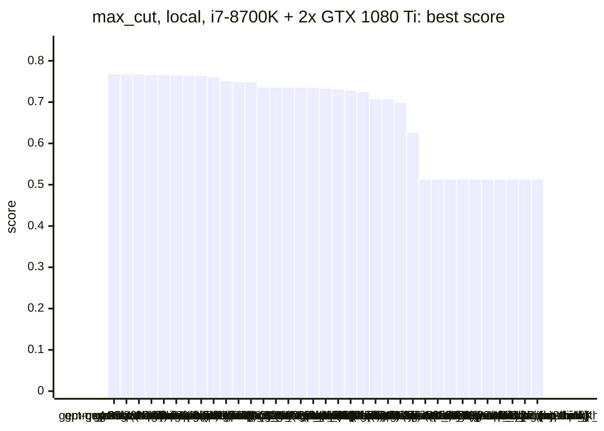

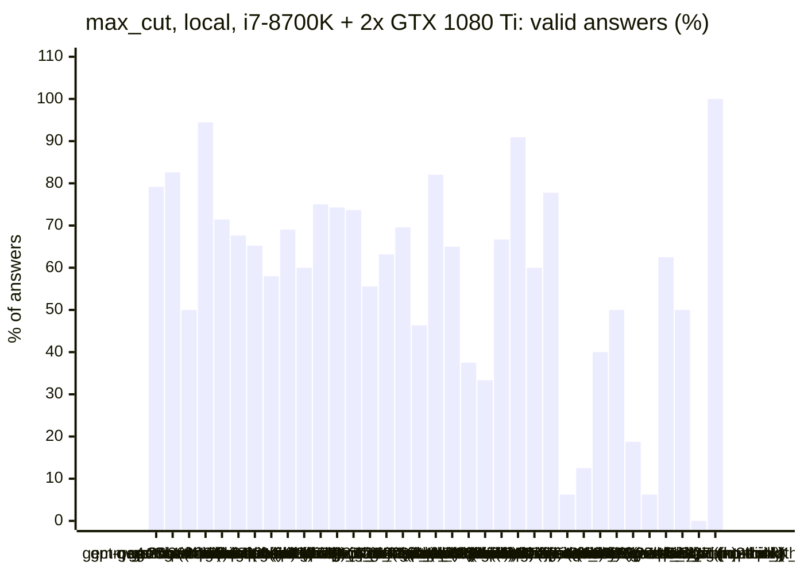

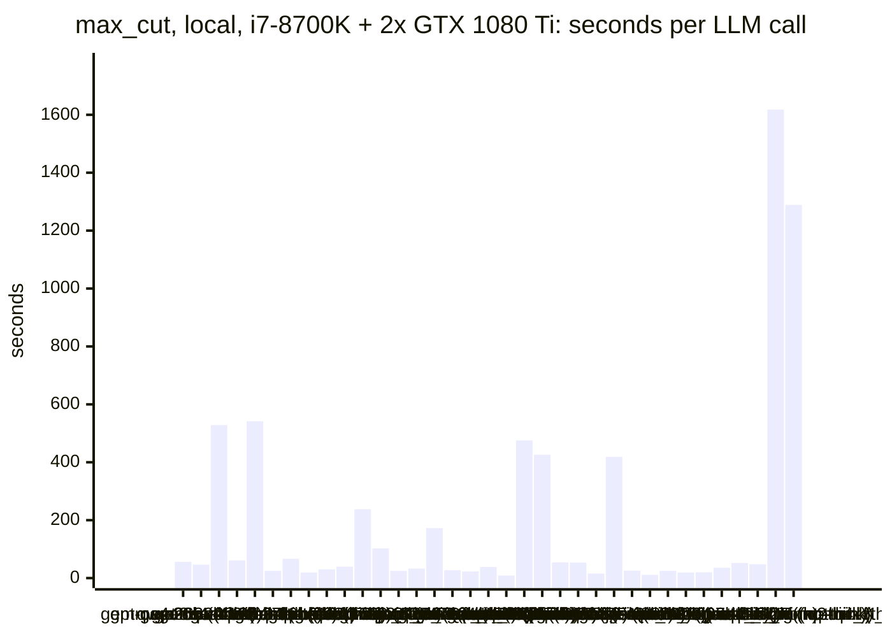

### Inference speed and memory

RAM is what Ollama reports for the loaded model (weights, context cache and buffers; on Apple silicon this is shared memory). Load is the time to bring the model into memory. Prompt and generation speeds are tokens per second over all calls of the run.

| Model | Params | RAM GB | Load s | Prompt tok/s | Gen tok/s | Median s/call | p90 s/call | Tokens/answer | Stopped |
|---|---|--:|--:|--:|--:|--:|--:|--:|--:|
| gemma4:e2b (think) | 4.6B | 0.9 | 0 | 2434 | 102.4 | 25 | 39 | 2429 | 0 |
| gemma4:e2b (no-think) | 4.6B | 0.9 | 17 | 2568 | 143.1 | 8 | 11 | 634 | 0 |
| hf.co/LiquidAI/LFM3-1.7B-GGUF:Q4_K_M (think) | 1.73B | 1.5 | 0 | 4239 | 103.0 | 181 | 244 | 17258 | 1 |
| hf.co/LiquidAI/LFM3-1.7B-GGUF:Q4_K_M (no-think) | 1.73B | 1.5 | 6 | 4254 | 118.1 | 21 | 56 | 1414 | 8 |
| gemma4:latest (think) | 7.5B | 3.3 | 0 | 1258 | 53.5 | 39 | 76 | 2186 | 0 |
| gemma4:latest (no-think) | 7.5B | 3.3 | 23 | 1193 | 65.2 | 19 | 32 | 789 | 2 |
| nemotron-3-nano:4b (think) | 4.0B | 3.9 | 0 | 1650 | 76.7 | 22 | 33 | 1425 | 0 |
| nemotron-3-nano:4b (no-think) | 4.0B | 3.9 | 9 | 1765 | 79.4 | 12 | 17 | 544 | 2 |
| richardyoung/frognano-4b-2609:latest (think) | 4.3B | 4.8 | 0 | 1757 | 56.6 | 35 | 74 | 2048 | 1 |
| richardyoung/frognano-4b-2609:latest (no-think) | 4.3B | 4.8 | 11 | 1826 | 59.1 | 22 | 37 | 1092 | 1 |
| gemma4:e4b-it-qat (no-think) | 7.5B | 6.1 | 20 | 1535 | 44.5 | 24 | 38 | 808 | 4 |
| gemma4:e4b-it-qat (think) | 7.5B | 6.1 | 0 | 1409 | 43.2 | 62 | 109 | 2683 | 0 |
| qwen2.5-coder:7b (no-think) | 7.6B | 6.6 | 14 | 1435 | 48.1 | 18 | 24 | 525 | 0 |
| qwen3.5:latest (no-think) | 9.0B | 9.4 | 20 | 1001 | 38.4 | 28 | 81 | 973 | 0 |
| qwen3.5:latest (think) | 9.0B | 9.4 | 0 | 1034 | 36.4 | 50 | 72 | 1575 | 0 |
| yandex/YandexGPT-5-Lite-8B-instruct-GGUF:latest (no-think) | 8.0B | 10.2 | 14 | 1569 | 45.6 | 19 | 30 | 652 | 0 |
| gemma4:12b-it-qat (think) | 11.9B | 11.0 | 0 | 582 | 26.9 | 510 | 840 | 14385 | 0 |
| gemma4:12b-it-qat (no-think) | 11.9B | 11.0 | 0 | 550 | 28.2 | 35 | 115 | 846 | 2 |
| underdog-saluki-27b:iq2-mix (no-think) | 26.9B | 11.2 | 22 | 411 | 16.0 | 102 | 148 | 1313 | 1 |
| underdog-saluki-27b:iq2-mix (think) | 26.9B | 11.2 | 0 | 369 | 15.3 | 1610 | 1636 | 24576 | 0 |
| MichelRosselli/apertus:8b-instruct-2509-q4_k_m (no-think) | 8.1B | 12.6 | 16 | 1498 | 44.9 | 16 | 34 | 506 | 2 |
| llm-jp-4-8b-omega:q4_k_m (no-think) | 8.6B | 13.0 | 16 | 1503 | 42.3 | 36 | 59 | 1234 | 2 |
| gpt-oss:20b (think) | 20.9B | 13.9 | 0 | 1761 | 51.8 | 52 | 99 | 2661 | 0 |
| gpt-oss:20b (no-think) | 20.9B | 13.9 | 36 | 1778 | 52.0 | 55 | 101 | 2845 | 0 |
| gemma4:26b-a4b-it-qat (think) | 25.2B | 16.1 | 0 | 802 | 33.3 | 510 | 768 | 17378 | 0 |
| gemma4:26b-a4b-it-qat (no-think) | 25.2B | 16.1 | 0 | 806 | 39.3 | 37 | 122 | 1039 | 4 |
| qwen3.6:27b-coding-mtp-q4_K_M (no-think) | 27.3B | 20.4 | 52 | 192 | 7.5 | 254 | 318 | 1571 | 0 |
| qwen3.6:27b-coding-mtp-q4_K_M (think) | 27.3B | 20.4 | 0 | 203 | 5.4 | 1327 | 1472 | 6888 | 0 |
| frob/sarvam:30b (think) | 32.2B | 21.2 | 0 | 1300 | 39.6 | 621 | 641 | 18638 | 0 |
| frob/sarvam:30b (no-think) | 32.2B | 21.2 | 58 | 1293 | 43.2 | 577 | 587 | 17977 | 0 |
| glm-4.7-flash:latest (no-think) | 29.9B | 21.6 | 55 | 347 | 27.4 | 32 | 64 | 639 | 0 |
| glm-4.7-flash:latest (think) | 29.9B | 21.6 | 0 | 452 | 21.3 | 440 | 640 | 8751 | 0 |
| qwen3:30b-a3b-instruct-2507-q4_K_M (no-think) | 30.5B | 23.0 | 52 | 594 | 31.0 | 22 | 60 | 589 | 0 |
| qwen3:30b-a3b-instruct-2507-q4_K_M (think) | 30.5B | 23.0 | 0 | 662 | 28.3 | 25 | 33 | 516 | 0 |
| qwen3-coder:30b (no-think) | 30.5B | 23.0 | 52 | 580 | 30.3 | 50 | 74 | 1281 | 0 |

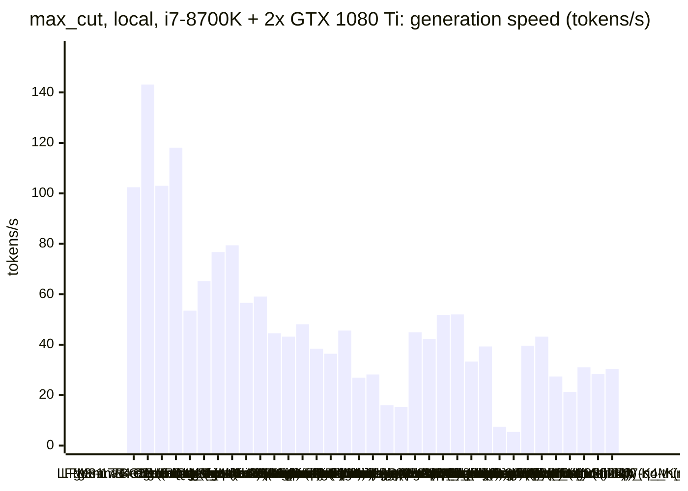

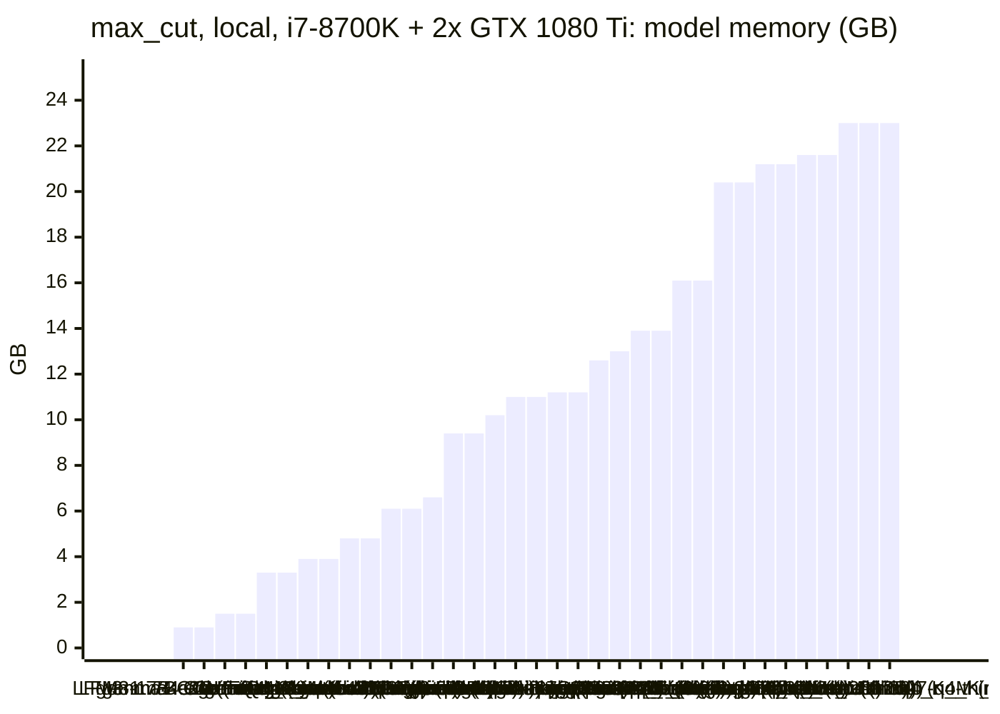

### Best score over time

| Model | 15 min | 30 min | 45 min | 60 min |
|---|--:|--:|--:|--:|
| gpt-oss:20b (think) | 0.76745 | 0.76745 | 0.76745 | 0.76745 |
| gemma4:latest (think) | 0.76631 | 0.76631 | 0.76631 | 0.76631 |
| gemma4:26b-a4b-it-qat (think) | 0.76604 | 0.76604 | 0.76604 | 0.76618 |
| gpt-oss:20b (no-think) | 0.76574 | 0.76574 | 0.76574 | 0.76574 |
| gemma4:12b-it-qat (think) | 0.51218 | 0.73159 | 0.75629 | 0.76535 |
| gemma4:e4b-it-qat (no-think) | 0.75484 | 0.76471 | 0.76471 | 0.76471 |
| gemma4:e4b-it-qat (think) | 0.76424 | 0.76424 | 0.76424 | 0.76424 |
| gemma4:latest (no-think) | 0.76345 | 0.76345 | 0.76345 | 0.76345 |
| qwen3:30b-a3b-instruct-2507-q4_K_M (no-think) | 0.76007 | 0.76007 | 0.76007 | 0.76007 |
| richardyoung/frognano-4b-2609:latest (think) | 0.7503 | 0.7503 | 0.7503 | 0.7503 |
| qwen3.6:27b-coding-mtp-q4_K_M (no-think) | 0.63935 | 0.63935 | 0.64801 | 0.74898 |
| underdog-saluki-27b:iq2-mix (no-think) | 0.72123 | 0.72684 | 0.74766 | 0.74766 |
| qwen3:30b-a3b-instruct-2507-q4_K_M (think) | 0.73531 | 0.73531 | 0.73531 | 0.73531 |
| qwen3.5:latest (no-think) | 0.73495 | 0.73495 | 0.73495 | 0.73495 |
| hf.co/LiquidAI/LFM3-1.7B-GGUF:Q4_K_M (think) | 0.73495 | 0.73495 | 0.73495 | 0.73495 |
| gemma4:e2b (think) | 0.73495 | 0.73495 | 0.73495 | 0.73495 |
| nemotron-3-nano:4b (think) | 0.7342 | 0.7342 | 0.7342 | 0.7342 |
| glm-4.7-flash:latest (no-think) | 0.73215 | 0.73215 | 0.73215 | 0.73215 |
| gemma4:e2b (no-think) | 0.73068 | 0.73068 | 0.73068 | 0.73068 |
| frob/sarvam:30b (think) | 0.51218 | 0.62488 | 0.72836 | 0.72836 |
| frob/sarvam:30b (no-think) | 0.72422 | 0.72422 | 0.72422 | 0.72422 |
| gemma4:12b-it-qat (no-think) | 0.70701 | 0.70701 | 0.70701 | 0.70701 |
| qwen3-coder:30b (no-think) | 0.70701 | 0.70701 | 0.70701 | 0.70701 |
| qwen2.5-coder:7b (no-think) | 0.6981 | 0.6981 | 0.6981 | 0.6981 |
| glm-4.7-flash:latest (think) | 0.51218 | 0.51218 | 0.62558 | 0.62624 |
| hf.co/LiquidAI/LFM3-1.7B-GGUF:Q4_K_M (no-think) | 0.51218 | 0.51218 | 0.51218 | 0.51218 |
| nemotron-3-nano:4b (no-think) | 0.51218 | 0.51218 | 0.51218 | 0.51218 |
| richardyoung/frognano-4b-2609:latest (no-think) | 0.51218 | 0.51218 | 0.51218 | 0.51218 |
| yandex/YandexGPT-5-Lite-8B-instruct-GGUF:latest (no-think) | 0.51218 | 0.51218 | 0.51218 | 0.51218 |
| MichelRosselli/apertus:8b-instruct-2509-q4_k_m (no-think) | 0.51218 | 0.51218 | 0.51218 | 0.51218 |
| llm-jp-4-8b-omega:q4_k_m (no-think) | 0.51218 | 0.51218 | 0.51218 | 0.51218 |
| gemma4:26b-a4b-it-qat (no-think) | 0.51218 | 0.51218 | 0.51218 | 0.51218 |
| qwen3.5:latest (think) | 0.51218 | 0.51218 | 0.51218 | 0.51218 |
| underdog-saluki-27b:iq2-mix (think) | 0.51218 | 0.51218 | 0.51218 | 0.51218 |
| qwen3.6:27b-coding-mtp-q4_K_M (think) | 0.51218 | 0.51218 | 0.51218 | 0.51218 |

### Outcome of the LLM answers

| Model | duplicate | edit error | invalid | llm error | ok | timeout |
|---|--:|--:|--:|--:|--:|--:|
| gpt-oss:20b (think) | 0 | 4 | 1 | 0 | 19 | 0 |
| gemma4:latest (think) | 1 | 0 | 3 | 0 | 19 | 0 |
| gemma4:26b-a4b-it-qat (think) | 0 | 3 | 1 | 0 | 4 | 0 |
| gpt-oss:20b (no-think) | 0 | 1 | 0 | 0 | 17 | 0 |
| gemma4:12b-it-qat (think) | 0 | 1 | 1 | 0 | 5 | 0 |
| gemma4:e4b-it-qat (no-think) | 0 | 8 | 10 | 4 | 46 | 0 |
| gemma4:e4b-it-qat (think) | 0 | 1 | 5 | 0 | 15 | 2 |
| gemma4:latest (no-think) | 0 | 1 | 18 | 2 | 29 | 0 |
| qwen3:30b-a3b-instruct-2507-q4_K_M (no-think) | 4 | 5 | 4 | 0 | 29 | 0 |
| richardyoung/frognano-4b-2609:latest (think) | 0 | 1 | 5 | 1 | 12 | 1 |
| qwen3.6:27b-coding-mtp-q4_K_M (no-think) | 2 | 1 | 0 | 0 | 12 | 1 |
| underdog-saluki-27b:iq2-mix (no-think) | 0 | 5 | 3 | 1 | 26 | 0 |
| qwen3:30b-a3b-instruct-2507-q4_K_M (think) | 2 | 1 | 2 | 0 | 14 | 0 |
| qwen3.5:latest (no-think) | 0 | 3 | 4 | 0 | 10 | 1 |
| hf.co/LiquidAI/LFM3-1.7B-GGUF:Q4_K_M (think) | 0 | 5 | 1 | 1 | 12 | 0 |
| gemma4:e2b (think) | 1 | 3 | 1 | 0 | 16 | 2 |
| nemotron-3-nano:4b (think) | 0 | 18 | 3 | 0 | 19 | 1 |
| glm-4.7-flash:latest (no-think) | 3 | 1 | 3 | 0 | 32 | 0 |
| gemma4:e2b (no-think) | 3 | 2 | 1 | 0 | 13 | 1 |
| frob/sarvam:30b (think) | 1 | 4 | 0 | 0 | 3 | 0 |
| frob/sarvam:30b (no-think) | 0 | 5 | 1 | 0 | 3 | 0 |
| gemma4:12b-it-qat (no-think) | 0 | 3 | 0 | 2 | 12 | 1 |
| qwen3-coder:30b (no-think) | 1 | 0 | 1 | 0 | 20 | 0 |
| qwen2.5-coder:7b (no-think) | 7 | 1 | 4 | 0 | 18 | 0 |
| glm-4.7-flash:latest (think) | 0 | 1 | 1 | 0 | 7 | 0 |
| hf.co/LiquidAI/LFM3-1.7B-GGUF:Q4_K_M (no-think) | 0 | 4 | 3 | 8 | 1 | 0 |
| nemotron-3-nano:4b (no-think) | 0 | 10 | 1 | 2 | 2 | 1 |
| richardyoung/frognano-4b-2609:latest (no-think) | 0 | 2 | 6 | 1 | 6 | 0 |
| yandex/YandexGPT-5-Lite-8B-instruct-GGUF:latest (no-think) | 1 | 2 | 4 | 0 | 8 | 1 |
| MichelRosselli/apertus:8b-instruct-2509-q4_k_m (no-think) | 0 | 5 | 6 | 2 | 3 | 0 |
| llm-jp-4-8b-omega:q4_k_m (no-think) | 0 | 5 | 8 | 2 | 1 | 0 |
| gemma4:26b-a4b-it-qat (no-think) | 0 | 1 | 1 | 4 | 10 | 0 |
| qwen3.5:latest (think) | 0 | 1 | 6 | 0 | 8 | 1 |
| underdog-saluki-27b:iq2-mix (think) | 0 | 3 | 0 | 0 | 0 | 0 |
| qwen3.6:27b-coding-mtp-q4_K_M (think) | 0 | 0 | 0 | 0 | 3 | 0 |

### Best idea per model

- **gpt-oss:20b (think)**: Use a degree‑ordered greedy construction so high‑degree nodes are placed first, improving the initial cut and giving the local search a better starting point.
- **gemma4:latest (think)**: Introduce randomness to the Tabu tenure calculation, varying it between n/10 and n/5, to improve the search's ability to escape local optima and address the weak performance …
- **gemma4:26b-a4b-it-qat (think)**: Implement a randomized restart strategy with perturbation and efficient local search to explore the search space more effectively.
- **gpt-oss:20b (no-think)**: Add a small perturbation restart loop after the initial local search to escape local optima, recomputing gains each restart and keeping the best solution, which should raise the …
- **gemma4:12b-it-qat (think)**: Remove the triple-quoted string that is causing a SyntaxError and ensure the greedy construction and local search are correctly implemented.
- **gemma4:e4b-it-qat (no-think)**: Increase the perturbation percentage from 0.1 to 0.2 to encourage broader exploration of the search space from the current best solution, potentially leading to better local …
- **gemma4:e4b-it-qat (think)**: Implement Simulated Annealing to escape local optima by allowing moves that decrease the cut weight with a probability dependent on a cooling temperature, allowing better …
- **gemma4:latest (no-think)**: Increase the number of restarts and refine the time limit constants to allow for deeper exploration, targeting the weakest graph's performance.
- **qwen3:30b-a3b-instruct-2507-q4_K_M (no-think)**: tuned TIE_BIAS=0.00145 on top of: Replace greedy construction with a randomized greedy construction that uses a small bias toward the better side in ties, combined with a one-flip …
- **richardyoung/frognano-4b-2609:latest (think)**: tuned NUM_RESTARTS=31, FLIP_FRACTION=0, MAX_FLIPS=361 on top of: Implement proper adjacency list structure with greedy initialization and one-flip local search, plus sweep key …
- **qwen3.6:27b-coding-mtp-q4_K_M (no-think)**: Replace the expensive periodic random perturbation with a memetic crossover step that combines the current solution with the best solution found so far (keeping nodes where they …
- **underdog-saluki-27b:iq2-mix (no-think)**: tuned PAIR_SEARCH_LIMIT=40, ALLOW_NEGATIVE=True on top of: The current 3-opt loop is O(n^2) per iteration with no pruning, which is too slow for the 400-node graph; expose the …
- **qwen3:30b-a3b-instruct-2507-q4_K_M (think)**: Add one-flip local search after greedy construction to escape local optima and improve the cut weight, especially on the weaker g200 instance where the current score is 0.6679.
- **qwen3.5:latest (no-think)**: Replace the trivial alternating assignment with a greedy heuristic that assigns each node to the side maximizing its immediate cut contribution, which significantly improves the …
- **hf.co/LiquidAI/LFM3-1.7B-GGUF:Q4_K_M (think)**: Replace the trivial alternating split with a greedy placement that chooses each node’s side to maximise cut against already placed neighbours, followed by up to ten one‑flip local …
- **gemma4:e2b (think)**: Implement a greedy construction phase followed by an iterative local search phase to refine the initial assignment, leveraging an adjacency list for efficiency.
- **nemotron-3-nano:4b (think)**: tuned RANDOMIZE=0.5 on top of: Introduce a small probability to randomize the greedy ordering, which can break ties and explore alternative placements for the high‑degree nodes …
- **glm-4.7-flash:latest (no-think)**: tuned perturb_prob=1 on top of: Implement an adaptive perturbation strategy where the restart probability is dynamically scaled based on the current iteration progress and the …
- **gemma4:e2b (no-think)**: Implement a simple randomized initial assignment followed by a single pass of local search to improve the greedy solution, leveraging the structure of the graph.
- **frob/sarvam:30b (think)**: One-flip local search after a greedy assignment.
- **frob/sarvam:30b (no-think)**: Implement a one-flip local search starting from the initial alternating assignment to improve the cut weight.
- **gemma4:12b-it-qat (no-think)**: Implement a greedy construction followed by a local search with incremental gain updates to maximize the cut weight efficiently.
- **qwen3-coder:30b (no-think)**: Replace the trivial alternating heuristic with a memetic algorithm that combines two greedy constructions (one random, one using degree heuristics) followed by local search with …
- **qwen2.5-coder:7b (no-think)**: Introduce a one-flip local search heuristic to improve the solution by exploring neighboring solutions incrementally.
- **glm-4.7-flash:latest (think)**: tuned PERTURBATION_RATIO=0.03 on top of: Replace the trivial alternating split with a randomized greedy local search that uses incremental gain updates and periodic perturbations …
- **hf.co/LiquidAI/LFM3-1.7B-GGUF:Q4_K_M (no-think)**: initial program
- **nemotron-3-nano:4b (no-think)**: initial program
- **richardyoung/frognano-4b-2609:latest (no-think)**: initial program
- **yandex/YandexGPT-5-Lite-8B-instruct-GGUF:latest (no-think)**: initial program
- **MichelRosselli/apertus:8b-instruct-2509-q4_k_m (no-think)**: initial program
- **llm-jp-4-8b-omega:q4_k_m (no-think)**: initial program
- **gemma4:26b-a4b-it-qat (no-think)**: initial program
- **qwen3.5:latest (think)**: initial program
- **underdog-saluki-27b:iq2-mix (think)**: initial program
- **qwen3.6:27b-coding-mtp-q4_K_M (think)**: initial program

## Cloud models (OpenRouter) on i7-8700K

Free OpenRouter models; times include the network and the provider's queue.

| Model | Params | Initial | Best | Gain | LLM calls | s/call | Valid | New bests | Min to best | Minutes | Stopped by |
|---|---|--:|--:|--:|--:|--:|--:|--:|--:|--:|---|
| nvidia/nemotron-3-nano-omni-30b-a3b-reasoning:free (think) |  | 0.51218 | **0.7393** | ×1.44 | 22 | 92 | 36% | 3 | 34.4 | 35.7 | no progress |

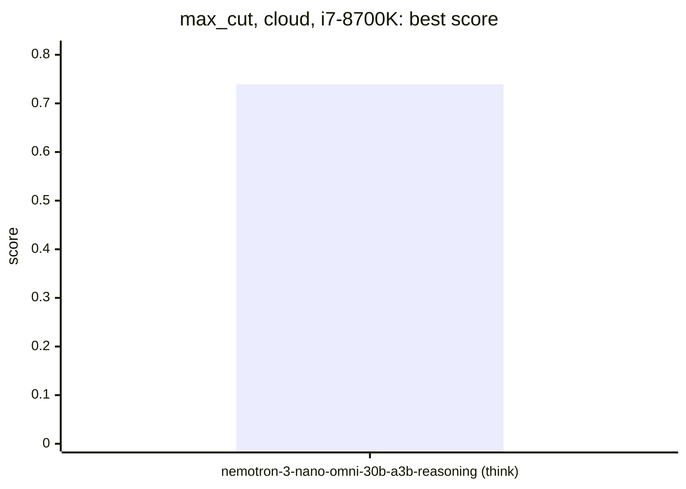

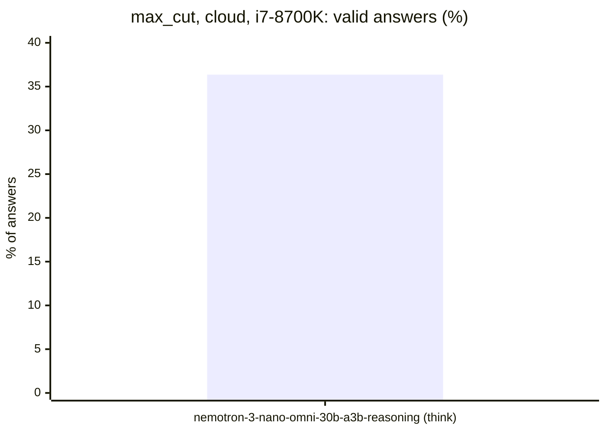

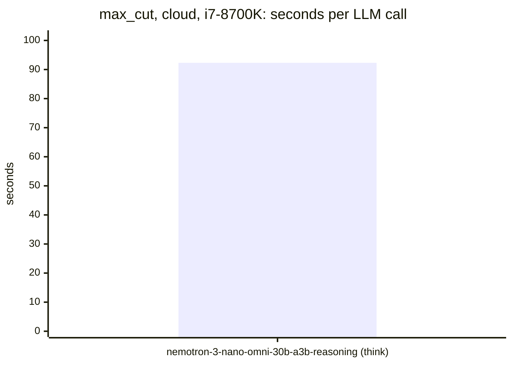

### Inference speed and cost

Generation speed is measured from the first to the last streamed token; the time to the first token is counted as prompt time. Cost is what OpenRouter charged for the run.

| Model | Gen tok/s | Median s/call | p90 s/call | Tokens/answer | Stopped | Cost $ |
|---|--:|--:|--:|--:|--:|--:|
| nvidia/nemotron-3-nano-omni-30b-a3b-reasoning:free (think) | 110.8 | 72 | 174 | 10032 | 0 | 0.000 |

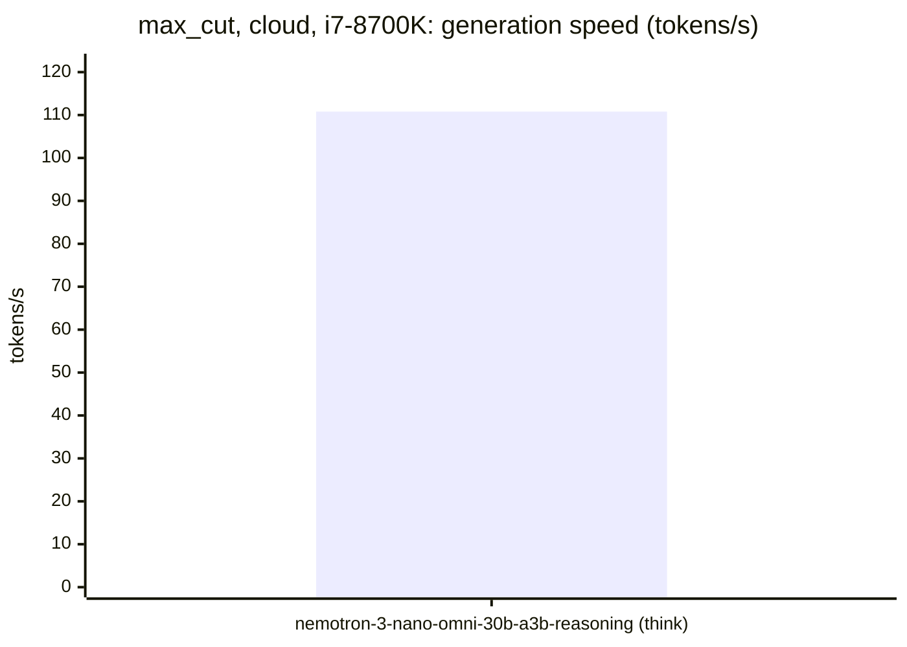

### Best score over time

| Model | 15 min | 30 min | 45 min | 60 min |
|---|--:|--:|--:|--:|
| nvidia/nemotron-3-nano-omni-30b-a3b-reasoning:free (think) | 0.73771 | 0.73771 | 0.7393 | 0.7393 |

### Outcome of the LLM answers

| Model | edit error | invalid | ok | timeout |
|---|--:|--:|--:|--:|
| nvidia/nemotron-3-nano-omni-30b-a3b-reasoning:free (think) | 10 | 1 | 8 | 3 |

### Best idea per model

- **nvidia/nemotron-3-nano-omni-30b-a3b-reasoning:free (think)**: tuned MAX_RESTARTS=5, TIME_BUFFER=0.05, MAX_ITER=2000 on top of: Replace the parity assignment with a greedy construction, per‑node gain updates and multiple restarts while …

## Cloud models (OpenRouter) on i7-8700K + 2x GTX 1080 Ti

Free OpenRouter models; times include the network and the provider's queue.

| Model | Params | Initial | Best | Gain | LLM calls | s/call | Valid | New bests | Min to best | Minutes | Stopped by |
|---|---|--:|--:|--:|--:|--:|--:|--:|--:|--:|---|
| nvidia/nemotron-3-ultra-550b-a55b:free (think) |  | 0.51218 | **0.76768** | ×1.50 | 16 | 71 | 88% | 5 | 14.5 | 19.9 | no progress |
| dots-studio/dots-3-note-preview:free (no-think) |  | 0.51218 | **0.76761** | ×1.50 | 19 | 13 | 47% | 3 | 3.6 | 4.4 | no progress |
| dots-studio/dots-3-note-preview:free (think) |  | 0.51218 | **0.76752** | ×1.50 | 17 | 190 | 41% | 4 | 27.1 | 55.0 | no progress |
| nvidia/nemotron-3.5-super-vl:free (think) |  | 0.51218 | **0.76745** | ×1.50 | 12 | 64 | 100% | 4 | 6.7 | 13.4 | no progress |
| recursive/flint-v1.0:free (think) |  | 0.51218 | **0.76745** | ×1.50 | 33 | 76 | 82% | 10 | 30.3 | 43.2 | no progress |
| nvidia/nemotron-3-ultra-550b-a55b:free (no-think) |  | 0.51218 | **0.76741** | ×1.50 | 27 | 23 | 81% | 5 | 8.2 | 10.7 | no progress |
| nvidia/nemotron-3.5-lightning:free (no-think) |  | 0.51218 | **0.76162** | ×1.49 | 43 | 28 | 42% | 5 | 13.6 | 20.7 | no progress |
| cohere/north-mini-code:free (think) |  | 0.51218 | **0.75925** | ×1.48 | 16 | 136 | 62% | 4 | 7.6 | 36.8 | no progress |
| cohere/north-mini-code:free (no-think) |  | 0.51218 | **0.75332** | ×1.47 | 42 | 8 | 74% | 5 | 6.5 | 8.4 | no progress |
| xingchen-agi/xing4.0-29b-a4b:free (think) |  | 0.51218 | **0.75161** | ×1.47 | 22 | 111 | 32% | 1 | 15.0 | 41.0 | no progress |
| xingchen-agi/xing4.0-29b-a4b:free (no-think) |  | 0.51218 | **0.73131** | ×1.43 | 30 | 60 | 23% | 1 | 14.1 | 31.5 | no progress |
| nvidia/nemotron-3.5-super-vl:free (no-think) |  | 0.51218 | **0.71534** | ×1.40 | 33 | 31 | 76% | 4 | 11.1 | 17.3 | no progress |
| nvidia/nemotron-3-nano-omni-30b-a3b-reasoning:free (no-think) |  | 0.51218 | **0.51218** | ×1.00 | 15 | 20 | 33% | 0 | - | 5.2 | no progress |
| nvidia/nemotron-3.5-lightning:free (think) |  | 0.51218 | **0.51218** | ×1.00 | 15 | 233 | 7% | 0 | - | 58.3 | no progress |

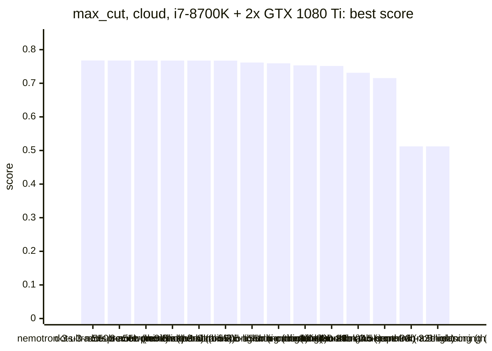

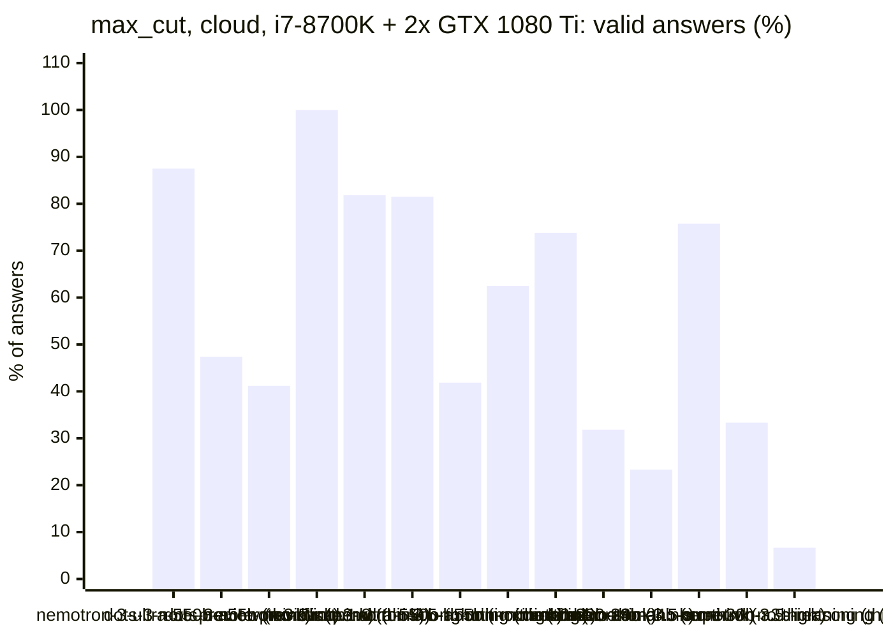

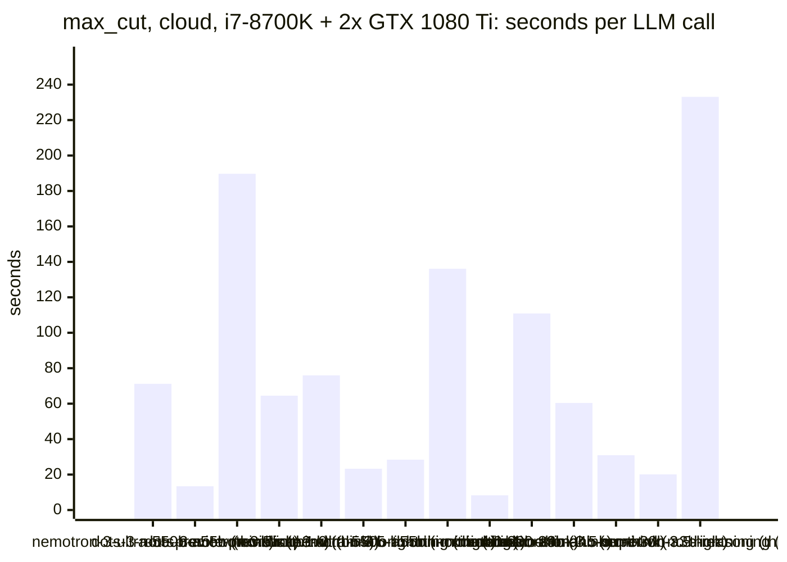

### Inference speed and cost

Generation speed is measured from the first to the last streamed token; the time to the first token is counted as prompt time. Cost is what OpenRouter charged for the run.

| Model | Gen tok/s | Median s/call | p90 s/call | Tokens/answer | Stopped | Cost $ |
|---|--:|--:|--:|--:|--:|--:|
| nvidia/nemotron-3.5-super-vl:free (think) | 170.7 | 67 | 99 | 10815 | 0 | 0.000 |
| cohere/north-mini-code:free (no-think) | 160.5 | 6 | 15 | 1238 | 0 | 0.000 |
| recursive/flint-v1.0:free (think) | 155.1 | 79 | 109 | 11618 | 0 | 0.000 |
| xingchen-agi/xing4.0-29b-a4b:free (think) | 128.0 | 115 | 183 | 8477 | 2 | 0.000 |
| dots-studio/dots-3-note-preview:free (no-think) | 114.9 | 13 | 20 | 1386 | 1 | 0.000 |
| cohere/north-mini-code:free (think) | 113.3 | 148 | 214 | 15328 | 0 | 0.000 |
| nvidia/nemotron-3.5-lightning:free (think) | 101.4 | 245 | 263 | 24402 | 1 | 0.000 |
| dots-studio/dots-3-note-preview:free (think) | 95.4 | 205 | 277 | 17891 | 0 | 0.000 |
| xingchen-agi/xing4.0-29b-a4b:free (no-think) | 80.7 | 73 | 100 | 1021 | 6 | 0.000 |
| nvidia/nemotron-3-nano-omni-30b-a3b-reasoning:free (no-think) | 78.8 | 9 | 61 | 1542 | 1 | 0.000 |
| nvidia/nemotron-3-ultra-550b-a55b:free (no-think) | 66.8 | 18 | 53 | 1328 | 0 | 0.000 |
| nvidia/nemotron-3.5-lightning:free (no-think) | 57.4 | 15 | 42 | 1740 | 10 | 0.000 |
| nvidia/nemotron-3-ultra-550b-a55b:free (think) | 41.9 | 72 | 135 | 2940 | 0 | 0.000 |
| nvidia/nemotron-3.5-super-vl:free (no-think) | 37.9 | 16 | 82 | 1059 | 1 | 0.000 |

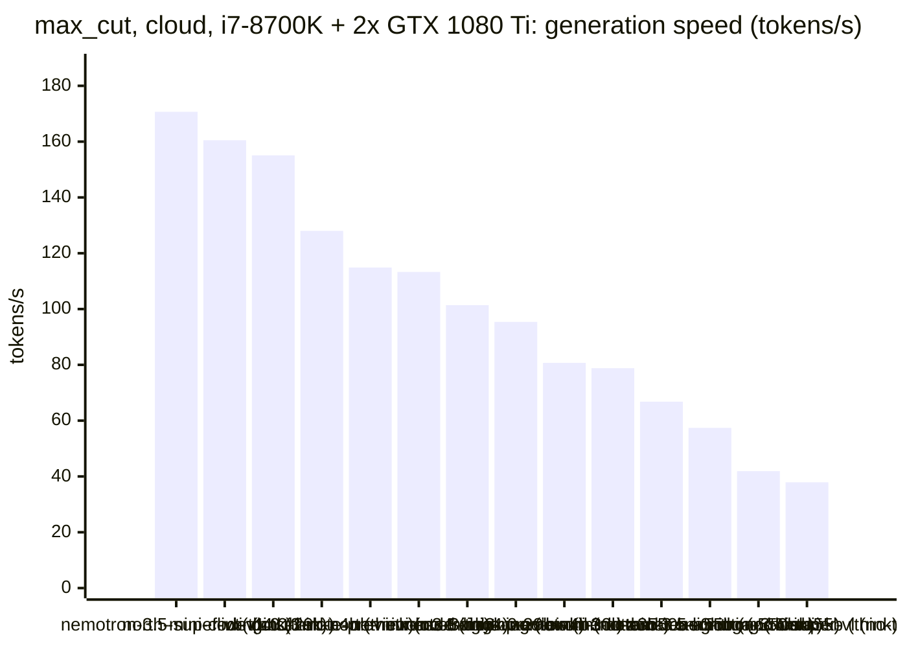

### Best score over time

| Model | 15 min | 30 min | 45 min | 60 min |
|---|--:|--:|--:|--:|
| nvidia/nemotron-3-ultra-550b-a55b:free (think) | 0.76768 | 0.76768 | 0.76768 | 0.76768 |
| dots-studio/dots-3-note-preview:free (no-think) | 0.76761 | 0.76761 | 0.76761 | 0.76761 |
| dots-studio/dots-3-note-preview:free (think) | 0.76745 | 0.76752 | 0.76752 | 0.76752 |
| nvidia/nemotron-3.5-super-vl:free (think) | 0.76745 | 0.76745 | 0.76745 | 0.76745 |
| recursive/flint-v1.0:free (think) | 0.76165 | 0.7673 | 0.76745 | 0.76745 |
| nvidia/nemotron-3-ultra-550b-a55b:free (no-think) | 0.76741 | 0.76741 | 0.76741 | 0.76741 |
| nvidia/nemotron-3.5-lightning:free (no-think) | 0.76162 | 0.76162 | 0.76162 | 0.76162 |
| cohere/north-mini-code:free (think) | 0.75925 | 0.75925 | 0.75925 | 0.75925 |
| cohere/north-mini-code:free (no-think) | 0.75332 | 0.75332 | 0.75332 | 0.75332 |
| xingchen-agi/xing4.0-29b-a4b:free (think) | 0.75161 | 0.75161 | 0.75161 | 0.75161 |
| xingchen-agi/xing4.0-29b-a4b:free (no-think) | 0.73131 | 0.73131 | 0.73131 | 0.73131 |
| nvidia/nemotron-3.5-super-vl:free (no-think) | 0.71534 | 0.71534 | 0.71534 | 0.71534 |
| nvidia/nemotron-3-nano-omni-30b-a3b-reasoning:free (no-think) | 0.51218 | 0.51218 | 0.51218 | 0.51218 |
| nvidia/nemotron-3.5-lightning:free (think) | 0.51218 | 0.51218 | 0.51218 | 0.51218 |

### Outcome of the LLM answers

| Model | duplicate | edit error | invalid | llm error | ok | timeout |
|---|--:|--:|--:|--:|--:|--:|
| nvidia/nemotron-3-ultra-550b-a55b:free (think) | 0 | 0 | 0 | 2 | 14 | 0 |
| dots-studio/dots-3-note-preview:free (no-think) | 0 | 8 | 1 | 1 | 9 | 0 |
| dots-studio/dots-3-note-preview:free (think) | 0 | 6 | 0 | 0 | 7 | 4 |
| nvidia/nemotron-3.5-super-vl:free (think) | 0 | 0 | 0 | 0 | 12 | 0 |
| recursive/flint-v1.0:free (think) | 0 | 3 | 3 | 0 | 27 | 0 |
| nvidia/nemotron-3-ultra-550b-a55b:free (no-think) | 0 | 0 | 5 | 0 | 22 | 0 |
| nvidia/nemotron-3.5-lightning:free (no-think) | 1 | 9 | 5 | 10 | 18 | 0 |
| cohere/north-mini-code:free (think) | 2 | 4 | 0 | 0 | 10 | 0 |
| cohere/north-mini-code:free (no-think) | 2 | 5 | 1 | 0 | 31 | 3 |
| xingchen-agi/xing4.0-29b-a4b:free (think) | 1 | 3 | 3 | 8 | 7 | 0 |
| xingchen-agi/xing4.0-29b-a4b:free (no-think) | 1 | 0 | 7 | 15 | 7 | 0 |
| nvidia/nemotron-3.5-super-vl:free (no-think) | 2 | 1 | 3 | 1 | 25 | 1 |
| nvidia/nemotron-3-nano-omni-30b-a3b-reasoning:free (no-think) | 0 | 8 | 1 | 1 | 5 | 0 |
| nvidia/nemotron-3.5-lightning:free (think) | 0 | 13 | 0 | 1 | 1 | 0 |

### Best idea per model

- **nvidia/nemotron-3-ultra-550b-a55b:free (think)**: tuned TABU_TENURE_BASE=0.07, TABU_RANDOM_RANGE=7, PERTURB_FRACTION=0.25, TIME_LIMIT=1.95 on top of: Fix the critical bug where best_side tracks the current solution instead of the …
- **dots-studio/dots-3-note-preview:free (no-think)**: Add a tabu search phase after the local search to escape local optima, using a dynamic tenure and periodic restarts with perturbation to improve the cut weight.
- **dots-studio/dots-3-note-preview:free (think)**: tuned TENURE_FRAC=0.1542, RESTART_NO_IMPROVE_FRAC=5, PERTURB_MIN_FRAC=0.06862 on top of: Replace the trivial alternating assignment with a tabu search heuristic that uses greedy …
- **nvidia/nemotron-3.5-super-vl:free (think)**: tuned TABU_CAP=3865, ELITE_SIZE=8 on top of: Add a memetic elite population that recombines the current solution with elite members (agreement crossover) followed by …
- **recursive/flint-v1.0:free (think)**: tuned RESTART_EVERY=4 on top of: Add periodic restarts from the best assignment every few local searches to escape local optima and improve the final cut.
- **nvidia/nemotron-3-ultra-550b-a55b:free (no-think)**: The tabu search recomputes the full cut weight for aspiration checks in every iteration (O(E) per iteration), which wastes CPU time. Replace this with incremental tracking of …
- **nvidia/nemotron-3.5-lightning:free (no-think)**: tuned FLIP_RATIO=0.05, TENURE=15, SWEEP_RATIO=0.2, PERTURB_RATIO=0.1 on top of: Replace naive alternating assignment with greedy incremental construction that places nodes one by …
- **cohere/north-mini-code:free (think)**: Increase the number of random restarts and the perturbation size to explore more of the solution space, improving the chance of escaping local optima, especially for the g200 …
- **cohere/north-mini-code:free (no-think)**: tuned RESTARTS=29, RESTART_FLIP_PCT=0.05 on top of: Increase restart perturbation size to 10% and add early‑time adaptive restarts to better explore larger graphs within the time …
- **xingchen-agi/xing4.0-29b-a4b:free (think)**: Replace the alternating assignment with greedy construction seeded by a node order, followed by incremental one-flip local search that tracks each node's gain and updates …
- **xingchen-agi/xing4.0-29b-a4b:free (no-think)**: Replace the alternating assignment with a memetic approach combining greedy construction, one-flip local search with incremental gain updates, and tabu search restarts, keeping …
- **nvidia/nemotron-3.5-super-vl:free (no-think)**: Expose the tabu tenure as a named constant so the engine can find the best value for each graph size instead of guessing n//10.
- **nvidia/nemotron-3-nano-omni-30b-a3b-reasoning:free (no-think)**: initial program
- **nvidia/nemotron-3.5-lightning:free (think)**: initial program
