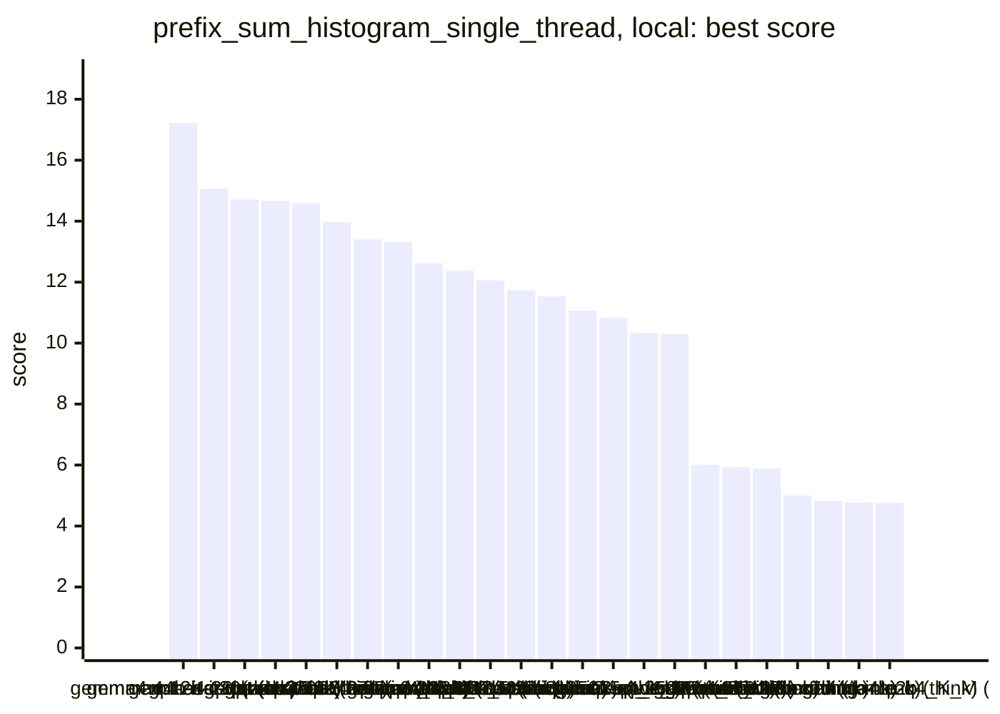
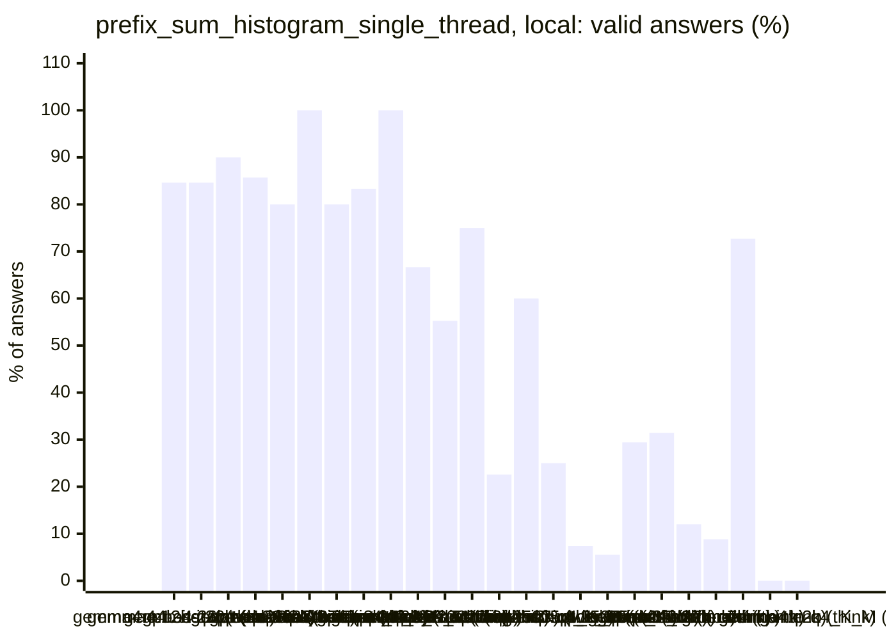
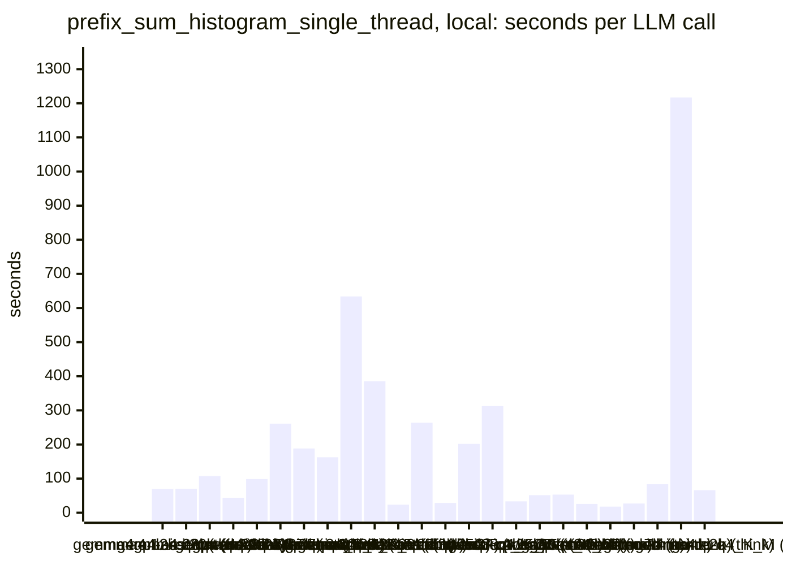
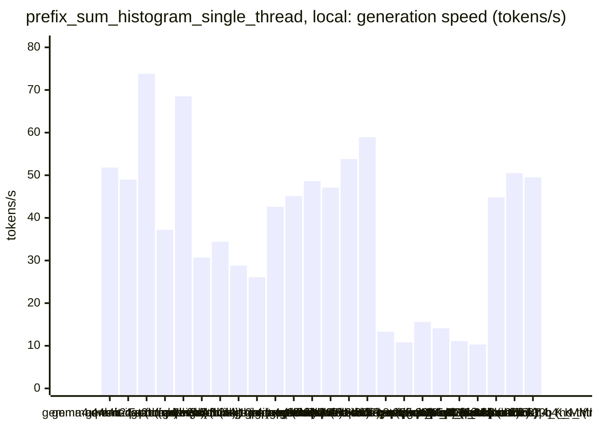
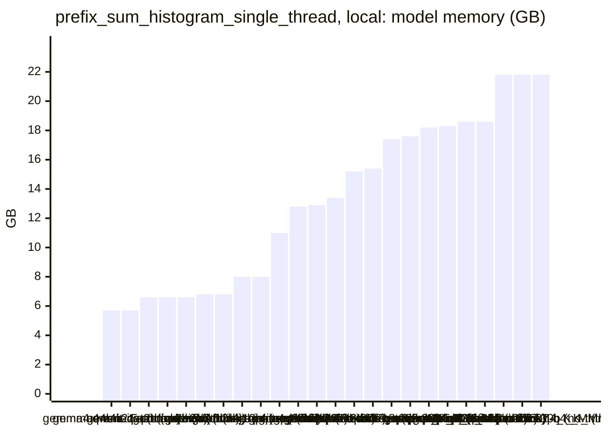

<!-- Copyright (c) 2026 by C. Klukas -->
<!-- SPDX-License-Identifier: GPL-3.0-only -->
<!-- Generated by `omega report` from bench/results/*.json. Do not edit by hand. -->

# prefix_sum_histogram_single_thread

24 models, 15 minutes each, latest run per model. The [overall ranking](../benchmarks.md#overall-ranking) compares the models over all examples.

Machine: Apple M1 Max (Mac13,1), 10 cores, 32 GB.

## Local models

Ollama on this machine.

| Model | Params | Initial | Best | Gain | LLM calls | s/call | Valid | New bests | Min to best |
|---|---|--:|--:|--:|--:|--:|--:|--:|--:|
| gemma4:e4b-it-qat (think) | 7.5B | 4.89476 | **17.2154** | ×3.52 | 13 | 70 | 85% | 4 | 15.5 |
| gemma4:12b-it-qat (no-think) | 11.9B | 4.99969 | **15.0602** | ×3.01 | 13 | 70 | 85% | 6 | 15.4 |
| gpt-oss:20b (no-think) | 20.9B | 4.92914 | **14.7140** | ×2.99 | 10 | 108 | 90% | 3 | 13.4 |
| gemma4:26b-a4b-it-qat (no-think) | 25.2B | 4.82247 | **14.6735** | ×3.04 | 21 | 44 | 86% | 4 | 7.6 |
| gpt-oss:20b (think) | 20.9B | 4.82276 | **14.5852** | ×3.02 | 10 | 99 | 80% | 3 | 16.6 |
| gemma4:26b-a4b-it-qat (think) | 25.2B | 4.84702 | **13.9689** | ×2.88 | 4 | 261 | 100% | 3 | 14.4 |
| qwen3.5:27b (no-think) | 27.8B | 4.94376 | **13.4003** | ×2.71 | 5 | 188 | 80% | 2 | 9.3 |
| qwen3.8:27b-mtp-q4_K_M (no-think) | 27.3B | 4.86145 | **13.3222** | ×2.74 | 6 | 162 | 83% | 3 | 16.4 |
| qwen3.8:27b-mtp-q4_K_M (think) | 27.3B | 4.75964 | **12.6223** | ×2.65 | 3 | 634 | 100% | 2 | 31.8 |
| gemma4:12b-it-qat (think) | 11.9B | 4.84848 | **12.3762** | ×2.55 | 3 | 386 | 67% | 1 | 8.1 |
| gemma4:e4b-it-qat (no-think) | 7.5B | 4.93644 | **12.0591** | ×2.44 | 38 | 24 | 55% | 4 | 6.6 |
| qwen3.5:27b (think) | 27.8B | 4.89297 | **11.7354** | ×2.40 | 4 | 264 | 75% | 2 | 9.9 |
| qwen3:30b-a3b-instruct-2507-q4_K_M (think) | 30.5B | 4.68961 | **11.5307** | ×2.46 | 31 | 29 | 23% | 2 | 3.1 |
| qwen3.6:27b-coding-mtp-q4_K_M (no-think) | 27.3B | 4.78813 | **11.0711** | ×2.31 | 5 | 202 | 60% | 2 | 9.0 |
| qwen3.5:latest (think) | 9.7B | 4.78555 | **10.8430** | ×2.27 | 4 | 312 | 25% | 1 | 8.1 |
| qwen3:30b-a3b-instruct-2507-q4_K_M (no-think) | 30.5B | 4.865 | **10.3306** | ×2.12 | 27 | 33 | 7% | 3 | 15.3 |
| qwen3-coder:30b (no-think) | 30.5B | 4.7976 | **10.3040** | ×2.15 | 18 | 52 | 6% | 1 | 6.9 |
| qwen3.5:latest (no-think) | 9.7B | 4.93005 | **6.00646** | ×1.22 | 17 | 53 | 29% | 1 | 6.5 |
| gemma4:latest (no-think) |  | 4.9125 | **5.93032** | ×1.21 | 35 | 26 | 31% | 4 | 15.2 |
| gemma4:e2b (no-think) | 5.1B | 4.99127 | **5.88495** | ×1.18 | 50 | 18 | 12% | 1 | 1.2 |
| qwen2.5-coder:7b (no-think) | 7.6B | 5.00125 | **5.00125** | ×1.00 | 34 | 27 | 9% | 0 | - |
| gemma4:latest (think) |  | 4.81957 | **4.81957** | ×1.00 | 11 | 84 | 73% | 0 | - |
| qwen3.6:27b-coding-mtp-q4_K_M (think) | 27.3B | 4.77071 | **4.77071** | ×1.00 | 1 | 1217 | 0% | 0 | - |
| gemma4:e2b (think) | 5.1B | 4.76105 | **4.76105** | ×1.00 | 14 | 66 | 0% | 0 | - |

### Inference speed and memory

RAM is what Ollama reports for the loaded model (weights, context cache and buffers; on Apple silicon this is shared memory). Load is the time to bring the model into memory. Prompt and generation speeds are tokens per second over all calls of the run.

| Model | Params | RAM GB | Load s | Prompt tok/s | Gen tok/s | Median s/call | p90 s/call | Tokens/answer | Stopped |
|---|---|--:|--:|--:|--:|--:|--:|--:|--:|
| gemma4:e4b-it-qat (think) | 7.5B | 5.7 | 87 | 630 | 51.8 | 64 | 94 | 2915 | 0 |
| gemma4:e4b-it-qat (no-think) | 7.5B | 5.7 | 55 | 546 | 49.0 | 20 | 39 | 601 | 0 |
| gemma4:e2b (no-think) | 5.1B | 6.6 | 33 | 815 | 73.8 | 17 | 25 | 796 | 0 |
| qwen2.5-coder:7b (no-think) | 7.6B | 6.6 | 34 | 776 | 37.2 | 24 | 46 | 774 | 0 |
| gemma4:e2b (think) | 5.1B | 6.6 | 0 | 869 | 68.5 | 64 | 77 | 3915 | 1 |
| qwen3.5:latest (think) | 9.7B | 6.8 | 53 | 411 | 30.7 | 479 | 510 | 6758 | 1 |
| qwen3.5:latest (no-think) | 9.7B | 6.8 | 28 | 379 | 34.4 | 40 | 106 | 910 | 3 |
| gemma4:12b-it-qat (no-think) | 11.9B | 8.0 | 65 | 205 | 28.8 | 74 | 99 | 1124 | 0 |
| gemma4:12b-it-qat (think) | 11.9B | 8.0 | 99 | 252 | 26.1 | 388 | 481 | 8779 | 0 |
| gemma4:latest (think) |  | 11.0 | 98 | 1104 | 42.6 | 73 | 117 | 2995 | 0 |
| gpt-oss:20b (think) | 20.9B | 12.8 | 291 | 529 | 45.1 | 72 | 361 | 2774 | 0 |
| gpt-oss:20b (no-think) | 20.9B | 12.9 | 132 | 953 | 48.6 | 98 | 228 | 4349 | 0 |
| gemma4:latest (no-think) |  | 13.4 | 104 | 1437 | 47.1 | 21 | 39 | 897 | 1 |
| gemma4:26b-a4b-it-qat (think) | 25.2B | 15.2 | 276 | 578 | 53.8 | 192 | 492 | 9895 | 0 |
| gemma4:26b-a4b-it-qat (no-think) | 25.2B | 15.4 | 268 | 511 | 58.9 | 36 | 43 | 1120 | 0 |
| qwen3.6:27b-coding-mtp-q4_K_M (think) | 27.3B | 17.4 | 285 | 87 | 13.3 | 1217 | 1217 | 11835 | 0 |
| qwen3.8:27b-mtp-q4_K_M (think) | 27.3B | 17.6 | 286 | 121 | 10.8 | 562 | 1092 | 5507 | 0 |
| qwen3.6:27b-coding-mtp-q4_K_M (no-think) | 27.3B | 18.2 | 14 | 109 | 15.6 | 137 | 444 | 1452 | 0 |
| qwen3.8:27b-mtp-q4_K_M (no-think) | 27.3B | 18.3 | 14 | 128 | 14.1 | 133 | 454 | 984 | 0 |
| qwen3.5:27b (no-think) | 27.8B | 18.6 | 199 | 112 | 11.1 | 182 | 308 | 1236 | 0 |
| qwen3.5:27b (think) | 27.8B | 18.6 | 144 | 106 | 10.3 | 305 | 339 | 1978 | 0 |
| qwen3:30b-a3b-instruct-2507-q4_K_M (think) | 30.5B | 21.8 | 144 | 726 | 44.8 | 19 | 44 | 691 | 0 |
| qwen3:30b-a3b-instruct-2507-q4_K_M (no-think) | 30.5B | 21.8 | 3 | 1084 | 50.5 | 20 | 32 | 814 | 1 |
| qwen3-coder:30b (no-think) | 30.5B | 21.8 | 3 | 1021 | 49.5 | 37 | 63 | 1347 | 0 |

### Best score over time

| Model | 3.75 min | 7.5 min | 11.25 min | 15 min |
|---|--:|--:|--:|--:|
| gemma4:e4b-it-qat (think) | 4.89476 | 10.6995 | 16.8599 | 16.8599 |
| gemma4:12b-it-qat (no-think) | 11.3782 | 13.9252 | 14.8176 | 14.8176 |
| gpt-oss:20b (no-think) | 4.92914 | 14.2399 | 14.6789 | 14.7140 |
| gemma4:26b-a4b-it-qat (no-think) | 4.82247 | 13.1083 | 14.6735 | 14.6735 |
| gpt-oss:20b (think) | 4.82276 | 12.5471 | 12.5471 | 13.0484 |
| gemma4:26b-a4b-it-qat (think) | 4.84702 | 4.84702 | 13.9082 | 13.9689 |
| qwen3.5:27b (no-think) | 4.94376 | 11.7907 | 13.4003 | 13.4003 |
| qwen3.8:27b-mtp-q4_K_M (no-think) | 4.86145 | 4.86145 | 8.08489 | 12.9324 |
| qwen3.8:27b-mtp-q4_K_M (think) | 4.75964 | 4.75964 | 12.0355 | 12.0355 |
| gemma4:12b-it-qat (think) | 4.84848 | 4.84848 | 12.3762 | 12.3762 |
| gemma4:e4b-it-qat (no-think) | 10.8519 | 12.0591 | 12.0591 | 12.0591 |
| qwen3.5:27b (think) | 4.89297 | 4.89297 | 11.7354 | 11.7354 |
| qwen3:30b-a3b-instruct-2507-q4_K_M (think) | 11.5307 | 11.5307 | 11.5307 | 11.5307 |
| qwen3.6:27b-coding-mtp-q4_K_M (no-think) | 4.78813 | 10.7672 | 11.0711 | 11.0711 |
| qwen3.5:latest (think) | 4.78555 | 4.78555 | 10.8430 | 10.8430 |
| qwen3:30b-a3b-instruct-2507-q4_K_M (no-think) | 4.865 | 4.865 | 4.865 | 9.04568 |
| qwen3-coder:30b (no-think) | 4.7976 | 10.3040 | 10.3040 | 10.3040 |
| qwen3.5:latest (no-think) | 4.93005 | 6.00646 | 6.00646 | 6.00646 |
| gemma4:latest (no-think) | 4.9125 | 4.9125 | 4.9125 | 5.90362 |
| gemma4:e2b (no-think) | 5.88495 | 5.88495 | 5.88495 | 5.88495 |
| qwen2.5-coder:7b (no-think) | 5.00125 | 5.00125 | 5.00125 | 5.00125 |
| gemma4:latest (think) | 4.81957 | 4.81957 | 4.81957 | 4.81957 |
| qwen3.6:27b-coding-mtp-q4_K_M (think) | 4.77071 | 4.77071 | 4.77071 | 4.77071 |
| gemma4:e2b (think) | 4.76105 | 4.76105 | 4.76105 | 4.76105 |

### Outcome of the LLM answers

| Model | compile error | duplicate | edit error | invalid | llm error | ok |
|---|--:|--:|--:|--:|--:|--:|
| gemma4:e4b-it-qat (think) | 0 | 0 | 0 | 2 | 0 | 11 |
| gemma4:12b-it-qat (no-think) | 0 | 0 | 0 | 2 | 0 | 11 |
| gpt-oss:20b (no-think) | 0 | 0 | 1 | 0 | 0 | 9 |
| gemma4:26b-a4b-it-qat (no-think) | 1 | 1 | 1 | 0 | 0 | 18 |
| gpt-oss:20b (think) | 1 | 0 | 1 | 0 | 0 | 8 |
| gemma4:26b-a4b-it-qat (think) | 0 | 0 | 0 | 0 | 0 | 4 |
| qwen3.5:27b (no-think) | 0 | 0 | 1 | 0 | 0 | 4 |
| qwen3.8:27b-mtp-q4_K_M (no-think) | 0 | 0 | 0 | 1 | 0 | 5 |
| qwen3.8:27b-mtp-q4_K_M (think) | 0 | 0 | 0 | 0 | 0 | 3 |
| gemma4:12b-it-qat (think) | 0 | 0 | 0 | 1 | 0 | 2 |
| gemma4:e4b-it-qat (no-think) | 7 | 2 | 0 | 8 | 0 | 21 |
| qwen3.5:27b (think) | 0 | 0 | 0 | 1 | 0 | 3 |
| qwen3:30b-a3b-instruct-2507-q4_K_M (think) | 12 | 3 | 8 | 1 | 0 | 7 |
| qwen3.6:27b-coding-mtp-q4_K_M (no-think) | 1 | 0 | 0 | 1 | 0 | 3 |
| qwen3.5:latest (think) | 1 | 0 | 1 | 0 | 1 | 1 |
| qwen3:30b-a3b-instruct-2507-q4_K_M (no-think) | 19 | 0 | 3 | 2 | 1 | 2 |
| qwen3-coder:30b (no-think) | 12 | 4 | 0 | 1 | 0 | 1 |
| qwen3.5:latest (no-think) | 2 | 0 | 1 | 6 | 3 | 5 |
| gemma4:latest (no-think) | 10 | 0 | 4 | 9 | 1 | 11 |
| gemma4:e2b (no-think) | 28 | 3 | 9 | 4 | 0 | 6 |
| qwen2.5-coder:7b (no-think) | 19 | 0 | 0 | 12 | 0 | 3 |
| gemma4:latest (think) | 0 | 0 | 1 | 2 | 0 | 8 |
| qwen3.6:27b-coding-mtp-q4_K_M (think) | 0 | 0 | 0 | 1 | 0 | 0 |
| gemma4:e2b (think) | 7 | 0 | 4 | 2 | 1 | 0 |

### Best idea per model

- **gemma4:e4b-it-qat (think)**: Generalize the unrolling factor $U$ and the number of local histogram buffers $K$ as sweep parameters to find the optimal trade-off between instruction-level parallelism and …
- **gemma4:12b-it-qat (no-think)**: tuned BANKS=32, UNROLL=16 on top of: Use manual unrolling and a larger bank count for sub-histograms to improve instruction-level parallelism and reduce contention.
- **gpt-oss:20b (no-think)**: Increase sub‑histogram depth from 8 to 16 and unroll the main loop to 16 elements per iteration so that each element updates a different sub‑histogram, reducing cache‑line …
- **gemma4:26b-a4b-it-qat (no-think)**: Use 16 sub-histograms and unroll the loop 16 times to further reduce RMW dependency chains and maximize instruction-level parallelism.
- **gpt-oss:20b (think)**: Use 16 sub‑histograms and a fully unrolled 16‑element loop to reduce contention on hot bins and loop overhead, while keeping the prefix sum scalar.
- **gemma4:26b-a4b-it-qat (think)**: Use 16 sub-histograms and a 16-way unroll to further reduce cache contention and dependency chains, and add prefetching to improve memory throughput.
- **qwen3.5:27b (no-think)**: Replace the naive scalar loop with an unrolled vectorized loop using ARM NEON to process 4 `int64_t` values per iteration, reducing loop overhead and increasing instruction-level …
- **qwen3.8:27b-mtp-q4_K_M (no-think)**: Route each 4-element block to a single sub-histogram (indexed by block number & 7) instead of per-element i&7, so the four low-byte increments in a block target one cache line …
- **qwen3.8:27b-mtp-q4_K_M (think)**: Replace the naive single-loop with K=4 sub-histograms (uint32_t) to break the read-modify-write dependency chain on hot histogram bins, unroll the main loop by 4, and add …
- **gemma4:12b-it-qat (think)**: Use 256 sub-histograms of 16 bins each to break the store-to-load dependency chain on hot bins, while maintaining a sequential access pattern for the hot bins to benefit from …
- **gemma4:e4b-it-qat (no-think)**: Change the VLA usage to use dynamic allocation or a fixed-size array if $N$ is bounded, but since $N$ is large and dynamic allocation is slower, I will optimize the histogram …
- **qwen3.5:27b (think)**: tuned SUBHIST=16 on top of: Use 8 private uint32_t sub-histograms with element i going to sub-histogram[i & 7] to break the histogram bin dependency chain caused by consecutive …
- **qwen3:30b-a3b-instruct-2507-q4_K_M (think)**: tuned block_size=88 on top of: Use 8 private 32-bit sub-histograms to break long store-to-load chains on hot bins, reduce memory contention, and improve CPU throughput by enabling …
- **qwen3.6:27b-coding-mtp-q4_K_M (no-think)**: Use 8 private uint32_t sub-histograms to eliminate false sharing and store-to-load dependency chains on hot bins, and process the array in cache-friendly blocks with loop …
- **qwen3.5:latest (think)**: Use 4 private sub-histogram arrays to break store-to-load dependency chains for hot bins, add prefetching for memory bandwidth optimization, and use pointer arithmetic in the loop …
- **qwen3:30b-a3b-instruct-2507-q4_K_M (no-think)**: tuned kSubHistCount=11, block_size=27 on top of: Expose the sub-histogram count and block size as configurable constants to allow the evolutionary search to find optimal values …
- **qwen3-coder:30b (no-think)**: Use four private sub-histograms to reduce write-after-write dependencies when updating hot histogram bins, then merge them into the final histogram.
- **qwen3.5:latest (no-think)**: Fix the logic error where bin 0 was handled conditionally inside the `if (low_byte == 0)` block (causing non-zero bins to be skipped for that element) by ensuring every element …
- **gemma4:latest (no-think)**: tuned UNROLL_FACTOR=23 on top of: Increase the loop unrolling factor from 16 to expose more Instruction Level Parallelism (ILP) to reduce loop overhead, as this is the primary …
- **gemma4:e2b (no-think)**: Use AVX/ARM NEON to process data in chunks of 8 elements simultaneously to improve data throughput and reduce loop overhead.
- **qwen2.5-coder:7b (no-think)**: initial program
- **gemma4:latest (think)**: initial program
- **qwen3.6:27b-coding-mtp-q4_K_M (think)**: initial program
- **gemma4:e2b (think)**: initial program
