<!-- Copyright (c) 2026 by C. Klukas -->
<!-- SPDX-License-Identifier: GPL-3.0-only -->
<!-- Generated by `omega report` from bench/results/*.json. Do not edit by hand. -->

# prefix_sum_histogram_single_thread

41 models, each run at most 60 minutes, ended earlier after 15 answers in a row without progress; one run per model. The [overall ranking](../benchmarks.md#overall-ranking) compares the models over all examples.

Machines: **i7-8700K**: Intel(R) Core(TM) i7-8700K CPU @ 3.70GHz (MS-7A98), 12 cores, 64 GB, 1 runs; **i7-8700K + 2x GTX 1080 Ti**: Intel(R) Core(TM) i7-8700K CPU @ 3.70GHz (MS-7A98), 12 cores, 64 GB, 2x NVIDIA GeForce GTX 1080 Ti, 11264 MiB, 40 runs.

## Local models on i7-8700K + 2x GTX 1080 Ti

Ollama on this machine.

| Model | Params | Initial | Best | Gain | LLM calls | s/call | Valid | New bests | Min to best | Minutes | Stopped by |
|---|---|--:|--:|--:|--:|--:|--:|--:|--:|--:|---|
| gpt-oss:20b (no-think) | 20.9B | 5.83075 | **6.74067** | ×1.16 | 32 | 111 | 72% | 6 | 45.4 | 61.1 | time limit |
| gemma4:latest (no-think) | 7.5B | 5.84467 | **6.51811** | ×1.12 | 38 | 18 | 45% | 4 | 11.6 | 12.1 | no progress |
| underdog-saluki-27b:iq2-mix (no-think) | 26.9B | 5.87489 | **6.38209** | ×1.09 | 23 | 161 | 26% | 1 | 37.4 | 62.6 | time limit |
| gemma4:12b-it-qat (no-think) | 11.9B | 5.83189 | **6.348** | ×1.09 | 27 | 49 | 70% | 6 | 22.8 | 23.3 | no progress |
| qwen2.5-coder:7b (no-think) | 7.6B | 5.94451 | **5.94451** | ×1.00 | 16 | 31 | 0% | 0 | - | 8.8 | no progress |
| gemma4:e2b (no-think) | 4.6B | 5.87696 | **5.94377** | ×1.01 | 24 | 11 | 17% | 1 | 1.9 | 4.9 | no progress |
| llm-jp-4-8b-omega:q4_k_m (no-think) | 8.6B | 5.92539 | **5.92539** | ×1.00 | 16 | 43 | 0% | 0 | - | 12.0 | no progress |
| MichelRosselli/apertus:8b-instruct-2509-q4_k_m (no-think) | 8.1B | 5.91493 | **5.91493** | ×1.00 | 16 | 17 | 19% | 0 | - | 5.1 | no progress |
| gemma4:26b-a4b-it-qat (no-think) | 25.2B | 4.51401 | **5.89333** | ×1.31 | 40 | 40 | 78% | 6 | 14.8 | 28.4 | no progress |
| gemma4:e4b-it-qat (no-think) | 7.5B | 5.89102 | **5.89102** | ×1.00 | 16 | 21 | 25% | 0 | - | 6.1 | no progress |
| qwen3.5:latest (no-think) | 9.0B | 5.87234 | **5.87234** | ×1.00 | 16 | 39 | 25% | 0 | - | 10.8 | no progress |
| richardyoung/frognano-4b-2609:latest (no-think) | 4.3B | 5.86256 | **5.86256** | ×1.00 | 16 | 40 | 25% | 0 | - | 11.3 | no progress |
| nemotron-3-nano:4b (no-think) | 4.0B | 5.86222 | **5.86222** | ×1.00 | 16 | 19 | 0% | 0 | - | 5.5 | no progress |
| hf.co/LiquidAI/LFM3-1.7B-GGUF:Q4_K_M (no-think) | 1.73B | 5.85283 | **5.85283** | ×1.00 | 16 | 52 | 0% | 0 | - | 14.2 | no progress |
| yandex/YandexGPT-5-Lite-8B-instruct-GGUF:latest (no-think) | 8.0B | 3.81366 | **5.82907** | ×1.53 | 62 | 30 | 24% | 6 | 21.4 | 32.0 | no progress |
| qwen3.6:27b-coding-mtp-q4_K_M (no-think) | 27.3B | 4.5197 | **5.56419** | ×1.23 | 12 | 308 | 50% | 2 | 21.4 | 62.5 | time limit |
| qwen3:30b-a3b-instruct-2507-q4_K_M (no-think) | 30.5B | 5.3974 | **5.3974** | ×1.00 | 13 | 42 | 38% | 0 | - | 9.9 | no progress |
| qwen3-coder:30b (no-think) | 30.5B | 4.64757 | **4.64757** | ×1.00 | 16 | 57 | 19% | 0 | - | 16.3 | no progress |
| glm-4.7-flash:latest (no-think) | 29.9B | 4.53881 | **4.53881** | ×1.00 | 16 | 49 | 6% | 0 | - | 14.6 | no progress |
| frob/sarvam:30b (no-think) | 32.2B | 4.40778 | **4.40778** | ×1.00 | 8 | 524 | 12% | 0 | - | 71.2 | time limit |

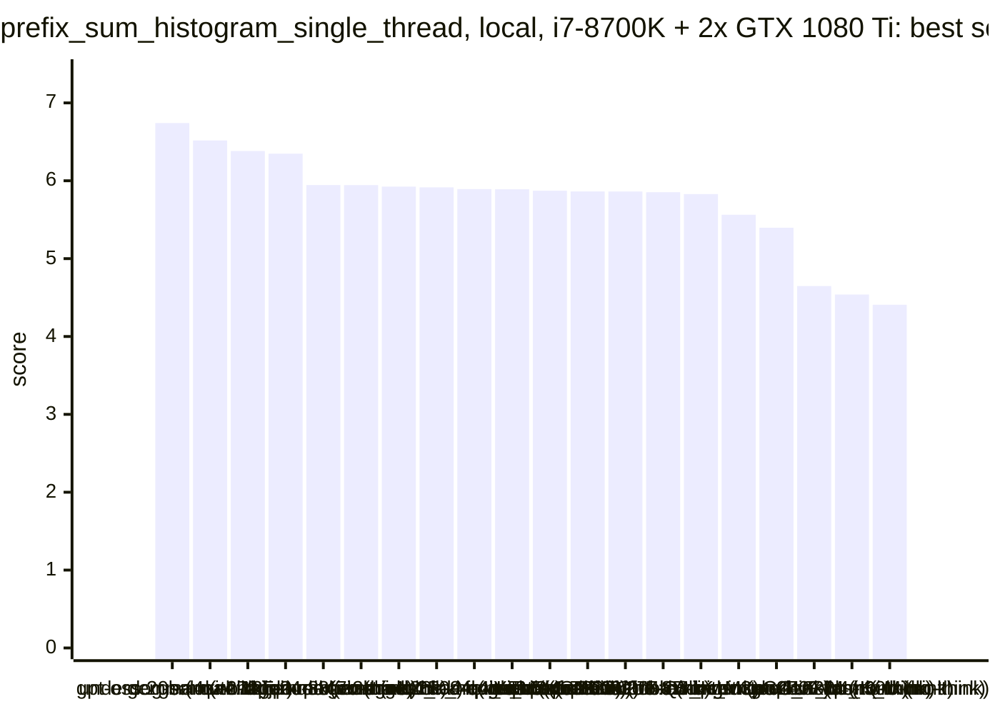

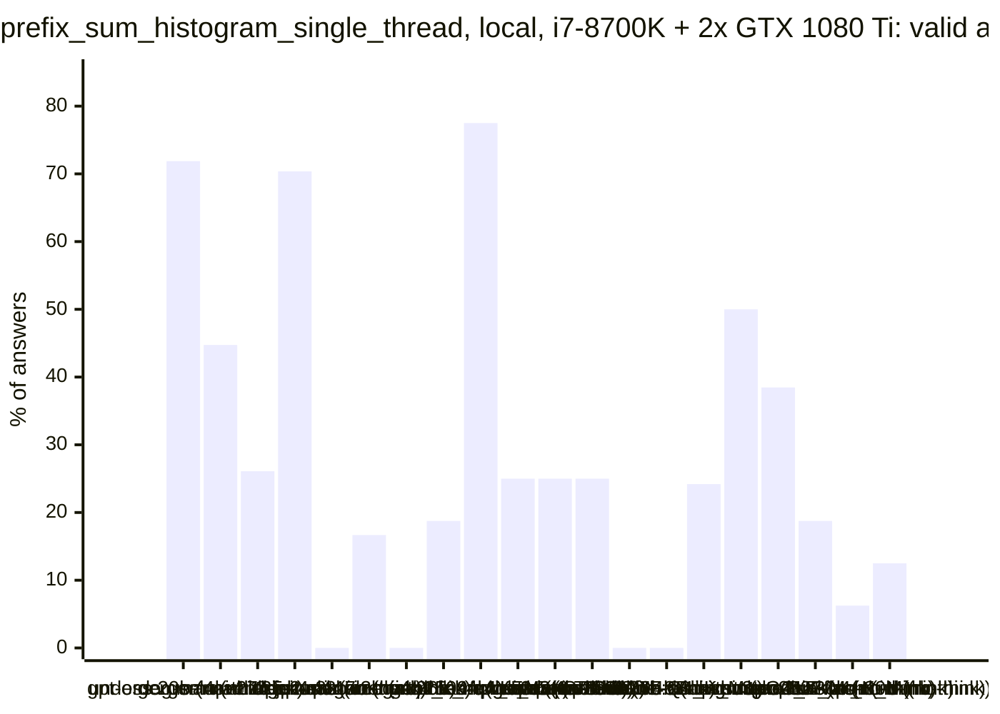

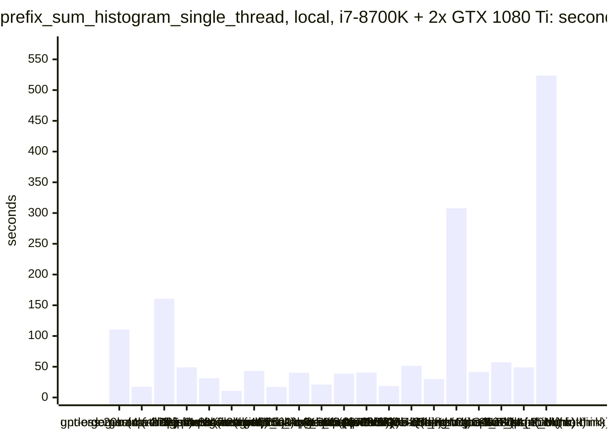

### Inference speed and memory

RAM is what Ollama reports for the loaded model (weights, context cache and buffers; on Apple silicon this is shared memory). Load is the time to bring the model into memory. Prompt and generation speeds are tokens per second over all calls of the run.

| Model | Params | RAM GB | Load s | Prompt tok/s | Gen tok/s | Median s/call | p90 s/call | Tokens/answer | Stopped |
|---|---|--:|--:|--:|--:|--:|--:|--:|--:|
| gemma4:e2b (no-think) | 4.6B | 0.5 | 17 | 2102 | 130.9 | 10 | 17 | 745 | 0 |
| hf.co/LiquidAI/LFM3-1.7B-GGUF:Q4_K_M (no-think) | 1.73B | 1.3 | 0 | 4173 | 118.4 | 64 | 68 | 1082 | 13 |
| gemma4:latest (no-think) | 7.5B | 1.6 | 22 | 1178 | 64.1 | 15 | 30 | 642 | 0 |
| nemotron-3-nano:4b (no-think) | 4.0B | 3.5 | 9 | 1652 | 73.3 | 14 | 31 | 966 | 0 |
| richardyoung/frognano-4b-2609:latest (no-think) | 4.3B | 4.3 | 12 | 1646 | 58.8 | 35 | 59 | 1955 | 2 |
| gemma4:e4b-it-qat (no-think) | 7.5B | 4.4 | 21 | 1792 | 45.5 | 19 | 38 | 696 | 0 |
| qwen2.5-coder:7b (no-think) | 7.6B | 6.6 | 14 | 2354 | 43.4 | 18 | 57 | 1154 | 0 |
| qwen3.5:latest (no-think) | 9.0B | 7.6 | 20 | 1255 | 38.6 | 39 | 59 | 1233 | 0 |
| gemma4:12b-it-qat (no-think) | 11.9B | 9.0 | 21 | 736 | 28.5 | 47 | 72 | 1066 | 0 |
| MichelRosselli/apertus:8b-instruct-2509-q4_k_m (no-think) | 8.1B | 10.1 | 14 | 2402 | 43.5 | 15 | 36 | 534 | 1 |
| yandex/YandexGPT-5-Lite-8B-instruct-GGUF:latest (no-think) | 8.0B | 10.2 | 14 | 2052 | 43.6 | 27 | 48 | 1053 | 0 |
| llm-jp-4-8b-omega:q4_k_m (no-think) | 8.6B | 10.4 | 16 | 2504 | 39.8 | 41 | 62 | 1499 | 0 |
| underdog-saluki-27b:iq2-mix (no-think) | 26.9B | 11.3 | 0 | 370 | 15.8 | 113 | 319 | 1997 | 1 |
| gpt-oss:20b (no-think) | 20.9B | 13.8 | 38 | 2279 | 50.7 | 63 | 227 | 5312 | 0 |
| gemma4:26b-a4b-it-qat (no-think) | 25.2B | 16.5 | 66 | 881 | 33.0 | 37 | 69 | 917 | 2 |
| qwen3.6:27b-coding-mtp-q4_K_M (no-think) | 27.3B | 19.9 | 65 | 193 | 6.6 | 306 | 463 | 1803 | 0 |
| frob/sarvam:30b (no-think) | 32.2B | 21.0 | 88 | 2400 | 43.9 | 566 | 656 | 22283 | 0 |
| glm-4.7-flash:latest (no-think) | 29.9B | 21.2 | 67 | 723 | 23.4 | 46 | 73 | 876 | 0 |
| qwen3:30b-a3b-instruct-2507-q4_K_M (no-think) | 30.5B | 22.2 | 58 | 1136 | 27.8 | 29 | 68 | 859 | 0 |
| qwen3-coder:30b (no-think) | 30.5B | 22.2 | 75 | 1239 | 24.3 | 45 | 110 | 1110 | 1 |

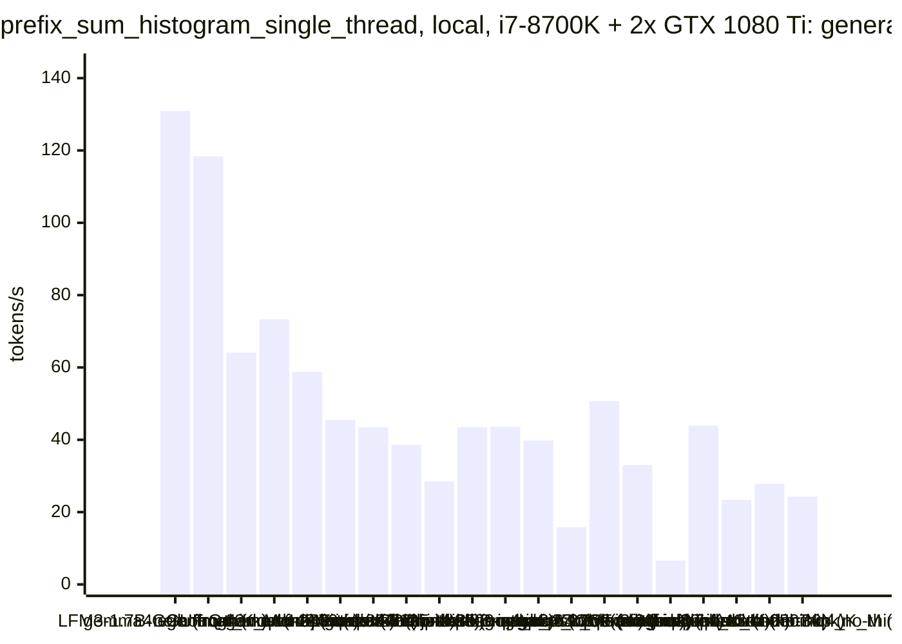

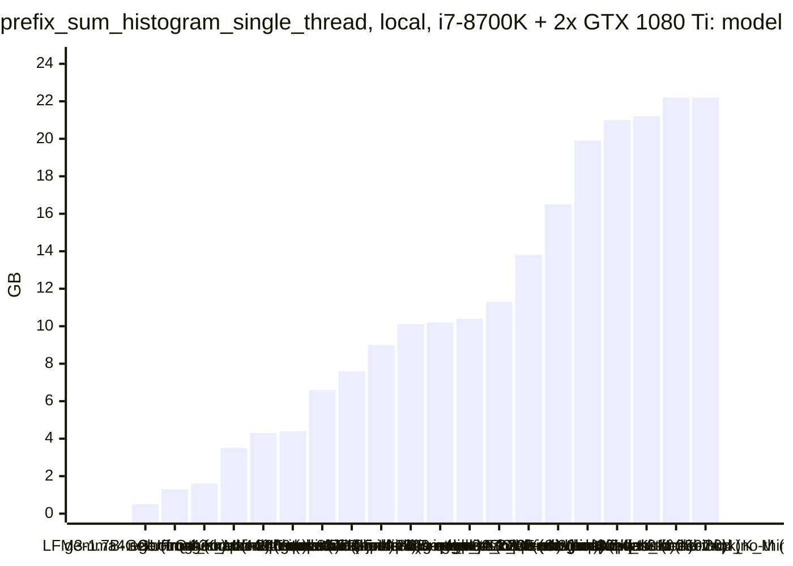

### Best score over time

| Model | 15 min | 30 min | 45 min | 60 min |
|---|--:|--:|--:|--:|
| gpt-oss:20b (no-think) | 6.40037 | 6.44056 | 6.65055 | 6.74067 |
| gemma4:latest (no-think) | 6.51811 | 6.51811 | 6.51811 | 6.51811 |
| underdog-saluki-27b:iq2-mix (no-think) | 5.87489 | 5.87489 | 6.38209 | 6.38209 |
| gemma4:12b-it-qat (no-think) | 6.3411 | 6.348 | 6.348 | 6.348 |
| qwen2.5-coder:7b (no-think) | 5.94451 | 5.94451 | 5.94451 | 5.94451 |
| gemma4:e2b (no-think) | 5.94377 | 5.94377 | 5.94377 | 5.94377 |
| llm-jp-4-8b-omega:q4_k_m (no-think) | 5.92539 | 5.92539 | 5.92539 | 5.92539 |
| MichelRosselli/apertus:8b-instruct-2509-q4_k_m (no-think) | 5.91493 | 5.91493 | 5.91493 | 5.91493 |
| gemma4:26b-a4b-it-qat (no-think) | 5.89333 | 5.89333 | 5.89333 | 5.89333 |
| gemma4:e4b-it-qat (no-think) | 5.89102 | 5.89102 | 5.89102 | 5.89102 |
| qwen3.5:latest (no-think) | 5.87234 | 5.87234 | 5.87234 | 5.87234 |
| richardyoung/frognano-4b-2609:latest (no-think) | 5.86256 | 5.86256 | 5.86256 | 5.86256 |
| nemotron-3-nano:4b (no-think) | 5.86222 | 5.86222 | 5.86222 | 5.86222 |
| hf.co/LiquidAI/LFM3-1.7B-GGUF:Q4_K_M (no-think) | 5.85283 | 5.85283 | 5.85283 | 5.85283 |
| yandex/YandexGPT-5-Lite-8B-instruct-GGUF:latest (no-think) | 5.80772 | 5.82907 | 5.82907 | 5.82907 |
| qwen3.6:27b-coding-mtp-q4_K_M (no-think) | 5.26316 | 5.56419 | 5.56419 | 5.56419 |
| qwen3:30b-a3b-instruct-2507-q4_K_M (no-think) | 5.3974 | 5.3974 | 5.3974 | 5.3974 |
| qwen3-coder:30b (no-think) | 4.64757 | 4.64757 | 4.64757 | 4.64757 |
| glm-4.7-flash:latest (no-think) | 4.53881 | 4.53881 | 4.53881 | 4.53881 |
| frob/sarvam:30b (no-think) | 4.40778 | 4.40778 | 4.40778 | 4.40778 |

### Outcome of the LLM answers

| Model | compile error | duplicate | edit error | invalid | llm error | ok |
|---|--:|--:|--:|--:|--:|--:|
| gpt-oss:20b (no-think) | 5 | 1 | 3 | 0 | 0 | 23 |
| gemma4:latest (no-think) | 9 | 3 | 3 | 6 | 0 | 17 |
| underdog-saluki-27b:iq2-mix (no-think) | 7 | 1 | 3 | 5 | 1 | 6 |
| gemma4:12b-it-qat (no-think) | 1 | 2 | 1 | 4 | 0 | 19 |
| qwen2.5-coder:7b (no-think) | 13 | 0 | 0 | 3 | 0 | 0 |
| gemma4:e2b (no-think) | 14 | 1 | 5 | 0 | 0 | 4 |
| llm-jp-4-8b-omega:q4_k_m (no-think) | 9 | 0 | 5 | 2 | 0 | 0 |
| MichelRosselli/apertus:8b-instruct-2509-q4_k_m (no-think) | 7 | 2 | 2 | 1 | 1 | 3 |
| gemma4:26b-a4b-it-qat (no-think) | 1 | 1 | 2 | 3 | 2 | 31 |
| gemma4:e4b-it-qat (no-think) | 4 | 0 | 0 | 8 | 0 | 4 |
| qwen3.5:latest (no-think) | 3 | 0 | 1 | 8 | 0 | 4 |
| richardyoung/frognano-4b-2609:latest (no-think) | 8 | 0 | 0 | 2 | 2 | 4 |
| nemotron-3-nano:4b (no-think) | 3 | 0 | 12 | 1 | 0 | 0 |
| hf.co/LiquidAI/LFM3-1.7B-GGUF:Q4_K_M (no-think) | 2 | 0 | 1 | 0 | 13 | 0 |
| yandex/YandexGPT-5-Lite-8B-instruct-GGUF:latest (no-think) | 12 | 21 | 7 | 7 | 0 | 15 |
| qwen3.6:27b-coding-mtp-q4_K_M (no-think) | 2 | 0 | 1 | 3 | 0 | 6 |
| qwen3:30b-a3b-instruct-2507-q4_K_M (no-think) | 5 | 0 | 3 | 0 | 0 | 5 |
| qwen3-coder:30b (no-think) | 5 | 3 | 0 | 4 | 1 | 3 |
| glm-4.7-flash:latest (no-think) | 6 | 1 | 0 | 8 | 0 | 1 |
| frob/sarvam:30b (no-think) | 1 | 0 | 6 | 0 | 0 | 1 |

### Best idea per model

- **gpt-oss:20b (no-think)**: Add `__restrict__` qualifiers to the function parameters to eliminate aliasing assumptions and allow the compiler to optimize the loop more aggressively.
- **gemma4:latest (no-think)**: tuned UNROLL_FACTOR=25 on top of: Implement loop unrolling with local histogram accumulation and keep the running sum in a register to reduce write-modify-write contention on hot …
- **underdog-saluki-27b:iq2-mix (no-think)**: Replace the broken, dead NEON histogram code and the scalar 8-wide prefix sum inside the main loop with a correct scalar 8-wide inclusive prefix sum plus the histogram …
- **gemma4:12b-it-qat (no-think)**: Use multiple private sub-histograms and loop unrolling to mitigate cache contention on hot bins and increase instruction-level parallelism.
- **qwen2.5-coder:7b (no-think)**: initial program
- **gemma4:e2b (no-think)**: Replace the complex and incorrect NEON attempts with a highly optimized sequential loop structure that leverages the running sum register and minimizes branching within the main …
- **llm-jp-4-8b-omega:q4_k_m (no-think)**: initial program
- **MichelRosselli/apertus:8b-instruct-2509-q4_k_m (no-think)**: initial program
- **gemma4:26b-a4b-it-qat (no-think)**: Use 8 sub-histograms to break the dependency chain on hot bins, unroll the loop for better ILP, and use a local array for sub-histograms to keep them in L1 cache.
- **gemma4:e4b-it-qat (no-think)**: initial program
- **qwen3.5:latest (no-think)**: initial program
- **richardyoung/frognano-4b-2609:latest (no-think)**: initial program
- **nemotron-3-nano:4b (no-think)**: initial program
- **hf.co/LiquidAI/LFM3-1.7B-GGUF:Q4_K_M (no-think)**: initial program
- **yandex/YandexGPT-5-Lite-8B-instruct-GGUF:latest (no-think)**: Use a block processing with NEON instructions to parallelize the prefix sum and histogram computation, and add a separate loop for the remainder to further reduce overhead and …
- **qwen3.6:27b-coding-mtp-q4_K_M (no-think)**: Introduce tunable constants for block size, sub-histogram count, and loop unrolling factor to allow the evolutionary search to optimize memory prefetching and dependency breaking …
- **qwen3:30b-a3b-instruct-2507-q4_K_M (no-think)**: initial program
- **qwen3-coder:30b (no-think)**: initial program
- **glm-4.7-flash:latest (no-think)**: initial program
- **frob/sarvam:30b (no-think)**: initial program

## Cloud models (OpenRouter) on i7-8700K

Free OpenRouter models; times include the network and the provider's queue.

| Model | Params | Initial | Best | Gain | LLM calls | s/call | Valid | New bests | Min to best | Minutes | Stopped by |
|---|---|--:|--:|--:|--:|--:|--:|--:|--:|--:|---|
| cohere/north-mini-code:free (think) |  | 4.3637 | **4.54575** | ×1.04 | 16 | 235 | 19% | 2 | 61.3 | 65.2 | time limit |

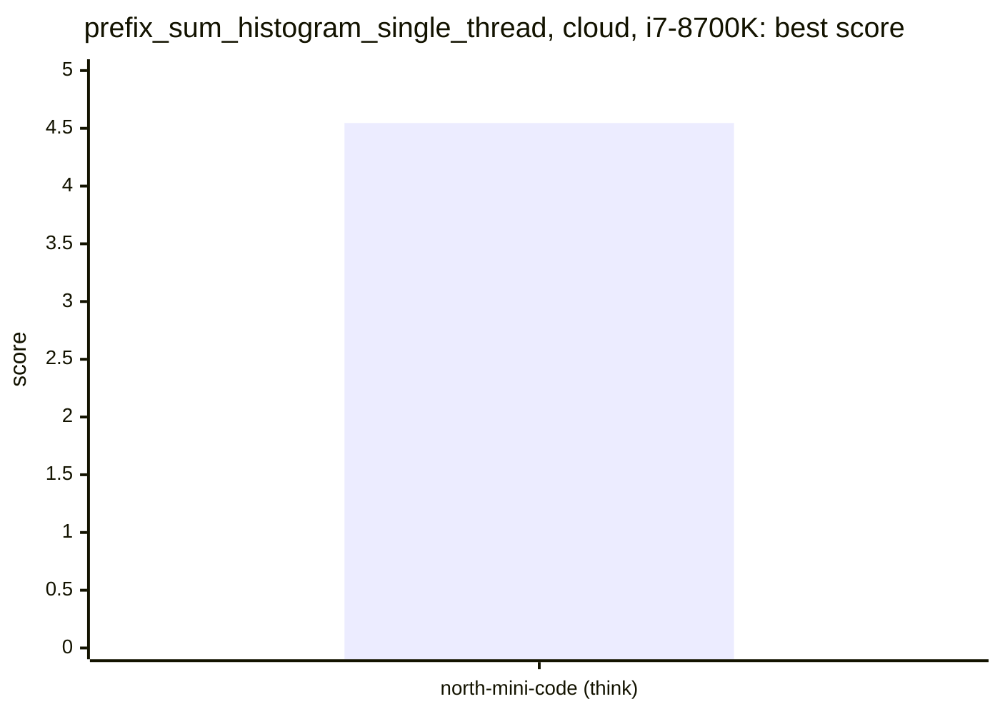

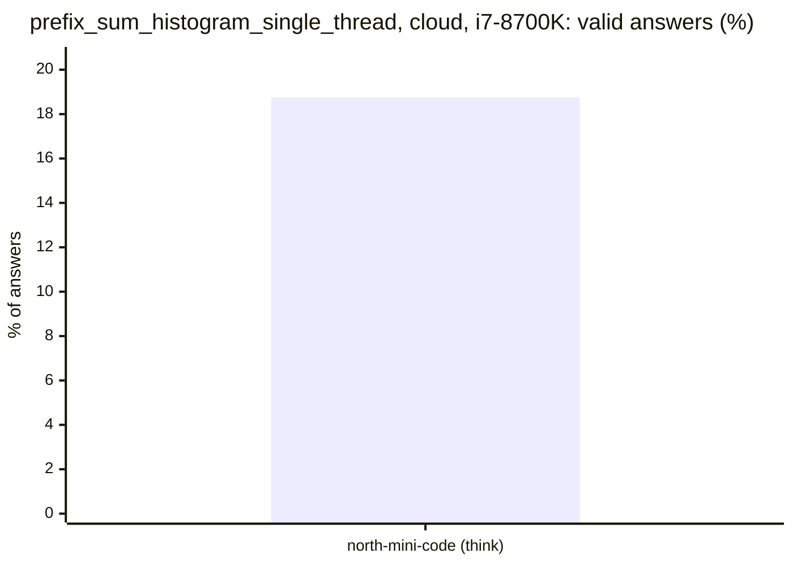

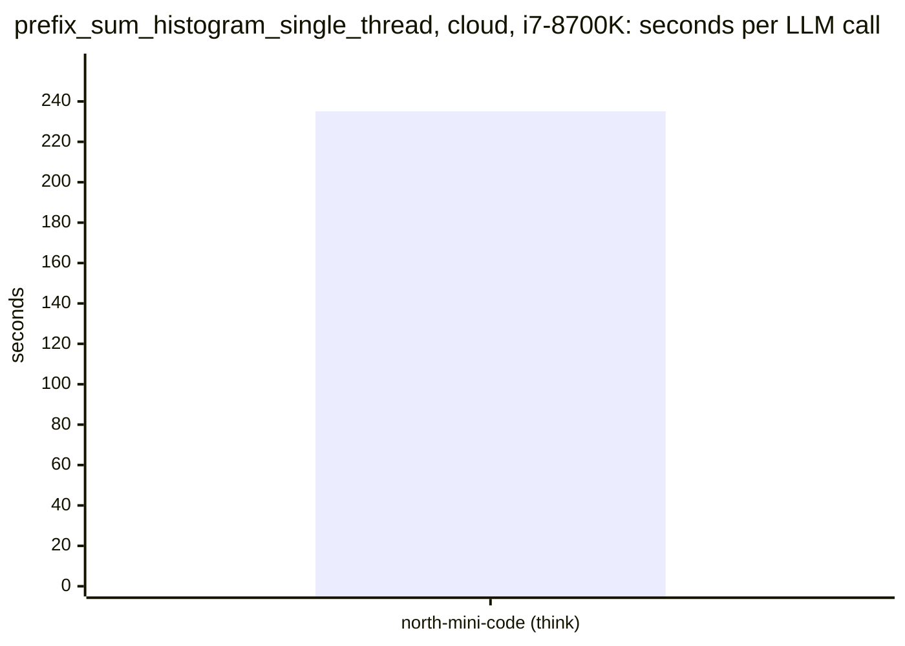

### Inference speed and cost

Generation speed is measured from the first to the last streamed token; the time to the first token is counted as prompt time. Cost is what OpenRouter charged for the run.

| Model | Gen tok/s | Median s/call | p90 s/call | Tokens/answer | Stopped | Cost $ |
|---|--:|--:|--:|--:|--:|--:|
| cohere/north-mini-code:free (think) | 90.4 | 244 | 314 | 19724 | 0 | 0.000 |

### Best score over time

| Model | 15 min | 30 min | 45 min | 60 min |
|---|--:|--:|--:|--:|
| cohere/north-mini-code:free (think) | 4.3637 | 4.49205 | 4.49205 | 4.49205 |

### Outcome of the LLM answers

| Model | compile error | edit error | llm error | ok | timeout |
|---|--:|--:|--:|--:|--:|
| cohere/north-mini-code:free (think) | 3 | 8 | 1 | 3 | 1 |

### Best idea per model

- **cohere/north-mini-code:free (think)**: tuned BLOCK=512, SUB_K=4 on top of: Expose BLOCK and SUB_K as global constexpr constants to enable systematic sweep over block size and sub‑histogram count, optimizing cache usage …

## Cloud models (OpenRouter) on i7-8700K + 2x GTX 1080 Ti

Free OpenRouter models; times include the network and the provider's queue.

| Model | Params | Initial | Best | Gain | LLM calls | s/call | Valid | New bests | Min to best | Minutes | Stopped by |
|---|---|--:|--:|--:|--:|--:|--:|--:|--:|--:|---|
| nvidia/nemotron-3-ultra-550b-a55b:free (think) |  | 5.54026 | **7.50181** | ×1.35 | 22 | 73 | 50% | 1 | 10.3 | 28.4 | no progress |
| dots-studio/dots-3-note-preview:free (think) |  | 4.09681 | **6.4022** | ×1.56 | 16 | 238 | 19% | 1 | 8.7 | 63.9 | time limit |
| nvidia/nemotron-3.5-super-vl:free (no-think) |  | 5.03346 | **6.28423** | ×1.25 | 18 | 13 | 33% | 1 | 0.5 | 4.3 | no progress |
| nvidia/nemotron-3.5-super-vl:free (think) |  | 4.22315 | **6.14197** | ×1.45 | 30 | 99 | 43% | 3 | 28.4 | 52.5 | no progress |
| poolside/laguna-s-2.1:free (no-think) |  | 4.9876 | **6.12493** | ×1.23 | 21 | 84 | 19% | 3 | 6.5 | 30.1 | no progress |
| dots-studio/dots-3-note-preview:free (no-think) |  | 5.00204 | **6.12226** | ×1.22 | 52 | 12 | 60% | 5 | 7.3 | 11.2 | no progress |
| poolside/laguna-xs-2.1:free (no-think) |  | 4.98297 | **6.01417** | ×1.21 | 32 | 51 | 34% | 2 | 14.6 | 29.1 | no progress |
| nvidia/nemotron-3-ultra-550b-a55b:free (no-think) |  | 5.11196 | **5.77102** | ×1.13 | 19 | 20 | 26% | 1 | 1.4 | 6.7 | no progress |
| google/gemma-4-26b-a4b-it:free (think) |  | | | | | | | | | | failed: all 5 model requests failed: google/gemma-4-26b-a4b-it:free: |
| nvidia/nemotron-3-nano-omni-30b-a3b-reasoning:free (think) |  | 4.98853 | **5.24523** | ×1.05 | 23 | 159 | 48% | 3 | 47.2 | 62.0 | time limit |
| google/gemma-4-26b-a4b-it:free (no-think) |  | | | | | | | | | | failed: all 6 model requests failed: google/gemma-4-26b-a4b-it:free: |
| xingchen-agi/xing4.0-29b-a4b:free (no-think) |  | 4.55257 | **5.11627** | ×1.12 | 28 | 77 | 4% | 1 | 15.8 | 37.6 | no progress |
| google/gemma-4-31b-it:free (no-think) |  | | | | | | | | | | failed: all 5 model requests failed: google/gemma-4-31b-it:free: rat |
| google/gemma-4-31b-it:free (think) |  | | | | | | | | | | failed: all 5 model requests failed: google/gemma-4-31b-it:free: rat |
| nvidia/nemotron-3.5-lightning:free (no-think) |  | 4.98403 | **4.98403** | ×1.00 | 16 | 24 | 0% | 0 | - | 6.7 | no progress |
| cohere/north-mini-code:free (no-think) |  | 4.85369 | **4.85369** | ×1.00 | 16 | 7 | 0% | 0 | - | 2.4 | no progress |
| xingchen-agi/xing4.0-29b-a4b:free (think) |  | 4.83715 | **4.83715** | ×1.00 | 14 | 257 | 0% | 0 | - | 62.2 | time limit |
| nvidia/nemotron-3.5-lightning:free (think) |  | 4.76522 | **4.76522** | ×1.00 | 10 | 390 | 20% | 0 | - | 65.6 | time limit |
| recursive/flint-v1.0:free (think) |  | | | | | | | | | | failed: all 5 model requests failed: recursive/flint-v1.0:free: requ |
| nvidia/nemotron-3-nano-omni-30b-a3b-reasoning:free (no-think) |  | 3.165 | **3.165** | ×1.00 | 16 | 12 | 0% | 0 | - | 3.4 | no progress |

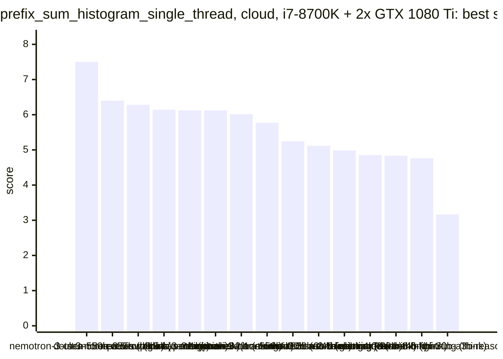

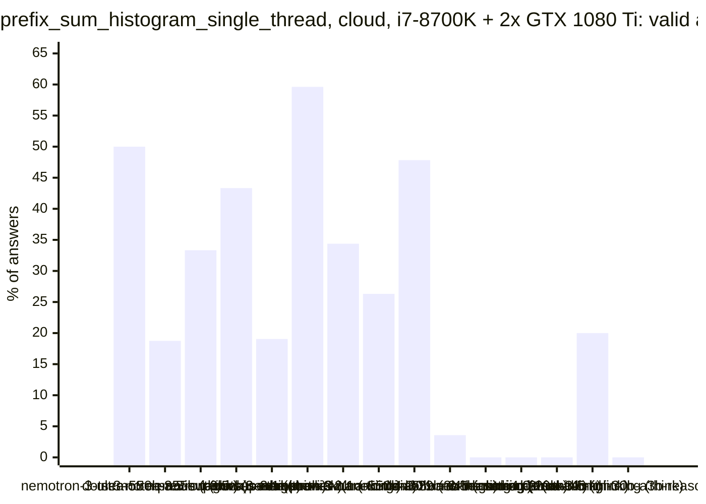

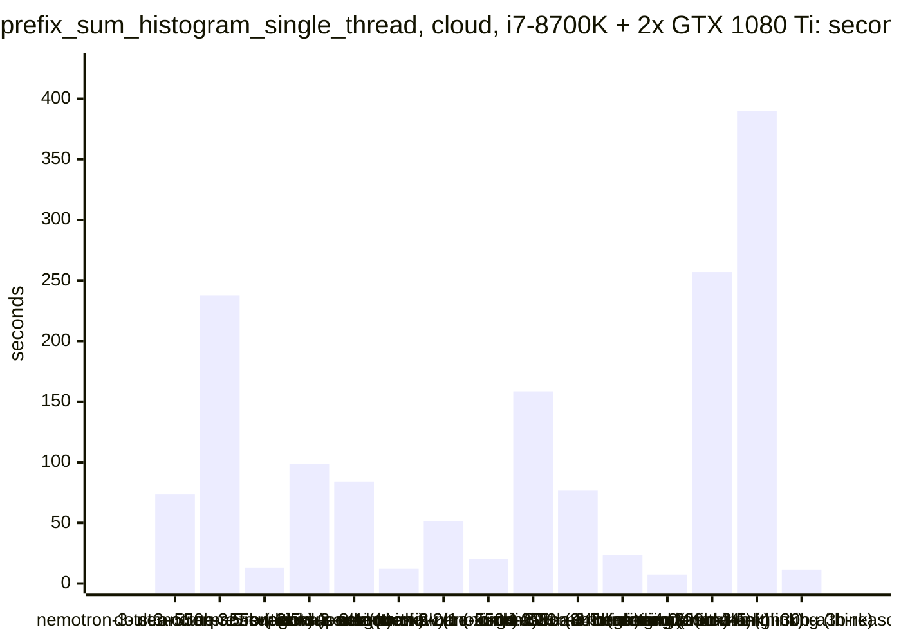

### Inference speed and cost

Generation speed is measured from the first to the last streamed token; the time to the first token is counted as prompt time. Cost is what OpenRouter charged for the run.

| Model | Gen tok/s | Median s/call | p90 s/call | Tokens/answer | Stopped | Cost $ |
|---|--:|--:|--:|--:|--:|--:|
| nvidia/nemotron-3.5-super-vl:free (think) | 164.9 | 106 | 182 | 16078 | 0 | 0.000 |
| nvidia/nemotron-3.5-super-vl:free (no-think) | 159.7 | 10 | 28 | 1626 | 3 | 0.000 |
| cohere/north-mini-code:free (no-think) | 136.8 | 7 | 15 | 942 | 0 | 0.000 |
| dots-studio/dots-3-note-preview:free (no-think) | 115.3 | 12 | 20 | 1144 | 3 | 0.000 |
| nvidia/nemotron-3-nano-omni-30b-a3b-reasoning:free (no-think) | 100.1 | 8 | 23 | 968 | 2 | 0.000 |
| dots-studio/dots-3-note-preview:free (think) | 87.5 | 279 | 296 | 20668 | 0 | 0.000 |
| nvidia/nemotron-3-ultra-550b-a55b:free (no-think) | 80.7 | 16 | 35 | 1506 | 0 | 0.000 |
| nvidia/nemotron-3.5-lightning:free (no-think) | 70.5 | 20 | 67 | 912 | 9 | 0.000 |
| poolside/laguna-xs-2.1:free (no-think) | 69.0 | 57 | 79 | 1127 | 1 | 0.000 |
| xingchen-agi/xing4.0-29b-a4b:free (think) | 65.8 | 366 | 420 | 7312 | 5 | 0.000 |
| nvidia/nemotron-3-nano-omni-30b-a3b-reasoning:free (think) | 58.7 | 100 | 364 | 9260 | 0 | 0.000 |
| xingchen-agi/xing4.0-29b-a4b:free (no-think) | 58.7 | 74 | 94 | 430 | 4 | 0.000 |
| nvidia/nemotron-3.5-lightning:free (think) | 56.5 | 439 | 698 | 18024 | 0 | 0.000 |
| poolside/laguna-s-2.1:free (no-think) | 48.2 | 42 | 176 | 1066 | 9 | 0.000 |
| nvidia/nemotron-3-ultra-550b-a55b:free (think) | 36.6 | 47 | 173 | 2616 | 0 | 0.000 |

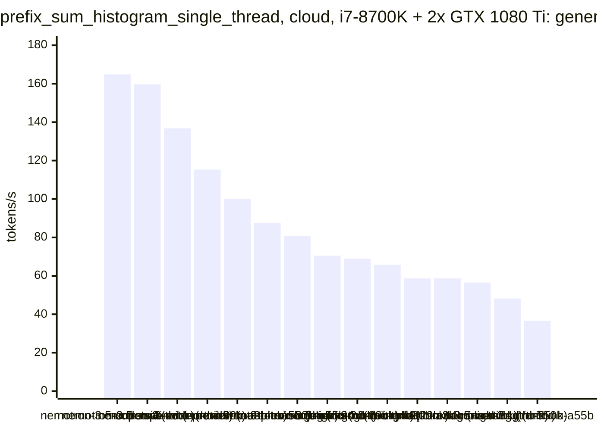

### Best score over time

| Model | 15 min | 30 min | 45 min | 60 min |
|---|--:|--:|--:|--:|
| nvidia/nemotron-3-ultra-550b-a55b:free (think) | 7.50181 | 7.50181 | 7.50181 | 7.50181 |
| dots-studio/dots-3-note-preview:free (think) | 6.4022 | 6.4022 | 6.4022 | 6.4022 |
| nvidia/nemotron-3.5-super-vl:free (no-think) | 6.28423 | 6.28423 | 6.28423 | 6.28423 |
| nvidia/nemotron-3.5-super-vl:free (think) | 5.28817 | 6.14197 | 6.14197 | 6.14197 |
| poolside/laguna-s-2.1:free (no-think) | 6.12493 | 6.12493 | 6.12493 | 6.12493 |
| dots-studio/dots-3-note-preview:free (no-think) | 6.12226 | 6.12226 | 6.12226 | 6.12226 |
| poolside/laguna-xs-2.1:free (no-think) | 6.01417 | 6.01417 | 6.01417 | 6.01417 |
| nvidia/nemotron-3-ultra-550b-a55b:free (no-think) | 5.77102 | 5.77102 | 5.77102 | 5.77102 |
| nvidia/nemotron-3-nano-omni-30b-a3b-reasoning:free (think) | 5.15449 | 5.24504 | 5.24504 | 5.24523 |
| xingchen-agi/xing4.0-29b-a4b:free (no-think) | 4.55257 | 5.11627 | 5.11627 | 5.11627 |
| nvidia/nemotron-3.5-lightning:free (no-think) | 4.98403 | 4.98403 | 4.98403 | 4.98403 |
| cohere/north-mini-code:free (no-think) | 4.85369 | 4.85369 | 4.85369 | 4.85369 |
| xingchen-agi/xing4.0-29b-a4b:free (think) | 4.83715 | 4.83715 | 4.83715 | 4.83715 |
| nvidia/nemotron-3.5-lightning:free (think) | 4.76522 | 4.76522 | 4.76522 | 4.76522 |
| nvidia/nemotron-3-nano-omni-30b-a3b-reasoning:free (no-think) | 3.165 | 3.165 | 3.165 | 3.165 |

### Outcome of the LLM answers

| Model | compile error | duplicate | edit error | invalid | llm error | ok | timeout |
|---|--:|--:|--:|--:|--:|--:|--:|
| nvidia/nemotron-3-ultra-550b-a55b:free (think) | 7 | 2 | 0 | 2 | 0 | 11 | 0 |
| dots-studio/dots-3-note-preview:free (think) | 1 | 2 | 9 | 1 | 0 | 3 | 0 |
| nvidia/nemotron-3.5-super-vl:free (no-think) | 3 | 0 | 1 | 5 | 3 | 6 | 0 |
| nvidia/nemotron-3.5-super-vl:free (think) | 4 | 2 | 10 | 1 | 0 | 13 | 0 |
| poolside/laguna-s-2.1:free (no-think) | 3 | 3 | 1 | 1 | 9 | 4 | 0 |
| dots-studio/dots-3-note-preview:free (no-think) | 2 | 4 | 7 | 5 | 3 | 31 | 0 |
| poolside/laguna-xs-2.1:free (no-think) | 2 | 0 | 6 | 3 | 10 | 11 | 0 |
| nvidia/nemotron-3-ultra-550b-a55b:free (no-think) | 5 | 7 | 0 | 2 | 0 | 5 | 0 |
| nvidia/nemotron-3-nano-omni-30b-a3b-reasoning:free (think) | 2 | 1 | 8 | 1 | 0 | 11 | 0 |
| xingchen-agi/xing4.0-29b-a4b:free (no-think) | 2 | 2 | 0 | 0 | 22 | 1 | 1 |
| nvidia/nemotron-3.5-lightning:free (no-think) | 4 | 0 | 2 | 1 | 9 | 0 | 0 |
| cohere/north-mini-code:free (no-think) | 5 | 1 | 3 | 7 | 0 | 0 | 0 |
| xingchen-agi/xing4.0-29b-a4b:free (think) | 3 | 0 | 0 | 1 | 10 | 0 | 0 |
| nvidia/nemotron-3.5-lightning:free (think) | 0 | 0 | 7 | 0 | 1 | 2 | 0 |
| nvidia/nemotron-3-nano-omni-30b-a3b-reasoning:free (no-think) | 0 | 0 | 10 | 3 | 2 | 0 | 1 |

### Best idea per model

- **nvidia/nemotron-3-ultra-550b-a55b:free (think)**: Fix compilation timeout by simplifying the unrolled loop structure while keeping 8x unrolling, 4 sub-histograms, prefetching, and local prefix sums for ILP.
- **dots-studio/dots-3-note-preview:free (think)**: Replace the single histogram with 8 private sub-histograms (one per stream position) so that repeated increments of a hot bin hit different cache lines, breaking the store-to-load …
- **nvidia/nemotron-3.5-super-vl:free (no-think)**: Prefetch cache lines ahead of the access point to hide memory latency while keeping a simple exact scalar loop.
- **nvidia/nemotron-3.5-super-vl:free (think)**: tuned SUB=8, PREFETCH_BYTES=256 on top of: Replace the naive serial loop with a fused optimization: (1) split the prefix sum into two independent even/odd accumulator chains to …
- **poolside/laguna-s-2.1:free (no-think)**: Use a single 2D sub-histogram array of uint32_t indexed by [i%8][byte] with 8-way unrolling and a register-blocked 8-element inner loop, keeping the running sum in a register and …
- **dots-studio/dots-3-note-preview:free (no-think)**: Use a single, unified sub-histogram array indexed by (i % K) to reduce cache pressure and improve write locality, while keeping the 8-way unrolling and a single running sum for …
- **poolside/laguna-xs-2.1:free (no-think)**: Remove the duplicate `int64_t sum = 0;` declaration in the non-NEON fallback loop that causes the compile error.
- **nvidia/nemotron-3-ultra-550b-a55b:free (no-think)**: Use 4 private uint32_t sub-histograms to break the long store-to-load dependency chain on hot bins (especially bin 0), process 4 elements per iteration to amortize loop overhead …
- **nvidia/nemotron-3-nano-omni-30b-a3b-reasoning:free (think)**: Increase the per‑iteration unroll factor to 32 and the sub‑histogram count to 64 to lower loop overhead and histogram contention, boosting throughput.
- **xingchen-agi/xing4.0-29b-a4b:free (no-think)**: tuned K=4 on top of: Replace the single histogram with four private uint32 sub-histograms indexed by `i & 3`, so consecutive increments to the same hot bin land in different …
- **nvidia/nemotron-3.5-lightning:free (no-think)**: initial program
- **cohere/north-mini-code:free (no-think)**: initial program
- **xingchen-agi/xing4.0-29b-a4b:free (think)**: initial program
- **nvidia/nemotron-3.5-lightning:free (think)**: initial program
- **nvidia/nemotron-3-nano-omni-30b-a3b-reasoning:free (no-think)**: initial program
