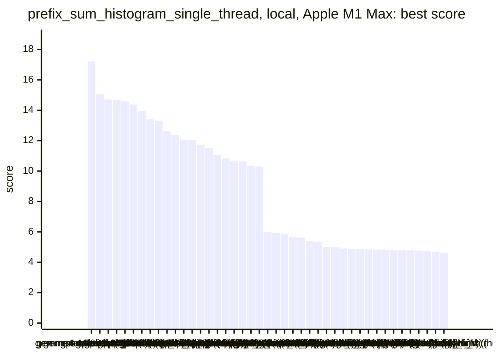
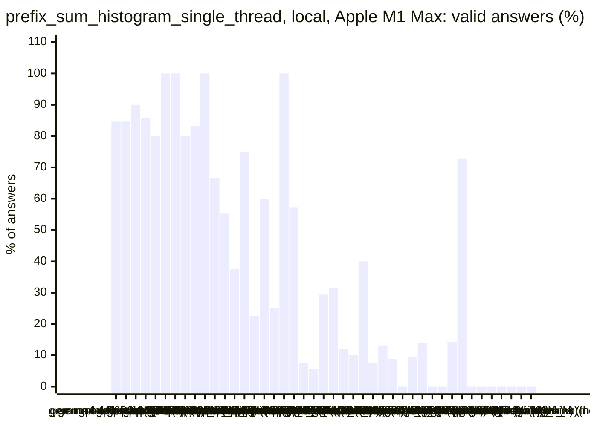
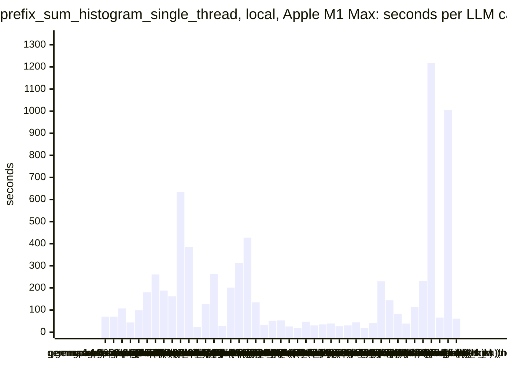
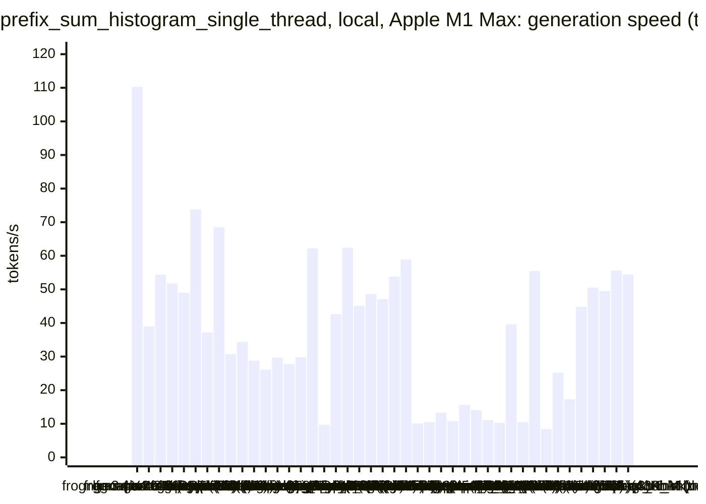
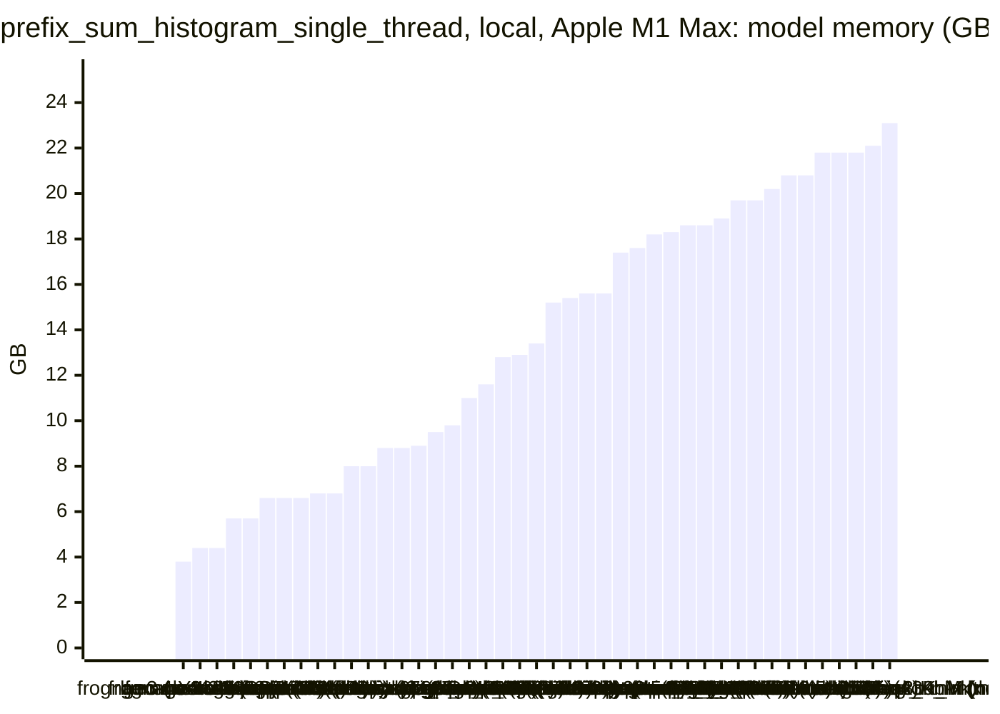
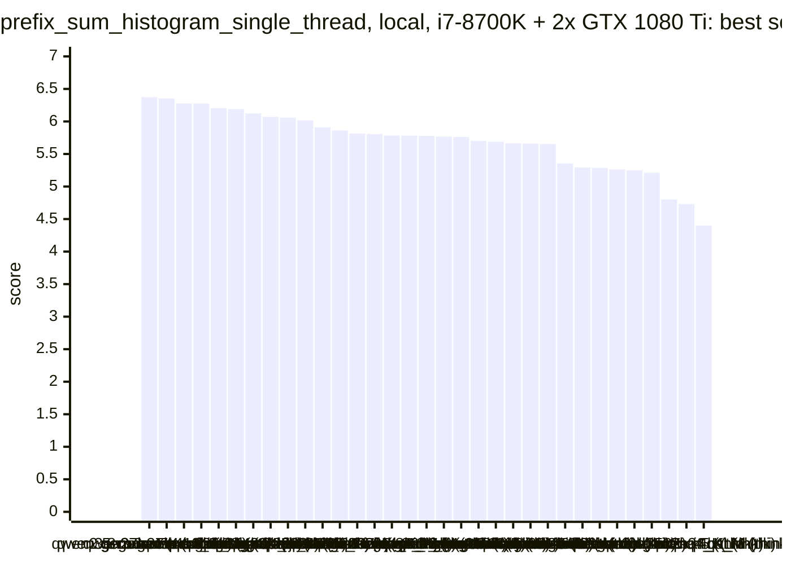
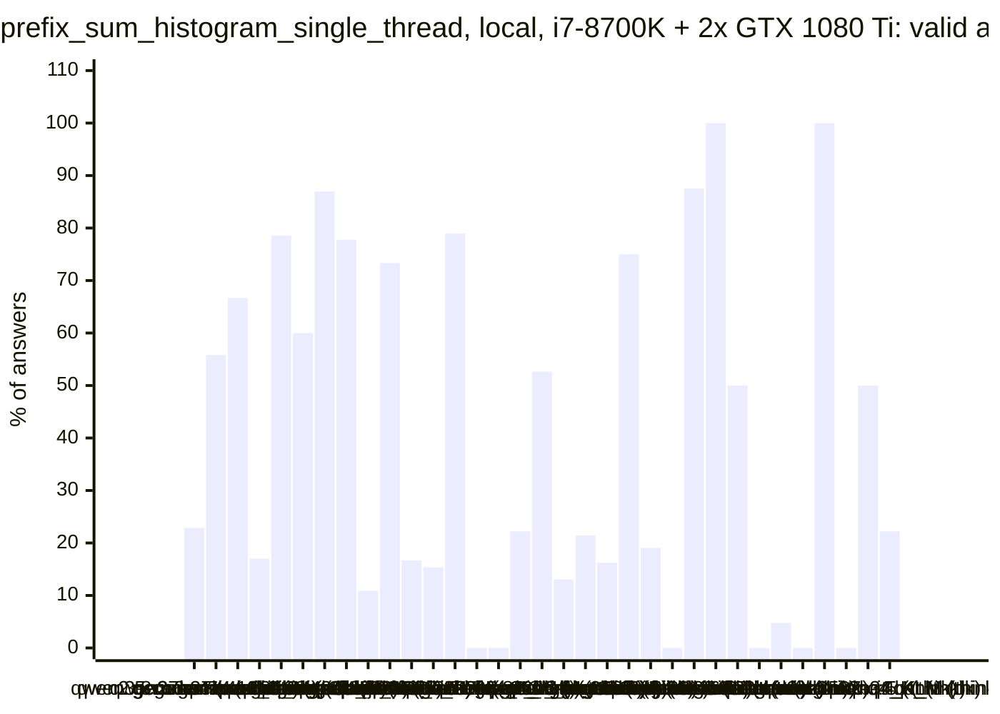
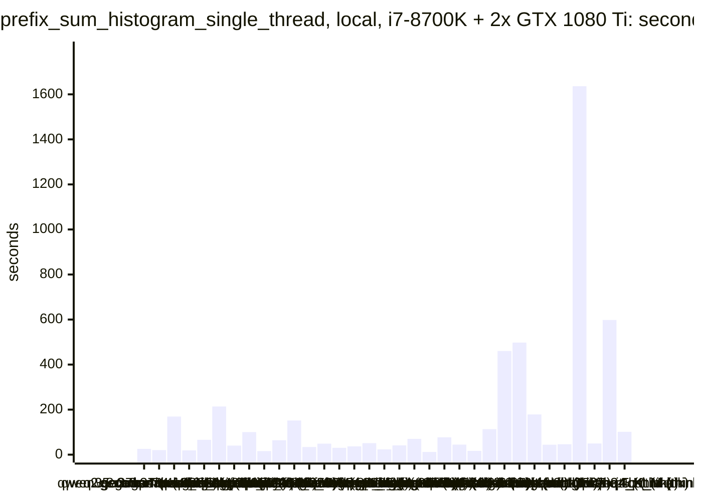
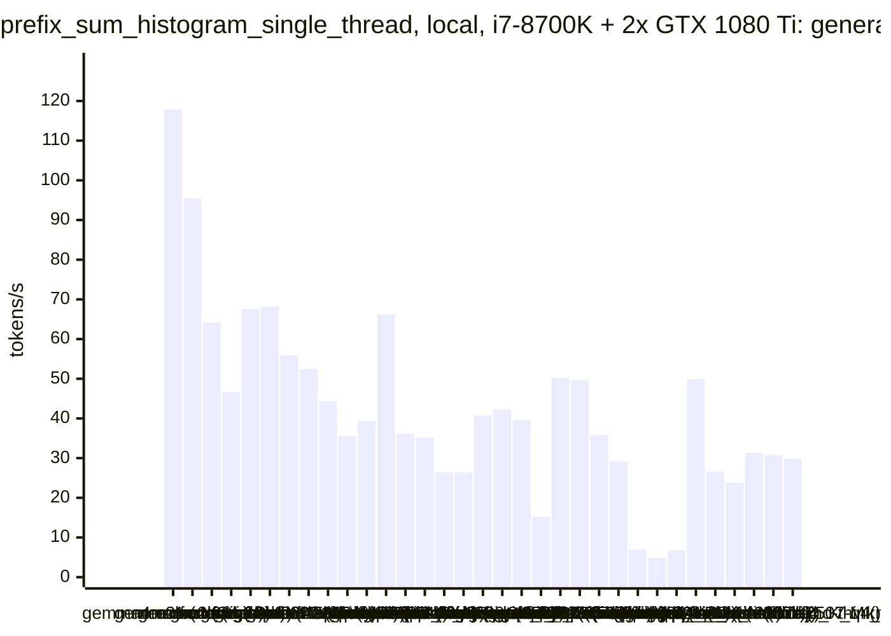
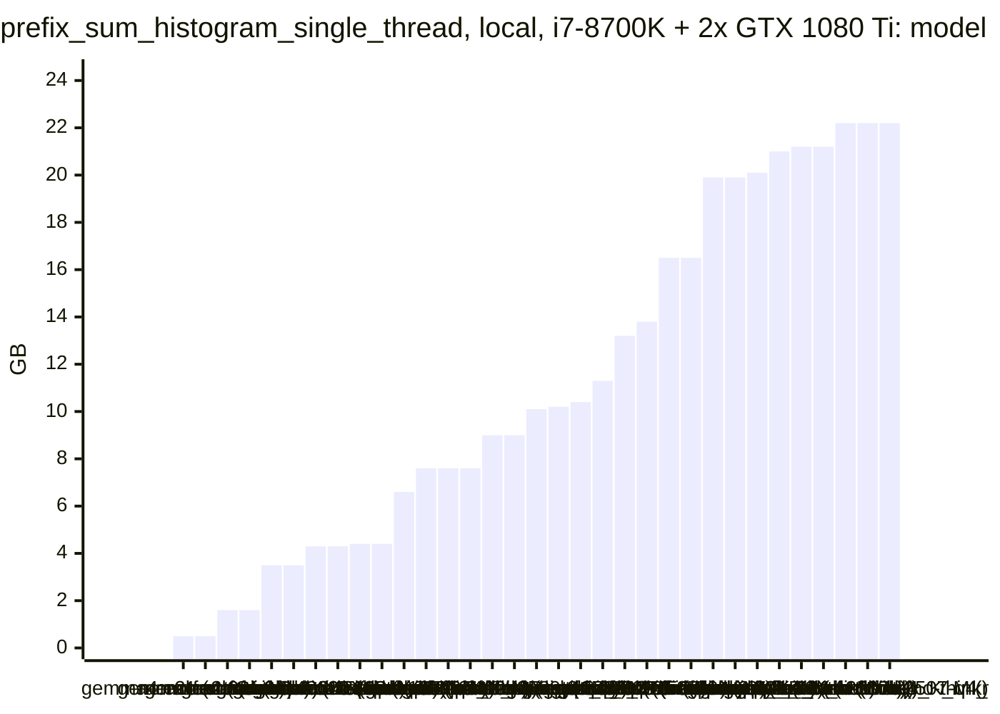

<!-- Copyright (c) 2026 by C. Klukas -->
<!-- SPDX-License-Identifier: GPL-3.0-only -->
<!-- Generated by `omega report` from bench/results/*.json. Do not edit by hand. -->

# prefix_sum_histogram_single_thread

48 models, 15 minutes each, one run per model. The [overall ranking](../benchmarks.md#overall-ranking) compares the models over all examples.

Machines: **Apple M1 Max**: Apple M1 Max (Mac13,1), 10 cores, 32 GB, 47 runs; **i7-8700K + 2x GTX 1080 Ti**: Intel(R) Core(TM) i7-8700K CPU @ 3.70GHz (MS-7A98), 12 cores, 64 GB, 2x NVIDIA GeForce GTX 1080 Ti, 11264 MiB, 36 runs.

## Local models on Apple M1 Max

Ollama on this machine.

| Model | Params | Initial | Best | Gain | LLM calls | s/call | Valid | New bests | Min to best |
|---|---|--:|--:|--:|--:|--:|--:|--:|--:|
| gemma4:e4b-it-qat (think) | 7.5B | 4.89476 | **17.2154** | ×3.52 | 13 | 70 | 85% | 4 | 15.5 |
| gemma4:12b-it-qat (no-think) | 11.9B | 4.99969 | **15.0602** | ×3.01 | 13 | 70 | 85% | 6 | 15.4 |
| gpt-oss:20b (no-think) | 20.9B | 4.92914 | **14.7140** | ×2.99 | 10 | 108 | 90% | 3 | 13.4 |
| gemma4:26b-a4b-it-qat (no-think) | 25.2B | 4.82247 | **14.6735** | ×3.04 | 21 | 44 | 86% | 4 | 7.6 |
| gpt-oss:20b (think) | 20.9B | 4.82276 | **14.5852** | ×3.02 | 10 | 99 | 80% | 3 | 16.6 |
| muse-glimmer:30b (no-think) | 27.9B | 4.69098 | **14.3807** | ×3.07 | 6 | 181 | 100% | 3 | 12.2 |
| gemma4:26b-a4b-it-qat (think) | 25.2B | 4.84702 | **13.9689** | ×2.88 | 4 | 261 | 100% | 3 | 14.4 |
| qwen3.5:27b (no-think) | 27.8B | 4.94376 | **13.4003** | ×2.71 | 5 | 188 | 80% | 2 | 9.3 |
| qwen3.8:27b-mtp-q4_K_M (no-think) | 27.3B | 4.86145 | **13.3222** | ×2.74 | 6 | 162 | 83% | 3 | 16.4 |
| qwen3.8:27b-mtp-q4_K_M (think) | 27.3B | 4.75964 | **12.6223** | ×2.65 | 3 | 634 | 100% | 2 | 31.8 |
| gemma4:12b-it-qat (think) | 11.9B | 4.84848 | **12.3762** | ×2.55 | 3 | 386 | 67% | 1 | 8.1 |
| gemma4:e4b-it-qat (no-think) | 7.5B | 4.93644 | **12.0591** | ×2.44 | 38 | 24 | 55% | 4 | 6.6 |
| devstral-small-2:24b (no-think) | 24.0B | 4.7117 | **12.0355** | ×2.55 | 8 | 128 | 38% | 4 | 14.3 |
| qwen3.5:27b (think) | 27.8B | 4.89297 | **11.7354** | ×2.40 | 4 | 264 | 75% | 2 | 9.9 |
| qwen3:30b-a3b-instruct-2507-q4_K_M (think) | 30.5B | 4.68961 | **11.5307** | ×2.46 | 31 | 29 | 23% | 2 | 3.1 |
| qwen3.6:27b-coding-mtp-q4_K_M (no-think) | 27.3B | 4.78813 | **11.0711** | ×2.31 | 5 | 202 | 60% | 2 | 9.0 |
| qwen3.5:latest (think) | 9.7B | 4.78555 | **10.8430** | ×2.27 | 4 | 312 | 25% | 1 | 8.1 |
| muse-glimmer:30b (think) | 27.9B | 4.85437 | **10.6355** | ×2.19 | 3 | 427 | 100% | 1 | 8.1 |
| nemotron-3-nano:30b-a3b-mlx (think) |  | 4.88938 | **10.6298** | ×2.17 | 7 | 135 | 57% | 2 | 16.0 |
| qwen3:30b-a3b-instruct-2507-q4_K_M (no-think) | 30.5B | 4.865 | **10.3306** | ×2.12 | 27 | 33 | 7% | 3 | 15.3 |
| qwen3-coder:30b (no-think) | 30.5B | 4.7976 | **10.3040** | ×2.15 | 18 | 52 | 6% | 1 | 6.9 |
| qwen3.5:latest (no-think) | 9.7B | 4.93005 | **6.00646** | ×1.22 | 17 | 53 | 29% | 1 | 6.5 |
| gemma4:latest (no-think) |  | 4.9125 | **5.93032** | ×1.21 | 35 | 26 | 31% | 4 | 15.2 |
| gemma4:e2b (no-think) | 5.1B | 4.99127 | **5.88495** | ×1.18 | 50 | 18 | 12% | 1 | 1.2 |
| richardyoung/frognano-4b-2609:latest (no-think) | 4.3B | 4.69897 | **5.66974** | ×1.21 | 20 | 47 | 10% | 3 | 14.8 |
| yandex/YandexGPT-5-Lite-8B-instruct-GGUF:latest (no-think) | 8.0B | 4.80423 | **5.62509** | ×1.17 | 30 | 30 | 40% | 3 | 13.8 |
| glm-4.7-flash:latest (no-think) | 29.9B | 4.57457 | **5.37743** | ×1.18 | 26 | 35 | 8% | 2 | 12.5 |
| MichelRosselli/apertus:8b-instruct-2509-q4_k_m (no-think) | 8.1B | 4.63526 | **5.35117** | ×1.15 | 23 | 39 | 13% | 3 | 10.9 |
| qwen2.5-coder:7b (no-think) | 7.6B | 5.00125 | **5.00125** | ×1.00 | 34 | 27 | 9% | 0 | - |
| lfm3:latest (no-think) |  | 4.98815 | **4.98815** | ×1.00 | 30 | 30 | 0% | 0 | - |
| nemotron-3-nano:4b (think) |  | 4.90707 | **4.90707** | ×1.00 | 21 | 45 | 10% | 0 | - |
| lfm3:latest (think) |  | | | | | | | | failed: all 8 model requests failed: lfm3:latest: answer stopped: re |
| nemotron-3-nano:4b (no-think) |  | 4.83471 | **4.86648** | ×1.01 | 50 | 17 | 14% | 1 | 14.5 |
| nemotron-3.5-lightning:30b-mlx (no-think) |  | 4.85732 | **4.85732** | ×1.00 | 24 | 41 | 0% | 0 | - |
| underdog-saluki-27b:iq2-mix (no-think) | 26.9B | 4.84731 | **4.84731** | ×1.00 | 5 | 230 | 0% | 0 | - |
| ingu627/exaone4.0:32b (no-think) | 32.0B | 4.84291 | **4.84291** | ×1.00 | 7 | 144 | 14% | 0 | - |
| nemotron-3.5-lightning:30b-mlx (think) |  | | | | | | | | failed: all 4 model requests failed: nemotron-3.5-lightning:30b-mlx: |
| gemma4:latest (think) |  | 4.81957 | **4.81957** | ×1.00 | 11 | 84 | 73% | 0 | - |
| nemotron-3-nano:30b-a3b-mlx (no-think) |  | 4.81174 | **4.81174** | ×1.00 | 24 | 39 | 0% | 0 | - |
| frob/sarvam:30b (think) | 32.2B | | | | | | | | failed: all 3 model requests failed: frob/sarvam:30b: answer stopped |
| underdog-saluki-27b:iq2-mix (think) | 26.9B | | | | | | | | failed: all 1 model requests failed: underdog-saluki-27b:iq2-mix: an |
| richardyoung/frognano-4b-2609:latest (think) | 4.3B | 4.78813 | **4.78813** | ×1.00 | 8 | 113 | 0% | 0 | - |
| frob/sarvam:30b (no-think) | 32.2B | 4.78297 | **4.78297** | ×1.00 | 5 | 232 | 0% | 0 | - |
| qwen3.6:27b-coding-mtp-q4_K_M (think) | 27.3B | 4.77071 | **4.77071** | ×1.00 | 1 | 1217 | 0% | 0 | - |
| gemma4:e2b (think) | 5.1B | 4.76105 | **4.76105** | ×1.00 | 14 | 66 | 0% | 0 | - |
| glm-4.7-flash:latest (think) | 29.9B | 4.70395 | **4.70395** | ×1.00 | 1 | 1006 | 0% | 0 | - |
| llm-jp-4-8b-omega:q4_k_m (no-think) | 8.6B | 4.63338 | **4.63338** | ×1.00 | 16 | 61 | 0% | 0 | - |

### Inference speed and memory

RAM is what Ollama reports for the loaded model (weights, context cache and buffers; on Apple silicon this is shared memory). Load is the time to bring the model into memory. Prompt and generation speeds are tokens per second over all calls of the run.

| Model | Params | RAM GB | Load s | Prompt tok/s | Gen tok/s | Median s/call | p90 s/call | Tokens/answer | Stopped |
|---|---|--:|--:|--:|--:|--:|--:|--:|--:|
| lfm3:latest (no-think) |  | 3.8 | 0 | 4842 | 110.3 | 26 | 75 | 5163 | 25 |
| richardyoung/frognano-4b-2609:latest (no-think) | 4.3B | 4.4 | 0 | 807 | 39.0 | 43 | 80 | 1161 | 7 |
| richardyoung/frognano-4b-2609:latest (think) | 4.3B | 4.4 | 11 | 709 | 54.4 | 108 | 203 | 5786 | 0 |
| gemma4:e4b-it-qat (think) | 7.5B | 5.7 | 87 | 630 | 51.8 | 64 | 94 | 2915 | 0 |
| gemma4:e4b-it-qat (no-think) | 7.5B | 5.7 | 55 | 546 | 49.0 | 20 | 39 | 601 | 0 |
| gemma4:e2b (no-think) | 5.1B | 6.6 | 33 | 815 | 73.8 | 17 | 25 | 796 | 0 |
| qwen2.5-coder:7b (no-think) | 7.6B | 6.6 | 34 | 776 | 37.2 | 24 | 46 | 774 | 0 |
| gemma4:e2b (think) | 5.1B | 6.6 | 0 | 869 | 68.5 | 64 | 77 | 3915 | 1 |
| qwen3.5:latest (think) | 9.7B | 6.8 | 53 | 411 | 30.7 | 479 | 510 | 6758 | 1 |
| qwen3.5:latest (no-think) | 9.7B | 6.8 | 28 | 379 | 34.4 | 40 | 106 | 910 | 3 |
| gemma4:12b-it-qat (no-think) | 11.9B | 8.0 | 65 | 205 | 28.8 | 74 | 99 | 1124 | 0 |
| gemma4:12b-it-qat (think) | 11.9B | 8.0 | 99 | 252 | 26.1 | 388 | 481 | 8779 | 0 |
| yandex/YandexGPT-5-Lite-8B-instruct-GGUF:latest (no-think) | 8.0B | 8.8 | 15 | 624 | 29.7 | 31 | 46 | 633 | 0 |
| llm-jp-4-8b-omega:q4_k_m (no-think) | 8.6B | 8.8 | 0 | 812 | 27.8 | 56 | 126 | 1402 | 1 |
| MichelRosselli/apertus:8b-instruct-2509-q4_k_m (no-think) | 8.1B | 8.9 | 16 | 582 | 29.8 | 33 | 54 | 609 | 2 |
| nemotron-3-nano:4b (think) |  | 9.5 | 8 | 1016 | 62.2 | 48 | 61 | 2516 | 0 |
| underdog-saluki-27b:iq2-mix (no-think) | 26.9B | 9.8 | 3 | 98 | 9.7 | 261 | 314 | 1847 | 0 |
| gemma4:latest (think) |  | 11.0 | 98 | 1104 | 42.6 | 73 | 117 | 2995 | 0 |
| nemotron-3-nano:4b (no-think) |  | 11.6 | 8 | 1009 | 62.4 | 16 | 34 | 735 | 4 |
| gpt-oss:20b (think) | 20.9B | 12.8 | 291 | 529 | 45.1 | 72 | 361 | 2774 | 0 |
| gpt-oss:20b (no-think) | 20.9B | 12.9 | 132 | 953 | 48.6 | 98 | 228 | 4349 | 0 |
| gemma4:latest (no-think) |  | 13.4 | 104 | 1437 | 47.1 | 21 | 39 | 897 | 1 |
| gemma4:26b-a4b-it-qat (think) | 25.2B | 15.2 | 276 | 578 | 53.8 | 192 | 492 | 9895 | 0 |
| gemma4:26b-a4b-it-qat (no-think) | 25.2B | 15.4 | 268 | 511 | 58.9 | 36 | 43 | 1120 | 0 |
| muse-glimmer:30b (no-think) | 27.9B | 15.6 | 60 | 103 | 10.1 | 184 | 245 | 1333 | 0 |
| muse-glimmer:30b (think) | 27.9B | 15.6 | 57 | 129 | 10.5 | 481 | 553 | 4019 | 0 |
| qwen3.6:27b-coding-mtp-q4_K_M (think) | 27.3B | 17.4 | 285 | 87 | 13.3 | 1217 | 1217 | 11835 | 0 |
| qwen3.8:27b-mtp-q4_K_M (think) | 27.3B | 17.6 | 286 | 121 | 10.8 | 562 | 1092 | 5507 | 0 |
| qwen3.6:27b-coding-mtp-q4_K_M (no-think) | 27.3B | 18.2 | 14 | 109 | 15.6 | 137 | 444 | 1452 | 0 |
| qwen3.8:27b-mtp-q4_K_M (no-think) | 27.3B | 18.3 | 14 | 128 | 14.1 | 133 | 454 | 984 | 0 |
| qwen3.5:27b (no-think) | 27.8B | 18.6 | 199 | 112 | 11.1 | 182 | 308 | 1236 | 0 |
| qwen3.5:27b (think) | 27.8B | 18.6 | 144 | 106 | 10.3 | 305 | 339 | 1978 | 0 |
| frob/sarvam:30b (no-think) | 32.2B | 18.9 | 113 | 1584 | 39.6 | 229 | 324 | 8192 | 0 |
| devstral-small-2:24b (no-think) | 24.0B | 19.7 | 0 | 217 | 10.5 | 138 | 209 | 937 | 3 |
| nemotron-3-nano:30b-a3b-mlx (think) |  | 19.7 | 112 | 407 | 55.5 | 86 | 341 | 5136 | 1 |
| ingu627/exaone4.0:32b (no-think) | 32.0B | 20.2 | 49 | 69 | 8.4 | 154 | 178 | 700 | 0 |
| glm-4.7-flash:latest (no-think) | 29.9B | 20.8 | 56 | 585 | 25.2 | 32 | 56 | 666 | 0 |
| glm-4.7-flash:latest (think) | 29.9B | 20.8 | 53 | 369 | 17.3 | 1006 | 1006 | 16384 | 0 |
| qwen3:30b-a3b-instruct-2507-q4_K_M (think) | 30.5B | 21.8 | 144 | 726 | 44.8 | 19 | 44 | 691 | 0 |
| qwen3:30b-a3b-instruct-2507-q4_K_M (no-think) | 30.5B | 21.8 | 3 | 1084 | 50.5 | 20 | 32 | 814 | 1 |
| qwen3-coder:30b (no-think) | 30.5B | 21.8 | 3 | 1021 | 49.5 | 37 | 63 | 1347 | 0 |
| nemotron-3-nano:30b-a3b-mlx (no-think) |  | 22.1 | 0 | 1032 | 55.6 | 32 | 69 | 1451 | 7 |
| nemotron-3.5-lightning:30b-mlx (no-think) |  | 23.1 | 0 | 950 | 54.4 | 28 | 88 | 1425 | 15 |

### Best score over time

| Model | 3.75 min | 7.5 min | 11.25 min | 15 min |
|---|--:|--:|--:|--:|
| gemma4:e4b-it-qat (think) | 4.89476 | 10.6995 | 16.8599 | 16.8599 |
| gemma4:12b-it-qat (no-think) | 11.3782 | 13.9252 | 14.8176 | 14.8176 |
| gpt-oss:20b (no-think) | 4.92914 | 14.2399 | 14.6789 | 14.7140 |
| gemma4:26b-a4b-it-qat (no-think) | 4.82247 | 13.1083 | 14.6735 | 14.6735 |
| gpt-oss:20b (think) | 4.82276 | 12.5471 | 12.5471 | 13.0484 |
| muse-glimmer:30b (no-think) | 4.69098 | 12.1988 | 13.9738 | 14.3807 |
| gemma4:26b-a4b-it-qat (think) | 4.84702 | 4.84702 | 13.9082 | 13.9689 |
| qwen3.5:27b (no-think) | 4.94376 | 11.7907 | 13.4003 | 13.4003 |
| qwen3.8:27b-mtp-q4_K_M (no-think) | 4.86145 | 4.86145 | 8.08489 | 12.9324 |
| qwen3.8:27b-mtp-q4_K_M (think) | 4.75964 | 4.75964 | 12.0355 | 12.0355 |
| gemma4:12b-it-qat (think) | 4.84848 | 4.84848 | 12.3762 | 12.3762 |
| gemma4:e4b-it-qat (no-think) | 10.8519 | 12.0591 | 12.0591 | 12.0591 |
| devstral-small-2:24b (no-think) | 4.7117 | 10.7657 | 10.8050 | 12.0355 |
| qwen3.5:27b (think) | 4.89297 | 4.89297 | 11.7354 | 11.7354 |
| qwen3:30b-a3b-instruct-2507-q4_K_M (think) | 11.5307 | 11.5307 | 11.5307 | 11.5307 |
| qwen3.6:27b-coding-mtp-q4_K_M (no-think) | 4.78813 | 10.7672 | 11.0711 | 11.0711 |
| qwen3.5:latest (think) | 4.78555 | 4.78555 | 10.8430 | 10.8430 |
| muse-glimmer:30b (think) | 4.85437 | 4.85437 | 10.6355 | 10.6355 |
| nemotron-3-nano:30b-a3b-mlx (think) | 4.88938 | 4.88938 | 10.4548 | 10.4548 |
| qwen3:30b-a3b-instruct-2507-q4_K_M (no-think) | 4.865 | 4.865 | 4.865 | 9.04568 |
| qwen3-coder:30b (no-think) | 4.7976 | 10.3040 | 10.3040 | 10.3040 |
| qwen3.5:latest (no-think) | 4.93005 | 6.00646 | 6.00646 | 6.00646 |
| gemma4:latest (no-think) | 4.9125 | 4.9125 | 4.9125 | 5.90362 |
| gemma4:e2b (no-think) | 5.88495 | 5.88495 | 5.88495 | 5.88495 |
| richardyoung/frognano-4b-2609:latest (no-think) | 4.69897 | 4.69897 | 4.69897 | 5.66974 |
| yandex/YandexGPT-5-Lite-8B-instruct-GGUF:latest (no-think) | 5.5862 | 5.5862 | 5.5862 | 5.62509 |
| glm-4.7-flash:latest (no-think) | 4.57457 | 4.57457 | 4.57457 | 5.37743 |
| MichelRosselli/apertus:8b-instruct-2509-q4_k_m (no-think) | 5.09944 | 5.09944 | 5.35117 | 5.35117 |
| qwen2.5-coder:7b (no-think) | 5.00125 | 5.00125 | 5.00125 | 5.00125 |
| lfm3:latest (no-think) | 4.98815 | 4.98815 | 4.98815 | 4.98815 |
| nemotron-3-nano:4b (think) | 4.90707 | 4.90707 | 4.90707 | 4.90707 |
| nemotron-3-nano:4b (no-think) | 4.83471 | 4.83471 | 4.83471 | 4.86648 |
| nemotron-3.5-lightning:30b-mlx (no-think) | 4.85732 | 4.85732 | 4.85732 | 4.85732 |
| underdog-saluki-27b:iq2-mix (no-think) | 4.84731 | 4.84731 | 4.84731 | 4.84731 |
| ingu627/exaone4.0:32b (no-think) | 4.84291 | 4.84291 | 4.84291 | 4.84291 |
| gemma4:latest (think) | 4.81957 | 4.81957 | 4.81957 | 4.81957 |
| nemotron-3-nano:30b-a3b-mlx (no-think) | 4.81174 | 4.81174 | 4.81174 | 4.81174 |
| richardyoung/frognano-4b-2609:latest (think) | 4.78813 | 4.78813 | 4.78813 | 4.78813 |
| frob/sarvam:30b (no-think) | 4.78297 | 4.78297 | 4.78297 | 4.78297 |
| qwen3.6:27b-coding-mtp-q4_K_M (think) | 4.77071 | 4.77071 | 4.77071 | 4.77071 |
| gemma4:e2b (think) | 4.76105 | 4.76105 | 4.76105 | 4.76105 |
| glm-4.7-flash:latest (think) | 4.70395 | 4.70395 | 4.70395 | 4.70395 |
| llm-jp-4-8b-omega:q4_k_m (no-think) | 4.63338 | 4.63338 | 4.63338 | 4.63338 |

### Outcome of the LLM answers

| Model | compile error | duplicate | edit error | invalid | llm error | ok |
|---|--:|--:|--:|--:|--:|--:|
| gemma4:e4b-it-qat (think) | 0 | 0 | 0 | 2 | 0 | 11 |
| gemma4:12b-it-qat (no-think) | 0 | 0 | 0 | 2 | 0 | 11 |
| gpt-oss:20b (no-think) | 0 | 0 | 1 | 0 | 0 | 9 |
| gemma4:26b-a4b-it-qat (no-think) | 1 | 1 | 1 | 0 | 0 | 18 |
| gpt-oss:20b (think) | 1 | 0 | 1 | 0 | 0 | 8 |
| muse-glimmer:30b (no-think) | 0 | 0 | 0 | 0 | 0 | 6 |
| gemma4:26b-a4b-it-qat (think) | 0 | 0 | 0 | 0 | 0 | 4 |
| qwen3.5:27b (no-think) | 0 | 0 | 1 | 0 | 0 | 4 |
| qwen3.8:27b-mtp-q4_K_M (no-think) | 0 | 0 | 0 | 1 | 0 | 5 |
| qwen3.8:27b-mtp-q4_K_M (think) | 0 | 0 | 0 | 0 | 0 | 3 |
| gemma4:12b-it-qat (think) | 0 | 0 | 0 | 1 | 0 | 2 |
| gemma4:e4b-it-qat (no-think) | 7 | 2 | 0 | 8 | 0 | 21 |
| devstral-small-2:24b (no-think) | 1 | 1 | 0 | 0 | 3 | 3 |
| qwen3.5:27b (think) | 0 | 0 | 0 | 1 | 0 | 3 |
| qwen3:30b-a3b-instruct-2507-q4_K_M (think) | 12 | 3 | 8 | 1 | 0 | 7 |
| qwen3.6:27b-coding-mtp-q4_K_M (no-think) | 1 | 0 | 0 | 1 | 0 | 3 |
| qwen3.5:latest (think) | 1 | 0 | 1 | 0 | 1 | 1 |
| muse-glimmer:30b (think) | 0 | 0 | 0 | 0 | 0 | 3 |
| nemotron-3-nano:30b-a3b-mlx (think) | 1 | 0 | 0 | 1 | 1 | 4 |
| qwen3:30b-a3b-instruct-2507-q4_K_M (no-think) | 19 | 0 | 3 | 2 | 1 | 2 |
| qwen3-coder:30b (no-think) | 12 | 4 | 0 | 1 | 0 | 1 |
| qwen3.5:latest (no-think) | 2 | 0 | 1 | 6 | 3 | 5 |
| gemma4:latest (no-think) | 10 | 0 | 4 | 9 | 1 | 11 |
| gemma4:e2b (no-think) | 28 | 3 | 9 | 4 | 0 | 6 |
| richardyoung/frognano-4b-2609:latest (no-think) | 5 | 0 | 0 | 6 | 7 | 2 |
| yandex/YandexGPT-5-Lite-8B-instruct-GGUF:latest (no-think) | 5 | 12 | 1 | 0 | 0 | 12 |
| glm-4.7-flash:latest (no-think) | 3 | 3 | 2 | 16 | 0 | 2 |
| MichelRosselli/apertus:8b-instruct-2509-q4_k_m (no-think) | 15 | 0 | 3 | 0 | 2 | 3 |
| qwen2.5-coder:7b (no-think) | 19 | 0 | 0 | 12 | 0 | 3 |
| lfm3:latest (no-think) | 0 | 0 | 5 | 0 | 25 | 0 |
| nemotron-3-nano:4b (think) | 6 | 0 | 5 | 8 | 0 | 2 |
| nemotron-3-nano:4b (no-think) | 21 | 0 | 17 | 1 | 4 | 7 |
| nemotron-3.5-lightning:30b-mlx (no-think) | 4 | 0 | 3 | 2 | 15 | 0 |
| underdog-saluki-27b:iq2-mix (no-think) | 4 | 0 | 0 | 1 | 0 | 0 |
| ingu627/exaone4.0:32b (no-think) | 5 | 0 | 0 | 1 | 0 | 1 |
| gemma4:latest (think) | 0 | 0 | 1 | 2 | 0 | 8 |
| nemotron-3-nano:30b-a3b-mlx (no-think) | 8 | 0 | 9 | 0 | 7 | 0 |
| richardyoung/frognano-4b-2609:latest (think) | 7 | 0 | 1 | 0 | 0 | 0 |
| frob/sarvam:30b (no-think) | 0 | 0 | 5 | 0 | 0 | 0 |
| qwen3.6:27b-coding-mtp-q4_K_M (think) | 0 | 0 | 0 | 1 | 0 | 0 |
| gemma4:e2b (think) | 7 | 0 | 4 | 2 | 1 | 0 |
| glm-4.7-flash:latest (think) | 0 | 0 | 1 | 0 | 0 | 0 |
| llm-jp-4-8b-omega:q4_k_m (no-think) | 10 | 0 | 5 | 0 | 1 | 0 |

### Best idea per model

- **gemma4:e4b-it-qat (think)**: Generalize the unrolling factor $U$ and the number of local histogram buffers $K$ as sweep parameters to find the optimal trade-off between instruction-level parallelism and …
- **gemma4:12b-it-qat (no-think)**: tuned BANKS=32, UNROLL=16 on top of: Use manual unrolling and a larger bank count for sub-histograms to improve instruction-level parallelism and reduce contention.
- **gpt-oss:20b (no-think)**: Increase sub‑histogram depth from 8 to 16 and unroll the main loop to 16 elements per iteration so that each element updates a different sub‑histogram, reducing cache‑line …
- **gemma4:26b-a4b-it-qat (no-think)**: Use 16 sub-histograms and unroll the loop 16 times to further reduce RMW dependency chains and maximize instruction-level parallelism.
- **gpt-oss:20b (think)**: Use 16 sub‑histograms and a fully unrolled 16‑element loop to reduce contention on hot bins and loop overhead, while keeping the prefix sum scalar.
- **muse-glimmer:30b (no-think)**: tuned K=16 on top of: break the hot histogram read-modify-write dependency by accumulating counts into K private uint32_t sub-histograms indexed by i%K and merging them after the …
- **gemma4:26b-a4b-it-qat (think)**: Use 16 sub-histograms and a 16-way unroll to further reduce cache contention and dependency chains, and add prefetching to improve memory throughput.
- **qwen3.5:27b (no-think)**: Replace the naive scalar loop with an unrolled vectorized loop using ARM NEON to process 4 `int64_t` values per iteration, reducing loop overhead and increasing instruction-level …
- **qwen3.8:27b-mtp-q4_K_M (no-think)**: Route each 4-element block to a single sub-histogram (indexed by block number & 7) instead of per-element i&7, so the four low-byte increments in a block target one cache line …
- **qwen3.8:27b-mtp-q4_K_M (think)**: Replace the naive single-loop with K=4 sub-histograms (uint32_t) to break the read-modify-write dependency chain on hot histogram bins, unroll the main loop by 4, and add …
- **gemma4:12b-it-qat (think)**: Use 256 sub-histograms of 16 bins each to break the store-to-load dependency chain on hot bins, while maintaining a sequential access pattern for the hot bins to benefit from …
- **gemma4:e4b-it-qat (no-think)**: Change the VLA usage to use dynamic allocation or a fixed-size array if $N$ is bounded, but since $N$ is large and dynamic allocation is slower, I will optimize the histogram …
- **devstral-small-2:24b (no-think)**: Use ARM NEON SIMD to process 2 or 4 input elements per iteration, parallelize the prefix sum and histogram update, and minimize memory operations with NEON intrinsics for better …
- **qwen3.5:27b (think)**: tuned SUBHIST=16 on top of: Use 8 private uint32_t sub-histograms with element i going to sub-histogram[i & 7] to break the histogram bin dependency chain caused by consecutive …
- **qwen3:30b-a3b-instruct-2507-q4_K_M (think)**: tuned block_size=88 on top of: Use 8 private 32-bit sub-histograms to break long store-to-load chains on hot bins, reduce memory contention, and improve CPU throughput by enabling …
- **qwen3.6:27b-coding-mtp-q4_K_M (no-think)**: Use 8 private uint32_t sub-histograms to eliminate false sharing and store-to-load dependency chains on hot bins, and process the array in cache-friendly blocks with loop …
- **qwen3.5:latest (think)**: Use 4 private sub-histogram arrays to break store-to-load dependency chains for hot bins, add prefetching for memory bandwidth optimization, and use pointer arithmetic in the loop …
- **muse-glimmer:30b (think)**: eliminate the long read-modify-write chain on the shared 256-bin histogram by accumulating into 8 private sub-histograms indexed by i & 7 and combine them once at the end, with a …
- **nemotron-3-nano:30b-a3b-mlx (think)**: tuned BLOCK=39.32, SUB=8 on top of: Replace the single‑pass atomic histogram update with 8 sub‑histograms indexed by iteration modulo 8 and process the prefix sum in 32‑element …
- **qwen3:30b-a3b-instruct-2507-q4_K_M (no-think)**: tuned kSubHistCount=11, block_size=27 on top of: Expose the sub-histogram count and block size as configurable constants to allow the evolutionary search to find optimal values …
- **qwen3-coder:30b (no-think)**: Use four private sub-histograms to reduce write-after-write dependencies when updating hot histogram bins, then merge them into the final histogram.
- **qwen3.5:latest (no-think)**: Fix the logic error where bin 0 was handled conditionally inside the `if (low_byte == 0)` block (causing non-zero bins to be skipped for that element) by ensuring every element …
- **gemma4:latest (no-think)**: tuned UNROLL_FACTOR=23 on top of: Increase the loop unrolling factor from 16 to expose more Instruction Level Parallelism (ILP) to reduce loop overhead, as this is the primary …
- **gemma4:e2b (no-think)**: Use AVX/ARM NEON to process data in chunks of 8 elements simultaneously to improve data throughput and reduce loop overhead.
- **richardyoung/frognano-4b-2609:latest (no-think)**: tuned BLOCK_SIZE=8 on top of: Replace the scalar loop with a block-based scalar loop processing 4 elements per iteration to improve branch prediction, cache efficiency, and reduce …
- **yandex/YandexGPT-5-Lite-8B-instruct-GGUF:latest (no-think)**: Increase the unrolling factor for better cache utilization and performance.
- **glm-4.7-flash:latest (no-think)**: Use NEON intrinsics to load 4 inputs and 4 histogram bins per iteration, breaking the hot bin store dependency and adding unrolling for fewer loop iterations.
- **MichelRosselli/apertus:8b-instruct-2509-q4_k_m (no-think)**: Unroll the loop by 4 and use NEON vectorization if possible.
- **qwen2.5-coder:7b (no-think)**: initial program
- **lfm3:latest (no-think)**: initial program
- **nemotron-3-nano:4b (think)**: initial program
- **nemotron-3-nano:4b (no-think)**: Replace the sequential scan with a NEON parallel prefix sum using vaddq_s64 and vextq_s64, processing 8 int64_t values per iteration, and batch histogram updates with register …
- **nemotron-3.5-lightning:30b-mlx (no-think)**: initial program
- **underdog-saluki-27b:iq2-mix (no-think)**: initial program
- **ingu627/exaone4.0:32b (no-think)**: initial program
- **gemma4:latest (think)**: initial program
- **nemotron-3-nano:30b-a3b-mlx (no-think)**: initial program
- **richardyoung/frognano-4b-2609:latest (think)**: initial program
- **frob/sarvam:30b (no-think)**: initial program
- **qwen3.6:27b-coding-mtp-q4_K_M (think)**: initial program
- **gemma4:e2b (think)**: initial program
- **glm-4.7-flash:latest (think)**: initial program
- **llm-jp-4-8b-omega:q4_k_m (no-think)**: initial program

## Local models on i7-8700K + 2x GTX 1080 Ti

Ollama on this machine.

| Model | Params | Initial | Best | Gain | LLM calls | s/call | Valid | New bests | Min to best |
|---|---|--:|--:|--:|--:|--:|--:|--:|--:|
| qwen2.5-coder:7b (no-think) | 7.6B | 5.76919 | **6.37309** | ×1.10 | 35 | 26 | 23% | 2 | 15.8 |
| gemma4:latest (no-think) | 7.5B | 5.47847 | **6.35338** | ×1.16 | 43 | 20 | 56% | 4 | 11.8 |
| qwen3.8:27b-mtp-q4_K_M (no-think) | 27.3B | 5.68275 | **6.27605** | ×1.10 | 6 | 169 | 67% | 3 | 17.1 |
| gemma4:e4b-it-qat (no-think) | 7.5B | 5.83964 | **6.27482** | ×1.07 | 47 | 19 | 17% | 2 | 13.0 |
| gemma4:12b-it-qat (no-think) | 11.9B | 5.55524 | **6.20471** | ×1.12 | 14 | 66 | 79% | 3 | 8.7 |
| qwen3.6:27b-coding-mtp-q4_K_M (no-think) | 27.3B | 5.80893 | **6.19018** | ×1.07 | 5 | 214 | 60% | 1 | 11.0 |
| gemma4:26b-a4b-it-qat (no-think) | 25.2B | 5.5755 | **6.12277** | ×1.10 | 23 | 40 | 87% | 4 | 11.6 |
| gpt-oss:20b (no-think) | 20.9B | 3.63044 | **6.07054** | ×1.67 | 9 | 100 | 78% | 4 | 15.8 |
| MichelRosselli/apertus:8b-instruct-2509-q4_k_m (no-think) | 8.1B | 5.77996 | **6.059** | ×1.05 | 55 | 16 | 11% | 3 | 12.4 |
| gpt-oss:20b (think) | 20.9B | 4.65563 | **6.01735** | ×1.29 | 15 | 64 | 73% | 3 | 12.2 |
| underdog-saluki-27b:iq2-mix (no-think) | 26.9B | 5.91 | **5.91** | ×1.00 | 6 | 152 | 17% | 0 | - |
| qwen3:30b-a3b-instruct-2507-q4_K_M (no-think) | 30.5B | 5.86227 | **5.86227** | ×1.00 | 26 | 34 | 15% | 0 | - |
| qwen3-coder:30b (no-think) | 30.5B | 5.81527 | **5.81527** | ×1.00 | 19 | 49 | 79% | 0 | - |
| Bored/GigaChat3.1-10B-A1.8B-q4_K_M:latest (no-think) | 10.7B | 5.80678 | **5.80678** | ×1.00 | 30 | 30 | 0% | 0 | - |
| llm-jp-4-8b-omega:q4_k_m (no-think) | 8.6B | 5.78251 | **5.78251** | ×1.00 | 24 | 37 | 0% | 0 | - |
| richardyoung/frognano-4b-2609:latest (no-think) | 4.3B | 5.78183 | **5.78183** | ×1.00 | 18 | 51 | 22% | 0 | - |
| yandex/YandexGPT-5-Lite-8B-instruct-GGUF:latest (no-think) | 8.0B | 5.63145 | **5.77683** | ×1.03 | 38 | 24 | 53% | 3 | 15.7 |
| qwen3.5:latest (no-think) | 9.0B | 5.76735 | **5.76735** | ×1.00 | 23 | 41 | 13% | 0 | - |
| richardyoung/frognano-4b-2609:latest (think) | 4.3B | 5.58074 | **5.76153** | ×1.03 | 14 | 70 | 21% | 1 | 12.3 |
| gemma4:e2b (no-think) | 4.6B | 5.70053 | **5.70053** | ×1.00 | 74 | 12 | 16% | 0 | - |
| gemma4:latest (think) | 7.5B | 5.1941 | **5.68914** | ×1.10 | 12 | 77 | 75% | 1 | 3.4 |
| glm-4.7-flash:latest (no-think) | 29.9B | 5.66505 | **5.66505** | ×1.00 | 21 | 45 | 19% | 0 | - |
| nemotron-3-nano:4b (no-think) | 4.0B | 5.661 | **5.661** | ×1.00 | 52 | 17 | 0% | 0 | - |
| gemma4:e4b-it-qat (think) | 7.5B | 5.65404 | **5.65404** | ×1.00 | 8 | 113 | 88% | 0 | - |
| underdog-saluki-27b:iq2-mix (think) | 26.9B | | | | | | | | failed: all 1 model requests failed: underdog-saluki-27b:iq2-mix: an |
| gemma4:26b-a4b-it-qat (think) | 25.2B | 5.35544 | **5.35544** | ×1.00 | 2 | 460 | 100% | 0 | - |
| glm-4.7-flash:latest (think) | 29.9B | 5.17474 | **5.2929** | ×1.02 | 2 | 498 | 50% | 1 | 17.1 |
| frob/sarvam:30b (no-think) | 32.2B | 5.2871 | **5.2871** | ×1.00 | 6 | 179 | 0% | 0 | - |
| frob/sarvam:30b (think) | 32.2B | | | | | | | | failed: all 3 model requests failed: frob/sarvam:30b: answer stopped |
| gemma4:e2b (think) | 4.6B | 5.2617 | **5.26423** | ×1.00 | 21 | 44 | 5% | 1 | 13.8 |
| qwen3:30b-a3b-instruct-2507-q4_K_M (think) | 30.5B | 5.24765 | **5.24765** | ×1.00 | 20 | 46 | 0% | 0 | - |
| qwen3.6:27b-coding-mtp-q4_K_M (think) | 27.3B | 5.19456 | **5.21149** | ×1.00 | 1 | 1636 | 100% | 1 | 28.2 |
| qwen3.8:27b-mtp-q4_K_M (think) | 27.3B | | | | | | | | failed: all 1 model requests failed: qwen3.8:27b-mtp-q4_K_M: answer  |
| nemotron-3-nano:4b (think) | 4.0B | 4.80205 | **4.80205** | ×1.00 | 19 | 50 | 0% | 0 | - |
| gemma4:12b-it-qat (think) | 11.9B | 4.01164 | **4.73075** | ×1.18 | 2 | 598 | 50% | 1 | 20.5 |
| qwen3.5:latest (think) | 9.0B | 4.25239 | **4.40136** | ×1.04 | 9 | 102 | 22% | 1 | 10.0 |

### Inference speed and memory

RAM is what Ollama reports for the loaded model (weights, context cache and buffers; on Apple silicon this is shared memory). Load is the time to bring the model into memory. Prompt and generation speeds are tokens per second over all calls of the run.

| Model | Params | RAM GB | Load s | Prompt tok/s | Gen tok/s | Median s/call | p90 s/call | Tokens/answer | Stopped |
|---|---|--:|--:|--:|--:|--:|--:|--:|--:|
| gemma4:e2b (no-think) | 4.6B | 0.5 | 18 | 1866 | 117.8 | 10 | 15 | 761 | 1 |
| gemma4:e2b (think) | 4.6B | 0.5 | 19 | 2038 | 95.4 | 44 | 58 | 3725 | 0 |
| gemma4:latest (no-think) | 7.5B | 1.6 | 39 | 1094 | 64.2 | 19 | 27 | 751 | 0 |
| gemma4:latest (think) | 7.5B | 1.6 | 26 | 1152 | 46.7 | 79 | 98 | 3097 | 0 |
| nemotron-3-nano:4b (no-think) | 4.0B | 3.5 | 10 | 1630 | 67.5 | 16 | 26 | 759 | 1 |
| nemotron-3-nano:4b (think) | 4.0B | 3.5 | 11 | 1585 | 68.2 | 46 | 83 | 2978 | 0 |
| richardyoung/frognano-4b-2609:latest (no-think) | 4.3B | 4.3 | 12 | 1585 | 55.9 | 54 | 77 | 1802 | 7 |
| richardyoung/frognano-4b-2609:latest (think) | 4.3B | 4.3 | 0 | 1958 | 52.4 | 58 | 141 | 3424 | 3 |
| gemma4:e4b-it-qat (no-think) | 7.5B | 4.4 | 21 | 1743 | 44.3 | 20 | 27 | 589 | 0 |
| gemma4:e4b-it-qat (think) | 7.5B | 4.4 | 31 | 1731 | 35.5 | 114 | 188 | 3707 | 0 |
| qwen2.5-coder:7b (no-think) | 7.6B | 6.6 | 14 | 1975 | 39.4 | 22 | 36 | 662 | 2 |
| Bored/GigaChat3.1-10B-A1.8B-q4_K_M:latest (no-think) | 10.7B | 7.6 | 18 | 853 | 66.2 | 26 | 51 | 1221 | 3 |
| qwen3.5:latest (no-think) | 9.0B | 7.6 | 0 | 1238 | 36.2 | 37 | 87 | 948 | 4 |
| qwen3.5:latest (think) | 9.0B | 7.6 | 28 | 1220 | 35.2 | 97 | 199 | 3273 | 0 |
| gemma4:12b-it-qat (no-think) | 11.9B | 9.0 | 22 | 692 | 26.4 | 44 | 78 | 1415 | 0 |
| gemma4:12b-it-qat (think) | 11.9B | 9.0 | 30 | 888 | 26.4 | 656 | 656 | 15196 | 0 |
| MichelRosselli/apertus:8b-instruct-2509-q4_k_m (no-think) | 8.1B | 10.1 | 15 | 2261 | 40.8 | 15 | 24 | 448 | 3 |
| yandex/YandexGPT-5-Lite-8B-instruct-GGUF:latest (no-think) | 8.0B | 10.2 | 14 | 2054 | 42.3 | 22 | 37 | 768 | 0 |
| llm-jp-4-8b-omega:q4_k_m (no-think) | 8.6B | 10.4 | 16 | 2402 | 39.5 | 35 | 56 | 1229 | 1 |
| underdog-saluki-27b:iq2-mix (no-think) | 26.9B | 11.3 | 7 | 386 | 15.2 | 108 | 327 | 1020 | 2 |
| gpt-oss:20b (think) | 20.9B | 13.2 | 59 | 1722 | 50.1 | 51 | 105 | 2758 | 0 |
| gpt-oss:20b (no-think) | 20.9B | 13.8 | 54 | 2416 | 49.6 | 99 | 174 | 4444 | 0 |
| gemma4:26b-a4b-it-qat (no-think) | 25.2B | 16.5 | 0 | 904 | 35.8 | 36 | 59 | 1010 | 1 |
| gemma4:26b-a4b-it-qat (think) | 25.2B | 16.5 | 61 | 1174 | 29.2 | 494 | 494 | 12366 | 0 |
| qwen3.6:27b-coding-mtp-q4_K_M (no-think) | 27.3B | 19.9 | 55 | 206 | 7.0 | 201 | 296 | 1273 | 0 |
| qwen3.6:27b-coding-mtp-q4_K_M (think) | 27.3B | 19.9 | 68 | 172 | 4.9 | 1636 | 1636 | 7636 | 0 |
| qwen3.8:27b-mtp-q4_K_M (no-think) | 27.3B | 20.1 | 57 | 194 | 6.8 | 183 | 317 | 942 | 0 |
| frob/sarvam:30b (no-think) | 32.2B | 21.0 | 65 | 2418 | 49.9 | 171 | 230 | 8192 | 0 |
| glm-4.7-flash:latest (no-think) | 29.9B | 21.2 | 60 | 589 | 26.7 | 40 | 66 | 875 | 0 |
| glm-4.7-flash:latest (think) | 29.9B | 21.2 | 0 | 880 | 23.8 | 621 | 621 | 8783 | 1 |
| qwen3:30b-a3b-instruct-2507-q4_K_M (no-think) | 30.5B | 22.2 | 53 | 1109 | 31.3 | 35 | 47 | 786 | 1 |
| qwen3-coder:30b (no-think) | 30.5B | 22.2 | 53 | 964 | 30.8 | 47 | 80 | 1198 | 0 |
| qwen3:30b-a3b-instruct-2507-q4_K_M (think) | 30.5B | 22.2 | 69 | 1106 | 29.8 | 40 | 127 | 1094 | 0 |

### Best score over time

| Model | 3.75 min | 7.5 min | 11.25 min | 15 min |
|---|--:|--:|--:|--:|
| qwen2.5-coder:7b (no-think) | 5.76919 | 6.16242 | 6.16242 | 6.16242 |
| gemma4:latest (no-think) | 6.06784 | 6.06784 | 6.16011 | 6.35338 |
| qwen3.8:27b-mtp-q4_K_M (no-think) | 5.68275 | 5.68275 | 5.68275 | 6.07552 |
| gemma4:e4b-it-qat (no-think) | 5.83964 | 5.83964 | 5.95921 | 6.27482 |
| gemma4:12b-it-qat (no-think) | 5.55524 | 5.9022 | 6.20471 | 6.20471 |
| qwen3.6:27b-coding-mtp-q4_K_M (no-think) | 5.80893 | 5.80893 | 6.19018 | 6.19018 |
| gemma4:26b-a4b-it-qat (no-think) | 5.5755 | 5.67953 | 5.79591 | 6.12277 |
| gpt-oss:20b (no-think) | 3.63044 | 5.43723 | 5.96954 | 5.96954 |
| MichelRosselli/apertus:8b-instruct-2509-q4_k_m (no-think) | 5.77996 | 5.77996 | 5.97239 | 6.059 |
| gpt-oss:20b (think) | 5.52066 | 5.71875 | 5.71875 | 6.01735 |
| underdog-saluki-27b:iq2-mix (no-think) | 5.91 | 5.91 | 5.91 | 5.91 |
| qwen3:30b-a3b-instruct-2507-q4_K_M (no-think) | 5.86227 | 5.86227 | 5.86227 | 5.86227 |
| qwen3-coder:30b (no-think) | 5.81527 | 5.81527 | 5.81527 | 5.81527 |
| Bored/GigaChat3.1-10B-A1.8B-q4_K_M:latest (no-think) | 5.80678 | 5.80678 | 5.80678 | 5.80678 |
| llm-jp-4-8b-omega:q4_k_m (no-think) | 5.78251 | 5.78251 | 5.78251 | 5.78251 |
| richardyoung/frognano-4b-2609:latest (no-think) | 5.78183 | 5.78183 | 5.78183 | 5.78183 |
| yandex/YandexGPT-5-Lite-8B-instruct-GGUF:latest (no-think) | 5.63145 | 5.63851 | 5.63851 | 5.6585 |
| qwen3.5:latest (no-think) | 5.76735 | 5.76735 | 5.76735 | 5.76735 |
| richardyoung/frognano-4b-2609:latest (think) | 5.58074 | 5.58074 | 5.58074 | 5.76153 |
| gemma4:e2b (no-think) | 5.70053 | 5.70053 | 5.70053 | 5.70053 |
| gemma4:latest (think) | 5.68914 | 5.68914 | 5.68914 | 5.68914 |
| glm-4.7-flash:latest (no-think) | 5.66505 | 5.66505 | 5.66505 | 5.66505 |
| nemotron-3-nano:4b (no-think) | 5.661 | 5.661 | 5.661 | 5.661 |
| gemma4:e4b-it-qat (think) | 5.65404 | 5.65404 | 5.65404 | 5.65404 |
| gemma4:26b-a4b-it-qat (think) | 5.35544 | 5.35544 | 5.35544 | 5.35544 |
| glm-4.7-flash:latest (think) | 5.17474 | 5.17474 | 5.17474 | 5.17474 |
| frob/sarvam:30b (no-think) | 5.2871 | 5.2871 | 5.2871 | 5.2871 |
| gemma4:e2b (think) | 5.2617 | 5.2617 | 5.2617 | 5.26423 |
| qwen3:30b-a3b-instruct-2507-q4_K_M (think) | 5.24765 | 5.24765 | 5.24765 | 5.24765 |
| qwen3.6:27b-coding-mtp-q4_K_M (think) | 5.19456 | 5.19456 | 5.19456 | 5.19456 |
| nemotron-3-nano:4b (think) | 4.80205 | 4.80205 | 4.80205 | 4.80205 |
| gemma4:12b-it-qat (think) | 4.01164 | 4.01164 | 4.01164 | 4.01164 |
| qwen3.5:latest (think) | 4.25239 | 4.25239 | 4.40136 | 4.40136 |

### Outcome of the LLM answers

| Model | compile error | duplicate | edit error | invalid | llm error | ok | timeout |
|---|--:|--:|--:|--:|--:|--:|--:|
| qwen2.5-coder:7b (no-think) | 12 | 3 | 0 | 10 | 2 | 8 | 0 |
| gemma4:latest (no-think) | 10 | 2 | 3 | 4 | 0 | 24 | 0 |
| qwen3.8:27b-mtp-q4_K_M (no-think) | 1 | 0 | 0 | 1 | 0 | 4 | 0 |
| gemma4:e4b-it-qat (no-think) | 14 | 2 | 1 | 22 | 0 | 8 | 0 |
| gemma4:12b-it-qat (no-think) | 1 | 0 | 2 | 0 | 0 | 11 | 0 |
| qwen3.6:27b-coding-mtp-q4_K_M (no-think) | 0 | 0 | 0 | 2 | 0 | 3 | 0 |
| gemma4:26b-a4b-it-qat (no-think) | 0 | 0 | 2 | 0 | 1 | 20 | 0 |
| gpt-oss:20b (no-think) | 0 | 0 | 2 | 0 | 0 | 7 | 0 |
| MichelRosselli/apertus:8b-instruct-2509-q4_k_m (no-think) | 22 | 8 | 3 | 13 | 3 | 6 | 0 |
| gpt-oss:20b (think) | 1 | 0 | 3 | 0 | 0 | 11 | 0 |
| underdog-saluki-27b:iq2-mix (no-think) | 0 | 1 | 0 | 2 | 2 | 1 | 0 |
| qwen3:30b-a3b-instruct-2507-q4_K_M (no-think) | 14 | 1 | 6 | 0 | 1 | 4 | 0 |
| qwen3-coder:30b (no-think) | 2 | 2 | 0 | 0 | 0 | 15 | 0 |
| Bored/GigaChat3.1-10B-A1.8B-q4_K_M:latest (no-think) | 10 | 0 | 17 | 0 | 3 | 0 | 0 |
| llm-jp-4-8b-omega:q4_k_m (no-think) | 17 | 0 | 4 | 2 | 1 | 0 | 0 |
| richardyoung/frognano-4b-2609:latest (no-think) | 3 | 0 | 4 | 0 | 7 | 4 | 0 |
| yandex/YandexGPT-5-Lite-8B-instruct-GGUF:latest (no-think) | 6 | 5 | 1 | 5 | 0 | 20 | 1 |
| qwen3.5:latest (no-think) | 8 | 0 | 1 | 6 | 4 | 3 | 1 |
| richardyoung/frognano-4b-2609:latest (think) | 0 | 0 | 2 | 6 | 3 | 3 | 0 |
| gemma4:e2b (no-think) | 45 | 1 | 7 | 8 | 1 | 12 | 0 |
| gemma4:latest (think) | 1 | 0 | 0 | 2 | 0 | 9 | 0 |
| glm-4.7-flash:latest (no-think) | 9 | 0 | 2 | 6 | 0 | 4 | 0 |
| nemotron-3-nano:4b (no-think) | 14 | 0 | 37 | 0 | 1 | 0 | 0 |
| gemma4:e4b-it-qat (think) | 0 | 0 | 0 | 1 | 0 | 7 | 0 |
| gemma4:26b-a4b-it-qat (think) | 0 | 0 | 0 | 0 | 0 | 2 | 0 |
| glm-4.7-flash:latest (think) | 0 | 0 | 0 | 0 | 1 | 1 | 0 |
| frob/sarvam:30b (no-think) | 0 | 0 | 6 | 0 | 0 | 0 | 0 |
| gemma4:e2b (think) | 13 | 1 | 5 | 1 | 0 | 1 | 0 |
| qwen3:30b-a3b-instruct-2507-q4_K_M (think) | 13 | 1 | 6 | 0 | 0 | 0 | 0 |
| qwen3.6:27b-coding-mtp-q4_K_M (think) | 0 | 0 | 0 | 0 | 0 | 1 | 0 |
| nemotron-3-nano:4b (think) | 3 | 0 | 14 | 2 | 0 | 0 | 0 |
| gemma4:12b-it-qat (think) | 0 | 0 | 1 | 0 | 0 | 1 | 0 |
| qwen3.5:latest (think) | 4 | 0 | 1 | 2 | 0 | 2 | 0 |

### Best idea per model

- **qwen2.5-coder:7b (no-think)**: tuned prefetch_distance=320 on top of: Increase the prefetch distance to better align with the cache line size and improve memory bandwidth utilization.
- **gemma4:latest (no-think)**: Consolidate the duplicated and conflicting initializations and loop structures by removing redundant variable declarations and unifying the logic around the chosen …
- **qwen3.8:27b-mtp-q4_K_M (no-think)**: Fix the n=0 bug by zeroing hist when n==0, and improve the hot loop by using a 4-wide unrolled loop with 4 rotating sub-histogram pointers (i&3) to break the hot-bin RMW …
- **gemma4:e4b-it-qat (no-think)**: The prefix sum calculation is inherently sequential, so instead of attempting to process fixed-size blocks independently and then merging histograms, I will process the entire …
- **gemma4:12b-it-qat (no-think)**: Use a multi-histogram approach with 8 sub-histograms to reduce cache contention on hot bins and improve ILP by unrolling the main loop.
- **qwen3.6:27b-coding-mtp-q4_K_M (no-think)**: Use 8 private uint32_t sub-histograms to break the store-to-load dependency chain on hot bins (especially bin 0), accumulating counts in parallel and merging them at the end …
- **gemma4:26b-a4b-it-qat (no-think)**: Use 8 sub-histograms to break the read-modify-write dependency chain on hot bins, using 8 sub-histograms to maximize instruction-level parallelism and minimize stalls.
- **gpt-oss:20b (no-think)**: Use 8 sub‑histograms to avoid hot counter stalls and combine them at the end.
- **MichelRosselli/apertus:8b-instruct-2509-q4_k_m (no-think)**: edit: // Optimize the loop unrolling factor by introducing a named constant, / // reducing code complexity, and improving parallelism.
- **gpt-oss:20b (think)**: Expand to 8 sub‑histograms and an 8‑way unrolled loop with larger prefetch distance to further reduce write‑conflict stalls on hot histogram bins.
- **underdog-saluki-27b:iq2-mix (no-think)**: initial program
- **qwen3:30b-a3b-instruct-2507-q4_K_M (no-think)**: initial program
- **qwen3-coder:30b (no-think)**: initial program
- **Bored/GigaChat3.1-10B-A1.8B-q4_K_M:latest (no-think)**: initial program
- **llm-jp-4-8b-omega:q4_k_m (no-think)**: initial program
- **richardyoung/frognano-4b-2609:latest (no-think)**: initial program
- **yandex/YandexGPT-5-Lite-8B-instruct-GGUF:latest (no-think)**: tuned block_size=128, unroll_factor=64 on top of: Increase the unroll factor and block size to reduce the number of loop iterations and improve cache performance.
- **qwen3.5:latest (no-think)**: initial program
- **richardyoung/frognano-4b-2609:latest (think)**: tuned SUB_COUNT=16, CHUNK=16 on top of: Replace scalar loop with NEON vectorization for prefix sum (vaddq_s64/vextq_s64) and use 8 sub-histograms to break hot-bin store-to-load …
- **gemma4:e2b (no-think)**: initial program
- **gemma4:latest (think)**: Introduce four local histograms to decouple the frequent read-modify-write operations on hot global bins, replacing contention with localized, non-blocking counter increments …
- **glm-4.7-flash:latest (no-think)**: initial program
- **nemotron-3-nano:4b (no-think)**: initial program
- **gemma4:e4b-it-qat (think)**: initial program
- **gemma4:26b-a4b-it-qat (think)**: initial program
- **glm-4.7-flash:latest (think)**: Replace the scalar loop with a NEON vectorized loop processing two integers at a time, using four private sub-histograms to eliminate cache line contention on the global histogram …
- **frob/sarvam:30b (no-think)**: initial program
- **gemma4:e2b (think)**: Replace the failing NEON block with a clean, unrolled loop structure for block processing to guarantee correctness while maintaining the fused calculation structure, and optimize …
- **qwen3:30b-a3b-instruct-2507-q4_K_M (think)**: initial program
- **qwen3.6:27b-coding-mtp-q4_K_M (think)**: Break the histogram store-to-load dependency chain by distributing increments across 8 private uint32_t sub-histograms, and limit the prefix-sum serial dependency to blocks of 32 …
- **nemotron-3-nano:4b (think)**: initial program
- **gemma4:12b-it-qat (think)**: Use a set of 8 private `uint32_t` sub-histograms to break the store-to-load dependency chain of hot histogram bins, which is the primary bottleneck.
- **qwen3.5:latest (think)**: Add __builtin_prefetch hints for better cache utilization and add loop unrolling to improve instruction-level parallelism, while keeping histogram accumulation in-place since it's …
