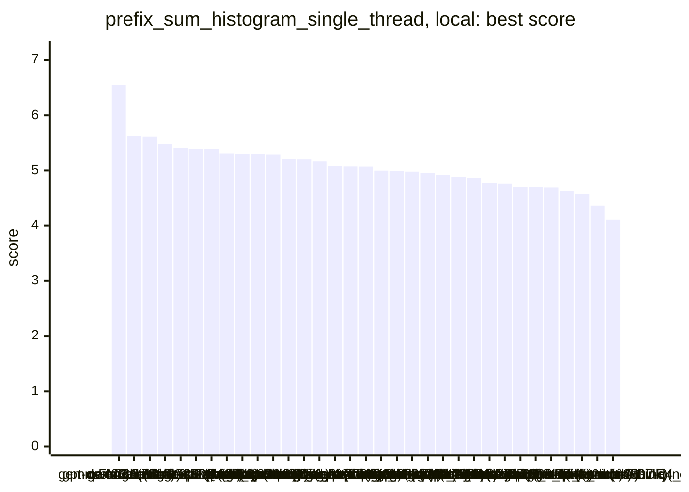
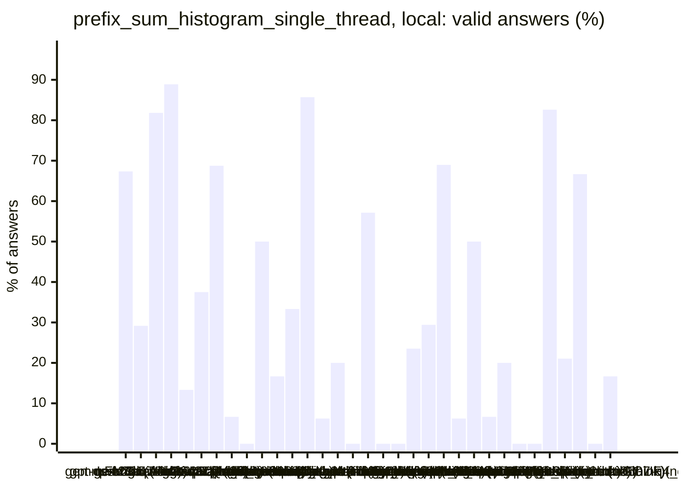
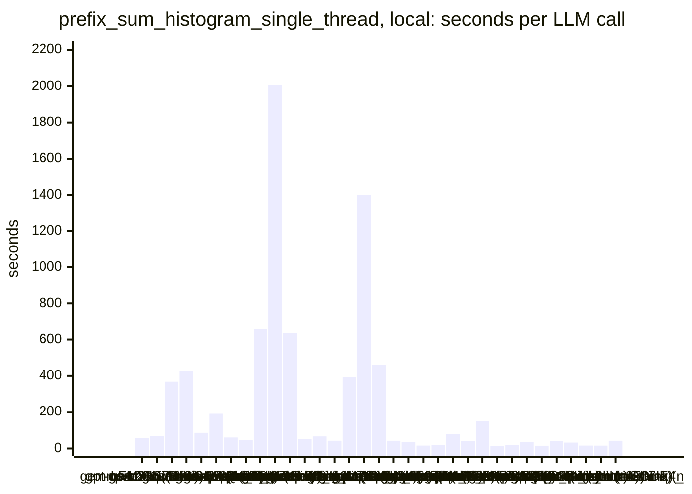
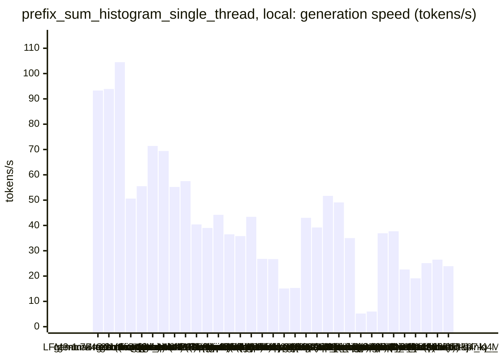
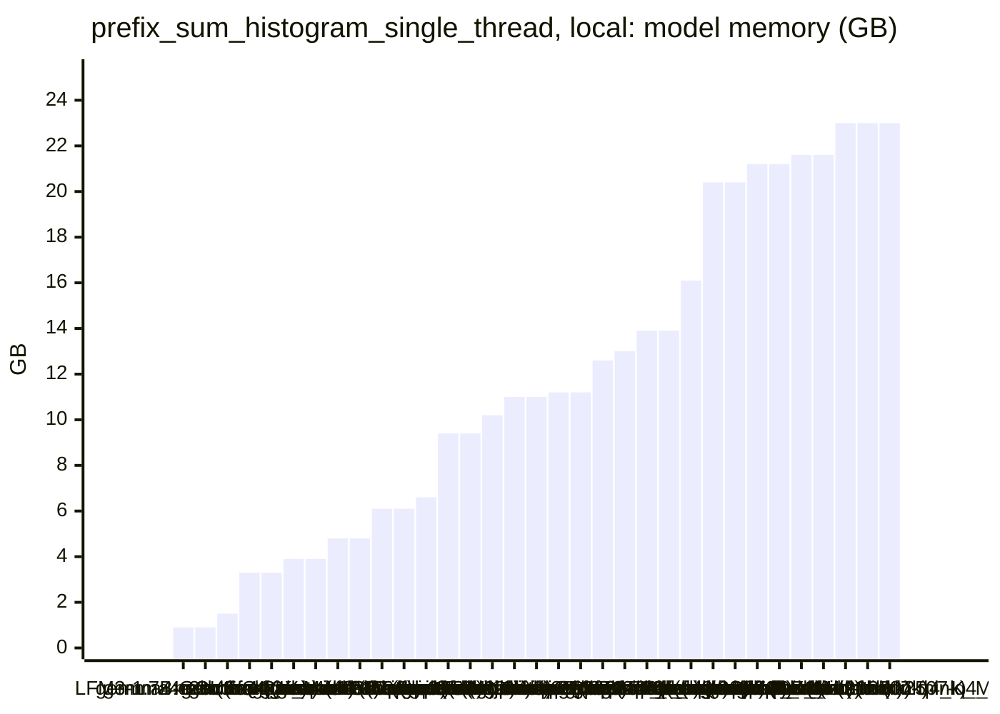
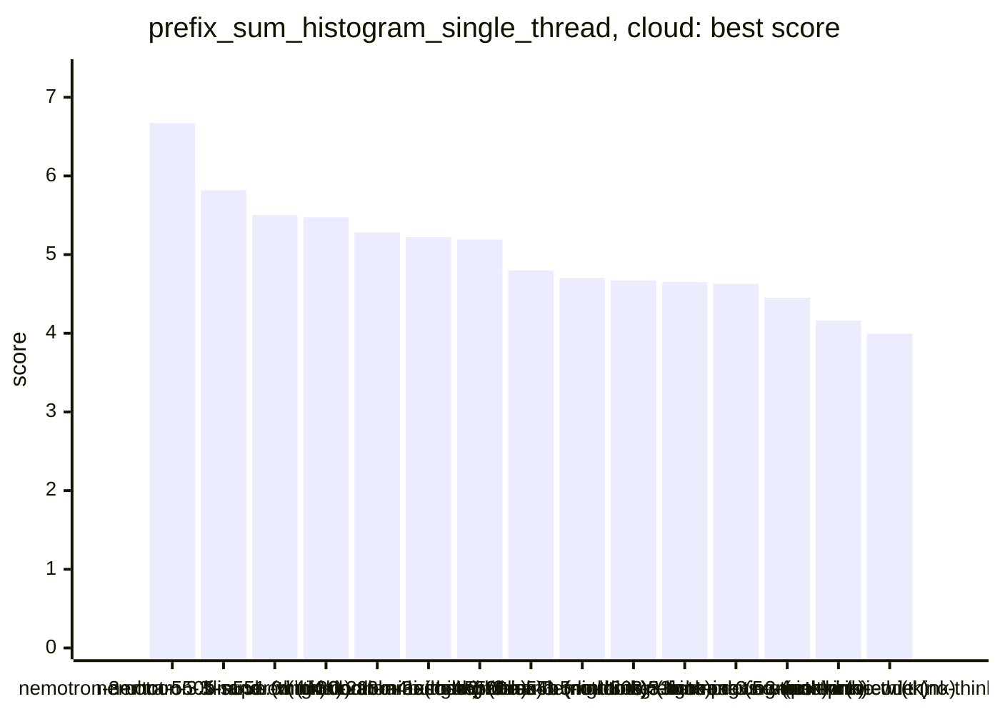
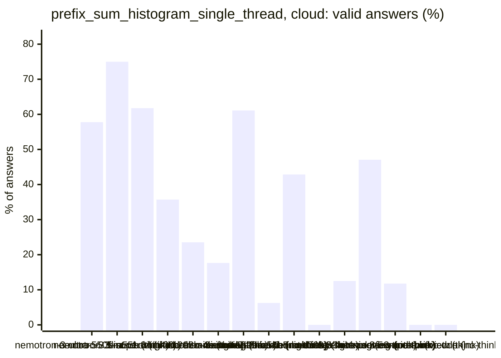
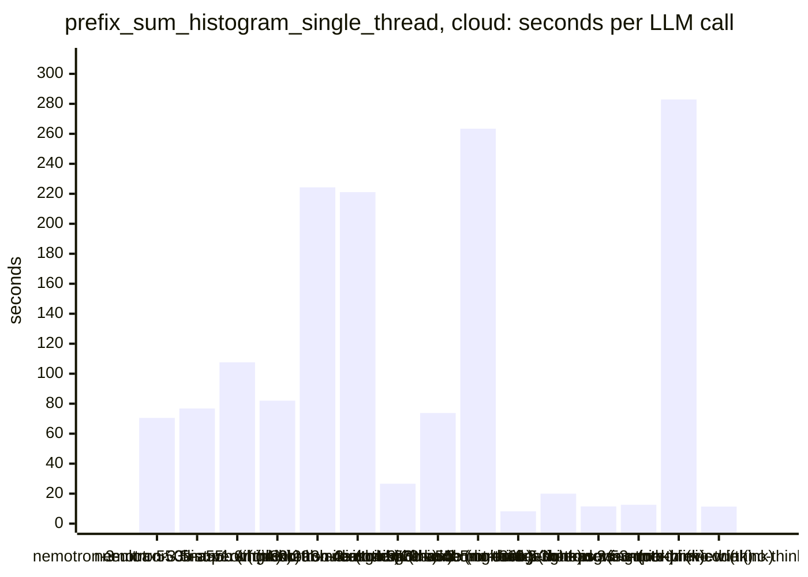
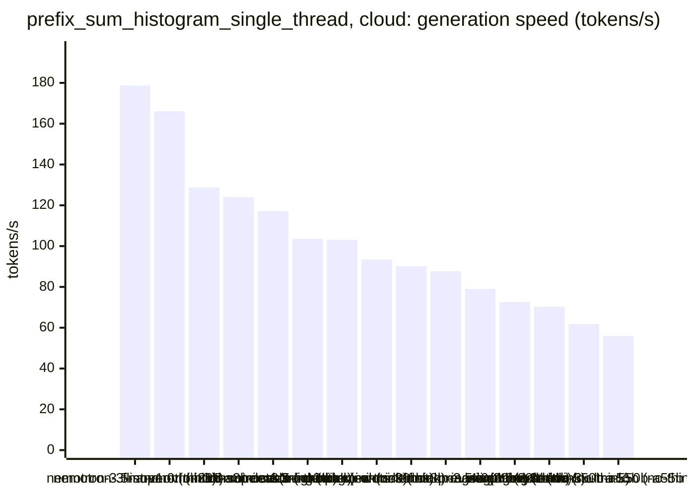

<!-- Copyright (c) 2026 by C. Klukas -->
<!-- SPDX-License-Identifier: GPL-3.0-only -->
<!-- Generated by `omega report` from bench/results/*.json. Do not edit by hand. -->

# prefix_sum_histogram_single_thread

50 models, each run at most 60 minutes, ended earlier after 15 answers in a row without progress; one run per model. The [overall ranking](../benchmarks.md#overall-ranking) compares the models over all examples.

Machine: Intel(R) Core(TM) i7-8700K CPU @ 3.70GHz (MS-7A98), 12 cores, 64 GB, 2x NVIDIA GeForce GTX 1080 Ti, 11264 MiB.

## Local models

Ollama on this machine.

| Model | Params | Initial | Best | Gain | LLM calls | s/call | Valid | New bests | Min to best | Minutes | Stopped by |
|---|---|--:|--:|--:|--:|--:|--:|--:|--:|--:|---|
| gpt-oss:20b (think) | 20.9B | 5.22511 | **6.55077** | ×1.25 | 49 | 58 | 67% | 7 | 34.0 | 50.6 | no progress |
| qwen3.5:latest (think) | 9.0B | 5.16695 | **5.62669** | ×1.09 | 24 | 69 | 29% | 2 | 15.4 | 31.7 | no progress |
| gemma4:26b-a4b-it-qat (think) | 25.2B | 5.38272 | **5.6116** | ×1.04 | 11 | 368 | 82% | 1 | 33.7 | 69.2 | time limit |
| gemma4:12b-it-qat (think) | 11.9B | 5.31832 | **5.47647** | ×1.03 | 9 | 424 | 89% | 1 | 40.6 | 65.4 | time limit |
| richardyoung/frognano-4b-2609:latest (think) | 4.3B | 5.40658 | **5.40658** | ×1.00 | 15 | 86 | 13% | 0 | - | 22.4 | no progress |
| hf.co/LiquidAI/LFM3-1.7B-GGUF:Q4_K_M (think) | 1.73B | 5.39561 | **5.39561** | ×1.00 | 16 | 191 | 38% | 0 | - | 52.0 | no progress |
| gemma4:latest (think) | 7.5B | 5.3948 | **5.3948** | ×1.00 | 16 | 60 | 69% | 0 | - | 17.3 | no progress |
| glm-4.7-flash:latest (no-think) | 29.9B | 5.31132 | **5.31132** | ×1.00 | 15 | 47 | 7% | 0 | - | 13.4 | no progress |
| frob/sarvam:30b (no-think) | 32.2B | 5.30545 | **5.30545** | ×1.00 | 6 | 659 | 0% | 0 | - | 67.7 | time limit |
| qwen3.6:27b-coding-mtp-q4_K_M (think) | 27.3B | 5.29855 | **5.29855** | ×1.00 | 2 | 2006 | 50% | 0 | - | 69.0 | time limit |
| frob/sarvam:30b (think) | 32.2B | 5.28396 | **5.28396** | ×1.00 | 6 | 634 | 17% | 0 | - | 66.3 | time limit |
| qwen3-coder:30b (no-think) | 30.5B | 5.20055 | **5.20055** | ×1.00 | 15 | 53 | 33% | 0 | - | 15.0 | no progress |
| gemma4:e4b-it-qat (think) | 7.5B | 5.198 | **5.198** | ×1.00 | 14 | 66 | 86% | 0 | - | 16.7 | no progress |
| nemotron-3-nano:4b (think) | 4.0B | 5.1615 | **5.1615** | ×1.00 | 16 | 43 | 6% | 0 | - | 12.3 | no progress |
| qwen3.6:27b-coding-mtp-q4_K_M (no-think) | 27.3B | 4.58332 | **5.07887** | ×1.11 | 10 | 392 | 20% | 1 | 28.2 | 68.1 | time limit |
| underdog-saluki-27b:iq2-mix (think) | 26.9B | 5.07165 | **5.07165** | ×1.00 | 3 | 1398 | 0% | 0 | - | 71.1 | time limit |
| glm-4.7-flash:latest (think) | 29.9B | 4.74459 | **5.07005** | ×1.07 | 7 | 461 | 57% | 1 | 15.0 | 66.8 | time limit |
| gemma4:e2b (think) | 4.6B | 4.99717 | **4.99717** | ×1.00 | 16 | 43 | 0% | 0 | - | 12.5 | no progress |
| qwen3:30b-a3b-instruct-2507-q4_K_M (no-think) | 30.5B | 4.99407 | **4.99407** | ×1.00 | 16 | 37 | 0% | 0 | - | 11.4 | no progress |
| qwen2.5-coder:7b (no-think) | 7.6B | 4.747 | **4.97865** | ×1.05 | 17 | 16 | 24% | 1 | 4.6 | 5.6 | no progress |
| gemma4:latest (no-think) | 7.5B | 4.51175 | **4.95586** | ×1.10 | 17 | 20 | 29% | 1 | 5.4 | 6.9 | no progress |
| gpt-oss:20b (no-think) | 20.9B | 4.54661 | **4.92035** | ×1.08 | 29 | 79 | 69% | 2 | 16.6 | 40.8 | no progress |
| richardyoung/frognano-4b-2609:latest (no-think) | 4.3B | 4.88596 | **4.88596** | ×1.00 | 16 | 42 | 6% | 0 | - | 12.2 | no progress |
| underdog-saluki-27b:iq2-mix (no-think) | 26.9B | 4.47724 | **4.86684** | ×1.09 | 24 | 150 | 50% | 6 | 53.6 | 62.7 | time limit |
| nemotron-3-nano:4b (no-think) | 4.0B | 4.78129 | **4.78129** | ×1.00 | 15 | 14 | 7% | 0 | - | 4.5 | no progress |
| gemma4:e4b-it-qat (no-think) | 7.5B | 4.34146 | **4.76532** | ×1.10 | 20 | 18 | 20% | 2 | 6.0 | 7.5 | no progress |
| llm-jp-4-8b-omega:q4_k_m (no-think) | 8.6B | 4.69476 | **4.69476** | ×1.00 | 16 | 36 | 0% | 0 | - | 10.7 | no progress |
| MichelRosselli/apertus:8b-instruct-2509-q4_k_m (no-think) | 8.1B | 4.69193 | **4.69193** | ×1.00 | 16 | 15 | 0% | 0 | - | 5.1 | no progress |
| gemma4:12b-it-qat (no-think) | 11.9B | 4.37652 | **4.68777** | ×1.07 | 23 | 40 | 83% | 2 | 3.8 | 16.9 | no progress |
| hf.co/LiquidAI/LFM3-1.7B-GGUF:Q4_K_M (no-think) | 1.73B | | | | | | | | | | failed: all 16 model requests failed: hf.co/LiquidAI/LFM3-1.7B-GGUF: |
| qwen3.5:latest (no-think) | 9.0B | 4.35213 | **4.62595** | ×1.06 | 19 | 32 | 21% | 1 | 2.4 | 12.5 | no progress |
| yandex/YandexGPT-5-Lite-8B-instruct-GGUF:latest (no-think) | 8.0B | 4.15145 | **4.56958** | ×1.10 | 24 | 16 | 67% | 1 | 2.5 | 7.6 | no progress |
| gemma4:e2b (no-think) | 4.6B | 4.3636 | **4.3636** | ×1.00 | 16 | 16 | 0% | 0 | - | 5.3 | no progress |
| qwen3:30b-a3b-instruct-2507-q4_K_M (think) | 30.5B | 4.10543 | **4.10543** | ×1.00 | 18 | 43 | 17% | 0 | - | 16.8 | no progress |
| gemma4:26b-a4b-it-qat (no-think) | 25.2B | | | | | | | | | | failed: RuntimeError: the initial program does not pass the evaluato |

### Inference speed and memory

RAM is what Ollama reports for the loaded model (weights, context cache and buffers; on Apple silicon this is shared memory). Load is the time to bring the model into memory. Prompt and generation speeds are tokens per second over all calls of the run.

| Model | Params | RAM GB | Load s | Prompt tok/s | Gen tok/s | Median s/call | p90 s/call | Tokens/answer | Stopped |
|---|---|--:|--:|--:|--:|--:|--:|--:|--:|
| gemma4:e2b (think) | 4.6B | 0.9 | 0 | 3420 | 93.3 | 43 | 54 | 3650 | 0 |
| gemma4:e2b (no-think) | 4.6B | 0.9 | 0 | 3918 | 93.9 | 14 | 30 | 1167 | 1 |
| hf.co/LiquidAI/LFM3-1.7B-GGUF:Q4_K_M (think) | 1.73B | 1.5 | 0 | 6512 | 104.5 | 194 | 240 | 19670 | 0 |
| gemma4:latest (think) | 7.5B | 3.3 | 0 | 1838 | 50.6 | 55 | 102 | 2820 | 0 |
| gemma4:latest (no-think) | 7.5B | 3.3 | 0 | 2029 | 55.5 | 21 | 30 | 835 | 0 |
| nemotron-3-nano:4b (think) | 4.0B | 3.9 | 0 | 3130 | 71.4 | 40 | 72 | 2768 | 0 |
| nemotron-3-nano:4b (no-think) | 4.0B | 3.9 | 0 | 2943 | 69.4 | 14 | 21 | 719 | 0 |
| richardyoung/frognano-4b-2609:latest (think) | 4.3B | 4.8 | 0 | 2721 | 55.2 | 48 | 195 | 4112 | 1 |
| richardyoung/frognano-4b-2609:latest (no-think) | 4.3B | 4.8 | 0 | 2557 | 57.5 | 42 | 57 | 2044 | 2 |
| gemma4:e4b-it-qat (think) | 7.5B | 6.1 | 0 | 2211 | 40.4 | 70 | 82 | 2502 | 0 |
| gemma4:e4b-it-qat (no-think) | 7.5B | 6.1 | 0 | 2467 | 39.0 | 19 | 30 | 565 | 0 |
| qwen2.5-coder:7b (no-think) | 7.6B | 6.6 | 0 | 2559 | 44.2 | 15 | 27 | 548 | 0 |
| qwen3.5:latest (think) | 9.0B | 9.4 | 0 | 1437 | 36.5 | 66 | 95 | 2316 | 0 |
| qwen3.5:latest (no-think) | 9.0B | 9.4 | 0 | 1644 | 35.8 | 27 | 63 | 803 | 3 |
| yandex/YandexGPT-5-Lite-8B-instruct-GGUF:latest (no-think) | 8.0B | 10.2 | 0 | 2293 | 43.4 | 18 | 20 | 506 | 0 |
| gemma4:12b-it-qat (think) | 11.9B | 11.0 | 0 | 807 | 26.8 | 372 | 625 | 11122 | 0 |
| gemma4:12b-it-qat (no-think) | 11.9B | 11.0 | 0 | 738 | 26.7 | 40 | 47 | 789 | 0 |
| underdog-saluki-27b:iq2-mix (think) | 26.9B | 11.2 | 26 | 380 | 15.1 | 1625 | 1674 | 16384 | 0 |
| underdog-saluki-27b:iq2-mix (no-think) | 26.9B | 11.2 | 0 | 409 | 15.3 | 142 | 233 | 1999 | 0 |
| MichelRosselli/apertus:8b-instruct-2509-q4_k_m (no-think) | 8.1B | 12.6 | 0 | 2178 | 43.0 | 14 | 25 | 485 | 0 |
| llm-jp-4-8b-omega:q4_k_m (no-think) | 8.6B | 13.0 | 0 | 2036 | 39.2 | 34 | 60 | 1244 | 1 |
| gpt-oss:20b (think) | 20.9B | 13.9 | 0 | 2308 | 51.7 | 53 | 92 | 2769 | 1 |
| gpt-oss:20b (no-think) | 20.9B | 13.9 | 0 | 2368 | 49.1 | 59 | 141 | 3456 | 1 |
| gemma4:26b-a4b-it-qat (think) | 25.2B | 16.1 | 0 | 825 | 35.0 | 342 | 454 | 12562 | 0 |
| qwen3.6:27b-coding-mtp-q4_K_M (think) | 27.3B | 20.4 | 0 | 305 | 5.2 | 2096 | 2096 | 10258 | 0 |
| qwen3.6:27b-coding-mtp-q4_K_M (no-think) | 27.3B | 20.4 | 0 | 195 | 6.0 | 386 | 786 | 2189 | 0 |
| frob/sarvam:30b (no-think) | 32.2B | 21.2 | 0 | 2026 | 36.9 | 670 | 680 | 24576 | 1 |
| frob/sarvam:30b (think) | 32.2B | 21.2 | 0 | 2110 | 37.7 | 671 | 687 | 23730 | 0 |
| glm-4.7-flash:latest (no-think) | 29.9B | 21.6 | 0 | 617 | 22.6 | 47 | 88 | 859 | 0 |
| glm-4.7-flash:latest (think) | 29.9B | 21.6 | 0 | 508 | 19.1 | 387 | 1072 | 8615 | 0 |
| qwen3-coder:30b (no-think) | 30.5B | 23.0 | 0 | 1052 | 25.1 | 43 | 92 | 1182 | 0 |
| qwen3:30b-a3b-instruct-2507-q4_K_M (no-think) | 30.5B | 23.0 | 0 | 1101 | 26.5 | 37 | 76 | 810 | 0 |
| qwen3:30b-a3b-instruct-2507-q4_K_M (think) | 30.5B | 23.0 | 0 | 842 | 23.9 | 50 | 90 | 821 | 0 |

### Best score over time

| Model | 15 min | 30 min | 45 min | 60 min |
|---|--:|--:|--:|--:|
| gpt-oss:20b (think) | 6.01114 | 6.1501 | 6.55077 | 6.55077 |
| qwen3.5:latest (think) | 5.6 | 5.62669 | 5.62669 | 5.62669 |
| gemma4:26b-a4b-it-qat (think) | 5.38272 | 5.38272 | 5.6116 | 5.6116 |
| gemma4:12b-it-qat (think) | 5.31832 | 5.31832 | 5.47647 | 5.47647 |
| richardyoung/frognano-4b-2609:latest (think) | 5.40658 | 5.40658 | 5.40658 | 5.40658 |
| hf.co/LiquidAI/LFM3-1.7B-GGUF:Q4_K_M (think) | 5.39561 | 5.39561 | 5.39561 | 5.39561 |
| gemma4:latest (think) | 5.3948 | 5.3948 | 5.3948 | 5.3948 |
| glm-4.7-flash:latest (no-think) | 5.31132 | 5.31132 | 5.31132 | 5.31132 |
| frob/sarvam:30b (no-think) | 5.30545 | 5.30545 | 5.30545 | 5.30545 |
| qwen3.6:27b-coding-mtp-q4_K_M (think) | 5.29855 | 5.29855 | 5.29855 | 5.29855 |
| frob/sarvam:30b (think) | 5.28396 | 5.28396 | 5.28396 | 5.28396 |
| qwen3-coder:30b (no-think) | 5.20055 | 5.20055 | 5.20055 | 5.20055 |
| gemma4:e4b-it-qat (think) | 5.198 | 5.198 | 5.198 | 5.198 |
| nemotron-3-nano:4b (think) | 5.1615 | 5.1615 | 5.1615 | 5.1615 |
| qwen3.6:27b-coding-mtp-q4_K_M (no-think) | 4.58332 | 5.07887 | 5.07887 | 5.07887 |
| underdog-saluki-27b:iq2-mix (think) | 5.07165 | 5.07165 | 5.07165 | 5.07165 |
| glm-4.7-flash:latest (think) | 5.07005 | 5.07005 | 5.07005 | 5.07005 |
| gemma4:e2b (think) | 4.99717 | 4.99717 | 4.99717 | 4.99717 |
| qwen3:30b-a3b-instruct-2507-q4_K_M (no-think) | 4.99407 | 4.99407 | 4.99407 | 4.99407 |
| qwen2.5-coder:7b (no-think) | 4.97865 | 4.97865 | 4.97865 | 4.97865 |
| gemma4:latest (no-think) | 4.95586 | 4.95586 | 4.95586 | 4.95586 |
| gpt-oss:20b (no-think) | 4.68212 | 4.92035 | 4.92035 | 4.92035 |
| richardyoung/frognano-4b-2609:latest (no-think) | 4.88596 | 4.88596 | 4.88596 | 4.88596 |
| underdog-saluki-27b:iq2-mix (no-think) | 4.79005 | 4.85187 | 4.85187 | 4.86684 |
| nemotron-3-nano:4b (no-think) | 4.78129 | 4.78129 | 4.78129 | 4.78129 |
| gemma4:e4b-it-qat (no-think) | 4.76532 | 4.76532 | 4.76532 | 4.76532 |
| llm-jp-4-8b-omega:q4_k_m (no-think) | 4.69476 | 4.69476 | 4.69476 | 4.69476 |
| MichelRosselli/apertus:8b-instruct-2509-q4_k_m (no-think) | 4.69193 | 4.69193 | 4.69193 | 4.69193 |
| gemma4:12b-it-qat (no-think) | 4.68777 | 4.68777 | 4.68777 | 4.68777 |
| qwen3.5:latest (no-think) | 4.62595 | 4.62595 | 4.62595 | 4.62595 |
| yandex/YandexGPT-5-Lite-8B-instruct-GGUF:latest (no-think) | 4.56958 | 4.56958 | 4.56958 | 4.56958 |
| gemma4:e2b (no-think) | 4.3636 | 4.3636 | 4.3636 | 4.3636 |
| qwen3:30b-a3b-instruct-2507-q4_K_M (think) | 4.10543 | 4.10543 | 4.10543 | 4.10543 |

### Outcome of the LLM answers

| Model | compile error | duplicate | edit error | invalid | llm error | ok | timeout |
|---|--:|--:|--:|--:|--:|--:|--:|
| gpt-oss:20b (think) | 7 | 1 | 6 | 1 | 1 | 33 | 0 |
| qwen3.5:latest (think) | 4 | 0 | 4 | 9 | 0 | 7 | 0 |
| gemma4:26b-a4b-it-qat (think) | 0 | 1 | 1 | 0 | 0 | 9 | 0 |
| gemma4:12b-it-qat (think) | 0 | 0 | 0 | 1 | 0 | 8 | 0 |
| richardyoung/frognano-4b-2609:latest (think) | 6 | 0 | 3 | 3 | 1 | 2 | 0 |
| hf.co/LiquidAI/LFM3-1.7B-GGUF:Q4_K_M (think) | 2 | 0 | 4 | 3 | 0 | 6 | 1 |
| gemma4:latest (think) | 3 | 1 | 0 | 1 | 0 | 11 | 0 |
| glm-4.7-flash:latest (no-think) | 6 | 1 | 2 | 5 | 0 | 1 | 0 |
| frob/sarvam:30b (no-think) | 0 | 0 | 5 | 0 | 1 | 0 | 0 |
| qwen3.6:27b-coding-mtp-q4_K_M (think) | 0 | 0 | 0 | 1 | 0 | 1 | 0 |
| frob/sarvam:30b (think) | 0 | 0 | 5 | 0 | 0 | 1 | 0 |
| qwen3-coder:30b (no-think) | 6 | 0 | 0 | 4 | 0 | 5 | 0 |
| gemma4:e4b-it-qat (think) | 1 | 0 | 0 | 1 | 0 | 12 | 0 |
| nemotron-3-nano:4b (think) | 5 | 0 | 10 | 0 | 0 | 1 | 0 |
| qwen3.6:27b-coding-mtp-q4_K_M (no-think) | 1 | 1 | 0 | 6 | 0 | 2 | 0 |
| underdog-saluki-27b:iq2-mix (think) | 0 | 0 | 2 | 0 | 1 | 0 | 0 |
| glm-4.7-flash:latest (think) | 1 | 1 | 0 | 1 | 0 | 4 | 0 |
| gemma4:e2b (think) | 14 | 0 | 2 | 0 | 0 | 0 | 0 |
| qwen3:30b-a3b-instruct-2507-q4_K_M (no-think) | 12 | 0 | 4 | 0 | 0 | 0 | 0 |
| qwen2.5-coder:7b (no-think) | 5 | 1 | 0 | 7 | 0 | 4 | 0 |
| gemma4:latest (no-think) | 8 | 1 | 1 | 2 | 0 | 5 | 0 |
| gpt-oss:20b (no-think) | 6 | 0 | 2 | 0 | 1 | 20 | 0 |
| richardyoung/frognano-4b-2609:latest (no-think) | 6 | 0 | 1 | 6 | 2 | 1 | 0 |
| underdog-saluki-27b:iq2-mix (no-think) | 4 | 0 | 5 | 3 | 0 | 12 | 0 |
| nemotron-3-nano:4b (no-think) | 4 | 0 | 10 | 0 | 0 | 1 | 0 |
| gemma4:e4b-it-qat (no-think) | 5 | 0 | 0 | 11 | 0 | 4 | 0 |
| llm-jp-4-8b-omega:q4_k_m (no-think) | 10 | 0 | 4 | 1 | 1 | 0 | 0 |
| MichelRosselli/apertus:8b-instruct-2509-q4_k_m (no-think) | 4 | 1 | 7 | 4 | 0 | 0 | 0 |
| gemma4:12b-it-qat (no-think) | 2 | 0 | 0 | 2 | 0 | 19 | 0 |
| qwen3.5:latest (no-think) | 1 | 0 | 1 | 7 | 3 | 4 | 3 |
| yandex/YandexGPT-5-Lite-8B-instruct-GGUF:latest (no-think) | 2 | 2 | 1 | 3 | 0 | 16 | 0 |
| gemma4:e2b (no-think) | 12 | 0 | 2 | 1 | 1 | 0 | 0 |
| qwen3:30b-a3b-instruct-2507-q4_K_M (think) | 9 | 1 | 5 | 0 | 0 | 3 | 0 |

### Best idea per model

- **gpt-oss:20b (think)**: tuned PREFETCH_DIST=97 on top of: Expose the prefetch distance as a named constant and use a larger default (96) to better hide memory latency for the 10 M element benchmark.
- **qwen3.5:latest (think)**: Fix the prefix sum bug by carrying partial_sum across blocks instead of recomputing it per-block, and use i%SUB_BINS for histogram bins which maintains correct bin assignment …
- **gemma4:26b-a4b-it-qat (think)**: Use a `s[4][256]` layout to ensure that increments to the same bin are spread across different cache lines, reducing cache line contention and RMW-related stalls on hot bins.
- **richardyoung/frognano-4b-2609:latest (think)**: initial program
- **hf.co/LiquidAI/LFM3-1.7B-GGUF:Q4_K_M (think)**: initial program
- **gemma4:latest (think)**: initial program
- **glm-4.7-flash:latest (no-think)**: initial program
- **frob/sarvam:30b (no-think)**: initial program
- **qwen3.6:27b-coding-mtp-q4_K_M (think)**: initial program
- **frob/sarvam:30b (think)**: initial program
- **qwen3-coder:30b (no-think)**: initial program
- **gemma4:e4b-it-qat (think)**: initial program
- **nemotron-3-nano:4b (think)**: initial program
- **qwen3.6:27b-coding-mtp-q4_K_M (no-think)**: Use 8 private uint32_t sub-histograms to eliminate store-to-load dependency chains on hot bins, process 32 elements per loop iteration with scalar unrolling, and accumulate prefix …
- **underdog-saluki-27b:iq2-mix (think)**: initial program
- **glm-4.7-flash:latest (think)**: Replace the single global histogram with four private sub-histograms to break the cache dependency caused by repeated updates to hot bins, and unroll the main loop four times to …
- **gemma4:e2b (think)**: initial program
- **qwen3:30b-a3b-instruct-2507-q4_K_M (no-think)**: initial program
- **qwen2.5-coder:7b (no-think)**: tuned prefetch_distance=116 on top of: Expose the prefetch distance as a named constant and let the engine find the optimal value.
- **gemma4:latest (no-think)**: Unroll the loop by a factor of 4 and use local accumulators for histogram updates to reduce write-after-read contention on hot bins, while keeping the running sum in a register.
- **gpt-oss:20b (no-think)**: Replace the naïve loop with a 4‑element unrolled loop using four private 256‑entry sub‑histograms to eliminate hot‑bin write contention, then merge them into the final histogram.
- **richardyoung/frognano-4b-2609:latest (no-think)**: initial program
- **underdog-saluki-27b:iq2-mix (no-think)**: tuned K=64, W=8192, U=32 on top of: The current program is scalar-only; replace it with a proper NEON 8-lane prefix scan per 8-element group (vaddq_s64 + vextq_s64) plus K …
- **nemotron-3-nano:4b (no-think)**: initial program
- **gemma4:e4b-it-qat (no-think)**: Increase the unroll factor to utilize more CPU pipeline parallelism and better exploit cache locality, as the initial factor of 4 is conservative.
- **llm-jp-4-8b-omega:q4_k_m (no-think)**: initial program
- **MichelRosselli/apertus:8b-instruct-2509-q4_k_m (no-think)**: initial program
- **gemma4:12b-it-qat (no-think)**: Implement a block-based prefix sum using SIMD (NEON) to break the serial dependency of the sum, combined with a larger number of private sub-histograms (16) to further reduce …
- **qwen3.5:latest (no-think)**: Initialize `sum` to zero (required since `out` is not cleared by the caller) and use an index variable `i` instead of relying on `in[i] & 255` for bounds checking, while keeping …
- **yandex/YandexGPT-5-Lite-8B-instruct-GGUF:latest (no-think)**: Unroll the main loop for more iterations to reduce loop overhead further.
- **gemma4:e2b (no-think)**: initial program
- **qwen3:30b-a3b-instruct-2507-q4_K_M (think)**: initial program

## Cloud models (OpenRouter)

Free OpenRouter models; times include the network and the provider's queue.

| Model | Params | Initial | Best | Gain | LLM calls | s/call | Valid | New bests | Min to best | Minutes | Stopped by |
|---|---|--:|--:|--:|--:|--:|--:|--:|--:|--:|---|
| nvidia/nemotron-3-ultra-550b-a55b:free (think) |  | 4.82159 | **6.67211** | ×1.38 | 45 | 70 | 58% | 7 | 38.3 | 54.4 | no progress |
| nvidia/nemotron-3.5-super-vl:free (think) |  | 5.19659 | **5.82027** | ×1.12 | 20 | 77 | 75% | 3 | 12.0 | 26.4 | no progress |
| recursive/flint-v1.0:free (think) |  | 5.04166 | **5.5055** | ×1.09 | 34 | 108 | 62% | 3 | 38.2 | 61.9 | no progress |
| nvidia/nemotron-3-nano-omni-30b-a3b-reasoning:free (think) |  | 4.35053 | **5.47409** | ×1.26 | 28 | 82 | 36% | 1 | 19.6 | 39.0 | no progress |
| xingchen-agi/xing4.0-29b-a4b:free (think) |  | 4.40273 | **5.28155** | ×1.20 | 17 | 224 | 24% | 2 | 58.9 | 64.0 | time limit |
| cohere/north-mini-code:free (think) |  | 4.40193 | **5.22357** | ×1.19 | 17 | 221 | 18% | 2 | 22.3 | 63.0 | time limit |
| nvidia/nemotron-3-ultra-550b-a55b:free (no-think) |  | 4.25777 | **5.19129** | ×1.22 | 36 | 27 | 61% | 5 | 16.0 | 17.0 | no progress |
| xingchen-agi/xing4.0-29b-a4b:free (no-think) |  | 4.79928 | **4.79928** | ×1.00 | 16 | 74 | 6% | 0 | - | 20.2 | no progress |
| nvidia/nemotron-3.5-lightning:free (think) |  | 4.2864 | **4.7024** | ×1.10 | 14 | 263 | 43% | 1 | 14.0 | 62.0 | time limit |
| nvidia/nemotron-3-nano-omni-30b-a3b-reasoning:free (no-think) |  | 4.67263 | **4.67263** | ×1.00 | 16 | 8 | 0% | 0 | - | 2.9 | no progress |
| nvidia/nemotron-3.5-lightning:free (no-think) |  | 4.65112 | **4.65112** | ×1.00 | 16 | 20 | 12% | 0 | - | 6.2 | no progress |
| dots-studio/dots-3-note-preview:free (no-think) |  | 4.55956 | **4.62763** | ×1.01 | 17 | 12 | 47% | 1 | 3.7 | 4.2 | no progress |
| nvidia/nemotron-3.5-super-vl:free (no-think) |  | 4.45235 | **4.45235** | ×1.00 | 17 | 13 | 12% | 0 | - | 4.0 | no progress |
| dots-studio/dots-3-note-preview:free (think) |  | 4.16299 | **4.16299** | ×1.00 | 13 | 283 | 0% | 0 | - | 61.8 | time limit |
| cohere/north-mini-code:free (no-think) |  | 3.99453 | **3.99453** | ×1.00 | 16 | 11 | 0% | 0 | - | 3.4 | no progress |

### Inference speed and cost

Generation speed is measured from the first to the last streamed token; the time to the first token is counted as prompt time. Cost is what OpenRouter charged for the run.

| Model | Gen tok/s | Median s/call | p90 s/call | Tokens/answer | Stopped | Cost $ |
|---|--:|--:|--:|--:|--:|--:|
| nvidia/nemotron-3.5-super-vl:free (think) | 178.7 | 78 | 135 | 13444 | 0 | 0.000 |
| recursive/flint-v1.0:free (think) | 166.1 | 129 | 147 | 17763 | 0 | 0.000 |
| nvidia/nemotron-3-nano-omni-30b-a3b-reasoning:free (think) | 128.7 | 73 | 172 | 10480 | 0 | 0.000 |
| nvidia/nemotron-3.5-super-vl:free (no-think) | 124.0 | 9 | 19 | 946 | 1 | 0.000 |
| cohere/north-mini-code:free (no-think) | 117.2 | 13 | 20 | 1260 | 0 | 0.000 |
| nvidia/nemotron-3.5-lightning:free (no-think) | 103.6 | 18 | 45 | 1066 | 8 | 0.000 |
| dots-studio/dots-3-note-preview:free (no-think) | 103.1 | 10 | 17 | 880 | 0 | 0.000 |
| cohere/north-mini-code:free (think) | 93.4 | 218 | 359 | 20589 | 0 | 0.000 |
| nvidia/nemotron-3-nano-omni-30b-a3b-reasoning:free (no-think) | 90.2 | 8 | 13 | 668 | 1 | 0.000 |
| dots-studio/dots-3-note-preview:free (think) | 87.7 | 281 | 300 | 24576 | 0 | 0.000 |
| nvidia/nemotron-3.5-lightning:free (think) | 79.0 | 240 | 455 | 15640 | 0 | 0.000 |
| xingchen-agi/xing4.0-29b-a4b:free (think) | 72.6 | 194 | 412 | 11261 | 4 | 0.000 |
| xingchen-agi/xing4.0-29b-a4b:free (no-think) | 70.3 | 75 | 106 | 911 | 1 | 0.000 |
| nvidia/nemotron-3-ultra-550b-a55b:free (no-think) | 61.8 | 25 | 46 | 1538 | 0 | 0.000 |
| nvidia/nemotron-3-ultra-550b-a55b:free (think) | 55.9 | 41 | 186 | 3848 | 0 | 0.000 |

### Best score over time

| Model | 15 min | 30 min | 45 min | 60 min |
|---|--:|--:|--:|--:|
| nvidia/nemotron-3-ultra-550b-a55b:free (think) | 5.97209 | 6.33744 | 6.67211 | 6.67211 |
| nvidia/nemotron-3.5-super-vl:free (think) | 5.82027 | 5.82027 | 5.82027 | 5.82027 |
| recursive/flint-v1.0:free (think) | 5.30178 | 5.30178 | 5.5055 | 5.5055 |
| nvidia/nemotron-3-nano-omni-30b-a3b-reasoning:free (think) | 4.35053 | 5.47409 | 5.47409 | 5.47409 |
| xingchen-agi/xing4.0-29b-a4b:free (think) | 5.21247 | 5.21247 | 5.21247 | 5.28155 |
| cohere/north-mini-code:free (think) | 4.93636 | 5.22357 | 5.22357 | 5.22357 |
| nvidia/nemotron-3-ultra-550b-a55b:free (no-think) | 5.11293 | 5.19129 | 5.19129 | 5.19129 |
| xingchen-agi/xing4.0-29b-a4b:free (no-think) | 4.79928 | 4.79928 | 4.79928 | 4.79928 |
| nvidia/nemotron-3.5-lightning:free (think) | 4.7024 | 4.7024 | 4.7024 | 4.7024 |
| nvidia/nemotron-3-nano-omni-30b-a3b-reasoning:free (no-think) | 4.67263 | 4.67263 | 4.67263 | 4.67263 |
| nvidia/nemotron-3.5-lightning:free (no-think) | 4.65112 | 4.65112 | 4.65112 | 4.65112 |
| dots-studio/dots-3-note-preview:free (no-think) | 4.62763 | 4.62763 | 4.62763 | 4.62763 |
| nvidia/nemotron-3.5-super-vl:free (no-think) | 4.45235 | 4.45235 | 4.45235 | 4.45235 |
| dots-studio/dots-3-note-preview:free (think) | 4.16299 | 4.16299 | 4.16299 | 4.16299 |
| cohere/north-mini-code:free (no-think) | 3.99453 | 3.99453 | 3.99453 | 3.99453 |

### Outcome of the LLM answers

| Model | compile error | duplicate | edit error | invalid | llm error | ok |
|---|--:|--:|--:|--:|--:|--:|
| nvidia/nemotron-3-ultra-550b-a55b:free (think) | 6 | 9 | 3 | 1 | 0 | 26 |
| nvidia/nemotron-3.5-super-vl:free (think) | 0 | 0 | 4 | 1 | 0 | 15 |
| recursive/flint-v1.0:free (think) | 0 | 3 | 10 | 0 | 0 | 21 |
| nvidia/nemotron-3-nano-omni-30b-a3b-reasoning:free (think) | 2 | 0 | 16 | 0 | 0 | 10 |
| xingchen-agi/xing4.0-29b-a4b:free (think) | 5 | 1 | 0 | 1 | 6 | 4 |
| cohere/north-mini-code:free (think) | 1 | 0 | 12 | 1 | 0 | 3 |
| nvidia/nemotron-3-ultra-550b-a55b:free (no-think) | 5 | 5 | 0 | 4 | 0 | 22 |
| xingchen-agi/xing4.0-29b-a4b:free (no-think) | 2 | 0 | 2 | 1 | 10 | 1 |
| nvidia/nemotron-3.5-lightning:free (think) | 0 | 0 | 7 | 0 | 1 | 6 |
| nvidia/nemotron-3-nano-omni-30b-a3b-reasoning:free (no-think) | 2 | 0 | 10 | 3 | 1 | 0 |
| nvidia/nemotron-3.5-lightning:free (no-think) | 1 | 0 | 3 | 2 | 8 | 2 |
| dots-studio/dots-3-note-preview:free (no-think) | 2 | 3 | 0 | 4 | 0 | 8 |
| nvidia/nemotron-3.5-super-vl:free (no-think) | 4 | 0 | 8 | 2 | 1 | 2 |
| dots-studio/dots-3-note-preview:free (think) | 0 | 0 | 13 | 0 | 0 | 0 |
| cohere/north-mini-code:free (no-think) | 8 | 2 | 3 | 3 | 0 | 0 |

### Best idea per model

- **nvidia/nemotron-3-ultra-550b-a55b:free (think)**: tuned PREFETCH_DISTANCE=320, SUB_HIST_COUNT=8 on top of: Fix the remainder loop's broken modulo operation (using bitwise AND on non-power-of-2 SUB_HIST_COUNT) by aligning …
- **nvidia/nemotron-3.5-super-vl:free (think)**: Replace the per-lane running sums + tree sum + serial subtraction chain with a block-wise prefix sum (short local carry chain per block, single carry dependency between blocks) …
- **recursive/flint-v1.0:free (think)**: Use a 16-element block-wise local prefix sum to break the global serial dependency chain while retaining the private sub-histogram updates.
- **nvidia/nemotron-3-nano-omni-30b-a3b-reasoning:free (think)**: Use eight sub‑histograms and process eight elements per iteration to break histogram contention and reduce memory traffic while keeping the prefix sum in a register.
- **xingchen-agi/xing4.0-29b-a4b:free (think)**: tuned K=4 on top of: Add eight private sub-histograms so repeated updates to hot low-byte bins hit different counters, and unroll the prefix sum by four with two partial sums to …
- **cohere/north-mini-code:free (think)**: Zero‑initialize the private sub‑histogram array with memset so that n=0 yields correct zero histogram and eliminates undefined reads.
- **nvidia/nemotron-3-ultra-550b-a55b:free (no-think)**: Remove the invalid SWEEP directive and fix the UNROLL constant to match the actual loop unrolling factor of 8.
- **xingchen-agi/xing4.0-29b-a4b:free (no-think)**: initial program
- **nvidia/nemotron-3.5-lightning:free (think)**: Use 8 sub-histograms (uint32_t arrays) to distribute hot bin increments across separate arrays, breaking the store-to-load dependency chain that stalls the histogram computation …
- **nvidia/nemotron-3-nano-omni-30b-a3b-reasoning:free (no-think)**: initial program
- **nvidia/nemotron-3.5-lightning:free (no-think)**: initial program
- **dots-studio/dots-3-note-preview:free (no-think)**: Use 16 private uint32_t sub-histograms (one per remainder modulo 16) to further break store-to-load dependency chains on hot bins, combined with a 16x unrolled loop and a running …
- **nvidia/nemotron-3.5-super-vl:free (no-think)**: initial program
- **dots-studio/dots-3-note-preview:free (think)**: initial program
- **cohere/north-mini-code:free (no-think)**: initial program
