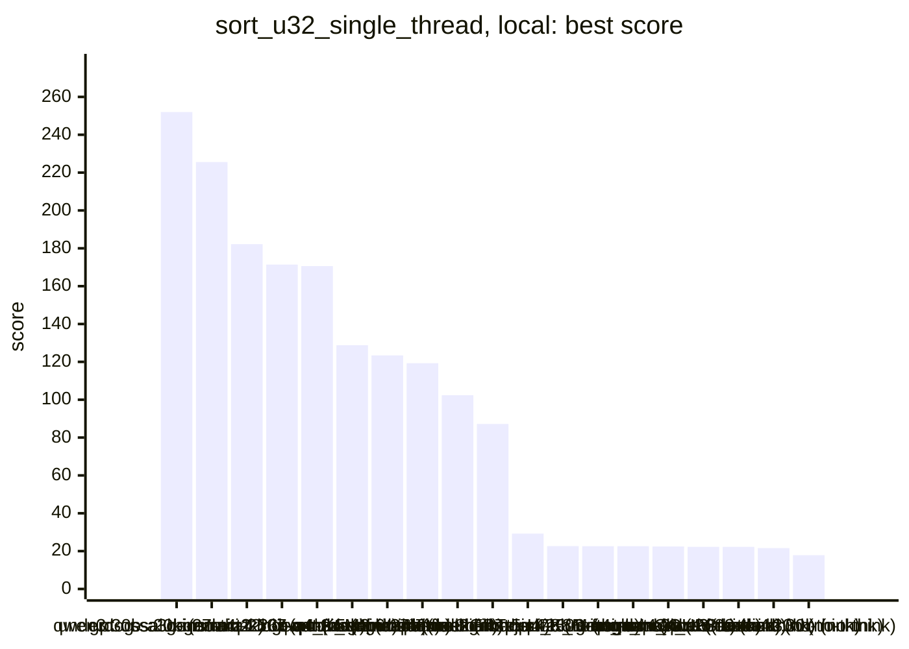
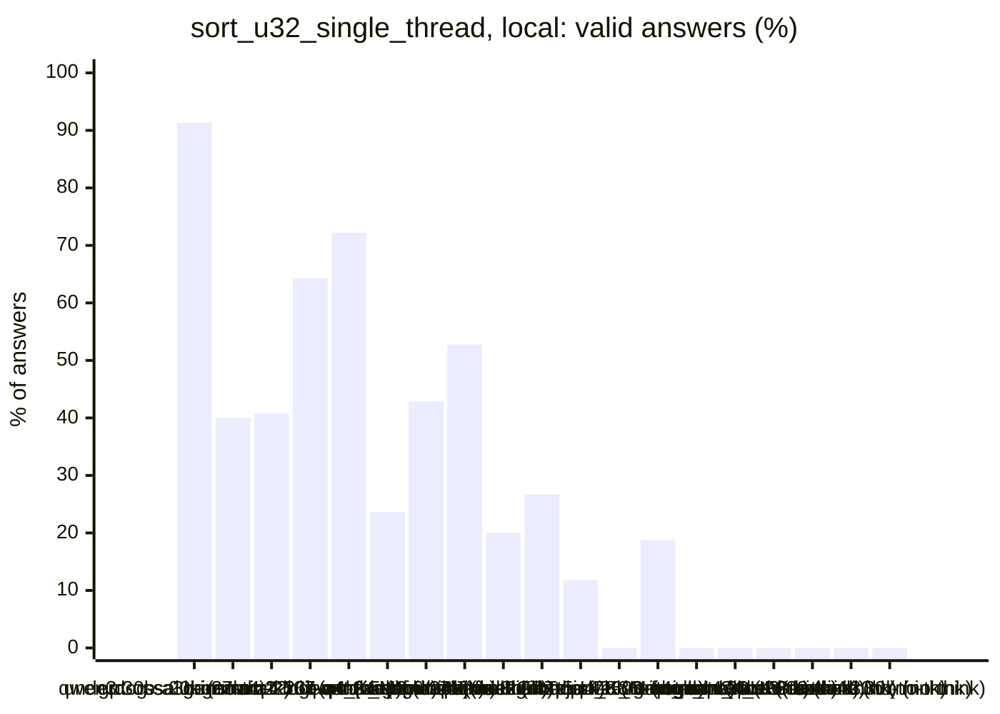
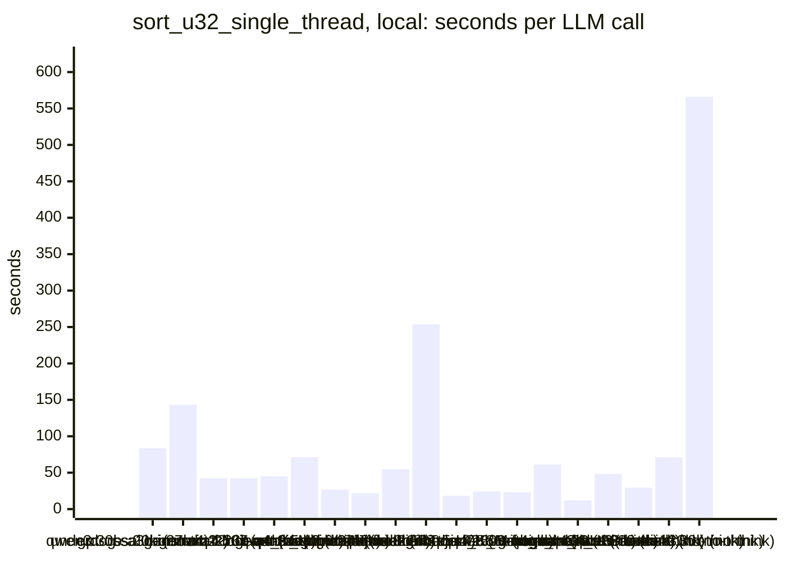
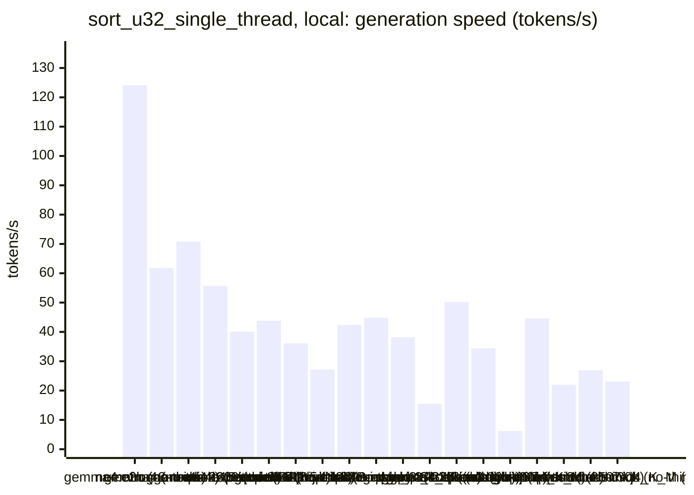
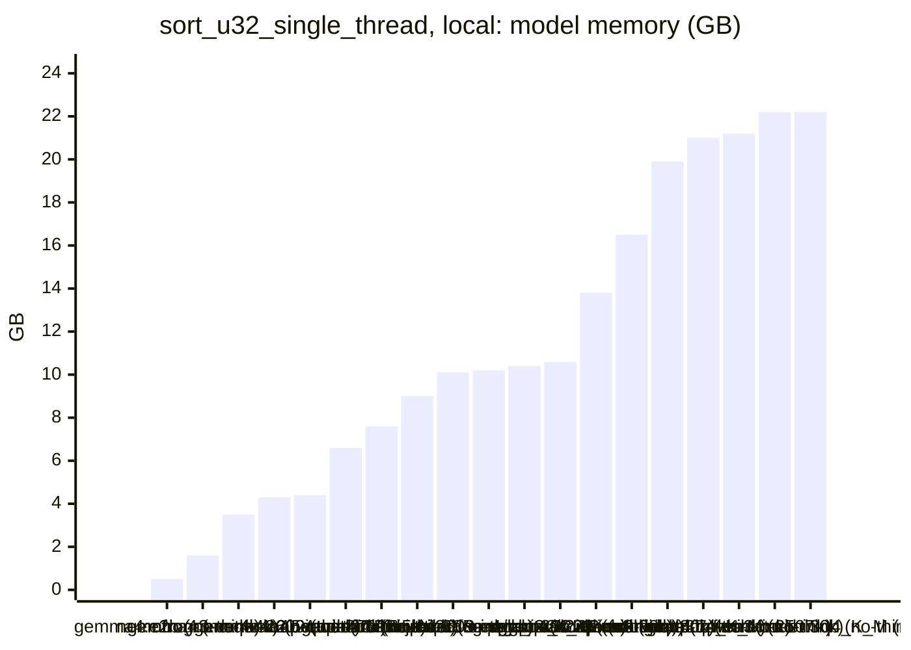
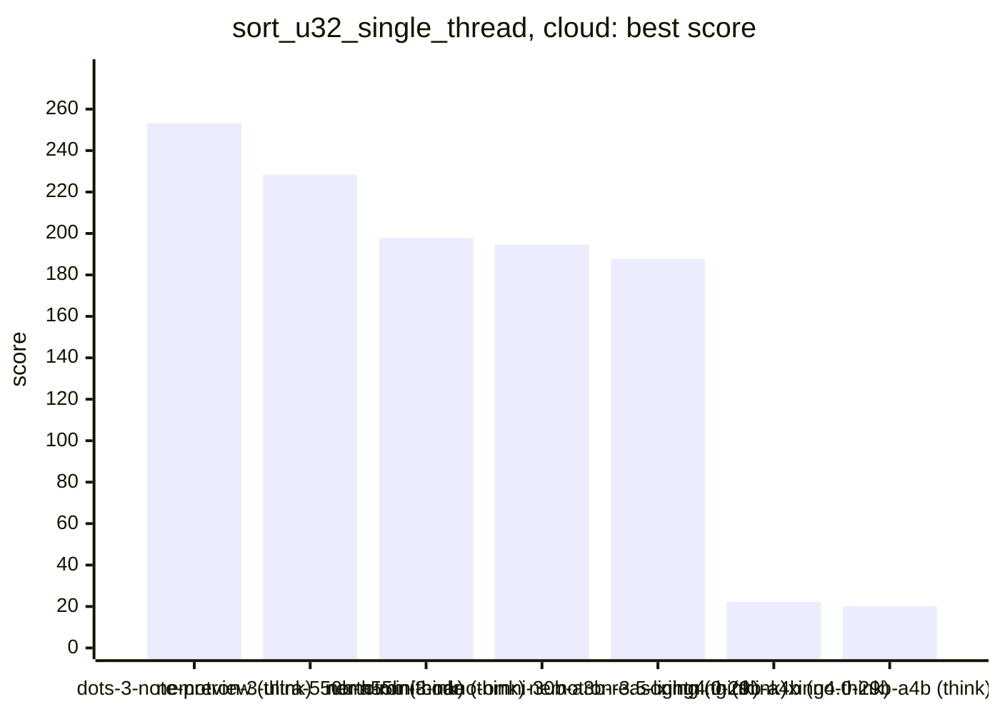
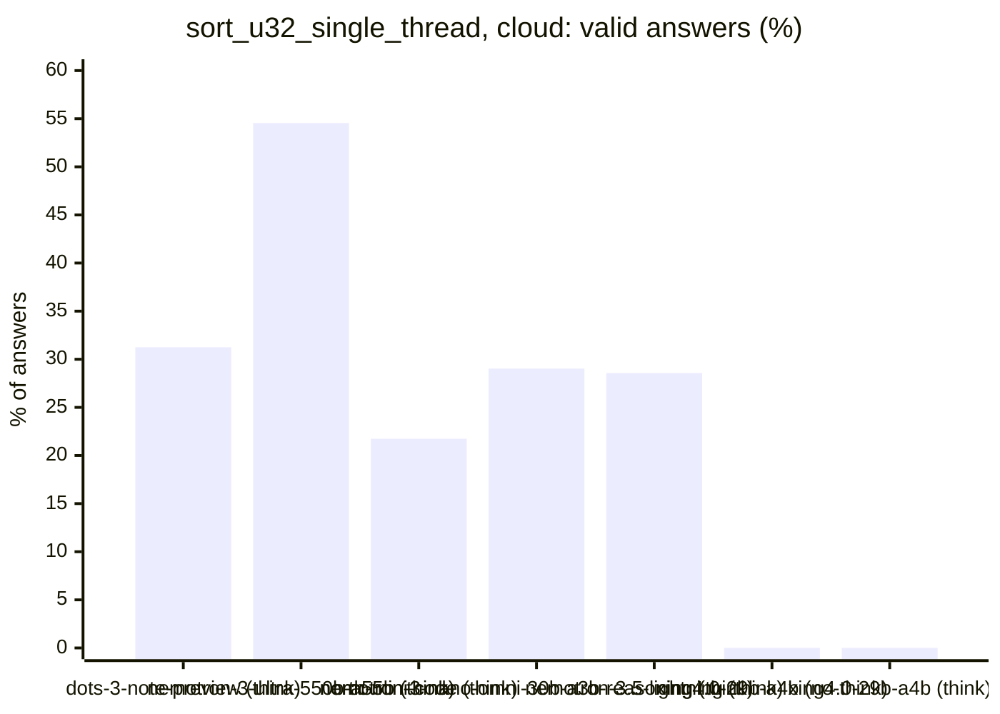
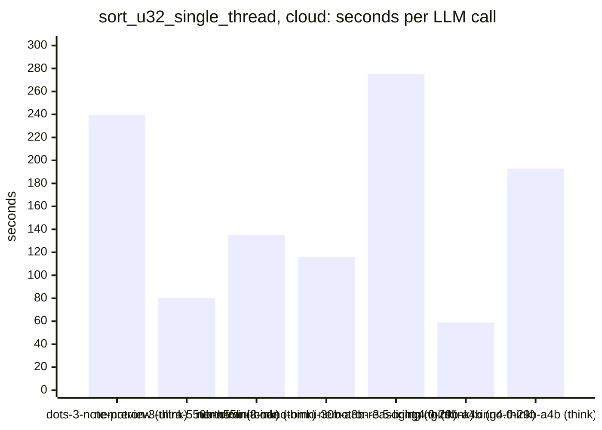
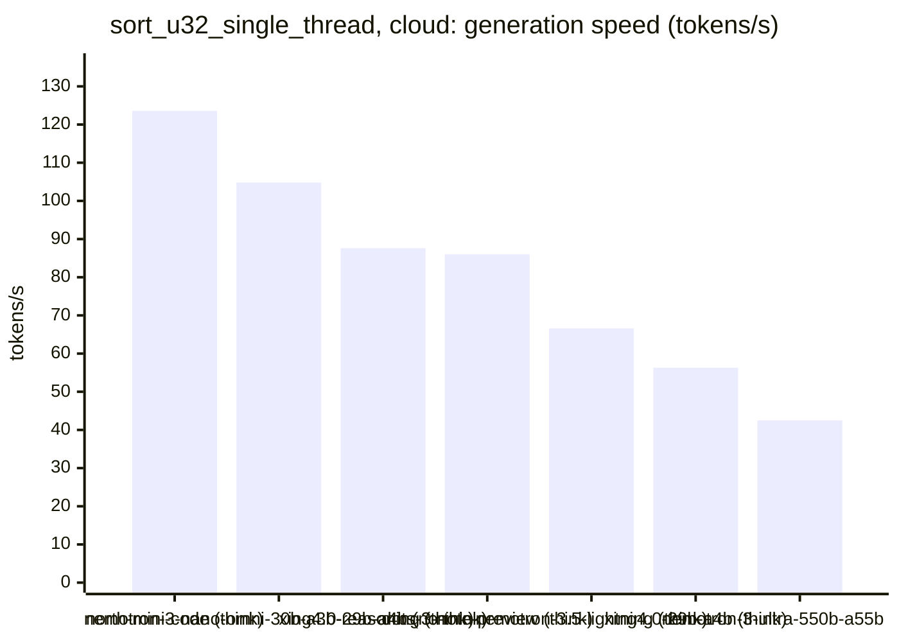

<!-- Copyright (c) 2026 by C. Klukas -->
<!-- SPDX-License-Identifier: GPL-3.0-only -->
<!-- Generated by `omega report` from bench/results/*.json. Do not edit by hand. -->

# sort_u32_single_thread

41 models, each run at most 60 minutes, ended earlier after 15 answers in a row without progress; one run per model. The [overall ranking](../benchmarks.md#overall-ranking) compares the models over all examples.

Machine: Intel(R) Core(TM) i7-8700K CPU @ 3.70GHz (MS-7A98), 12 cores, 64 GB, 2x NVIDIA GeForce GTX 1080 Ti, 11264 MiB.

## Local models

Ollama on this machine.

| Model | Params | Initial | Best | Gain | LLM calls | s/call | Valid | New bests | Min to best | Minutes | Stopped by |
|---|---|--:|--:|--:|--:|--:|--:|--:|--:|--:|---|
| gpt-oss:20b (no-think) | 20.9B | 20.6417 | **252.0461** | ×12.21 | 23 | 84 | 91% | 5 | 14.0 | 34.3 | no progress |
| underdog-saluki-27b:iq2-mix (no-think) | 26.9B | 18.3131 | **225.6457** | ×12.32 | 25 | 143 | 40% | 3 | 44.0 | 62.4 | time limit |
| qwen3:30b-a3b-instruct-2507-q4_K_M (no-think) | 30.5B | 19.4272 | **182.1660** | ×9.38 | 27 | 42 | 41% | 1 | 8.3 | 21.0 | no progress |
| gemma4:12b-it-qat (no-think) | 11.9B | 22.1288 | **171.3880** | ×7.75 | 42 | 42 | 64% | 6 | 18.4 | 33.2 | no progress |
| gemma4:26b-a4b-it-qat (no-think) | 25.2B | 22.0473 | **170.6196** | ×7.74 | 36 | 45 | 72% | 7 | 27.8 | 28.5 | no progress |
| qwen3.5:latest (no-think) | 9.0B | 22.2856 | **128.7961** | ×5.78 | 38 | 71 | 24% | 3 | 23.9 | 46.2 | no progress |
| gemma4:e4b-it-qat (no-think) | 7.5B | 18.0048 | **123.3560** | ×6.85 | 35 | 27 | 43% | 8 | 10.2 | 17.7 | no progress |
| gemma4:latest (no-think) | 7.5B | 21.0804 | **119.3034** | ×5.66 | 36 | 22 | 53% | 4 | 8.2 | 14.1 | no progress |
| glm-4.7-flash:latest (no-think) | 29.9B | 18.0897 | **102.4331** | ×5.66 | 30 | 55 | 20% | 2 | 9.7 | 29.8 | no progress |
| qwen3.6:27b-coding-mtp-q4_K_M (no-think) | 27.3B | 21.4129 | **87.1696** | ×4.07 | 15 | 254 | 27% | 1 | 11.2 | 64.3 | time limit |
| qwen2.5-coder:7b (no-think) | 7.6B | 20.4444 | **29.2547** | ×1.43 | 17 | 18 | 12% | 1 | 5.3 | 6.0 | no progress |
| MichelRosselli/apertus:8b-instruct-2509-q4_k_m (no-think) | 8.1B | 22.6408 | **22.6408** | ×1.00 | 16 | 24 | 0% | 0 | - | 7.0 | no progress |
| yandex/YandexGPT-5-Lite-8B-instruct-GGUF:latest (no-think) | 8.0B | 22.6016 | **22.6016** | ×1.00 | 16 | 23 | 19% | 0 | - | 6.8 | no progress |
| llm-jp-4-8b-omega:q4_k_m (no-think) | 8.6B | 22.5831 | **22.5831** | ×1.00 | 16 | 61 | 0% | 0 | - | 17.1 | no progress |
| gemma4:e2b (no-think) | 4.6B | 22.4472 | **22.4472** | ×1.00 | 16 | 12 | 0% | 0 | - | 3.9 | no progress |
| richardyoung/frognano-4b-2609:latest (no-think) | 4.3B | 22.2670 | **22.2670** | ×1.00 | 16 | 48 | 0% | 0 | - | 13.6 | no progress |
| nemotron-3-nano:4b (no-think) | 4.0B | 22.2555 | **22.2555** | ×1.00 | 16 | 29 | 0% | 0 | - | 8.5 | no progress |
| qwen3-coder:30b (no-think) | 30.5B | 21.5902 | **21.5902** | ×1.00 | 17 | 71 | 0% | 0 | - | 21.5 | no progress |
| frob/sarvam:30b (no-think) | 32.2B | 17.8300 | **17.8300** | ×1.00 | 7 | 566 | 0% | 0 | - | 71.4 | time limit |
| hf.co/LiquidAI/LFM3-1.7B-GGUF:Q4_K_M (no-think) | 1.73B | | | | | | | | | | failed: all 16 model requests failed: hf.co/LiquidAI/LFM3-1.7B-GGUF: |

### Inference speed and memory

RAM is what Ollama reports for the loaded model (weights, context cache and buffers; on Apple silicon this is shared memory). Load is the time to bring the model into memory. Prompt and generation speeds are tokens per second over all calls of the run.

| Model | Params | RAM GB | Load s | Prompt tok/s | Gen tok/s | Median s/call | p90 s/call | Tokens/answer | Stopped |
|---|---|--:|--:|--:|--:|--:|--:|--:|--:|
| gemma4:e2b (no-think) | 4.6B | 0.5 | 17 | 2044 | 124.1 | 11 | 16 | 875 | 0 |
| gemma4:latest (no-think) | 7.5B | 1.6 | 27 | 1142 | 61.8 | 22 | 29 | 846 | 0 |
| nemotron-3-nano:4b (no-think) | 4.0B | 3.5 | 10 | 1625 | 70.8 | 20 | 76 | 1460 | 1 |
| richardyoung/frognano-4b-2609:latest (no-think) | 4.3B | 4.3 | 12 | 1606 | 55.7 | 48 | 78 | 2064 | 2 |
| gemma4:e4b-it-qat (no-think) | 7.5B | 4.4 | 33 | 1824 | 40.1 | 26 | 41 | 776 | 1 |
| qwen2.5-coder:7b (no-think) | 7.6B | 6.6 | 15 | 2587 | 43.8 | 19 | 32 | 614 | 0 |
| qwen3.5:latest (no-think) | 9.0B | 7.6 | 21 | 1275 | 36.1 | 56 | 218 | 2311 | 0 |
| gemma4:12b-it-qat (no-think) | 11.9B | 9.0 | 23 | 731 | 27.2 | 38 | 50 | 804 | 1 |
| MichelRosselli/apertus:8b-instruct-2509-q4_k_m (no-think) | 8.1B | 10.1 | 16 | 2424 | 42.4 | 20 | 50 | 652 | 1 |
| yandex/YandexGPT-5-Lite-8B-instruct-GGUF:latest (no-think) | 8.0B | 10.2 | 14 | 2476 | 44.8 | 24 | 38 | 821 | 0 |
| llm-jp-4-8b-omega:q4_k_m (no-think) | 8.6B | 10.4 | 24 | 2334 | 38.2 | 55 | 99 | 1986 | 0 |
| underdog-saluki-27b:iq2-mix (no-think) | 26.9B | 10.6 | 30 | 411 | 15.5 | 107 | 290 | 1851 | 2 |
| gpt-oss:20b (no-think) | 20.9B | 13.8 | 47 | 2460 | 50.2 | 73 | 142 | 3885 | 0 |
| gemma4:26b-a4b-it-qat (no-think) | 25.2B | 16.5 | 55 | 923 | 34.4 | 38 | 86 | 925 | 5 |
| qwen3.6:27b-coding-mtp-q4_K_M (no-think) | 27.3B | 19.9 | 58 | 188 | 6.2 | 201 | 452 | 1365 | 0 |
| frob/sarvam:30b (no-think) | 32.2B | 21.0 | 79 | 2310 | 44.6 | 548 | 623 | 24576 | 0 |
| glm-4.7-flash:latest (no-think) | 29.9B | 21.2 | 76 | 468 | 22.0 | 44 | 101 | 869 | 2 |
| qwen3:30b-a3b-instruct-2507-q4_K_M (no-think) | 30.5B | 22.2 | 69 | 981 | 26.9 | 26 | 79 | 884 | 0 |
| qwen3-coder:30b (no-think) | 30.5B | 22.2 | 199 | 1394 | 23.1 | 60 | 82 | 1257 | 1 |

### Best score over time

| Model | 15 min | 30 min | 45 min | 60 min |
|---|--:|--:|--:|--:|
| gpt-oss:20b (no-think) | 252.0461 | 252.0461 | 252.0461 | 252.0461 |
| underdog-saluki-27b:iq2-mix (no-think) | 18.3131 | 95.8658 | 225.6457 | 225.6457 |
| qwen3:30b-a3b-instruct-2507-q4_K_M (no-think) | 182.1660 | 182.1660 | 182.1660 | 182.1660 |
| gemma4:12b-it-qat (no-think) | 162.3584 | 171.3880 | 171.3880 | 171.3880 |
| gemma4:26b-a4b-it-qat (no-think) | 160.4905 | 170.6196 | 170.6196 | 170.6196 |
| qwen3.5:latest (no-think) | 106.5898 | 128.7961 | 128.7961 | 128.7961 |
| gemma4:e4b-it-qat (no-think) | 123.3560 | 123.3560 | 123.3560 | 123.3560 |
| gemma4:latest (no-think) | 119.3034 | 119.3034 | 119.3034 | 119.3034 |
| glm-4.7-flash:latest (no-think) | 102.4331 | 102.4331 | 102.4331 | 102.4331 |
| qwen3.6:27b-coding-mtp-q4_K_M (no-think) | 87.1696 | 87.1696 | 87.1696 | 87.1696 |
| qwen2.5-coder:7b (no-think) | 29.2547 | 29.2547 | 29.2547 | 29.2547 |
| MichelRosselli/apertus:8b-instruct-2509-q4_k_m (no-think) | 22.6408 | 22.6408 | 22.6408 | 22.6408 |
| yandex/YandexGPT-5-Lite-8B-instruct-GGUF:latest (no-think) | 22.6016 | 22.6016 | 22.6016 | 22.6016 |
| llm-jp-4-8b-omega:q4_k_m (no-think) | 22.5831 | 22.5831 | 22.5831 | 22.5831 |
| gemma4:e2b (no-think) | 22.4472 | 22.4472 | 22.4472 | 22.4472 |
| richardyoung/frognano-4b-2609:latest (no-think) | 22.2670 | 22.2670 | 22.2670 | 22.2670 |
| nemotron-3-nano:4b (no-think) | 22.2555 | 22.2555 | 22.2555 | 22.2555 |
| qwen3-coder:30b (no-think) | 21.5902 | 21.5902 | 21.5902 | 21.5902 |
| frob/sarvam:30b (no-think) | 17.8300 | 17.8300 | 17.8300 | 17.8300 |

### Outcome of the LLM answers

| Model | compile error | duplicate | edit error | invalid | llm error | ok | timeout |
|---|--:|--:|--:|--:|--:|--:|--:|
| gpt-oss:20b (no-think) | 0 | 1 | 0 | 1 | 0 | 21 | 0 |
| underdog-saluki-27b:iq2-mix (no-think) | 4 | 0 | 2 | 6 | 2 | 10 | 1 |
| qwen3:30b-a3b-instruct-2507-q4_K_M (no-think) | 9 | 5 | 1 | 1 | 0 | 11 | 0 |
| gemma4:12b-it-qat (no-think) | 4 | 4 | 0 | 6 | 1 | 27 | 0 |
| gemma4:26b-a4b-it-qat (no-think) | 1 | 0 | 4 | 0 | 5 | 26 | 0 |
| qwen3.5:latest (no-think) | 16 | 0 | 6 | 6 | 0 | 9 | 1 |
| gemma4:e4b-it-qat (no-think) | 5 | 1 | 4 | 9 | 1 | 15 | 0 |
| gemma4:latest (no-think) | 9 | 5 | 1 | 2 | 0 | 19 | 0 |
| glm-4.7-flash:latest (no-think) | 13 | 0 | 4 | 4 | 2 | 6 | 1 |
| qwen3.6:27b-coding-mtp-q4_K_M (no-think) | 5 | 3 | 0 | 1 | 0 | 4 | 2 |
| qwen2.5-coder:7b (no-think) | 6 | 1 | 0 | 8 | 0 | 2 | 0 |
| MichelRosselli/apertus:8b-instruct-2509-q4_k_m (no-think) | 6 | 1 | 7 | 0 | 2 | 0 | 0 |
| yandex/YandexGPT-5-Lite-8B-instruct-GGUF:latest (no-think) | 8 | 1 | 1 | 3 | 0 | 3 | 0 |
| llm-jp-4-8b-omega:q4_k_m (no-think) | 13 | 0 | 3 | 0 | 0 | 0 | 0 |
| gemma4:e2b (no-think) | 4 | 0 | 1 | 11 | 0 | 0 | 0 |
| richardyoung/frognano-4b-2609:latest (no-think) | 11 | 0 | 0 | 3 | 2 | 0 | 0 |
| nemotron-3-nano:4b (no-think) | 4 | 0 | 11 | 0 | 1 | 0 | 0 |
| qwen3-coder:30b (no-think) | 7 | 0 | 0 | 5 | 1 | 0 | 4 |
| frob/sarvam:30b (no-think) | 0 | 0 | 7 | 0 | 0 | 0 | 0 |

### Best idea per model

- **gpt-oss:20b (no-think)**: Add early exit for already sorted or reverse sorted arrays, adapt the number of radix passes to the maximum value, and reuse a static scratch buffer to avoid per‑call allocations …
- **underdog-saluki-27b:iq2-mix (no-think)**: The previous program's LSD radix sort was incomplete and buggy; replace it with a clean, correct 4-pass 8-bit LSD radix sort using a single scratch buffer, with a skip check when …
- **qwen3:30b-a3b-instruct-2507-q4_K_M (no-think)**: Replace the iterative merge sort with a hybrid approach using counting sort for small ranges and radix sort for large inputs, leveraging NEON for efficient counting and digit …
- **gemma4:12b-it-qat (no-think)**: Use 4 passes of 8 bits instead of the current 4 passes of 8 bits (which is actually already 4 passes but the loop condition `shift < 32` with `shift += 8` is correct) and add an …
- **gemma4:26b-a4b-it-qat (no-think)**: Fix the compile error by replacing `constexpr` with `const` in the loop and use a robust 4-pass 8-bit radix sort which is more cache-efficient and avoids the `constexpr` bit-shift …
- **qwen3.5:latest (no-think)**: Replace the slow recursive merge sort with a hybrid LSD Radix Sort that uses insertion sort for small arrays (<=32 elements), processes data in 4 passes of 8-bit buckets using a …
- **gemma4:e4b-it-qat (no-think)**: Implement LSD Radix Sort using NEON intrinsics for the counting and distribution passes to fully leverage the ARM architecture's vector capabilities.
- **gemma4:latest (no-think)**: Replace the recursive merge sort implementation with an LSD Radix Sort as it is generally much faster for fixed-width integer types like uint32_t, especially given the hint …
- **glm-4.7-flash:latest (no-think)**: Replace the generic recursive Merge Sort (O(n log n), cache-unfriendly, branchy) with a high-throughput 4-pass LSD radix sort using 32-bit buckets and in-place ping-pong buffering …
- **qwen3.6:27b-coding-mtp-q4_K_M (no-think)**: Replace the slow recursive merge sort with a hybrid MSD radix sort + insertion sort that is branch-predictor friendly and handles small/nearly-sorted inputs efficiently.
- **qwen2.5-coder:7b (no-think)**: Introduce a constant for the threshold below which merge sort is replaced with insertion sort, as insertion sort is more efficient for small subarrays.
- **MichelRosselli/apertus:8b-instruct-2509-q4_k_m (no-think)**: initial program
- **yandex/YandexGPT-5-Lite-8B-instruct-GGUF:latest (no-think)**: initial program
- **llm-jp-4-8b-omega:q4_k_m (no-think)**: initial program
- **gemma4:e2b (no-think)**: initial program
- **richardyoung/frognano-4b-2609:latest (no-think)**: initial program
- **nemotron-3-nano:4b (no-think)**: initial program
- **qwen3-coder:30b (no-think)**: initial program
- **frob/sarvam:30b (no-think)**: initial program

## Cloud models (OpenRouter)

Free OpenRouter models; times include the network and the provider's queue.

| Model | Params | Initial | Best | Gain | LLM calls | s/call | Valid | New bests | Min to best | Minutes | Stopped by |
|---|---|--:|--:|--:|--:|--:|--:|--:|--:|--:|---|
| dots-studio/dots-3-note-preview:free (think) |  | 18.9585 | **253.2415** | ×13.36 | 16 | 240 | 31% | 2 | 27.6 | 64.5 | time limit |
| nvidia/nemotron-3-ultra-550b-a55b:free (think) |  | 17.7243 | **228.3437** | ×12.88 | 33 | 80 | 55% | 3 | 25.9 | 47.4 | no progress |
| cohere/north-mini-code:free (think) |  | 19.8694 | **197.8012** | ×9.96 | 23 | 135 | 22% | 2 | 8.7 | 54.9 | no progress |
| nvidia/nemotron-3-nano-omni-30b-a3b-reasoning:free (think) |  | 20.0281 | **194.6110** | ×9.72 | 31 | 116 | 29% | 4 | 25.9 | 60.9 | time limit |
| nvidia/nemotron-3.5-lightning:free (think) |  | 20.6943 | **187.8212** | ×9.08 | 14 | 275 | 29% | 2 | 59.9 | 64.7 | time limit |
| google/gemma-4-26b-a4b-it:free (no-think) |  | | | | | | | | | | failed: all 6 model requests failed: google/gemma-4-26b-a4b-it:free: |
| nvidia/nemotron-3-ultra-550b-a55b:free (no-think) |  | | | | | | | | | | failed: all 6 model requests failed: nvidia/nemotron-3-ultra-550b-a5 |
| poolside/laguna-s-2.1:free (no-think) |  | | | | | | | | | | failed: all 6 model requests failed: poolside/laguna-s-2.1:free: rat |
| dots-studio/dots-3-note-preview:free (no-think) |  | | | | | | | | | | failed: all 6 model requests failed: dots-studio/dots-3-note-preview |
| xingchen-agi/xing4.0-29b-a4b:free (no-think) |  | 22.2125 | **22.2125** | ×1.00 | 16 | 59 | 0% | 0 | - | 16.1 | no progress |
| poolside/laguna-xs-2.1:free (no-think) |  | | | | | | | | | | failed: all 6 model requests failed: poolside/laguna-xs-2.1:free: ra |
| google/gemma-4-31b-it:free (no-think) |  | | | | | | | | | | failed: all 6 model requests failed: google/gemma-4-31b-it:free: rat |
| nvidia/nemotron-3-nano-omni-30b-a3b-reasoning:free (no-think) |  | | | | | | | | | | failed: all 6 model requests failed: nvidia/nemotron-3-nano-omni-30b |
| nvidia/nemotron-3.5-lightning:free (no-think) |  | | | | | | | | | | failed: all 6 model requests failed: nvidia/nemotron-3.5-lightning:f |
| xingchen-agi/xing4.0-29b-a4b:free (think) |  | 20.1104 | **20.1104** | ×1.00 | 8 | 193 | 0% | 0 | - | 26.2 | model errors |
| cohere/north-mini-code:free (no-think) |  | | | | | | | | | | failed: all 6 model requests failed: cohere/north-mini-code:free: ra |
| nvidia/nemotron-3.5-super-vl:free (no-think) |  | | | | | | | | | | failed: all 5 model requests failed: nvidia/nemotron-3.5-super-vl:fr |
| recursive/flint-v1.0:free (think) |  | | | | | | | | | | failed: all 5 model requests failed: recursive/flint-v1.0:free: requ |
| google/gemma-4-31b-it:free (think) |  | | | | | | | | | | failed: all 5 model requests failed: google/gemma-4-31b-it:free: rat |
| google/gemma-4-26b-a4b-it:free (think) |  | | | | | | | | | | failed: all 6 model requests failed: google/gemma-4-26b-a4b-it:free: |
| nvidia/nemotron-3.5-super-vl:free (think) |  | | | | | | | | | | failed: RuntimeError: the initial program does not pass the evaluato |

### Inference speed and cost

Generation speed is measured from the first to the last streamed token; the time to the first token is counted as prompt time. Cost is what OpenRouter charged for the run.

| Model | Gen tok/s | Median s/call | p90 s/call | Tokens/answer | Stopped | Cost $ |
|---|--:|--:|--:|--:|--:|--:|
| cohere/north-mini-code:free (think) | 123.6 | 118 | 208 | 16479 | 0 | 0.000 |
| nvidia/nemotron-3-nano-omni-30b-a3b-reasoning:free (think) | 104.8 | 94 | 214 | 12104 | 0 | 0.000 |
| xingchen-agi/xing4.0-29b-a4b:free (no-think) | 87.6 | 75 | 76 | 430 | 1 | 0.000 |
| dots-studio/dots-3-note-preview:free (think) | 86.0 | 285 | 306 | 20137 | 0 | 0.000 |
| nvidia/nemotron-3.5-lightning:free (think) | 66.6 | 304 | 400 | 18270 | 0 | 0.000 |
| xingchen-agi/xing4.0-29b-a4b:free (think) | 56.3 | 79 | 457 | 5886 | 1 | 0.000 |
| nvidia/nemotron-3-ultra-550b-a55b:free (think) | 42.5 | 49 | 147 | 3310 | 0 | 0.000 |

### Best score over time

| Model | 15 min | 30 min | 45 min | 60 min |
|---|--:|--:|--:|--:|
| dots-studio/dots-3-note-preview:free (think) | 18.9585 | 253.2415 | 253.2415 | 253.2415 |
| nvidia/nemotron-3-ultra-550b-a55b:free (think) | 17.7243 | 228.3437 | 228.3437 | 228.3437 |
| cohere/north-mini-code:free (think) | 197.8012 | 197.8012 | 197.8012 | 197.8012 |
| nvidia/nemotron-3-nano-omni-30b-a3b-reasoning:free (think) | 178.4317 | 194.6110 | 194.6110 | 194.6110 |
| nvidia/nemotron-3.5-lightning:free (think) | 187.6330 | 187.6330 | 187.6330 | 187.8212 |
| xingchen-agi/xing4.0-29b-a4b:free (no-think) | 22.2125 | 22.2125 | 22.2125 | 22.2125 |
| xingchen-agi/xing4.0-29b-a4b:free (think) | 20.1104 | 20.1104 | 20.1104 | 20.1104 |

### Outcome of the LLM answers

| Model | compile error | duplicate | edit error | invalid | llm error | ok | timeout |
|---|--:|--:|--:|--:|--:|--:|--:|
| dots-studio/dots-3-note-preview:free (think) | 0 | 0 | 9 | 0 | 2 | 5 | 0 |
| nvidia/nemotron-3-ultra-550b-a55b:free (think) | 11 | 2 | 0 | 2 | 0 | 18 | 0 |
| cohere/north-mini-code:free (think) | 5 | 1 | 10 | 1 | 0 | 5 | 1 |
| nvidia/nemotron-3-nano-omni-30b-a3b-reasoning:free (think) | 2 | 0 | 19 | 1 | 0 | 9 | 0 |
| nvidia/nemotron-3.5-lightning:free (think) | 1 | 0 | 9 | 0 | 0 | 4 | 0 |
| xingchen-agi/xing4.0-29b-a4b:free (no-think) | 1 | 0 | 0 | 4 | 11 | 0 | 0 |
| xingchen-agi/xing4.0-29b-a4b:free (think) | 1 | 0 | 0 | 1 | 6 | 0 | 0 |

### Best idea per model

- **dots-studio/dots-3-note-preview:free (think)**: tuned RADIX_BITS=8, SORT_THRESHOLD=512 on top of: Replace the merge sort with an LSD radix sort that detects sorted/reverse runs and uses a configurable radix size, with a …
- **nvidia/nemotron-3-ultra-550b-a55b:free (think)**: tuned SMALL_N_THRESHOLD=184, RADIX_THRESHOLD=1962 on top of: Add early detection for sorted/reverse-sorted inputs, accelerate histogram counting with NEON vectorization, and track …
- **cohere/north-mini-code:free (think)**: tuned INSERTION_SORT_THRESHOLD=48 on top of: Replace naive merge sort with a hybrid sorter: detect already sorted/reverse‑sorted arrays, use insertion sort for tiny blocks, and …
- **nvidia/nemotron-3-nano-omni-30b-a3b-reasoning:free (think)**: Use a 4‑pass 8‑bit LSD radix sort with a 256‑entry histogram, skip the distribution step when all remaining bytes are identical, and fall back to insertion sort for tiny arrays …
- **nvidia/nemotron-3.5-lightning:free (think)**: Replace merge sort with LSD radix sort using 4 passes of 8 bits, with histogram-based counting per pass, a skip optimization when all elements share the same digit, and O(n) …
- **xingchen-agi/xing4.0-29b-a4b:free (no-think)**: initial program
- **xingchen-agi/xing4.0-29b-a4b:free (think)**: initial program
