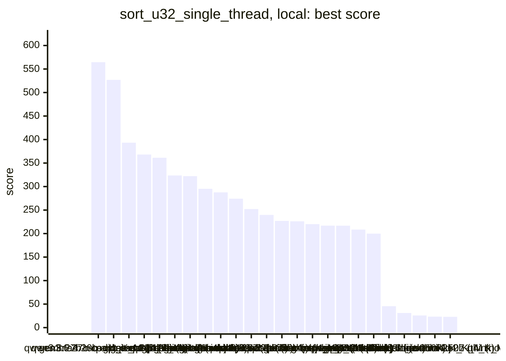
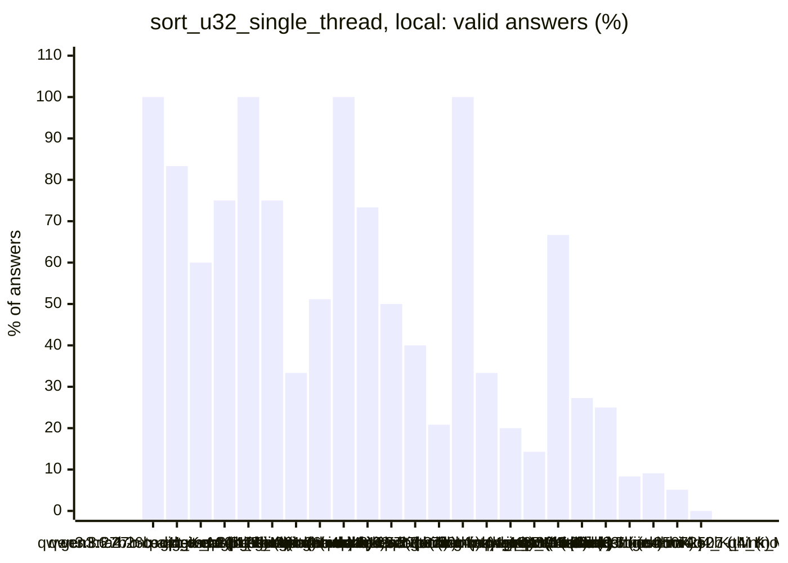
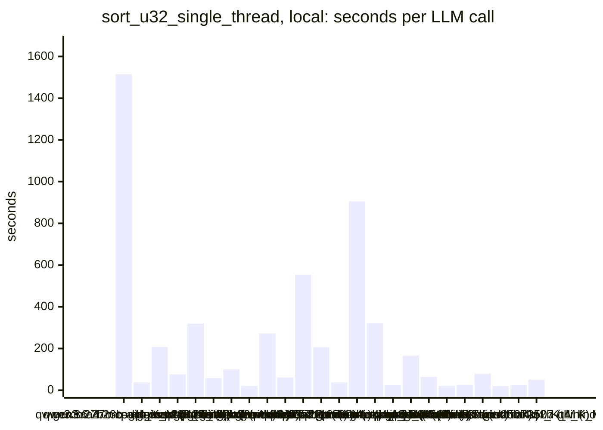
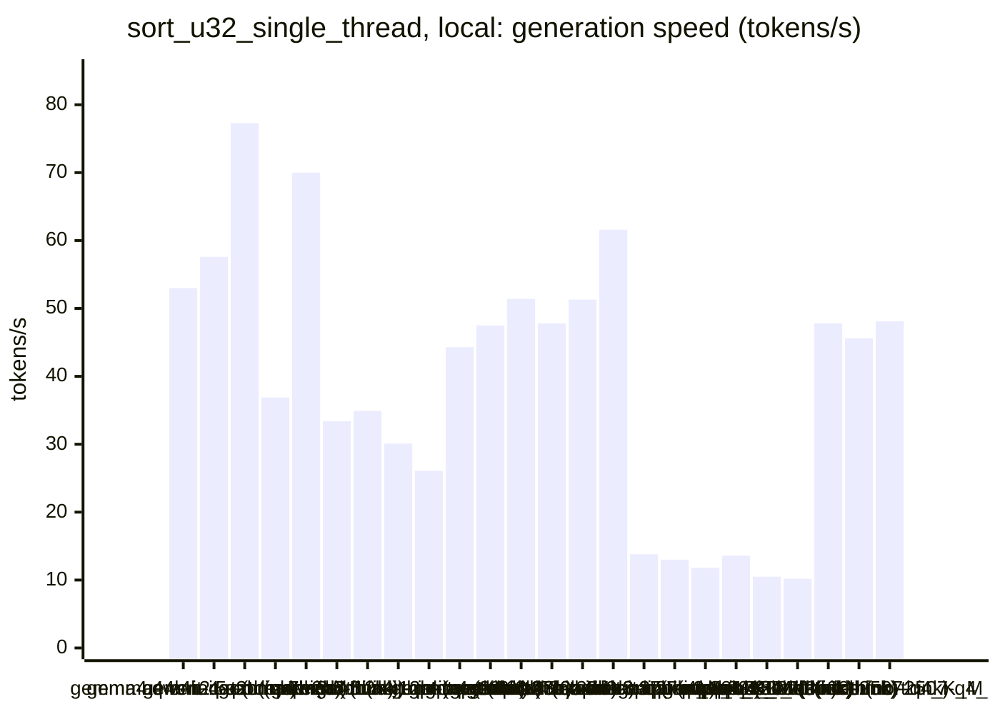
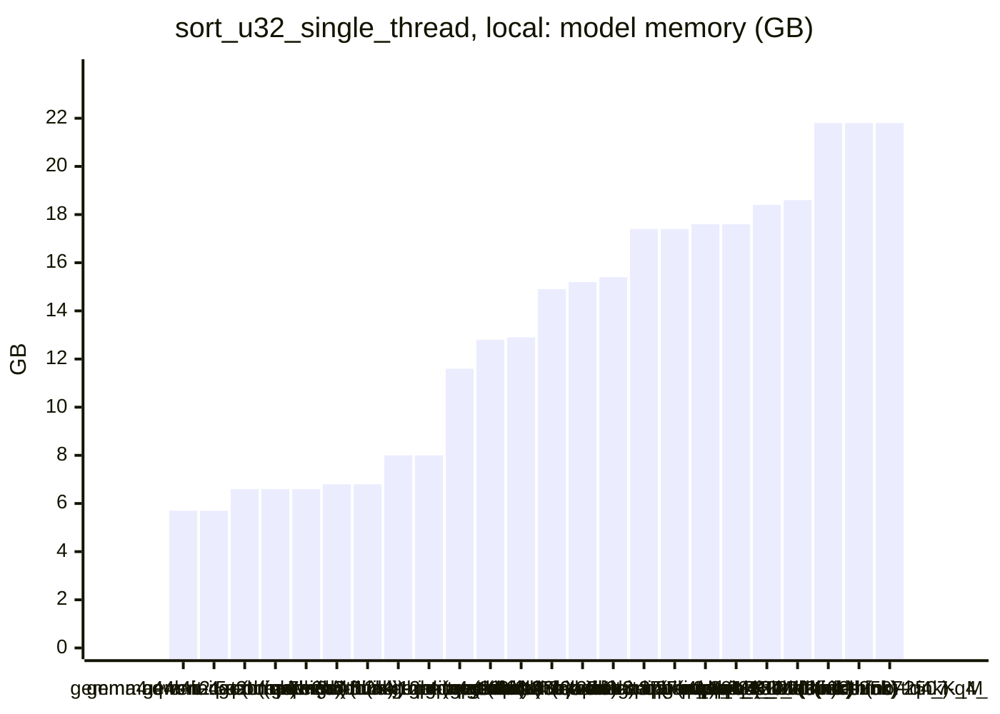

<!-- Copyright (c) 2026 by C. Klukas -->
<!-- SPDX-License-Identifier: GPL-3.0-only -->
<!-- Generated by `omega report` from bench/results/*.json. Do not edit by hand. -->

# sort_u32_single_thread

24 models, 15 minutes each, latest run per model. The [overall ranking](../benchmarks.md#overall-ranking) compares the models over all examples.

Machine: Apple M1 Max (Mac13,1), 10 cores, 32 GB.

## Local models

Ollama on this machine.

| Model | Params | Initial | Best | Gain | LLM calls | s/call | Valid | New bests | Min to best |
|---|---|--:|--:|--:|--:|--:|--:|--:|--:|
| qwen3.8:27b-mtp-q4_K_M (think) | 27.3B | 22.7147 | **564.4614** | ×24.85 | 1 | 1515 | 100% | 1 | 25.4 |
| gemma4:26b-a4b-it-qat (no-think) | 25.2B | 23.9752 | **526.8705** | ×21.98 | 24 | 38 | 83% | 7 | 14.2 |
| qwen3.6:27b-coding-mtp-q4_K_M (no-think) | 27.3B | 23.1794 | **393.2984** | ×16.97 | 5 | 207 | 60% | 3 | 17.4 |
| gpt-oss:20b (think) | 20.9B | 22.3922 | **368.1891** | ×16.44 | 12 | 76 | 75% | 4 | 10.2 |
| qwen3.5:27b (think) | 27.8B | 22.8759 | **361.2984** | ×15.79 | 3 | 319 | 100% | 2 | 9.6 |
| gemma4:12b-it-qat (no-think) | 11.9B | 22.6276 | **323.4781** | ×14.30 | 16 | 58 | 75% | 4 | 10.5 |
| gpt-oss:20b (no-think) | 20.9B | 23.9722 | **322.2479** | ×13.44 | 9 | 100 | 33% | 2 | 10.1 |
| gemma4:latest (no-think) |  | 24.0007 | **295.2118** | ×12.30 | 43 | 21 | 51% | 6 | 12.8 |
| gemma4:26b-a4b-it-qat (think) | 25.2B | 22.8505 | **287.6700** | ×12.59 | 4 | 272 | 100% | 1 | 7.0 |
| gemma4:e4b-it-qat (think) | 7.5B | 22.7781 | **274.2287** | ×12.04 | 15 | 61 | 73% | 4 | 15.3 |
| gemma4:12b-it-qat (think) | 11.9B | 22.9697 | **252.1177** | ×10.98 | 2 | 553 | 50% | 1 | 8.8 |
| qwen3.5:27b (no-think) | 27.8B | 23.7668 | **239.7158** | ×10.09 | 5 | 206 | 40% | 2 | 17.3 |
| qwen3-coder:30b (no-think) | 30.5B | 22.9410 | **226.8907** | ×9.89 | 24 | 38 | 21% | 4 | 10.9 |
| qwen3.6:27b-coding-mtp-q4_K_M (think) | 27.3B | 22.9987 | **226.0805** | ×9.83 | 1 | 905 | 100% | 1 | 15.2 |
| qwen3.8:27b-mtp-q4_K_M (no-think) | 27.3B | 23.3327 | **220.0800** | ×9.43 | 3 | 320 | 33% | 1 | 12.9 |
| gemma4:e4b-it-qat (no-think) | 7.5B | 23.3271 | **216.9010** | ×9.30 | 40 | 23 | 20% | 6 | 10.1 |
| qwen3.5:latest (think) | 9.7B | 23.3290 | **216.6847** | ×9.29 | 7 | 166 | 14% | 1 | 19.5 |
| gemma4:latest (think) |  | 22.6636 | **208.4549** | ×9.20 | 15 | 64 | 67% | 4 | 16.1 |
| gemma4:e2b (no-think) | 5.1B | 24.0010 | **199.8160** | ×8.33 | 44 | 21 | 27% | 4 | 9.6 |
| qwen2.5-coder:7b (no-think) | 7.6B | 23.6181 | **45.5448** | ×1.93 | 36 | 25 | 25% | 3 | 9.9 |
| qwen3.5:latest (no-think) | 9.7B | 23.8223 | **31.0841** | ×1.30 | 12 | 80 | 8% | 1 | 16.1 |
| qwen3:30b-a3b-instruct-2507-q4_K_M (no-think) | 30.5B | 22.4985 | **25.8331** | ×1.15 | 44 | 20 | 9% | 4 | 5.4 |
| qwen3:30b-a3b-instruct-2507-q4_K_M (think) | 30.5B | 23.1855 | **23.3623** | ×1.01 | 39 | 23 | 5% | 1 | 5.1 |
| gemma4:e2b (think) | 5.1B | 22.9626 | **22.9626** | ×1.00 | 18 | 50 | 0% | 0 | - |

### Inference speed and memory

RAM is what Ollama reports for the loaded model (weights, context cache and buffers; on Apple silicon this is shared memory). Load is the time to bring the model into memory. Prompt and generation speeds are tokens per second over all calls of the run.

| Model | Params | RAM GB | Load s | Prompt tok/s | Gen tok/s | Median s/call | p90 s/call | Tokens/answer | Stopped |
|---|---|--:|--:|--:|--:|--:|--:|--:|--:|
| gemma4:e4b-it-qat (think) | 7.5B | 5.7 | 88 | 514 | 53.0 | 58 | 76 | 2381 | 0 |
| gemma4:e4b-it-qat (no-think) | 7.5B | 5.7 | 90 | 538 | 57.6 | 19 | 33 | 609 | 1 |
| gemma4:e2b (no-think) | 5.1B | 6.6 | 72 | 827 | 77.3 | 18 | 29 | 859 | 1 |
| qwen2.5-coder:7b (no-think) | 7.6B | 6.6 | 70 | 640 | 36.9 | 23 | 34 | 579 | 0 |
| gemma4:e2b (think) | 5.1B | 6.6 | 45 | 908 | 70.0 | 46 | 79 | 3049 | 0 |
| qwen3.5:latest (think) | 9.7B | 6.8 | 32 | 390 | 33.4 | 117 | 378 | 3892 | 1 |
| qwen3.5:latest (no-think) | 9.7B | 6.8 | 0 | 396 | 34.9 | 80 | 106 | 1612 | 5 |
| gemma4:12b-it-qat (no-think) | 11.9B | 8.0 | 126 | 216 | 30.1 | 51 | 72 | 818 | 0 |
| gemma4:12b-it-qat (think) | 11.9B | 8.0 | 93 | 196 | 26.1 | 588 | 588 | 10667 | 1 |
| gemma4:latest (think) |  | 11.6 | 108 | 1039 | 44.3 | 60 | 104 | 2274 | 1 |
| gpt-oss:20b (think) | 20.9B | 12.8 | 106 | 521 | 47.5 | 73 | 135 | 2814 | 0 |
| gpt-oss:20b (no-think) | 20.9B | 12.9 | 54 | 1157 | 51.4 | 84 | 165 | 4663 | 0 |
| gemma4:latest (no-think) |  | 14.9 | 107 | 1268 | 47.8 | 16 | 32 | 642 | 0 |
| gemma4:26b-a4b-it-qat (think) | 25.2B | 15.2 | 243 | 591 | 51.3 | 254 | 411 | 10457 | 0 |
| gemma4:26b-a4b-it-qat (no-think) | 25.2B | 15.4 | 196 | 524 | 61.6 | 28 | 54 | 955 | 2 |
| qwen3.6:27b-coding-mtp-q4_K_M (no-think) | 27.3B | 17.4 | 310 | 103 | 13.8 | 165 | 453 | 1464 | 0 |
| qwen3.6:27b-coding-mtp-q4_K_M (think) | 27.3B | 17.4 | 302 | 89 | 13.0 | 905 | 905 | 7378 | 0 |
| qwen3.8:27b-mtp-q4_K_M (think) | 27.3B | 17.6 | 307 | 88 | 11.8 | 1515 | 1515 | 10121 | 0 |
| qwen3.8:27b-mtp-q4_K_M (no-think) | 27.3B | 17.6 | 300 | 125 | 13.6 | 124 | 767 | 962 | 0 |
| qwen3.5:27b (think) | 27.8B | 18.4 | 160 | 120 | 10.5 | 390 | 398 | 2482 | 0 |
| qwen3.5:27b (no-think) | 27.8B | 18.6 | 140 | 105 | 10.2 | 190 | 272 | 1436 | 0 |
| qwen3-coder:30b (no-think) | 30.5B | 21.8 | 165 | 835 | 47.8 | 32 | 50 | 1151 | 1 |
| qwen3:30b-a3b-instruct-2507-q4_K_M (no-think) | 30.5B | 21.8 | 69 | 843 | 45.6 | 16 | 32 | 532 | 1 |
| qwen3:30b-a3b-instruct-2507-q4_K_M (think) | 30.5B | 21.8 | 170 | 933 | 48.1 | 16 | 38 | 620 | 1 |

### Best score over time

| Model | 3.75 min | 7.5 min | 11.25 min | 15 min |
|---|--:|--:|--:|--:|
| qwen3.8:27b-mtp-q4_K_M (think) | 22.7147 | 22.7147 | 22.7147 | 22.7147 |
| gemma4:26b-a4b-it-qat (no-think) | 233.8420 | 419.2873 | 419.2873 | 526.8705 |
| qwen3.6:27b-coding-mtp-q4_K_M (no-think) | 23.1794 | 23.1794 | 187.2028 | 390.6251 |
| gpt-oss:20b (think) | 180.4403 | 248.6821 | 368.1891 | 368.1891 |
| qwen3.5:27b (think) | 22.8759 | 192.3594 | 361.2984 | 361.2984 |
| gemma4:12b-it-qat (no-think) | 252.1434 | 312.6171 | 323.4781 | 323.4781 |
| gpt-oss:20b (no-think) | 221.8771 | 221.8771 | 322.2479 | 322.2479 |
| gemma4:latest (no-think) | 33.0596 | 199.1475 | 199.1475 | 295.2118 |
| gemma4:26b-a4b-it-qat (think) | 22.8505 | 287.6700 | 287.6700 | 287.6700 |
| gemma4:e4b-it-qat (think) | 186.1434 | 219.5582 | 270.0805 | 270.0805 |
| gemma4:12b-it-qat (think) | 22.9697 | 22.9697 | 252.1177 | 252.1177 |
| qwen3.5:27b (no-think) | 23.7668 | 180.8187 | 180.8187 | 180.8187 |
| qwen3-coder:30b (no-think) | 22.9410 | 174.7640 | 226.8907 | 226.8907 |
| qwen3.6:27b-coding-mtp-q4_K_M (think) | 22.9987 | 22.9987 | 22.9987 | 22.9987 |
| qwen3.8:27b-mtp-q4_K_M (no-think) | 23.3327 | 23.3327 | 23.3327 | 220.0800 |
| gemma4:e4b-it-qat (no-think) | 193.0204 | 193.1470 | 216.9010 | 216.9010 |
| qwen3.5:latest (think) | 23.3290 | 23.3290 | 23.3290 | 23.3290 |
| gemma4:latest (think) | 22.6636 | 192.2262 | 192.2262 | 192.2262 |
| gemma4:e2b (no-think) | 128.5346 | 128.5346 | 199.8160 | 199.8160 |
| qwen2.5-coder:7b (no-think) | 23.6181 | 43.9993 | 45.5448 | 45.5448 |
| qwen3.5:latest (no-think) | 23.8223 | 23.8223 | 23.8223 | 23.8223 |
| qwen3:30b-a3b-instruct-2507-q4_K_M (no-think) | 22.9240 | 25.8331 | 25.8331 | 25.8331 |
| qwen3:30b-a3b-instruct-2507-q4_K_M (think) | 23.1855 | 23.3623 | 23.3623 | 23.3623 |
| gemma4:e2b (think) | 22.9626 | 22.9626 | 22.9626 | 22.9626 |

### Outcome of the LLM answers

| Model | compile error | duplicate | edit error | invalid | llm error | ok | timeout |
|---|--:|--:|--:|--:|--:|--:|--:|
| qwen3.8:27b-mtp-q4_K_M (think) | 0 | 0 | 0 | 0 | 0 | 1 | 0 |
| gemma4:26b-a4b-it-qat (no-think) | 0 | 0 | 1 | 1 | 2 | 20 | 0 |
| qwen3.6:27b-coding-mtp-q4_K_M (no-think) | 2 | 0 | 0 | 0 | 0 | 3 | 0 |
| gpt-oss:20b (think) | 1 | 0 | 2 | 0 | 0 | 9 | 0 |
| qwen3.5:27b (think) | 0 | 0 | 0 | 0 | 0 | 3 | 0 |
| gemma4:12b-it-qat (no-think) | 2 | 2 | 0 | 0 | 0 | 12 | 0 |
| gpt-oss:20b (no-think) | 1 | 0 | 5 | 0 | 0 | 3 | 0 |
| gemma4:latest (no-think) | 14 | 2 | 3 | 2 | 0 | 22 | 0 |
| gemma4:26b-a4b-it-qat (think) | 0 | 0 | 0 | 0 | 0 | 4 | 0 |
| gemma4:e4b-it-qat (think) | 1 | 0 | 2 | 1 | 0 | 11 | 0 |
| gemma4:12b-it-qat (think) | 0 | 0 | 0 | 0 | 1 | 1 | 0 |
| qwen3.5:27b (no-think) | 1 | 0 | 2 | 0 | 0 | 2 | 0 |
| qwen3-coder:30b (no-think) | 3 | 4 | 0 | 11 | 1 | 5 | 0 |
| qwen3.6:27b-coding-mtp-q4_K_M (think) | 0 | 0 | 0 | 0 | 0 | 1 | 0 |
| qwen3.8:27b-mtp-q4_K_M (no-think) | 0 | 0 | 0 | 2 | 0 | 1 | 0 |
| gemma4:e4b-it-qat (no-think) | 11 | 4 | 5 | 11 | 1 | 8 | 0 |
| qwen3.5:latest (think) | 1 | 0 | 0 | 3 | 1 | 1 | 1 |
| gemma4:latest (think) | 1 | 1 | 1 | 1 | 1 | 10 | 0 |
| gemma4:e2b (no-think) | 11 | 4 | 10 | 6 | 1 | 12 | 0 |
| qwen2.5-coder:7b (no-think) | 7 | 6 | 1 | 13 | 0 | 9 | 0 |
| qwen3.5:latest (no-think) | 2 | 0 | 0 | 4 | 5 | 1 | 0 |
| qwen3:30b-a3b-instruct-2507-q4_K_M (no-think) | 14 | 4 | 4 | 17 | 1 | 4 | 0 |
| qwen3:30b-a3b-instruct-2507-q4_K_M (think) | 10 | 5 | 5 | 16 | 1 | 2 | 0 |
| gemma4:e2b (think) | 8 | 0 | 4 | 6 | 0 | 0 | 0 |

### Best idea per model

- **qwen3.8:27b-mtp-q4_K_M (think)**: Replace the O(n log n) merge sort with a hybrid approach: detect sorted/reverse in O(n) for early exit, then use LSD radix sort with 11-bit passes (1-3 passes depending on max …
- **gemma4:26b-a4b-it-qat (no-think)**: Implement a check to skip radix passes when all elements in the current pass share the same key, which significantly boosts performance on many duplicates and nearly sorted data.
- **qwen3.6:27b-coding-mtp-q4_K_M (no-think)**: Replace the slow recursive merge sort with a hybrid approach: use a fast 3-pass 11-bit LSD radix sort for large arrays (which handles random and duplicate data extremely well) and …
- **gpt-oss:20b (think)**: Add reverse‑sorted detection and an adaptive LSD radix sort that switches between 1‑, 2‑, and 4‑pass versions based on the maximum value, eliminating unnecessary passes for …
- **qwen3.5:27b (think)**: Replace the O(n log n) merge sort with an LSD radix sort (4 passes of 8 bits) which is O(n) and much faster for uniform/random data and especially for many duplicates, while also …
- **gemma4:12b-it-qat (no-think)**: Implement an optimized LSD radix sort with 3 passes of 11 bits, using a temporary buffer and correct pointer swapping to achieve high throughput.
- **gpt-oss:20b (no-think)**: Use a two‑pass 16‑bit LSD radix sort with a single temporary buffer, skipping the high‑bit pass when all high bits are identical and falling back to std::sort for very small …
- **gemma4:latest (no-think)**: Optimize the LSD Radix Sort to handle keys that are all zero for a given pass, allowing an early exit from the radix pass to save CPU cycles.
- **gemma4:26b-a4b-it-qat (think)**: Implement a high-performance 2-pass LSD radix sort (16 bits per pass) for large $n$, with special handling for already-sorted and reverse-sorted arrays, and fallback to …
- **gemma4:e4b-it-qat (think)**: Transition from 4 passes of 8-bit radix sort to 3 passes of 11-bit radix sort, leveraging the reduced loop overhead and fewer passes to improve constant factors and overall speed.
- **gemma4:12b-it-qat (think)**: Replace the merge sort with an LSD radix sort (4 passes of 8 bits) which is $O(n)$ and significantly faster for 32-bit integers, while adding $O(n)$ checks for already sorted or …
- **qwen3.5:27b (no-think)**: The current LSD Radix Sort uses 4 passes of 8-bit histograms, which incurs high overhead on sorted/reverse-sorted data due to 4 full memory scans and allocations; switching to 3 …
- **qwen3-coder:30b (no-think)**: tuned RADIX_BITS=11, INSERTION_SORT_THRESHOLD=32 on top of: Replace the fixed 8-bit radix sort with a configurable number of bits that can be tuned for optimal performance on the …
- **qwen3.6:27b-coding-mtp-q4_K_M (think)**: Replace the recursive merge sort with a 4-pass LSD radix sort (8 bits per pass) that accumulates all digit histograms in a single forward pass, skips passes where all keys share …
- **qwen3.8:27b-mtp-q4_K_M (no-think)**: edit: #include <algorithm> / #include <cstdint>
- **gemma4:e4b-it-qat (no-think)**: tuned BITS=16, PASSES=2 on top of: Replace fixed 8-bit passes with a parameter that allows sweeping over different bit widths and number of passes to find the optimal LSD radix …
- **qwen3.5:latest (think)**: Implement an adaptive hybrid sort that uses insertion sort for small arrays and sorted cases, detects already-sorted/reverse-sorted patterns to skip complex logic, and applies a …
- **gemma4:latest (think)**: Implement an O(N) check for already sorted input to allow an early exit, saving CPU time on the 'sorted' input distribution.
- **gemma4:e2b (no-think)**: Implement an LSD Radix Sort using 8-bit passes and NEON for efficient counting/distribution to leverage ARM NEON capabilities for high throughput, as suggested by the lineage …
- **qwen2.5-coder:7b (no-think)**: tuned INSERTION_SORT_THRESHOLD=26, QUICK_SORT_RECURSION_THRESHOLD=60 on top of: Define constants for the thresholds in quicksort and insertion sort to optimize for both large and …
- **qwen3.5:latest (no-think)**: Switch from recursive merge sort (O(n log n) with high constant overhead) to a hybrid Introsort that detects sorted/reverse runs, skips them if trivial, and uses Insertion Sort …
- **qwen3:30b-a3b-instruct-2507-q4_K_M (no-think)**: tuned INSERTION_SORT_THRESHOLD=23 on top of: Replace the fixed-width merge sort with a hybrid approach that switches to insertion sort for small subarrays, reducing overhead for …
- **qwen3:30b-a3b-instruct-2507-q4_K_M (think)**: Replace the recursive merge sort with an iterative bottom-up merge sort to eliminate recursion overhead and improve cache locality, which significantly improves performance on …
- **gemma4:e2b (think)**: initial program
