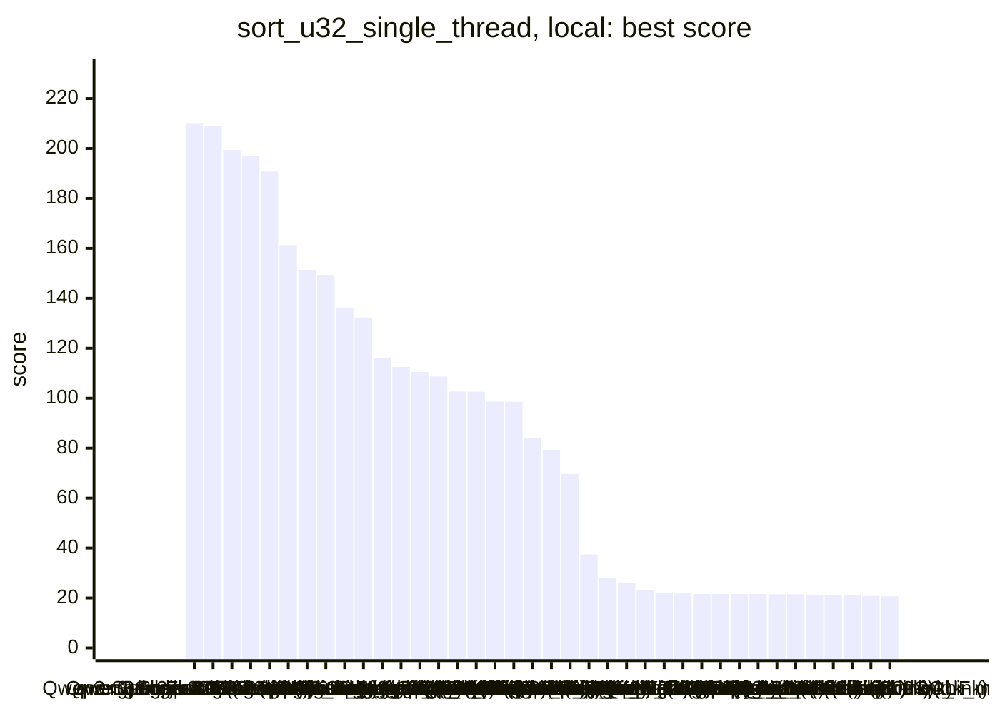
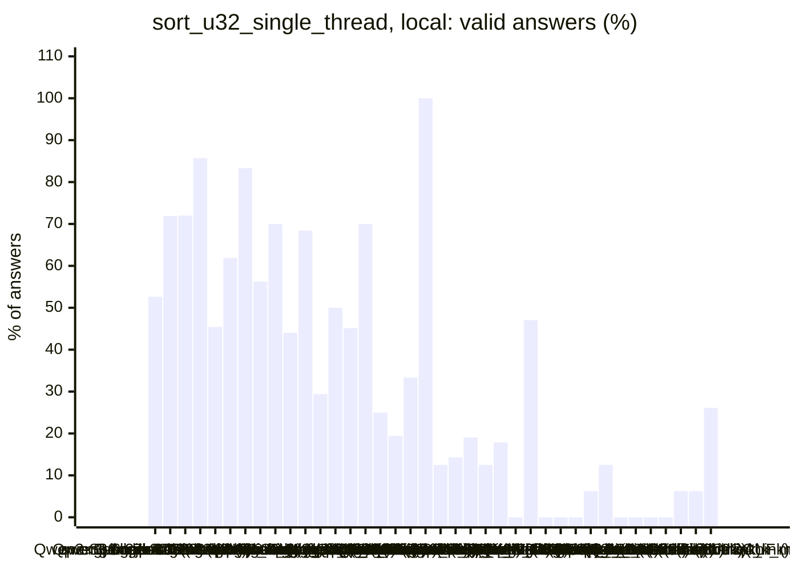
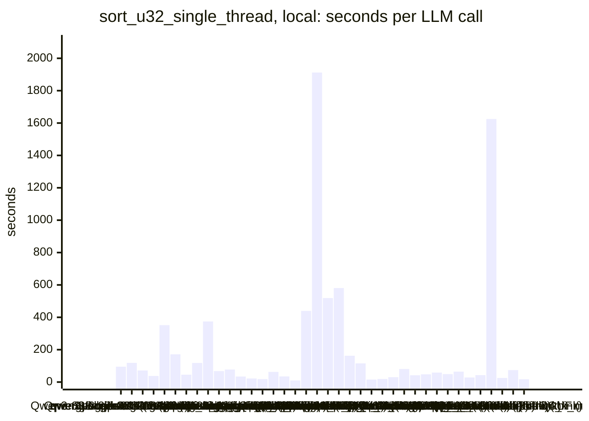
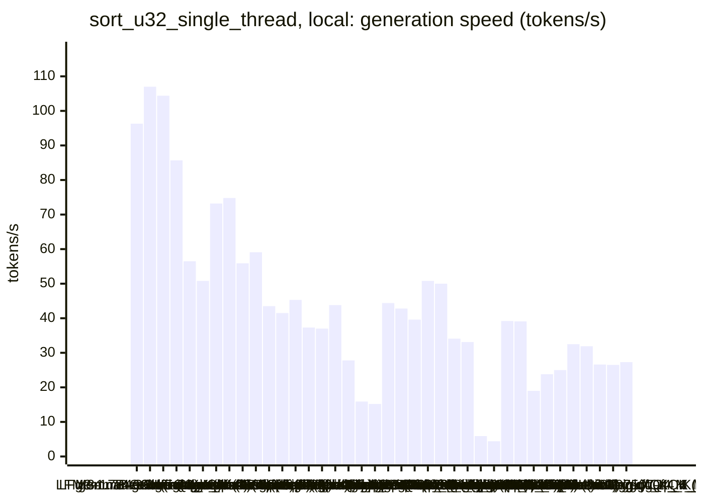
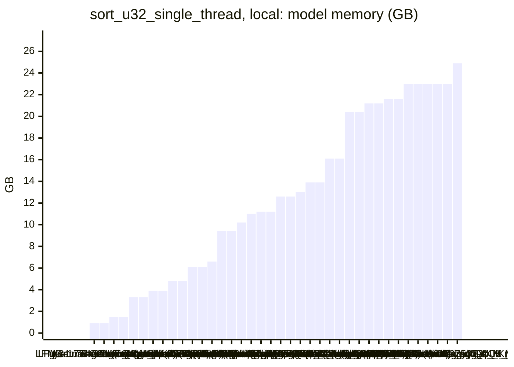
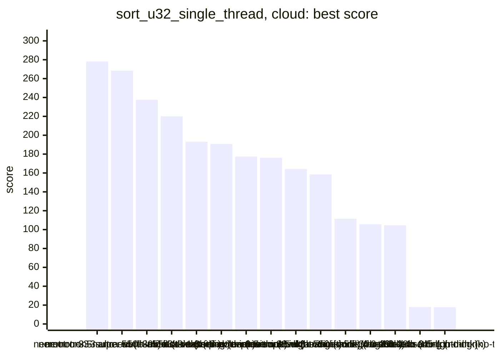
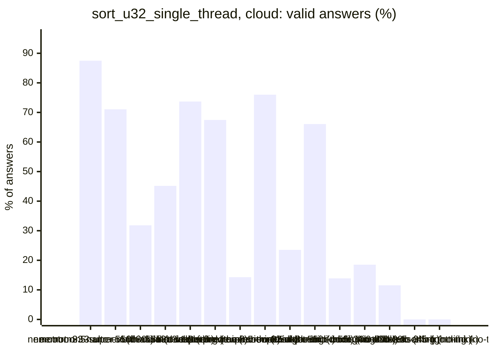
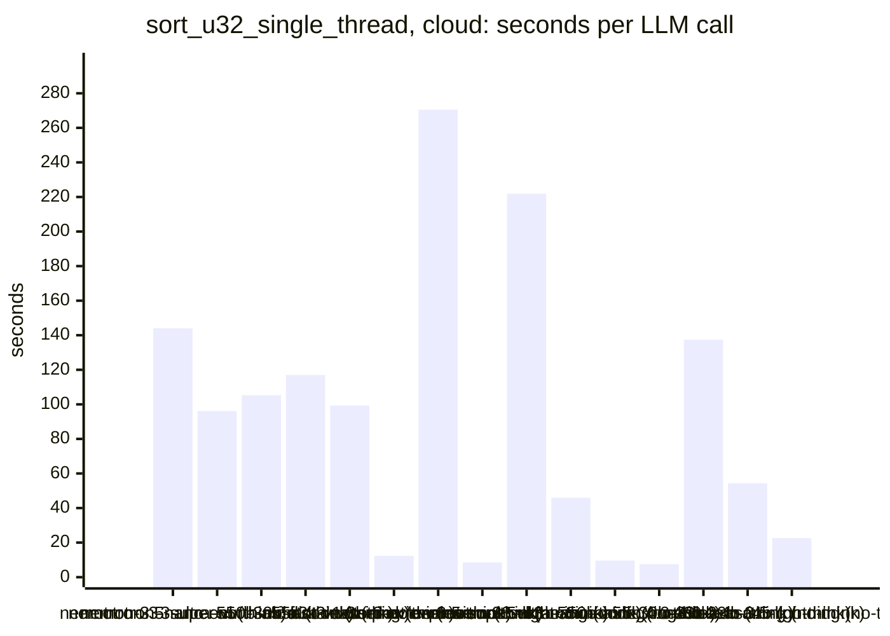
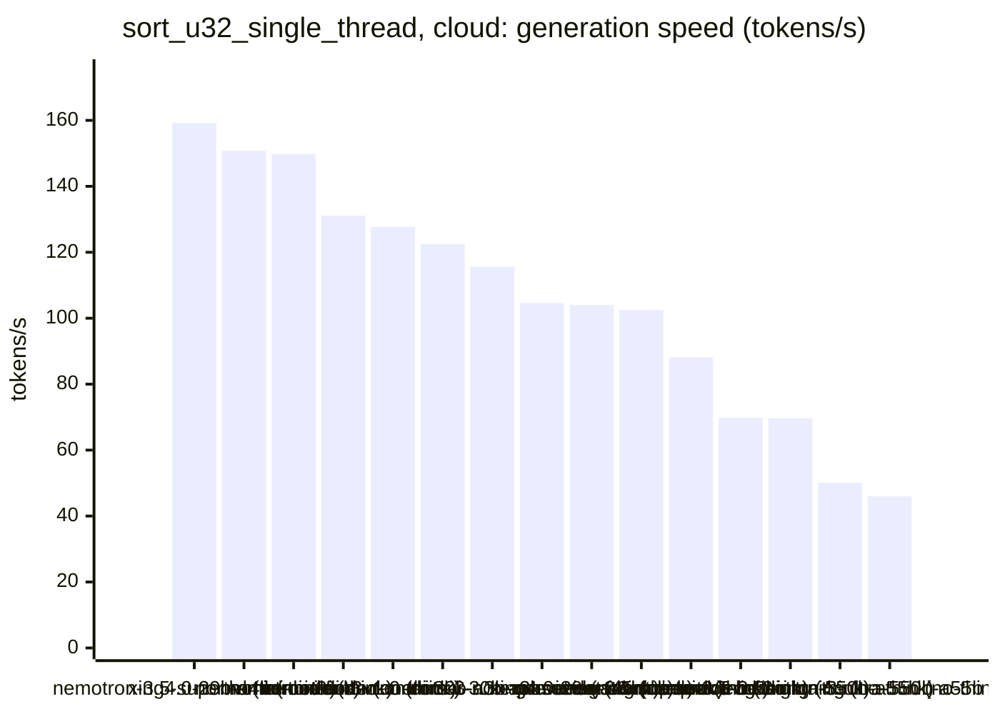

<!-- Copyright (c) 2026 by C. Klukas -->
<!-- SPDX-License-Identifier: GPL-3.0-only -->
<!-- Generated by `omega report` from bench/results/*.json. Do not edit by hand. -->

# sort_u32_single_thread

54 models, each run at most 60 minutes, ended earlier after 15 answers in a row without progress; one run per model. The [overall ranking](../benchmarks.md#overall-ranking) compares the models over all examples.

Machine: Intel(R) Core(TM) i7-8700K CPU @ 3.70GHz (MS-7A98), 12 cores, 64 GB, 2x NVIDIA GeForce GTX 1080 Ti, 11264 MiB.

## Local models

Ollama on this machine.

| Model | Params | Initial | Best | Gain | LLM calls | s/call | Valid | New bests | Min to best | Minutes | Stopped by |
|---|---|--:|--:|--:|--:|--:|--:|--:|--:|--:|---|
| qwen3-coder:30b (no-think) | 30.5B | 21.3555 | **210.1563** | ×9.84 | 38 | 95 | 53% | 7 | 53.1 | 62.4 | time limit |
| gpt-oss:20b (no-think) | 20.9B | 20.7094 | **209.0805** | ×10.10 | 32 | 118 | 72% | 5 | 49.0 | 65.3 | time limit |
| gpt-oss:20b (think) | 20.9B | 21.1031 | **199.3797** | ×9.45 | 25 | 72 | 72% | 5 | 58.1 | 63.7 | time limit |
| gemma4:12b-it-qat (no-think) | 11.9B | 20.9351 | **196.9652** | ×9.41 | 35 | 38 | 86% | 9 | 12.2 | 23.8 | no progress |
| qwen3.6:27b-coding-mtp-q4_K_M (no-think) | 27.3B | 21.1675 | **190.7861** | ×9.01 | 11 | 352 | 45% | 2 | 46.4 | 66.3 | time limit |
| hf.co/mmnga-o/Qwen3-Swallow-30B-A3B-RL-v0.2-gguf:Q4_K_M (think) | 30.5B | 23.8538 | **161.2733** | ×6.76 | 21 | 172 | 62% | 4 | 32.6 | 62.7 | time limit |
| gemma4:26b-a4b-it-qat (no-think) | 25.2B | 21.0503 | **151.3881** | ×7.19 | 24 | 46 | 83% | 5 | 6.4 | 20.3 | no progress |
| hf.co/mmnga-o/Qwen3-Swallow-30B-A3B-RL-v0.2-gguf:Q4_K_M (no-think) | 30.5B | 24.2506 | **149.4041** | ×6.16 | 32 | 118 | 56% | 6 | 28.3 | 65.4 | time limit |
| gemma4:26b-a4b-it-qat (think) | 25.2B | 21.7476 | **136.2851** | ×6.27 | 10 | 374 | 70% | 2 | 24.0 | 65.3 | time limit |
| hf.co/llm-jp/llm-jp-4.1-32b-a3b-thinking-gguf:Q4_K_M (no-think) | 32.1B | 22.6761 | **132.2910** | ×5.83 | 25 | 68 | 44% | 3 | 13.4 | 31.2 | no progress |
| gemma4:e4b-it-qat (think) | 7.5B | 21.3970 | **116.1173** | ×5.43 | 19 | 78 | 68% | 3 | 4.7 | 25.8 | no progress |
| gemma4:e2b (think) | 4.6B | 21.8149 | **112.4801** | ×5.16 | 17 | 34 | 29% | 1 | 0.9 | 11.2 | no progress |
| gemma4:e4b-it-qat (no-think) | 7.5B | 21.0437 | **110.5333** | ×5.25 | 22 | 22 | 50% | 2 | 2.6 | 9.4 | no progress |
| gemma4:latest (no-think) | 7.5B | 21.0846 | **108.7229** | ×5.16 | 31 | 18 | 45% | 2 | 5.0 | 11.2 | no progress |
| gemma4:latest (think) | 7.5B | 21.4057 | **102.7348** | ×4.80 | 20 | 62 | 70% | 1 | 3.5 | 23.3 | no progress |
| qwen3:30b-a3b-instruct-2507-q4_K_M (no-think) | 30.5B | 21.1390 | **102.6424** | ×4.86 | 24 | 35 | 25% | 1 | 4.0 | 16.1 | no progress |
| gemma4:e2b (no-think) | 4.6B | 21.7523 | **98.6291** | ×4.53 | 36 | 10 | 19% | 2 | 3.4 | 7.3 | no progress |
| glm-4.7-flash:latest (think) | 29.9B | 21.5735 | **98.5835** | ×4.57 | 9 | 440 | 33% | 3 | 57.4 | 68.5 | time limit |
| qwen3.6:27b-coding-mtp-q4_K_M (think) | 27.3B | 21.4667 | **83.9068** | ×3.91 | 2 | 1912 | 100% | 1 | 34.6 | 67.8 | time limit |
| frob/sarvam:30b (no-think) | 32.2B | 21.5643 | **79.3777** | ×3.68 | 8 | 519 | 12% | 1 | 58.8 | 71.1 | time limit |
| frob/sarvam:30b (think) | 32.2B | 21.4466 | **69.6883** | ×3.25 | 7 | 581 | 14% | 1 | 40.0 | 70.6 | time limit |
| hf.co/LiquidAI/LFM3-1.7B-GGUF:Q4_K_M (think) | 1.73B | 22.2800 | **37.4444** | ×1.68 | 21 | 163 | 19% | 2 | 16.0 | 59.3 | no progress |
| underdog-saluki-27b:iq2-mix (no-think) | 26.9B | 21.4718 | **27.9395** | ×1.30 | 32 | 116 | 12% | 2 | 34.7 | 63.5 | time limit |
| qwen2.5-coder:7b (no-think) | 7.6B | 17.9995 | **26.1112** | ×1.45 | 28 | 16 | 18% | 3 | 7.9 | 9.1 | no progress |
| hf.co/Colby/apertus-v1.5-8b-text-Q4_K_M-GGUF:Q4_K_M (no-think) | 8.05B | 23.1454 | **23.1454** | ×1.00 | 16 | 19 | 0% | 0 | - | 6.0 | no progress |
| qwen3:30b-a3b-instruct-2507-q4_K_M (think) | 30.5B | 21.7475 | **21.9741** | ×1.01 | 17 | 30 | 47% | 1 | 8.8 | 11.9 | no progress |
| qwen3.5:latest (think) | 9.0B | 21.8265 | **21.8265** | ×1.00 | 16 | 81 | 0% | 0 | - | 22.9 | no progress |
| richardyoung/frognano-4b-2609:latest (no-think) | 4.3B | 21.6144 | **21.6144** | ×1.00 | 16 | 42 | 0% | 0 | - | 12.2 | no progress |
| llm-jp-4-8b-omega:q4_k_m (no-think) | 8.6B | 21.6066 | **21.6066** | ×1.00 | 16 | 48 | 0% | 0 | - | 13.8 | no progress |
| hf.co/LiquidAI/LFM3-1.7B-GGUF:Q4_K_M (no-think) | 1.73B | 21.5673 | **21.5673** | ×1.00 | 16 | 59 | 6% | 0 | - | 16.5 | no progress |
| glm-4.7-flash:latest (no-think) | 29.9B | 21.5517 | **21.5517** | ×1.00 | 16 | 49 | 12% | 0 | - | 15.0 | no progress |
| richardyoung/frognano-4b-2609:latest (think) | 4.3B | 21.4971 | **21.4971** | ×1.00 | 16 | 65 | 0% | 0 | - | 19.7 | no progress |
| nemotron-3-nano:4b (no-think) | 4.0B | 21.4822 | **21.4822** | ×1.00 | 16 | 28 | 0% | 0 | - | 8.5 | no progress |
| nemotron-3-nano:4b (think) | 4.0B | 21.3231 | **21.3231** | ×1.00 | 16 | 43 | 0% | 0 | - | 12.8 | no progress |
| underdog-saluki-27b:iq2-mix (think) | 26.9B | 21.2820 | **21.2820** | ×1.00 | 3 | 1625 | 0% | 0 | - | 83.2 | time limit |
| yandex/YandexGPT-5-Lite-8B-instruct-GGUF:latest (no-think) | 8.0B | 21.2540 | **21.2540** | ×1.00 | 16 | 25 | 6% | 0 | - | 7.8 | no progress |
| qwen3.5:latest (no-think) | 9.0B | 20.7871 | **20.7871** | ×1.00 | 16 | 74 | 6% | 0 | - | 20.9 | no progress |
| MichelRosselli/apertus:8b-instruct-2509-q4_k_m (no-think) | 8.1B | 19.1860 | **20.6900** | ×1.08 | 23 | 17 | 26% | 2 | 6.7 | 8.1 | no progress |
| gemma4:12b-it-qat (think) | 11.9B | | | | | | | | | | failed: HTTPError: HTTP Error 500: Internal Server Error |

### Inference speed and memory

RAM is what Ollama reports for the loaded model (weights, context cache and buffers; on Apple silicon this is shared memory). Load is the time to bring the model into memory. Prompt and generation speeds are tokens per second over all calls of the run.

| Model | Params | RAM GB | Load s | Prompt tok/s | Gen tok/s | Median s/call | p90 s/call | Tokens/answer | Stopped |
|---|---|--:|--:|--:|--:|--:|--:|--:|--:|
| gemma4:e2b (think) | 4.6B | 0.9 | 0 | 2729 | 96.3 | 34 | 42 | 2922 | 0 |
| gemma4:e2b (no-think) | 4.6B | 0.9 | 0 | 3359 | 107.0 | 10 | 14 | 696 | 0 |
| hf.co/LiquidAI/LFM3-1.7B-GGUF:Q4_K_M (think) | 1.73B | 1.5 | 0 | 7003 | 104.4 | 151 | 236 | 16758 | 1 |
| hf.co/LiquidAI/LFM3-1.7B-GGUF:Q4_K_M (no-think) | 1.73B | 1.5 | 0 | 4823 | 85.7 | 73 | 81 | 538 | 13 |
| gemma4:latest (no-think) | 7.5B | 3.3 | 0 | 1806 | 56.5 | 15 | 38 | 734 | 0 |
| gemma4:latest (think) | 7.5B | 3.3 | 1 | 1884 | 50.8 | 65 | 100 | 2926 | 0 |
| nemotron-3-nano:4b (no-think) | 4.0B | 3.9 | 0 | 2942 | 73.2 | 15 | 64 | 1646 | 3 |
| nemotron-3-nano:4b (think) | 4.0B | 3.9 | 0 | 3052 | 74.8 | 41 | 65 | 2904 | 0 |
| richardyoung/frognano-4b-2609:latest (no-think) | 4.3B | 4.8 | 0 | 2527 | 55.9 | 40 | 70 | 1722 | 3 |
| richardyoung/frognano-4b-2609:latest (think) | 4.3B | 4.8 | 0 | 2554 | 59.1 | 40 | 167 | 3331 | 1 |
| gemma4:e4b-it-qat (think) | 7.5B | 6.1 | 0 | 1967 | 43.5 | 77 | 117 | 3160 | 0 |
| gemma4:e4b-it-qat (no-think) | 7.5B | 6.1 | 0 | 2058 | 41.5 | 23 | 32 | 720 | 0 |
| qwen2.5-coder:7b (no-think) | 7.6B | 6.6 | 0 | 2079 | 45.3 | 16 | 28 | 516 | 0 |
| qwen3.5:latest (think) | 9.0B | 9.4 | 0 | 1503 | 37.3 | 67 | 131 | 2688 | 1 |
| qwen3.5:latest (no-think) | 9.0B | 9.4 | 0 | 1588 | 37.0 | 51 | 176 | 1980 | 2 |
| yandex/YandexGPT-5-Lite-8B-instruct-GGUF:latest (no-think) | 8.0B | 10.2 | 0 | 2408 | 43.8 | 25 | 32 | 939 | 0 |
| gemma4:12b-it-qat (no-think) | 11.9B | 11.0 | 0 | 770 | 27.8 | 34 | 49 | 710 | 1 |
| underdog-saluki-27b:iq2-mix (no-think) | 26.9B | 11.2 | 0 | 409 | 15.9 | 102 | 177 | 1451 | 3 |
| underdog-saluki-27b:iq2-mix (think) | 26.9B | 11.2 | 0 | 545 | 15.2 | 1626 | 1627 | 24576 | 0 |
| hf.co/Colby/apertus-v1.5-8b-text-Q4_K_M-GGUF:Q4_K_M (no-think) | 8.05B | 12.6 | 0 | 2192 | 44.4 | 19 | 26 | 676 | 0 |
| MichelRosselli/apertus:8b-instruct-2509-q4_k_m (no-think) | 8.1B | 12.6 | 0 | 1796 | 42.8 | 16 | 22 | 541 | 0 |
| llm-jp-4-8b-omega:q4_k_m (no-think) | 8.6B | 13.0 | 0 | 2005 | 39.6 | 48 | 74 | 1694 | 0 |
| gpt-oss:20b (no-think) | 20.9B | 13.9 | 0 | 2332 | 50.8 | 92 | 256 | 5788 | 0 |
| gpt-oss:20b (think) | 20.9B | 13.9 | 0 | 2378 | 50.0 | 58 | 99 | 3331 | 1 |
| gemma4:26b-a4b-it-qat (no-think) | 25.2B | 16.1 | 0 | 818 | 34.1 | 43 | 67 | 1096 | 2 |
| gemma4:26b-a4b-it-qat (think) | 25.2B | 16.1 | 0 | 815 | 33.1 | 339 | 600 | 12076 | 0 |
| qwen3.6:27b-coding-mtp-q4_K_M (no-think) | 27.3B | 20.4 | 0 | 193 | 5.9 | 371 | 491 | 1912 | 0 |
| qwen3.6:27b-coding-mtp-q4_K_M (think) | 27.3B | 20.4 | 0 | 300 | 4.4 | 1920 | 1920 | 8412 | 0 |
| frob/sarvam:30b (no-think) | 32.2B | 21.2 | 0 | 2132 | 39.2 | 632 | 655 | 20206 | 0 |
| frob/sarvam:30b (think) | 32.2B | 21.2 | 0 | 2610 | 39.1 | 607 | 691 | 22787 | 1 |
| glm-4.7-flash:latest (think) | 29.9B | 21.6 | 0 | 642 | 19.0 | 305 | 1481 | 8179 | 0 |
| glm-4.7-flash:latest (no-think) | 29.9B | 21.6 | 0 | 650 | 23.8 | 42 | 48 | 1011 | 1 |
| qwen3-coder:30b (no-think) | 30.5B | 23.0 | 0 | 636 | 25.0 | 98 | 152 | 2002 | 4 |
| hf.co/mmnga-o/Qwen3-Swallow-30B-A3B-RL-v0.2-gguf:Q4_K_M (think) | 30.5B | 23.0 | 0 | 806 | 32.5 | 167 | 350 | 4953 | 1 |
| hf.co/mmnga-o/Qwen3-Swallow-30B-A3B-RL-v0.2-gguf:Q4_K_M (no-think) | 30.5B | 23.0 | 53 | 816 | 31.9 | 117 | 188 | 3060 | 9 |
| qwen3:30b-a3b-instruct-2507-q4_K_M (no-think) | 30.5B | 23.0 | 0 | 965 | 26.6 | 30 | 59 | 745 | 0 |
| qwen3:30b-a3b-instruct-2507-q4_K_M (think) | 30.5B | 23.0 | 0 | 972 | 26.5 | 27 | 55 | 631 | 0 |
| hf.co/llm-jp/llm-jp-4.1-32b-a3b-thinking-gguf:Q4_K_M (no-think) | 32.1B | 24.9 | 0 | 675 | 27.3 | 62 | 109 | 1545 | 0 |

### Best score over time

| Model | 15 min | 30 min | 45 min | 60 min |
|---|--:|--:|--:|--:|
| qwen3-coder:30b (no-think) | 93.9786 | 159.9376 | 197.4725 | 210.1563 |
| gpt-oss:20b (no-think) | 113.7613 | 180.3117 | 184.0635 | 209.0805 |
| gpt-oss:20b (think) | 139.6787 | 148.0917 | 199.2697 | 199.3797 |
| gemma4:12b-it-qat (no-think) | 196.9652 | 196.9652 | 196.9652 | 196.9652 |
| qwen3.6:27b-coding-mtp-q4_K_M (no-think) | 21.1675 | 133.4629 | 133.4629 | 190.7861 |
| hf.co/mmnga-o/Qwen3-Swallow-30B-A3B-RL-v0.2-gguf:Q4_K_M (think) | 144.7130 | 147.2195 | 161.2733 | 161.2733 |
| gemma4:26b-a4b-it-qat (no-think) | 151.3881 | 151.3881 | 151.3881 | 151.3881 |
| hf.co/mmnga-o/Qwen3-Swallow-30B-A3B-RL-v0.2-gguf:Q4_K_M (no-think) | 108.2050 | 149.4041 | 149.4041 | 149.4041 |
| gemma4:26b-a4b-it-qat (think) | 133.0025 | 136.2851 | 136.2851 | 136.2851 |
| hf.co/llm-jp/llm-jp-4.1-32b-a3b-thinking-gguf:Q4_K_M (no-think) | 132.2910 | 132.2910 | 132.2910 | 132.2910 |
| gemma4:e4b-it-qat (think) | 116.1173 | 116.1173 | 116.1173 | 116.1173 |
| gemma4:e2b (think) | 112.4801 | 112.4801 | 112.4801 | 112.4801 |
| gemma4:e4b-it-qat (no-think) | 110.5333 | 110.5333 | 110.5333 | 110.5333 |
| gemma4:latest (no-think) | 108.7229 | 108.7229 | 108.7229 | 108.7229 |
| gemma4:latest (think) | 102.7348 | 102.7348 | 102.7348 | 102.7348 |
| qwen3:30b-a3b-instruct-2507-q4_K_M (no-think) | 102.6424 | 102.6424 | 102.6424 | 102.6424 |
| gemma4:e2b (no-think) | 98.6291 | 98.6291 | 98.6291 | 98.6291 |
| glm-4.7-flash:latest (think) | 21.5735 | 95.2774 | 95.2774 | 98.5835 |
| qwen3.6:27b-coding-mtp-q4_K_M (think) | 21.4667 | 21.4667 | 83.9068 | 83.9068 |
| frob/sarvam:30b (no-think) | 21.5643 | 21.5643 | 21.5643 | 79.3777 |
| frob/sarvam:30b (think) | 21.4466 | 21.4466 | 69.6883 | 69.6883 |
| hf.co/LiquidAI/LFM3-1.7B-GGUF:Q4_K_M (think) | 35.4996 | 37.4444 | 37.4444 | 37.4444 |
| underdog-saluki-27b:iq2-mix (no-think) | 26.0320 | 26.0320 | 27.9395 | 27.9395 |
| qwen2.5-coder:7b (no-think) | 26.1112 | 26.1112 | 26.1112 | 26.1112 |
| hf.co/Colby/apertus-v1.5-8b-text-Q4_K_M-GGUF:Q4_K_M (no-think) | 23.1454 | 23.1454 | 23.1454 | 23.1454 |
| qwen3:30b-a3b-instruct-2507-q4_K_M (think) | 21.9741 | 21.9741 | 21.9741 | 21.9741 |
| qwen3.5:latest (think) | 21.8265 | 21.8265 | 21.8265 | 21.8265 |
| richardyoung/frognano-4b-2609:latest (no-think) | 21.6144 | 21.6144 | 21.6144 | 21.6144 |
| llm-jp-4-8b-omega:q4_k_m (no-think) | 21.6066 | 21.6066 | 21.6066 | 21.6066 |
| hf.co/LiquidAI/LFM3-1.7B-GGUF:Q4_K_M (no-think) | 21.5673 | 21.5673 | 21.5673 | 21.5673 |
| glm-4.7-flash:latest (no-think) | 21.5517 | 21.5517 | 21.5517 | 21.5517 |
| richardyoung/frognano-4b-2609:latest (think) | 21.4971 | 21.4971 | 21.4971 | 21.4971 |
| nemotron-3-nano:4b (no-think) | 21.4822 | 21.4822 | 21.4822 | 21.4822 |
| nemotron-3-nano:4b (think) | 21.3231 | 21.3231 | 21.3231 | 21.3231 |
| underdog-saluki-27b:iq2-mix (think) | 21.2820 | 21.2820 | 21.2820 | 21.2820 |
| yandex/YandexGPT-5-Lite-8B-instruct-GGUF:latest (no-think) | 21.2540 | 21.2540 | 21.2540 | 21.2540 |
| qwen3.5:latest (no-think) | 20.7871 | 20.7871 | 20.7871 | 20.7871 |
| MichelRosselli/apertus:8b-instruct-2509-q4_k_m (no-think) | 20.6900 | 20.6900 | 20.6900 | 20.6900 |

### Outcome of the LLM answers

| Model | compile error | duplicate | edit error | invalid | llm error | ok | timeout |
|---|--:|--:|--:|--:|--:|--:|--:|
| qwen3-coder:30b (no-think) | 3 | 2 | 2 | 7 | 4 | 20 | 0 |
| gpt-oss:20b (no-think) | 3 | 1 | 4 | 1 | 0 | 23 | 0 |
| gpt-oss:20b (think) | 2 | 0 | 4 | 0 | 1 | 18 | 0 |
| gemma4:12b-it-qat (no-think) | 0 | 2 | 0 | 2 | 1 | 30 | 0 |
| qwen3.6:27b-coding-mtp-q4_K_M (no-think) | 4 | 1 | 0 | 1 | 0 | 5 | 0 |
| hf.co/mmnga-o/Qwen3-Swallow-30B-A3B-RL-v0.2-gguf:Q4_K_M (think) | 2 | 1 | 2 | 2 | 1 | 13 | 0 |
| gemma4:26b-a4b-it-qat (no-think) | 0 | 0 | 0 | 2 | 2 | 20 | 0 |
| hf.co/mmnga-o/Qwen3-Swallow-30B-A3B-RL-v0.2-gguf:Q4_K_M (no-think) | 0 | 2 | 1 | 1 | 10 | 18 | 0 |
| gemma4:26b-a4b-it-qat (think) | 2 | 0 | 1 | 0 | 0 | 7 | 0 |
| hf.co/llm-jp/llm-jp-4.1-32b-a3b-thinking-gguf:Q4_K_M (no-think) | 2 | 0 | 12 | 0 | 0 | 11 | 0 |
| gemma4:e4b-it-qat (think) | 1 | 1 | 2 | 2 | 0 | 13 | 0 |
| gemma4:e2b (think) | 8 | 0 | 1 | 3 | 0 | 5 | 0 |
| gemma4:e4b-it-qat (no-think) | 8 | 1 | 0 | 2 | 0 | 11 | 0 |
| gemma4:latest (no-think) | 7 | 4 | 0 | 6 | 0 | 14 | 0 |
| gemma4:latest (think) | 1 | 0 | 0 | 5 | 0 | 14 | 0 |
| qwen3:30b-a3b-instruct-2507-q4_K_M (no-think) | 11 | 1 | 3 | 3 | 0 | 6 | 0 |
| gemma4:e2b (no-think) | 5 | 0 | 3 | 20 | 0 | 7 | 1 |
| glm-4.7-flash:latest (think) | 1 | 0 | 2 | 3 | 0 | 3 | 0 |
| qwen3.6:27b-coding-mtp-q4_K_M (think) | 0 | 0 | 0 | 0 | 0 | 2 | 0 |
| frob/sarvam:30b (no-think) | 1 | 0 | 6 | 0 | 0 | 1 | 0 |
| frob/sarvam:30b (think) | 0 | 0 | 5 | 0 | 1 | 1 | 0 |
| hf.co/LiquidAI/LFM3-1.7B-GGUF:Q4_K_M (think) | 8 | 0 | 7 | 1 | 1 | 4 | 0 |
| underdog-saluki-27b:iq2-mix (no-think) | 7 | 0 | 2 | 15 | 3 | 4 | 1 |
| qwen2.5-coder:7b (no-think) | 7 | 4 | 1 | 11 | 0 | 5 | 0 |
| hf.co/Colby/apertus-v1.5-8b-text-Q4_K_M-GGUF:Q4_K_M (no-think) | 4 | 0 | 12 | 0 | 0 | 0 | 0 |
| qwen3:30b-a3b-instruct-2507-q4_K_M (think) | 6 | 1 | 2 | 0 | 0 | 8 | 0 |
| qwen3.5:latest (think) | 11 | 0 | 2 | 2 | 1 | 0 | 0 |
| richardyoung/frognano-4b-2609:latest (no-think) | 8 | 0 | 2 | 3 | 3 | 0 | 0 |
| llm-jp-4-8b-omega:q4_k_m (no-think) | 11 | 0 | 4 | 1 | 0 | 0 | 0 |
| hf.co/LiquidAI/LFM3-1.7B-GGUF:Q4_K_M (no-think) | 0 | 0 | 2 | 0 | 13 | 1 | 0 |
| glm-4.7-flash:latest (no-think) | 4 | 0 | 3 | 6 | 1 | 2 | 0 |
| richardyoung/frognano-4b-2609:latest (think) | 4 | 0 | 1 | 9 | 1 | 0 | 1 |
| nemotron-3-nano:4b (no-think) | 4 | 0 | 9 | 0 | 3 | 0 | 0 |
| nemotron-3-nano:4b (think) | 3 | 0 | 12 | 1 | 0 | 0 | 0 |
| underdog-saluki-27b:iq2-mix (think) | 0 | 0 | 3 | 0 | 0 | 0 | 0 |
| yandex/YandexGPT-5-Lite-8B-instruct-GGUF:latest (no-think) | 9 | 1 | 2 | 3 | 0 | 1 | 0 |
| qwen3.5:latest (no-think) | 12 | 0 | 1 | 0 | 2 | 1 | 0 |
| MichelRosselli/apertus:8b-instruct-2509-q4_k_m (no-think) | 4 | 3 | 8 | 2 | 0 | 6 | 0 |

### Best idea per model

- **qwen3-coder:30b (no-think)**: Replace the NEON histogram computation with a fully unrolled loop that processes 8 elements at a time using vector operations, which should improve performance on large arrays by …
- **gpt-oss:20b (no-think)**: Add a fast single‑pass counting sort for small key ranges (< 1024 or < 2048) by computing the maximum value while detecting sorted/reversed input, and return early to avoid the …
- **gpt-oss:20b (think)**: Replace the recursive merge sort with a fast 3‑pass 11‑bit LSD radix sort, add sorted/reverse detection, insertion sort for small arrays, and reuse a static temporary buffer to …
- **gemma4:12b-it-qat (no-think)**: Implement a hybrid sort that uses a high-performance 4-pass LSD radix sort for large $n$ and a branchless, NEON-accelerated sorting network for small $n$ to improve performance on …
- **qwen3.6:27b-coding-mtp-q4_K_M (no-think)**: Fix the compile error by moving the declaration of loop variable `i` outside the `#if defined(__ARM_NEON)` block so it is visible to the remainder loop, and optimize the radix …
- **hf.co/mmnga-o/Qwen3-Swallow-30B-A3B-RL-v0.2-gguf:Q4_K_M (think)**: Replace the 65536‑entry 16‑bit histogram with a 256‑entry 8‑bit histogram, which halves the memset size and loop work per pass, giving a big speed‑up on the Apple‑Silicon CPU.
- **gemma4:26b-a4b-it-qat (no-think)**: Use a 4-pass 8-bit Radix Sort with a single buffer, which is often faster for large random arrays due to smaller histogram sizes and better cache behavior, and implement a more …
- **hf.co/mmnga-o/Qwen3-Swallow-30B-A3B-RL-v0.2-gguf:Q4_K_M (no-think)**: Replace the std::sort call with an in‑place LSD radix sort that uses a configurable digit size (RADIX_BITS); the linear‑time counting‑sort passes are highly parallelizable on ARM …
- **hf.co/llm-jp/llm-jp-4.1-32b-a3b-thinking-gguf:Q4_K_M (no-think)**: Replace the heap‑allocated scratch buffer with a fixed‑size thread‑local array to eliminate per‑call allocation overhead and improve cache locality, keeping the existing …
- **gemma4:e4b-it-qat (think)**: Implement a ping-pong buffer strategy to eliminate redundant $O(N)$ copying between the original array and the temporary buffer in every pass of the radix sort.
- **gemma4:e2b (think)**: Implement an LSD Radix Sort using 4 passes of 8-bit counting sort, leveraging NEON-like vector operations conceptually for grouping, which should outperform general comparison …
- **gemma4:e4b-it-qat (no-think)**: Fix the compile error by making `SHIFT` a non-constexpr local variable inside `counting_sort_pass` since `pass` is not a compile-time constant.
- **gemma4:latest (no-think)**: Replace the generic merge sort with LSD Radix Sort, as it is expected to outperform comparison sorts for fixed-width integers, especially when optimized for cache locality and …
- **gemma4:latest (think)**: Replace the $O(N \log N)$ Merge Sort implementation with $O(N)$ LSD Radix Sort, which is asymptotically faster for fixed-width integer sorting and highly performant for …
- **qwen3:30b-a3b-instruct-2507-q4_K_M (no-think)**: Replace recursive merge sort with an iterative bottom-up radix sort using 8-bit digit passes with NEON-optimized counting and in-place digit rearrangement, which leverages high …
- **gemma4:e2b (no-think)**: Implement an in-place hybrid sort using an Introsort-like structure: switching to insertion sort for small partitions and using a highly optimized, iterative LSD Radix Sort for …
- **glm-4.7-flash:latest (think)**: Replace the recursive merge sort with a 4-pass LSD radix sort using a scratch buffer and raw counting arrays to leverage compiler auto-vectorization, achieving linear time …
- **frob/sarvam:30b (no-think)**: Use an LSD radix sort with 8‑bit digits, a single temporary buffer, and a branchless distribution pass, leveraging NEON for the histogram and prefix sum to achieve O(n) time with …
- **frob/sarvam:30b (think)**: Use an in-place 8‑bit LSD radix sort with insertion sort for tiny arrays to maximize throughput.
- **hf.co/LiquidAI/LFM3-1.7B-GGUF:Q4_K_M (think)**: Replace the custom recursive merge sort that allocates a full `std::vector` and uses per‑call recursion with plain `std::sort(a, a+n)`. The standard library’s introsort is highly …
- **underdog-saluki-27b:iq2-mix (no-think)**: Replace the recursive merge sort with an iterative bottom-up merge sort using the scratch buffer, plus a pre-check for nearly-sorted and reverse-sorted inputs to short-circuit …
- **qwen2.5-coder:7b (no-think)**: Optimize the merge sort by using a ping-pong buffer to reduce cache misses.
- **hf.co/Colby/apertus-v1.5-8b-text-Q4_K_M-GGUF:Q4_K_M (no-think)**: initial program
- **qwen3:30b-a3b-instruct-2507-q4_K_M (think)**: tuned INSERTION_SORT_THRESHOLD=9.062 on top of: Replace the recursive merge sort with an iterative bottom-up merge sort to eliminate recursion overhead and improve cache …
- **qwen3.5:latest (think)**: initial program
- **richardyoung/frognano-4b-2609:latest (no-think)**: initial program
- **llm-jp-4-8b-omega:q4_k_m (no-think)**: initial program
- **hf.co/LiquidAI/LFM3-1.7B-GGUF:Q4_K_M (no-think)**: initial program
- **glm-4.7-flash:latest (no-think)**: initial program
- **richardyoung/frognano-4b-2609:latest (think)**: initial program
- **nemotron-3-nano:4b (no-think)**: initial program
- **nemotron-3-nano:4b (think)**: initial program
- **underdog-saluki-27b:iq2-mix (think)**: initial program
- **yandex/YandexGPT-5-Lite-8B-instruct-GGUF:latest (no-think)**: initial program
- **qwen3.5:latest (no-think)**: initial program
- **MichelRosselli/apertus:8b-instruct-2509-q4_k_m (no-think)**: Use a smaller threshold for the recursive merge sort to better handle small datasets, which reduces overhead and improves performance.

## Cloud models (OpenRouter)

Free OpenRouter models; times include the network and the provider's queue.

| Model | Params | Initial | Best | Gain | LLM calls | s/call | Valid | New bests | Min to best | Minutes | Stopped by |
|---|---|--:|--:|--:|--:|--:|--:|--:|--:|--:|---|
| nvidia/nemotron-3.5-super-vl:free (think) |  | 18.0532 | **278.1298** | ×15.41 | 24 | 144 | 88% | 3 | 23.9 | 59.0 | no progress |
| nvidia/nemotron-3-ultra-550b-a55b:free (think) |  | 20.0554 | **268.5245** | ×13.39 | 38 | 96 | 71% | 11 | 37.3 | 62.4 | time limit |
| nvidia/nemotron-3-nano-omni-30b-a3b-reasoning:free (think) |  | 17.7280 | **237.6100** | ×13.40 | 22 | 105 | 32% | 3 | 11.6 | 39.4 | no progress |
| cohere/north-mini-code:free (think) |  | 20.9346 | **220.1253** | ×10.51 | 31 | 117 | 45% | 5 | 35.8 | 61.8 | time limit |
| recursive/flint-v1.0:free (think) |  | 20.4022 | **193.1179** | ×9.47 | 19 | 99 | 74% | 2 | 5.1 | 32.1 | no progress |
| dots-studio/dots-3-note-preview:free (no-think) |  | 18.2791 | **190.7624** | ×10.44 | 43 | 12 | 67% | 5 | 8.8 | 9.8 | no progress |
| dots-studio/dots-3-note-preview:free (think) |  | 18.3752 | **177.3926** | ×9.65 | 14 | 270 | 14% | 1 | 50.2 | 63.7 | time limit |
| nvidia/nemotron-3.5-super-vl:free (no-think) |  | 18.0175 | **176.1989** | ×9.78 | 25 | 8 | 76% | 3 | 2.3 | 6.5 | no progress |
| nvidia/nemotron-3.5-lightning:free (think) |  | 17.9114 | **164.3294** | ×9.17 | 17 | 222 | 24% | 2 | 19.0 | 63.5 | time limit |
| nvidia/nemotron-3-ultra-550b-a55b:free (no-think) |  | 18.3971 | **158.5411** | ×8.62 | 56 | 46 | 66% | 6 | 26.8 | 44.4 | no progress |
| cohere/north-mini-code:free (no-think) |  | 18.1012 | **111.5420** | ×6.16 | 36 | 10 | 14% | 2 | 3.5 | 6.7 | no progress |
| nvidia/nemotron-3-nano-omni-30b-a3b-reasoning:free (no-think) |  | 18.1163 | **105.6055** | ×5.83 | 27 | 8 | 19% | 2 | 1.7 | 4.1 | no progress |
| xingchen-agi/xing4.0-29b-a4b:free (think) |  | 18.3402 | **104.5525** | ×5.70 | 26 | 137 | 12% | 4 | 56.6 | 61.5 | time limit |
| xingchen-agi/xing4.0-29b-a4b:free (no-think) |  | 17.9483 | **17.9483** | ×1.00 | 16 | 54 | 0% | 0 | - | 15.1 | no progress |
| nvidia/nemotron-3.5-lightning:free (no-think) |  | 17.8017 | **17.8017** | ×1.00 | 16 | 23 | 0% | 0 | - | 6.7 | no progress |

### Inference speed and cost

Generation speed is measured from the first to the last streamed token; the time to the first token is counted as prompt time. Cost is what OpenRouter charged for the run.

| Model | Gen tok/s | Median s/call | p90 s/call | Tokens/answer | Stopped | Cost $ |
|---|--:|--:|--:|--:|--:|--:|
| nvidia/nemotron-3.5-super-vl:free (no-think) | 159.2 | 8 | 12 | 1179 | 1 | 0.000 |
| xingchen-agi/xing4.0-29b-a4b:free (no-think) | 150.7 | 74 | 76 | 460 | 1 | 0.000 |
| cohere/north-mini-code:free (think) | 149.8 | 115 | 173 | 17339 | 0 | 0.000 |
| cohere/north-mini-code:free (no-think) | 131.1 | 8 | 17 | 1182 | 1 | 0.000 |
| recursive/flint-v1.0:free (think) | 127.7 | 102 | 193 | 12519 | 0 | 0.000 |
| nvidia/nemotron-3-nano-omni-30b-a3b-reasoning:free (think) | 122.5 | 92 | 190 | 12534 | 1 | 0.000 |
| nvidia/nemotron-3-nano-omni-30b-a3b-reasoning:free (no-think) | 115.6 | 7 | 13 | 659 | 4 | 0.000 |
| dots-studio/dots-3-note-preview:free (no-think) | 104.6 | 11 | 19 | 947 | 0 | 0.000 |
| xingchen-agi/xing4.0-29b-a4b:free (think) | 104.0 | 88 | 265 | 4986 | 7 | 0.000 |
| nvidia/nemotron-3.5-super-vl:free (think) | 102.5 | 161 | 229 | 14578 | 0 | 0.000 |
| dots-studio/dots-3-note-preview:free (think) | 88.1 | 282 | 299 | 23631 | 0 | 0.000 |
| nvidia/nemotron-3.5-lightning:free (think) | 69.8 | 192 | 380 | 15433 | 0 | 0.000 |
| nvidia/nemotron-3.5-lightning:free (no-think) | 69.6 | 21 | 36 | 1196 | 7 | 0.000 |
| nvidia/nemotron-3-ultra-550b-a55b:free (no-think) | 50.1 | 38 | 80 | 2213 | 0 | 0.000 |
| nvidia/nemotron-3-ultra-550b-a55b:free (think) | 46.0 | 67 | 240 | 4184 | 2 | 0.000 |

### Best score over time

| Model | 15 min | 30 min | 45 min | 60 min |
|---|--:|--:|--:|--:|
| nvidia/nemotron-3.5-super-vl:free (think) | 269.5259 | 278.1298 | 278.1298 | 278.1298 |
| nvidia/nemotron-3-ultra-550b-a55b:free (think) | 247.9010 | 251.1741 | 268.5245 | 268.5245 |
| nvidia/nemotron-3-nano-omni-30b-a3b-reasoning:free (think) | 237.6100 | 237.6100 | 237.6100 | 237.6100 |
| cohere/north-mini-code:free (think) | 195.8426 | 206.3283 | 220.1253 | 220.1253 |
| recursive/flint-v1.0:free (think) | 193.1179 | 193.1179 | 193.1179 | 193.1179 |
| dots-studio/dots-3-note-preview:free (no-think) | 190.7624 | 190.7624 | 190.7624 | 190.7624 |
| dots-studio/dots-3-note-preview:free (think) | 18.3752 | 18.3752 | 18.3752 | 177.3926 |
| nvidia/nemotron-3.5-super-vl:free (no-think) | 176.1989 | 176.1989 | 176.1989 | 176.1989 |
| nvidia/nemotron-3.5-lightning:free (think) | 17.9114 | 164.3294 | 164.3294 | 164.3294 |
| nvidia/nemotron-3-ultra-550b-a55b:free (no-think) | 135.4210 | 158.5411 | 158.5411 | 158.5411 |
| cohere/north-mini-code:free (no-think) | 111.5420 | 111.5420 | 111.5420 | 111.5420 |
| nvidia/nemotron-3-nano-omni-30b-a3b-reasoning:free (no-think) | 105.6055 | 105.6055 | 105.6055 | 105.6055 |
| xingchen-agi/xing4.0-29b-a4b:free (think) | 18.3402 | 81.3476 | 83.5653 | 104.5525 |
| xingchen-agi/xing4.0-29b-a4b:free (no-think) | 17.9483 | 17.9483 | 17.9483 | 17.9483 |
| nvidia/nemotron-3.5-lightning:free (no-think) | 17.8017 | 17.8017 | 17.8017 | 17.8017 |

### Outcome of the LLM answers

| Model | compile error | duplicate | edit error | invalid | llm error | ok | timeout |
|---|--:|--:|--:|--:|--:|--:|--:|
| nvidia/nemotron-3.5-super-vl:free (think) | 0 | 0 | 3 | 0 | 0 | 21 | 0 |
| nvidia/nemotron-3-ultra-550b-a55b:free (think) | 1 | 2 | 0 | 6 | 2 | 27 | 0 |
| nvidia/nemotron-3-nano-omni-30b-a3b-reasoning:free (think) | 1 | 0 | 11 | 2 | 1 | 7 | 0 |
| cohere/north-mini-code:free (think) | 0 | 2 | 15 | 0 | 0 | 14 | 0 |
| recursive/flint-v1.0:free (think) | 1 | 0 | 4 | 0 | 0 | 14 | 0 |
| dots-studio/dots-3-note-preview:free (no-think) | 3 | 4 | 5 | 1 | 1 | 29 | 0 |
| dots-studio/dots-3-note-preview:free (think) | 0 | 0 | 12 | 0 | 0 | 2 | 0 |
| nvidia/nemotron-3.5-super-vl:free (no-think) | 0 | 2 | 2 | 1 | 1 | 19 | 0 |
| nvidia/nemotron-3.5-lightning:free (think) | 0 | 2 | 11 | 0 | 0 | 4 | 0 |
| nvidia/nemotron-3-ultra-550b-a55b:free (no-think) | 3 | 10 | 0 | 6 | 0 | 37 | 0 |
| cohere/north-mini-code:free (no-think) | 8 | 3 | 8 | 10 | 1 | 5 | 1 |
| nvidia/nemotron-3-nano-omni-30b-a3b-reasoning:free (no-think) | 0 | 1 | 13 | 4 | 4 | 5 | 0 |
| xingchen-agi/xing4.0-29b-a4b:free (think) | 1 | 0 | 0 | 2 | 20 | 3 | 0 |
| xingchen-agi/xing4.0-29b-a4b:free (no-think) | 2 | 0 | 2 | 2 | 10 | 0 | 0 |
| nvidia/nemotron-3.5-lightning:free (no-think) | 5 | 0 | 4 | 0 | 7 | 0 | 0 |

### Best idea per model

- **nvidia/nemotron-3.5-super-vl:free (think)**: tuned kInsertionThreshold=64 on top of: Replace the O(n log n) merge sort with a 4-pass LSD byte radix sort: one combined pass counts all four byte histograms, passes with a …
- **nvidia/nemotron-3-ultra-550b-a55b:free (think)**: tuned INSERTION_SORT_THRESHOLD=226 on top of: Fix the buggy pass-skipping logic (it incorrectly resets skip=false after finding a full bucket), combine the two sorted-check loops …
- **nvidia/nemotron-3-nano-omni-30b-a3b-reasoning:free (think)**: tuned INSERTION_SORT_THRESHOLD=16, COUNTING_RANGE=2000 on top of: Implement a hybrid LSD radix sort with early sorted/reverse detection, a reduced insertion‑sort threshold, and a …
- **cohere/north-mini-code:free (think)**: Replace std::sort with a custom hybrid LSD radix sort that uses static buffers, early detection of sorted/reverse runs, and insertion sort for small arrays to drastically reduce …
- **recursive/flint-v1.0:free (think)**: Add a single O(n) scan that early-outs for already-sorted and reverse-sorted inputs before running the radix passes, so the sorted/reverse benchmark distributions skip nearly all …
- **dots-studio/dots-3-note-preview:free (no-think)**: Replace the scalar scatter loop with an unrolled, branchless scatter that processes 4 elements at once using NEON scatter-like operations (vst4q_u32) to reduce loop overhead and …
- **dots-studio/dots-3-note-preview:free (think)**: Replace the O(n log n) merge sort with an LSD radix sort (4 passes of 8 bits) that computes all histograms in a single pass, skips constant bytes, and includes a fast early-exit …
- **nvidia/nemotron-3.5-super-vl:free (no-think)**: Replace std::sort fallback with a 4-pass 8-bit LSD radix sort: one counting pass builds all histograms, zero-digit passes are skipped, and data pings-pongs between input and …
- **nvidia/nemotron-3.5-lightning:free (think)**: tuned INSERTION_SORT_THRESHOLD=256 on top of: Replace merge sort with LSD radix sort using 4 passes of 8 bits each, with early detection of already-sorted/reverse-sorted data and …
- **nvidia/nemotron-3-ultra-550b-a55b:free (no-think)**: Optimize the NEON counting pass by unrolling the loop 4x (processing 16 elements per iteration) and reducing store/reload overhead by accumulating byte histograms directly from …
- **cohere/north-mini-code:free (no-think)**: Optimize the LSD radix sort by using branchless placement and a single counting pass per bit‑layer to reduce memory writes and improve NEON utilization.
- **nvidia/nemotron-3-nano-omni-30b-a3b-reasoning:free (no-think)**: Replace the recursive merge sort with a bottom-up LSD radix sort using 4 passes of 8 bits and a static scratch buffer to minimize memory traffic and CPU overhead, leveraging NEON …
- **xingchen-agi/xing4.0-29b-a4b:free (think)**: tuned PASS_BITS=8, PASSES=4, COUNTING_BUCKETS=1000, SMALL_THRESHOLD=16 on top of: Sweep the radix sort's bits-per-pass and number-of-passes parameters to find the fastest …
- **xingchen-agi/xing4.0-29b-a4b:free (no-think)**: initial program
- **nvidia/nemotron-3.5-lightning:free (no-think)**: initial program
