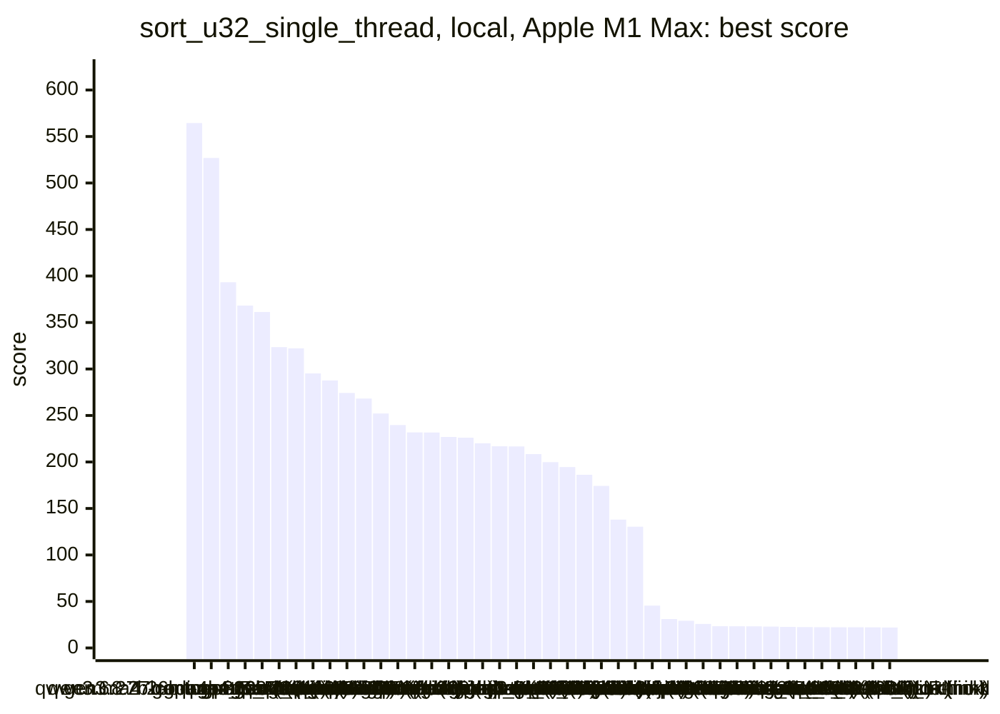
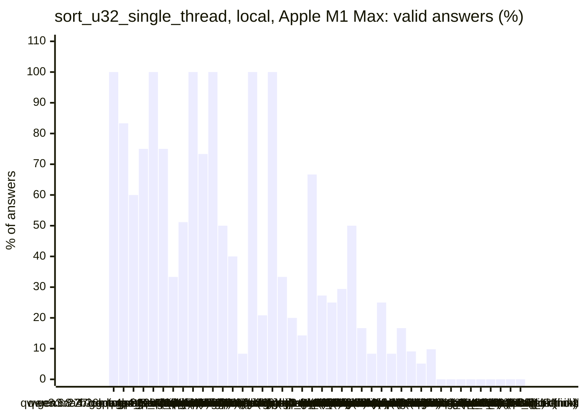
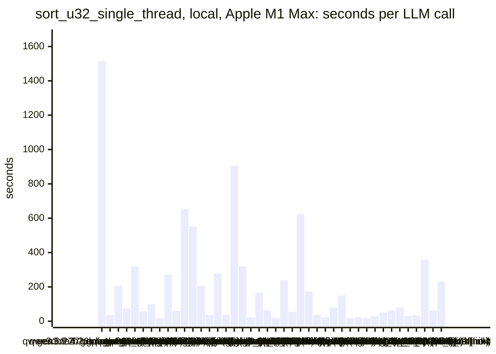
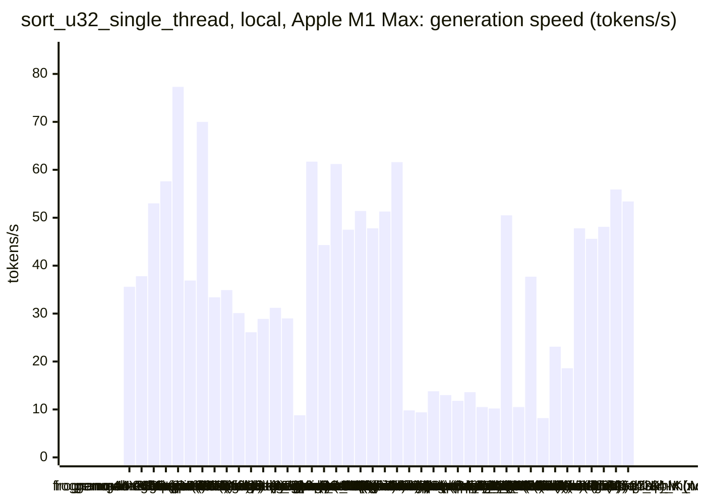
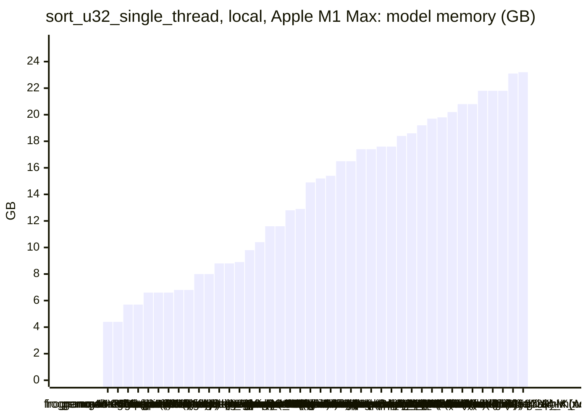
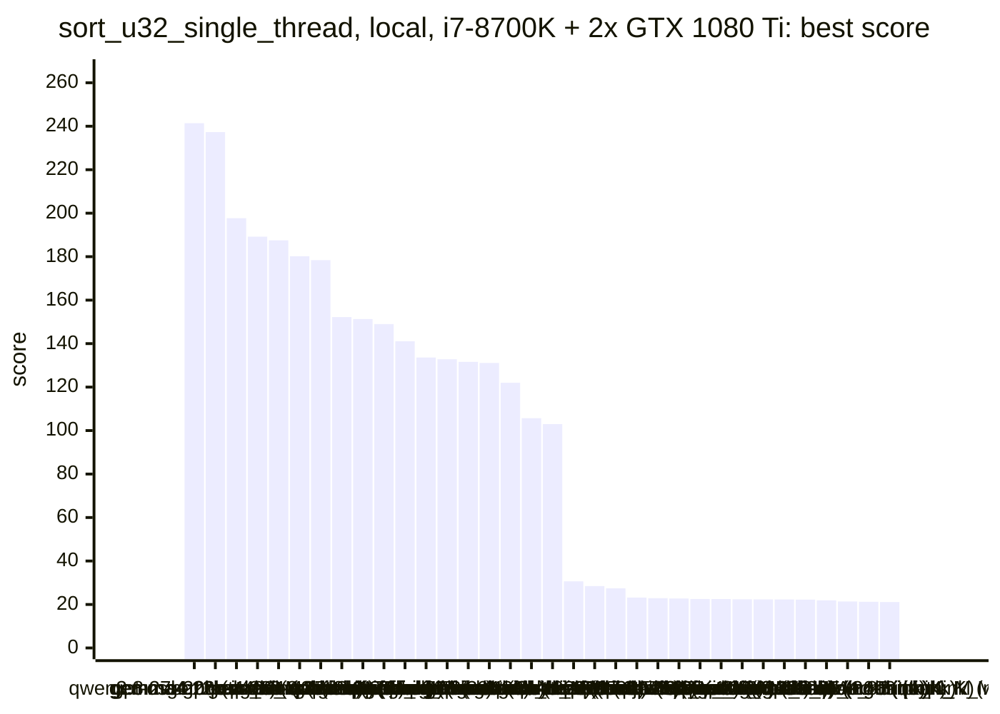
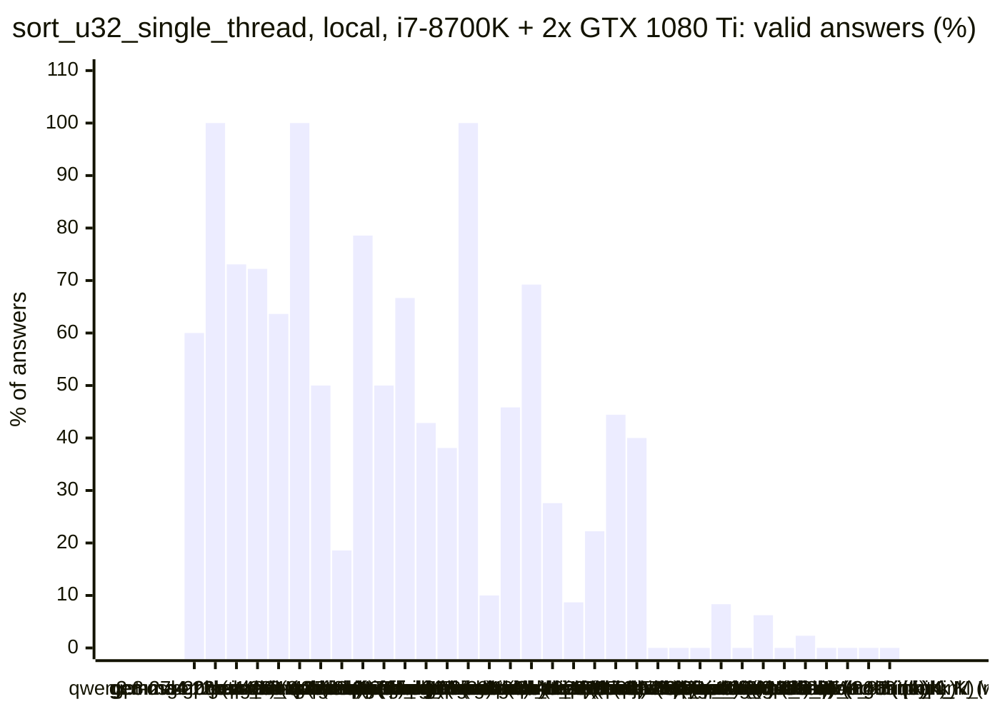
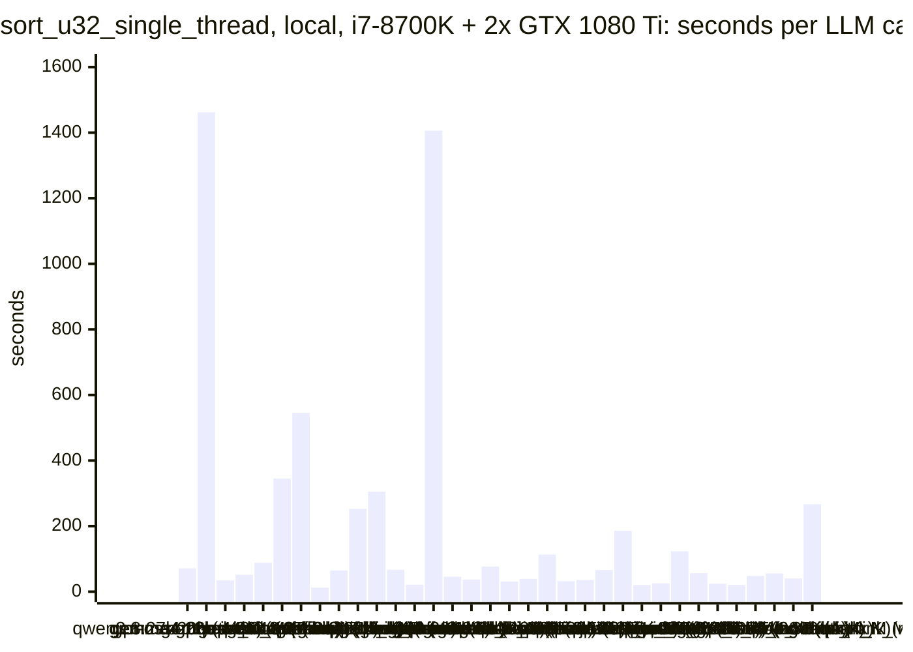
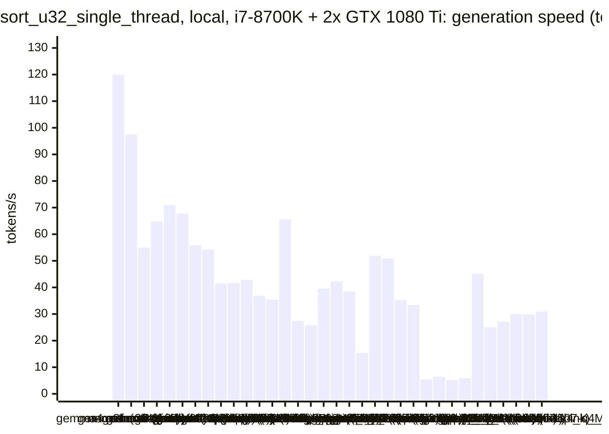
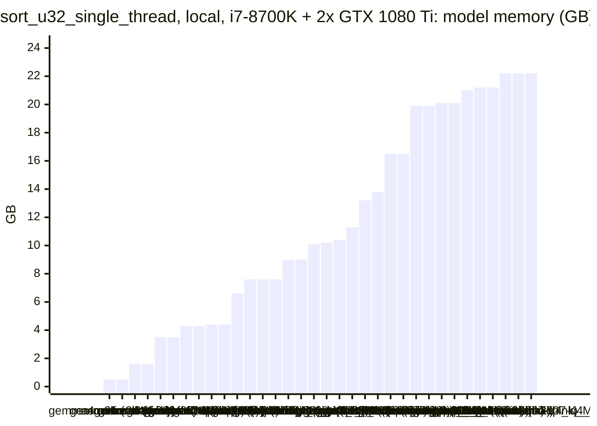

<!-- Copyright (c) 2026 by C. Klukas -->
<!-- SPDX-License-Identifier: GPL-3.0-only -->
<!-- Generated by `omega report` from bench/results/*.json. Do not edit by hand. -->

# sort_u32_single_thread

46 models, 15 minutes each, one run per model. The [overall ranking](../benchmarks.md#overall-ranking) compares the models over all examples.

Machines: **Apple M1 Max**: Apple M1 Max (Mac13,1), 10 cores, 32 GB, 45 runs; **i7-8700K + 2x GTX 1080 Ti**: Intel(R) Core(TM) i7-8700K CPU @ 3.70GHz (MS-7A98), 12 cores, 64 GB, 2x NVIDIA GeForce GTX 1080 Ti, 11264 MiB, 35 runs.

## Local models on Apple M1 Max

Ollama on this machine.

| Model | Params | Initial | Best | Gain | LLM calls | s/call | Valid | New bests | Min to best |
|---|---|--:|--:|--:|--:|--:|--:|--:|--:|
| qwen3.8:27b-mtp-q4_K_M (think) | 27.3B | 22.7147 | **564.4614** | ×24.85 | 1 | 1515 | 100% | 1 | 25.4 |
| gemma4:26b-a4b-it-qat (no-think) | 25.2B | 23.9752 | **526.8705** | ×21.98 | 24 | 38 | 83% | 7 | 14.2 |
| qwen3.6:27b-coding-mtp-q4_K_M (no-think) | 27.3B | 23.1794 | **393.2984** | ×16.97 | 5 | 207 | 60% | 3 | 17.4 |
| gpt-oss:20b (think) | 20.9B | 22.3922 | **368.1891** | ×16.44 | 12 | 76 | 75% | 4 | 10.2 |
| qwen3.5:27b (think) | 27.8B | 22.8759 | **361.2984** | ×15.79 | 3 | 319 | 100% | 2 | 9.6 |
| gemma4:12b-it-qat (no-think) | 11.9B | 22.6276 | **323.4781** | ×14.30 | 16 | 58 | 75% | 4 | 10.5 |
| gpt-oss:20b (no-think) | 20.9B | 23.9722 | **322.2479** | ×13.44 | 9 | 100 | 33% | 2 | 10.1 |
| gemma4:latest (no-think) |  | 24.0007 | **295.2118** | ×12.30 | 43 | 21 | 51% | 6 | 12.8 |
| gemma4:26b-a4b-it-qat (think) | 25.2B | 22.8505 | **287.6700** | ×12.59 | 4 | 272 | 100% | 1 | 7.0 |
| gemma4:e4b-it-qat (think) | 7.5B | 22.7781 | **274.2287** | ×12.04 | 15 | 61 | 73% | 4 | 15.3 |
| muse-glimmer:30b (think) | 27.9B | 22.5319 | **268.1684** | ×11.90 | 2 | 652 | 100% | 2 | 21.9 |
| gemma4:12b-it-qat (think) | 11.9B | 22.9697 | **252.1177** | ×10.98 | 2 | 553 | 50% | 1 | 8.8 |
| qwen3.5:27b (no-think) | 27.8B | 23.7668 | **239.7158** | ×10.09 | 5 | 206 | 40% | 2 | 17.3 |
| nemotron-3.5-lightning:30b-mlx (no-think) |  | 23.1661 | **231.7818** | ×10.01 | 24 | 37 | 8% | 2 | 8.9 |
| muse-glimmer:30b (no-think) | 27.9B | 21.5279 | **231.7497** | ×10.77 | 4 | 278 | 100% | 2 | 18.9 |
| qwen3-coder:30b (no-think) | 30.5B | 22.9410 | **226.8907** | ×9.89 | 24 | 38 | 21% | 4 | 10.9 |
| qwen3.6:27b-coding-mtp-q4_K_M (think) | 27.3B | 22.9987 | **226.0805** | ×9.83 | 1 | 905 | 100% | 1 | 15.2 |
| qwen3.8:27b-mtp-q4_K_M (no-think) | 27.3B | 23.3327 | **220.0800** | ×9.43 | 3 | 320 | 33% | 1 | 12.9 |
| gemma4:e4b-it-qat (no-think) | 7.5B | 23.3271 | **216.9010** | ×9.30 | 40 | 23 | 20% | 6 | 10.1 |
| qwen3.5:latest (think) | 9.7B | 23.3290 | **216.6847** | ×9.29 | 7 | 166 | 14% | 1 | 19.5 |
| gemma4:latest (think) |  | 22.6636 | **208.4549** | ×9.20 | 15 | 64 | 67% | 4 | 16.1 |
| gemma4:e2b (no-think) | 5.1B | 24.0010 | **199.8160** | ×8.33 | 44 | 21 | 27% | 4 | 9.6 |
| nemotron-3-nano:30b-a3b-mlx (think) |  | 23.7677 | **194.4692** | ×8.18 | 4 | 240 | 25% | 1 | 5.6 |
| glm-4.7-flash:latest (no-think) | 29.9B | 22.1847 | **186.1989** | ×8.39 | 17 | 55 | 29% | 3 | 9.7 |
| glm-4.7-flash:latest (think) | 29.9B | 23.0595 | **174.2766** | ×7.56 | 2 | 624 | 50% | 1 | 10.5 |
| ingu627/exaone4.0:32b (no-think) | 32.0B | 22.4285 | **138.0263** | ×6.15 | 6 | 174 | 17% | 1 | 17.9 |
| nemotron-3-nano:4b (think) |  | 23.8228 | **130.4122** | ×5.47 | 24 | 37 | 8% | 2 | 13.1 |
| qwen2.5-coder:7b (no-think) | 7.6B | 23.6181 | **45.5448** | ×1.93 | 36 | 25 | 25% | 3 | 9.9 |
| qwen3.5:latest (no-think) | 9.7B | 23.8223 | **31.0841** | ×1.30 | 12 | 80 | 8% | 1 | 16.1 |
| underdog-saluki-27b:iq2-mix (no-think) | 26.9B | 22.3971 | **29.2642** | ×1.31 | 6 | 150 | 17% | 2 | 10.7 |
| qwen3:30b-a3b-instruct-2507-q4_K_M (no-think) | 30.5B | 22.4985 | **25.8331** | ×1.15 | 44 | 20 | 9% | 4 | 5.4 |
| nemotron-3.5-lightning:30b-mlx (think) |  | | | | | | | | failed: all 4 model requests failed: nemotron-3.5-lightning:30b-mlx: |
| qwen3:30b-a3b-instruct-2507-q4_K_M (think) | 30.5B | 23.1855 | **23.3623** | ×1.01 | 39 | 23 | 5% | 1 | 5.1 |
| underdog-saluki-27b:iq2-mix (think) | 26.9B | | | | | | | | failed: all 1 model requests failed: underdog-saluki-27b:iq2-mix: an |
| nemotron-3-nano:4b (no-think) |  | 23.0386 | **23.2840** | ×1.01 | 51 | 17 | 10% | 1 | 5.5 |
| nemotron-3-nano:30b-a3b-mlx (no-think) |  | 23.2628 | **23.2628** | ×1.00 | 31 | 29 | 0% | 0 | - |
| gemma4:e2b (think) | 5.1B | 22.9626 | **22.9626** | ×1.00 | 18 | 50 | 0% | 0 | - |
| llm-jp-4-8b-omega:q4_k_m (no-think) | 8.6B | 22.5858 | **22.5858** | ×1.00 | 14 | 64 | 0% | 0 | - |
| frob/sarvam:30b (think) | 32.2B | | | | | | | | failed: all 3 model requests failed: frob/sarvam:30b: answer stopped |
| richardyoung/frognano-4b-2609:latest (think) | 4.3B | 22.4295 | **22.4295** | ×1.00 | 12 | 80 | 0% | 0 | - |
| yandex/YandexGPT-5-Lite-8B-instruct-GGUF:latest (no-think) | 8.0B | 22.2805 | **22.2805** | ×1.00 | 28 | 32 | 0% | 0 | - |
| MichelRosselli/apertus:8b-instruct-2509-q4_k_m (no-think) | 8.1B | 22.2474 | **22.2474** | ×1.00 | 25 | 35 | 0% | 0 | - |
| devstral-small-2:24b (no-think) | 24.0B | 22.2454 | **22.2454** | ×1.00 | 3 | 359 | 0% | 0 | - |
| richardyoung/frognano-4b-2609:latest (no-think) | 4.3B | 22.1990 | **22.1990** | ×1.00 | 15 | 62 | 0% | 0 | - |
| frob/sarvam:30b (no-think) | 32.2B | 22.0103 | **22.0103** | ×1.00 | 4 | 231 | 0% | 0 | - |

### Inference speed and memory

RAM is what Ollama reports for the loaded model (weights, context cache and buffers; on Apple silicon this is shared memory). Load is the time to bring the model into memory. Prompt and generation speeds are tokens per second over all calls of the run.

| Model | Params | RAM GB | Load s | Prompt tok/s | Gen tok/s | Median s/call | p90 s/call | Tokens/answer | Stopped |
|---|---|--:|--:|--:|--:|--:|--:|--:|--:|
| richardyoung/frognano-4b-2609:latest (think) | 4.3B | 4.4 | 13 | 668 | 35.6 | 72 | 95 | 2633 | 2 |
| richardyoung/frognano-4b-2609:latest (no-think) | 4.3B | 4.4 | 12 | 631 | 37.8 | 62 | 92 | 1905 | 6 |
| gemma4:e4b-it-qat (think) | 7.5B | 5.7 | 88 | 514 | 53.0 | 58 | 76 | 2381 | 0 |
| gemma4:e4b-it-qat (no-think) | 7.5B | 5.7 | 90 | 538 | 57.6 | 19 | 33 | 609 | 1 |
| gemma4:e2b (no-think) | 5.1B | 6.6 | 72 | 827 | 77.3 | 18 | 29 | 859 | 1 |
| qwen2.5-coder:7b (no-think) | 7.6B | 6.6 | 70 | 640 | 36.9 | 23 | 34 | 579 | 0 |
| gemma4:e2b (think) | 5.1B | 6.6 | 45 | 908 | 70.0 | 46 | 79 | 3049 | 0 |
| qwen3.5:latest (think) | 9.7B | 6.8 | 32 | 390 | 33.4 | 117 | 378 | 3892 | 1 |
| qwen3.5:latest (no-think) | 9.7B | 6.8 | 0 | 396 | 34.9 | 80 | 106 | 1612 | 5 |
| gemma4:12b-it-qat (no-think) | 11.9B | 8.0 | 126 | 216 | 30.1 | 51 | 72 | 818 | 0 |
| gemma4:12b-it-qat (think) | 11.9B | 8.0 | 93 | 196 | 26.1 | 588 | 588 | 10667 | 1 |
| llm-jp-4-8b-omega:q4_k_m (no-think) | 8.6B | 8.8 | 19 | 714 | 28.9 | 62 | 90 | 1623 | 0 |
| yandex/YandexGPT-5-Lite-8B-instruct-GGUF:latest (no-think) | 8.0B | 8.8 | 16 | 831 | 31.2 | 32 | 44 | 848 | 0 |
| MichelRosselli/apertus:8b-instruct-2509-q4_k_m (no-think) | 8.1B | 8.9 | 16 | 689 | 29.0 | 31 | 58 | 817 | 1 |
| underdog-saluki-27b:iq2-mix (no-think) | 26.9B | 9.8 | 2 | 94 | 8.8 | 167 | 198 | 973 | 0 |
| nemotron-3-nano:4b (think) |  | 10.4 | 8 | 1003 | 61.7 | 39 | 66 | 2033 | 0 |
| gemma4:latest (think) |  | 11.6 | 108 | 1039 | 44.3 | 60 | 104 | 2274 | 1 |
| nemotron-3-nano:4b (no-think) |  | 11.6 | 8 | 972 | 61.2 | 16 | 24 | 742 | 1 |
| gpt-oss:20b (think) | 20.9B | 12.8 | 106 | 521 | 47.5 | 73 | 135 | 2814 | 0 |
| gpt-oss:20b (no-think) | 20.9B | 12.9 | 54 | 1157 | 51.4 | 84 | 165 | 4663 | 0 |
| gemma4:latest (no-think) |  | 14.9 | 107 | 1268 | 47.8 | 16 | 32 | 642 | 0 |
| gemma4:26b-a4b-it-qat (think) | 25.2B | 15.2 | 243 | 591 | 51.3 | 254 | 411 | 10457 | 0 |
| gemma4:26b-a4b-it-qat (no-think) | 25.2B | 15.4 | 196 | 524 | 61.6 | 28 | 54 | 955 | 2 |
| muse-glimmer:30b (think) | 27.9B | 16.5 | 56 | 150 | 9.8 | 687 | 687 | 5904 | 0 |
| muse-glimmer:30b (no-think) | 27.9B | 16.5 | 56 | 110 | 9.4 | 292 | 377 | 2184 | 0 |
| qwen3.6:27b-coding-mtp-q4_K_M (no-think) | 27.3B | 17.4 | 310 | 103 | 13.8 | 165 | 453 | 1464 | 0 |
| qwen3.6:27b-coding-mtp-q4_K_M (think) | 27.3B | 17.4 | 302 | 89 | 13.0 | 905 | 905 | 7378 | 0 |
| qwen3.8:27b-mtp-q4_K_M (think) | 27.3B | 17.6 | 307 | 88 | 11.8 | 1515 | 1515 | 10121 | 0 |
| qwen3.8:27b-mtp-q4_K_M (no-think) | 27.3B | 17.6 | 300 | 125 | 13.6 | 124 | 767 | 962 | 0 |
| qwen3.5:27b (think) | 27.8B | 18.4 | 160 | 120 | 10.5 | 390 | 398 | 2482 | 0 |
| qwen3.5:27b (no-think) | 27.8B | 18.6 | 140 | 105 | 10.2 | 190 | 272 | 1436 | 0 |
| nemotron-3-nano:30b-a3b-mlx (think) |  | 19.2 | 100 | 265 | 50.5 | 247 | 328 | 9640 | 1 |
| devstral-small-2:24b (no-think) | 24.0B | 19.7 | 0 | 245 | 10.5 | 377 | 508 | 1848 | 2 |
| frob/sarvam:30b (no-think) | 32.2B | 19.8 | 72 | 1473 | 37.7 | 193 | 354 | 8192 | 1 |
| ingu627/exaone4.0:32b (no-think) | 32.0B | 20.2 | 69 | 73 | 8.2 | 188 | 223 | 843 | 0 |
| glm-4.7-flash:latest (no-think) | 29.9B | 20.8 | 64 | 470 | 23.1 | 52 | 101 | 959 | 0 |
| glm-4.7-flash:latest (think) | 29.9B | 20.8 | 51 | 340 | 18.6 | 652 | 652 | 10002 | 1 |
| qwen3-coder:30b (no-think) | 30.5B | 21.8 | 165 | 835 | 47.8 | 32 | 50 | 1151 | 1 |
| qwen3:30b-a3b-instruct-2507-q4_K_M (no-think) | 30.5B | 21.8 | 69 | 843 | 45.6 | 16 | 32 | 532 | 1 |
| qwen3:30b-a3b-instruct-2507-q4_K_M (think) | 30.5B | 21.8 | 170 | 933 | 48.1 | 16 | 38 | 620 | 1 |
| nemotron-3-nano:30b-a3b-mlx (no-think) |  | 23.1 | 0 | 1071 | 55.9 | 22 | 50 | 1060 | 6 |
| nemotron-3.5-lightning:30b-mlx (no-think) |  | 23.2 | 0 | 879 | 53.4 | 29 | 64 | 1226 | 11 |

### Best score over time

| Model | 3.75 min | 7.5 min | 11.25 min | 15 min |
|---|--:|--:|--:|--:|
| qwen3.8:27b-mtp-q4_K_M (think) | 22.7147 | 22.7147 | 22.7147 | 22.7147 |
| gemma4:26b-a4b-it-qat (no-think) | 233.8420 | 419.2873 | 419.2873 | 526.8705 |
| qwen3.6:27b-coding-mtp-q4_K_M (no-think) | 23.1794 | 23.1794 | 187.2028 | 390.6251 |
| gpt-oss:20b (think) | 180.4403 | 248.6821 | 368.1891 | 368.1891 |
| qwen3.5:27b (think) | 22.8759 | 192.3594 | 361.2984 | 361.2984 |
| gemma4:12b-it-qat (no-think) | 252.1434 | 312.6171 | 323.4781 | 323.4781 |
| gpt-oss:20b (no-think) | 221.8771 | 221.8771 | 322.2479 | 322.2479 |
| gemma4:latest (no-think) | 33.0596 | 199.1475 | 199.1475 | 295.2118 |
| gemma4:26b-a4b-it-qat (think) | 22.8505 | 287.6700 | 287.6700 | 287.6700 |
| gemma4:e4b-it-qat (think) | 186.1434 | 219.5582 | 270.0805 | 270.0805 |
| muse-glimmer:30b (think) | 22.5319 | 22.5319 | 22.5319 | 236.3283 |
| gemma4:12b-it-qat (think) | 22.9697 | 22.9697 | 252.1177 | 252.1177 |
| qwen3.5:27b (no-think) | 23.7668 | 180.8187 | 180.8187 | 180.8187 |
| nemotron-3.5-lightning:30b-mlx (no-think) | 23.1661 | 226.6958 | 231.7818 | 231.7818 |
| muse-glimmer:30b (no-think) | 21.5279 | 200.6580 | 200.6580 | 200.6580 |
| qwen3-coder:30b (no-think) | 22.9410 | 174.7640 | 226.8907 | 226.8907 |
| qwen3.6:27b-coding-mtp-q4_K_M (think) | 22.9987 | 22.9987 | 22.9987 | 22.9987 |
| qwen3.8:27b-mtp-q4_K_M (no-think) | 23.3327 | 23.3327 | 23.3327 | 220.0800 |
| gemma4:e4b-it-qat (no-think) | 193.0204 | 193.1470 | 216.9010 | 216.9010 |
| qwen3.5:latest (think) | 23.3290 | 23.3290 | 23.3290 | 23.3290 |
| gemma4:latest (think) | 22.6636 | 192.2262 | 192.2262 | 192.2262 |
| gemma4:e2b (no-think) | 128.5346 | 128.5346 | 199.8160 | 199.8160 |
| nemotron-3-nano:30b-a3b-mlx (think) | 23.7677 | 194.4692 | 194.4692 | 194.4692 |
| glm-4.7-flash:latest (no-think) | 22.1847 | 170.6427 | 186.1989 | 186.1989 |
| glm-4.7-flash:latest (think) | 23.0595 | 23.0595 | 174.2766 | 174.2766 |
| ingu627/exaone4.0:32b (no-think) | 22.4285 | 22.4285 | 22.4285 | 22.4285 |
| nemotron-3-nano:4b (think) | 23.8228 | 126.9068 | 126.9068 | 130.4122 |
| qwen2.5-coder:7b (no-think) | 23.6181 | 43.9993 | 45.5448 | 45.5448 |
| qwen3.5:latest (no-think) | 23.8223 | 23.8223 | 23.8223 | 23.8223 |
| underdog-saluki-27b:iq2-mix (no-think) | 22.3971 | 22.3971 | 29.2642 | 29.2642 |
| qwen3:30b-a3b-instruct-2507-q4_K_M (no-think) | 22.9240 | 25.8331 | 25.8331 | 25.8331 |
| qwen3:30b-a3b-instruct-2507-q4_K_M (think) | 23.1855 | 23.3623 | 23.3623 | 23.3623 |
| nemotron-3-nano:4b (no-think) | 23.0386 | 23.2840 | 23.2840 | 23.2840 |
| nemotron-3-nano:30b-a3b-mlx (no-think) | 23.2628 | 23.2628 | 23.2628 | 23.2628 |
| gemma4:e2b (think) | 22.9626 | 22.9626 | 22.9626 | 22.9626 |
| llm-jp-4-8b-omega:q4_k_m (no-think) | 22.5858 | 22.5858 | 22.5858 | 22.5858 |
| richardyoung/frognano-4b-2609:latest (think) | 22.4295 | 22.4295 | 22.4295 | 22.4295 |
| yandex/YandexGPT-5-Lite-8B-instruct-GGUF:latest (no-think) | 22.2805 | 22.2805 | 22.2805 | 22.2805 |
| MichelRosselli/apertus:8b-instruct-2509-q4_k_m (no-think) | 22.2474 | 22.2474 | 22.2474 | 22.2474 |
| devstral-small-2:24b (no-think) | 22.2454 | 22.2454 | 22.2454 | 22.2454 |
| richardyoung/frognano-4b-2609:latest (no-think) | 22.1990 | 22.1990 | 22.1990 | 22.1990 |
| frob/sarvam:30b (no-think) | 22.0103 | 22.0103 | 22.0103 | 22.0103 |

### Outcome of the LLM answers

| Model | compile error | duplicate | edit error | invalid | llm error | ok | timeout |
|---|--:|--:|--:|--:|--:|--:|--:|
| qwen3.8:27b-mtp-q4_K_M (think) | 0 | 0 | 0 | 0 | 0 | 1 | 0 |
| gemma4:26b-a4b-it-qat (no-think) | 0 | 0 | 1 | 1 | 2 | 20 | 0 |
| qwen3.6:27b-coding-mtp-q4_K_M (no-think) | 2 | 0 | 0 | 0 | 0 | 3 | 0 |
| gpt-oss:20b (think) | 1 | 0 | 2 | 0 | 0 | 9 | 0 |
| qwen3.5:27b (think) | 0 | 0 | 0 | 0 | 0 | 3 | 0 |
| gemma4:12b-it-qat (no-think) | 2 | 2 | 0 | 0 | 0 | 12 | 0 |
| gpt-oss:20b (no-think) | 1 | 0 | 5 | 0 | 0 | 3 | 0 |
| gemma4:latest (no-think) | 14 | 2 | 3 | 2 | 0 | 22 | 0 |
| gemma4:26b-a4b-it-qat (think) | 0 | 0 | 0 | 0 | 0 | 4 | 0 |
| gemma4:e4b-it-qat (think) | 1 | 0 | 2 | 1 | 0 | 11 | 0 |
| muse-glimmer:30b (think) | 0 | 0 | 0 | 0 | 0 | 2 | 0 |
| gemma4:12b-it-qat (think) | 0 | 0 | 0 | 0 | 1 | 1 | 0 |
| qwen3.5:27b (no-think) | 1 | 0 | 2 | 0 | 0 | 2 | 0 |
| nemotron-3.5-lightning:30b-mlx (no-think) | 2 | 4 | 4 | 1 | 11 | 2 | 0 |
| muse-glimmer:30b (no-think) | 0 | 0 | 0 | 0 | 0 | 4 | 0 |
| qwen3-coder:30b (no-think) | 3 | 4 | 0 | 11 | 1 | 5 | 0 |
| qwen3.6:27b-coding-mtp-q4_K_M (think) | 0 | 0 | 0 | 0 | 0 | 1 | 0 |
| qwen3.8:27b-mtp-q4_K_M (no-think) | 0 | 0 | 0 | 2 | 0 | 1 | 0 |
| gemma4:e4b-it-qat (no-think) | 11 | 4 | 5 | 11 | 1 | 8 | 0 |
| qwen3.5:latest (think) | 1 | 0 | 0 | 3 | 1 | 1 | 1 |
| gemma4:latest (think) | 1 | 1 | 1 | 1 | 1 | 10 | 0 |
| gemma4:e2b (no-think) | 11 | 4 | 10 | 6 | 1 | 12 | 0 |
| nemotron-3-nano:30b-a3b-mlx (think) | 1 | 0 | 1 | 0 | 1 | 1 | 0 |
| glm-4.7-flash:latest (no-think) | 4 | 0 | 2 | 6 | 0 | 5 | 0 |
| glm-4.7-flash:latest (think) | 0 | 0 | 0 | 0 | 1 | 1 | 0 |
| ingu627/exaone4.0:32b (no-think) | 2 | 0 | 0 | 3 | 0 | 1 | 0 |
| nemotron-3-nano:4b (think) | 3 | 2 | 11 | 6 | 0 | 2 | 0 |
| qwen2.5-coder:7b (no-think) | 7 | 6 | 1 | 13 | 0 | 9 | 0 |
| qwen3.5:latest (no-think) | 2 | 0 | 0 | 4 | 5 | 1 | 0 |
| underdog-saluki-27b:iq2-mix (no-think) | 1 | 0 | 1 | 3 | 0 | 1 | 0 |
| qwen3:30b-a3b-instruct-2507-q4_K_M (no-think) | 14 | 4 | 4 | 17 | 1 | 4 | 0 |
| qwen3:30b-a3b-instruct-2507-q4_K_M (think) | 10 | 5 | 5 | 16 | 1 | 2 | 0 |
| nemotron-3-nano:4b (no-think) | 16 | 1 | 26 | 2 | 1 | 5 | 0 |
| nemotron-3-nano:30b-a3b-mlx (no-think) | 14 | 0 | 10 | 1 | 6 | 0 | 0 |
| gemma4:e2b (think) | 8 | 0 | 4 | 6 | 0 | 0 | 0 |
| llm-jp-4-8b-omega:q4_k_m (no-think) | 11 | 0 | 3 | 0 | 0 | 0 | 0 |
| richardyoung/frognano-4b-2609:latest (think) | 6 | 0 | 2 | 2 | 2 | 0 | 0 |
| yandex/YandexGPT-5-Lite-8B-instruct-GGUF:latest (no-think) | 10 | 0 | 7 | 10 | 0 | 0 | 1 |
| MichelRosselli/apertus:8b-instruct-2509-q4_k_m (no-think) | 11 | 1 | 9 | 3 | 1 | 0 | 0 |
| devstral-small-2:24b (no-think) | 1 | 0 | 0 | 0 | 2 | 0 | 0 |
| richardyoung/frognano-4b-2609:latest (no-think) | 4 | 0 | 2 | 3 | 6 | 0 | 0 |
| frob/sarvam:30b (no-think) | 0 | 0 | 3 | 0 | 1 | 0 | 0 |

### Best idea per model

- **qwen3.8:27b-mtp-q4_K_M (think)**: Replace the O(n log n) merge sort with a hybrid approach: detect sorted/reverse in O(n) for early exit, then use LSD radix sort with 11-bit passes (1-3 passes depending on max …
- **gemma4:26b-a4b-it-qat (no-think)**: Implement a check to skip radix passes when all elements in the current pass share the same key, which significantly boosts performance on many duplicates and nearly sorted data.
- **qwen3.6:27b-coding-mtp-q4_K_M (no-think)**: Replace the slow recursive merge sort with a hybrid approach: use a fast 3-pass 11-bit LSD radix sort for large arrays (which handles random and duplicate data extremely well) and …
- **gpt-oss:20b (think)**: Add reverse‑sorted detection and an adaptive LSD radix sort that switches between 1‑, 2‑, and 4‑pass versions based on the maximum value, eliminating unnecessary passes for …
- **qwen3.5:27b (think)**: Replace the O(n log n) merge sort with an LSD radix sort (4 passes of 8 bits) which is O(n) and much faster for uniform/random data and especially for many duplicates, while also …
- **gemma4:12b-it-qat (no-think)**: Implement an optimized LSD radix sort with 3 passes of 11 bits, using a temporary buffer and correct pointer swapping to achieve high throughput.
- **gpt-oss:20b (no-think)**: Use a two‑pass 16‑bit LSD radix sort with a single temporary buffer, skipping the high‑bit pass when all high bits are identical and falling back to std::sort for very small …
- **gemma4:latest (no-think)**: Optimize the LSD Radix Sort to handle keys that are all zero for a given pass, allowing an early exit from the radix pass to save CPU cycles.
- **gemma4:26b-a4b-it-qat (think)**: Implement a high-performance 2-pass LSD radix sort (16 bits per pass) for large $n$, with special handling for already-sorted and reverse-sorted arrays, and fallback to …
- **gemma4:e4b-it-qat (think)**: Transition from 4 passes of 8-bit radix sort to 3 passes of 11-bit radix sort, leveraging the reduced loop overhead and fewer passes to improve constant factors and overall speed.
- **muse-glimmer:30b (think)**: Replace the O(n log n) merge sort with a 2-pass 16-bit LSD radix sort, add a tiny-array insertion-sort fallback and an early sorted-array exit to obtain linear throughput on all …
- **gemma4:12b-it-qat (think)**: Replace the merge sort with an LSD radix sort (4 passes of 8 bits) which is $O(n)$ and significantly faster for 32-bit integers, while adding $O(n)$ checks for already sorted or …
- **qwen3.5:27b (no-think)**: The current LSD Radix Sort uses 4 passes of 8-bit histograms, which incurs high overhead on sorted/reverse-sorted data due to 4 full memory scans and allocations; switching to 3 …
- **nemotron-3.5-lightning:30b-mlx (no-think)**: Optimize LSD radix sort with NEON vectorized histogram computation and a three-way digit pass that groups elements by their 8-bit digit, reducing comparisons and enabling better …
- **muse-glimmer:30b (no-think)**: add reverse-sorted detection with in-place reversal and switch to a 4-pass 8-bit LSD radix sort with tiny 256-entry histogram for lower cache pressure and faster uniform passes …
- **qwen3-coder:30b (no-think)**: tuned RADIX_BITS=11, INSERTION_SORT_THRESHOLD=32 on top of: Replace the fixed 8-bit radix sort with a configurable number of bits that can be tuned for optimal performance on the …
- **qwen3.6:27b-coding-mtp-q4_K_M (think)**: Replace the recursive merge sort with a 4-pass LSD radix sort (8 bits per pass) that accumulates all digit histograms in a single forward pass, skips passes where all keys share …
- **qwen3.8:27b-mtp-q4_K_M (no-think)**: edit: #include <algorithm> / #include <cstdint>
- **gemma4:e4b-it-qat (no-think)**: tuned BITS=16, PASSES=2 on top of: Replace fixed 8-bit passes with a parameter that allows sweeping over different bit widths and number of passes to find the optimal LSD radix …
- **qwen3.5:latest (think)**: Implement an adaptive hybrid sort that uses insertion sort for small arrays and sorted cases, detects already-sorted/reverse-sorted patterns to skip complex logic, and applies a …
- **gemma4:latest (think)**: Implement an O(N) check for already sorted input to allow an early exit, saving CPU time on the 'sorted' input distribution.
- **gemma4:e2b (no-think)**: Implement an LSD Radix Sort using 8-bit passes and NEON for efficient counting/distribution to leverage ARM NEON capabilities for high throughput, as suggested by the lineage …
- **nemotron-3-nano:30b-a3b-mlx (think)**: Replace the recursive merge sort with an LSD 8‑bit radix sort that processes 32‑bit keys in four passes using a counting array, giving linear time and better cache usage.
- **glm-4.7-flash:latest (no-think)**: Replace the naive recursive merge sort with a branchless, unrolled, NEON-accelerated LSD radix sort using 4 passes of 8 bits and a single scratch buffer, tuned to avoid branch …
- **glm-4.7-flash:latest (think)**: Replace recursive merge sort with an iterative LSD radix sort (4 passes of 8 bits) using a single scratch buffer and insertion sort for small arrays, which leverages linear-time …
- **ingu627/exaone4.0:32b (no-think)**: Fix the LSD radix sort to properly handle the case when n <= 1 and ensure the counting and scattering steps are correctly implemented to match std::sort's behavior.
- **nemotron-3-nano:4b (think)**: Replace the full std::sort call with a cheap O(n) scan that detects already‑sorted or reverse‑sorted inputs and uses an in‑place reverse instead, avoiding unnecessary work and …
- **qwen2.5-coder:7b (no-think)**: tuned INSERTION_SORT_THRESHOLD=26, QUICK_SORT_RECURSION_THRESHOLD=60 on top of: Define constants for the thresholds in quicksort and insertion sort to optimize for both large and …
- **qwen3.5:latest (no-think)**: Switch from recursive merge sort (O(n log n) with high constant overhead) to a hybrid Introsort that detects sorted/reverse runs, skips them if trivial, and uses Insertion Sort …
- **underdog-saluki-27b:iq2-mix (no-think)**: tuned MERGE_INSERTION_THRESHOLD=64 on top of: Switch the recursive merge sort to an iterative bottom-up merge sort and make the merge's small-run threshold a named constant to …
- **qwen3:30b-a3b-instruct-2507-q4_K_M (no-think)**: tuned INSERTION_SORT_THRESHOLD=23 on top of: Replace the fixed-width merge sort with a hybrid approach that switches to insertion sort for small subarrays, reducing overhead for …
- **qwen3:30b-a3b-instruct-2507-q4_K_M (think)**: Replace the recursive merge sort with an iterative bottom-up merge sort to eliminate recursion overhead and improve cache locality, which significantly improves performance on …
- **nemotron-3-nano:4b (no-think)**: Replace merge sort with a runtime-adaptive LSD radix sort using NEON-optimized histogram counting, ping-pong buffers, and skip passes when digits are uniform.
- **nemotron-3-nano:30b-a3b-mlx (no-think)**: initial program
- **gemma4:e2b (think)**: initial program
- **llm-jp-4-8b-omega:q4_k_m (no-think)**: initial program
- **richardyoung/frognano-4b-2609:latest (think)**: initial program
- **yandex/YandexGPT-5-Lite-8B-instruct-GGUF:latest (no-think)**: initial program
- **MichelRosselli/apertus:8b-instruct-2509-q4_k_m (no-think)**: initial program
- **devstral-small-2:24b (no-think)**: initial program
- **richardyoung/frognano-4b-2609:latest (no-think)**: initial program
- **frob/sarvam:30b (no-think)**: initial program

## Local models on i7-8700K + 2x GTX 1080 Ti

Ollama on this machine.

| Model | Params | Initial | Best | Gain | LLM calls | s/call | Valid | New bests | Min to best |
|---|---|--:|--:|--:|--:|--:|--:|--:|--:|
| gpt-oss:20b (think) | 20.9B | 22.3978 | **241.4414** | ×10.78 | 15 | 71 | 60% | 4 | 7.2 |
| qwen3.8:27b-mtp-q4_K_M (think) | 27.3B | 22.3270 | **237.3475** | ×10.63 | 1 | 1462 | 100% | 1 | 24.7 |
| gemma4:12b-it-qat (no-think) | 11.9B | 22.4496 | **197.6591** | ×8.80 | 26 | 34 | 73% | 6 | 15.5 |
| gemma4:26b-a4b-it-qat (no-think) | 25.2B | 21.5053 | **189.1945** | ×8.80 | 18 | 52 | 72% | 6 | 15.8 |
| gpt-oss:20b (no-think) | 20.9B | 22.6993 | **187.4841** | ×8.26 | 11 | 88 | 64% | 4 | 12.5 |
| gemma4:26b-a4b-it-qat (think) | 25.2B | 22.6690 | **180.1774** | ×7.95 | 3 | 345 | 100% | 3 | 17.6 |
| gemma4:12b-it-qat (think) | 11.9B | 22.2068 | **178.3551** | ×8.03 | 2 | 545 | 50% | 1 | 9.0 |
| gemma4:e2b (no-think) | 4.6B | 22.9085 | **152.2101** | ×6.64 | 70 | 13 | 19% | 2 | 8.9 |
| gemma4:latest (think) | 7.5B | 22.4283 | **151.3129** | ×6.75 | 14 | 65 | 79% | 4 | 15.5 |
| qwen3.8:27b-mtp-q4_K_M (no-think) | 27.3B | 22.1669 | **149.0161** | ×6.72 | 4 | 253 | 50% | 1 | 5.6 |
| glm-4.7-flash:latest (think) | 29.9B | 22.5243 | **141.1194** | ×6.27 | 3 | 305 | 67% | 3 | 16.3 |
| qwen3-coder:30b (no-think) | 30.5B | 22.1933 | **133.5933** | ×6.02 | 14 | 67 | 43% | 6 | 16.6 |
| gemma4:latest (no-think) | 7.5B | 22.1431 | **132.8138** | ×6.00 | 42 | 21 | 38% | 3 | 5.4 |
| qwen3.6:27b-coding-mtp-q4_K_M (think) | 27.3B | 22.4959 | **131.5523** | ×5.85 | 1 | 1406 | 100% | 1 | 23.9 |
| glm-4.7-flash:latest (no-think) | 29.9B | 22.8887 | **131.0646** | ×5.73 | 20 | 46 | 10% | 4 | 16.1 |
| gemma4:e2b (think) | 4.6B | 21.4495 | **121.9891** | ×5.69 | 24 | 37 | 46% | 3 | 9.1 |
| gemma4:e4b-it-qat (think) | 7.5B | 22.1798 | **105.7071** | ×4.77 | 13 | 77 | 69% | 5 | 15.0 |
| gemma4:e4b-it-qat (no-think) | 7.5B | 22.6701 | **102.9600** | ×4.54 | 29 | 31 | 28% | 2 | 6.3 |
| richardyoung/frognano-4b-2609:latest (no-think) | 4.3B | 22.8033 | **30.6270** | ×1.34 | 23 | 39 | 9% | 2 | 11.8 |
| underdog-saluki-27b:iq2-mix (no-think) | 26.9B | 22.9346 | **28.4632** | ×1.24 | 9 | 113 | 22% | 1 | 3.4 |
| qwen3:30b-a3b-instruct-2507-q4_K_M (no-think) | 30.5B | 22.4287 | **27.4213** | ×1.22 | 27 | 32 | 44% | 3 | 10.8 |
| qwen3:30b-a3b-instruct-2507-q4_K_M (think) | 30.5B | 22.3613 | **23.1804** | ×1.04 | 25 | 36 | 40% | 1 | 9.3 |
| qwen3.5:latest (no-think) | 9.0B | 22.8955 | **22.8955** | ×1.00 | 14 | 66 | 0% | 0 | - |
| frob/sarvam:30b (no-think) | 32.2B | 22.7542 | **22.7542** | ×1.00 | 5 | 186 | 0% | 0 | - |
| nemotron-3-nano:4b (no-think) | 4.0B | 22.5245 | **22.5245** | ×1.00 | 44 | 20 | 0% | 0 | - |
| yandex/YandexGPT-5-Lite-8B-instruct-GGUF:latest (no-think) | 8.0B | 22.5031 | **22.5031** | ×1.00 | 36 | 25 | 8% | 0 | - |
| frob/sarvam:30b (think) | 32.2B | | | | | | | | failed: all 4 model requests failed: frob/sarvam:30b: answer stopped |
| qwen3.5:latest (think) | 9.0B | 22.3773 | **22.3773** | ×1.00 | 8 | 123 | 0% | 0 | - |
| llm-jp-4-8b-omega:q4_k_m (no-think) | 8.6B | 22.3341 | **22.3341** | ×1.00 | 16 | 57 | 6% | 0 | - |
| MichelRosselli/apertus:8b-instruct-2509-q4_k_m (no-think) | 8.1B | 22.3118 | **22.3118** | ×1.00 | 37 | 24 | 0% | 0 | - |
| qwen2.5-coder:7b (no-think) | 7.6B | 22.2427 | **22.2427** | ×1.00 | 43 | 21 | 2% | 0 | - |
| nemotron-3-nano:4b (think) | 4.0B | 21.9141 | **21.9141** | ×1.00 | 19 | 48 | 0% | 0 | - |
| richardyoung/frognano-4b-2609:latest (think) | 4.3B | 21.3672 | **21.3672** | ×1.00 | 18 | 56 | 0% | 0 | - |
| Bored/GigaChat3.1-10B-A1.8B-q4_K_M:latest (no-think) | 10.7B | 21.2410 | **21.2410** | ×1.00 | 23 | 40 | 0% | 0 | - |
| qwen3.6:27b-coding-mtp-q4_K_M (no-think) | 27.3B | 21.1055 | **21.1055** | ×1.00 | 4 | 267 | 0% | 0 | - |

### Inference speed and memory

RAM is what Ollama reports for the loaded model (weights, context cache and buffers; on Apple silicon this is shared memory). Load is the time to bring the model into memory. Prompt and generation speeds are tokens per second over all calls of the run.

| Model | Params | RAM GB | Load s | Prompt tok/s | Gen tok/s | Median s/call | p90 s/call | Tokens/answer | Stopped |
|---|---|--:|--:|--:|--:|--:|--:|--:|--:|
| gemma4:e2b (no-think) | 4.6B | 0.5 | 20 | 1949 | 119.9 | 12 | 17 | 881 | 0 |
| gemma4:e2b (think) | 4.6B | 0.5 | 19 | 1884 | 97.5 | 38 | 52 | 3052 | 0 |
| gemma4:latest (think) | 7.5B | 1.6 | 28 | 1163 | 55.0 | 65 | 105 | 3112 | 0 |
| gemma4:latest (no-think) | 7.5B | 1.6 | 62 | 1126 | 64.8 | 18 | 31 | 810 | 0 |
| nemotron-3-nano:4b (no-think) | 4.0B | 3.5 | 11 | 1562 | 71.0 | 16 | 32 | 841 | 5 |
| nemotron-3-nano:4b (think) | 4.0B | 3.5 | 12 | 1574 | 67.8 | 44 | 91 | 2863 | 0 |
| richardyoung/frognano-4b-2609:latest (no-think) | 4.3B | 4.3 | 0 | 2133 | 55.8 | 31 | 70 | 1518 | 4 |
| richardyoung/frognano-4b-2609:latest (think) | 4.3B | 4.3 | 24 | 1459 | 54.2 | 49 | 81 | 2708 | 1 |
| gemma4:e4b-it-qat (think) | 7.5B | 4.4 | 21 | 1846 | 41.5 | 70 | 121 | 2914 | 0 |
| gemma4:e4b-it-qat (no-think) | 7.5B | 4.4 | 20 | 1712 | 41.7 | 27 | 56 | 1040 | 0 |
| qwen2.5-coder:7b (no-think) | 7.6B | 6.6 | 72 | 2548 | 42.8 | 18 | 26 | 650 | 0 |
| qwen3.5:latest (no-think) | 9.0B | 7.6 | 0 | 1261 | 36.9 | 62 | 116 | 2096 | 1 |
| qwen3.5:latest (think) | 9.0B | 7.6 | 20 | 1222 | 35.4 | 79 | 437 | 2481 | 1 |
| Bored/GigaChat3.1-10B-A1.8B-q4_K_M:latest (no-think) | 10.7B | 7.6 | 24 | 826 | 65.6 | 36 | 53 | 1393 | 8 |
| gemma4:12b-it-qat (no-think) | 11.9B | 9.0 | 22 | 724 | 27.5 | 34 | 50 | 620 | 1 |
| gemma4:12b-it-qat (think) | 11.9B | 9.0 | 23 | 644 | 25.8 | 575 | 575 | 12499 | 1 |
| MichelRosselli/apertus:8b-instruct-2509-q4_k_m (no-think) | 8.1B | 10.1 | 16 | 2269 | 39.6 | 23 | 41 | 773 | 0 |
| yandex/YandexGPT-5-Lite-8B-instruct-GGUF:latest (no-think) | 8.0B | 10.2 | 15 | 2227 | 42.3 | 27 | 33 | 871 | 0 |
| llm-jp-4-8b-omega:q4_k_m (no-think) | 8.6B | 10.4 | 16 | 2297 | 38.5 | 64 | 82 | 1968 | 0 |
| underdog-saluki-27b:iq2-mix (no-think) | 26.9B | 11.3 | 6 | 366 | 15.3 | 93 | 253 | 1241 | 1 |
| gpt-oss:20b (think) | 20.9B | 13.2 | 40 | 1735 | 51.9 | 55 | 87 | 2456 | 1 |
| gpt-oss:20b (no-think) | 20.9B | 13.8 | 37 | 2340 | 50.8 | 98 | 126 | 4090 | 0 |
| gemma4:26b-a4b-it-qat (no-think) | 25.2B | 16.5 | 68 | 888 | 35.3 | 46 | 104 | 1361 | 2 |
| gemma4:26b-a4b-it-qat (think) | 25.2B | 16.5 | 59 | 1048 | 33.4 | 345 | 396 | 10668 | 0 |
| qwen3.6:27b-coding-mtp-q4_K_M (think) | 27.3B | 19.9 | 58 | 178 | 5.4 | 1406 | 1406 | 7116 | 0 |
| qwen3.6:27b-coding-mtp-q4_K_M (no-think) | 27.3B | 19.9 | 56 | 218 | 6.4 | 283 | 303 | 1500 | 0 |
| qwen3.8:27b-mtp-q4_K_M (think) | 27.3B | 20.1 | 73 | 170 | 5.2 | 1462 | 1462 | 7100 | 0 |
| qwen3.8:27b-mtp-q4_K_M (no-think) | 27.3B | 20.1 | 57 | 282 | 5.9 | 306 | 309 | 1313 | 0 |
| frob/sarvam:30b (no-think) | 32.2B | 21.0 | 0 | 3607 | 45.1 | 191 | 202 | 8192 | 1 |
| glm-4.7-flash:latest (think) | 29.9B | 21.2 | 60 | 627 | 25.0 | 268 | 427 | 6937 | 0 |
| glm-4.7-flash:latest (no-think) | 29.9B | 21.2 | 58 | 681 | 27.1 | 37 | 98 | 795 | 1 |
| qwen3-coder:30b (no-think) | 30.5B | 22.2 | 59 | 829 | 29.9 | 58 | 125 | 1628 | 0 |
| qwen3:30b-a3b-instruct-2507-q4_K_M (no-think) | 30.5B | 22.2 | 54 | 916 | 29.8 | 28 | 63 | 671 | 0 |
| qwen3:30b-a3b-instruct-2507-q4_K_M (think) | 30.5B | 22.2 | 56 | 1033 | 30.9 | 22 | 66 | 590 | 1 |

### Best score over time

| Model | 3.75 min | 7.5 min | 11.25 min | 15 min |
|---|--:|--:|--:|--:|
| gpt-oss:20b (think) | 184.0518 | 241.4414 | 241.4414 | 241.4414 |
| qwen3.8:27b-mtp-q4_K_M (think) | 22.3270 | 22.3270 | 22.3270 | 22.3270 |
| gemma4:12b-it-qat (no-think) | 129.0665 | 189.6584 | 190.9185 | 194.6279 |
| gemma4:26b-a4b-it-qat (no-think) | 101.0166 | 153.1138 | 153.1138 | 157.3809 |
| gpt-oss:20b (no-think) | 163.8702 | 169.4383 | 169.4383 | 187.4841 |
| gemma4:26b-a4b-it-qat (think) | 22.6690 | 110.2601 | 110.2601 | 147.6958 |
| gemma4:12b-it-qat (think) | 22.2068 | 22.2068 | 178.3551 | 178.3551 |
| gemma4:e2b (no-think) | 105.2757 | 105.2757 | 152.2101 | 152.2101 |
| gemma4:latest (think) | 115.3116 | 115.3116 | 137.6150 | 137.6150 |
| qwen3.8:27b-mtp-q4_K_M (no-think) | 22.1669 | 149.0161 | 149.0161 | 149.0161 |
| glm-4.7-flash:latest (think) | 22.5243 | 22.5243 | 22.5243 | 96.3863 |
| qwen3-coder:30b (no-think) | 95.4752 | 95.4752 | 95.4752 | 115.5104 |
| gemma4:latest (no-think) | 120.3506 | 132.8138 | 132.8138 | 132.8138 |
| qwen3.6:27b-coding-mtp-q4_K_M (think) | 22.4959 | 22.4959 | 22.4959 | 22.4959 |
| glm-4.7-flash:latest (no-think) | 22.8887 | 22.8887 | 22.8887 | 27.6936 |
| gemma4:e2b (think) | 116.1210 | 121.4191 | 121.9891 | 121.9891 |
| gemma4:e4b-it-qat (think) | 92.3977 | 94.3268 | 101.6680 | 105.4813 |
| gemma4:e4b-it-qat (no-think) | 56.1509 | 102.9600 | 102.9600 | 102.9600 |
| richardyoung/frognano-4b-2609:latest (no-think) | 22.8033 | 22.8033 | 22.8033 | 30.6270 |
| underdog-saluki-27b:iq2-mix (no-think) | 28.4632 | 28.4632 | 28.4632 | 28.4632 |
| qwen3:30b-a3b-instruct-2507-q4_K_M (no-think) | 22.4287 | 23.9718 | 27.4213 | 27.4213 |
| qwen3:30b-a3b-instruct-2507-q4_K_M (think) | 22.3613 | 22.3613 | 23.1804 | 23.1804 |
| qwen3.5:latest (no-think) | 22.8955 | 22.8955 | 22.8955 | 22.8955 |
| frob/sarvam:30b (no-think) | 22.7542 | 22.7542 | 22.7542 | 22.7542 |
| nemotron-3-nano:4b (no-think) | 22.5245 | 22.5245 | 22.5245 | 22.5245 |
| yandex/YandexGPT-5-Lite-8B-instruct-GGUF:latest (no-think) | 22.5031 | 22.5031 | 22.5031 | 22.5031 |
| qwen3.5:latest (think) | 22.3773 | 22.3773 | 22.3773 | 22.3773 |
| llm-jp-4-8b-omega:q4_k_m (no-think) | 22.3341 | 22.3341 | 22.3341 | 22.3341 |
| MichelRosselli/apertus:8b-instruct-2509-q4_k_m (no-think) | 22.3118 | 22.3118 | 22.3118 | 22.3118 |
| qwen2.5-coder:7b (no-think) | 22.2427 | 22.2427 | 22.2427 | 22.2427 |
| nemotron-3-nano:4b (think) | 21.9141 | 21.9141 | 21.9141 | 21.9141 |
| richardyoung/frognano-4b-2609:latest (think) | 21.3672 | 21.3672 | 21.3672 | 21.3672 |
| Bored/GigaChat3.1-10B-A1.8B-q4_K_M:latest (no-think) | 21.2410 | 21.2410 | 21.2410 | 21.2410 |
| qwen3.6:27b-coding-mtp-q4_K_M (no-think) | 21.1055 | 21.1055 | 21.1055 | 21.1055 |

### Outcome of the LLM answers

| Model | compile error | duplicate | edit error | invalid | llm error | ok | timeout |
|---|--:|--:|--:|--:|--:|--:|--:|
| gpt-oss:20b (think) | 1 | 0 | 2 | 2 | 1 | 9 | 0 |
| qwen3.8:27b-mtp-q4_K_M (think) | 0 | 0 | 0 | 0 | 0 | 1 | 0 |
| gemma4:12b-it-qat (no-think) | 3 | 0 | 2 | 1 | 1 | 19 | 0 |
| gemma4:26b-a4b-it-qat (no-think) | 0 | 0 | 3 | 0 | 2 | 13 | 0 |
| gpt-oss:20b (no-think) | 1 | 1 | 1 | 1 | 0 | 7 | 0 |
| gemma4:26b-a4b-it-qat (think) | 0 | 0 | 0 | 0 | 0 | 3 | 0 |
| gemma4:12b-it-qat (think) | 0 | 0 | 0 | 0 | 1 | 1 | 0 |
| gemma4:e2b (no-think) | 31 | 0 | 6 | 20 | 0 | 13 | 0 |
| gemma4:latest (think) | 0 | 0 | 0 | 3 | 0 | 11 | 0 |
| qwen3.8:27b-mtp-q4_K_M (no-think) | 0 | 0 | 1 | 1 | 0 | 2 | 0 |
| glm-4.7-flash:latest (think) | 1 | 0 | 0 | 0 | 0 | 2 | 0 |
| qwen3-coder:30b (no-think) | 1 | 1 | 0 | 6 | 0 | 6 | 0 |
| gemma4:latest (no-think) | 14 | 2 | 3 | 7 | 0 | 16 | 0 |
| qwen3.6:27b-coding-mtp-q4_K_M (think) | 0 | 0 | 0 | 0 | 0 | 1 | 0 |
| glm-4.7-flash:latest (no-think) | 11 | 0 | 3 | 3 | 1 | 2 | 0 |
| gemma4:e2b (think) | 9 | 0 | 3 | 1 | 0 | 11 | 0 |
| gemma4:e4b-it-qat (think) | 2 | 0 | 1 | 1 | 0 | 9 | 0 |
| gemma4:e4b-it-qat (no-think) | 9 | 1 | 6 | 5 | 0 | 8 | 0 |
| richardyoung/frognano-4b-2609:latest (no-think) | 11 | 0 | 3 | 3 | 4 | 2 | 0 |
| underdog-saluki-27b:iq2-mix (no-think) | 2 | 0 | 2 | 2 | 1 | 2 | 0 |
| qwen3:30b-a3b-instruct-2507-q4_K_M (no-think) | 5 | 6 | 4 | 0 | 0 | 12 | 0 |
| qwen3:30b-a3b-instruct-2507-q4_K_M (think) | 4 | 3 | 4 | 3 | 1 | 10 | 0 |
| qwen3.5:latest (no-think) | 9 | 0 | 1 | 3 | 1 | 0 | 0 |
| frob/sarvam:30b (no-think) | 0 | 0 | 4 | 0 | 1 | 0 | 0 |
| nemotron-3-nano:4b (no-think) | 11 | 0 | 27 | 1 | 5 | 0 | 0 |
| yandex/YandexGPT-5-Lite-8B-instruct-GGUF:latest (no-think) | 16 | 5 | 6 | 6 | 0 | 3 | 0 |
| qwen3.5:latest (think) | 2 | 0 | 1 | 4 | 1 | 0 | 0 |
| llm-jp-4-8b-omega:q4_k_m (no-think) | 10 | 0 | 4 | 1 | 0 | 1 | 0 |
| MichelRosselli/apertus:8b-instruct-2509-q4_k_m (no-think) | 22 | 0 | 15 | 0 | 0 | 0 | 0 |
| qwen2.5-coder:7b (no-think) | 11 | 6 | 1 | 22 | 0 | 1 | 2 |
| nemotron-3-nano:4b (think) | 4 | 0 | 14 | 1 | 0 | 0 | 0 |
| richardyoung/frognano-4b-2609:latest (think) | 4 | 0 | 2 | 11 | 1 | 0 | 0 |
| Bored/GigaChat3.1-10B-A1.8B-q4_K_M:latest (no-think) | 6 | 0 | 8 | 1 | 8 | 0 | 0 |
| qwen3.6:27b-coding-mtp-q4_K_M (no-think) | 2 | 0 | 0 | 2 | 0 | 0 | 0 |

### Best idea per model

- **gpt-oss:20b (think)**: Add a reverse‑sorted detection and early insertion sort for very small arrays to skip costly radix passes, improving reverse and small‑size cases.
- **qwen3.8:27b-mtp-q4_K_M (think)**: Replace the O(n log n) merge sort with an O(n) LSD radix sort (4 passes of 8 bits with pass-skipping) plus O(n) detection of already-sorted and reverse-sorted inputs, which should …
- **gemma4:12b-it-qat (no-think)**: Replace the 3-pass 11-bit radix sort with a 4-pass 8-bit radix sort using a more cache-efficient counting loop and avoiding unnecessary `memcpy` by using a stable ping-pong buffer.
- **gemma4:26b-a4b-it-qat (no-think)**: Implement a single-pass combined histogram to reduce memory passes, which is a known high-performance technique for radix sort.
- **gpt-oss:20b (no-think)**: Correct the single‑bucket detection logic in the LSD radix sort so that passes are only skipped when all keys share the same byte, and avoid swapping pointers when skipping …
- **gemma4:26b-a4b-it-qat (think)**: Add a check for already sorted or reverse-sorted arrays to significantly improve performance on those distributions, and remove the buggy `same_val` optimization.
- **gemma4:12b-it-qat (think)**: Replace the merge sort with an LSD radix sort (4 passes of 8 bits) and add an O(n) check for already sorted and reverse sorted inputs, as radix sort is significantly faster for …
- **gemma4:e2b (no-think)**: Implement a hybrid sorting approach: detect if the array is sorted or reverse-sorted in $O(N)$ time, and if not, fall back to a highly optimized, vectorized LSD Radix Sort, which …
- **gemma4:latest (think)**: Add an O(N) check at the beginning of sort_u32 to detect if the input array is already sorted, allowing an immediate return and saving CPU time on the 'sorted' distribution.
- **qwen3.8:27b-mtp-q4_K_M (no-think)**: Replace the naive recursive merge sort with a hybrid: a single O(n) scan that detects already-sorted / reverse-sorted / nearly-sorted data and uses an insertion-sort repair for …
- **glm-4.7-flash:latest (think)**: Replace the generic recursive merge sort with an optimized LSD Radix Sort using a static scratch buffer. This eliminates the per-call memory allocation overhead (vector …
- **qwen3-coder:30b (no-think)**: tuned RADIX_BITS=8, RADIX_PASSES=4, INSERTION_SORT_THRESHOLD=16 on top of: Replace the hybrid approach with a pure LSD radix sort that uses NEON optimizations for counting passes …
- **gemma4:latest (no-think)**: Implement a hybrid sort combining LSD Radix Sort for large inputs with Insertion Sort for small partitions to handle small $N$ more efficiently and potentially improve cache …
- **qwen3.6:27b-coding-mtp-q4_K_M (think)**: Replace the recursive merge sort with a 4-pass LSD radix sort (8 bits per pass) that ping-pongs between the input array and a scratch buffer, skips passes where all keys share the …
- **glm-4.7-flash:latest (no-think)**: tuned RADIX_BITS=8 on top of: Use branchless, in-place LSD radix sort with NEON histogram computation for the counting pass, which is significantly faster on large inputs (1M+ …
- **gemma4:e2b (think)**: Replace the problematic NEON vectorized counting loop with a standard scalar loop to ensure compilation and correctness while preserving the LSD Radix Sort structure.
- **gemma4:e4b-it-qat (think)**: Implement the pass-skipping optimization in the LSD Radix Sort to skip counting and placement if all elements share the same $p$-th byte, significantly improving performance on …
- **gemma4:e4b-it-qat (no-think)**: Replace the general-purpose Merge Sort implementation with a highly optimized LSD Radix Sort using 4 passes of 8-bit keys and fixed buffer swapping for better performance on …
- **richardyoung/frognano-4b-2609:latest (no-think)**: tuned MERGE_THRESHOLD=32 on top of: edit: constexpr size_t MAX_N = 2000005; / constexpr size_t MERGE_THRESHOLD = 16;
- **underdog-saluki-27b:iq2-mix (no-think)**: Replace the naive recursive merge sort with an iterative bottom-up merge sort (with insertion sort for small runs and an already-sorted shortcut), which dramatically cuts …
- **qwen3:30b-a3b-instruct-2507-q4_K_M (no-think)**: tuned INSERTION_SORT_THRESHOLD=20 on top of: Introduce a threshold to switch to insertion sort for small subarrays, reducing overhead in the merge sort's base case and improving …
- **qwen3:30b-a3b-instruct-2507-q4_K_M (think)**: Reduce the insertion sort threshold to 8 to better handle small subarrays and improve performance on nearly sorted and reverse sorted inputs, where small runs are common and …
- **qwen3.5:latest (no-think)**: initial program
- **frob/sarvam:30b (no-think)**: initial program
- **nemotron-3-nano:4b (no-think)**: initial program
- **yandex/YandexGPT-5-Lite-8B-instruct-GGUF:latest (no-think)**: initial program
- **qwen3.5:latest (think)**: initial program
- **llm-jp-4-8b-omega:q4_k_m (no-think)**: initial program
- **MichelRosselli/apertus:8b-instruct-2509-q4_k_m (no-think)**: initial program
- **qwen2.5-coder:7b (no-think)**: initial program
- **nemotron-3-nano:4b (think)**: initial program
- **richardyoung/frognano-4b-2609:latest (think)**: initial program
- **Bored/GigaChat3.1-10B-A1.8B-q4_K_M:latest (no-think)**: initial program
- **qwen3.6:27b-coding-mtp-q4_K_M (no-think)**: initial program
